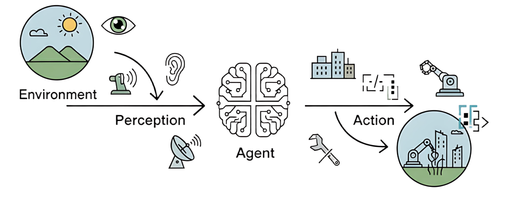
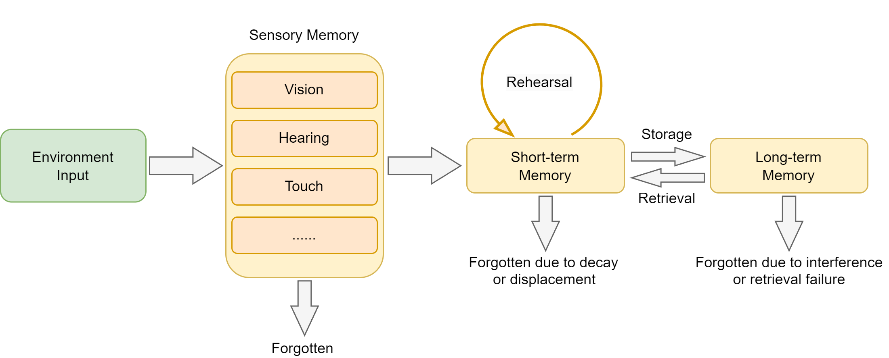
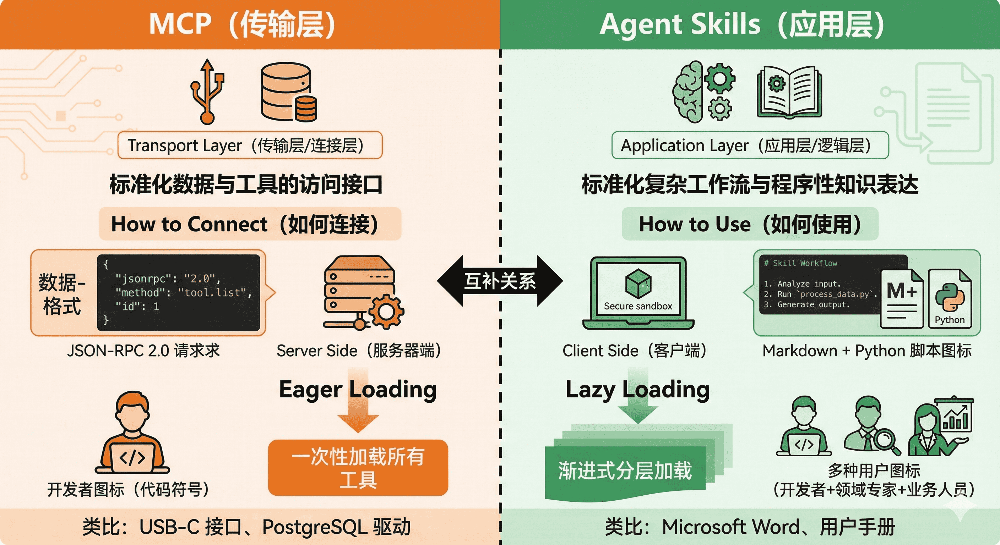
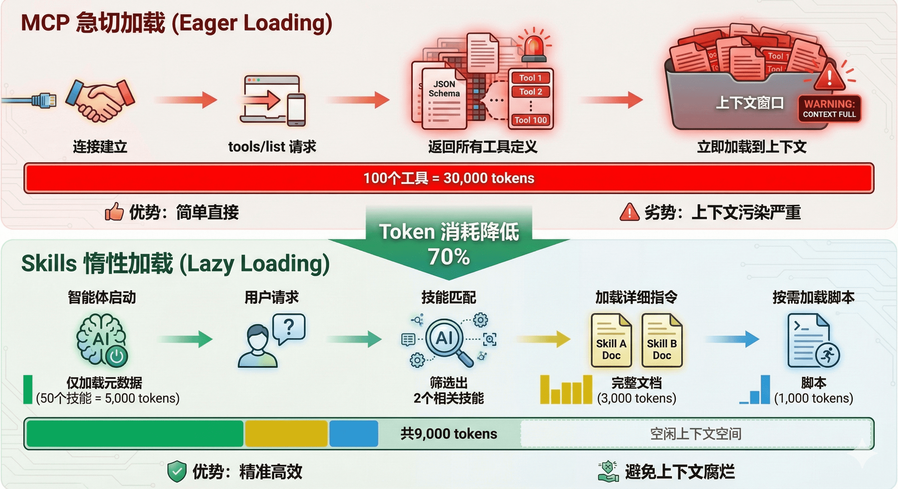
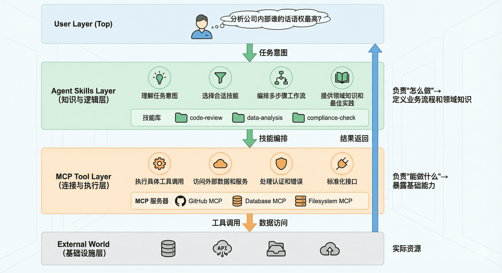

# 第一章 初识智能体

欢迎来到智能体的世界！在人工智能浪潮席卷全球的今天，<strong>智能体（Agent）</strong>已成为驱动技术变革与应用创新的核心概念之一。无论你的志向是成为 AI 领域的研究者、工程师，还是希望深刻理解技术前沿的观察者，掌握智能体的本质，都将是你知识体系中不可或缺的一环。

因此，在本章，让我们回到原点，一起探讨几个问题：智能体是什么？它有哪些主要的类型？它又是如何与我们所处的世界进行交互的？通过这些讨论，希望能为你未来的学习和探索打下坚实的基础。

<div align="center">
  
  <p>图 1.1 智能体与环境的基本交互循环</p>
</div>


## 什么是智能体？

在探索任何一个复杂概念时，我们最好从一个简洁的定义开始。在人工智能领域，智能体被定义为任何能够通过<strong>传感器（Sensors）</strong>感知其所处<strong>环境（Environment）</strong>，并<strong>自主</strong>地通过<strong>执行器（Actuators）</strong>采取<strong>行动（Action）</strong>以达成特定目标的实体。

这个定义包含了智能体存在的四个基本要素。环境是智能体所处的外部世界。对于自动驾驶汽车，环境是动态变化的道路交通；对于一个交易算法，环境则是瞬息万变的金融市场。智能体并非与环境隔离，它通过其传感器持续地感知环境状态。摄像头、麦克风、雷达或各类<strong>应用程序编程接口（Application Programming Interface, API）</strong>返回的数据流，都是其感知能力的延伸。

获取信息后，智能体需要采取行动来对环境施加影响，它通过执行器来改变环境的状态。执行器可以是物理设备（如机械臂、方向盘）或虚拟工具（如执行一段代码、调用一个服务）。

然而，真正赋予智能体"智能"的，是其<strong>自主性（Autonomy）</strong>。智能体并非只是被动响应外部刺激或严格执行预设指令的程序，它能够基于其感知和内部状态进行独立决策，以达成其设计目标。这种从感知到行动的闭环，构成了所有智能体行为的基础，如图 1.1 所示。

## 传统视角下的智能体

在当前<strong>大语言模型（Large Language Model, LLM）</strong>的热潮出现之前，人工智能的先驱们已经对“智能体”这一概念进行了数十年的探索与构建。这些如今我们称之为“传统智能体”的范式，并非单一的静态概念，而是经历了一条从简单到复杂、从被动反应到主动学习的清晰演进路线。

这个演进的起点，是那些结构最简单的<strong>反射智能体（Simple Reflex Agent）</strong>。它们的决策核心由工程师明确设计的“条件-动作”规则构成，如图 1.2 所示。经典的自动恒温器便是如此：若传感器感知的室温高于设定值，则启动制冷系统。

这种智能体完全依赖于当前的感知输入，不具备记忆或预测能力。它像一种数字化的本能，可靠且高效，但也因此无法应对需要理解上下文的复杂任务。它的局限性引出了一个关键问题：如果环境的当前状态不足以作为决策的全部依据，智能体该怎么办？

<div align="center">
  
  <p>图 1.2 简单反射智能体的决策逻辑示意图</p>
</div>


为了回答这个问题，研究者们引入了“状态”的概念，发展出<strong>基于模型的反射智能体（Model-Based Reflex Agent）</strong>。这类智能体拥有一个内部的<strong>世界模型（World Model）</strong>，用于追踪和理解环境中那些无法被直接感知的方面。它试图回答：“世界现在是什么样子的？”。例如，一辆在隧道中行驶的自动驾驶汽车，即便摄像头暂时无法感知到前方的车辆，它的内部模型依然会维持对那辆车存在、速度和预估位置的判断。这个内部模型让智能体拥有了初级的“记忆”，使其决策不再仅仅依赖于瞬时感知，而是基于一个更连贯、更完整的世界状态理解。

然而，仅仅理解世界还不够，智能体需要有明确的目标。这促进了<strong>基于目标的智能体（Goal-Based Agent）</strong>的发展。与前两者不同，它的行为不再是被动地对环境做出反应，而是主动地、有预见性地选择能够导向某个特定未来状态的行动。这类智能体需要回答的问题是：“我应该做什么才能达成目标？”。经典的例子是 GPS 导航系统：你的目标是到达公司，智能体会基于地图数据（世界模型），通过搜索算法（如 A*算法）来规划（Planning）出一条最优路径。这类智能体的核心能力体现在了对未来的考量与规划上。

更进一步，现实世界的目标往往不是单一的。我们不仅希望到达公司，还希望时间最短、路程最省油并且避开拥堵。当多个目标需要权衡时，<strong>基于效用的智能体（Utility-Based Agent）</strong>便随之出现。它为每一个可能的世界状态都赋予一个效用值，这个值代表了满意度的高低。智能体的核心目标不再是简单地达成某个特定状态，而是最大化期望效用。它需要回答一个更复杂的问题：“哪种行为能为我带来最满意的结果？”。这种架构让智能体学会在相互冲突的目标之间进行权衡，使其决策更接近人类的理性选择。

至此，我们讨论的智能体虽然功能日益复杂，但其核心决策逻辑，无论是规则、模型还是效用函数，依然依赖于人类设计师的先验知识。如果智能体能不依赖预设，而是通过与环境的互动自主学习呢？

这便是<strong>学习型智能体（Learning Agent）</strong>的核心思想，而<strong>强化学习（Reinforcement Learning, RL）</strong>是实现这一思想最具代表性的路径。一个学习型智能体包含一个性能元件（即我们前面讨论的各类智能体）和一个学习元件。学习元件通过观察性能元件在环境中的行动所带来的结果来不断修正性能元件的决策策略。

想象一个学习下棋的 AI。它开始时可能只是随机落子，当它最终赢下一局时，系统会给予它一个正向的奖励。通过大量的自我对弈，学习元件会逐渐发现哪些棋路更有可能导向最终的胜利。AlphaGo Zero 是这一理念的一个里程碑式的成就。它在围棋这一复杂博弈中，通过强化学习发现了许多超越人类既有知识的有效策略。

从简单的恒温器，到拥有内部模型的汽车，再到能够规划路线的导航、懂得权衡利弊的决策者，最终到可以通过经验自我进化的学习者。这条演进之路，展示了传统人工智能在构建机器智能的道路上所经历的发展脉络。它们为我们今天理解更前沿的智能体范式，打下了坚实而必要的基础。

## 大语言模型驱动的新范式

以<strong>GPT（Generative Pre-trained Transformer）</strong>为代表的大语言模型的出现，正在显著改变智能体的构建方法与能力边界。由大语言模型驱动的 LLM 智能体，其核心决策机制与传统智能体存在本质区别，从而赋予了其一系列全新的特性。

这种转变，可以从两者在核心引擎、知识来源、交互方式等多个维度的对比中清晰地看出，如表 1.1 所示。简而言之，传统智能体的能力源于工程师的显式编程与知识构建，其行为模式是确定且有边界的；而 LLM 智能体则通过在海量数据上的预训练，获得了隐式的世界模型与强大的涌现能力，使其能够以更灵活、更通用的方式应对复杂任务。

<div align="center">
  <p>表 1.1 传统智能体与 LLM 驱动智能体的核心对比</p>
  
</div>


这种差异使得 LLM 智能体可以直接处理高层级、模糊且充满上下文信息的自然语言指令。让我们以一个“智能旅行助手”为例来说明。

在 LLM 智能体出现之前，规划旅行通常意味着用户需要在多个专用应用（如天气、地图、预订网站）之间手动切换，并由用户自己扮演信息整合与决策的角色。而一个 LLM 智能体则能将这个流程整合起来。当接收到“规划一次厦门之旅”这样的模糊指令时，它的工作方式体现了以下几点：

- <strong>规划与推理</strong>：智能体首先会将这个高层级目标分解为一系列逻辑子任务，例如：`[确认出行偏好] -> [查询目的地信息] -> [制定行程草案] -> [预订票务住宿]`。这是一个内在的、由模型驱动的规划过程。
- <strong>工具使用</strong>：在执行规划时，智能体识别到信息缺口，会主动调用外部工具来补全。例如，它会调用天气查询接口获取实时天气，并基于“预报有雨”这一信息，在后续规划中倾向于推荐室内活动。
- <strong>动态修正</strong>：在交互过程中，智能体会将用户的反馈（如“这家酒店超出预算”）视为新的约束，并据此调整后续的行动，重新搜索并推荐符合新要求的选项。整个“<strong>查天气 → 调行程 → 订酒店</strong>”的流程，展现了其根据上下文动态修正自身行为的能力。

总而言之，我们正从开发专用自动化工具转向构建能自主解决问题的系统。核心不再是编写代码，而是引导一个通用的“大脑”去规划、行动和学习。


### 大模型驱动的Agent 的演进梳理

Agent 的能力不是一次性出现的。模型先获得外部调用能力，随后才有编排、长任务和长期在线这些需求。

**2022 年，ChatGPT 这类产品刚火的时候**，模型主要依据已有知识回答问题，不能主动调用外部工具，也不能自行完成操作。[Prompt Engineering](https://javaguide.cn/ai/agent/prompt-engineering.html) 是当时最重要的使用方式：把约束和上下文说清楚，输出才更稳定。

**2023 年中，Function Calling 出现后，事情开始变了。**

Function Calling 让 LLM 能调用外部 API；RAG 则把外部知识库接进回答过程。AutoGPT 等早期尝试随之出现，但它们经常在多步任务中重复调用，甚至陷入无限循环。

**2023 年底，大家开始重视编排。**

ReAct 开始被广泛采用：模型根据当前状态选择动作，读取工具返回结果，再继续判断。多 Agent 的分工也在这一阶段进入实践，例如把规划、执行和检查交给不同角色。

Coze、Dify 等平台用 DAG（有向无环图）约束执行路径，给完全自治的早期方案加上可观察、可控制的流程边界。

**2024 年底，标准化和多模态开始变重要。**

[MCP 协议](https://javaguide.cn/ai/agent/mcp.html)开始处理工具接入碎片化的问题，Computer Use 则把可执行范围扩展到图形界面。Cursor、Claude Code、Codex 等编程工具也逐渐把代码库阅读、修改、测试和提交串进同一条任务链路，“Vibe Coding”随之被更多人讨论。

**2025 年，Agent 开始往长任务执行方向走。**

这一阶段，Agent 开始承接一次对话之外的长任务：接收任务、运行流程、留下结果。单条 Prompt 无法稳定覆盖这类工作，固定流程、上下文、模板、脚本和校验规则被封装为 Skill，供相似任务按需加载。

**到了 2026 年，Agent 开始更接近长期在线的数字工作单元。**

OpenClaw 这类项目把 Skills 和 Heartbeat 推到更显眼的位置。

Skills 负责封装能力，Heartbeat 周期性唤醒 Agent 去检查消息、处理任务或更新状态。它是定时唤醒，不是连续意识；本地数据主权也不代表绝对安全。能安装 Skill、访问文件和执行脚本的 Agent，必须面对权限、沙箱和供应链风险。

这也推动了 Harness Engineering。可以把它看作 `Agent = Model + Harness`：模型负责推理和生成，Harness 提供可执行、可观察、可恢复和可验证的运行环境。关注点因此从模型参数、上下文长度和 Prompt 技巧，延伸到了模型之外的工程环境。

内建记忆、预测能力，以及从数字世界扩展到物理机器人的能力仍在推进。年份只是便于理解的切片：真实产品往往同时具有多个阶段的特征。较明显的分水岭仍是 2023 年中，模型从生成文本逐步获得了执行外部操作的能力。

### Agent 核心结构拆解

一个排障 Agent 收到“服务变慢”的请求后，可能先读监控，再根据告警查日志，最后把结论发给负责人。每一步都取决于前一步得到的证据。LangChain 等框架把这类过程封装起来，底层通常仍是一个不断读取状态、选择动作、写回结果的循环。

AI Agent 是能感知环境、决策并执行动作的软件系统。LLM 处理意图和决策，工具执行外部操作，记忆保存当前任务和历史信息。与只生成回复的聊天机器人相比，它会在任务过程中持续观察和调整，直到结束条件满足。

常用的拆分方式是：**Agent = LLM + Planning + Memory + Tools**。


- **Planning（规划）**决定下一步的目标与动作。LLM 根据当前任务状态拆解目标；Chain-of-Thought（CoT）提示技术把推理过程拆成步骤，减少直接给出未经展开的结论。
- **Memory（记忆）**短期记忆通常保存在上下文历史中，用于保持对话连续；长期记忆常由向量数据库或知识图谱等外部知识库承担，用于检索过去积累的信息。
- **Tools（工具）**负责查询数据、调用 API、读写文件或执行代码。执行结果必须追加进上下文，成为下一轮的 Observation（观察）；否则模型看不到外部操作的反馈，后续动作也就无从判断

### 什么是 Agent Loop？

Agent Loop 把这条反馈链路连续跑起来。每轮先由 LLM 根据上下文选择动作，再执行工具并写回结果；任务完成或命中停止条件时退出。


Loop 初始化时载入 System Prompt、工具列表和用户请求。之后模型在“直接回复”和“调用工具”之间选择；工具结果写回上下文，直到模型不再请求工具。

最大迭代轮次通常设在 10 到 20 轮，也可以按 Token 消耗终止。这个边界用来阻止错误判断把任务带进无限循环。

上下文会随着每轮结果不断变长，关键信息被稀释后，模型更容易跑偏。Context Engineering 处理的正是筛选和组织这些信息的问题。LangChain、LlamaIndex、Spring AI 提供的封装不同，底层都绕不开这条 Loop。


# 第二章 规划篇

一个现代的智能体，其核心能力在于能将大语言模型的推理能力与外部世界联通。它能够自主地理解用户意图、拆解复杂任务，并通过调用代码解释器、搜索引擎、API等一系列“工具”，来获取信息、执行操作，最终达成目标。 然而，智能体并非万能，它同样面临着来自大模型本身的“幻觉”问题、在复杂任务中可能陷入推理循环、以及对工具的错误使用等挑战，这些也构成了智能体的能力边界。

为了更好地组织智能体的“思考”与“行动”过程，业界涌现出了多种经典的架构范式。在本章中，我们将聚焦于其中最具代表性的三种，并一步步从零实现它们：

- **ReAct (Reasoning and Acting)：** 一种将“思考”和“行动”紧密结合的范式，让智能体边想边做，动态调整。
- **Plan-and-Solve：** 一种“三思而后行”的范式，智能体首先生成一个完整的行动计划，然后严格执行。
- **Reflection：** 一种赋予智能体“反思”能力的范式，通过自我批判和修正来优化结果。

了解这个之前，先来看看大模型CoT技术


## Planning 机制技术基础：思维链（Chain-of-Thought, CoT）

### 核心定义与起源

CoT（Chain-of-Thought，思维链）这一术语主要出自 Google Research 在 2022 年发表的论文：

> **《Chain-of-Thought Prompting Elicits Reasoning in Large Language Models》**
>  Jason Wei、Xuezhi Wang 等
>  发表于 **NeurIPS 2022**

论文地址：[NeurIPS 正式论文页面](https://proceedings.neurips.cc/paper/2022/hash/9d5609613524ecf4f15af0f7b31abca4-Abstract-Conference.html?utm_source=chatgpt.com) ｜ [arXiv](https://arxiv.org/abs/2201.11903?utm_source=chatgpt.com)

论文中的核心思想是：

> 让大模型在给出最终答案之前，先生成一系列中间推理步骤。

普通提示：

```
问题 → 答案
```

CoT 提示：

```
问题 → 中间推理步骤 → 答案
```

**思维链**（`Chain-of-Thought`, `CoT`）是一种通过引导**大型语言模型**生成中间推理步骤来提升复杂任务表现的提示方法。其核心思想是在**少样本学习**（`few-shot learning`）中，通过展示从输入到输出的**完整推理路径**，而非仅提供最终答案，从而激活模型的逻辑推理能力。少样本学习是指在训练数据有限的情况下，模型能够快速适应新任务并进行有效学习的一种学习方式，在思维链中，通过这种方式让模型理解并生成推理过程，进而提高其在复杂任务中的表现。

**关键突破**：

- **涌现性**：仅当模型参数量达到百亿级别时，`CoT`才能显著生效，例如`PaLM-540B`在数学推理任务`GSM8K`上的准确率从**17%**提升至**58%**；
- **可解释性**：中间推理步骤使模型决策过程透明化，便于调试错误。

### 核心原理与优势

`CoT`通过模拟人类分步推理的思维过程，将复杂任务分解为多个子步骤。例如，在解决二次方程时，模型会逐步执行以下操作（示例）：

```
1. 识别方程类型：x² - 5x + 6 = 0（标准二次方程形式ax²+bx+c=0）
2. 因式分解：寻找满足m×n=6且m+n=-5的数（-2和-3）
3. 构建方程：(x-2)(x-3)=0
4. 应用零乘积定理：x=2或x=3
5. 验证解的正确性：代入原方程确认结果
```


**与传统提示的对比**

| **方法**   | **输出形式**  | **适用场景** | **性能表现**     |
| :--------- | :------------ | :----------- | :--------------- |
| `标准提示` | 直接输出答案  | 简单任务     | 低（依赖直觉）   |
| `CoT提示`  | 答案+分步推理 | 复杂推理任务 | 高（依赖逻辑链） |

实验表明，`CoT`在需要多步推理的任务（如数学题GSM8K）上，准确率比标准提示提升**2-3**倍，甚至超过传统监督学习方法。

**提示链与思维链的区别**

**提示链**（`prompt chaining`）是一种更基础的 `CoT` 提示形式，其中 `AI` 被提示根据给定上下文或问题生成响应。相比之下，`CoT` 提示不仅仅是生成连贯且相关的响应，还要求 `AI` 从头开始构建完整的逻辑论证，包括前提和结论。提示链侧重于优化单个响应，而 `CoT` 提示旨在创建全面且逻辑一致的论据，从而突破 AI 解决问题能力的界限。

试想，如果 AI 被问到“天空是什么颜色的？”，`AI` 会生成一个简单直接的回答，例如“天空是蓝色的。”然而，如果使用 `CoT` 提示要求 `AI` 解释为什么天空是蓝色的，`AI` 首先会定义“蓝色”的含义（即一种原色），然后推导出天空之所以呈现蓝色，是因为大气吸收了其他颜色。这一回答体现了 AI 构建逻辑论证的能力。


**提示链与思维链对比**：

| **特征** | **提示链**       | **思维链（CoT）**  |
| :------- | :--------------- | :----------------- |
| 目标     | 优化单个响应质量 | 构建完整逻辑论证   |
| 推理深度 | 单步推理         | 多步符号化推理     |
| 可解释性 | 低               | 高（展示中间步骤） |

##  Planning 的典型实践范式：ReAct

### 理论

ReAct 是 Reasoning + Acting，最经典的一个智能体范式，由 Shunyu Yao 等人在 2022 年提出，论文是[《ReAct: Synergizing Reasoning and Acting in Language Models》](https://react-lm.github.io/)。

> Yao S, Zhao J, Yu D, et al. React: Synergizing reasoning and acting in language models[C]//International Conference on Learning Representations (ICLR). 2023.

其核心思想是模仿人类解决问题的方式，将<strong>推理 (Reasoning)</strong> 与<strong>行动 (Acting)</strong> 显式地结合起来，形成一个“思考-行动-观察”的循环。

LangChain、LlamaIndex、AgentScope 这类框架里的 Agent 模块，很多都能看到这个范式的影子。

它的思路很直观：模型先推理一步，拿到外部环境反馈，再推理下一步，交替进行。

LLM 自己容易缺少实时信息，也容易幻觉。ReAct 就让它“走一步看一步”，每一步都根据工具返回结果继续判断。


### 示例

比如任务是：帮我排查一下今天早上 user-service 接口变慢的原因，并把结果发给负责人。

ReAct 跑起来大概是这样。

它先查 user-service 早上的监控，发现 9 点到 9:30 CPU 飙到 98%，同时有大量慢 SQL 告警。

然后顺着这条线去翻日志，捞出那条慢 SQL，发现是一个没走索引的全表扫描。

接着去查服务负责人，通讯录里找到王建国，邮箱是 [wangjianguo@company.com](mailto:wangjianguo@company.com)。

最后组织排查报告，发邮件通知。

这个过程不是一开始就写死的。如果监控显示的是内存 OOM，第二步就应该去查 Heap Dump，而不是继续翻慢 SQL。

ReAct 的价值就在这里：它能根据证据不断修正方向。

ReAct 落地时一般需要这几个组件配合：

1. 历史上下文，保存推理步骤、执行动作、反馈观察
2. 实时环境输入，比如系统告警、用户反馈等外部变量
3. LLM 推理模块：负责逻辑分析和下一步规划
4. 工具集与技能库，包括原子工具和 Skills
5. 反馈观察机制，采集工具响应并追加回上下文


ReAct 的每一步都由外部观察结果推动，因而比一次性生成更容易追溯决策依据，也能减少脱离环境的判断。相应地，多轮调用会增加响应延迟，效果还取决于工具和 Skills 是否可靠。

例如，查监控、查日志、分析瓶颈可以封装为 `diagnose_service_performance` Skill，向 LLM 返回结构化诊断摘要。这样无需在每次排障时都从原子步骤重新组合。

###  ReAct 的工作流程

在ReAct诞生之前，主流的方法可以分为两类：一类是“纯思考”型，如<strong>思维链 (Chain-of-Thought)</strong>，它能引导模型进行复杂的逻辑推理，但无法与外部世界交互，容易产生事实幻觉；另一类是“纯行动”型，模型直接输出要执行的动作，但缺乏规划和纠错能力。

ReAct的巧妙之处在于，它认识到<strong>思考与行动是相辅相成的</strong>。思考指导行动，而行动的结果又反过来修正思考。为此，ReAct范式通过一种特殊的提示工程来引导模型，使其每一步的输出都遵循一个固定的轨迹：

- <strong>Thought (思考)：</strong> 这是智能体的“内心独白”。它会分析当前情况、分解任务、制定下一步计划，或者反思上一步的结果。
- <strong>Action (行动)：</strong> 这是智能体决定采取的具体动作，通常是调用一个外部工具，例如 `Search['华为最新款手机']`。
- <strong>Observation (观察)：</strong> 这是执行`Action`后从外部工具返回的结果，例如搜索结果的摘要或API的返回值。

智能体将不断重复这个 <strong>Thought -> Action -> Observation</strong> 的循环，将新的观察结果追加到历史记录中，形成一个不断增长的上下文，直到它在`Thought`中认为已经找到了最终答案，然后输出结果。这个过程形成了一个强大的协同效应：<strong>推理使得行动更具目的性，而行动则为推理提供了事实依据。</strong>

我们可以将这个过程形式化地表达出来，如图4.1所示。具体来说，在每个时间步 $t$，智能体的策略（即大语言模型 $\pi$）会根据初始问题 $q$ 和之前所有步骤的“行动-观察”历史轨迹 $((a_1,o_1),\dots,(a_{t-1},o_{t-1}))$，来生成当前的思考 $th_t$ 和行动 $a_t$：

$$\left(th_t,a_t\right)=\pi\left(q,(a_1,o_1),\ldots,(a_{t-1},o_{t-1})\right)$$

随后，环境中的工具 $T$ 会执行行动 $a_t$，并返回一个新的观察结果 $o_t$：

$$o_t = T(a_t)$$

这个循环不断进行，将新的 $(a_t,o_t)$ 对追加到历史中，直到模型在思考 $th_t$ 中判断任务已完成。

<div align="center">
  
  <p>图 4.1 ReAct 范式中的“思考-行动-观察”协同循环</p>
</div>


这种机制特别适用于以下场景：

- <strong>需要外部知识的任务</strong>：如查询实时信息（天气、新闻、股价）、搜索专业领域的知识等。
- <strong>需要精确计算的任务</strong>：将数学问题交给计算器工具，避免LLM的计算错误。
- <strong>需要与API交互的任务</strong>：如操作数据库、调用某个服务的API来完成特定功能。

### ReAct 的特点、局限性与调试技巧

通过亲手实现一个 ReAct 智能体，我们不仅掌握了其工作流程，也应该对其内在机制有了更深刻的认识。任何技术范式都有其闪光点和待改进之处，本节将对 ReAct 进行总结。

（1）ReAct 的主要特点

1. <strong>高可解释性</strong>：ReAct 最大的优点之一就是透明。通过 `Thought` 链，我们可以清晰地看到智能体每一步的“心路历程”——它为什么会选择这个工具，下一步又打算做什么。这对于理解、信任和调试智能体的行为至关重要。
2. <strong>动态规划与纠错能力</strong>：与一次性生成完整计划的范式不同，ReAct 是“走一步，看一步”。它根据每一步从外部世界获得的 `Observation` 来动态调整后续的 `Thought` 和 `Action`。如果上一步的搜索结果不理想，它可以在下一步中修正搜索词，重新尝试。
3. <strong>工具协同能力</strong>：ReAct 范式天然地将大语言模型的推理能力与外部工具的执行能力结合起来。LLM 负责运筹帷幄（规划和推理），工具负责解决具体问题（搜索、计算），二者协同工作，突破了单一 LLM 在知识时效性、计算准确性等方面的固有局限。

（2）ReAct 的固有局限性

1. <strong>对LLM自身能力的强依赖</strong>：ReAct 流程的成功与否，高度依赖于底层 LLM 的综合能力。如果 LLM 的逻辑推理能力、指令遵循能力或格式化输出能力不足，就很容易在 `Thought` 环节产生错误的规划，或者在 `Action` 环节生成不符合格式的指令，导致整个流程中断。
2. <strong>执行效率问题</strong>：由于其循序渐进的特性，完成一个任务通常需要多次调用 LLM。每一次调用都伴随着网络延迟和计算成本。对于需要很多步骤的复杂任务，这种串行的“思考-行动”循环可能会导致较高的总耗时和费用。
3. <strong>提示词的脆弱性</strong>：整个机制的稳定运行建立在一个精心设计的提示词模板之上。模板中的任何微小变动，甚至是用词的差异，都可能影响 LLM 的行为。此外，并非所有模型都能持续稳定地遵循预设的格式，这增加了在实际应用中的不确定性。
4. <strong>可能陷入局部最优</strong>：步进式的决策模式意味着智能体缺乏一个全局的、长远的规划。它可能会因为眼前的 `Observation` 而选择一个看似正确但长远来看并非最优的路径，甚至在某些情况下陷入“原地打转”的循环中。

（3）调试技巧

当你构建的 ReAct 智能体行为不符合预期时，可以从以下几个方面入手进行调试：

- <strong>检查完整的提示词</strong>：在每次调用 LLM 之前，将最终格式化好的、包含所有历史记录的完整提示词打印出来。这是追溯 LLM 决策源头的最直接方式。
- <strong>分析原始输出</strong>：当输出解析失败时（例如，正则表达式没有匹配到 `Action`），务必将 LLM 返回的原始、未经处理的文本打印出来。这能帮助你判断是 LLM 没有遵循格式，还是你的解析逻辑有误。
- <strong>验证工具的输入与输出</strong>：检查智能体生成的 `tool_input` 是否是工具函数所期望的格式，同时也要确保工具返回的 `observation` 格式是智能体可以理解和处理的。
- <strong>调整提示词中的示例 (Few-shot Prompting)</strong>：如果模型频繁出错，可以在提示词中加入一两个完整的“Thought-Action-Observation”成功案例，通过示例来引导模型更好地遵循你的指令。
- <strong>尝试不同的模型或参数</strong>：更换一个能力更强的模型，或者调整 `temperature` 参数（通常设为0以保证输出的确定性），有时能直接解决问题。

## Plan-and-Solve

在我们掌握了 ReAct 这种反应式的、步进决策的智能体范式后，接下来将探讨一种风格迥异但同样强大的方法，<strong>Plan-and-Solve</strong>。顾名思义，这种范式将任务处理明确地分为两个阶段：<strong>先规划 (Plan)，后执行 (Solve)</strong>。

如果说 ReAct 像一个经验丰富的侦探，根据现场的蛛丝马迹（Observation）一步步推理，随时调整自己的调查方向；那么 Plan-and-Solve 则更像一位建筑师，在动工之前必须先绘制出完整的蓝图（Plan），然后严格按照蓝图来施工（Solve）。事实上我们现在用的很多大模型工具的Agent模式都融入了这种设计模式。

### Plan-and-Solve 的工作原理

Plan-and-Solve Prompting 由 Lei Wang 在2023年提出<sup>[2]</sup>。其核心动机是为了解决思维链在处理多步骤、复杂问题时容易“偏离轨道”的问题。

> Wang L, Xu W, Lan Y, et al. Plan-and-solve prompting: Improving zero-shot chain-of-thought reasoning by large language models[J]. arXiv preprint arXiv:2305.04091, 2023.

与 ReAct 将思考和行动融合在每一步不同，Plan-and-Solve 将整个流程解耦为两个核心阶段，如图4.2所示：

1. <strong>规划阶段 (Planning Phase)</strong>： 首先，智能体会接收用户的完整问题。它的第一个任务不是直接去解决问题或调用工具，而是<strong>将问题分解，并制定出一个清晰、分步骤的行动计划</strong>。这个计划本身就是一次大语言模型的调用产物。
2. <strong>执行阶段 (Solving Phase)</strong>： 在获得完整的计划后，智能体进入执行阶段。它会<strong>严格按照计划中的步骤，逐一执行</strong>。每一步的执行都可能是一次独立的 LLM 调用，或者是对上一步结果的加工处理，直到计划中的所有步骤都完成，最终得出答案。

这种“先谋后动”的策略，使得智能体在处理需要长远规划的复杂任务时，能够保持更高的目标一致性，避免在中间步骤中迷失方向。

我们可以将这个两阶段过程进行形式化表达。首先，规划模型 $\pi_{\text{plan}}$ 根据原始问题 $q$ 生成一个包含 $n$ 个步骤的计划 $P = (p_1, p_2, \dots, p_n)$：

$$
P = \pi_{\text{plan}}(q)
$$

随后，在执行阶段，执行模型 $\pi_{\text{solve}}$ 会逐一完成计划中的步骤。对于第 $i$ 个步骤，其解决方案 $s_i$ 的生成会同时依赖于原始问题 $q$、完整计划 $P$ 以及之前所有步骤的执行结果 $(s_1, \dots, s_{i-1})$：

$$
s_i = \pi_{\text{solve}}(q, P, (s_1, \dots, s_{i-1}))
$$

最终的答案就是最后一个步骤的执行结果 $s_n$。

<div align="center">
  
  <p>图 4.2 Plan-and-Solve 范式的两阶段工作流</p>
</div>


Plan-and-Solve 尤其适用于那些结构性强、可以被清晰分解的复杂任务，例如：

- <strong>多步数学应用题</strong>：需要先列出计算步骤，再逐一求解。
- <strong>需要整合多个信息源的报告撰写</strong>：需要先规划好报告结构（引言、数据来源A、数据来源B、总结），再逐一填充内容。
- <strong>代码生成任务</strong>：需要先构思好函数、类和模块的结构，再逐一实现。

### 规划阶段

为了凸显 Plan-and-Solve 范式在结构化推理任务上的优势，我们将不使用工具的方式，而是通过提示词的设计，完成一个推理任务。

这类任务的特点是，答案无法通过单次查询或计算得出，必须先将问题分解为一系列逻辑连贯的子步骤，然后按顺序求解。这恰好能发挥 Plan-and-Solve “先规划，后执行”的核心能力。

<strong>我们的目标问题是：</strong>“一个水果店周一卖出了15个苹果。周二卖出的苹果数量是周一的两倍。周三卖出的数量比周二少了5个。请问这三天总共卖出了多少个苹果？”

这个问题对于大语言模型来说并不算特别困难，但它包含了一个清晰的逻辑链条可供参考。在某些实际的逻辑难题上，如果大模型不能高质量的推理出准确的答案，可以参考这个设计模式来设计自己的Agent完成任务。智能体需要：

1. <strong>规划阶段</strong>：首先，将问题分解为三个独立的计算步骤（计算周二销量、计算周三销量、计算总销量）。
2. <strong>执行阶段</strong>：然后，严格按照计划，一步步执行计算，并将每一步的结果作为下一步的输入，最终得出总和。

规划阶段的目标是让大语言模型接收原始问题，并输出一个清晰、分步骤的行动计划。这个计划必须是结构化的，以便我们的代码可以轻松解析并逐一执行。因此，我们设计的提示词需要明确地告诉模型它的角色和任务，并给出一个输出格式的范例。

````python
PLANNER_PROMPT_TEMPLATE = """
你是一个顶级的AI规划专家。你的任务是将用户提出的复杂问题分解成一个由多个简单步骤组成的行动计划。
请确保计划中的每个步骤都是一个独立的、可执行的子任务，并且严格按照逻辑顺序排列。
你的输出必须是一个Python列表，其中每个元素都是一个描述子任务的字符串。

问题: {question}

请严格按照以下格式输出你的计划,```python与```作为前后缀是必要的:
```python
["步骤1", "步骤2", "步骤3", ...]
```
"""
````

这个提示词通过以下几点确保了输出的质量和稳定性：

- <strong>角色设定</strong>： “顶级的AI规划专家”，激发模型的专业能力。
- <strong>任务描述</strong>： 清晰地定义了“分解问题”的目标。
- <strong>格式约束</strong>： 强制要求输出为一个 Python 列表格式的字符串，这极大地简化了后续代码的解析工作，使其比解析自然语言更稳定、更可靠。

接下来，我们将这个提示词逻辑封装成一个 `Planner` 类，这个类也是我们的规划器。

```python
# 假定 llm_client.py 中的 HelloAgentsLLM 类已经定义好
# from llm_client import HelloAgentsLLM

class Planner:
    def __init__(self, llm_client):
        self.llm_client = llm_client

    def plan(self, question: str) -> list[str]:
        """
        根据用户问题生成一个行动计划。
        """
        prompt = PLANNER_PROMPT_TEMPLATE.format(question=question)
        
        # 为了生成计划，我们构建一个简单的消息列表
        messages = [{"role": "user", "content": prompt}]
        
        print("--- 正在生成计划 ---")
        # 使用流式输出来获取完整的计划
        response_text = self.llm_client.think(messages=messages) or ""
        
        print(f"✅ 计划已生成:\n{response_text}")
        
        # 解析LLM输出的列表字符串
        try:
            # 找到```python和```之间的内容
            plan_str = response_text.split("```python")[1].split("```")[0].strip()
            # 使用ast.literal_eval来安全地执行字符串，将其转换为Python列表
            plan = ast.literal_eval(plan_str)
            return plan if isinstance(plan, list) else []
        except (ValueError, SyntaxError, IndexError) as e:
            print(f"❌ 解析计划时出错: {e}")
            print(f"原始响应: {response_text}")
            return []
        except Exception as e:
            print(f"❌ 解析计划时发生未知错误: {e}")
            return []
```

### 执行器与状态管理

在规划器 (`Planner`) 生成了清晰的行动蓝图后，我们就需要一个执行器 (`Executor`) 来逐一完成计划中的任务。执行器不仅负责调用大语言模型来解决每个子问题，还承担着一个至关重要的角色：<strong>状态管理</strong>。它必须记录每一步的执行结果，并将其作为上下文提供给后续步骤，确保信息在整个任务链条中顺畅流动

执行器的提示词与规划器不同。它的目标不是分解问题，而是<strong>在已有上下文的基础上，专注解决当前这一个步骤</strong>。因此，提示词需要包含以下关键信息：

- <strong>原始问题</strong>： 确保模型始终了解最终目标。
- <strong>完整计划</strong>： 让模型了解当前步骤在整个任务中的位置。
- <strong>历史步骤与结果</strong>： 提供至今为止已经完成的工作，作为当前步骤的直接输入。
- <strong>当前步骤</strong>： 明确指示模型现在需要解决哪一个具体任务。

```python
EXECUTOR_PROMPT_TEMPLATE = """
你是一位顶级的AI执行专家。你的任务是严格按照给定的计划，一步步地解决问题。
你将收到原始问题、完整的计划、以及到目前为止已经完成的步骤和结果。
请你专注于解决“当前步骤”，并仅输出该步骤的最终答案，不要输出任何额外的解释或对话。

# 原始问题:
{question}

# 完整计划:
{plan}

# 历史步骤与结果:
{history}

# 当前步骤:
{current_step}

请仅输出针对“当前步骤”的回答:
"""
```

我们将执行逻辑封装到 `Executor` 类中。这个类将循环遍历计划，调用 LLM，并维护一个历史记录（状态）。

```python
class Executor:
    def __init__(self, llm_client):
        self.llm_client = llm_client

    def execute(self, question: str, plan: list[str]) -> str:
        """
        根据计划，逐步执行并解决问题。
        """
        history = "" # 用于存储历史步骤和结果的字符串
        
        print("\n--- 正在执行计划 ---")
        
        for i, step in enumerate(plan):
            print(f"\n-> 正在执行步骤 {i+1}/{len(plan)}: {step}")
            
            prompt = EXECUTOR_PROMPT_TEMPLATE.format(
                question=question,
                plan=plan,
                history=history if history else "无", # 如果是第一步，则历史为空
                current_step=step
            )
            
            messages = [{"role": "user", "content": prompt}]
            
            response_text = self.llm_client.think(messages=messages) or ""
            
            # 更新历史记录，为下一步做准备
            history += f"步骤 {i+1}: {step}\n结果: {response_text}\n\n"
            
            print(f"✅ 步骤 {i+1} 已完成，结果: {response_text}")

        # 循环结束后，最后一步的响应就是最终答案
        final_answer = response_text
        return final_answer
```

现在已经分别构建了负责“规划”的 `Planner` 和负责“执行”的 `Executor`。最后一步是将这两个组件整合到一个统一的智能体 `PlanAndSolveAgent` 中，并赋予它解决问题的完整能力。我们将创建一个主类 `PlanAndSolveAgent`，它的职责非常清晰：接收一个 LLM 客户端，初始化内部的规划器和执行器，并提供一个简单的 `run` 方法来启动整个流程。

```python
class PlanAndSolveAgent:
    def __init__(self, llm_client):
        """
        初始化智能体，同时创建规划器和执行器实例。
        """
        self.llm_client = llm_client
        self.planner = Planner(self.llm_client)
        self.executor = Executor(self.llm_client)

    def run(self, question: str):
        """
        运行智能体的完整流程:先规划，后执行。
        """
        print(f"\n--- 开始处理问题 ---\n问题: {question}")
        
        # 1. 调用规划器生成计划
        plan = self.planner.plan(question)
        
        # 检查计划是否成功生成
        if not plan:
            print("\n--- 任务终止 --- \n无法生成有效的行动计划。")
            return

        # 2. 调用执行器执行计划
        final_answer = self.executor.execute(question, plan)
        
        print(f"\n--- 任务完成 ---\n最终答案: {final_answer}")
```

这个 `PlanAndSolveAgent` 类的设计体现了“组合优于继承”的原则。它本身不包含复杂的逻辑，而是作为一个协调者 (Orchestrator)，清晰地调用其内部组件来完成任务。

### 运行实例与分析

完整的代码同样参考本书配套的代码仓库 `code` 文件夹，这里只演示最终结果。

````bash
--- 开始处理问题 ---
问题: 一个水果店周一卖出了15个苹果。周二卖出的苹果数量是周一的两倍。周三卖出的数量比周二少了5个。请问这三天总共卖出了多少个苹果？
--- 正在生成计划 ---
🧠 正在调用 xxxx 模型...
✅ 大语言模型响应成功:
```python
["计算周一卖出的苹果数量： 15个", "计算周二卖出的苹果数量： 周一数量 × 2 = 15 × 2 = 30个", "计算周三卖出的苹果数量： 周二数量 - 5 = 30 - 5 = 25个", "计算三天总销量： 周一 + 周二 + 周三 = 15 + 30 + 25 = 70个"]
```
✅ 计划已生成:
```python
["计算周一卖出的苹果数量： 15个", "计算周二卖出的苹果数量： 周一数量 × 2 = 15 × 2 = 30个", "计算周三卖出的苹果数量： 周二数量 - 5 = 30 - 5 = 25个", "计算三天总销量： 周一 + 周二 + 周三 = 15 + 30 + 25 = 70个"]
```

--- 正在执行计划 ---

-> 正在执行步骤 1/4: 计算周一卖出的苹果数量: 15个
🧠 正在调用 xxxx 模型...
✅ 大语言模型响应成功:
15
✅ 步骤 1 已完成，结果: 15

-> 正在执行步骤 2/4: 计算周二卖出的苹果数量: 周一数量 × 2 = 15 × 2 = 30个
🧠 正在调用 xxxx 模型...
✅ 大语言模型响应成功:
30
✅ 步骤 2 已完成，结果: 30

-> 正在执行步骤 3/4: 计算周三卖出的苹果数量: 周二数量 - 5 = 30 - 5 = 25个
🧠 正在调用 xxxx 模型...
✅ 大语言模型响应成功:
25
✅ 步骤 3 已完成，结果: 25

-> 正在执行步骤 4/4: 计算三天总销量: 周一 + 周二 + 周三 = 15 + 30 + 25 = 70个
🧠 正在调用 xxxx 模型...
✅ 大语言模型响应成功:
70
✅ 步骤 4 已完成，结果: 70

--- 任务完成 ---
最终答案: 70
````

从上面的输出日志中，我们可以清晰地看到 Plan-and-Solve 范式的工作流程：

1.  <strong>规划阶段</strong>： 智能体首先调用 `Planner`，成功地将复杂的应用题分解成了一个包含四个逻辑步骤的 Python 列表。这个结构化的计划为后续的执行奠定了基础。
2.  <strong>执行阶段</strong>： `Executor` 严格按照生成的计划，一步一步地向下执行。在每一步中，它都将历史结果作为上下文，确保了信息的正确传递（例如，步骤2正确地使用了步骤1的结果“15个”，步骤3也正确使用了步骤2的结果“30个”）。
3.  <strong>结果</strong>：整个过程逻辑清晰，步骤明确，最终智能体准确地得出了正确答案“70个”。

## Reflection

在我们已经实现的 ReAct 和 Plan-and-Solve 范式中，智能体一旦完成了任务，其工作流程便告结束。然而，它们生成的初始答案，无论是行动轨迹还是最终结果，都可能存在谬误或有待改进之处。Reflection 机制的核心思想，正是为智能体引入一种<strong>事后（post-hoc）的自我校正循环</strong>，使其能够像人类一样，审视自己的工作，发现不足，并进行迭代优化。

### Reflection 机制的核心思想

Reflection 机制的灵感来源于人类的学习过程：我们完成初稿后会进行校对，解出数学题后会进行验算。这一思想在多个研究中得到了体现，例如 Shinn, Noah 在2023年提出的 Reflexion 框架<sup>[3]</sup>。

> Shinn N, Cassano F, Gopinath A, et al. Reflexion: Language agents with verbal reinforcement learning[J]. Advances in Neural Information Processing Systems, 2023, 36: 8634-8652.

其核心工作流程可以概括为一个简洁的三步循环：<strong>执行 -> 反思 -> 优化</strong>。

1. <strong>执行 (Execution)</strong>：首先，智能体使用我们熟悉的方法（如 ReAct 或 Plan-and-Solve）尝试完成任务，生成一个初步的解决方案或行动轨迹。这可以看作是“初稿”。
2. <strong>反思 (Reflection)</strong>：接着，智能体进入反思阶段。它会调用一个独立的、或者带有特殊提示词的大语言模型实例，来扮演一个“评审员”的角色。这个“评审员”会审视第一步生成的“初稿”，并从多个维度进行评估，例如：
   - <strong>事实性错误</strong>：是否存在与常识或已知事实相悖的内容？
   - <strong>逻辑漏洞</strong>：推理过程是否存在不连贯或矛盾之处？
   - <strong>效率问题</strong>：是否有更直接、更简洁的路径来完成任务？
   - <strong>遗漏信息</strong>：是否忽略了问题的某些关键约束或方面？ 根据评估，它会生成一段结构化的<strong>反馈 (Feedback)</strong>，指出具体的问题所在和改进建议。
3. <strong>优化 (Refinement)</strong>：最后，智能体将“初稿”和“反馈”作为新的上下文，再次调用大语言模型，要求它根据反馈内容对初稿进行修正，生成一个更完善的“修订稿”。

如图4.3所示，这个循环可以重复进行多次，直到反思阶段不再发现新的问题，或者达到预设的迭代次数上限。我们可以将这个迭代优化的过程形式化地表达出来。假设 $O_i$ 是第 $i$ 次迭代产生的输出（$O_0$ 为初始输出），反思模型 $\pi_{\text{reflect}}$ 会生成针对 $O_i$ 的反馈 $F_i$：
$$
F_i = \pi_{\text{reflect}}(\text{Task}, O_i)
$$
随后，优化模型 $\pi_{\text{refine}}$ 会结合原始任务、上一版输出以及反馈，生成新一版的输出 $O_{i+1}$：
$$
O_{i+1} = \pi_{\text{refine}}(\text{Task}, O_i, F_i)
$$


<div align="center">

<p>图 4.3 Reflection 机制中的“执行-反思-优化”迭代循环</p>
</div>


与前两种范式相比，Reflection 的价值在于：

- 它为智能体提供了一个内部纠错回路，使其不再完全依赖于外部工具的反馈（ReAct 的 Observation），从而能够修正更高层次的逻辑和策略错误。
- 它将一次性的任务执行，转变为一个持续优化的过程，显著提升了复杂任务的最终成功率和答案质量。
- 它为智能体构建了一个临时的<strong>“短期记忆”</strong>。整个“执行-反思-优化”的轨迹形成了一个宝贵的经验记录，智能体不仅知道最终答案，还记得自己是如何从有缺陷的初稿迭代到最终版本的。更进一步，这个记忆系统还可以是<strong>多模态的</strong>，允许智能体反思和修正文本以外的输出（如代码、图像等），为构建更强大的多模态智能体奠定了基础。

### 案例设定与记忆模块设计

为了在实战中体现 Reflection 机制，我们将引入记忆管理机制，因为reflection通常对应着信息的存储和提取，如果上下文足够长的情况，想让“评审员”直接获取所有的信息然后进行反思往往会传入很多冗余信息。这一步实践我们主要完成<strong>代码生成与迭代优化</strong>。

这一步的目标任务是：“编写一个Python函数，找出1到n之间所有的素数 (prime numbers)。”

这个任务是检验 Reflection 机制的绝佳场景：

1. <strong>存在明确的优化路径</strong>：大语言模型初次生成的代码很可能是一个简单但效率低下的递归实现。
2. <strong>反思点清晰</strong>：可以通过反思发现其“时间复杂度过高”或“存在重复计算”的问题。
3. <strong>优化方向明确</strong>：可以根据反馈，将其优化为更高效的迭代版本或使用备忘录模式的版本。

Reflection 的核心在于迭代，而迭代的前提是能够记住之前的尝试和获得的反馈。因此，一个“短期记忆”模块是实现该范式的必需品。这个记忆模块将负责存储每一次“执行-反思”循环的完整轨迹。

```python
from typing import List, Dict, Any, Optional

class Memory:
    """
    一个简单的短期记忆模块，用于存储智能体的行动与反思轨迹。
    """

    def __init__(self):
        """
        初始化一个空列表来存储所有记录。
        """
        self.records: List[Dict[str, Any]] = []

    def add_record(self, record_type: str, content: str):
        """
        向记忆中添加一条新记录。

        参数:
        - record_type (str): 记录的类型 ('execution' 或 'reflection')。
        - content (str): 记录的具体内容 (例如，生成的代码或反思的反馈)。
        """
        record = {"type": record_type, "content": content}
        self.records.append(record)
        print(f"📝 记忆已更新，新增一条 '{record_type}' 记录。")

    def get_trajectory(self) -> str:
        """
        将所有记忆记录格式化为一个连贯的字符串文本，用于构建提示词。
        """
        trajectory_parts = []
        for record in self.records:
            if record['type'] == 'execution':
                trajectory_parts.append(f"--- 上一轮尝试 (代码) ---\n{record['content']}")
            elif record['type'] == 'reflection':
                trajectory_parts.append(f"--- 评审员反馈 ---\n{record['content']}")
        
        return "\n\n".join(trajectory_parts)

    def get_last_execution(self) -> Optional[str]:
        """
        获取最近一次的执行结果 (例如，最新生成的代码)。
        如果不存在，则返回 None。
        """
        for record in reversed(self.records):
            if record['type'] == 'execution':
                return record['content']
        return None
```

这个 `Memory` 类的设计比较简洁，主体是这样的：

- 使用一个列表 `records` 来按顺序存储每一次的行动和反思。
- `add_record` 方法负责向记忆中添加新的条目。
- `get_trajectory` 方法是核心，它将记忆轨迹“序列化”成一段文本，可以直接插入到后续的提示词中，为模型的反思和优化提供完整的上下文。
- `get_last_execution` 方便我们获取最新的“初稿”以供反思。


### Reflection 智能体的编码实现

有了 `Memory` 模块作为基础，我们现在可以着手构建 `ReflectionAgent` 的核心逻辑。整个智能体的工作流程将围绕我们之前讨论的“执行-反思-优化”循环展开，并通过精心设计的提示词来引导大语言模型扮演不同的角色。

（1）提示词设计

与之前的范式不同，Reflection 机制需要多个不同角色的提示词来协同工作。

1. <strong>初始执行提示词 (Execution Prompt)</strong> ：这是智能体首次尝试解决问题的提示词，内容相对直接，只要求模型完成指定任务。

```bash
INITIAL_PROMPT_TEMPLATE = """
你是一位资深的Python程序员。请根据以下要求，编写一个Python函数。
你的代码必须包含完整的函数签名、文档字符串，并遵循PEP 8编码规范。

要求: {task}

请直接输出代码，不要包含任何额外的解释。
"""
```

2. <strong>反思提示词 (Reflection Prompt)</strong> ：这个提示词是 Reflection 机制的灵魂。它指示模型扮演“代码评审员”的角色，对上一轮生成的代码进行批判性分析，并提供具体的、可操作的反馈。

````bash
REFLECT_PROMPT_TEMPLATE = """
你是一位极其严格的代码评审专家和资深算法工程师，对代码的性能有极致的要求。
你的任务是审查以下Python代码，并专注于找出其在<strong>算法效率</strong>上的主要瓶颈。

# 原始任务:
{task}

# 待审查的代码:
```python
{code}
```

请分析该代码的时间复杂度，并思考是否存在一种<strong>算法上更优</strong>的解决方案来显著提升性能。
如果存在，请清晰地指出当前算法的不足，并提出具体的、可行的改进算法建议（例如，使用筛法替代试除法）。
如果代码在算法层面已经达到最优，才能回答“无需改进”。

请直接输出你的反馈，不要包含任何额外的解释。
"""
````

3. <strong>优化提示词 (Refinement Prompt)</strong> ：当收到反馈后，这个提示词将引导模型根据反馈内容，对原有代码进行修正和优化。

````bash
REFINE_PROMPT_TEMPLATE = """
你是一位资深的Python程序员。你正在根据一位代码评审专家的反馈来优化你的代码。

# 原始任务:
{task}

# 你上一轮尝试的代码:
{last_code_attempt}
评审员的反馈：
{feedback}

请根据评审员的反馈，生成一个优化后的新版本代码。
你的代码必须包含完整的函数签名、文档字符串，并遵循PEP 8编码规范。
请直接输出优化后的代码，不要包含任何额外的解释。
"""
````

（2）智能体封装与实现

现在，我们将这套提示词逻辑和 `Memory` 模块整合到 `ReflectionAgent` 类中。

```python
# 假设 llm_client.py 和 memory.py 已定义
# from llm_client import HelloAgentsLLM
# from memory import Memory

class ReflectionAgent:
    def __init__(self, llm_client, max_iterations=3):
        self.llm_client = llm_client
        self.memory = Memory()
        self.max_iterations = max_iterations

    def run(self, task: str):
        print(f"\n--- 开始处理任务 ---\n任务: {task}")

        # --- 1. 初始执行 ---
        print("\n--- 正在进行初始尝试 ---")
        initial_prompt = INITIAL_PROMPT_TEMPLATE.format(task=task)
        initial_code = self._get_llm_response(initial_prompt)
        self.memory.add_record("execution", initial_code)

        # --- 2. 迭代循环:反思与优化 ---
        for i in range(self.max_iterations):
            print(f"\n--- 第 {i+1}/{self.max_iterations} 轮迭代 ---")

            # a. 反思
            print("\n-> 正在进行反思...")
            last_code = self.memory.get_last_execution()
            reflect_prompt = REFLECT_PROMPT_TEMPLATE.format(task=task, code=last_code)
            feedback = self._get_llm_response(reflect_prompt)
            self.memory.add_record("reflection", feedback)

            # b. 检查是否需要停止
            if "无需改进" in feedback:
                print("\n✅ 反思认为代码已无需改进，任务完成。")
                break

            # c. 优化
            print("\n-> 正在进行优化...")
            refine_prompt = REFINE_PROMPT_TEMPLATE.format(
                task=task,
                last_code_attempt=last_code,
                feedback=feedback
            )
            refined_code = self._get_llm_response(refine_prompt)
            self.memory.add_record("execution", refined_code)
        
        final_code = self.memory.get_last_execution()
        print(f"\n--- 任务完成 ---\n最终生成的代码:\n```python\n{final_code}\n```")
        return final_code

    def _get_llm_response(self, prompt: str) -> str:
        """一个辅助方法，用于调用LLM并获取完整的流式响应。"""
        messages = [{"role": "user", "content": prompt}]
        response_text = self.llm_client.think(messages=messages) or ""
        return response_text

```

### 运行实例与分析

这里提供一个输出示例。

````python
--- 开始处理任务 ---
任务： 编写一个Python函数，找出1到n之间所有的素数 (prime numbers)。

--- 正在进行初始尝试 ---
🧠 正在调用 xxxxxx 模型...
✅ 大语言模型响应成功：
```python
def find_primes(n):
    ...
    return primes
```
📝 记忆已更新，新增一条 'execution' 记录。   

--- 第 1/2 轮迭代 ---

-> 正在进行反思...
🧠 正在调用 xxxxxx 模型...
✅ 大语言模型响应成功：
当前代码的时间复杂度为O(n * sqrt(n))。虽然对于较小的n值，这种实现是可以接受的，但当n非常大时，性能会显著下降。主要瓶颈在于每个数都需要进行试除法检查，这导致了较高的时间开销。

建议使用埃拉托斯特尼筛法（Sieve of Eratosthenes），该算法的时间复杂度为O(n log(log n))，能够显著提高查找素数的效率。

改进后的代码如下：
```python
def find_primes(n):
    ...
    return primes
```
📝 记忆已更新，新增一条 'reflection' 记录。

-> 正在进行优化...
🧠 正在调用 xxxxxx 模型...
✅ 大语言模型响应成功：
```python
def find_primes(n):
    ...
    return primes
```
📝 记忆已更新，新增一条 'execution' 记录。

--- 第 2/2 轮迭代 ---

-> 正在进行反思...
🧠 正在调用 xxxxxx 模型...
✅ 大语言模型响应成功：
当前代码使用了Eratosthenes筛法，时间复杂度为O(n log log n)，空间复杂度为O(n)。此算法在寻找1到n之间的所有素数时已经非常高效，通常情况下无需进一步优化。但在某些特定场景下，可以考虑以下改进：

1. <strong>分段筛法（Segmented Sieve）</strong>：适用于n非常大但内存有限的情况。将区间分成多个小段，每段分别用筛法处理，减少内存使用。
2. <strong>奇数筛法（Odd Number Sieve）</strong>：除了2以外，所有素数都是奇数。可以在初始化`is_prime`数组时只标记奇数，这样可以将空间复杂度降低一半，同时减少一些不必要的计算。

然而，这些改进对于大多数应用场景来说并不是必需的，因为标准的Eratosthenes筛法已经足够高效。因此，在一般情况下，<strong>无需改进</strong>。
📝 记忆已更新，新增一条 'reflection' 记录。

✅ 反思认为代码已无需改进，任务完成。

--- 任务完成 ---
最终生成的代码：
```python
def find_primes(n):
    """
    Finds all prime numbers between 1 and n using the Sieve of Eratosthenes algorithm.

    :param n: The upper limit of the range to find prime numbers.
    :return: A list of all prime numbers between 1 and n.
    """
    if n < 2:
        return []

    is_prime = [True] * (n + 1)
    is_prime[0] = is_prime[1] = False

    p = 2
    while p * p <= n:
        if is_prime[p]:
            for i in range(p * p, n + 1, p):
                is_prime[i] = False
        p += 1

    primes = [num for num in range(2, n + 1) if is_prime[num]]
    return primes
```
````

这个运行实例展示了 Reflection 机制是如何驱动智能体进行深度优化的:

1. <strong>有效的“批判”是优化的前提</strong>:在第一轮反思中，由于我们使用了“极其严格”且“专注于算法效率”的提示词，智能体没有满足于功能正确的初版代码，而是精准地指出了其 `O(n * sqrt(n))` 的时间复杂度瓶颈，并提出了算法层面的改进建议——埃拉托斯特尼筛法。
2. <strong>迭代式改进</strong>: 智能体在接收到明确的反馈后，于优化阶段成功地实现了更高效的筛法，将算法复杂度降至 `O(n log log n)`，完成了第一次有意义的自我迭代。
3. <strong>收敛与终止</strong>: 在第二轮反思中，智能体面对已经高效的筛法，展现出了更深层次的知识。它不仅肯定了当前算法的效率，甚至还提及了分段筛法等更高级的优化方向，但最终做出了“在一般情况下无需改进”的正确判断。这个判断触发了我们的终止条件，使优化过程得以收敛。

这个案例充分证明，一个设计良好的 Reflection 机制，其价值不仅在于修复错误，更在于<strong>驱动解决方案在质量和效率上实现阶梯式的提升</strong>，这使其成为构建复杂、高质量智能体的关键技术之一。

### Reflection 机制的成本收益分析

尽管 Reflection 机制在提升任务解决质量上表现出色，但这种能力的获得并非没有代价。在实际应用中，我们需要权衡其带来的收益与相应的成本。

（1）主要成本

1. <strong>模型调用开销增加</strong>:这是最直接的成本。每进行一轮迭代，至少需要额外调用两次大语言模型（一次用于反思，一次用于优化）。如果迭代多轮，API 调用成本和计算资源消耗将成倍增加。

2. <strong>任务延迟显著提高</strong>:Reflection 是一个串行过程，每一轮的优化都必须等待上一轮的反思完成。这使得任务的总耗时显著延长，不适合对实时性要求高的场景。

3. <strong>提示工程复杂度上升</strong>:如我们的案例所示，Reflection 的成功在很大程度上依赖于高质量、有针对性的提示词。为“执行”、“反思”、“优化”等不同阶段设计和调试有效的提示词，需要投入更多的开发精力。

（2）核心收益

1. <strong>解决方案质量的跃迁</strong>:最大的收益在于，它能将一个“合格”的初始方案，迭代优化成一个“优秀”的最终方案。这种从功能正确到性能高效、从逻辑粗糙到逻辑严谨的提升，在很多关键任务中是至关重要的。

2. <strong>鲁棒性与可靠性增强</strong>:通过内部的自我纠错循环，智能体能够发现并修复初始方案中可能存在的逻辑漏洞、事实性错误或边界情况处理不当等问题，从而大大提高了最终结果的可靠性。

综上所述，Reflection 机制是一种典型的“以成本换质量”的策略。它非常适合那些<strong>对最终结果的质量、准确性和可靠性有极高要求，且对任务完成的实时性要求相对宽松</strong>的场景。例如:

- 生成关键的业务代码或技术报告。
- 在科学研究中进行复杂的逻辑推演。
- 需要深度分析和规划的决策支持系统。

反之，如果应用场景需要快速响应，或者一个“大致正确”的答案就已经足够，那么使用更轻量的 ReAct 或 Plan-and-Solve 范式可能会是更具性价比的选择。

## 选型指南

<strong>核心知识点回顾:</strong>

1. ReAct:我们构建了一个能与外部世界交互的 ReAct 智能体。通过“思考-行动-观察”的动态循环，它成功地利用搜索引擎回答了自身知识库无法覆盖的实时性问题。其核心优势在于<strong>环境适应性</strong>和<strong>动态纠错能力</strong>，使其成为处理探索性、需要外部工具输入的任务的首选。
2. Plan-and-Solve:我们实现了一个先规划后执行的 Plan-and-Solve 智能体，并利用它解决了需要多步推理的数学应用题。它将复杂的任务分解为清晰的步骤，然后逐一执行。其核心优势在于<strong>结构性</strong>和<strong>稳定性</strong>，特别适合处理逻辑路径确定、内部推理密集的任务。
3. Reflection (自我反思与迭代):我们构建了一个具备自我优化能力的 Reflection 智能体。通过引入“执行-反思-优化”的迭代循环，它成功地将一个效率较低的初始代码方案，优化为了一个算法上更优的高性能版本。其核心价值在于能<strong>显著提升解决方案的质量</strong>，适用于对结果的准确性和可靠性有极高要求的场景。

本章探讨的三种范式，代表了智能体解决问题的三种不同策略，如表4.1所示。在实际应用中，选择哪一种，取决于任务的核心需求:

<div align="center">
<p>表 4.1 不同 Agent Loop 的选择策略</p>

</div>


至此，我们已经掌握了构建单个智能体的核心技术。为了过渡知识，以及对实际应用更加深入。下一节我们将会探索不同低代码平台的使用方式以及轻代码构建agent的方案。


# 第三章 记忆篇

长任务一跑起来，很快就会撞到几件硬约束：上下文窗口有上限，Token 账单会一路涨，Session 结束后如果没有落库，上一轮轨迹默认就跟进程一起消失。模型即使能完成当前推理，也缺少保存和复用历史记录的位置。

记忆层需要同时保住当前对话的关键事实，并让新 Session 能取回用户偏好、背景和历史决策。文章依次讨论记忆的表征和功能分类、读写生命周期、短期与长期实现、主流产品和检索优化，以及 Markdown 记忆。

## 人类记忆系统的启发

在构建智能体的记忆系统之前，让我们先从认知科学的角度理解人类是如何处理和存储信息的。人类记忆是一个多层级的认知系统，它不仅能存储信息，还能根据重要性、时间和上下文对信息进行分类和整理。认知心理学为理解记忆的结构和过程提供了经典的理论框架<sup>[1]</sup>，如图8.1所示。

<div align="center">
  
  <p>图 8.1 人类记忆系统的层次结构</p>
</div>


根据认知心理学的研究，人类记忆可以分为以下几个层次：

1. <strong>感觉记忆（Sensory Memory）</strong>：持续时间极短（0.5-3秒），容量巨大，负责暂时保存感官接收到的所有信息
2. <strong>工作记忆（Working Memory）</strong>：持续时间短（15-30秒），容量有限（7±2个项目），负责当前任务的信息处理
3. <strong>长期记忆（Long-term Memory）</strong>：持续时间长（可达终生），容量几乎无限，进一步分为：
   - <strong>程序性记忆</strong>：技能和习惯（如骑自行车）
   - <strong>陈述性记忆</strong>：可以用语言表达的知识，又分为：
     - <strong>语义记忆</strong>：一般知识和概念（如"巴黎是法国首都"）
     - <strong>情景记忆</strong>：个人经历和事件（如"昨天的会议内容"）

## 智能体需要记忆

借鉴人类记忆系统的设计，我们可以理解为什么智能体也需要类似的记忆能力。人类智能的一个重要特征就是能够记住过去的经历，从中学习，并将这些经验应用到新的情况中。同样，一个真正智能的智能体也需要具备记忆能力。对于基于LLM的智能体而言，通常面临两个根本性局限：<strong>对话状态的遗忘</strong>和<strong>内置知识的局限</strong>。

（1）局限一：无状态导致的对话遗忘

当前的大语言模型虽然强大，但设计上是<strong>无状态的</strong>。这意味着，每一次用户请求（或API调用）都是一次独立的、无关联的计算。模型本身不会自动“记住”上一次对话的内容。这带来了几个问题：

1. <strong>上下文丢失</strong>：在长对话中，早期的重要信息可能会因为上下文窗口限制而丢失
2. <strong>个性化缺失</strong>：Agent无法记住用户的偏好、习惯或特定需求
3. <strong>学习能力受限</strong>：无法从过往的成功或失败经验中学习改进
4. <strong>一致性问题</strong>：在多轮对话中可能出现前后矛盾的回答

要解决这个问题，我们的框架需要引入记忆系统。

（2）局限二：模型内置知识的局限性

除了遗忘对话历史，LLM 的另一个核心局限在于其知识是<strong>静态的、有限的</strong>。这些知识完全来自于它的训练数据，并因此带来一系列问题：

1. <strong>知识时效性</strong>：大模型的训练数据有时间截止点，无法获取最新信息
2. <strong>专业领域知识</strong>：通用模型在特定领域的深度知识可能不足
3. <strong>事实准确性</strong>：通过检索验证，减少模型的幻觉问题
4. <strong>可解释性</strong>：提供信息来源，增强回答的可信度

## Agent 的记忆系统是如何设计的？


记忆系统通常分两层：短期记忆和长期记忆。短期记忆是 Session 级的，服务当前任务；长期记忆是跨 Session 的，负责把用户偏好、历史决策、过往经验沉淀下来。两者在物理和逻辑上都应该分开，不要混成一锅。


### 记忆有哪些存储形式？

除了按时间维度拆，记忆还可以按存储位置和表征形式分成三类。

| 存储形式     | 说明                                     | 典型实现                          |
| ------------ | ---------------------------------------- | --------------------------------- |
| Token 级记忆 | 以自然语言或离散符号形式存储在外部数据库 | 向量库中的文本块、结构化 JSON     |
| 参数化记忆   | 将信息编码进模型参数中                   | 预训练知识、LoRA 适配器、SFT 微调 |
| 潜在记忆     | 以隐式形式承载在模型内部表示中           | KV Cache、激活值、Hidden States   |

这三种形式不是完全割裂的。MemOS 提出的“记忆立方体”框架就支持从纯文本记忆，到激活记忆（KV Cache），再到参数记忆的动态流转。简单说，就是把经常用的热记忆放到更近的位置，把稳定、长期的冷记忆用更重的方式固化下来。

> **MemOS: A Memory OS for AI System**
>  Zhiyu Li、Shichao Song 等，2025
>  [arXiv 论文](https://arxiv.org/abs/2507.03724?utm_source=chatgpt.com)｜[官方 GitHub 项目](https://github.com/MemTensor/MemOS?utm_source=chatgpt.com)

### 记忆在功能上如何分类？

按功能目的看，Agent 记忆可以分成三类。

| 功能类型 | 核心问题           | 存储内容                     | 典型场景               |
| -------- | ------------------ | ---------------------------- | ---------------------- |
| 事实记忆 | 智能体知道什么     | 用户偏好、环境状态、显式事实 | 记住用户的技术栈偏好   |
| 经验记忆 | 智能体如何改进     | 过往轨迹、成败教训、策略知识 | 从失败的代码审查中学习 |
| 工作记忆 | 智能体当前思考什么 | 当前推理上下文、任务进展     | 多步推理中的中间状态   |

按内容性质还可以继续细分：

- 情景记忆（Episodic Memory）：记录特定时间、场景下的具体事件，回答 “What happened?”。例如：“上周三用户反馈订单超时问题”。
- 语义记忆（Semantic Memory）：从多个情景中提炼出的通用知识、事实或规律，回答 “What does it mean?”。例如：“该用户对性能问题的敏感度高于功能需求”。
- 程序记忆（Procedural Memory）：存储技能、规则和习得行为，让 Agent 能自动执行某类任务序列，而不是每次重新推理。例如：“处理该用户的代码审查时，优先检查 OOM 风险”。

### 记忆操作的生命周期是怎样的？


一条记忆从进入系统到最终被淘汰，一般会经历这些环节。不同论文里的名字会有差异，但语义基本能对上。


```text
编码(Encode) → 存储(Storage) → 提取(Retrieval) → 巩固(Consolidation) → 反思(Reflection) → 遗忘(Forgetting)
```

| 操作 | 说明                               | 工程实现                      |
| ---- | ---------------------------------- | ----------------------------- |
| 编码 | 将原始交互转化为可存储的结构化信息 | LLM 提取事实三元组、生成摘要  |
| 存储 | 将编码后的信息持久化               | 写入向量库 / 图数据库 / 参数  |
| 提取 | 根据上下文检索相关记忆             | 向量检索 + BM25 + 图遍历      |
| 巩固 | 将短期记忆转化为长期记忆           | 异步任务：对话摘要 → 实体库   |
| 反思 | 主动回顾评估记忆内容，优化决策     | 任务完成后提取 Meta-Knowledge |
| 遗忘 | 淘汰低价值或过时记忆               | 权重衰减 + 冲突标记废弃       |

把每轮对话都送去抽取，寒暄、临时猜测和重复描述也会进入库。用强化学习决定读写时机能减少这类写入，但训练、回放和保留原因的解释成本都不低。

许多系统先用 `importance` 等规则拦住无用内容，再由离线任务处理冲突、重复条目和过期记录。规则需要贴合业务，但每次写入和清理都能留下可检查的结果。

### 什么是短期记忆（Short-Term Memory / Working Memory）？

短期记忆是 Agent 在当前单次会话中持有的暂存信息，包括用户提问、模型每轮回复、工具调用的中间结果（Observations）。这些内容会直接进入当轮 Prompt，是当前任务状态的主要载体。宿主机侧的隐藏状态、`state` JSON 如果存在，也应该和这条叙事对齐。

短期记忆主要依托 LLM 自身的上下文窗口。不同型号的上限差异很大，同一产品线也会变化。例如，[Grok 4](https://x.ai/news/grok-4) 的官方上下文窗口是 256K Token，2M Token 对应的是 [Grok 4 Fast](https://x.ai/news/grok-4-fast)，不能只写产品家族名就复用参数。模型选型时应查对应 model ID 的官方 model card 或 API 文档，并记录核对日期；本文不再维护一张容易过期的窗口长度表。

窗口大，不等于可以无限塞上下文。推理成本会随 Token 数线性增长。《Lost in the Middle》研究也表明，在多文档检索型任务中，模型更容易利用上下文首尾的信息，中间段的信息利用率明显更低。窗口越长，这种位置偏差越明显，所以上下文工程里要主动控制输入信息的分布。


为了控制短期记忆膨胀，框架层常见三种做法，和上下文工程里的 Token 降级、JIT 卸载属于同一类思路。

第一种是上下文缩减（Context Reduction）。当对话历史达到预设 Token 阈值时，框架自动丢弃最早的 N 轮消息，也就是滑动窗口；或者调用轻量模型把历史对话压缩成摘要，用信息损耗换上下文空间。

第二种是上下文卸载（Context Offloading）。工具或 Skill 调用可能返回很大的数据，比如完整网页 HTML、CSV 文件内容。这时可以把重型结果放到外部临时存储里，Prompt 里只保留一个短引用，比如 UUID 或文件路径。模型需要深挖细节时，再通过强制关联的 Function Calling 调内部工具读取。读取接口要定义超时和大小上限；超过限制时返回截断结果或明确的降级信息，避免一次工具调用拖垮后续步骤。

第三种是上下文隔离（Context Isolation）。主 Agent 只把子任务说明和必要片段交给子 Agent。完整对话历史随任务广播，会重复消耗 Token，也会把与子任务无关的消息带进判断过程。

### 什么是长期记忆（Long-Term Memory）？

长期记忆放在 Session 外部。对话结束后，偏好、事实和决策写入存储；新 Session 只按当前问题取回相关条目，而不把整段聊天记录原样搬回来。

长期记忆可以理解成 Record & Retrieve 两条链路。

记忆写入（Record）通常发生在对话结束后。框架触发后台异步任务，调用 LLM 对本轮短期记忆做语义提纯：过滤冗余对话噪声，抽取高价值结构化事实，比如“用户的技术栈偏好为 Python + FastAPI”“用户的汇报对象是 CFO，需要非技术化表达风格”，再写入持久化存储。

这条写入链路最好按尽力而为（Best-Effort）来设计。LLM 抽取可能漏掉关键事实，也可能把假设性陈述误写成偏好。写入操作本身还要有幂等 Key，避免重试产生重复记忆。LLM 抽取场景下，幂等 Key 更适合基于源消息 ID + 抽取批次 ID，而不是抽取结果文本，因为温度采样或 Prompt 微调可能导致语义相同但字面不同，字符串哈希并不可靠。多端并发对话时，实体库合并和覆盖还要引入乐观锁或版本控制（MVCC）。

记忆检索（Retrieve）通常发生在新 Session 开始时。系统把用户 Query 向量化，再和长期记忆库里的条目做语义相似性检索，将命中率最高的一批条目 prepend 进 System Prompt 或放进平行 slot。首包路径上跑一次向量检索很常见，但 VectorStore 的 P99 会直接吃进 TTFT。常见缓解方式是用 Redis 做预热线，或者把浅层偏好、静态画像全量预载，深度记忆再走异步精排，或者和生成流水线重叠，把等人感压下去。

### 长期记忆和 RAG 有什么区别？

长期记忆和 RAG 技术上很像，都会用向量库和语义检索。但它们服务的对象不一样。

RAG 经常挂载公司规章、产品文档和实时数据库查询结果等共享知识源，但它并不天然是“非个性化”的。检索链路可以按租户、用户、角色或会话过滤数据，也可以用用户偏好重排结果。与长期记忆相比，RAG 更强调从外部知识源取回证据；知识源是否共享、是否个性化，要看索引和权限设计。

长期记忆管理的是 Agent 与特定用户交互中动态沉淀的个性化经验，比如用户偏好、习惯、历史决策、专属背景。它高度个性化，因人而异。

检索时可以分开召回公司规章、产品文档等外部证据，以及用户偏好、历史决策等个人记忆，再统一排序。长期记忆中的实体还能扩展 RAG query，用户偏好也能参与结果重排。


## 主流的记忆技术架构有哪些？

向量化存储、语义检索和记忆管理往往会单独拆出来：主 Agent 负责调度，记忆组件负责写入、查询和维护。

### 底层存储架构通常包含哪些层级？

底层常见的职责可分为三层。

VectorStore 负责向量存储。它把提取出来的记忆文本转成 Embeddings，再存进向量数据库。以单节点 Qdrant 1.x 版本、本地 SSD、HNSW 索引 ef=128、Recall@10 ≥ 0.95 为基准，在低并发场景（如 QPS 小于 50）下，P99 延迟可以控制在数十毫秒级。不同产品在同样 QPS 下 P99 差异可能达到 5-10 倍，比如 Pinecone Serverless、自建 Qdrant、Milvus 之间就会有明显差异。实际选型最好参考 [ann-benchmarks.com](https://ann-benchmarks.com/) 或各厂商 benchmark 报告。常见方案包括 Pinecone、Weaviate、Chroma、Qdrant 等。

GraphStore 负责图存储。进阶场景里，可以把记忆建模成“实体-关系”形式的知识图谱，比如用 Neo4j。它更适合需要多跳推理的复杂查询，比如“用户提到的同事 A 和项目 B 之间有什么关联”。

Reranker 负责重排序。向量检索只是初步召回，语义相关性并不总是精确有序。Reranker 通常基于交叉编码器（Cross-Encoder）对候选结果做二次精排，把更相关的记忆排到前面，减少无关内容进入上下文。

向量库选型要同时核对索引、过滤、隔离、一致性和成本：

| 维度         | 关键考量                          | 说明                                         |
| ------------ | --------------------------------- | -------------------------------------------- |
| 索引类型     | HNSW / IVF / DiskANN              | 影响召回率与延迟的 tradeoff                  |
| 元数据过滤   | pre-filter vs post-filter         | 高过滤率场景下 pre-filter 易破坏图结构连通性 |
| 多租户隔离   | Namespace / Collection / 物理隔离 | 影响召回率与数据安全                         |
| 持久化一致性 | 强一致 vs 最终一致                | 影响写入可靠性                               |
| 成本模型     | Serverless 按量 vs 自建集群       | 影响运营成本                                 |

模型抽取出的“我可能会……”不能直接固化为稳定偏好。写入前可用 JSON Schema 约束字段，并复查低置信度条目；高 `importance` 条目还应保留源对话和抽取结果，方便追溯来源。

### 主流 Memory 产品如何对比？

下表列出几个公开项目或产品的侧重点。选型还要回到延迟、合规要求和数据形态，不能仅按功能名称对应。

| 产品                                   | 核心思想                            | 技术亮点                                                     | 适用场景         |
| -------------------------------------- | ----------------------------------- | ------------------------------------------------------------ | ---------------- |
| [Mem0](https://github.com/mem0ai/mem0) | 单次 ADD-only 抽取 + 多信号融合检索 | 单次 LLM 调用完成实体抽取与跨记忆链接；语义 + BM25 + Entity Linking 并行打分；通过可选的 GraphStore 后端启用图记忆（Mem0g） | 通用对话记忆     |
| LETTA（原 MemGPT）                     | 操作系统虚拟内存分页                | Main Context ↔ External Context 动态交换；递归摘要压缩       | 长对话上下文管理 |
| ZEP                                    | 时间感知知识图谱                    | 自研 Graphiti 引擎；情景/语义/社区三层子图；边失效机制       | 企业级多租户场景 |
| A-MEM                                  | Zettelkasten 知识管理               | 卡片笔记法；记忆间自动建立语义连接                           | 知识密集型任务   |
| MemOS                                  | 三种记忆类型动态转换                | 纯文本 ↔ 激活记忆（KV Cache）↔ 参数记忆（LoRA）              | 全栈记忆管理     |
| MIRIX                                  | 六模块分工协作                      | 元记忆管理器路由；不同记忆组件采用不同存储结构               | 复杂决策支持     |

### LETTA、ZEP、MemOS 有什么不同？

LETTA 把上下文想成操作系统里的页。Main Context 放系统指令和当前工作台，FIFO 顶住最新消息；顶不住时，就把旧段落递归摘要后换到 External Context。这个思路很好理解，但它是一条有损路径。递归摘要多轮以后，精确密钥字面量、报错栈、小数点后几位这种细节很容易先被洗掉。看起来像“失忆”，其实是压缩带来的副作用。

ZEP 在图上加了三层粒度：情景子图咬住原始 payload，语义子图抽实体关系，社区子图把强连接聚成大块摘要。这个思路和 GraphRAG 的社群层有相似之处。ZEP 更值得借鉴的是边失效机制：新事实和旧边时间重叠时，标记旧边失效并打时间戳。这样既能追新事实，也方便审计旧判断。

MemOS 则在论文和宣传里画了“文本 → KV Cache（激活）→ LoRA（参数）”这条梯度。热条目预灌 cache 可以降低冷启动延迟；如果想把记忆固化成权重，就要走离线 SFT，这会变成一笔单独的训练账单。

这里有个很现实的限制：LoRA 写进去之后不好删。向量库删一行就行，但参数里抠掉某条事实，本质上会碰到 Machine Unlearning 还没完全铺好的深水区。所以参数记忆只适合变化很慢的偏好。多租户场景下，还要依赖 vLLM / TGI 这类支持动态挂载、卸载 adapter 的运行时。

```text
纯文本记忆 ──(高频使用)──→ 激活记忆(KV Cache) ──(长期固化)──→ 参数记忆(LoRA)
     ↑                                                          │
     └──────────────(知识过时/卸载)─────────────────────────────┘
```

## 主流范式: Markdown 存储 Agent 记忆

向量链路太重时，还有一个很土但好用的办法：把 Agent 需要记住的东西写进仓库里的 Markdown。没有 embedding 也没关系，只要信息量可控，并且可读性比语义检索更重要，这条路就能成立。

### 为什么 Markdown 可以作为 Agent 记忆？

Markdown 可以看成人机共写的明文长期记忆。不强制上向量检索，只靠目录组织，以及 Claude Code 里的 `@` / `rules` 机制，也能跑起来。

它省掉的是可见性和运维成本：

- 透明可审计：随时打开文件，就能看到 Agent 记住了什么、写入了什么，没有黑盒。
- 持久化：文件存在磁盘上，不依赖进程生命周期。进程崩溃或重启后仍可读取；换机器时需要 Git、同步盘或共享存储把文件带过去。
- 版本控制：记忆可以提交到 Git，回滚、分支、Code Review 都很自然。
- 零迁移成本：标准格式，没有供应商锁定。换模型、换框架时，复制文件即可。
- 成本低：托管向量数据库和完整 RAG pipeline 的成本、运维复杂度都不低，Markdown 本地文件几乎没有额外成本。

Manus 将文件系统作为结构化的外部记忆；Claude Code 则把 `CLAUDE.md` 和 Auto Memory 纳入产品能力。它们采用的机制并不相同，但都把一部分可审阅的信息留在文件里。对项目约定、操作偏好这类数量有限的内容，文件系统加 Markdown 已经能够覆盖需求；面对大量自由文本，仍需要检索层。

### Claude Code 的 `CLAUDE.md` 机制是怎样的？

Claude Code 的记忆系统采用双轨制：人工编写的 `CLAUDE.md`，以及自动积累的 Auto Memory。

#### `CLAUDE.md` 里该写什么、不该写什么？

官方建议每个 `CLAUDE.md` 控制在 200 行以内。超过这个限制会降低 Claude 的指令遵守率。通过 `@` 引用拆分文件可以改善可维护性，但不会减少上下文消耗，因为被引用文件在启动时会全量加载。如果指令很长，优先使用 `.claude/rules/` 目录的 path-scoped rules，只在编辑匹配路径时加载对应规则。

`CLAUDE.md` 的作用是交代项目中不能靠通用知识推断的约定。文件臃肿时，重要规则会被稀释，反而降低指令的可用性。

技术栈和版本应写清楚；例如未注明 Spring Boot 版本，Agent 可能套用训练数据中更常见的写法。测试、lint、启动命令放入代码块，能减少命令在转述时被改写。

架构规则要带上原因。比如“使用 QueryWrapper”后补充“SQL 审计系统依赖 Wrapper 解析来记录操作日志”，Agent 才能判断类似查询该沿用什么做法。提交信息格式、分支命名和环境变量依赖等项目约定也应记录下来。

格式化工具能强制执行的代码风格不必重复写入；语言或框架的默认行为同样没有必要占用上下文。大段参考资料保留链接即可。

审查 `CLAUDE.md` 时，可以逐条核对：删掉这一行后，最近出现过的问题会不会重新发生？没有对应错误的规则通常可以移除。

#### 怎么写才能让 Claude 真正遵守？

规则要能够验收。“注意代码可读性”无法检查，“函数名使用动词开头、单个函数不超过 40 行”则可以据此判断是否符合要求。

字段注入被禁用时，规则还应明确指定构造器注入和可参考的现有实现：

```markdown
# 依赖注入

- 不要使用 @Autowired 字段注入
- 使用构造器注入，配合 Lombok 的 @RequiredArgsConstructor
- 参考示例：UserController.java 中的写法
```

标记词可以用，但别滥用。如果某条规则 Claude 反复违反，加 `IMPORTANT:` 或 `YOU MUST:` 能稍微提高注意力。但整篇文件到处都是“重要”，最后就等于没有重点。

同一条规则反复被忽略时，先检查它是否被大量无关内容挤到后面，或是否与其他规则冲突。给句子多加几个感叹号解决不了加载范围和优先级问题；删掉无效规则、把局部约定移到对应的 rules 文件，通常更有效。

标题可沿用 Commands、Structure、Conventions、Testing 等常见名称。它们与 README 的常用结构一致，规则的用途也更容易被识别。

#### `CLAUDE.md` 文件的层级结构是怎样的？

| 层级   | 位置                                      | 作用范围     | 适用场景                                                     |
| ------ | ----------------------------------------- | ------------ | ------------------------------------------------------------ |
| 组织级 | 系统目录，如 `/etc/claude-code/CLAUDE.md` | 所有用户     | 公司编码规范、安全策略，任何设置都无法排除                   |
| 用户级 | `~/.claude/CLAUDE.md`                     | 个人所有项目 | 代码风格偏好、个人工具习惯                                   |
| 项目级 | `./CLAUDE.md` 或 `./.claude/CLAUDE.md`    | 团队共享     | 项目架构、编码标准、工作流，提交至 Git                       |
| 本地级 | `./CLAUDE.local.md`                       | 个人当前项目 | 沙箱 URL、测试数据偏好，需手动加入 `.gitignore`，运行 `/init` 可自动添加 |

文件加载遵循目录树向上查找规则：从当前工作目录逐级向上。同一目录内，`CLAUDE.local.md` 会追加在 `CLAUDE.md` 之后，越靠近工作目录的规则优先级越高。

`CLAUDE.md` 不适合存大段日志和完整对话记录，也不应该存敏感密钥、Token、账号信息。高频变化的运行时数据、可以实时查询的动态信息，也不适合写进去。

项目变大后，需要做分层管理。一个人的项目，一份 `CLAUDE.md` 通常够用；团队项目就要拆开。


```markdown
# `CLAUDE.md`（项目根目录）

## Project

Spring Boot 3.2 + MyBatis-Plus + MySQL 8.0 的订单管理服务。

## Commands

- 构建：`mvn clean package`
- 测试：`mvn test`

## Rules

- API 约定：@docs/api-conventions.md
- 数据库规范：@docs/database-rules.md
```

可以用 `@path/to/file` 引用外部文件。但要注意，`@` 引用最多支持 5 层递归深度。首次在项目中使用外部引用时，Claude Code 会弹出审批对话框。如果误拒，引用会被永久禁用，需要手动重置。`@` 引用会把整个文件内容嵌入上下文，被引用文件在启动时全量加载，所以不会减少上下文消耗。

如果需要更细粒度控制，可以用 `.claude/rules/` 目录组织 path-scoped rules。它和 `@` 引用的区别很关键：rules 只在匹配指定路径时加载，属于按需加载；`@` 引用在启动时全量加载。规则只针对特定文件或目录时，比如后端 API 规范、测试配置，优先用 rules，而不是继续往 `CLAUDE.md` 里堆内容。


```yaml
---
paths:
  - "src/main/java/**/controller/**/*.java"
---
# Controller 规范
- 统一使用 Result<T> 包装返回值
- 所有接口必须添加 Swagger 注解
```

这样编辑 Controller 时只加载 Controller 规则，编辑 Service 时只加载 Service 规则。

#### AGENTS.md和 CLAUDE.md 是什么关系？

Claude Code 自动读取的是 `CLAUDE.md`，不是 `AGENTS.md`。多种编码 Agent 共用的约定可以放在 `AGENTS.md`，再由 `CLAUDE.md` 导入；Claude Code 专属规则继续留在后者，基础约定也只需维护一份。

```markdown
@AGENTS.md

## Claude Code 特定指令

- 使用 plan mode 处理 `src/billing/` 下的改动
```

#### Auto Memory 是什么？

Auto Memory 会把对话中的调试方式、代码习惯和工作流偏好写成笔记。它位于 `~/.claude/projects/<project>/memory/`；`MEMORY.md` 是入口，细节放在子文件中。

`MEMORY.md` 只加载前 200 行或 25KB，超出部分不会进入上下文，细节会拆到 Topic 文件。经过 20-30 个会话，笔记可能积累矛盾或过时条目；社区的 dream-skill 会按 Orient、Gather Signal、Consolidate、Prune 四阶段做整合，但并非官方功能。

禁用 Auto Memory 可以使用 `/memory`、`autoMemoryEnabled` 配置，或设置环境变量 `CLAUDE_CODE_DISABLE_AUTO_MEMORY=1`。CI/CD 运行通常不需要沉淀临时笔记，可在该环境中关闭。

Auto Memory 需要 Claude Code v2.1.59+，默认开启。

### Markdown 记忆如何分层设计？

一个完整的 Markdown 记忆体系通常会分成几个层级：

- 用户级记忆：存个人偏好和长期习惯，放在 `~/.claude/CLAUDE.md`，比如 2-space 缩进、先写测试再写代码、不喜欢用 emoji。
- 项目级记忆：存项目规范、技术栈、目录结构，放在仓库根目录的 `CLAUDE.md`，团队成员共享，通过 Git 同步。
- 子目录级记忆：存局部模块的专属规则，放在子目录的 `CLAUDE.md`，比如 `backend/` 下的 API 设计规范、`docs/` 下的写作风格要求。
- 团队共享记忆：需要提交到仓库的共同约定，通常是项目级 `CLAUDE.md` 和 `.claude/rules/` 目录下可版本化的规则文件。
- 私有记忆：不应该提交的个人工作流，比如 `CLAUDE.local.md`，加入 `.gitignore` 后只留在本地。

### Markdown 记忆和传统长期记忆的边界在哪里？


Markdown 和向量库各有适用边界，不建议一刀切。

| 维度       | Markdown 记忆                        | 向量库记忆           | RAG 知识库           | 数据库型框架（Mem0 等） |
| ---------- | ------------------------------------ | -------------------- | -------------------- | ----------------------- |
| 检索精度   | 全量注入，无检索机制，启动时全部加载 | 高，语义相似度       | 高，语义检索         | 高，混合策略            |
| 上下文成本 | 与文件大小线性相关，大文件会挤占空间 | 按需检索，上下文高效 | 按需检索，上下文高效 | 按需检索，上下文高效    |
| 调试体验   | 极佳，直接读写文件                   | 中等，需向量查询工具 | 中等，需检索日志     | 复杂，需理解框架逻辑    |
| 部署成本   | 极低，只需文件读写                   | 高，需维护向量服务   | 高，需 RAG pipeline  | 高，需框架运行时        |
| 版本控制   | 原生集成 Git                         | 需额外同步机制       | 需额外同步机制       | 需额外同步机制          |
| 迁移成本   | 零，复制文件即可                     | 高，锁定专有格式     | 高，锁定 pipeline    | 极高，绑定框架          |
| 适用场景   | 偏好、约定、踩坑记录                 | 多样化记忆检索       | 共享知识查询         | 复杂多源记忆管理        |

文件数量和内容增长后，目录和人工命名很难保证每次都能定位到相关片段。若要从大量非结构化记录中按语义召回内容，就该交给向量检索；把这类数据继续堆进 Markdown，只会让全量加载和维护都变慢。

反过来，如果记忆需求是“记住这个项目的编码规范”“记住用户的报告偏好”这类明确、可结构化的信息，Markdown 的简洁和可维护性通常比复杂系统更合适。

### Markdown 记忆应如何维护？

以 `CLAUDE.md` 为例，项目演进后，原有规则也需要重新检查。

只在出现过具体错误、并且新规则能阻止同类错误复发时，再把它加入文件。先记录每次纠正的线索，确认是同一类问题后再归纳为一条简洁规则；删除后行为仍未变化的规则，也不必为了“完整”继续保留。

规则已经写明，Claude 却仍为违反它道歉，说明规则表述、位置或加载范围需要检查。同一条规则跨会话反复失效，也常见于文件过长、重点被稀释的情况。此时应缩短文件或拆分局部规则，再观察行为是否变化。

维护时可以用对话式审查：每隔几周，挑几条 `CLAUDE.md` 里的规则问 Claude，“如果我删掉这条规则，你会改变行为吗？”如果它说不会，这条规则可能就可以删。

不过这个方法只能当启发式参考，不能完全相信 Claude 的自我评估。Claude 无法准确预测缺少某条规则时自己是否会改变行为。更可靠的做法是先备份规则，实际删除后，在几个真实任务上观察行为有没有变化。

`/init` 也可以用，但不要直接用。自动生成的 `CLAUDE.md` 是一个不错的起点，但里面可能有不准确的项目描述。按上面的原则逐条审查，删掉冗余，补上遗漏。

最后，团队共享的记忆更新最好走 Git。每次重要记忆更新都 commit，出问题可以回滚，Code Review 也能追溯修改原因。团队共享内容的修改，建议走 PR 流程。


# 第四章节 工具篇


## 工具总览

Agent 想准确调用外部工具，绕不开两个东西：OpenAI Schema 和 MCP。

OpenAI Schema 解决数据格式问题，MCP 解决通信接入问题。


时间线: 

**1. Function Calling**

> **2023 年6月13日，OpenAI 在 Chat Completions API 中正式推出 Function Calling 功能。开发者可以通过 JSON Schema 向模型描述外部函数，由模型判断是否调用函数，并生成结构化的函数名称和调用参数。**

来源：[OpenAI：Function calling and other API updates](https://openai.com/index/function-calling-and-other-api-updates)


**2. MCP**

> **2024 年11月25日，Anthropic 正式发布 MCP（Model Context Protocol，模型上下文协议）。MCP 是一种开放协议，用于标准化 AI 应用与外部工具、数据源和工作流之间的连接方式。**

来源：[Anthropic：Introducing the Model Context Protocol](https://www.anthropic.com/news/model-context-protocol)

**3. Skills**


> **2025 年10月16日，Anthropic 正式推出 Agent Skills。Skill 是一个包含指令、脚本和资源的文件夹，智能体可以根据当前任务按需加载，从而获得可复用的专业知识和标准化工作流程。**

来源：[Anthropic：Introducing Agent Skills](https://www.anthropic.com/news/skills)


### 数据格式：Function Calling Schema

外部工具可以很复杂，但 LLM 推理时只认结构化描述。

现在主流的数据格式基本都在向 OpenAI Function Calling Schema 靠拢。Anthropic、Google 这些厂商也都支持类似形式。

它用 JSON Schema 描述工具名称、用途、参数类型、必填字段。模型根据这段描述判断要不要调用工具，以及参数该怎么填。

比如一个大数据工程师常见的工具：查询慢 SQL 日志。

```json
{
  "type": "function",
  "function": {
    "name": "query_slow_sql",
    "description": "查指定微服务在特定时间段的慢 SQL 日志。服务响应慢、数据库超时、CPU 飙升的时候用这个。如果用户问的是网络或内存问题，别调这个。",
    "parameters": {
      "type": "object",
      "properties": {
        "service_name": {
          "type": "string",
          "description": "服务名，比如 user-service、order-service"
        },
        "time_range": {
          "type": "string",
          "description": "时间范围，格式 HH:MM-HH:MM，比如 09:00-09:30"
        },
        "threshold_ms": {
          "type": "integer",
          "description": "慢 SQL 判定阈值（毫秒），默认 1000"
        }
      },
      "required": ["service_name", "time_range"]
    }
  }
}
```

工具描述写得好不好，会直接影响 Agent 的判断。

模型是否调用工具、怎样填写参数，主要依据 `description`。描述中应同时给出适用和不适用的条件。例如慢 SQL 查询工具明确排除网络和内存问题，模型就不会在方向不符时调用它。

###  通信接入：MCP 协议

Function Calling Schema 描述工具的名称、参数和用途，MCP 则规定工具如何接入宿主程序；两者解决的问题不同。

Anthropic 在 2024 年 11 月推出 MCP。它要解决的痛点很直接：以前开发者要在代码里手动维护一堆映射，比如：

工具名称 → 实际执行函数 + JSON Schema 描述

接一个新工具，就写一堆胶水代码。工具越多，维护越难。

MCP 提供了一套基于 JSON-RPC 2.0 的统一通信协议，经常被叫作 AI 领域的 “USB-C 接口”。外部系统通过 MCP Server 暴露能力，宿主程序连接 Server 后，就能自动发现并注册工具。


这样 AI 应用和底层外部代码就解耦了。

MCP 定义了三类标准原语：

| 原语类型  | 作用                     | 例子                           |
| --------- | ------------------------ | ------------------------------ |
| Tools     | LLM 主动调用的函数       | 查询数据库、发送邮件、执行代码 |
| Resources | Agent 按需读取的只读数据 | 本地文件、数据库记录、日志流   |
| Prompts   | 可复用的提示词模板       | 代码审查模板、故障报告模板     |

这里容易混的一点是：MCP Server 对外暴露工具时，内部还是会用 JSON Schema 描述参数规范。

JSON Schema 是数据格式，MCP 是通信协议层。


### 进阶封装：Skills

一次慢查询排查往往需要依次读日志、运行分析脚本，再按团队规范组织建议。若每次都由 Agent 临时规划，步骤和输出都难以稳定复用。

Skill 用可按需加载的指令文件保存这条执行链的顺序、约束条件和踩坑记录。宿主判断任务匹配后，才把相关内容放入上下文。

常见的封装方式有两种：

**传统 Toolkits（黑盒）**在代码中把多个原子工具组合成高阶工具，对外只暴露 JSON Schema，LLM 看不到内部路径。它适合逻辑固定、需要减少推理步骤和 Token 消耗的场景。

需要查看执行路径的 **Agent Skills（白盒）** 通常以 `SKILL.md` 作为入口，用自然语言表达任务指令。一个 Skill 通常是独立文件夹：


```text
.claude/skills/code-reviewer/
├── SKILL.md          ← YAML front-matter + 详细指令
├── scripts/xxx.py    ← 可选：配套脚本
└── reference.md      ← 可选：参考资料
```

`SKILL.md` 前面的轻量元数据用于发现，说明 Skill 的用途和触发条件；正文则记录流程、约束和示例。宿主先读取元数据，模型判断需要后才加载完整正文，这种延迟加载是 Agent Skills 与传统 Toolkits 的关键差异。

Claude Code、Cursor 等工具会扫描项目中的 `.claude/skills/` 目录，由模型决定是否激活某个 Skill。调用路径固定时用 Toolkits；需要沉淀团队经验、又保留任务流程弹性时，Agent Skills 更合适。


## Function Calling

### FC功能简介

尽管大语言模型的知识储量巨大，且具备非常强大的涌现能力，但很多时候我们实际使用大语言模型时仍然会明显的感受到模型能力上的局限，例如模型无法获取最新的信息、模型只能给出文字的建议但无法直接帮我们解决某些问题（如自动回复邮件、自动查询订阅机票等）。

在2023年4月，AutoGPT项目的横空出世则为这些解决问题提出了一个极具潜力的方案——那就是进一步赋予大语言模型调用外部工具API的能力，从而大幅拓展大语言模型的能力。

在这一基本背景下，经过数月的研发和优化，OpenAI在2023.0613的更新中为Chat类模型增加了Function Calling功能，  

> > **2023 年6月13日，OpenAI 在 Chat Completions API 中正式推出 Function Calling 功能。开发者可以通过 JSON Schema 向模型描述外部函数，由模型判断是否调用函数，并生成结构化的函数名称和调用参数。**
>
> 来源：[OpenAI：Function calling and other API updates](https://openai.com/index/function-calling-and-other-api-updates/?utm_source=chatgpt.com)

Function Calling功能功能的本质是让大语言模型调用外部函数的能力，即Chat模型可以不再仅仅根据自身的数据库知识进行回答，而是可以额外挂载一个函数库，然后根据用户提问进行函数库检索，根据实际需求调用外部函数并获取函数运行结果，再基于函数运行结果进行回答。

毫无疑问，Function Calling的诞生意义重大，这项技术目前也成为大模型调用外部工具的基本技术范式，哪怕是MCP盛行的今天，底层仍然是Function Calling执行流程。

其基本过程如下：


例如一个典型的Function Calling示例，我们希望让大模型能够调用一些天气API查询即时天气，此时我们就需要创建一个查询天气的外部函数，负责调用天气API来查询天气，同时将外部函数的说明传递给大模型，使其能够根据用户意图，在必要的时候向外部函数发起调用请求。


### 模型如何具备FC能力

答案是通过模型训练。对于DeepSeek-V3模型来说，由于在训练阶段（指令微调阶段）就带入了大量的类似如下的工具调用对话数据进行训练，因此能够识别外部工具并发起对外部工具调用的请求。而类似的，R1模型的训练过程没有工具调用数据，因此就不具备Function Calling能力。


### Function Calling 流程总结


## MCP

MCP（Model Context Protocol，模型上下文协议）是一个用于将AI应用程序连接到外部系统的开源标准。

使用MCP，像Claude或ChatGPT这样的AI应用程序可以连接到数据源（例如本地文件、数据库）、工具（例如搜索引擎、计算器）和工作流（例如专用提示词）——使它们能够访问关键信息并执行任务。

将MCP想象成AI应用程序的USB-C端口。正如USB-C提供了一种连接电子设备的标准化方式，MCP提供了一种将AI应用程序连接到外部系统的标准化方式。


## MCP能实现什么？

* 智能体可以访问您的Google日历和Notion，充当更加个性化的AI助手。
* Claude Code可以使用Figma设计生成整个Web应用程序。
* 企业聊天机器人可以连接到组织内的多个数据库，使用户能够通过聊天分析数据。
* AI模型可以在Blender上创建3D设计，并使用3D打印机打印出来。

## 为什么MCP很重要？

根据您在生态系统中的位置，MCP可以带来一系列好处。

* **开发者**：MCP减少了构建或与AI应用程序或智能体集成时的开发时间和复杂性。
* **AI应用程序或智能体**：MCP提供对数据源、工具和应用程序生态系统的访问，这将增强能力并改善最终用户体验。
* **最终用户**：MCP带来更有能力的AI应用程序或智能体，它们可以在必要时访问您的数据并代表您采取行动。

### MCP 的通信链路由 Host、Client 和 Server 组成。


Host 是用户使用的 AI 应用，例如 Claude Desktop、Cursor、VS Code 中的 AI 插件或自建 Agent 平台。

Client 位于 Host 内部，负责与 MCP Server 建立会话和交换协议消息。一个 Host 可以连多个 Server，通常每个 Server 对应一个 Client 会话。

开发者主要编写 Server。文件读取、SQL 查询、GitHub Issue 查询和内部工单查询等能力，都可以由它向 Host 暴露。

Server 后面才是实际的数据源：本地文件、数据库、内部平台、GitHub 或第三方 API。它们不属于 MCP 的协议角色。Host 只通过 Client 调用 Server；查库、请求 API 等底层实现留在 Server 内部处理。

## 一次 MCP 调用大概怎么走？

还是拿“分析这个仓库的最新提交”举例。


模型发现自己缺少 Git 日志后，先生成工具调用。Host 把调用交给 MCP Client，Client 通过 JSON-RPC 请求 Server；Server 查询 Git，再把结果沿原路径返回，模型据此组织回答。

工具的名称、`description`、参数说明和禁用场景会直接影响模型的选择。Server 接收到的参数也必须视为不可信输入：文件读取要限制目录，SQL 要参数化，高危操作要审批，返回数据要脱敏。

还有一步容易被忽略：Client 和 Server 在正式调用工具前，会先完成初始化握手。Client 发送 `initialize` 请求，带上自己支持的协议版本和能力列表；Server 返回自己支持的协议版本、能力和基础信息。确认之后，Client 再发 `initialized` 通知，双方才进入可用状态。

这一步的意义在于：Client 能通过它知道 Server 支持哪些能力（只有 Tools？还是有 Resources 和 Prompts？），Server 也能知道 Client 的限制。很多“Server 配好了但工具没出现”的问题，排查时都应该先看初始化阶段有没有失败。


## Skills

## 引言：MCP 之后，我们还需要什么？

MCP，你会遇到两个根本性的问题：

<strong>第一个问题是上下文爆炸</strong>。为了让智能体能够灵活查询数据库，MCP 服务器通常会暴露数十甚至上百个工具（不同的表、不同的查询方法）。这些工具的完整 JSON Schema 在连接建立时就会被加载到系统提示词中，可能占用数万个 token。据社区开发者反馈，仅加载一个 Playwright MCP 服务器就会占用 200k 上下文窗口的 8%，这在多轮对话中会迅速累积，导致成本飙升和推理能力下降。

<strong>第二个问题是能力鸿沟</strong>。MCP 解决了"能够连接"的问题，但没有解决"知道如何使用"的问题。拥有数据库连接能力，不等于智能体知道如何编写高效且安全的 SQL；能够访问文件系统，不意味着它理解特定项目的代码结构和开发规范。这就像给一个新手程序员开通了所有系统的访问权限，但没有提供操作手册和最佳实践。

这正是 <strong>Agent Skills</strong> 要解决的核心问题。2025年初，Anthropic 在推出 MCP 之后，进一步提出了 Agent Skills 的概念，引发了业界的广泛关注。有开发者评论说："Skills 和 MCP 是两种东西，Skills 是领域知识，告诉模型该如何做，本质上是高级 Prompt；而 MCP 对接外部工具和数据。" 也有人认为："从 Function Call 到 Tool Call 到 MCP 到 Skills，核心大差不差，就是工程实践和表现形式的优化演进。"

那么，Agent Skills 到底是什么？它与 MCP 有何本质区别？两者是竞争关系还是互补关系？本章将深入探讨这些问题。


## 什么是 Agent Skills？

### 核心设计理念

<strong>Agent Skills 是一种标准化的程序性知识封装格式</strong>。如果说 MCP 为智能体提供了"手"来操作工具，那么 Skills 就提供了"操作手册"或"SOP（标准作业程序）"，教导智能体如何正确使用这些工具。

这种设计理念源于一个简单但深刻的洞察：<strong>连接性（Connectivity）与能力（Capability）应该分离</strong>。MCP 专注于前者，Skills 专注于后者。这种职责分离带来了清晰的架构优势：

- <strong>MCP 的职责</strong>：提供标准化的访问接口，让智能体能够"够得着"外部世界的数据和工具
- <strong>Skills 的职责</strong>：提供领域专业知识，告诉智能体在特定场景下"如何组合使用这些工具"

用一个类比来理解：MCP 像是 USB 接口或驱动程序，它定义了设备如何连接；而 Skills 像是软件应用程序，它定义了如何使用这些连接的设备来完成具体任务。你可以拥有一个功能完善的打印机驱动（MCP），但如果没有告诉你如何在 Word 里设置页边距和双面打印（Skill），你仍然无法高效地完成打印任务。

### 渐进式披露：破解上下文困境

Agent Skills 最核心的创新是<strong>渐进式披露（Progressive Disclosure）机制</strong>。这种机制将技能信息分为三个层次，智能体按需逐步加载，既确保必要时不遗漏细节，又避免一次性将过多内容塞入上下文窗口。

<div align="center">
  
  <p>图 1 Agent Skills 渐进式披露三层架构</p>
</div>


#### 第一层：元数据（Metadata）

在 Skills 的设计中，每个技能都存放在一个独立的文件夹中，核心是一个名为 `SKILL.md` 的 Markdown 文件。这个文件必须以 YAML 格式的 Frontmatter 开头，定义技能的基本信息。

当智能体启动时，它会扫描所有已安装的技能文件夹，<strong>仅读取每个 `SKILL.md` 的 Frontmatter 部分</strong>，将这些元数据加载到系统提示词中。根据实测数据，每个技能的元数据仅消耗约 <strong>100 个 token</strong>。即使你安装了 50 个技能，初始的上下文消耗也只有约 5,000 个 token。

这与 MCP 的工作方式形成了鲜明对比。在典型的 MCP 实现中，当客户端连接到一个服务器时，通常会通过 `tools/list` 请求获取所有可用工具的完整 JSON Schema，可能立即消耗数万个 token。

#### 第二层：技能主体（Instructions）

当智能体通过分析用户请求，判断某个技能与当前任务高度相关时，它会进入第二层加载。此时，智能体会读取该技能的完整 `SKILL.md` 文件内容，将详细的指令、注意事项、示例等加载到上下文中。

此时，智能体获得了完成任务所需的全部上下文：数据库结构、查询模式、注意事项等。这部分内容的 token 消耗取决于指令的复杂度，通常在 1,000 到 5,000 个 token 之间。

#### 第三层：附加资源（Scripts & References）

对于更复杂的技能，`SKILL.md` 可以引用同一文件夹下的其他文件：脚本、配置文件、参考文档等。智能体<strong>仅在需要时才加载这些资源</strong>。

例如，一个 PDF 处理技能的文件结构可能是：

```
skills/pdf-processing/
├── SKILL.md              # 主技能文件
├── parse_pdf.py          # PDF 解析脚本
├── forms.md              # 表单填写指南（仅在填表任务时加载）
└── templates/            # PDF 模板文件
    ├── invoice.pdf
    └── report.pdf
```

在 `SKILL.md` 中，可以这样引用附加资源：

- 当需要执行 PDF 解析时，智能体会运行 `parse_pdf.py` 脚本
- 当遇到表单填写任务时，才会加载 `forms.md` 了解详细步骤
- 模板文件只在需要生成特定格式文档时访问

这种设计有两个关键优势：

1. <strong>无限的知识容量</strong>：通过脚本和外部文件，技能可以"携带"远超上下文限制的知识。例如，一个数据分析技能可以附带一个 1GB 的数据文件和一个查询脚本，智能体通过执行脚本来访问数据，而无需将整个数据集加载到上下文中。

2. <strong>确定性执行</strong>：复杂的计算、数据转换、格式解析等任务交给代码执行，避免了 LLM 生成过程中的不确定性和幻觉问题。

### 渐进式披露的效果：从 16k 到 500 Token

社区开发者分享的实践案例充分证明了渐进式披露的威力。在一个真实场景中：

- <strong>传统 MCP 方式</strong>：直接连接一个包含大量工具定义的 MCP 服务器，初始加载消耗 <strong>16,000 个 token</strong>
- <strong>Skills 包装后</strong>：创建一个简单的 Skill 作为"网关"，仅在 Frontmatter 中描述功能，初始消耗仅 <strong>500 个 token</strong>

当智能体确定需要使用该技能时，才会加载详细指令并按需调用底层的 MCP 工具。这种架构不仅大幅降低了初始成本，还使得对话过程中的上下文管理更加精准和高效。

## Agent Skills vs MCP：本质区别与协作关系

现在，我们可以系统地比较这两种技术的本质区别了。

<div align="center">
  
  <p>图 2 MCP 与 Agent Skills 设计哲学对比</p>
</div>


### 从工程视角理解差异

让我们通过一个具体的例子来理解这种差异。假设你要构建一个智能体来帮助团队进行代码审查：

<strong>MCP 的职责</strong>：

```python
# MCP 提供对 GitHub 的标准化访问
github_mcp = MCPTool(server_command=["npx", "-y", "@modelcontextprotocol/server-github"])

# MCP 暴露的工具（简化示例）：
# - list_pull_requests(repo, state)
# - get_pull_request_details(pr_number)
# - list_pr_comments(pr_number)
# - create_pr_comment(pr_number, body)
# - get_file_content(repo, path, ref)
# - list_pr_files(pr_number)
```

MCP 让智能体"能够"访问 GitHub，能够调用这些 API。但它不知道"应该"做什么。

<strong>Skills 的职责</strong>：

```markdown
---
name: code-review-workflow
description: 执行标准的代码审查流程，包括检查代码风格、安全问题、测试覆盖率等
---

# 代码审查工作流

## 审查清单

当执行代码审查时，按以下步骤进行：

1. **获取 PR 信息**：调用 `get_pull_request_details` 了解变更背景
2. **分析变更文件**：调用 `list_pr_files` 获取文件列表
3. **逐文件审查**：
   - 对于 `.py` 文件：检查是否符合 PEP 8，是否有明显的性能问题
   - 对于 `.js/.ts` 文件：检查是否有未处理的 Promise，是否使用了废弃的 API
   - 对于测试文件：验证是否覆盖了新增的代码路径
4. **安全检查**：
   - 是否硬编码了敏感信息（密钥、密码）
   - 是否有 SQL 注入或 XSS 风险
5. **提供反馈**：
   - 严重问题：使用 `create_pr_comment` 直接评论
   - 建议改进：在总结中提出

## 公司特定规范

- 所有数据库查询必须使用参数化查询
- API 端点必须有权限验证装饰器
- 新功能必须附带单元测试（覆盖率 > 80%）

## 示例评论模板

**严重问题**：

⚠️ 安全风险：第 45 行直接拼接 SQL 字符串，存在注入风险。
建议改用参数化查询：`cursor.execute("SELECT * FROM users WHERE id = ?", (user_id,))`

```

Skills 告诉智能体"应该"做什么、如何组织审查流程、需要关注哪些公司特定的规范。它是领域知识和最佳实践的容器。


### 上下文管理策略的本质差异

<div align="center">
  
  <p>图 3 MCP 急切加载 vs Skills 惰性加载对比</p>
</div>


### 互补而非竞争：Skills + MCP 的混合架构

理解了两者的差异后，我们会发现：<strong>Skills 和 MCP 不是竞争关系，而是互补关系</strong>。最佳实践是将两者结合，形成分层架构：

<div align="center">
  
  <p>图 4 Skills + MCP 混合架构设计</p>
</div>

<strong>典型工作流</strong>：

1. 用户问："分析公司内部谁的话语权最高"
2. <strong>Skills 层</strong>识别这是一个数据分析任务，加载 `mysql-employees-analysis` 技能
3. <strong>Skills 层</strong>根据技能指令，将任务分解为子步骤：查询管理关系、薪资对比、任职时长等
4. <strong>MCP 层</strong>执行具体的 SQL 查询，返回结果
5. <strong>Skills 层</strong>根据技能中的领域知识，解读数据并生成综合分析
6. 返回结构化的答案给用户

这种架构的优势是：

- <strong>关注点分离</strong>：MCP 专注于"能力"，Skills 专注于"智慧"
- <strong>成本优化</strong>：渐进式加载大幅降低 token 消耗
- <strong>可维护性</strong>：业务逻辑（Skills）与基础设施（MCP）解耦
- <strong>复用性</strong>：同一个 MCP 服务器可以被多个 Skills 使用


# 第五章 智能体工程实践范式

## Prompt Engineering

https://javaguide.cn/ai/agent/prompt-engineering.html

Prompt 是提供给大语言模型（LLM）的输入指令，可以包含任务、背景、约束和输出格式。

LLM 会根据当前上下文生成后续 Token。输入没有说明任务边界、所需信息和结果形式时，模型只能自行补全这些条件，输出便更容易偏题或编造。Prompt 的作用是把这部分条件交代清楚。

Prompt 写得好不好，不看长度，看它有没有把任务说清楚。

一个合格的 Prompt，通常要交代四件事：Role、Task、Context、Format。


| 要素              | 作用                             | 常见表述                                        |
| ----------------- | -------------------------------- | ----------------------------------------------- |
| Role（角色）      | 告诉模型该用哪个领域的知识和语气 | “你是一位 10 年经验的 Java 架构师”              |
| Task（任务）      | 说明要完成什么动作               | “请评审以下代码的性能问题”                      |
| Context（上下文） | 补充和任务相关的背景             | “当前线上 QPS 2000，响应时间超 500ms”           |
| Format（格式）    | 规定输出长什么样                 | “输出 JSON，包含 bottleneck、solution 两个字段” |

## Context Engineering

https://javaguide.cn/ai/agent/context-engineering.html

一个 CI 故障查到第三轮还没有收敛时，原始日志、测试输出、改动记录和相互矛盾的判断很容易堆在一起。它们全塞进上下文，项目规则反而容易被淹没，已经排除过的方案也可能再跑一遍。


每轮调用前应先放入 `AGENTS.md`、`CLAUDE.md` 和编码规范等常驻规则，再按当前失败加载相关文件、测试输出、Issue 描述或设计文档。traceId、错误码、日志路径这类排障入口保留原值；已验证的过程压成结论并写入外部状态。

窗口接近上限时，需要在压缩历史、清理旧工具结果和落盘进度之间取舍。这样下一轮可以直接接上证据，避免重新读项目、猜规则或重复解释同一个错误。

## harness-engineering

https://javaguide.cn/ai/agent/harness-engineering.html

在 [Harness Engineering](https://javaguide.cn/ai/agent/harness-engineering.html) 中，Agent 可以拆成 Model + Harness。模型负责推理和生成，Harness 提供环境、工具、反馈、沙箱、权限、观测和恢复。


可以把 Harness 看成单轮任务的运行环境。CI triage 能读哪些日志、能否修改文件、能运行哪些测试命令，都由 Harness 决定；Loop 再决定什么时候把这套环境启动一次、结果保存在哪里、需不需要交给另一个 Agent 检查。只有目标而没有文件权限、验证命令和失败处理，任务仍然无法无人值守地执行。


## Loop Engineering

https://javaguide.cn/ai/agent/loop-engineering.html

Loop Engineering 的起源

Loop Engineering 的出现有一个清晰的时间节点：2026 年 6 月。

引爆点：两句话，百万次转发

2026 年 6 月初，Anthropic Claude Code 负责人 **Boris Cherny** 在一次公开演讲中说道：

> "I don't prompt Claude anymore. I have loops running. They're the ones prompting Claude and figuring out what to do. My job is to write loops."
> （我不再直接提示 Claude 了。我有一套 Loop 在运行，它们负责提示 Claude 并决定下一步做什么。我的工作是编写 Loop。）

几天后，2026 年 6 月 7 日，开发者 **Peter Steinberger**——开源 AI Agent 项目 OpenClaw（GitHub 历史上获星最快的新仓库）的创作者——发了一条十二个字的推文：

> "You shouldn't be prompting coding agents anymore. You should be designing loops that prompt your agents."
> （你不应该再手动提示 AI 编程助手了。你应该设计让 Agent 自己提示自己的 Loop。）

- **Prompt Engineering** 是「教 AI 怎么做」
- **Loop Engineering** 是「设计一个系统，让 AI 自己持续做」


这两句话在 AI 开发者社区引发了巨大的讨论，因为它们精准地描述了一种很多人已经感受到但尚未命名的趋势：**提示词写得好不好，已经不是瓶颈了；瓶颈在于你为 Agent 设计的整套运行系统**。

随后，Addy Osmani 在 Substack 发表了长文，将这一实践正式命名并系统化为 **Loop Engineering**，使其成为独立的工程学科。


# 第六章 智能体构建实践

## 基于低代码平台的智能体搭建

在前一章中，通过编写 Python 代码，从零开始实现了 ReAct、Plan-and-Solve 和 Reflection 多种经典的智能体工作流。这个过程为我们打下了坚实的技术基础，让我们深刻理解了智能体内部的运作机理。然而，对于一个快速发展的领域而言，纯代码的开发模式并非总是最高效的选择，尤其是在需要快速验证想法、或者非专业开发者希望参与构建的场景中。

### 平台化构建的兴起

随着技术的成熟，我们看到越来越多的能力正在被“平台化”。正如网站的开发从手写 HTML/CSS/JS，演进到了可以使用 WordPress、Wix 等建站平台一样，智能体的构建也迎来了平台化的浪潮。本章将聚焦于如何利用图形化、模块化的低代码平台，来快速、直观地搭建、调试和部署智能体应用，将我们的重心从“实现细节”转向“业务逻辑”。

#### 为何需要低代码平台

“重复造轮子”对于深入学习至关重要，但在追求工程效率和创新的实战中，我们往往需要站在巨人的肩膀上。尽管我们在第四章中封装了可复用的 `ReActAgent`、`PlanAndSolveAgent` 等类，但当业务逻辑变得复杂时，纯代码的维护成本和开发周期会急剧上升。低代码平台的出现，正是为了解决这些痛点。

其核心价值主要体现在以下几个方面：

1. <strong>降低技术门槛</strong>：低代码平台将复杂的技术细节（如 API 调用、状态管理、并发控制）封装成一个个易于理解的“节点”或“模块”。用户无需精通编程，只需通过拖拽、连接这些节点，就能构建出功能强大的工作流。这使得产品经理、设计师、业务专家等非技术人员也能参与到智能体的设计与创造中来，极大地拓宽了创新的边界。
2. <strong>提升开发效率</strong>：对于专业开发者而言，平台同样能带来巨大的效率提升。在项目初期，当需要快速验证一个想法或搭建一个原型 (Prototype) 时，使用低代码平台可以在数小时甚至数分钟内完成原本需要数天编码的工作。开发者可以将精力更多地投入到业务逻辑梳理和提示工程优化上，而非底层的工程实现。
3. <strong>提供更优的可视化与可观测性</strong>：相比于在终端中打印日志，图形化的平台天然提供了对智能体运行轨迹的端到端可视化。你可以清晰地看到数据在每一个节点之间如何流动，哪一个环节耗时最长，哪一个工具调用失败。这种直观的调试体验，是纯代码开发难以比拟的。
4. <strong>标准化与最佳实践沉淀</strong>：优秀的低代码平台通常会内置许多行业内的最佳实践。例如，它会提供预设的 ReAct 模板、优化的知识库检索引擎、标准化的工具接入规范等。这不仅避免了开发者“踩坑”，也使得团队协作更加顺畅，因为所有人都基于同一套标准和组件进行开发。

简而言之，低代码平台并非要取代代码，而是提供了一种更高层次的抽象。它让我们可以从繁琐的底层实现中解放出来，更专注于智能体“思考”与“行动”的逻辑本身，从而更快、更好地将创意变为现实。

#### 低代码平台的选择

当前，智能体与 LLM 应用的低代码平台市场呈现出百花齐放的态势，每个平台都有其独特的定位和优势。选择哪个平台，往往取决于你的核心需求、技术背景以及项目的最终目标。在本章的后续内容中，我们将重点介绍并实操几个各具代表性的平台：Coze、Dify、FastGPT和 n8n。在此之前，我们先对它们进行一个概要性的介绍。

<strong>Coze</strong>

- <strong>核心定位</strong>：由字节跳动推出的 Coze<sup>[1]</sup>，主打零代码/低代码的 Agent 的构建体验，让不具备编程背景的用户也能轻松创造。
- <strong>特点分析</strong>：Coze 拥有极其友好的可视化界面，用户可以像搭建乐高积木一样，通过拖拽插件、配置知识库和设定工作流来创建智能体。其内置了极为丰富的插件库，并支持一键发布到抖音、飞书、微信公众号等多个主流平台，极大地简化了分发流程。
- <strong>适用人群</strong>：AI 应用的入门用户、产品经理、运营人员，以及希望快速将创意变为可交互产品的个人创作者。

<strong>Dify</strong>

- <strong>核心定位</strong>：Dify 是一个开源的、功能全面的 LLM 应用开发与运营平台<sup>[2]</sup>，旨在为开发者提供从原型构建到生产部署的一站式解决方案。
- <strong>特点分析</strong>：它融合了后端服务和模型运营的理念，支持 Agent 工作流、RAG Pipeline、数据标注与微调等多种能力。对于追求专业、稳定、可扩展的企业级应用而言，Dify 提供了坚实的基础。
- <strong>适用人群</strong>：有一定技术背景的开发者、需要构建可扩展的企业级 AI 应用的团队。

<strong>FastGPT</strong>

- <strong>核心定位</strong>：FastGPT 是一个开源的、基于 LLM 大语言模型的知识库问答平台与 Agent 构建工具<sup>[3]</sup>，专注于提供简单易用的 RAG（检索增强生成）解决方案和可视化工作流编排能力。
- <strong>特点分析</strong>：FastGPT 最核心的优势在于其对知识库问答场景的极致优化。它提供了从数据导入、自动文本分块、向量化存储到智能检索的完整 RAG 链路，并支持通过直观的可视化界面（Flow 模块）编排复杂的对话流程和 Agent 工作流。平台采用模型中立设计，可灵活对接 OpenAI、Claude、通义千问等多种国内外主流大模型，同时提供了完善的 API 接口和插件市场，便于与企业微信、钉钉、飞书等现有系统快速集成。
- <strong>适用人群</strong>：希望基于私有知识库快速搭建智能客服、企业内部知识助手、文档问答机器人的开发者和中小企业团队，以及对 RAG 技术感兴趣但希望降低实现门槛的技术爱好者。

<strong>n8n</strong>

- <strong>核心定位</strong>：n8n 本质上是一个开源工作流自动化工具<sup>[4]</sup>，而非纯粹的 LLM 平台。近年来，它积极集成了 AI 能力。

- <strong>特点分析</strong>：n8n 的强项在于“连接”。它拥有数百个预置的节点，可以轻松地将各类 SaaS 服务、数据库、API 连接成复杂的自动化业务流程。你可以在这个流程中嵌入 LLM 节点，使其成为整个自动化链路中的一环。虽然在 LLM 功能的专一度上不如前两者，但其通用自动化能力是独一无二的。不过，其学习曲线也相对陡峭。

- <strong>适用人群</strong>：需要将 AI 能力深度整合进现有业务流程、实现高度定制化自动化的开发者和企业。

在接下来的小节中，我们将逐一上手体验这些平台，通过实际操作来更直观地感受它们各自的魅力。

## 框架开发实践

在第四章中，我们通过编写原生代码，实现了 ReAct、Plan-and-Solve 和 Reflection 这几种智能体的核心工作流。这个过程让我们对智能体的内在执行逻辑有了理解。随后，在第五章，我们切换到“使用者”的视角，体验了低代码平台带来的便捷与高效。

本章的目标，就是探讨如何利用业界主流的一些<strong>智能体框架</strong>，来高效、规范地构建可靠的智能体应用。我们将首先概览当前市面上主流的智能体框架，然后并对几个具有代表性的框架，通过一个完整的实战案例，来体验框架驱动的开发模式。

### 从手动实现到框架开发

从编写一次性的脚本到使用一个成熟的框架，是软件工程领域一次重要的思维跃迁。我们在第四章中编写的代码，其主要目的是为了教学和理解。它们能很好地完成特定任务，但如果要用它们来构建多个、不同类型且逻辑复杂的智能体应用，很快就会遇到瓶颈。

一个框架的本质，是提供一套经过验证的“规范”。它将所有智能体共有的、重复性的工作（如主循环、状态管理、工具调用、日志记录等）进行抽象和封装，让我们在构建新的智能体时，能够专注于其独特的业务逻辑，而非通用的底层实现。

#### 为何需要智能体框架

在我们开始实战之前，首先需要明确为什么要使用框架。相比于直接编写独立的智能体脚本，使用框架的价值主要体现在以下几个方面：

1. <strong>提升代码复用与开发效率</strong>：这是最直接的价值。一个好的框架会提供一个通用的 `Agent` 基类或执行器，它封装了智能体运行的核心循环（Agent Loop）。无论是 ReAct 还是 Plan-and-Solve，都可以基于框架提供的标准组件快速搭建，从而避免重复劳动。
2. <strong>实现核心组件的解耦与可扩展性</strong>：一个健壮的智能体系统应该由多个松散耦合的模块组成。框架的设计会强制我们分离不同的关注点：
   - <strong>模型层 (Model Layer)</strong>：负责与大语言模型交互，可以轻松替换不同的模型（OpenAI, Anthropic, 本地模型）。
   - <strong>工具层 (Tool Layer)</strong>：提供标准化的工具定义、注册和执行接口，添加新工具不会影响其他代码。
   - <strong>记忆层 (Memory Layer)</strong>：处理短期和长期记忆，可以根据需求切换不同的记忆策略（如滑动窗口、摘要记忆）。 这种模块化的设计使得整个系统极具可扩展性，更换或升级任何一个组件都变得简单。
3. <strong>标准化复杂的状态管理</strong>：我们在 `ReflectionAgent` 中实现的 `Memory` 类只是一个简单的开始。在真实的、长时运行的智能体应用中，状态管理是一个巨大的挑战，它需要处理上下文窗口限制、历史信息持久化、多轮对话状态跟踪等问题。一个框架可以提供一套强大而通用的状态管理机制，开发者无需每次都重新处理这些复杂问题。
4. <strong>简化可观测性与调试过程</strong>：当智能体的行为变得复杂时，理解其决策过程变得至关重要。一个精心设计的框架可以内置强大的可观测性能力。例如，通过引入事件回调机制（Callbacks），我们可以在智能体生命周期的关键节点（如 `on_llm_start`, `on_tool_end`, `on_agent_finish`）自动触发日志记录或数据上报，从而轻松地追踪和调试智能体的完整运行轨迹。这远比在代码中手动添加 `print` 语句要高效和系统化。

因此，从手动实现走向框架开发，不仅是代码组织方式的改变，更是构建复杂、可靠、可维护的智能体应用的必由之路。

#### 主流框架的选型与对比

智能体框架的生态正在以前所未有的速度发展。如果说 LangChain 和 LlamaIndex 定义了第一代通用 LLM 应用框架的范式，那么新一代的框架则更加专注于解决特定领域的深层挑战，尤其是<strong>多智能体协作 (Multi-Agent Collaboration)</strong> 和 <strong>复杂工作流控制 (Complex Workflow Control)</strong>。

在本章的后续实战中，我们将聚焦于四个在这些前沿领域极具代表性的框架：AutoGen、AgentScope、CAMEL 和 LangGraph。它们的设计理念各不相同，分别代表了实现复杂智能体系统的不同技术路径，如表6.1所示。

<div align="center">
  <p>表 6.1 四种智能体框架对比</p>
  
</div>


- <strong>AutoGen</strong>：AutoGen 的核心思想是通过对话实现协作<sup>[1]</sup>。它将多智能体系统抽象为一个由多个“可对话”智能体组成的群聊。开发者可以定义不同角色（如 `Coder`, `ProductManager`, `Tester`），并设定它们之间的交互规则（例如，`Coder` 写完代码后由 `Tester` 自动接管）。任务的解决过程，就是这些智能体在群聊中通过自动化消息传递，不断对话、协作、迭代直至最终目标达成的过程。
- <strong>AgentScope</strong>：AgentScope 是一个专为多智能体应用设计的、功能全面的开发平台<sup>[2]</sup>。它的核心特点是<strong>易用性</strong>和<strong>工程化</strong>。它提供了一套非常友好的编程接口，让开发者可以轻松定义智能体、构建通信网络，并管理整个应用的生命周期。其内置的<strong>消息传递机制</strong>和对分布式部署的支持，使其非常适合构建和运维复杂、大规模的多智能体系统。
- <strong>CAMEL</strong>：CAMEL 提供了一种新颖的、名为<strong>角色扮演 (Role-Playing)</strong> 的协作方法<sup>[3]</sup>。其核心理念是，我们只需要为两个智能体（例如，`AI研究员` 和 `Python程序员`）设定好各自的角色和共同的任务目标，它们就能在“<strong>初始提示 (Inception Prompting)</strong>”的引导下，自主地进行多轮对话，相互启发、相互配合，共同完成任务。它极大地降低了设计多智能体对话流程的复杂度。
- <strong>LangGraph</strong>：作为 LangChain 生态的扩展，LangGraph 另辟蹊径，将智能体的执行流程建模为<strong>图 (Graph)</strong><sup>[4]</sup>。在传统的链式结构中，信息只能单向流动。而 LangGraph 将每一步操作（如调用LLM、执行工具）定义为图中的一个<strong>节点 (Node)</strong>，并用<strong>边 (Edge)</strong> 来定义节点之间的跳转逻辑。这种设计天然支持<strong>循环 (Cycles)</strong>，使得实现如 Reflection 这样的迭代、修正、自我反思的复杂工作流变得异常简单和直观。

在接下来的小节中，我们将对这四个框架，分别通过一个完整的实战案例，来深入体验框架驱动的开发模式。<strong>请注意</strong>，所有演示的项目源文件会放在`code`文件夹下，正文内只讲解原理部分。
