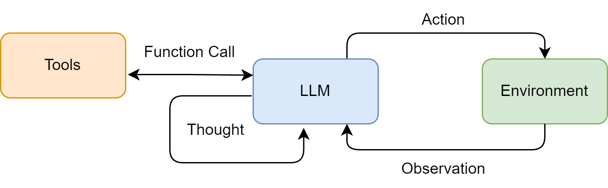
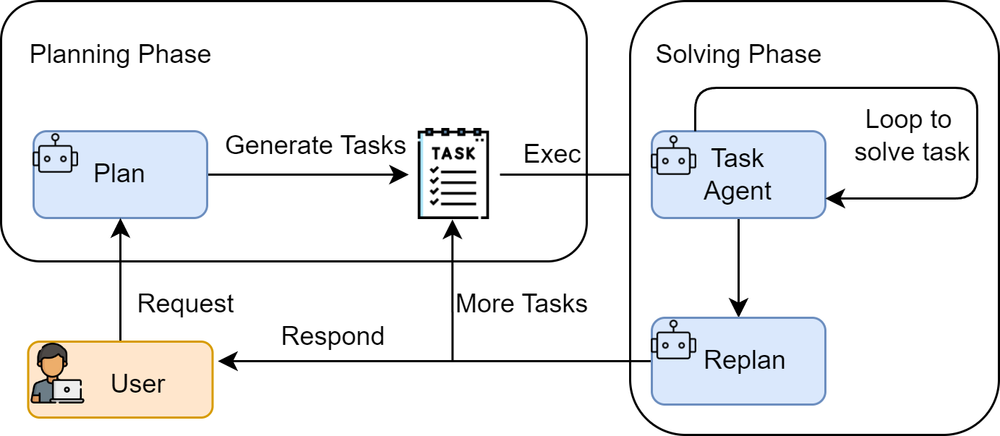
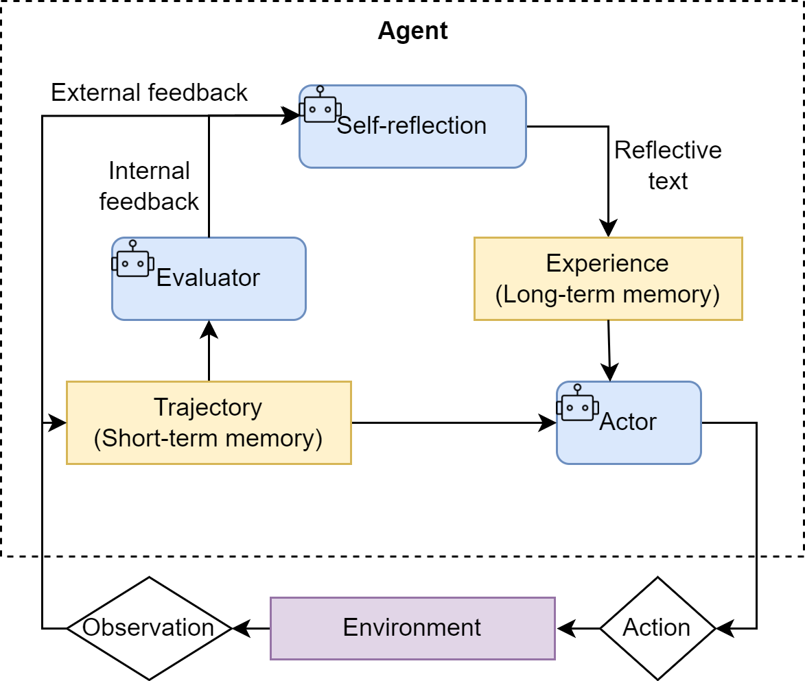

# 智能体经典范式构建

一个现代的智能体，其核心能力在于能将大语言模型的推理能力与外部世界联通。它能够自主地理解用户意图、拆解复杂任务，并通过调用代码解释器、搜索引擎、API等一系列“工具”，来获取信息、执行操作，最终达成目标。 然而，智能体并非万能，它同样面临着来自大模型本身的“幻觉”问题、在复杂任务中可能陷入推理循环、以及对工具的错误使用等挑战，这些也构成了智能体的能力边界。

为了更好地组织智能体的“思考”与“行动”过程，业界涌现出了多种经典的架构范式。在本章中，我们将聚焦于其中最具代表性的三种，并一步步从零实现它们：

- **ReAct (Reasoning and Acting)：** 一种将“思考”和“行动”紧密结合的范式，让智能体边想边做，动态调整。
- **Plan-and-Solve：** 一种“三思而后行”的范式，智能体首先生成一个完整的行动计划，然后严格执行。
- **Reflection：** 一种赋予智能体“反思”能力的范式，通过自我批判和修正来优化结果。

了解了这些之后，你可能会问，市面上已有LangChain、LlamaIndex等众多优秀框架，为何还要“重复造轮子”？答案在于，尽管成熟的框架在工程效率上优势显著，但直接使用高度抽象的工具，并不利于我们了解背后的设计机制是怎么运行的，或者是有何好处。其次，这个过程会暴露出项目的工程挑战。框架为我们处理了许多问题，例如模型输出格式的解析、工具调用失败的重试、防止智能体陷入死循环等。亲手处理这些问题，是培养系统设计能力的最直接方式。最后，也是最重要的一点，掌握了设计原理，你才能真正地从一个框架的“使用者”转变为一个智能体应用的“创造者”。当标准组件无法满足你的复杂需求时，你将拥有深度定制乃至从零构建一个全新智能体的能力。

##  ReAct

在准备好LLM客户端后，我们将构建第一个，也是最经典的一个智能体范式<strong>ReAct (Reason + Act)</strong>。

ReAct 是 Reasoning + Acting，由 Shunyu Yao 等人在 2022 年提出，论文是[《ReAct: Synergizing Reasoning and Acting in Language Models》](https://react-lm.github.io/)。其核心思想是模仿人类解决问题的方式，将<strong>推理 (Reasoning)</strong> 与<strong>行动 (Acting)</strong> 显式地结合起来，形成一个“思考-行动-观察”的循环。

LangChain、LlamaIndex、AgentScope 这类框架里的 Agent 模块，很多都能看到这个范式的影子。

它的思路很直观：模型先推理一步，拿到外部环境反馈，再推理下一步，交替进行。

LLM 自己容易缺少实时信息，也容易幻觉。ReAct 就让它“走一步看一步”，每一步都根据工具返回结果继续判断。


###  ReAct 的工作流程

在ReAct诞生之前，主流的方法可以分为两类：一类是“纯思考”型，如<strong>思维链 (Chain-of-Thought)</strong>，它能引导模型进行复杂的逻辑推理，但无法与外部世界交互，容易产生事实幻觉；另一类是“纯行动”型，模型直接输出要执行的动作，但缺乏规划和纠错能力。

ReAct的巧妙之处在于，它认识到<strong>思考与行动是相辅相成的</strong>。思考指导行动，而行动的结果又反过来修正思考。为此，ReAct范式通过一种特殊的提示工程来引导模型，使其每一步的输出都遵循一个固定的轨迹：

- <strong>Thought (思考)：</strong> 这是智能体的“内心独白”。它会分析当前情况、分解任务、制定下一步计划，或者反思上一步的结果。
- <strong>Action (行动)：</strong> 这是智能体决定采取的具体动作，通常是调用一个外部工具，例如 `Search['华为最新款手机']`。
- <strong>Observation (观察)：</strong> 这是执行`Action`后从外部工具返回的结果，例如搜索结果的摘要或API的返回值。

智能体将不断重复这个 <strong>Thought -> Action -> Observation</strong> 的循环，将新的观察结果追加到历史记录中，形成一个不断增长的上下文，直到它在`Thought`中认为已经找到了最终答案，然后输出结果。这个过程形成了一个强大的协同效应：<strong>推理使得行动更具目的性，而行动则为推理提供了事实依据。</strong>

我们可以将这个过程形式化地表达出来，如图4.1所示。具体来说，在每个时间步 $t$，智能体的策略（即大语言模型 $\pi$）会根据初始问题 $q$ 和之前所有步骤的“行动-观察”历史轨迹 $((a_1,o_1),\dots,(a_{t-1},o_{t-1}))$，来生成当前的思考 $th_t$ 和行动 $a_t$：

$$\left(th_t,a_t\right)=\pi\left(q,(a_1,o_1),\ldots,(a_{t-1},o_{t-1})\right)$$

随后，环境中的工具 $T$ 会执行行动 $a_t$，并返回一个新的观察结果 $o_t$：

$$o_t = T(a_t)$$

这个循环不断进行，将新的 $(a_t,o_t)$ 对追加到历史中，直到模型在思考 $th_t$ 中判断任务已完成。

<div align="center">
  
  <p>图 4.1 ReAct 范式中的“思考-行动-观察”协同循环</p>
</div>

这种机制特别适用于以下场景：

- <strong>需要外部知识的任务</strong>：如查询实时信息（天气、新闻、股价）、搜索专业领域的知识等。
- <strong>需要精确计算的任务</strong>：将数学问题交给计算器工具，避免LLM的计算错误。
- <strong>需要与API交互的任务</strong>：如操作数据库、调用某个服务的API来完成特定功能。


### ReAct 的特点、局限性与调试技巧

通过亲手实现一个 ReAct 智能体，我们不仅掌握了其工作流程，也应该对其内在机制有了更深刻的认识。任何技术范式都有其闪光点和待改进之处，本节将对 ReAct 进行总结。

（1）ReAct 的主要特点

1. <strong>高可解释性</strong>：ReAct 最大的优点之一就是透明。通过 `Thought` 链，我们可以清晰地看到智能体每一步的“心路历程”——它为什么会选择这个工具，下一步又打算做什么。这对于理解、信任和调试智能体的行为至关重要。
2. <strong>动态规划与纠错能力</strong>：与一次性生成完整计划的范式不同，ReAct 是“走一步，看一步”。它根据每一步从外部世界获得的 `Observation` 来动态调整后续的 `Thought` 和 `Action`。如果上一步的搜索结果不理想，它可以在下一步中修正搜索词，重新尝试。
3. <strong>工具协同能力</strong>：ReAct 范式天然地将大语言模型的推理能力与外部工具的执行能力结合起来。LLM 负责运筹帷幄（规划和推理），工具负责解决具体问题（搜索、计算），二者协同工作，突破了单一 LLM 在知识时效性、计算准确性等方面的固有局限。

（2）ReAct 的固有局限性

1. <strong>对LLM自身能力的强依赖</strong>：ReAct 流程的成功与否，高度依赖于底层 LLM 的综合能力。如果 LLM 的逻辑推理能力、指令遵循能力或格式化输出能力不足，就很容易在 `Thought` 环节产生错误的规划，或者在 `Action` 环节生成不符合格式的指令，导致整个流程中断。
2. <strong>执行效率问题</strong>：由于其循序渐进的特性，完成一个任务通常需要多次调用 LLM。每一次调用都伴随着网络延迟和计算成本。对于需要很多步骤的复杂任务，这种串行的“思考-行动”循环可能会导致较高的总耗时和费用。
3. <strong>提示词的脆弱性</strong>：整个机制的稳定运行建立在一个精心设计的提示词模板之上。模板中的任何微小变动，甚至是用词的差异，都可能影响 LLM 的行为。此外，并非所有模型都能持续稳定地遵循预设的格式，这增加了在实际应用中的不确定性。
4. <strong>可能陷入局部最优</strong>：步进式的决策模式意味着智能体缺乏一个全局的、长远的规划。它可能会因为眼前的 `Observation` 而选择一个看似正确但长远来看并非最优的路径，甚至在某些情况下陷入“原地打转”的循环中。

（3）调试技巧

当你构建的 ReAct 智能体行为不符合预期时，可以从以下几个方面入手进行调试：

- <strong>检查完整的提示词</strong>：在每次调用 LLM 之前，将最终格式化好的、包含所有历史记录的完整提示词打印出来。这是追溯 LLM 决策源头的最直接方式。
- <strong>分析原始输出</strong>：当输出解析失败时（例如，正则表达式没有匹配到 `Action`），务必将 LLM 返回的原始、未经处理的文本打印出来。这能帮助你判断是 LLM 没有遵循格式，还是你的解析逻辑有误。
- <strong>验证工具的输入与输出</strong>：检查智能体生成的 `tool_input` 是否是工具函数所期望的格式，同时也要确保工具返回的 `observation` 格式是智能体可以理解和处理的。
- <strong>调整提示词中的示例 (Few-shot Prompting)</strong>：如果模型频繁出错，可以在提示词中加入一两个完整的“Thought-Action-Observation”成功案例，通过示例来引导模型更好地遵循你的指令。
- <strong>尝试不同的模型或参数</strong>：更换一个能力更强的模型，或者调整 `temperature` 参数（通常设为0以保证输出的确定性），有时能直接解决问题。

## Plan-and-Solve

在我们掌握了 ReAct 这种反应式的、步进决策的智能体范式后，接下来将探讨一种风格迥异但同样强大的方法，<strong>Plan-and-Solve</strong>。顾名思义，这种范式将任务处理明确地分为两个阶段：<strong>先规划 (Plan)，后执行 (Solve)</strong>。

如果说 ReAct 像一个经验丰富的侦探，根据现场的蛛丝马迹（Observation）一步步推理，随时调整自己的调查方向；那么 Plan-and-Solve 则更像一位建筑师，在动工之前必须先绘制出完整的蓝图（Plan），然后严格按照蓝图来施工（Solve）。事实上我们现在用的很多大模型工具的Agent模式都融入了这种设计模式。

### Plan-and-Solve 的工作原理

Plan-and-Solve Prompting 由 Lei Wang 在2023年提出<sup>[2]</sup>。其核心动机是为了解决思维链在处理多步骤、复杂问题时容易“偏离轨道”的问题。

与 ReAct 将思考和行动融合在每一步不同，Plan-and-Solve 将整个流程解耦为两个核心阶段，如图4.2所示：

1. <strong>规划阶段 (Planning Phase)</strong>： 首先，智能体会接收用户的完整问题。它的第一个任务不是直接去解决问题或调用工具，而是<strong>将问题分解，并制定出一个清晰、分步骤的行动计划</strong>。这个计划本身就是一次大语言模型的调用产物。
2. <strong>执行阶段 (Solving Phase)</strong>： 在获得完整的计划后，智能体进入执行阶段。它会<strong>严格按照计划中的步骤，逐一执行</strong>。每一步的执行都可能是一次独立的 LLM 调用，或者是对上一步结果的加工处理，直到计划中的所有步骤都完成，最终得出答案。

这种“先谋后动”的策略，使得智能体在处理需要长远规划的复杂任务时，能够保持更高的目标一致性，避免在中间步骤中迷失方向。

我们可以将这个两阶段过程进行形式化表达。首先，规划模型 $\pi_{\text{plan}}$ 根据原始问题 $q$ 生成一个包含 $n$ 个步骤的计划 $P = (p_1, p_2, \dots, p_n)$：

$$
P = \pi_{\text{plan}}(q)
$$

随后，在执行阶段，执行模型 $\pi_{\text{solve}}$ 会逐一完成计划中的步骤。对于第 $i$ 个步骤，其解决方案 $s_i$ 的生成会同时依赖于原始问题 $q$、完整计划 $P$ 以及之前所有步骤的执行结果 $(s_1, \dots, s_{i-1})$：

$$
s_i = \pi_{\text{solve}}(q, P, (s_1, \dots, s_{i-1}))
$$

最终的答案就是最后一个步骤的执行结果 $s_n$。

<div align="center">
  
  <p>图 4.2 Plan-and-Solve 范式的两阶段工作流</p>
</div>

Plan-and-Solve 尤其适用于那些结构性强、可以被清晰分解的复杂任务，例如：

- <strong>多步数学应用题</strong>：需要先列出计算步骤，再逐一求解。
- <strong>需要整合多个信息源的报告撰写</strong>：需要先规划好报告结构（引言、数据来源A、数据来源B、总结），再逐一填充内容。
- <strong>代码生成任务</strong>：需要先构思好函数、类和模块的结构，再逐一实现。

### 规划阶段

为了凸显 Plan-and-Solve 范式在结构化推理任务上的优势，我们将不使用工具的方式，而是通过提示词的设计，完成一个推理任务。

这类任务的特点是，答案无法通过单次查询或计算得出，必须先将问题分解为一系列逻辑连贯的子步骤，然后按顺序求解。这恰好能发挥 Plan-and-Solve “先规划，后执行”的核心能力。

<strong>我们的目标问题是：</strong>“一个水果店周一卖出了15个苹果。周二卖出的苹果数量是周一的两倍。周三卖出的数量比周二少了5个。请问这三天总共卖出了多少个苹果？”

这个问题对于大语言模型来说并不算特别困难，但它包含了一个清晰的逻辑链条可供参考。在某些实际的逻辑难题上，如果大模型不能高质量的推理出准确的答案，可以参考这个设计模式来设计自己的Agent完成任务。智能体需要：

1. <strong>规划阶段</strong>：首先，将问题分解为三个独立的计算步骤（计算周二销量、计算周三销量、计算总销量）。
2. <strong>执行阶段</strong>：然后，严格按照计划，一步步执行计算，并将每一步的结果作为下一步的输入，最终得出总和。

规划阶段的目标是让大语言模型接收原始问题，并输出一个清晰、分步骤的行动计划。这个计划必须是结构化的，以便我们的代码可以轻松解析并逐一执行。因此，我们设计的提示词需要明确地告诉模型它的角色和任务，并给出一个输出格式的范例。

````python
PLANNER_PROMPT_TEMPLATE = """
你是一个顶级的AI规划专家。你的任务是将用户提出的复杂问题分解成一个由多个简单步骤组成的行动计划。
请确保计划中的每个步骤都是一个独立的、可执行的子任务，并且严格按照逻辑顺序排列。
你的输出必须是一个Python列表，其中每个元素都是一个描述子任务的字符串。

问题: {question}

请严格按照以下格式输出你的计划,```python与```作为前后缀是必要的:
```python
["步骤1", "步骤2", "步骤3", ...]
```
"""
````

这个提示词通过以下几点确保了输出的质量和稳定性：
- <strong>角色设定</strong>： “顶级的AI规划专家”，激发模型的专业能力。
- <strong>任务描述</strong>： 清晰地定义了“分解问题”的目标。
- <strong>格式约束</strong>： 强制要求输出为一个 Python 列表格式的字符串，这极大地简化了后续代码的解析工作，使其比解析自然语言更稳定、更可靠。

接下来，我们将这个提示词逻辑封装成一个 `Planner` 类，这个类也是我们的规划器。

```python
# 假定 llm_client.py 中的 HelloAgentsLLM 类已经定义好
# from llm_client import HelloAgentsLLM

class Planner:
    def __init__(self, llm_client):
        self.llm_client = llm_client

    def plan(self, question: str) -> list[str]:
        """
        根据用户问题生成一个行动计划。
        """
        prompt = PLANNER_PROMPT_TEMPLATE.format(question=question)
        
        # 为了生成计划，我们构建一个简单的消息列表
        messages = [{"role": "user", "content": prompt}]
        
        print("--- 正在生成计划 ---")
        # 使用流式输出来获取完整的计划
        response_text = self.llm_client.think(messages=messages) or ""
        
        print(f"✅ 计划已生成:\n{response_text}")
        
        # 解析LLM输出的列表字符串
        try:
            # 找到```python和```之间的内容
            plan_str = response_text.split("```python")[1].split("```")[0].strip()
            # 使用ast.literal_eval来安全地执行字符串，将其转换为Python列表
            plan = ast.literal_eval(plan_str)
            return plan if isinstance(plan, list) else []
        except (ValueError, SyntaxError, IndexError) as e:
            print(f"❌ 解析计划时出错: {e}")
            print(f"原始响应: {response_text}")
            return []
        except Exception as e:
            print(f"❌ 解析计划时发生未知错误: {e}")
            return []
```

### 执行器与状态管理

在规划器 (`Planner`) 生成了清晰的行动蓝图后，我们就需要一个执行器 (`Executor`) 来逐一完成计划中的任务。执行器不仅负责调用大语言模型来解决每个子问题，还承担着一个至关重要的角色：<strong>状态管理</strong>。它必须记录每一步的执行结果，并将其作为上下文提供给后续步骤，确保信息在整个任务链条中顺畅流动

执行器的提示词与规划器不同。它的目标不是分解问题，而是<strong>在已有上下文的基础上，专注解决当前这一个步骤</strong>。因此，提示词需要包含以下关键信息：

- <strong>原始问题</strong>： 确保模型始终了解最终目标。
- <strong>完整计划</strong>： 让模型了解当前步骤在整个任务中的位置。
- <strong>历史步骤与结果</strong>： 提供至今为止已经完成的工作，作为当前步骤的直接输入。
- <strong>当前步骤</strong>： 明确指示模型现在需要解决哪一个具体任务。

```python
EXECUTOR_PROMPT_TEMPLATE = """
你是一位顶级的AI执行专家。你的任务是严格按照给定的计划，一步步地解决问题。
你将收到原始问题、完整的计划、以及到目前为止已经完成的步骤和结果。
请你专注于解决“当前步骤”，并仅输出该步骤的最终答案，不要输出任何额外的解释或对话。

# 原始问题:
{question}

# 完整计划:
{plan}

# 历史步骤与结果:
{history}

# 当前步骤:
{current_step}

请仅输出针对“当前步骤”的回答:
"""
```

我们将执行逻辑封装到 `Executor` 类中。这个类将循环遍历计划，调用 LLM，并维护一个历史记录（状态）。

```python
class Executor:
    def __init__(self, llm_client):
        self.llm_client = llm_client

    def execute(self, question: str, plan: list[str]) -> str:
        """
        根据计划，逐步执行并解决问题。
        """
        history = "" # 用于存储历史步骤和结果的字符串
        
        print("\n--- 正在执行计划 ---")
        
        for i, step in enumerate(plan):
            print(f"\n-> 正在执行步骤 {i+1}/{len(plan)}: {step}")
            
            prompt = EXECUTOR_PROMPT_TEMPLATE.format(
                question=question,
                plan=plan,
                history=history if history else "无", # 如果是第一步，则历史为空
                current_step=step
            )
            
            messages = [{"role": "user", "content": prompt}]
            
            response_text = self.llm_client.think(messages=messages) or ""
            
            # 更新历史记录，为下一步做准备
            history += f"步骤 {i+1}: {step}\n结果: {response_text}\n\n"
            
            print(f"✅ 步骤 {i+1} 已完成，结果: {response_text}")

        # 循环结束后，最后一步的响应就是最终答案
        final_answer = response_text
        return final_answer
```

现在已经分别构建了负责“规划”的 `Planner` 和负责“执行”的 `Executor`。最后一步是将这两个组件整合到一个统一的智能体 `PlanAndSolveAgent` 中，并赋予它解决问题的完整能力。我们将创建一个主类 `PlanAndSolveAgent`，它的职责非常清晰：接收一个 LLM 客户端，初始化内部的规划器和执行器，并提供一个简单的 `run` 方法来启动整个流程。

```python
class PlanAndSolveAgent:
    def __init__(self, llm_client):
        """
        初始化智能体，同时创建规划器和执行器实例。
        """
        self.llm_client = llm_client
        self.planner = Planner(self.llm_client)
        self.executor = Executor(self.llm_client)

    def run(self, question: str):
        """
        运行智能体的完整流程:先规划，后执行。
        """
        print(f"\n--- 开始处理问题 ---\n问题: {question}")
        
        # 1. 调用规划器生成计划
        plan = self.planner.plan(question)
        
        # 检查计划是否成功生成
        if not plan:
            print("\n--- 任务终止 --- \n无法生成有效的行动计划。")
            return

        # 2. 调用执行器执行计划
        final_answer = self.executor.execute(question, plan)
        
        print(f"\n--- 任务完成 ---\n最终答案: {final_answer}")
```

这个 `PlanAndSolveAgent` 类的设计体现了“组合优于继承”的原则。它本身不包含复杂的逻辑，而是作为一个协调者 (Orchestrator)，清晰地调用其内部组件来完成任务。

### 运行实例与分析

完整的代码同样参考本书配套的代码仓库 `code` 文件夹，这里只演示最终结果。

````bash
--- 开始处理问题 ---
问题: 一个水果店周一卖出了15个苹果。周二卖出的苹果数量是周一的两倍。周三卖出的数量比周二少了5个。请问这三天总共卖出了多少个苹果？
--- 正在生成计划 ---
🧠 正在调用 xxxx 模型...
✅ 大语言模型响应成功:
```python
["计算周一卖出的苹果数量： 15个", "计算周二卖出的苹果数量： 周一数量 × 2 = 15 × 2 = 30个", "计算周三卖出的苹果数量： 周二数量 - 5 = 30 - 5 = 25个", "计算三天总销量： 周一 + 周二 + 周三 = 15 + 30 + 25 = 70个"]
```
✅ 计划已生成:
```python
["计算周一卖出的苹果数量： 15个", "计算周二卖出的苹果数量： 周一数量 × 2 = 15 × 2 = 30个", "计算周三卖出的苹果数量： 周二数量 - 5 = 30 - 5 = 25个", "计算三天总销量： 周一 + 周二 + 周三 = 15 + 30 + 25 = 70个"]
```

--- 正在执行计划 ---

-> 正在执行步骤 1/4: 计算周一卖出的苹果数量: 15个
🧠 正在调用 xxxx 模型...
✅ 大语言模型响应成功:
15
✅ 步骤 1 已完成，结果: 15

-> 正在执行步骤 2/4: 计算周二卖出的苹果数量: 周一数量 × 2 = 15 × 2 = 30个
🧠 正在调用 xxxx 模型...
✅ 大语言模型响应成功:
30
✅ 步骤 2 已完成，结果: 30

-> 正在执行步骤 3/4: 计算周三卖出的苹果数量: 周二数量 - 5 = 30 - 5 = 25个
🧠 正在调用 xxxx 模型...
✅ 大语言模型响应成功:
25
✅ 步骤 3 已完成，结果: 25

-> 正在执行步骤 4/4: 计算三天总销量: 周一 + 周二 + 周三 = 15 + 30 + 25 = 70个
🧠 正在调用 xxxx 模型...
✅ 大语言模型响应成功:
70
✅ 步骤 4 已完成，结果: 70

--- 任务完成 ---
最终答案: 70
````

从上面的输出日志中，我们可以清晰地看到 Plan-and-Solve 范式的工作流程：

1.  <strong>规划阶段</strong>： 智能体首先调用 `Planner`，成功地将复杂的应用题分解成了一个包含四个逻辑步骤的 Python 列表。这个结构化的计划为后续的执行奠定了基础。
2.  <strong>执行阶段</strong>： `Executor` 严格按照生成的计划，一步一步地向下执行。在每一步中，它都将历史结果作为上下文，确保了信息的正确传递（例如，步骤2正确地使用了步骤1的结果“15个”，步骤3也正确使用了步骤2的结果“30个”）。
3.  <strong>结果</strong>：整个过程逻辑清晰，步骤明确，最终智能体准确地得出了正确答案“70个”。

## Reflection

在我们已经实现的 ReAct 和 Plan-and-Solve 范式中，智能体一旦完成了任务，其工作流程便告结束。然而，它们生成的初始答案，无论是行动轨迹还是最终结果，都可能存在谬误或有待改进之处。Reflection 机制的核心思想，正是为智能体引入一种<strong>事后（post-hoc）的自我校正循环</strong>，使其能够像人类一样，审视自己的工作，发现不足，并进行迭代优化。

### Reflection 机制的核心思想

Reflection 机制的灵感来源于人类的学习过程：我们完成初稿后会进行校对，解出数学题后会进行验算。这一思想在多个研究中得到了体现，例如 Shinn, Noah 在2023年提出的 Reflexion 框架<sup>[3]</sup>。其核心工作流程可以概括为一个简洁的三步循环：<strong>执行 -> 反思 -> 优化</strong>。

1. <strong>执行 (Execution)</strong>：首先，智能体使用我们熟悉的方法（如 ReAct 或 Plan-and-Solve）尝试完成任务，生成一个初步的解决方案或行动轨迹。这可以看作是“初稿”。
2. <strong>反思 (Reflection)</strong>：接着，智能体进入反思阶段。它会调用一个独立的、或者带有特殊提示词的大语言模型实例，来扮演一个“评审员”的角色。这个“评审员”会审视第一步生成的“初稿”，并从多个维度进行评估，例如：
   - <strong>事实性错误</strong>：是否存在与常识或已知事实相悖的内容？
   - <strong>逻辑漏洞</strong>：推理过程是否存在不连贯或矛盾之处？
   - <strong>效率问题</strong>：是否有更直接、更简洁的路径来完成任务？
   - <strong>遗漏信息</strong>：是否忽略了问题的某些关键约束或方面？ 根据评估，它会生成一段结构化的<strong>反馈 (Feedback)</strong>，指出具体的问题所在和改进建议。
3. <strong>优化 (Refinement)</strong>：最后，智能体将“初稿”和“反馈”作为新的上下文，再次调用大语言模型，要求它根据反馈内容对初稿进行修正，生成一个更完善的“修订稿”。

如图4.3所示，这个循环可以重复进行多次，直到反思阶段不再发现新的问题，或者达到预设的迭代次数上限。我们可以将这个迭代优化的过程形式化地表达出来。假设 $O_i$ 是第 $i$ 次迭代产生的输出（$O_0$ 为初始输出），反思模型 $\pi_{\text{reflect}}$ 会生成针对 $O_i$ 的反馈 $F_i$：
$$
F_i = \pi_{\text{reflect}}(\text{Task}, O_i)
$$
随后，优化模型 $\pi_{\text{refine}}$ 会结合原始任务、上一版输出以及反馈，生成新一版的输出 $O_{i+1}$：
$$
O_{i+1} = \pi_{\text{refine}}(\text{Task}, O_i, F_i)
$$


<div align="center">

<p>图 4.3 Reflection 机制中的“执行-反思-优化”迭代循环</p>
</div>


与前两种范式相比，Reflection 的价值在于：

- 它为智能体提供了一个内部纠错回路，使其不再完全依赖于外部工具的反馈（ReAct 的 Observation），从而能够修正更高层次的逻辑和策略错误。
- 它将一次性的任务执行，转变为一个持续优化的过程，显著提升了复杂任务的最终成功率和答案质量。
- 它为智能体构建了一个临时的<strong>“短期记忆”</strong>。整个“执行-反思-优化”的轨迹形成了一个宝贵的经验记录，智能体不仅知道最终答案，还记得自己是如何从有缺陷的初稿迭代到最终版本的。更进一步，这个记忆系统还可以是<strong>多模态的</strong>，允许智能体反思和修正文本以外的输出（如代码、图像等），为构建更强大的多模态智能体奠定了基础。

### 案例设定与记忆模块设计

为了在实战中体现 Reflection 机制，我们将引入记忆管理机制，因为reflection通常对应着信息的存储和提取，如果上下文足够长的情况，想让“评审员”直接获取所有的信息然后进行反思往往会传入很多冗余信息。这一步实践我们主要完成<strong>代码生成与迭代优化</strong>。

这一步的目标任务是：“编写一个Python函数，找出1到n之间所有的素数 (prime numbers)。”

这个任务是检验 Reflection 机制的绝佳场景：

1. <strong>存在明确的优化路径</strong>：大语言模型初次生成的代码很可能是一个简单但效率低下的递归实现。
2. <strong>反思点清晰</strong>：可以通过反思发现其“时间复杂度过高”或“存在重复计算”的问题。
3. <strong>优化方向明确</strong>：可以根据反馈，将其优化为更高效的迭代版本或使用备忘录模式的版本。

Reflection 的核心在于迭代，而迭代的前提是能够记住之前的尝试和获得的反馈。因此，一个“短期记忆”模块是实现该范式的必需品。这个记忆模块将负责存储每一次“执行-反思”循环的完整轨迹。

```python
from typing import List, Dict, Any, Optional

class Memory:
    """
    一个简单的短期记忆模块，用于存储智能体的行动与反思轨迹。
    """

    def __init__(self):
        """
        初始化一个空列表来存储所有记录。
        """
        self.records: List[Dict[str, Any]] = []

    def add_record(self, record_type: str, content: str):
        """
        向记忆中添加一条新记录。

        参数:
        - record_type (str): 记录的类型 ('execution' 或 'reflection')。
        - content (str): 记录的具体内容 (例如，生成的代码或反思的反馈)。
        """
        record = {"type": record_type, "content": content}
        self.records.append(record)
        print(f"📝 记忆已更新，新增一条 '{record_type}' 记录。")

    def get_trajectory(self) -> str:
        """
        将所有记忆记录格式化为一个连贯的字符串文本，用于构建提示词。
        """
        trajectory_parts = []
        for record in self.records:
            if record['type'] == 'execution':
                trajectory_parts.append(f"--- 上一轮尝试 (代码) ---\n{record['content']}")
            elif record['type'] == 'reflection':
                trajectory_parts.append(f"--- 评审员反馈 ---\n{record['content']}")
        
        return "\n\n".join(trajectory_parts)

    def get_last_execution(self) -> Optional[str]:
        """
        获取最近一次的执行结果 (例如，最新生成的代码)。
        如果不存在，则返回 None。
        """
        for record in reversed(self.records):
            if record['type'] == 'execution':
                return record['content']
        return None
```

这个 `Memory` 类的设计比较简洁，主体是这样的：

- 使用一个列表 `records` 来按顺序存储每一次的行动和反思。
- `add_record` 方法负责向记忆中添加新的条目。
- `get_trajectory` 方法是核心，它将记忆轨迹“序列化”成一段文本，可以直接插入到后续的提示词中，为模型的反思和优化提供完整的上下文。
- `get_last_execution` 方便我们获取最新的“初稿”以供反思。


### Reflection 智能体的编码实现

有了 `Memory` 模块作为基础，我们现在可以着手构建 `ReflectionAgent` 的核心逻辑。整个智能体的工作流程将围绕我们之前讨论的“执行-反思-优化”循环展开，并通过精心设计的提示词来引导大语言模型扮演不同的角色。

（1）提示词设计

与之前的范式不同，Reflection 机制需要多个不同角色的提示词来协同工作。

1. <strong>初始执行提示词 (Execution Prompt)</strong> ：这是智能体首次尝试解决问题的提示词，内容相对直接，只要求模型完成指定任务。

```bash
INITIAL_PROMPT_TEMPLATE = """
你是一位资深的Python程序员。请根据以下要求，编写一个Python函数。
你的代码必须包含完整的函数签名、文档字符串，并遵循PEP 8编码规范。

要求: {task}

请直接输出代码，不要包含任何额外的解释。
"""
```

2. <strong>反思提示词 (Reflection Prompt)</strong> ：这个提示词是 Reflection 机制的灵魂。它指示模型扮演“代码评审员”的角色，对上一轮生成的代码进行批判性分析，并提供具体的、可操作的反馈。

````bash
REFLECT_PROMPT_TEMPLATE = """
你是一位极其严格的代码评审专家和资深算法工程师，对代码的性能有极致的要求。
你的任务是审查以下Python代码，并专注于找出其在<strong>算法效率</strong>上的主要瓶颈。

# 原始任务:
{task}

# 待审查的代码:
```python
{code}
```

请分析该代码的时间复杂度，并思考是否存在一种<strong>算法上更优</strong>的解决方案来显著提升性能。
如果存在，请清晰地指出当前算法的不足，并提出具体的、可行的改进算法建议（例如，使用筛法替代试除法）。
如果代码在算法层面已经达到最优，才能回答“无需改进”。

请直接输出你的反馈，不要包含任何额外的解释。
"""
````

3. <strong>优化提示词 (Refinement Prompt)</strong> ：当收到反馈后，这个提示词将引导模型根据反馈内容，对原有代码进行修正和优化。

````bash

REFINE_PROMPT_TEMPLATE = """
你是一位资深的Python程序员。你正在根据一位代码评审专家的反馈来优化你的代码。

# 原始任务:
{task}

# 你上一轮尝试的代码:
{last_code_attempt}
评审员的反馈：
{feedback}

请根据评审员的反馈，生成一个优化后的新版本代码。
你的代码必须包含完整的函数签名、文档字符串，并遵循PEP 8编码规范。
请直接输出优化后的代码，不要包含任何额外的解释。
"""
````

（2）智能体封装与实现

现在，我们将这套提示词逻辑和 `Memory` 模块整合到 `ReflectionAgent` 类中。

```python
# 假设 llm_client.py 和 memory.py 已定义
# from llm_client import HelloAgentsLLM
# from memory import Memory

class ReflectionAgent:
    def __init__(self, llm_client, max_iterations=3):
        self.llm_client = llm_client
        self.memory = Memory()
        self.max_iterations = max_iterations

    def run(self, task: str):
        print(f"\n--- 开始处理任务 ---\n任务: {task}")

        # --- 1. 初始执行 ---
        print("\n--- 正在进行初始尝试 ---")
        initial_prompt = INITIAL_PROMPT_TEMPLATE.format(task=task)
        initial_code = self._get_llm_response(initial_prompt)
        self.memory.add_record("execution", initial_code)

        # --- 2. 迭代循环:反思与优化 ---
        for i in range(self.max_iterations):
            print(f"\n--- 第 {i+1}/{self.max_iterations} 轮迭代 ---")

            # a. 反思
            print("\n-> 正在进行反思...")
            last_code = self.memory.get_last_execution()
            reflect_prompt = REFLECT_PROMPT_TEMPLATE.format(task=task, code=last_code)
            feedback = self._get_llm_response(reflect_prompt)
            self.memory.add_record("reflection", feedback)

            # b. 检查是否需要停止
            if "无需改进" in feedback:
                print("\n✅ 反思认为代码已无需改进，任务完成。")
                break

            # c. 优化
            print("\n-> 正在进行优化...")
            refine_prompt = REFINE_PROMPT_TEMPLATE.format(
                task=task,
                last_code_attempt=last_code,
                feedback=feedback
            )
            refined_code = self._get_llm_response(refine_prompt)
            self.memory.add_record("execution", refined_code)
        
        final_code = self.memory.get_last_execution()
        print(f"\n--- 任务完成 ---\n最终生成的代码:\n```python\n{final_code}\n```")
        return final_code

    def _get_llm_response(self, prompt: str) -> str:
        """一个辅助方法，用于调用LLM并获取完整的流式响应。"""
        messages = [{"role": "user", "content": prompt}]
        response_text = self.llm_client.think(messages=messages) or ""
        return response_text

```

### 运行实例与分析

这里提供一个输出示例。

````python
--- 开始处理任务 ---
任务： 编写一个Python函数，找出1到n之间所有的素数 (prime numbers)。

--- 正在进行初始尝试 ---
🧠 正在调用 xxxxxx 模型...
✅ 大语言模型响应成功：
```python
def find_primes(n):
    ...
    return primes
```
📝 记忆已更新，新增一条 'execution' 记录。   

--- 第 1/2 轮迭代 ---

-> 正在进行反思...
🧠 正在调用 xxxxxx 模型...
✅ 大语言模型响应成功：
当前代码的时间复杂度为O(n * sqrt(n))。虽然对于较小的n值，这种实现是可以接受的，但当n非常大时，性能会显著下降。主要瓶颈在于每个数都需要进行试除法检查，这导致了较高的时间开销。

建议使用埃拉托斯特尼筛法（Sieve of Eratosthenes），该算法的时间复杂度为O(n log(log n))，能够显著提高查找素数的效率。

改进后的代码如下：
```python
def find_primes(n):
    ...
    return primes
```
📝 记忆已更新，新增一条 'reflection' 记录。

-> 正在进行优化...
🧠 正在调用 xxxxxx 模型...
✅ 大语言模型响应成功：
```python
def find_primes(n):
    ...
    return primes
```
📝 记忆已更新，新增一条 'execution' 记录。

--- 第 2/2 轮迭代 ---

-> 正在进行反思...
🧠 正在调用 xxxxxx 模型...
✅ 大语言模型响应成功：
当前代码使用了Eratosthenes筛法，时间复杂度为O(n log log n)，空间复杂度为O(n)。此算法在寻找1到n之间的所有素数时已经非常高效，通常情况下无需进一步优化。但在某些特定场景下，可以考虑以下改进：

1. <strong>分段筛法（Segmented Sieve）</strong>：适用于n非常大但内存有限的情况。将区间分成多个小段，每段分别用筛法处理，减少内存使用。
2. <strong>奇数筛法（Odd Number Sieve）</strong>：除了2以外，所有素数都是奇数。可以在初始化`is_prime`数组时只标记奇数，这样可以将空间复杂度降低一半，同时减少一些不必要的计算。

然而，这些改进对于大多数应用场景来说并不是必需的，因为标准的Eratosthenes筛法已经足够高效。因此，在一般情况下，<strong>无需改进</strong>。
📝 记忆已更新，新增一条 'reflection' 记录。

✅ 反思认为代码已无需改进，任务完成。

--- 任务完成 ---
最终生成的代码：
```python
def find_primes(n):
    """
    Finds all prime numbers between 1 and n using the Sieve of Eratosthenes algorithm.

    :param n: The upper limit of the range to find prime numbers.
    :return: A list of all prime numbers between 1 and n.
    """
    if n < 2:
        return []

    is_prime = [True] * (n + 1)
    is_prime[0] = is_prime[1] = False

    p = 2
    while p * p <= n:
        if is_prime[p]:
            for i in range(p * p, n + 1, p):
                is_prime[i] = False
        p += 1

    primes = [num for num in range(2, n + 1) if is_prime[num]]
    return primes
```
````

这个运行实例展示了 Reflection 机制是如何驱动智能体进行深度优化的:

1. <strong>有效的“批判”是优化的前提</strong>:在第一轮反思中，由于我们使用了“极其严格”且“专注于算法效率”的提示词，智能体没有满足于功能正确的初版代码，而是精准地指出了其 `O(n * sqrt(n))` 的时间复杂度瓶颈，并提出了算法层面的改进建议——埃拉托斯特尼筛法。
2. <strong>迭代式改进</strong>: 智能体在接收到明确的反馈后，于优化阶段成功地实现了更高效的筛法，将算法复杂度降至 `O(n log log n)`，完成了第一次有意义的自我迭代。
3. <strong>收敛与终止</strong>: 在第二轮反思中，智能体面对已经高效的筛法，展现出了更深层次的知识。它不仅肯定了当前算法的效率，甚至还提及了分段筛法等更高级的优化方向，但最终做出了“在一般情况下无需改进”的正确判断。这个判断触发了我们的终止条件，使优化过程得以收敛。

这个案例充分证明，一个设计良好的 Reflection 机制，其价值不仅在于修复错误，更在于<strong>驱动解决方案在质量和效率上实现阶梯式的提升</strong>，这使其成为构建复杂、高质量智能体的关键技术之一。

### Reflection 机制的成本收益分析

尽管 Reflection 机制在提升任务解决质量上表现出色，但这种能力的获得并非没有代价。在实际应用中，我们需要权衡其带来的收益与相应的成本。

（1）主要成本

1. <strong>模型调用开销增加</strong>:这是最直接的成本。每进行一轮迭代，至少需要额外调用两次大语言模型（一次用于反思，一次用于优化）。如果迭代多轮，API 调用成本和计算资源消耗将成倍增加。

2. <strong>任务延迟显著提高</strong>:Reflection 是一个串行过程，每一轮的优化都必须等待上一轮的反思完成。这使得任务的总耗时显著延长，不适合对实时性要求高的场景。

3. <strong>提示工程复杂度上升</strong>:如我们的案例所示，Reflection 的成功在很大程度上依赖于高质量、有针对性的提示词。为“执行”、“反思”、“优化”等不同阶段设计和调试有效的提示词，需要投入更多的开发精力。

（2）核心收益

1. <strong>解决方案质量的跃迁</strong>:最大的收益在于，它能将一个“合格”的初始方案，迭代优化成一个“优秀”的最终方案。这种从功能正确到性能高效、从逻辑粗糙到逻辑严谨的提升，在很多关键任务中是至关重要的。

2. <strong>鲁棒性与可靠性增强</strong>:通过内部的自我纠错循环，智能体能够发现并修复初始方案中可能存在的逻辑漏洞、事实性错误或边界情况处理不当等问题，从而大大提高了最终结果的可靠性。

综上所述，Reflection 机制是一种典型的“以成本换质量”的策略。它非常适合那些<strong>对最终结果的质量、准确性和可靠性有极高要求，且对任务完成的实时性要求相对宽松</strong>的场景。例如:

- 生成关键的业务代码或技术报告。
- 在科学研究中进行复杂的逻辑推演。
- 需要深度分析和规划的决策支持系统。

反之，如果应用场景需要快速响应，或者一个“大致正确”的答案就已经足够，那么使用更轻量的 ReAct 或 Plan-and-Solve 范式可能会是更具性价比的选择。

## 选型指南

<strong>核心知识点回顾:</strong>

1. ReAct:我们构建了一个能与外部世界交互的 ReAct 智能体。通过“思考-行动-观察”的动态循环，它成功地利用搜索引擎回答了自身知识库无法覆盖的实时性问题。其核心优势在于<strong>环境适应性</strong>和<strong>动态纠错能力</strong>，使其成为处理探索性、需要外部工具输入的任务的首选。
2. Plan-and-Solve:我们实现了一个先规划后执行的 Plan-and-Solve 智能体，并利用它解决了需要多步推理的数学应用题。它将复杂的任务分解为清晰的步骤，然后逐一执行。其核心优势在于<strong>结构性</strong>和<strong>稳定性</strong>，特别适合处理逻辑路径确定、内部推理密集的任务。
3. Reflection (自我反思与迭代):我们构建了一个具备自我优化能力的 Reflection 智能体。通过引入“执行-反思-优化”的迭代循环，它成功地将一个效率较低的初始代码方案，优化为了一个算法上更优的高性能版本。其核心价值在于能<strong>显著提升解决方案的质量</strong>，适用于对结果的准确性和可靠性有极高要求的场景。

本章探讨的三种范式，代表了智能体解决问题的三种不同策略，如表4.1所示。在实际应用中，选择哪一种，取决于任务的核心需求:

<div align="center">
<p>表 4.1 不同 Agent Loop 的选择策略</p>

</div>

至此，我们已经掌握了构建单个智能体的核心技术。为了过渡知识，以及对实际应用更加深入。下一节我们将会探索不同低代码平台的使用方式以及轻代码构建agent的方案。


## 参考文献

[1] Yao S, Zhao J, Yu D, et al. React: Synergizing reasoning and acting in language models[C]//International Conference on Learning Representations (ICLR). 2023.

[2] Wang L, Xu W, Lan Y, et al. Plan-and-solve prompting: Improving zero-shot chain-of-thought reasoning by large language models[J]. arXiv preprint arXiv:2305.04091, 2023.

[3] Shinn N, Cassano F, Gopinath A, et al. Reflexion: Language agents with verbal reinforcement learning[J]. Advances in Neural Information Processing Systems, 2023, 36: 8634-8652.
