# 智能体通信协议

在前面的章节中，我们构建了功能完备的单体智能体，它们具备推理、工具调用和记忆能力。然而，当我们尝试构建更复杂的 AI 系统时，自然会有疑问：<strong>如何让智能体与外部世界高效交互？如何让多个智能体相互协作？</strong>

这正是智能体通信协议要解决的核心问题。本章将为 HelloAgents 框架引入三种通信协议：<strong>MCP（Model Context Protocol）</strong>用于智能体与工具的标准化通信，<strong>A2A（Agent-to-Agent Protocol）</strong>用于智能体间的点对点协作，<strong>ANP（Agent Network Protocol）</strong>用于构建大规模智能体网络。这三种协议共同构成了智能体通信的基础设施层。

通过本章的学习，您将掌握智能体通信协议的设计理念和实践技能，理解三种主流协议的设计差异，学会如何选择合适的协议来解决实际问题。

## 智能体通信协议基础

### 为何需要通信协议

回顾我们在第七章构建的 ReAct 智能体，它已经具备了强大的推理和工具调用能力。让我们看一个典型的使用场景：

```python
from hello_agents import ReActAgent, HelloAgentsLLM
from hello_agents.tools import CalculatorTool, SearchTool

llm = HelloAgentsLLM()
agent = ReActAgent(name="AI助手", llm=llm)
agent.add_tool(CalculatorTool())
agent.add_tool(SearchTool())

# 智能体可以独立完成任务
response = agent.run("搜索最新的AI新闻，并计算相关公司的市值总和")
```

这个智能体工作得很好，但它面临着三个根本性的限制。首先是<strong>工具集成的困境</strong>：每当需要访问新的外部服务（如 GitHub API、数据库、文件系统），我们都必须编写专门的 Tool 类。这不仅工作量大，而且不同开发者编写的工具无法互相兼容。其次是<strong>能力扩展的瓶颈</strong>：智能体的能力被限制在预先定义的工具集内，无法动态发现和使用新的服务。最后是<strong>协作的缺失</strong>：当任务复杂到需要多个专业智能体协作时（如研究员+撰写员+编辑），我们只能通过手动编排来协调它们的工作。

让我们通过一个更具体的例子来理解这些限制。假设你要构建一个智能研究助手，它需要：

```python
# 传统方式：手动集成每个服务
class GitHubTool(BaseTool):
    """需要手写GitHub API适配器"""
    def run(self, repo_url):
        # 大量的API调用代码...
        pass

class DatabaseTool(BaseTool):
    """需要手写数据库适配器"""
    def run(self, query):
        # 数据库连接和查询代码...
        pass

class WeatherTool(BaseTool):
    """需要手写天气API适配器"""
    def run(self, location):
        # 天气API调用代码...
        pass

# 每个新服务都需要重复这个过程
agent.add_tool(GitHubTool())
agent.add_tool(DatabaseTool())
agent.add_tool(WeatherTool())
```

这种方式存在明显的问题：代码重复（每个工具都要处理 HTTP 请求、错误处理、认证等），难以维护（API 变更需要修改所有相关工具），无法复用（其他开发者的工具无法直接使用），扩展性差（添加新服务需要大量编码工作）。

<strong>通信协议的核心价值</strong>正是解决这些问题。它提供了一套标准化的接口规范，让智能体能够以统一的方式访问各种外部服务，而无需为每个服务编写专门的适配器。这就像互联网的 TCP/IP 协议，它让不同的设备能够相互通信，而不需要为每种设备编写专门的通信代码。

有了通信协议，上面的代码可以简化为：

```python
from hello_agents.tools import MCPTool

# 连接到MCP服务器，自动获得所有工具
mcp_tool = MCPTool()  # 内置服务器提供基础工具

# 或者连接到专业的MCP服务器
github_mcp = MCPTool(server_command=["npx", "-y", "@modelcontextprotocol/server-github"])
database_mcp = MCPTool(server_command=["python", "database_mcp_server.py"])

# 智能体自动获得所有能力，无需手写适配器
agent.add_tool(mcp_tool)
agent.add_tool(github_mcp)
agent.add_tool(database_mcp)
```

通信协议带来的改变是根本性的：<strong>标准化接口</strong>让不同服务提供统一的访问方式，<strong>互操作性</strong>使得不同开发者的工具可以无缝集成，<strong>动态发现</strong>允许智能体在运行时发现新的服务和能力，<strong>可扩展性</strong>让系统能够轻松添加新的功能模块。

### 三种协议设计理念比较

智能体通信协议并非单一的解决方案，而是针对不同通信场景设计的一系列标准。在本章以目前业界主流的三种协议 MCP、A2A 和 ANP 为例进行实践，下面是一个总览的比较。

<strong>（1）MCP：智能体与工具的桥梁</strong>

MCP（Model Context Protocol）由 Anthropic 团队提出<sup>[1]</sup>，其核心设计理念是<strong>标准化智能体与外部工具/资源的通信方式</strong>。想象一下，你的智能体需要访问文件系统、数据库、GitHub、Slack 等各种服务。传统做法是为每个服务编写专门的适配器，这不仅工作量大，而且难以维护。MCP 通过定义统一的协议规范，让所有服务都能以相同的方式被访问。

MCP 的设计哲学是"上下文共享"。它不仅仅是一个 RPC（远程过程调用）协议，更重要的是它允许智能体和工具之间共享丰富的上下文信息。如图 10.1 所示，当智能体访问一个代码仓库时，MCP 服务器不仅能提供文件内容，还能提供代码结构、依赖关系、提交历史等上下文信息，让智能体能够做出更智能的决策。

<div align="center">
  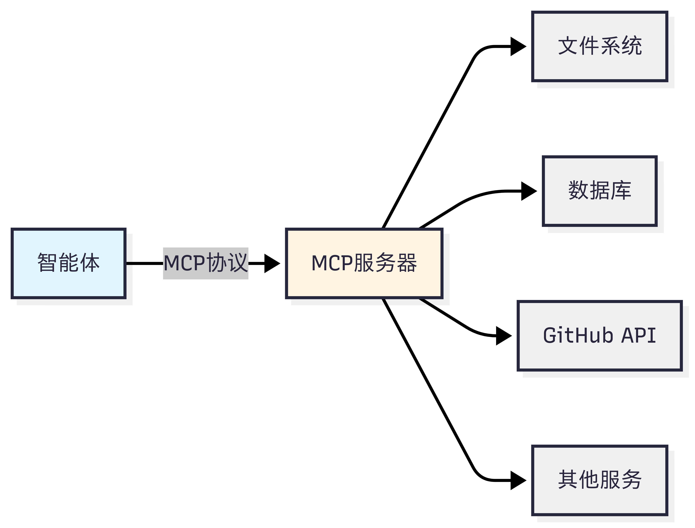
  <p>图 10.1 MCP 设计思想</p>
</div>

<strong>（2）A2A：智能体间的对话</strong>

A2A（Agent-to-Agent Protocol）协议由 Google 团队提出<sup>2</sup>，其核心设计理念是<strong>实现智能体之间的点对点通信</strong>。与 MCP 关注智能体与工具的通信不同，A2A 关注的是智能体之间如何相互协作。这种设计让智能体能够像人类团队一样进行对话、协商和协作。

A2A 的设计哲学是"对等通信"。如图 10.2 所示，在 A2A 网络中，每个智能体既是服务提供者，也是服务消费者。智能体可以主动发起请求，也可以响应其他智能体的请求。这种对等的设计避免了中心化协调器的瓶颈，让智能体网络更加灵活和可扩展。

<div align="center">
  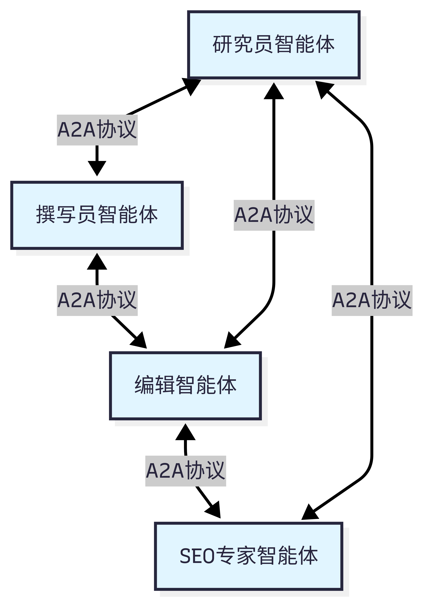
  <p>图 10.2 A2A 设计思想</p>
</div>

<strong>（3）ANP：智能体网络的基础设施</strong>

ANP（Agent Network Protocol）是一个概念性的协议框架<sup>3</sup>，目前由开源社区维护，还没有成熟的生态，其核心设计理念是<strong>构建大规模智能体网络的基础设施</strong>。如果说 MCP 解决的是"如何访问工具"，A2A 解决的是"如何与其他智能体对话"，那么 ANP 解决的是"如何在大规模网络中发现和连接智能体"。

ANP 的设计哲学是"去中心化服务发现"。在一个包含成百上千个智能体的网络中，如何让智能体能够找到它需要的服务？如图 10.3 所示，ANP 提供了服务注册、发现和路由机制，让智能体能够动态地发现网络中的其他服务，而不需要预先配置所有的连接关系。

<div align="center">
  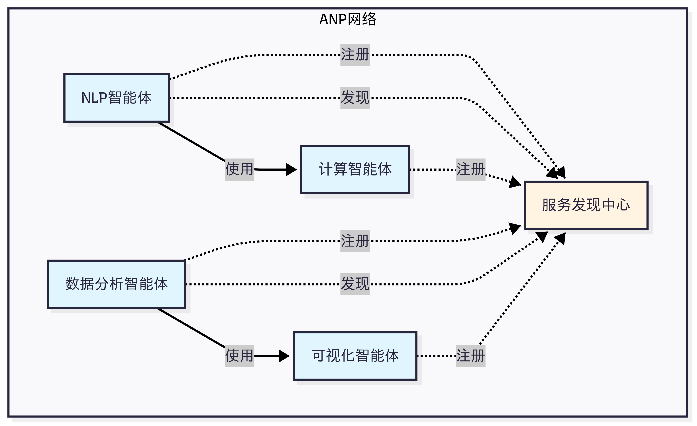
  <p>图 10.3 ANP 设计思想</p>
</div>

最后在表 10.1 中，让我们通过一个对比表格来更清晰地理解这三种协议的差异：

<div align="center">
  <p>表 10.1 三种协议对比</p>
  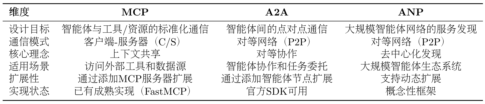
</div>

<strong>（4）如何选择合适的协议？</strong>

目前的协议还处于发展早期，MCP 的生态相对成熟，不过各种工具的时效性取决于维护者，更推荐选择大公司背书的 MCP 工具。

选择协议的关键在于理解你的需求：

- 如果你的智能体需要访问外部服务（文件、数据库、API），选择<strong>MCP</strong>
- 如果你需要多个智能体相互协作完成任务，选择<strong>A2A</strong>
- 如果你要构建大规模的智能体生态系统，考虑<strong>ANP</strong>


## MCP 协议实战

现在，让我们深入学习 MCP，掌握如何让智能体访问外部工具和资源。

### MCP 协议概念介绍

<strong>（1）MCP：智能体的"USB-C"</strong>

想象一下，你的智能体可能需要同时做很多事情，例如：
- 读取本地文件系统的文档
- 查询 PostgreSQL 数据库
- 搜索 GitHub 上的代码
- 发送 Slack 消息
- 访问 Google Drive

传统方式下，你需要为每个服务编写适配器代码，处理不同的 API、认证方式、错误处理等。这不仅工作量大，而且难以维护。更重要的是，不同 LLM 平台的 function call 实现差异巨大，切换模型时需要重写大量代码。

MCP 的出现改变了这一切。它就像 USB-C 统一了各种设备的连接方式一样，<strong>MCP 统一了智能体与外部工具的交互方式</strong>。无论你使用 Claude、GPT 还是其他模型，只要它们支持 MCP 协议，就能无缝访问相同的工具和资源。

<strong>（2）MCP 架构</strong>

MCP 协议采用 Host、Client、Servers 三层架构设计，让我们通过图 10.5 的场景来理解这些组件如何协同工作。

假设你正在使用 Claude Desktop 询问："我桌面上有哪些文档？"

<div align="center">
  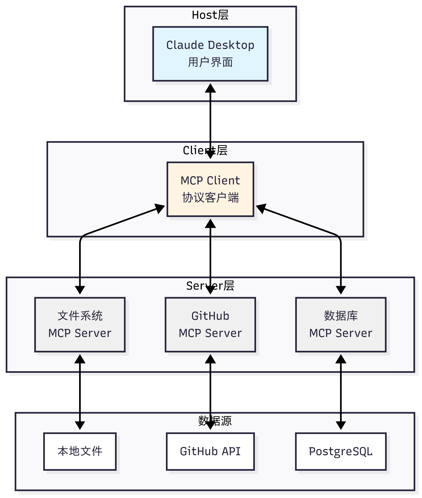
  <p>图 10.5 MCP 案例演示</p>
</div>

<strong>三层架构的职责：</strong>

1. <strong>Host（宿主层）</strong>：Claude Desktop 作为 Host，负责接收用户提问并与 Claude 模型交互。Host 是用户直接交互的界面，它管理整个对话流程。

2. <strong>Client（客户端层）</strong>：当 Claude 模型决定需要访问文件系统时，Host 中内置的 MCP Client 被激活。Client 负责与适当的 MCP Server 建立连接，发送请求并接收响应。

3. <strong>Server（服务器层）</strong>：文件系统 MCP Server 被调用，执行实际的文件扫描操作，访问桌面目录，并返回找到的文档列表。

<strong>完整的交互流程：</strong>用户问题 → Claude Desktop(Host) → Claude 模型分析 → 需要文件信息 → MCP Client 连接 → 文件系统 MCP Server → 执行操作 → 返回结果 → Claude 生成回答 → 显示在 Claude Desktop 上

这种架构设计的优势在于<strong>关注点分离</strong>：Host 专注于用户体验，Client 专注于协议通信，Server 专注于具体功能实现。开发者只需专注于开发对应的 MCP Server，无需关心 Host 和 Client 的实现细节。

<strong>（3）MCP 的核心能力</strong>

如表 10.2 所示，MCP 协议提供了三大核心能力，构成完整的工具访问框架：

<div align="center">
  <p>表 10.2 MCP 核心能力</p>
  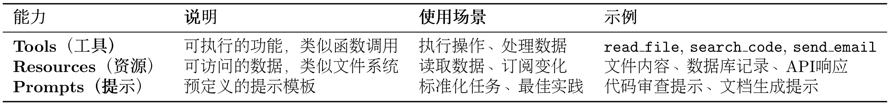
</div>

这三种能力的区别在于：<strong>Tools 是主动的</strong>（执行操作），<strong>Resources 是被动的</strong>（提供数据），<strong>Prompts 是指导性的</strong>（提供模板）。

<strong>（4）MCP 的工作流程</strong>

让我们通过一个具体例子来理解 MCP 的完整工作流程，如图 10.6 所示：

<div align="center">
  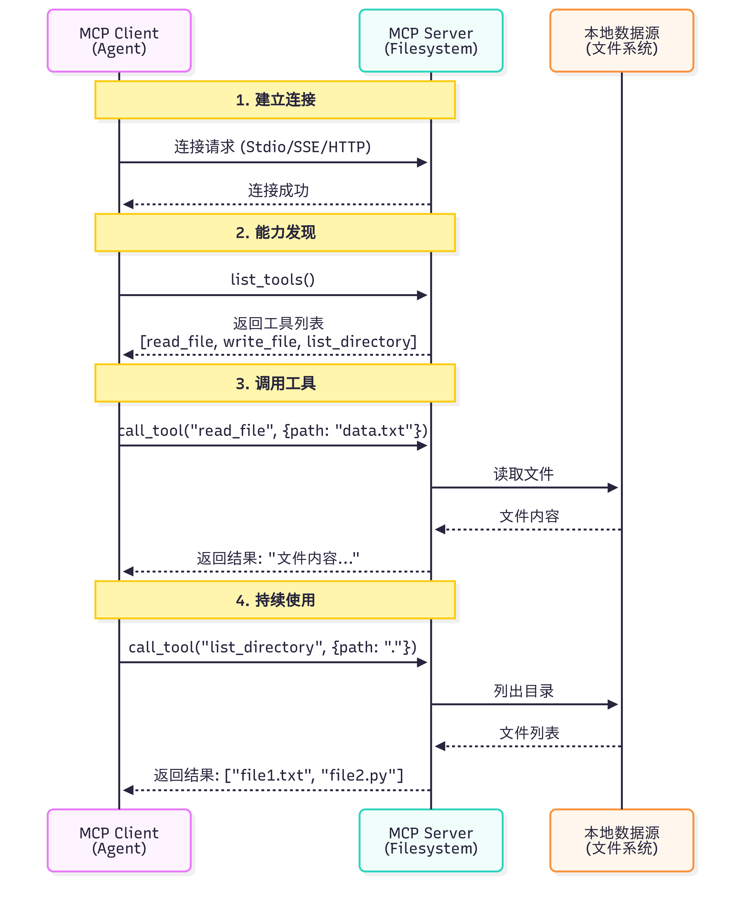
  <p>图 10.6 MCP 案例演示</p>
</div>

一个关键问题是：<strong>Claude（或其他 LLM）是如何决定使用哪些工具的？</strong> 

当用户提出问题时，完整的工具选择流程如下：

1. <strong>工具发现阶段</strong>：MCP Client 连接到 Server 后，首先调用`list_tools()`获取所有可用工具的描述信息（包括工具名称、功能说明、参数定义）

2. <strong>上下文构建</strong>：Client 将工具列表转换为 LLM 能理解的格式，添加到系统提示词中。例如：
   ```
   你可以使用以下工具：
   - read_file(path: str): 读取指定路径的文件内容
   - search_code(query: str, language: str): 在代码库中搜索
   ```

3. <strong>模型推理</strong>：LLM 分析用户问题和可用工具，决定是否需要调用工具以及调用哪个工具。这个决策基于工具的描述和当前对话上下文

4. <strong>工具执行</strong>：如果 LLM 决定使用工具，Client 通过 MCP Server 执行所选工具，获取结果

5. <strong>结果整合</strong>：工具执行结果被送回给 LLM，LLM 结合结果生成最终回答

这个过程是<strong>完全自动化</strong>的，LLM 会根据工具描述的质量来决定是否使用以及如何使用工具。因此，编写清晰、准确的工具描述至关重要。

<strong>（5）MCP 与 Function Calling 的差异</strong>

很多开发者会问：<strong>我已经在用 Function Calling 了，为什么还需要 MCP？</strong> 让我们通过表 10.3 来理解它们的区别。

<div align="center">
  <p>表 10.3 Function Calling 与 MCP 对比</p>
  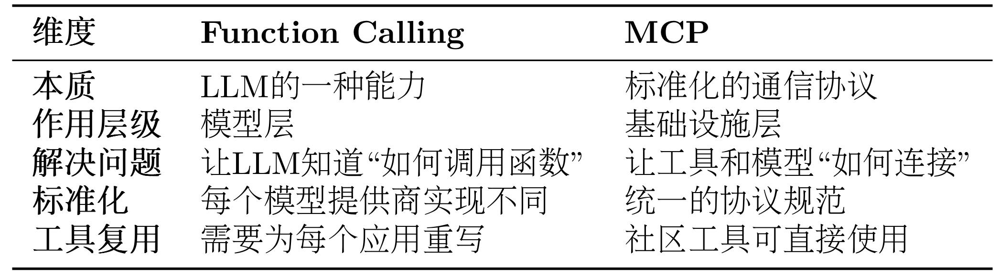
</div>

这里我们以智能体需要访问 GitHub 仓库和本地文件系统为例子来详细对比同一个任务的两种实现

<strong>方式 1：使用 Function Calling</strong>

```python
# 步骤1：为每个LLM提供商定义函数
# OpenAI格式
openai_tools = [
    {
        "type": "function",
        "function": {
            "name": "search_github",
            "description": "搜索GitHub仓库",
            "parameters": {
                "type": "object",
                "properties": {
                    "query": {"type": "string", "description": "搜索关键词"}
                },
                "required": ["query"]
            }
        }
    }
]

# Claude格式
claude_tools = [
    {
        "name": "search_github",
        "description": "搜索GitHub仓库",
        "input_schema": {  # 注意：不是parameters
            "type": "object",
            "properties": {
                "query": {"type": "string", "description": "搜索关键词"}
            },
            "required": ["query"]
        }
    }
]

# 步骤2：自己实现工具函数
def search_github(query):
    import requests
    response = requests.get(
        "https://api.github.com/search/repositories",
        params={"q": query}
    )
    return response.json()

# 步骤3：处理不同模型的响应格式
# OpenAI的响应
if response.choices[0].message.tool_calls:
    tool_call = response.choices[0].message.tool_calls[0]
    result = search_github(**json.loads(tool_call.function.arguments))

# Claude的响应
if response.content[0].type == "tool_use":
    tool_use = response.content[0]
    result = search_github(**tool_use.input)
```

<strong>方式 2：使用 MCP</strong>

```python
from hello_agents.protocols import MCPClient

# 步骤1：连接到社区提供的MCP服务器（无需自己实现）
github_client = MCPClient([
    "npx", "-y", "@modelcontextprotocol/server-github"
])

fs_client = MCPClient([
    "npx", "-y", "@modelcontextprotocol/server-filesystem", "."
])

# 步骤2：统一的调用方式（与模型无关）
async with github_client:
    # 自动发现工具
    tools = await github_client.list_tools()

    # 调用工具（标准化接口）
    result = await github_client.call_tool(
        "search_repositories",
        {"query": "AI agents"}
    )

# 步骤3：任何支持MCP的模型都能使用
# OpenAI、Claude、Llama等都使用相同的MCP客户端
```

首先需要明确的是，Function Calling 与 MCP 并非竞争关系，而是相辅相成的。Function Calling 是大语言模型的一项核心能力，它体现了模型内在的智能，使模型能够理解何时需要调用函数，并精准生成相应的调用参数。相对地，MCP 则扮演着基础设施协议的角色，它在工程层面解决了工具与模型如何连接的问题，通过标准化的方式来描述和调用工具。

我们可以用一个简单的类比来理解：Function Calling 相当于你学会了“如何打电话”这项技能，包括何时拨号、如何与对方沟通、何时挂断。而 MCP 则是那个全球统一的“电话通信标准”，确保了任何一部电话都能顺利地拨通另一部。

了解了它们之间的互补关系后，我们接下来看看如何在 HelloAgents 中使用 MCP 协议。


### MCP 传输方式详解

MCP 协议的一个重要特性是<strong>传输层无关性</strong>（Transport Agnostic）。这意味着 MCP 协议本身不依赖于特定的传输方式，可以在不同的通信通道上运行。HelloAgents 基于 FastMCP 2.0，提供了完整的传输方式支持，让你可以根据实际场景选择最合适的传输模式。

<strong>（1）传输方式概览</strong>

HelloAgents 的`MCPClient`支持五种传输方式，每种都有不同的使用场景，如表 10.4 所示：

<div align="center">
  <p>表 10.4 MCP 传输方式对比</p>
  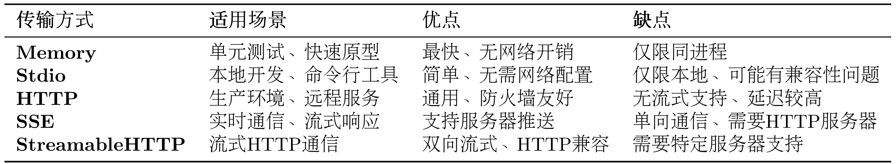
</div>

<strong>（2）传输方式使用示例</strong>

```python
from hello_agents.tools import MCPTool

# 1. Memory Transport - 内存传输（用于测试）
# 不指定任何参数，使用内置演示服务器
mcp_tool = MCPTool()

# 2. Stdio Transport - 标准输入输出传输（本地开发）
# 使用命令列表启动本地服务器
mcp_tool = MCPTool(server_command=["python", "examples/mcp_example_server.py"])

# 3. Stdio Transport with Args - 带参数的命令传输
# 可以传递额外参数
mcp_tool = MCPTool(server_command=["python", "examples/mcp_example_server.py", "--debug"])

# 4. Stdio Transport - 社区服务器（npx方式）
# 使用npx启动社区MCP服务器
mcp_tool = MCPTool(server_command=["npx", "-y", "@modelcontextprotocol/server-filesystem", "."])

# 5. HTTP/SSE/StreamableHTTP Transport
# 注意：MCPTool主要用于Stdio和Memory传输
# 对于HTTP/SSE等远程传输，建议直接使用MCPClient
```

<strong>（3）Memory Transport - 内存传输</strong>

适用场景：单元测试、快速原型开发

```python
from hello_agents.tools import MCPTool

# 使用内置演示服务器（Memory传输）
mcp_tool = MCPTool()

# 列出可用工具
result = mcp_tool.run({"action": "list_tools"})
print(result)

# 调用工具
result = mcp_tool.run({
    "action": "call_tool",
    "tool_name": "add",
    "arguments": {"a": 10, "b": 20}
})
print(result)
```

<strong>（4）Stdio Transport - 标准输入输出传输</strong>

适用场景：本地开发、调试、Python 脚本服务器

```python
from hello_agents.tools import MCPTool

# 方式1：使用自定义Python服务器
mcp_tool = MCPTool(server_command=["python", "my_mcp_server.py"])

# 方式2：使用社区服务器（文件系统）
mcp_tool = MCPTool(server_command=["npx", "-y", "@modelcontextprotocol/server-filesystem", "."])

# 列出工具
result = mcp_tool.run({"action": "list_tools"})
print(result)

# 调用工具
result = mcp_tool.run({
    "action": "call_tool",
    "tool_name": "read_file",
    "arguments": {"path": "README.md"}
})
print(result)
```

<strong>（5）HTTP Transport - HTTP 传输</strong>

适用场景：生产环境、远程服务、微服务架构

```python
# 注意：MCPTool 主要用于 Stdio 和 Memory 传输
# 对于 HTTP/SSE 等远程传输，建议使用底层的 MCPClient

import asyncio
from hello_agents.protocols import MCPClient

async def test_http_transport():
    # 连接到远程 HTTP MCP 服务器
    client = MCPClient("http://api.example.com/mcp")

    async with client:
        # 获取服务器信息
        tools = await client.list_tools()
        print(f"远程服务器工具: {len(tools)} 个")

        # 调用远程工具
        result = await client.call_tool("process_data", {
            "data": "Hello, World!",
            "operation": "uppercase"
        })
        print(f"远程处理结果: {result}")

# 注意：需要实际的 HTTP MCP 服务器
# asyncio.run(test_http_transport())
```

<strong>（6）SSE Transport - Server-Sent Events 传输</strong>

适用场景：实时通信、流式处理、长连接

```python
# 注意：MCPTool 主要用于 Stdio 和 Memory 传输
# 对于 SSE 传输，建议使用底层的 MCPClient

import asyncio
from hello_agents.protocols import MCPClient

async def test_sse_transport():
    # 连接到 SSE MCP 服务器
    client = MCPClient(
        "http://localhost:8080/sse",
        transport_type="sse"
    )

    async with client:
        # SSE 特别适合流式处理
        result = await client.call_tool("stream_process", {
            "input": "大量数据处理请求",
            "stream": True
        })
        print(f"流式处理结果: {result}")

# 注意：需要支持 SSE 的 MCP 服务器
# asyncio.run(test_sse_transport())
```

<strong>（7）StreamableHTTP Transport - 流式 HTTP 传输</strong>

适用场景：需要双向流式通信的 HTTP 场景

```python
# 注意：MCPTool 主要用于 Stdio 和 Memory 传输
# 对于 StreamableHTTP 传输，建议使用底层的 MCPClient

import asyncio
from hello_agents.protocols import MCPClient

async def test_streamable_http_transport():
    # 连接到 StreamableHTTP MCP 服务器
    client = MCPClient(
        "http://localhost:8080/mcp",
        transport_type="streamable_http"
    )

    async with client:
        # 支持双向流式通信
        tools = await client.list_tools()
        print(f"StreamableHTTP 服务器工具: {len(tools)} 个")

# 注意：需要支持 StreamableHTTP 的 MCP 服务器
# asyncio.run(test_streamable_http_transport())
```

### MCP 社区生态

MCP 协议的一个巨大优势是<strong>丰富的社区生态</strong>。Anthropic 和社区开发者已经创建了大量现成的 MCP 服务器，涵盖文件系统、数据库、API 服务等各种场景。这意味着你不需要从零开始编写工具适配器，可以直接使用这些经过验证的服务器。

这里给出 MCP 社区的三个资源库：

1. <strong>Awesome MCP Servers</strong> (https://github.com/punkpeye/awesome-mcp-servers)
   - 社区维护的 MCP 服务器精选列表
   - 包含各种第三方服务器
   - 按功能分类，易于查找

2. <strong>MCP Servers Website</strong> (https://mcpservers.org/)
   - 官方 MCP 服务器目录网站
   - 提供搜索和筛选功能
   - 包含使用说明和示例

3. <strong>Official MCP Servers</strong> (https://github.com/modelcontextprotocol/servers)
   - Anthropic 官方维护的服务器
   - 质量最高、文档最完善
   - 包含常用服务的实现

表 10.5 和 10.6 给出常用的官方 MCP 服务器和社区热门 MCP 服务器：

<div align="center">
  <p>表 10.5 常用官方 MCP 服务器</p>
  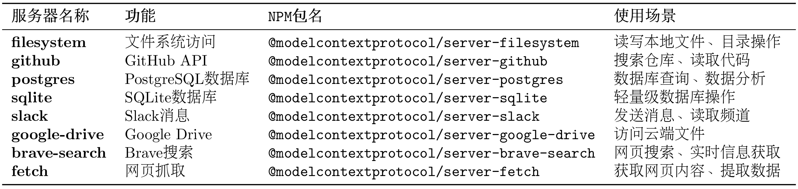
</div>

<div align="center">
  <p>表 10.6 社区热门 MCP 服务器</p>
  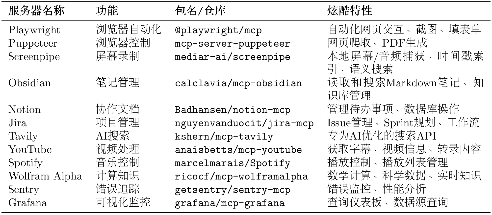
</div>

以下是一些特别有趣的案例 TODO 可供参考：

1. <strong>自动化网页测试（Playwright）</strong>
   
   ```python
   # Agent可以自动：
   # - 打开浏览器访问网站
   # - 填写表单并提交
   # - 截图验证结果
   # - 生成测试报告
   playwright_tool = MCPTool(
       name="playwright",
       server_command=["npx", "-y", "@playwright/mcp"]
   )
   ```
   
2. <strong>智能笔记助手（Obsidian + Perplexity）</strong>
   ```python
   # Agent可以：
   # - 搜索最新技术资讯（Perplexity）
   # - 整理成结构化笔记
   # - 保存到Obsidian知识库
   # - 自动建立笔记间的链接
   ```

3. <strong>项目管理自动化（Jira + GitHub）</strong>
   ```python
   # Agent可以：
   # - 从GitHub Issue创建Jira任务
   # - 同步代码提交到Jira
   # - 自动更新Sprint进度
   # - 生成项目报告
   ```

5. <strong>内容创作工作流（YouTube + Notion + Spotify）</strong>
   
   ```python
   # Agent可以：
   # - 获取YouTube视频字幕
   # - 生成内容摘要
   # - 保存到Notion数据库
   # - 播放背景音乐（Spotify）
   ```

通过这一节内容的讲解，希望你能探索更多 MCP 的实现案例，也欢迎投稿至 Helloagents！接下来，让我们学习 A2A 协议。

## A2A 协议实战

A2A（Agent-to-Agent）是一种支持智能体之间直接通信与协作的协议。

### 协议设计动机

MCP 协议解决了智能体与工具的交互，而 A2A 协议则解决智能体之间的协作问题。在一个需要多智能体（如研究员、撰写员、编辑）协作的任务中，它们需要通信、委托任务、协商能力和同步状态。

传统的中央协调器（星型拓扑）方案存在三个主要问题：

- <strong>单点故障</strong>：协调器失效导致系统整体瘫痪。
- <strong>性能瓶颈</strong>：所有通信都经过中心节点，限制了并发。
- <strong>扩展困难</strong>：增加或修改智能体需要改动中心逻辑。

A2A 协议采用点对点（P2P）架构（网状拓扑），允许智能体直接通信，从根本上解决了上述问题。它的核心是<strong>任务（Task）</strong>和<strong>工件（Artifact）</strong>这两个抽象概念，这是它与 MCP 最大的区别，如表 10.7 所示。

<div align="center">
  <p>表 10.7 A2A 核心概念</p>
  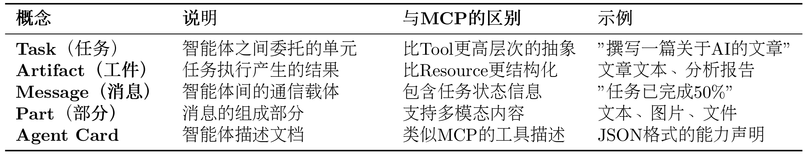
</div>

为实现对协作过程的管理，A2A 为任务定义了标准化的生命周期，包括创建、协商、代理、执行中、完成、失败等状态，可见图 10.7。

<div align="center">
  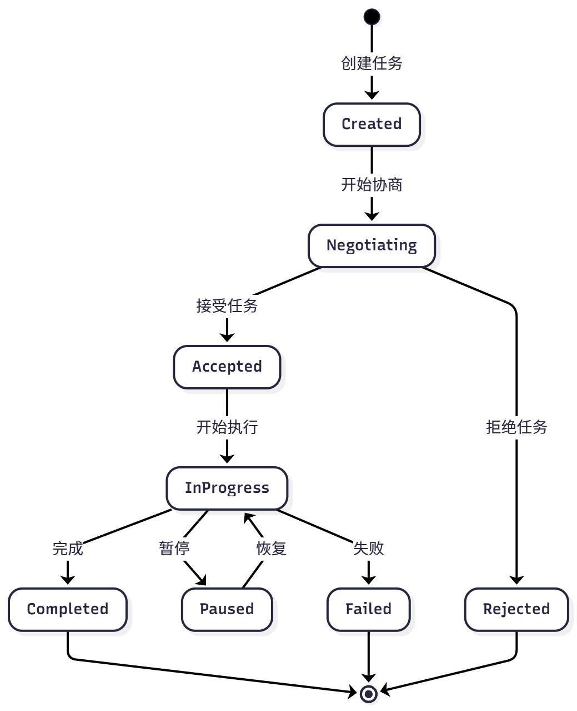
  <p>图 10.7 A2A 任务周期</p>
</div>


该机制使智能体可以进行任务协商、进度跟踪和异常处理。

A2A 请求生命周期是一个序列，详细说明了请求遵循的四个主要步骤：代理发现、身份验证、发送消息 API 和发送消息流 API。下图 10.8 借鉴了官网的流程图，用来展示了操作流程，说明了客户端、A2A 服务器和身份验证服务器之间的交互。

<div align="center">
  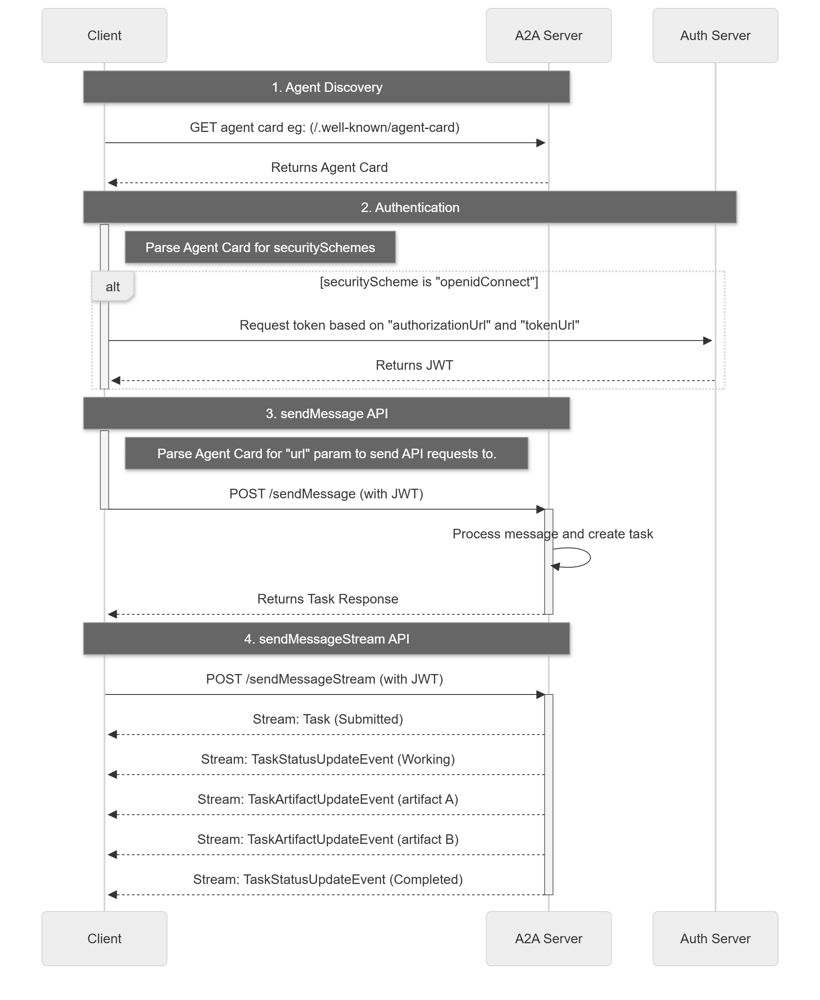
  <p>图 10.8 A2A 请求生命周期</p>
</div>


## ANP 协议

在 MCP 协议解决了工具调用、A2A 协议解决点对点智能体协作之后，ANP 协议则专注于解决大规模、开放网络环境下的智能体管理问题。

在 10.2 和 10.3 节中，我们学习了 MCP（工具访问）和 A2A（智能体协作）。现在，让我们学习 ANP（Agent Network Protocol）协议，它专注于构建<strong>大规模、开放的智能体网络</strong>。

### 协议目标

当一个网络中存在大量功能各异的智能体（例如，自然语言处理、图像识别、数据分析等）时，系统会面临一系列挑战：

- <strong>服务发现</strong>：当新任务到达时，如何快速找到能够处理该任务的智能体？
- <strong>智能路由</strong>：如果多个智能体都能处理同一任务，如何选择最合适的一个（如根据负载、成本等）并向其分派任务？
- <strong>动态扩展</strong>：如何让新加入网络的智能体被其他成员发现和调用？

ANP 的设计目标就是提供一套标准化的机制，来解决上述的服务发现、路由选择和网络扩展性问题。

为实现其设计目标，ANP 定义了以下几个核心概念，如表 10.8 所示：

<div align="center">
  <p>表 10.8 ANP 核心概念</p>
  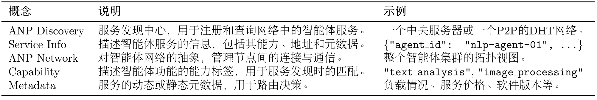
</div>

我们同样借用官方的[入门指南](https://github.com/agent-network-protocol/AgentNetworkProtocol/blob/main/docs/chinese/ANP入门指南.md)来介绍 ANP 的架构设计，如图 10.9 所示

<div align="center">
  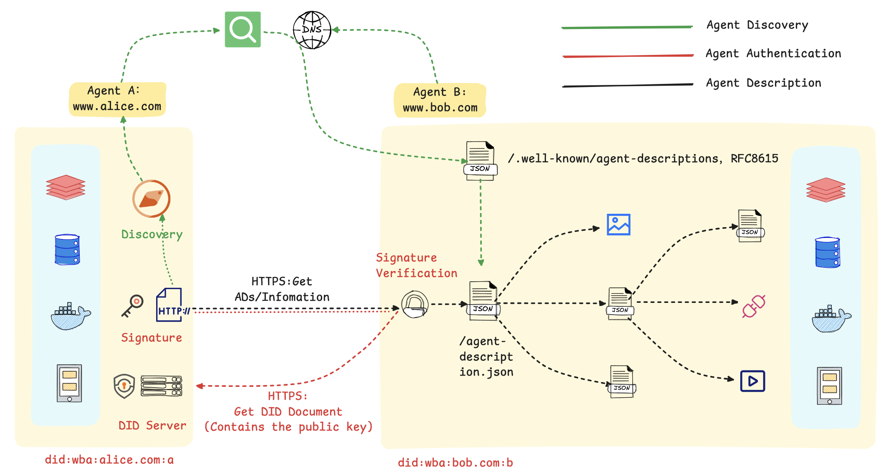
  <p>图 10.9 ANP 整体流程</p>
</div>


在这个流程图里，主要包括以下几个步骤：

<strong>1. 服务的发现与匹配：</strong>首先，智能体 A 通过一个公开的发现服务，基于语义或功能描述进行查询，以定位到符合其任务需求的智能体 B。该发现服务通过预先爬取各智能体对外暴露的标准端点（`.well-known/agent-descriptions`）来建立索引，从而实现服务需求方与提供方的动态匹配。

<strong>2. 基于 DID 的身份验证：</strong>在交互开始时，智能体 A 使用其私钥对包含自身 DID 的请求进行签名。智能体 B 收到后，通过解析该 DID 获取对应的公钥，并以此验证签名的真实性与请求的完整性，从而建立起双方的可信通信。

<strong>3. 标准化的服务执行：</strong>身份验证通过后，智能体 B 响应请求，双方依据预定义的标准接口和数据格式进行数据交换或服务调用（如预订、查询等）。标准化的交互流程是实现跨平台、跨系统互操作性的基础。

总而言之，该机制的核心是利用 DID 构建了一个去中心化的信任根基，并借助标准化的描述协议实现了服务的动态发现。这套方法使得智能体能够在无需中央协调的前提下，安全、高效地在互联网上形成协作网络。


## 本章总结

本章系统性地介绍了智能体通信的三种核心协议：MCP、A2A 与 ANP，并探讨了它们的设计理念、应用场景与实践方法。

<strong>协议定位：</strong>

- <strong>MCP (Model Context Protocol)</strong>: 作为智能体与工具之间的桥梁，提供统一的工具访问接口，适用于增强单个智能体的能力。
- <strong>A2A (Agent-to-Agent Protocol)</strong>: 作为智能体之间的对话系统，支持直接通信与任务协商，适用于小规模团队的紧密协作。
- <strong>ANP (Agent Network Protocol)</strong>: 作为智能体的“互联网”，提供服务发现、路由与负载均衡机制，适用于构建大规模、开放的智能体网络。


完成本章后，建议你：

1. <strong>动手实践</strong>：
   - 构建自己的 MCP 服务器
   - 利用协议创建多 Agent 协作系统
   - MCP、A2A 与 ANP 的组合应用策略
2. <strong>深入学习</strong>：
   - 阅读 MCP 官方文档：https://modelcontextprotocol.io
   - 阅读 A2A 官方文档：https://a2a-protocol.org/latest/
   - 阅读 ANP 官方文档：https://agent-network-protocol.com/guide/
3. <strong>参与社区</strong>：
   - 向社区贡献新的 MCP 服务
   - 分享个人开发的智能体实现案例
   - 参与相关协议的技术标准讨论，也可以在 Issue 提问或是直接帮助 Helloagents 支持新的 example 案例

<strong>恭喜你完成第十章的学习！</strong>

你现在已经掌握了智能体通信协议的核心知识。继续加油！🚀


## 参考文献

[1] Anthropic. (2024). *Model Context Protocol*. Retrieved October 7, 2025, from https://modelcontextprotocol.io/

[2] The A2A Project. (2025). *A2A Protocol: An open protocol for agent-to-agent communication*. Retrieved October 7, 2025, from https://a2a-protocol.org/

[3] Chang, G., Lin, E., Yuan, C., Cai, R., Chen, B., Xie, X., & Zhang, Y. (2025). *Agent Network Protocol technical white paper*. arXiv. https://doi.org/10.48550/arXiv.2508.00007
