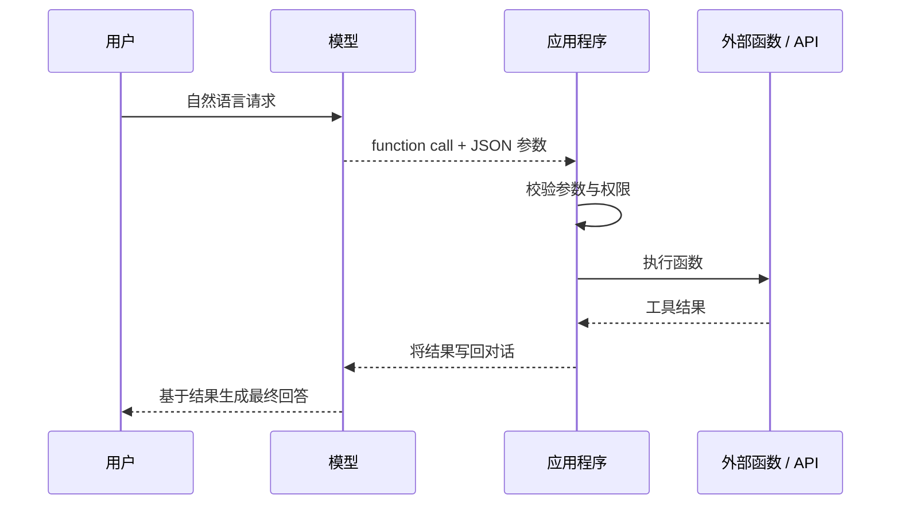
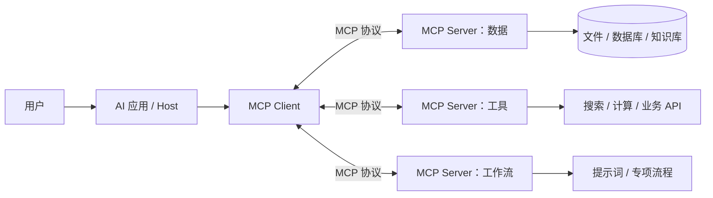
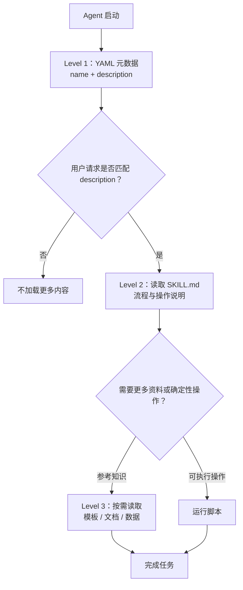

# 从 Function Calling 到 Agent：MCP、Skills 与 Reasoning + Tool Use

> 核心视角：大模型从"会说"走向"会做"，并不是靠单一技术完成的。
>
> -   **Function Calling**：让模型"会调用"
> -   **MCP**：让外部工具"接得上"
> -   **Skills**：让 Agent 知道"事情该怎么做"
> -   **Reasoning + Tool
>     Use**：让模型知道"什么时候调用、调用什么、调用之后下一步怎么办"
>
> 四者结合，构成现代 Agent 从语言模型走向任务执行系统的重要能力栈。

------------------------------------------------------------------------

# 总览：从"会说"到"会做"

``` text
                  LLM 如何从“会说”走向“会做”
                              │
                              ▼
                    ① Function Calling
                              │
                         模型会调用
                              │
                              ▼
                         ② MCP
                              │
                         工具接得上
                              │
                              ▼
                        ③ Skills
                              │
                         事情做得好
                              │
                              ▼
                 ④ Reasoning + Tool Use
                              │
                        会边想边做
                              │
                              ▼
                            Agent
```

四个概念解决的问题并不相同：

| 技术                 | 核心问题                             | 所在层次                 | 一句话理解                                 |
|----------------------|--------------------------------------|--------------------------|--------------------------------------------|
| **Function Calling** | 怎么调用？                           | Model / API              | 让模型输出结构化工具调用                   |
| **MCP**              | 怎么连接？                           | Protocol / Runtime       | 让 Agent 标准化连接 Tools / Resources      |
| **Skills**           | 怎么做好？                           | Capability / Knowledge   | 把专业知识、流程、脚本封装成可复用能力     |
| **Reasoning + Tool Use** | 什么时候用？用哪个？下一步怎么办？ | Model + Runtime          | 让模型边思考边行动                         |

------------------------------------------------------------------------

# 学术背景：Tool Use 并不是从 Function Calling 才开始

如果从产品/API 演进讲，可以从 OpenAI Function Calling 开始。

但如果从学术技术演进看，在 Function Calling 之前已经出现了重要工作：

``` text
2022
ReAct
 │
 │ Reasoning + Acting
 ▼
思考与行动交替
 │
 ▼
2023
Toolformer
 │
 │ Learn When / How to Use Tools
 ▼
学习何时调用外部 API
 │
 ▼
2023
OpenAI Function Calling
 │
 │ Structured Tool Calling
 ▼
结构化调用进入主流 LLM API
```

因此需要区分：

> **Function Calling 是现代 LLM 工具调用的重要工程/API 起点之一，而不是 Tool Use 研究本身的最早起点。**

------------------------------------------------------------------------

# ReAct：Reasoning 与 Acting 的早期结合

2022 年的 ReAct 是理解现代 Agent Tool Use 非常重要的一篇论文。

论文：

**ReAct: Synergizing Reasoning and Acting in Language Models**

核心思想是把：

``` text
Reasoning
```

和：

``` text
Acting
```

交错起来。

传统推理：

``` text
Question
   ↓
Reasoning
   ↓
Answer
```

ReAct：

``` text
Question
   ↓
Thought
   ↓
Action
   ↓
Observation
   ↓
Thought
   ↓
Action
   ↓
Observation
   ↓
...
   ↓
Answer
```

抽象后就是：

``` text
Reason
   ↓
Act
   ↓
Observe
   ↓
Reason
```

这已经非常接近现代 Agent 的基本工作循环。

**ReAct：让语言模型在“边想”与“边做”之间循环**

**来源**

- Shunyu Yao、Jeffrey Zhao、Dian Yu、Nan Du、Izhak Shafran、Karthik Narasimhan、Yuan Cao，*ReAct: Synergizing Reasoning and Acting in Language Models*（arXiv:2210.03629，ICLR 2023）：[arXiv](https://arxiv.org/abs/2210.03629)｜[PDF](https://arxiv.org/pdf/2210.03629)

> **论文 ID：** arXiv:2210.03629   **论文名称：** ReAct: Synergizing Reasoning and Acting in Language Models   **作者：** Shunyu Yao、Jeffrey Zhao、Dian Yu、Nan Du、Izhak Shafran、Karthik Narasimhan、Yuan Cao，2022   **发布时间：** 2022 年 10 月 6 日（arXiv 首次提交）   **原文：** [arXiv](https://arxiv.org/abs/2210.03629)｜[PDF](https://arxiv.org/pdf/2210.03629)

**核心观点**

ReAct 提出的不是新的语言模型或新的强化学习算法，而是一种 **提示（prompting）范式**：让模型交替生成两类 token——用于计划、反思和更新判断的 **Thought**，以及访问知识库或操作环境的 **Action**；环境执行动作后返回 **Observation**，模型再据此继续推理。这条闭环可概括为：

`Thought → Action → Observation → Thought → … → Finish`

它要解决的是当时两条路线各自的短板：纯 Chain-of-Thought（CoT）可做多步推理，但事实依赖模型参数中的静态知识，容易把错误一路传播；纯行动式 Agent 能查资料、操作环境，却缺少显式的高层计划与可读的工作记忆。ReAct 的核心主张是：**推理负责决定下一步该做什么，行动负责把新的外部证据带回推理。**

**1. 同一轨迹中把“计划”与“取证”交错起来**

在知识问答中，模型先写下“需要查什么”，再调用如 `Search[...]` 的动作；观察到搜索结果后，修正原先的判断并决定下一次查询。在交互环境中，Thought 可记录当前目标、失败原因和替代计划，Action 则执行 `go`、`open`、`take` 等环境动作。最终答案或 `Finish[...]` 是这条轨迹的结束，而不是一开始就直接生成的结论。


*Figure 1：上半部分是 HotpotQA 中标准回答、CoT、Act-only 与 ReAct 的对比；下半部分是 ALFWorld 中 Act-only 与 ReAct 的对比。红色标出错误或无效路径，绿色标出来自环境的证据或成功结果。来源：[论文第 2 页](https://arxiv.org/pdf/2210.03629#page=2)。*

图中的两个例子正好说明双向关系：

- **Reason to Act**：在 ALFWorld 里，模型先想到物品可能在哪里，再据此选择去柜子、台面或抽屉的动作；动作失败后，Thought 帮它更新计划，而不是重复无效尝试。
- **Act to Reason**：在 HotpotQA 里，模型用搜索结果纠正 CoT 中的错误联想。外部观察把推理锚定在可查询的证据上，降低了凭空补全事实的风险。

**2. ReAct 的训练门槛很低，但任务接口必须可靠**

原论文主要以少样本 in-context examples 驱动 PaLM-540B：示例把 Thought、Action、Observation 的格式写进提示，再由模型续写轨迹。它不要求为每个任务重新训练一个策略网络，因此可以迁移到问答、事实核验和网页/文本环境等多类任务。

不过，“能调用工具”不等于模型天然正确。ReAct 依赖三个前提：动作空间要被清晰文本化、环境观察要能忠实返回结果、示例要覆盖关键的计划与纠错行为。工具返回错误、接口含义不清或模型把观察误读时，轨迹仍可能失败；显式 Thought 提升的是可检查性，不是正确性的保证。

**3. 它把 Agent 的输出从“动作序列”变成可审阅的过程**

与只输出动作的方式相比，ReAct 会暴露“为什么现在搜索、为什么改变目标、为何认为任务已完成”。这让人可以检查是事实检索、计划还是执行步骤出了问题，也让环境反馈能够在下一个 Thought 中真正参与决策。论文将这种轨迹称为更接近人类的问题解决过程，并报告其在人类可解释性与可信度上的改善。

从今天的 Agent 视角看，ReAct 奠定了一个常见骨架：模型内部的语言推理不是与工具使用分离的前置步骤，而是在每一次工具调用之后重新读取状态、再决定下一步的循环。后续系统可以在这一骨架上加入函数调用、记忆、规划器、验证器或强化学习；这些扩展不是本论文的原始结论。

**带来的收益**

- **更少的事实幻觉与错误累积机会**：在 HotpotQA 和 FEVER 中，模型可查询一个简单的 Wikipedia API，再把证据纳入后续 Thought，而非只依赖参数化记忆。
- **交互任务的成功率提升**：论文报告，在仅提供 1–2 个 in-context 示例的条件下，ReAct 相对模仿学习与强化学习方法，在 ALFWorld 和 WebShop 的绝对成功率分别高出 **34 个百分点**和 **10 个百分点**。
- **更易调试与审计**：Thought—Action—Observation 轨迹把计划、工具调用和环境反馈显性化，便于定位失败环节；但这不应被误解为完整安全保证，Thought 也可能是错误或事后合理化的。
- **通用的 Agent 交互范式**：它证明了同一个 LLM 可以用文本接口在“推理—行动—反馈”之间循环，不必把思考和执行拆成互不相干的两个系统。

一句话：**ReAct 的影响在于把 LLM 从“先想完再回答”推进到“想一步、做一步、读回结果再想一步”，让推理能被外部证据持续校正。**

------------------------------------------------------------------------


# 模型的工具使用能力演进

## Toolformer：让语言模型自己学会何时调用工具

2023 年 Toolformer 进一步研究：

> **语言模型能否自己学习什么时候调用外部工具，以及如何利用工具结果？**

Toolformer 关注的核心问题可以概括为：

``` text
When to call?
      ↓
Which tool?
      ↓
What arguments?
      ↓
How to use the result?
```

也就是：

``` text
什么时候调用？
      ↓
调用什么？
      ↓
参数是什么？
      ↓
如何利用结果？
```

这与今天 Reasoning + Tool Use 所关注的问题高度相关。

**来源**

- Timo Schick、Jane Dwivedi-Yu、Roberto Dessì、Roberta Raileanu、Maria Lomeli、Luke Zettlemoyer、Nicola Cancedda、Thomas Scialom，*Toolformer: Language Models Can Teach Themselves to Use Tools*（arXiv:2302.04761，2023）：[arXiv](https://arxiv.org/abs/2302.04761)｜[PDF](https://arxiv.org/pdf/2302.04761)

> **模型：** Toolformer（基于 GPT-J 6.7B）   **模型厂家：** Meta AI Research   **论文 ID：** arXiv:2302.04761   **论文名称：** Toolformer: Language Models Can Teach Themselves to Use Tools   **作者：** Timo Schick、Jane Dwivedi-Yu、Roberto Dessì、Roberta Raileanu、Maria Lomeli、Luke Zettlemoyer、Nicola Cancedda、Thomas Scialom，2023   **发布时间：** 2023 年 2 月 9 日（arXiv 首次提交）   **原文：** [arXiv](https://arxiv.org/abs/2302.04761)｜[PDF](https://arxiv.org/pdf/2302.04761)

**核心观点**

Toolformer 的问题非常具体：语言模型知道怎样续写文本，却常常不会判断 **是否需要外部工具、应该调用哪个工具、参数如何写、工具结果应怎样影响后续输出**。论文的答案是把 API 调用也表示成文本，并让模型以自监督方式从普通语言数据中筛出“真正有助于下一个 token 预测”的调用样本，再据此微调。

它不是给模型手工标注海量工具轨迹，也不是在每个任务上单独训练工具策略。每种 API 只需少量人工示例来说明格式；其余“何时调用、问什么、值不值得调用”的训练信号由模型自身产生。

**1. 工具调用被线性化为语言的一部分**

论文将一次调用写成类似：

`<API> 工具名(输入) → 返回结果 </API>`

因而计算器、问答系统、Wikipedia 搜索、机器翻译和日历的输入输出，都可以直接插入普通文本。推理时，模型正常解码；一旦生成表示“需要返回结果”的标记，系统暂停生成、执行 API、把结果写回上下文，再继续生成。

这个设计使工具结果成为下一轮语言建模的条件信息：模型不必把精确算术、最新事实或翻译结果都压进参数中，而是学会在合适位置访问外部能力。

**2. 关键创新：只保留能降低预测损失的调用**

Toolformer 的训练数据构造分为三步：

1. **采样候选调用**：用少量示例提示原模型，在海量文本的若干位置生成候选 API 调用。
2. **执行调用**：取得每个候选调用的真实返回值。
3. **过滤调用**：比较“带调用及返回值”与“没有调用，或只有调用没有返回值”时对后续 token 的交叉熵损失；只有返回值使未来文本更容易预测的候选才留下。


*Figure 2：以问答 API 为例，先采样候选调用，再执行并依据后续 token 损失筛选，最后将保留的调用交织回原语言模型数据。来源：[论文第 2 页](https://arxiv.org/pdf/2302.04761#page=2)。*

若记某位置之后的加权预测损失为 \(L_i\)，论文保留满足下式的调用：

$$
L_i^{-}-L_i^{+}\geq \tau_f
$$

其中 \(L_i^{+}\) 是提供 API 调用与返回结果时的损失，\(L_i^{-}\) 是不调用或不给返回结果时的较优损失。直观上，**不是“看起来像工具调用”就作为训练样本，而是调用结果确实帮助模型预测接下来文本，才算有用。**

**3. 训练目标仍是普通语言模型目标**

筛选后，论文把 API 片段插回原始文本，得到增强数据集，再以标准 next-token prediction 微调。原文强调：除了插入的 API 片段，文本内容仍来自原语言模型数据，因此目标是让模型获得工具能力，同时尽量保留原来的通用语言建模能力。

这也明确了 Toolformer 的边界：它学习的是在文本分布中对工具有用的调用习惯，而非完备的任务规划、可靠的多轮验证或任意工具协议。工具输出错误、调用格式变化、需要长程状态管理的任务，仍可能让系统失败。

**带来的收益**

- **以很少人工标注换来工具使用能力**：每个 API 只需少量格式示例；候选调用、执行结果与质量筛选主要由自监督过程完成。
- **将“是否调用”也纳入模型学习**：筛选准则让模型学习到何时值得请求计算、检索或翻译，而不是把工具固定绑定到某个下游任务。
- **小模型可借外部工具弥补短板**：论文报告，基于 GPT-J 的 **6.7B** 参数 Toolformer 在多项零样本任务上显著提升，并在多种任务上优于更大的 GPT-3 基线，同时不牺牲核心语言建模能力。
- **奠定文本化工具调用的基本范式**：把调用、返回值和后续生成放在同一 token 序列中，为后来的函数调用与 Agent 系统提供了清晰的接口思路；但现代系统的权限控制、工具可靠性与多步规划仍需要额外机制。

一句话：**Toolformer 的突破是用“工具返回值是否让未来文本更可预测”作为自监督信号，让语言模型自己学会调用工具的时机与方式。**

------------------------------------------------------------------------

## Function Calling：给模型一双标准化的"手"

### OpenAI Function Calling

2023 年 6 月 13 日，OpenAI 为 GPT-4 和 GPT-3.5 Turbo 引入 Function
Calling。

核心变化是：

``` text
Natural Language
       ↓
      LLM
       ↓
Function Selection
       ↓
Arguments Generation
       ↓
Structured Tool Call
```

例如用户：

``` text
东京现在天气怎么样？
```

模型不再只能生成：

``` text
我建议查询天气 API。
```

而是可以产生结构化调用：

``` json
{
  "name": "get_weather",
  "arguments": {
    "city": "Tokyo"
  }
}
```

------------------------------------------------------------------------

### Function Calling 的完整流程

``` text
User
 │
 │ “东京现在天气怎么样？”
 ▼
LLM
 │
 │ 判断需要天气工具
 ▼
Function Selection
 │
 ▼
get_weather
{
  "city": "Tokyo"
}
 │
 ▼
Application / Agent Runtime
 │
 ▼
Weather API
 │
 ▼
Tool Result
 │
 ▼
LLM
 │
 ▼
Final Answer
```

这里有一个非常重要的边界：

> **模型通常并不真正执行 Function。**

模型主要负责：

``` text
理解用户意图
     ↓
判断是否需要工具
     ↓
选择 Function
     ↓
生成 Arguments
```

真正负责：

``` text
执行函数
调用 API
访问数据库
修改文件
```

的是：

``` text
Application
      /
Agent Runtime
```

因此 Function Calling 本质上解决的是：

> **自然语言世界与软件 API 世界之间的结构化接口。**

------------------------------------------------------------------------

### Function Calling 的核心三问

``` text
Need Tool?
    │
    ▼
Which Tool?
    │
    ▼
What Arguments?
```

即：

> **要不要调？调哪个？参数是什么？**

开发者通常向模型提供：

``` text
Tool Name
    +
Description
    +
Parameter Schema
```

模型根据：

``` text
User Query
    +
Tool Definition
```

决定工具调用。

------------------------------------------------------------------------

### Function Calling 的技术意义

在 Function Calling 之前：

``` text
LLM
 ↓
Text
```

模型只能"说"。

Function Calling 之后：

``` text
LLM
 ↓
Structured Call
 ↓
Software
```

模型开始能够把语言意图映射到软件操作。

因此可以把它理解成：

> **Function Calling 让 LLM 第一次拥有标准化的"手"。**

### Function Calling 的官方资料

**Function Calling：把语言理解连接到受控的外部动作**

**来源**

- OpenAI，*Function calling and other API updates*（2023-06-13）：[官方页面](https://openai.com/index/function-calling-and-other-api-updates/)

> **模型：** GPT-4-0613、GPT-3.5-turbo-0613   **模型厂家：** OpenAI   **文章名称：** Function calling and other API updates   **作者：** Atty Eleti、Jeff Harris、Logan Kilpatrick，2023   **发布时间：** 2023 年 6 月 13 日   **原文：** [OpenAI 官方页面](https://openai.com/index/function-calling-and-other-api-updates/)

**核心观点**

这篇发布把 LLM 接入外部系统的接口从“让模型在自然语言里拼一段看似像代码的文本”，推进到 **由开发者声明函数签名，模型选择是否调用并生成结构化参数**。初始支持的 `gpt-4-0613` 与 `gpt-3.5-turbo-0613` 被微调为：识别何时需要函数、选择合适函数、并输出遵循函数签名的 JSON 对象。

真正需要把握的边界是：**模型不执行函数。** 模型负责提出工具调用及参数；应用程序验证、执行外部 API，并把结果作为新的消息交还模型，由模型继续生成对用户可见的答案。



*流程图根据官方页面描述整理：模型负责选择与填写调用，应用程序负责执行与控制。官方原文没有提供可独立提取的静态示意图。*

**1. 函数签名把“可做什么”变成模型的受控选择空间**

开发者通过 `functions` 参数以 JSON Schema 描述函数名称、参数类型、必填字段与枚举值。例如，天气函数可声明 `location` 与只能取 `celsius` / `fahrenheit` 的 `unit`；模型据此可把“波士顿天气如何”转换为相应的结构化参数。开发者也能用 `function_call` 指定必须调用某个函数，或让模型自行决定。

这比解析自由文本更可靠，但“符合 schema”不等于“业务上正确”：地点、日期、收件人或 SQL 条件即使类型正确，也可能误解用户意图。因此 schema 是接口约束，不是事实校验和授权机制。

**2. 三类直接用途：工具、系统接口与结构化抽取**

官方页面列出的典型用途可归为三类：

- **让聊天机器人使用外部工具**：例如获取天气、查询服务信息；
- **把自然语言转为系统调用**：例如内部 API、数据库查询或发邮件参数；
- **从文本提取结构化数据**：例如从文章中抽取姓名、生日、地点等字段。

这三类任务的共同点不是“模型拥有了工具能力”，而是模型输出了一份机器可消费的、受函数定义约束的中间表示。应用仍须决定是否允许、如何执行及如何处理失败。

**3. 安全设计必须放在应用层**

发布页明确指出，来自工具的不可信数据可能诱导模型执行非预期动作；这是早期工具调用中典型的间接提示注入风险。因此官方建议只消费可信工具信息，并在发送邮件、发帖、购买等有现实影响的操作前加入用户确认。

实务上，可靠链路至少应包含：对调用参数做服务器端校验、按用户权限授权、把工具输出视为不可信输入、对有副作用的调用要求确认，以及记录调用与结果以便审计。它们不是 function calling 自动提供的能力，而是应用开发者的责任。

**带来的收益**

- **更稳定的系统集成接口**：函数名称与 JSON Schema 使模型输出从自由文本变成可验证的结构化参数，降低了脆弱的正则解析需求。
- **把“理解用户意图”与“执行外部动作”解耦**：模型做语义映射，应用控制权限、执行与错误处理，便于接入天气、检索、数据库和业务 API。
- **支持可组合的 Agent 工作流**：工具结果回注到对话后，模型可根据新事实继续回答或选择下一步；这成为后续工具调用与 Agent 框架的基础接口模式。
- **安全边界更清晰，但绝非自动安全**：结构化调用减少格式不确定性，却不能阻止错误参数、越权或提示注入；有副作用的操作仍应由应用做验证与用户确认。

一句话：**Function Calling 的核心价值是让模型把“我想调用什么工具、参数是什么”以受 schema 约束的结构化形式交给应用，再由应用安全地执行。**

### 从 Function Calling 到 Tool Calling

Function Calling 最初强调：

``` text
Function
```

后来模型可以使用的能力不断增加：

``` text
Function
   ↓
API
   ↓
Search
   ↓
Database
   ↓
Python
   ↓
File
   ↓
Browser
   ↓
Computer
```

于是概念逐渐扩展成：

``` text
Tool Calling
      /
Tool Use
```

可以这样理解：

  概念                   重点
---------------------- -------------------------------------------------
  **Function Calling**   模型生成结构化函数调用
  **Tool Calling**       模型调用 Search、Code、File、Browser 等广义工具
  **Tool Use**           模型学习何时以及如何利用工具完成任务

------------------------------------------------------------------------

## Gorilla / ToolLLM：大规模 API Tool Use

Function Calling 出现前后，学术界也开始集中研究大规模 API 调用。

### Gorilla

Gorilla 研究：

> **如何让 LLM 更准确地调用大量 API，并降低 API Hallucination。**

论文：

-   Patil et al. (2023), **Gorilla: Large Language Model Connected with Massive APIs**\ https://arxiv.org/abs/2305.15334

**Gorilla：让语言模型在海量、会变化的 API 中选对并写对调用**

**来源**

- Shishir G. Patil、Tianjun Zhang、Xin Wang、Joseph E. Gonzalez，*Gorilla: Large Language Model Connected with Massive APIs*（arXiv:2305.15334，2023）：[arXiv](https://arxiv.org/abs/2305.15334)｜[PDF](https://arxiv.org/pdf/2305.15334)

> **模型：** Gorilla（基于 LLaMA-7B）   **模型厂家：** UC Berkeley   **论文 ID：** arXiv:2305.15334   **论文名称：** Gorilla: Large Language Model Connected with Massive APIs   **作者：** Shishir G. Patil、Tianjun Zhang、Xin Wang、Joseph E. Gonzalez，2023   **发布时间：** 2023 年 5 月 24 日（arXiv 首次提交）   **原文：** [arXiv](https://arxiv.org/abs/2305.15334)｜[PDF](https://arxiv.org/pdf/2305.15334)

**核心观点**

Gorilla 要解决的不是“模型能不能调用一个已写进提示词的工具”，而是更接近真实开发环境的问题：**当 API 数量很大、功能彼此相似、文档不断更新时，模型能否选到正确 API，并生成参数与库名都正确的调用？**

论文的路线是三件事配合：构建面向机器学习 API 的 APIBench；用指令—API 对微调 LLaMA-7B；在训练与推理中结合文档检索。作者将“调用了数据库里不存在的 API”定义为 hallucination，并以 AST 子树匹配检查生成调用的功能对应关系。

**1. 从“会输出代码”转向“调用与文档一致的 API”**

对 API 调用来说，接近功能描述却使用了错误的库、模型名或参数，往往仍然不能运行。论文开篇的例子显示，即便是当时强大的通用模型，也可能为指定框架编造不存在的模型，或选择错误库。Gorilla 因此将目标定为 **fully-qualified API call**：不仅任务方向正确，调用本身还要能在目标 API 集合中找到对应项。

APIBench 汇集了 TorchHub、TensorFlow Hub 与 HuggingFace 的模型 API。论文统计其训练集合包含 **1,645** 个 API：94 个 TorchHub、626 个 TensorFlow Hub v2 与 925 个 HuggingFace API，并以 Self-Instruct 生成 **16,450** 个 instruction—API 对。

**2. Retriever 让模型在测试时跟上文档变化**

Gorilla 的关键补充不是只在模型参数里记住 API 文档，而是先从 API 数据库检索相关文档，再将“Use this API documentation for reference”及检索结果拼进用户请求。模型学习根据这段可更新的文档生成调用。


*Figure 3：上半部分从 API 文档、JSON 化数据与 Self-Instruct 样本训练 Gorilla-7B；下半部分展示推理时的两种模式：检索相关文档后再生成调用，或直接 zero-shot 生成。来源：[论文第 4 页](https://arxiv.org/pdf/2305.15334#page=4)。*

这使“更新 API 文档”可以在检索库侧完成，而不必每次 API 版本变化都重训模型。论文也特别指出：加入检索不必然提升效果，检索到不相关或质量不足的文档反而可能伤害性能；因此 Retriever 的召回质量和模型是否真正会阅读文档同样重要。

**3. 训练、推理与执行是三个不同环节**

训练时，论文把 instruction—API 对转成一轮 user—agent 对话，对 LLaMA-7B 做标准指令微调；推理时，模型输出待调用 API。论文虽有执行这些 API 的系统，但明确说明执行不是研究重点。

这一区分很重要：Gorilla 主要验证的是 **API 选择与调用合成的准确性**，而不是完整的多轮 Agent 规划、权限控制或实际操作安全。即使生成调用在 AST 级别与基准 API 相符，生产系统仍需要检查参数、依赖环境、鉴权与执行后结果。

**4. 与 Toolformer、Function Calling 的位置不同**

Toolformer 侧重自监督地学习何时调用几类工具；Function Calling 提供开发者声明 schema、模型输出结构化参数的接口。Gorilla 的重点则是“面对大规模且会更新的 API 文档，如何选对并写对具体调用”。三者可互补：schema 约束输出格式，Retriever 提供新文档，微调模型提升 API 选择与调用准确度。

**带来的收益**

- **降低 API 幻觉**：论文以“调用不属于 API 数据库”的生成作为 hallucination 定义，并报告 Gorilla 在 API 功能准确性与幻觉减少上优于其比较基线，包括 GPT-4；这是 APIBench 和论文设定下的结果。
- **支持不断变化的工具生态**：检索将新版本文档在测试时带入上下文，减少仅依赖参数化知识导致的过时调用。
- **把评测目标落到可执行接口**：APIBench 与 AST 子树匹配关注具体 API 调用的功能对应，而不是只看生成文本是否流畅。
- **为工具型 Agent 提供可靠一层**：当 Agent 要在大量相近服务中选择时，检索增强的 API 专项模型可降低“选错工具/编造接口”的风险；但它仍不取代权限、参数验证与执行确认。

一句话：**Gorilla 的贡献是把工具使用推进到“海量 API + 检索到的最新文档 + 正确调用合成”，重点解决真实系统中最常见的选错与编造接口问题。**

### ToolLLM

ToolLLM 则进一步构建 ToolBench 等数据与评测体系，让模型学习使用大量真实API。

论文：

-   Qin et al. (2023), **ToolLLM: Facilitating Large Language Models to Master 16000+ Real-world APIs**\ https://arxiv.org/abs/2307.16789

因此这一阶段可以理解成：

``` text
Function Calling
       │
       ▼
结构化调用
       │
       ▼
Large-scale API Tool Use
       │
       ├─ Gorilla
       └─ ToolLLM
```


**ToolLLM：让开源模型使用 16,000+ 真实 API**

**来源**

- Yujia Qin、Shihao Liang、Yining Ye、Kunlun Zhu、Lan Yan、Yaxi Lu、Yankai Lin 等，*ToolLLM: Facilitating Large Language Models to Master 16000+ Real-world APIs*（arXiv:2307.16789，2023）：[arXiv](https://arxiv.org/abs/2307.16789)｜[PDF](https://arxiv.org/pdf/2307.16789)

> **模型：** ToolLLaMA（ToolLLM 框架）   **模型厂家：** OpenBMB / 清华大学等   **论文 ID：** arXiv:2307.16789   **论文名称：** ToolLLM: Facilitating Large Language Models to Master 16000+ Real-world APIs   **作者：** Yujia Qin、Shihao Liang、Yining Ye、Kunlun Zhu、Lan Yan、Yaxi Lu、Yankai Lin 等，2023   **发布时间：** 2023 年 7 月 31 日（arXiv 首次提交）   **原文：** [arXiv](https://arxiv.org/abs/2307.16789)｜[PDF](https://arxiv.org/pdf/2307.16789)

**核心观点**

ToolLLM 的目标是把“LLM 会用少数演示工具”扩展为“LLM 能在大规模、真实、RESTful API 集合中，为复杂请求检索工具、规划多步调用、执行并根据返回值继续决策”。论文不是只发布一个模型，而是交付一套闭环：**ToolBench 数据构造、ToolLLaMA 训练、API Retriever、DFSDT 推理策略与 ToolEval 评测。**

**1. ToolBench 用真实 API 和真实返回值构建训练场景**

论文从 RapidAPI Hub 收集 **16,464** 个 REST API，覆盖 **49** 个类别。每个 API 都附带功能描述、参数、调用代码与文档；之后让 ChatGPT 生成单工具、同类多工具和跨集合多工具指令，并为每条指令搜索一条包含真实 API 调用与返回值的有效解决路径。

这与只生成“问题—调用文本”不同：后续模型能看到工具的真实返回信息，并学习根据返回值决定下一步。论文的 ToolBench 统计为 **126,486** 条实例、**469,585** 次真实 API 调用，平均每条推理轨迹 4.0 步。

**2. Retriever 先缩小候选工具，ToolLLaMA 再做多轮决策**

面对 16,000 多个 API，不能把所有文档塞进上下文，也不应要求用户手选工具。ToolLLM 先用神经 API Retriever 推荐相关 API 与文档，再交给微调后的 ToolLLaMA 进行多轮调用；每轮真实返回值成为下一步规划的信息。ToolEval 则评估整条轨迹的执行与质量。


*Figure 1：左半部分是 ToolBench 的 API 收集、指令生成与解题路径标注，以及 Retriever 与 ToolLLaMA 的训练；右半部分是推理时由 Retriever 提供候选 API、模型进行多轮调用、ToolEval 评测全过程。来源：[论文第 2 页](https://arxiv.org/pdf/2307.16789#page=2)。*

这条链路的分工是清晰的：Retriever 回答“候选工具有哪些”，ToolLLaMA 回答“现在调用哪个、参数怎样填、下一步怎么走”，真实 API 负责给出外部状态，而 ToolEval 判断结果是否真的完成了任务。

**3. DFSDT 让工具推理可以回退与分支搜索**

复杂任务的一条 ReAct 轨迹很容易在早期选错 API 后一路走偏。论文提出 **depth-first search-based decision tree（DFSDT）**：让模型在决策树中扩展多个推理/调用分支，评估当前步骤后决定继续、回退或尝试替代路径。它比单链路 ReAct 多了显式的搜索与回退机制。

DFSDT 在本文有双重作用：其一，用于为 ToolBench 标注难指令的有效解题路径；其二，作为推理策略提升模型处理多工具、跨步骤任务的机会。代价也相应存在：分支搜索意味着更多模型调用、更多 API 调用和更高延迟，必须设定合理的预算与停止条件。

**4. ToolEval 用轨迹结果而不是仅看文字流畅度**

ToolEval 是论文的自动评测器，核心包括：

- **Pass rate**：在有限调用预算内是否成功完成指令；
- **Win rate**：比较两条解题轨迹的质量与有用性。

作者报告 ToolEval 与人工评测具有较高相关性，并在该评测下发现：ToolLLaMA 超过 text-davinci-003 与 Claude-2，接近 ChatGPT、略低于 GPT-4；在未见过的 APIBench 上也展现零样本泛化。它们是指定 API、评估预算和自动评测器下的结果，不等同于生产环境的绝对可靠性。

**带来的收益**

- **把工具规模推进到真实 API 生态**：16,464 个 REST API 与多工具路径比少量手工工具更接近实际服务集成场景。
- **减少人工挑选工具的负担**：Retriever 在大候选池中先筛选相关 API，模型再结合文档与返回值做细粒度调用决策。
- **提升复杂多步任务的可完成性**：DFSDT 能探索、评估与回退多条轨迹，缓解单一路径早期失误造成的连锁失败。
- **提供可复用的训练—评测闭环**：ToolBench、ToolLLaMA、Retriever 和 ToolEval 将数据、模型、推理及评测联系起来，为开源工具 Agent 的后续迭代提供基准。

一句话：**ToolLLM 的核心贡献不是让模型“会调用一个工具”，而是建立一套让开源模型在海量真实 API 中检索、规划、执行和评测多步工具任务的完整框架。**


------------------------------------------------------------------------

# MCP：工具怎么"接得上"

Function Calling 解决了：

> **模型怎么表达"我要调用工具"。**

但随着 Agent 能连接的外部系统越来越多，又出现了新的工程问题：

``` text
GitHub
Database
File System
Slack
Search
Browser
Cloud Service
...
```

如果每个 Agent 都分别实现：

``` text
GitHub Integration
Database Integration
File Integration
Slack Integration
...
```

集成成本会越来越高。

于是出现 MCP：

**Model Context Protocol**

------------------------------------------------------------------------

## MCP 的核心思想

MCP 更适合放在：

> **Agent Runtime / Tool Infrastructure**

这一层理解。

``` text
                    LLM
                     │
                Tool Calling
                     │
                     ▼
                 Agent Runtime
                     │
                     ▼
                 MCP Client
                     │
       ┌─────────────┼─────────────┐
       ▼             ▼             ▼
   MCP Server    MCP Server    MCP Server
       │             │             │
     Files         GitHub       Database
       │             │             │
       ▼             ▼             ▼
     Tools         Tools         Resources
```

因此：

``` text
Function Calling
       │
       ▼
模型怎么调用工具


MCP
       │
       ▼
Agent 怎么标准化连接工具
```

------------------------------------------------------------------------

## Function Calling 与 MCP 的关系

不要简单理解成：

``` text
Function Calling
       ↓
      MCP
```

因为它们不是简单的前后替代关系。

更准确的是：

``` text
                  LLM
                   │
            Function / Tool Calling
                   │
                   ▼
              Agent Runtime
                   │
                   ▼
                  MCP
                   │
          ┌────────┼────────┐
          ▼        ▼        ▼
        Tool     Tool    Resource
```

因此一句话区分：

> **Function Calling 解决"怎么调用"；MCP 解决"怎么连接"。**

## MCP 官方资料

-   Anthropic, **Introducing the Model Context Protocol**\
    https://www.anthropic.com/news/model-context-protocol

-   Model Context Protocol 官方网站\
    https://modelcontextprotocol.io/

MCP 首先是一项：

> **开放协议 / 工程标准**

**Model Context Protocol（MCP）：AI 应用连接外部世界的通用接口**

**来源**

- Anthropic，*Introducing the Model Context Protocol*（2024-11-25）：[官方发布](https://www.anthropic.com/news/model-context-protocol)
- Model Context Protocol，*What is the Model Context Protocol (MCP)?*：[官方文档](https://modelcontextprotocol.io/)

> **协议：** Model Context Protocol（MCP）   **发起方：** Anthropic   **文章名称：** Introducing the Model Context Protocol   **作者：** Anthropic；MCP 由 David Soria Parra 与 Justin Spahr-Summers 在 Anthropic 创建   **发布时间：** 2024 年 11 月 25 日   **原文：** [Anthropic 官方发布](https://www.anthropic.com/news/model-context-protocol)｜[MCP 官方文档](https://modelcontextprotocol.io/)

**核心观点**

MCP 是连接 AI 应用与外部系统的开放协议。它试图解决的不是“模型如何思考”，而是“每接入一个数据源或工具，都要重新写一套私有集成”的工程碎片化问题。官方把它类比为 AI 应用的 **USB-C**：客户端实现一次协议，就能以统一方式连接文件、数据库、搜索、业务工具和工作流；服务端实现一次协议，就能被多个兼容客户端使用。

**1. MCP 标准化的是连接层，而不是模型或工具本身**

在 MCP 中，外部能力仍由各自系统提供：数据库保存数据、搜索引擎检索、业务 API 执行操作。协议的作用是规定 AI 应用怎样发现、读取或调用这些能力，如何传递上下文与结果，以及在客户端和服务端之间建立一致的通信边界。



*根据 Anthropic 发布与 MCP 官方文档整理的架构示意：Host 中的 Client 通过 MCP 连接多个 Server；Server 再封装各类外部系统。两份来源未提供可独立复用的同类静态架构图。*

这带来一个重要分层：**Host** 决定用户体验与权限策略；**Client** 负责协议会话；**Server** 暴露其数据或能力；底层系统仍保有自己的身份、权限和执行逻辑。MCP 并不把所有系统合并成一个数据库或一个“超级工具”。

**2. 连接的对象可分为数据、工具与工作流**

官方文档将 MCP 可连接的外部系统概括为三类：

- **数据源**：本地文件、代码仓库、数据库、企业知识库；
- **工具**：搜索、计算器、业务操作或其他可执行 API；
- **工作流**：专用提示、交互应用或面向特定任务的流程。

这使一个 AI 助手不必只依靠预训练知识和当前对话，而能在需要时获取与用户任务相关的最新上下文，并在授权范围内采取动作。Anthropic 首发时展示的方向包括 Google Drive、Slack、GitHub、Git、Postgres 和 Puppeteer 等预构建服务器。

**3. “一次构建，多处连接”是协议层收益**

没有通用协议时，若有 \(m\) 个 AI 应用与 \(n\) 个外部系统，常常需要维护接近 \(m\times n\) 套定制连接。MCP 试图把复杂度更接近地变为：应用各实现一个 Client，外部系统各实现一个 Server，再由协议完成互操作。

这不保证所有连接自动兼容——每个 Server 仍要定义能力、参数与安全限制——但显著减少了“为某个助手专门适配某个数据源”的重复工作，并让 Server 的实现有机会复用于不同客户端。

**4. 开放连接不等于自动获得安全授权**

MCP 使上下文与工具更容易接入，也同时扩大了模型接触不可信内容和执行外部动作的范围。因此协议解决的是互操作性，不替代安全体系。生产系统仍需由 Host 和 Server 共同落实：用户授权、最小权限、工具参数校验、敏感操作确认、来源可信度判断、审计与隔离。

尤其要避免把“Server 返回的文本”无条件当成模型应遵从的指令；它可能包含不可信内容。MCP 能传输上下文，但不会自动判断上下文是否安全或真实。

**带来的收益**

- **降低集成成本**：开发者可按同一开放协议构建客户端或服务端，避免为每个 AI 产品与数据系统维护独立连接器。
- **让 AI 回答更贴近实时任务上下文**：模型可在授权下访问文件、数据库、代码仓库等外部信息，减少仅依赖静态参数化知识的局限。
- **形成可复用的工具生态**：一个 MCP Server 有机会服务于多个兼容 AI 应用；官方文档已将其定位为连接数据、工具和工作流的通用层。
- **把安全责任显性化**：协议分层使权限、确认、执行和审计可以明确落在 Host 与 Server，而非把所有控制隐含在模型提示词中；但这些机制必须由实现者实际部署。

一句话：**MCP 的价值在于把 AI 与外部数据和工具之间的“点对点私有连接”，转化为 Client—Server 形式的开放协议生态。**


------------------------------------------------------------------------

# Skills：工具接上以后，"事情应该怎么做"

有了 Tool 和 MCP 以后，又出现一个新的问题：

> **Agent 能调用工具，就一定知道怎样把任务做好吗？**

答案是否定的。

例如：

``` text
GitHub Tool
```

可以提供：

``` text
read_pr
create_issue
comment_pr
merge_pr
...
```

这只能说明：

> **Agent 能操作 GitHub。**

但真正完成 Code Review，还需要知道：

``` text
先检查什么？
     ↓
如何判断代码正确性？
     ↓
如何检查安全问题？
     ↓
如何检查测试？
     ↓
如何遵循团队规范？
     ↓
最后如何输出 Review？
```

这些属于：

> **Procedural Knowledge / Workflow**

------------------------------------------------------------------------

## Agent Skills

Skill 可以把完成某类任务所需要的：

``` text
Instructions
     +
Workflow
     +
Best Practices
     +
Scripts
     +
References
     +
Templates
```

封装起来。

典型结构：

``` text
my-skill/
│
├── SKILL.md
│     ├─ name
│     ├─ description
│     └─ instructions
│
├── scripts/
├── references/
├── assets/
└── ...
```

可以把 Skill 理解成：

> **Agent 的可复用"经验包 / SOP / 工作方法"。**

------------------------------------------------------------------------

## MCP 与 Skills 的区别

这是非常容易混淆的一组概念。

例如：

``` text
GitHub MCP
```

负责提供：

``` text
read_pr
comment_pr
create_issue
merge_pr
```

而：

``` text
Code Review Skill
```

负责告诉 Agent：

``` text
① 读取 PR Diff
② 理解改动目的
③ 检查 Correctness
④ 检查 Security
⑤ 检查 Tests
⑥ 对照团队 Coding Standard
⑦ 输出 Review
```

因此：

``` text
MCP
 │
 └─ “我有哪些工具可以用？”


Skill
 │
 └─ “这件事情应该怎么做？”
```

------------------------------------------------------------------------

## Function Calling / MCP / Skills 三者关系

可以用三句话理解：

``` text
Function Calling
       ↓
“怎么调用？”


MCP
       ↓
“怎么连接？”


Skills
       ↓
“怎么做好？”
```

如果用 Agent 的人体类比：

``` text
Function Calling
       ↓
      手


MCP
       ↓
神经连接 / 接口


Skills
       ↓
经验 / SOP
```

## Agent Skills 官方资料

-   Anthropic, **Agent Skills Overview**\
    https://platform.claude.com/docs/en/agents-and-tools/agent-skills/overview

-   Anthropic Skills Repository\
    https://github.com/anthropics/skills

Agent Skills 更适合看作：

> **Agent 能力封装规范与工程实践。**

**Agent Skills：把通用 Agent 变成按需加载的领域专家**

**来源**

- Anthropic，*Agent Skills Overview*：[官方文档](https://platform.claude.com/docs/en/agents-and-tools/agent-skills/overview)
- Anthropic，*Skills Repository*：[GitHub 仓库](https://github.com/anthropics/skills)

> **能力机制：** Agent Skills   **提出方：** Anthropic   **文章名称：** Agent Skills Overview   **作者：** Anthropic   **发布时间：** 官方文档未标示单独发布日期   **原文：** [Agent Skills 官方文档](https://platform.claude.com/docs/en/agents-and-tools/agent-skills/overview)｜[Anthropic Skills Repository](https://github.com/anthropics/skills)

**核心观点**

Agent Skill 是一个可复用、基于文件系统的能力包：它将 **元数据、执行说明以及可选脚本/模板/参考资料** 放在同一个目录中。其目的不是替代模型，而是把某个组织的流程、知识和可靠操作方式封装起来，使通用 Agent 在匹配任务到来时按需成为“该领域的专家”。

关键区别在于：提示词通常服务于一次对话；Skill 可被一次创建、多次自动发现和组合使用。Anthropic 官方仓库中也以独立目录方式提供从创意、开发到企业流程及文档处理的示例与参考实现。

### 1. 渐进披露：只把当前任务所需内容带入上下文

Skill 的核心设计是分层加载：启动时只加载很小的元数据；请求匹配后才读取主说明；主说明引用的资料、模板或脚本则等真正需要时再访问。



*根据 Anthropic 官方文档的三层加载模型整理。元数据始终在上下文中；指令只在触发后读取；资源与代码仅在需要时访问或运行。*

这解决了一个实际矛盾：组织希望把大量流程、数据字典和范例交给 Agent，但不希望每次对话都占满上下文。官方文档给出的典型量级是：每个 Skill 的元数据约占 100 tokens，主说明在触发后进入上下文，而未访问的文件不消耗上下文 token；脚本运行时，模型主要接收其输出而非整段脚本源码。

**2. 一个最小 Skill 就是目录中的 `SKILL.md`**

官方要求每个 Skill 包含带 YAML frontmatter 的 `SKILL.md`，最小必需字段是：

```markdown
---
name: my-skill-name
description: 这个 Skill 做什么，以及什么时候应当使用它
---

# Instructions
…
```

其中 `description` 不只是介绍文案，更是发现与触发条件：它必须同时说明能力内容和适用时机。主说明可以继续链接表单指南、数据库 schema、样例与脚本；由此把“宽泛的知识”留在 Agent 的通用能力中，把“组织特有且可执行的做法”放在 Skill 内。

**3. 文件、脚本与资料分别承担不同职责**

- **指令**：描述可以根据情境调整的步骤、限制和最佳实践；
- **脚本**：处理格式转换、校验、批量操作等确定性工作，减少每次临时生成代码的不稳定性；
- **资源**：承载模板、品牌规范、API 文档、数据 schema 或示例，只在任务关联时读取。

这种划分的实质是：用语言模型处理理解、判断与协作，用确定性代码处理可验证、重复的操作，用资源文件保存不必每次记住的事实。Skill 也可以组合，因此一个复杂任务可按需调用多个小而清晰的能力包。

**4. Skill 应被视为可执行的软件供应链**

官方明确提醒：Skill 可能引导 Agent 调用工具、读写文件、运行代码或访问外部内容，因此不可信 Skill 可能造成数据外泄、未授权访问或工具滥用。安装或引入第三方 Skill 前，应审查 `SKILL.md`、脚本、模板、图片及外部依赖；尤其注意异常网络请求、与声明目的不符的文件访问，以及会产生副作用的命令。

此外，运行环境因产品表面而异。例如官方文档说明 Claude API 的 Skill 容器没有网络访问且不能临时安装包，而 Claude Code 的自定义 Skill 则使用本机同等网络能力。Skill 的可移植性并不意味着运行权限相同。

**带来的收益**

- **减少重复提示与上下文浪费**：将领域流程写入一次、在匹配任务时自动加载，而非在每轮对话重复粘贴长提示词。
- **提升任务一致性**：把模板、校验脚本与团队规范放进同一包，使文档处理、数据分析或业务流程更可复现。
- **支持能力组合**：小粒度 Skills 可按任务叠加，让 Agent 在复杂流程中分别获得不同领域的操作知识。
- **使专业知识可维护、可审计**：目录、版本控制与脚本让流程改动可以评审和迭代；但也要求按软件供应链标准审核来源与权限。

一句话：**Agent Skills 把“给模型一段长提示”升级为“可按需发现、加载、执行和组合的文件系统能力包”，以更少上下文承载更多专业流程。**

------------------------------------------------------------------------

# Reasoning + Tool Use：从"能调用"到"会调用"

Function Calling 最初重点解决：

``` text
Which Function?
      +
What Arguments?
```

但真正复杂的任务要求模型解决：

``` text
我现在需要工具吗？
        ↓
需要哪个工具？
        ↓
参数应该是什么？
        ↓
调用结果说明什么？
        ↓
信息够了吗？
        ↓
还需要调用其他工具吗？
        ↓
下一步怎么办？
```

这就是：

> **Reasoning + Tool Use**

------------------------------------------------------------------------

## Reasoning 与 Tool Use 汇合

``` text
                  User Goal
                     │
                     ▼
                   Think
                     │
              Need a Tool?
                     │
           ┌─────────┴─────────┐
           ▼                   ▼
          No                  Yes
           │                   │
           │              Which Tool?
           │                   │
           │                 Call
           │                   │
           │                Observe
           │                   │
           │                Think
           │                   │
           │             Need another?
           │                   │
           └─────────┬─────────┘
                     ▼
                   Answer
```

模型开始从：

``` text
“会生成 Tool Call”
```

升级成：

``` text
“会围绕目标使用 Tool”
```

------------------------------------------------------------------------

## OpenAI o3 / o4-mini：Reasoning + Tool Use

OpenAI 的 o3 / o4-mini 是现代 Reasoning + Tool Use 的代表案例之一。

能力不再只是：

``` text
User
 ↓
Function Call
 ↓
Result
```

而是：

``` text
User Goal
    ↓
Reasoning
    ↓
Need Information?
    ↓
Select Tool
    │
    ├─ Web Search
    ├─ Python
    ├─ Files
    ├─ Vision
    └─ Functions
    ↓
Tool Result
    ↓
Observation
    ↓
Re-reasoning
    ↓
Next Action
    ↓
...
    ↓
Answer
```

关键变化：

``` text
Function Calling
       ↓
“调用哪个函数？”


Reasoning + Tool Use
       ↓
“这个问题是否需要工具？”
       +
“需要哪个工具？”
       +
“结果出来后下一步怎么办？”
```

因此可以概括：

> **Function Calling = 能调用。**

> **Reasoning + Tool Use = 会调用。**

## **官方资料**

-   OpenAI, **Introducing o3 and o4-mini**\
    https://openai.com/index/introducing-o3-and-o4-mini/

-   OpenAI, **Learning to reason with LLMs**\
    https://openai.com/index/learning-to-reason-with-llms/

------------------------------------------------------------------------

# 从 Function Calling 到 Agent

最终可以形成一条非常清晰的能力路线：

``` text
LLM
 │
 ▼
会说
 │
 │ Language Modeling
 ▼
会想
 │
 │ Reasoning
 ▼
会调用
 │
 │ Function Calling
 ▼
接工具
 │
 │ MCP
 ▼
会做事
 │
 │ Skills
 ▼
边想边做
 │
 │ Reasoning + Tool Use
 ▼
会观察、会调整
 │
 │ Agent Runtime
 ▼
Agent
```

------------------------------------------------------------------------

## 技术时间线

``` text
2022
 │
 ├─ ReAct
 │    └─ Reasoning + Acting
 │
 ▼
2023
 │
 ├─ Toolformer
 │    └─ Learn When / How to Use Tools
 │
 ├─ OpenAI Function Calling
 │    └─ Structured Tool Calling
 │
 ├─ Gorilla
 │    └─ Massive API Calling
 │
 └─ ToolLLM
      └─ Large-scale Tool-use Training
 │
 ▼
2024
 │
 └─ MCP
      └─ Standardized Tool / Resource Connectivity
 │
 ▼
2025+
 │
 ├─ Agent Skills
 │    └─ Reusable Workflow / Procedural Knowledge
 │
 └─ Reasoning + Tool Use
      └─ Think → Act → Observe → Re-plan
 │
 ▼
Modern Agent
```

------------------------------------------------------------------------

# 核心论文与技术文档

## 1. Reasoning + Acting

### ReAct

**ReAct: Synergizing Reasoning and Acting in Language Models**

-   类型：论文
-   时间：2022
-   作用：把 Reasoning 与 Acting 交错起来，形成 Thought → Action →
    Observation 循环。

https://arxiv.org/abs/2210.03629

------------------------------------------------------------------------

## 2. Learning to Use Tools

### Toolformer

**Toolformer: Language Models Can Teach Themselves to Use Tools**

-   类型：论文
-   时间：2023
-   作用：研究模型如何学习何时调用 API、调用什么以及如何利用返回结果。

https://arxiv.org/abs/2302.04761

------------------------------------------------------------------------

## 3. Function Calling

### OpenAI Function Calling

**Function calling and other API updates**

-   类型：官方技术文档 / 产品发布
-   时间：2023
-   作用：让 GPT 模型能够根据函数定义输出结构化 Function Call。

https://openai.com/index/function-calling-and-other-api-updates/

------------------------------------------------------------------------

## 4. Large-scale API Tool Use

### Gorilla

**Gorilla: Large Language Model Connected with Massive APIs**

-   类型：论文
-   时间：2023
-   作用：研究大规模 API 调用与 API Hallucination。

https://arxiv.org/abs/2305.15334

### ToolLLM

**ToolLLM: Facilitating Large Language Models to Master 16000+
Real-world APIs**

-   类型：论文
-   时间：2023
-   作用：通过 ToolBench 等数据训练和评测大规模 Tool Use。

https://arxiv.org/abs/2307.16789

------------------------------------------------------------------------

## 5. MCP

### Model Context Protocol

-   类型：开放协议 / 官方技术规范
-   时间：2024
-   作用：标准化 AI Application / Agent 与外部 Tools、Resources、Data
    Sources 的连接。

Anthropic 发布：

https://www.anthropic.com/news/model-context-protocol

MCP 官方网站：

https://modelcontextprotocol.io/

------------------------------------------------------------------------

## 6. Agent Skills

### Agent Skills Overview

-   类型：官方技术文档 / 能力封装规范
-   作用：将 Instructions、Workflow、Scripts、References 等封装为可复用
    Agent Capability。

https://platform.claude.com/docs/en/agents-and-tools/agent-skills/overview

### Anthropic Skills Repository

https://github.com/anthropics/skills

------------------------------------------------------------------------

## 7. Modern Reasoning + Tool Use

### OpenAI o3 / o4-mini

**Introducing o3 and o4-mini**

-   类型：官方技术资料
-   作用：Reasoning Model 在推理过程中结合 Web
    Search、Python、Files、Vision 等工具，根据结果继续调整推理与行动。

https://openai.com/index/introducing-o3-and-o4-mini/

### OpenAI o1

**Learning to reason with LLMs**

-   类型：官方技术资料
-   作用：现代 Reasoning Model 与 Test-time Compute 路线的重要来源。

https://openai.com/index/learning-to-reason-with-llms/

------------------------------------------------------------------------

# 二十六、出处总表

| 技术                 | 时间   | 代表出处                               | 类型         | 核心贡献                             |
|----------------------|--------|----------------------------------------|--------------|--------------------------------------|
| **ReAct**            | 2022   | *ReAct: Synergizing Reasoning and Acting in Language Models* | 论文         | Reasoning + Acting                   |
| **Toolformer**       | 2023   | *Toolformer: Language Models Can Teach Themselves to Use Tools* | 论文         | 学习何时、如何调用工具               |
| **Function Calling** | 2023   | OpenAI Function Calling                | 官方技术文档 | 结构化工具调用                       |
| **Gorilla**          | 2023   | *Gorilla*                              | 论文         | 大规模 API 调用                      |
| **ToolLLM**          | 2023   | *ToolLLM*                              | 论文         | Tool-use 数据、训练与评测            |
| **MCP**              | 2024   | Model Context Protocol                 | 官方协议     | 标准化工具/资源连接                  |
| **Agent Skills**     | 2025+  | Agent Skills / Anthropic Skills        | 官方规范     | 封装流程、知识、脚本                 |
| **Reasoning + Tool Use** | 2025+ | OpenAI o3/o4-mini 等                 | 官方技术资料 | 推理何时以及如何使用工具             |
| **Agentic Tool Use** | 现在   | Reasoning + Tools + Skills + Runtime   | 综合范式     | 边想、边做、边观察、边调整           |

------------------------------------------------------------------------

# 二十七、一句话总结

> **Function Calling 定义"模型如何调用工具"，MCP
> 解决"工具如何标准化接入"，Skills 封装"任务应该怎样完成"，而
> Reasoning + Tool Use
> 则让模型具备"什么时候调用、调用什么、看到结果后下一步怎么办"的决策能力。四者结合，构成现代
> Agent 从"会说"走向"会做"的核心能力栈。**
