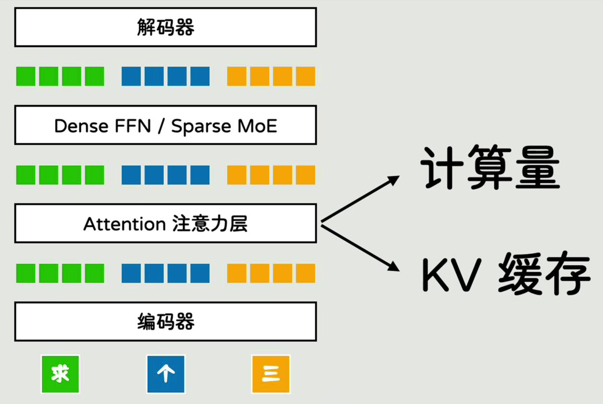
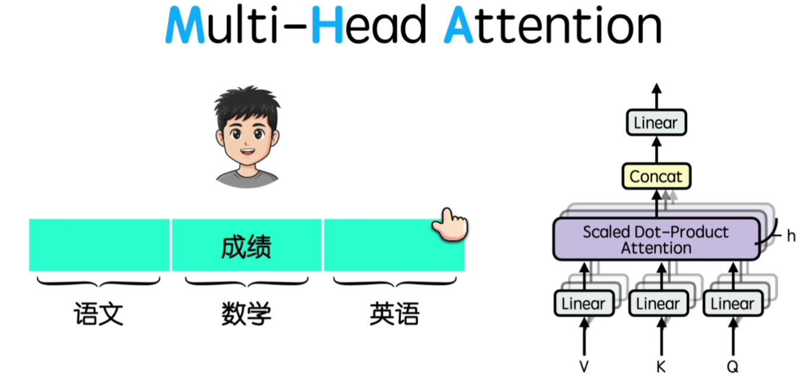
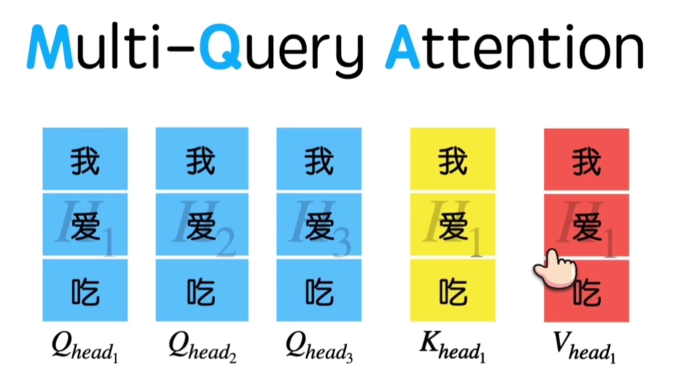
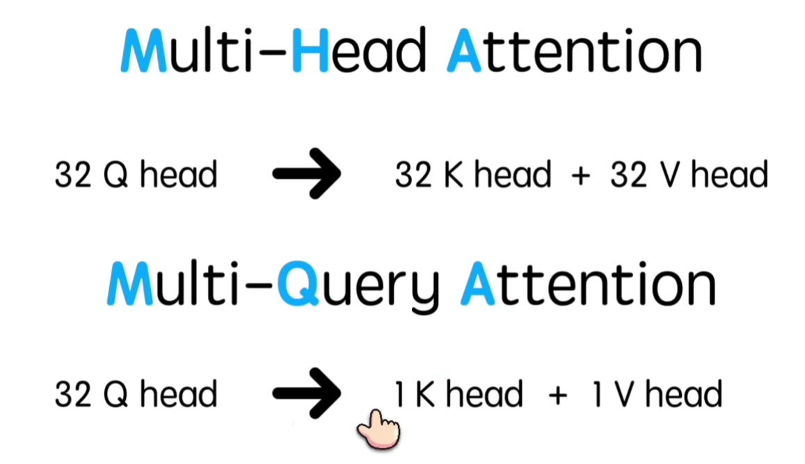
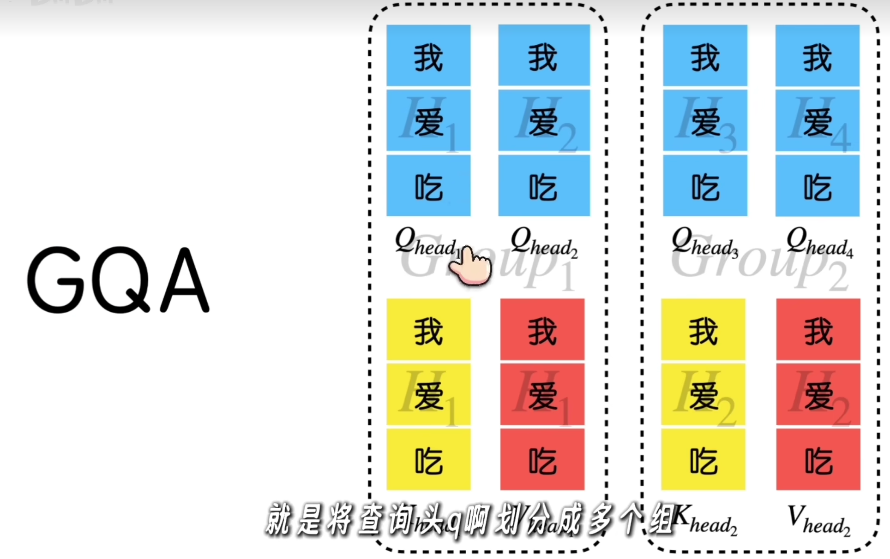

# 大模型技术演进：Agent 时代的大模型能力迭代（关键论文保留版）

> **核心主线：大模型作为 Agent 的“大脑”，技术演进不再按 Training / Inference 生硬切分，而是围绕能力不断增强：学得会 → 会思考 → 看得远 → 看得懂 → 跑得动 → 能调用。**
>
> \*\*Training 与 Inference 不再作为目录骨架，而是成为能力形成与能力落地的两类技术手段。\*\*例如长上下文既需要 RoPE、长上下文训练等模型侧能力建设，也会直接引出 KV Cache、Attention、Prefill 等运行时问题。

> **版本说明：** 本版在原稿基础上进行结构重排与论文/官方博客补强，**保留原有技术论文解析主体**。新增或补齐的重点包括 PagedAttention、RadixAttention、Toolformer、Speculative Decoding、Continuous Batching / Orca、Chunked Prefill / Sarathi-Serve、Mooncake、Gated DeltaNet，以及截至 2026 年 8 月的 DeepSeek / GLM / Kimi / Qwen 官方技术节点。
>
> ## 阅读导航：六次能力跃迁

| 能力跃迁   | 核心问题                                                           | 代表技术                                                                              | 对 Agent 的意义                        |
|------------|--------------------------------------------------------------------|---------------------------------------------------------------------------------------|----------------------------------------|
| **学得会** | 模型如何获得知识、指令遵循与更大的能力容量？                       | Pre-training、Scaling Law、Post-training、Dense → MoE                                 | 提供通用知识与基础能力                 |
| **会思考** | 如何把复杂推理能力真正练进模型？                                   | Reasoning Data、Reasoning SFT、RL/GRPO、Reasoning Model                               | 让模型具备复杂问题求解能力             |
| **看得远** | 模型如何处理更长的文档、代码、轨迹和任务状态？                     | RoPE、YaRN、DCA、Long-context Training                                                | 扩大 Agent 的单次工作上下文            |
| **跑得动** | 模型能力增强后，如何控制显存、延迟、吞吐，并在推理时投入更多计算？ | KV Cache、FlashAttention、MTP、PagedAttention、Continuous Batching、Test-time Scaling | 让强模型既高效运行，也能按需“想得更久” |
| **看得懂** | 模型能不能理解文字之外的图片、音频、视频与环境信息？               | ViT、CLIP、Flamingo、BLIP-2、LLaVA、ImageBind、Unified Token、Omni                    | 为 Agent 提供多模态感知能力            |
| **能调用** | 模型如何从“生成文本”走向“选择并使用外部能力”？                     | Tool-use Training、Function Calling、Structured Output                                | 为 Agent 行动能力提供模型基础          |

> **一句话理解全文：先把大脑练强，再让它想得深、看得远、看得懂、跑得动，最后能够连接工具真正行动。**

------------------------------------------------------------------------

# 一、Agent 时代背景：为什么大模型需要继续演进

## 1.1 Agent 时代为什么需要更强的大模型？

传统 Chatbot 的核心链路相对简单：

``` text
用户问题
   ↓
  LLM
   ↓
文本回答
```

而 Agent 面对的是一个持续、多步骤、与外部环境交互的任务闭环：

``` text
用户目标
   ↓
理解任务
   ↓
推理 / 规划
   ↓
选择并调用工具
   ↓
观察工具与环境结果
   ↓
更新状态 / 记忆
   ↓
继续推理与行动
   ↓
直到完成任务
```

ReAct 将 **Reasoning + Acting** 放入同一个交互循环中，是这一范式的重要代表工作。

论文：[ReAct: Synergizing Reasoning and Acting in Language Models](https://arxiv.org/abs/2210.03629)

因此，Agent对大模型提出的要求已经不只是”语言生成质量高”，而是一组更完整的能力组合。

## 1.2 Agent 对大模型提出了哪些能力要求？

``` text
                         智能体 Agent
                              │
                  完成复杂、长周期真实任务
                              │
                              ↓
                     对底座模型提出要求
                              │
          ┌───────────────────┼───────────────────┐
          ↓                   ↓                   ↓
       理解能力             推理能力             行动能力
          │                   │                   │
       看得远               想得深              会调用工具
       看得准               会分解任务           会观察结果
       多模态               会规划              会执行动作
          │                 会验证/反思              │
          └───────────────────┼───────────────────┘
                              ↓
                           记忆能力
                              │
                       保持任务上下文
                       维护中间状态
                       利用历史信息
                              │
                              ↓
                           工程能力
                              │
                        存得住 / 算得快
                        吐得快 / 扛得多
                              │
                              ↓
                      可持续运行的 Agent
```

### 1.2.1 理解能力：看得远、看得准

Agent 经常需要处理：

- 长文档与代码仓库
- 多轮任务历史
- 工具调用结果
- 环境状态
- 长时间任务轨迹

因此，长上下文不仅是”能塞更多文字”，而是 Agent工作记忆与任务状态的重要基础。

相关技术包括：

- RoPE / RoPE Scaling
- YaRN
- DCA
- Long-context Training
- 长上下文评测

### 1.2.2 推理能力：想得深、会规划、会反思

Agent 面对的通常不是”一问一答”，而是：

``` text
复杂目标
  ↓
任务分解
  ↓
制定计划
  ↓
执行步骤
  ↓
检查结果
  ↓
必要时修正计划
```

因此需要更强的 Reasoning、Planning、Verification 与 Reflection。

### 1.2.3 行动能力：会调用工具、会观察环境

Agent 与普通 Chatbot最大的区别之一，是模型不再只能生成文本，而是可以通过工具影响外部世界：

``` text
LLM
 ├─ Web Search
 ├─ API
 ├─ Code
 ├─ Database
 ├─ Files
 ├─ Browser
 └─ Business System
```

关键技术包括：

- Function Calling
- Tool Use
- ReAct
- MCP
- Agent Runtime / Harness

### 1.2.4 记忆能力：任务不能每一步都”从零开始”

长周期 Agent 需要持续维护：

- 当前任务状态
- 已完成步骤
- 工具执行结果
- 用户与环境信息
- 必要的历史经验

因此 Memory 与 Context Management 会成为 Agent 系统的重要组成部分。

这里需要区分：

``` text
模型 Context Window
        ↓
当前一次模型调用能够看到什么

Agent Memory
        ↓
系统决定什么信息应该保存、检索并重新放回 Context
```

所以，**长上下文扩大了模型一次能”看到”的范围；Memory 则解决 Agent 跨步骤、跨任务的信息管理问题。**

### 1.2.5 工程能力：能力再强，也必须跑得起来

Agent 会显著增加模型调用次数：

``` text
普通 Chatbot
用户 → LLM → Answer

Agent
用户
 ↓
LLM → Tool
 ↓
LLM → Tool
 ↓
LLM → Tool
 ↓
LLM → Final Answer
```

一次任务可能触发多轮 Prefill、Decode 和工具交互，因此 Agent 对推理系统提出更高要求：

- **存得住**：KV Cache 不成为显存瓶颈
- **算得快**：长 Prompt / Tool Context 能快速 Prefill
- **吐得快**：降低 Decode 延迟
- **扛得多**：大量并发 Agent 请求仍能保持吞吐

这也是为什么 GQA、MLA、Flash Attention、MTP、Paged Attention、Continuous Batching 等技术，在 Agent 时代依然非常关键。

------------------------------------------------------------------------

# 二、大模型能力演进全景

``` text
                         Agent 的“大脑”：LLM
                                  │
                                  ↓
                              	学得会
                   Pre-training / Post-training
                      Scaling / Dense → MoE
                                  │
                                  ↓
                              	会思考
                      Reasoning Data / SFT / RL
                                  │
                                  ↓
                              	看得远
              RoPE / YaRN / Long-context Training
                                  │
                                  ↓
                              	看得懂
                Vision / Audio / Video / Omni
                                  │
                                  ↓
                              	跑得动
                  ┌───────────────┬───────────────┐
                  ↓               ↓               ↓
               存得住            算得快           吐得快 
              KV Cache   Attention / Prefill   Decode
                  └───────────────┬───────────────┘
                                  │
                                  ↓
                               	能调用
                     Function Calling / Tool Use 
                                  │
                                  ↓
                             Agent Runtime
```

> **六次能力跃迁：学得会 → 会思考 → 看得远 → 看得懂 → 跑得动 → 能调用。** 其中“存得住 / 算得快 / 吐得快 / 扛得多 / 想得久”统一作为“跑得动”的工程子能力，而不是与六大能力并列。

这条路线不是严格的时间轴，而是**能力视角**：同一项技术可以同时支撑多个能力。例如 MTP 在模型训练中引入多 Token 预测，同时又可在生成阶段帮助加速 Decode；MLA 是模型架构，但它的重要价值之一是降低长上下文下的 KV Cache 压力。

------------------------------------------------------------------------

# 三、学得会：从语言模型到更强的通用模型

“学得会”统一回答一个问题：**模型如何获得知识、指令遵循能力，并在可控计算成本下继续扩大容量？**

## 3.1 Pre-training：从海量 Token 中学习世界知识

**Transformer：现代大模型的架构起点**

2017 年论文 **《Attention Is All You Need》** 提出 Transformer，用Self-Attention 取代 RNN 的顺序递归结构，奠定现代大语言模型的基本架构。

核心变化：

``` text
RNN：Token → Token → Token
             串行

Transformer：
Token ─┐
Token ─┼→ Self-Attention → 并行建模关系
Token ─┘
```

它带来的真正影响不是"Attention本身"，而是让模型具备了更强的并行训练和规模扩展能力。

**Attention Is All You Need：Transformer**

> **论文 ID：** arXiv:1706.03762  
> **论文名称：** Attention Is All You Need  
> **作者：** Ashish Vaswani、Noam Shazeer、Niki Parmar、Jakob Uszkoreit、Llion Jones、Aidan N. Gomez、Łukasz Kaiser、Illia Polosukhin，2017  
> **发布时间：** 2017 年 6 月 12 日（arXiv 首次提交）  
> **原文：** [arXiv](https://arxiv.org/abs/1706.03762)｜[PDF](https://arxiv.org/pdf/1706.03762)

核心观点

- **用注意力完全取代循环和卷积。** Transformer 仍是 encoder-decoder，但序列各位置不再必须按时间步递归计算；编码器通过 self-attention 建立输入内部关系，解码器用 masked self-attention 保证自回归生成，再通过 encoder-decoder attention 读取源序列。

- **核心算子是缩放点积注意力：** $$
  \operatorname{Attention}(Q,K,V)=\operatorname{softmax}\!\left(\frac{QK^\top}{\sqrt{d_k}}\right)V
  $$ (QK^) 衡量 query 与各 key 的相关性，softmax 得到权重并对 (V) 加权；除以 () 是为了避免维度较大时 softmax 饱和、梯度过小。

- **多头注意力不是简单重复。** 将 (Q,K,V) 投影到多个子空间并行计算，再拼接输出，使模型能在不同位置和表示子空间中同时捕捉不同关系。

- **没有递归就要显式给顺序。** 论文把正弦/余弦位置编码加到 token embedding 上；每层还配备逐位置前馈网络、残差连接和层归一化。

<figure>

<figcaption aria-hidden="true">Figure 1：Transformer 模型架构</figcaption>
</figure>

*Figure 1（原论文第 3 页）：左为编码器堆栈：多头自注意力与前馈网络；右为解码器堆栈：额外加入掩码自注意力和对编码器输出的交叉注意力。所有子层均以残差连接与归一化包裹。图源：[论文 PDF](https://arxiv.org/pdf/1706.03762#page=3)。*

带来的收益

- **训练可高度并行。** RNN 的位置计算存在 (O(n)) 的串行依赖；自注意力层的最少串行操作数为 (O(1))，因此能更充分利用并行硬件训练序列。
- **远距离依赖路径更短。** 任意两个位置在单层 self-attention 中即可直接连接，理论最短路径为 (O(1))；这也是其处理长距离关系的重要优势。
- **原论文的翻译结果。** 在 WMT 2014 英译德任务上取得 **28.4 BLEU**，比当时最佳结果（含集成）高逾 2 BLEU；在英译法上，单模型达到 **41.8 BLEU**，使用 8 张 GPU 训练 3.5 天。这些数字是论文当时的实验结果。
- **边界：标准自注意力的长度成本为二次方。** 完整注意力的每层复杂度为 (O(n^2d))，序列很长时显存和计算会成为瓶颈；后续长上下文工作主要围绕这一限制改进，而不是原论文已经解决的问题。

GPT这类大语言模型首先通过大规模自监督预训练学习语言分布。Decoder-only LLM 最典型的目标是 Next Token Prediction：

$$
\mathcal{L}_{NTP}=-\sum_t \log P(x_{t+1}\mid x_{\le t})
$$

``` text
海量文本 / 代码 / 多模态数据
          ↓
     Tokenization
          ↓
   Next Token Prediction
          ↓
语言规律 + 世界知识 + 基础能力
```


## 3.2 Post-training：学会指令与偏好从"会续写"到"会回答"


为什么 Pre-training 之后还需要 Post-training？预训练模型主要学习”文本接下来是什么”，并不天然等价于”按照用户意图完成任务”。因此需要 Post-training。

预训练模型学习的是：

```
Internet Text
      ↓
Next-token Prediction
```

例如给模型：

```
法国的首都是
```

模型学习预测：

```
巴黎
```

但用户与模型交互时，真正希望模型理解的是：

```
用户想让我做什么？
      ↓
有哪些明确要求？
      ↓
什么样的回答更合适？
```

因此两者实际上存在目标差异：

| 阶段              | 优化目标                          | 学到什么             |
| ----------------- | --------------------------------- | -------------------- |
| **Pre-training**  | Next-token Prediction             | 语言、知识、模式     |
| **Post-training** | Instruction / Preference / Reward | 如何按照用户意图回答 |

InstructGPT 把这种差异概括为：

```
Language Modeling Objective
            ≠
Follow User Intent
```

模型可能已经“知道很多”，但仍然可能：

- 不按照指令回答；
- 忽略用户约束；
- 编造事实；
- 给出不合适的回答；
- 需要复杂 Prompt 才能正确完成任务。

因此：

> **模型能力强，不等于模型行为符合用户意图。**

### SFT + Reward Model + PPO 

**关键论文：InstructGPT-用人类反馈训练更符合用户意图的语言模型**

> **模型：** InstructGPT  **模型厂家：** OpenAI  
> **论文 ID：** arXiv:2203.02155  
> **论文名称：** Training language models to follow instructions with human feedback  
> **作者：** Long Ouyang、Jeff Wu、Xu Jiang、Diogo Almeida 等，2022  
> **发布时间：** 2022 年 3 月 4 日（arXiv 首次提交）  
> **原文：** [arXiv](https://arxiv.org/abs/2203.02155)｜[PDF](https://arxiv.org/pdf/2203.02155)

核心观点

论文的中心问题是：预训练语言模型擅长预测互联网文本的下一个 token，但这并不等于它会**有帮助、诚实、无害地遵循用户指令**。InstructGPT 用人类反馈将 GPT-3 的策略从“模仿网页文本”校准为“生成标注者偏好的回答”。

- **第一步：SFT。** 标注者对从 API 使用分布抽样的 prompt 撰写理想回答，以监督学习微调 GPT-3，得到初始指令跟随策略。
- **第二步：奖励模型（RM）。** 对同一 prompt，由 SFT 策略生成多个候选回答，标注者从好到坏排序；模型学习为回答打分，使人类偏好变成可优化的标量奖励。
- **第三步：PPO。** 从 SFT 策略出发，用 PPO 最大化奖励模型得分；同时加入相对 SFT 策略的 KL 惩罚，避免为了迎合奖励模型而偏离语言能力或发生 reward hacking。
- **PPO-ptx 是稳定性折中。** 在 PPO 更新之外，混入一部分原始预训练数据的 next-token 目标，旨在降低“对齐后遗忘预训练能力”的风险。


*Figure 2（原论文第 4 页）：从人工示范训练 SFT，随后用排序数据训练奖励模型，最后以 PPO 优化策略。该图概括了论文的完整 RLHF 管线。图源：[论文 PDF](https://arxiv.org/pdf/2203.02155#page=4)。*

带来的收益

- **小模型可胜过大基础模型的偏好表现。** 在论文的 API prompt 人类评测中，标注者偏好 1.3B 参数的 InstructGPT 输出而非 175B GPT-3 输出，说明“对齐质量”与“预训练参数规模”不是同一维度。
- **更贴近用户意图。** 人工评测显示 InstructGPT 相比 GPT-3 更能遵循明确指令、少生成无关内容，并在一定程度上降低不实与有害输出。
- **保留通用能力的工程方案。** PPO-ptx 使模型在对齐优化同时保持预训练任务表现；论文也在 NLP 基准和用户分布 prompt 上对 SFT、PPO、PPO-ptx 做了比较。
- **不是安全的终点。** 奖励模型可能被策略利用，标注者偏好存在局限，训练与评估 prompt 分布也不覆盖所有风险。论文把这是“有前景但不完全”的对齐步骤，并强调持续评估、红队和部署控制的必要性。

### DPO：直接利用偏好对优化

DPO（Direct Preference Optimization）绕过显式 Reward Model + PPO（RLHF ） 的复杂流程，直接利用 chosen / rejected 偏好对优化策略。

``` text
Prompt
 ├─ Chosen Response
 └─ Rejected Response
          ↓
         DPO
          ↓
   Preference-aligned LLM
```

> **论文 ID：** arXiv:2305.18290  
> **论文名称：** Direct Preference Optimization: Your Language Model is Secretly a Reward Model  
> **作者：** Rafael Rafailov、Archit Sharma、Eric Mitchell、Stefano Ermon、Christopher D. Manning、Chelsea Finn，2023  
> **发布时间：** 2023 年 5 月 29 日（arXiv 首次提交）  
> **原文：** [arXiv](https://arxiv.org/abs/2305.18290)｜[PDF](https://arxiv.org/pdf/2305.18290)

**核心观点**

DPO（Direct Preference Optimization）指出：让语言模型学习人类偏好，不必一定走“训练奖励模型，再用 PPO 做强化学习”的 RLHF 流程。

在一个带 KL 约束的 RLHF 目标下，奖励函数可以改写为策略模型及其参考模型的对数概率比。因此，只要给定“哪个回答更好”的偏好对，便可以用一个普通的二元分类损失，**直接训练语言模型偏向被选择的回答**。

> **DPO 把 RLHF 中显式奖励模型和在线强化学习的两阶段优化，化为对离线偏好数据的一次直接优化。**

<figure>

<figcaption aria-hidden="true">Figure 1：传统 RLHF 与 DPO 的训练流程对比</figcaption>
</figure>

传统 RLHF 先用偏好数据训练奖励模型，再通过强化学习不断采样与优化语言模型；DPO 直接在偏好数据上优化最终语言模型，以最大似然训练完成。

典型 RLHF 流程包含三部分：

1.  收集人类偏好数据；
2.  训练奖励模型，预测人更喜欢哪个回答；
3.  用 PPO 等强化学习算法，让语言模型最大化奖励，同时用 KL 约束避免偏离初始模型过远。

这种方法有效，但工程代价较高：需要维护奖励模型和策略模型，训练中不断从策略采样，并调节奖励、KL 系数、学习率等一系列超参数。奖励模型如果不够可靠，还可能被策略模型“钻空子”。

DPO 相比 PPO-RLHF 的主要变化

| 维度       | PPO-RLHF                      | DPO                              |
|------------|-------------------------------|----------------------------------|
| 奖励模型   | 显式训练并维护                | 隐式包含在策略参数化中           |
| 策略优化   | 需要强化学习与在线采样        | 在离线偏好对上直接优化           |
| 训练目标   | 最大化奖励并控制 KL           | 偏好分类损失                     |
| 工程复杂度 | 多模型、多阶段、调参较多      | 单模型、单阶段、更接近 SFT       |
| 核心风险   | 奖励误差、RL 不稳定、奖励黑客 | 偏好数据质量、参考模型和 () 选择 |

## 3.3 Scaling Law：大模型为什么越做越大

**Scaling Laws**工作系统研究了语言模型损失与**模型规模、数据规模、训练计算量**之间的幂律关系，推动了”大模型规模化训练”路线。Scaling Law 揭示了一个关键规律：

> **模型参数、训练数据和计算量增加时，模型 Loss 会呈可预测的幂律下降。**

这使大模型研发从"试着把模型做大"逐渐变成"可以预测地 Scale"。

代表工作：

-   **Kaplan et al., 2020** --- [Scaling Laws for Neural Language Models](https://arxiv.org/abs/2001.08361)
-   **Chinchilla, 2022** --- [Training Compute-Optimal Large Language Models](https://arxiv.org/abs/2203.15556)

Chinchilla 进一步说明：参数量不是唯一重点，**Model Size 与 Training
Tokens 必须合理配比**。

``` text
能力提升
   │
   ├─ Model ↑
   ├─ Data ↑
   └─ Compute ↑
```

> **论文 ID：** arXiv:2001.08361  
> **论文名称：** Scaling Laws for Neural Language Models  
> **作者：** Jared Kaplan、Sam McCandlish、Tom Henighan 等，2020  
> **发布时间：** 2020 年 1 月 23 日（arXiv 首次提交）  
> **原文：** [arXiv](https://arxiv.org/abs/2001.08361)｜[PDF](https://arxiv.org/pdf/2001.08361)

这篇论文的核心不是简单地说“模型越大越好”，而是证明：语言模型性能随**模型参数量、数据量和训练算力**的增长，呈现平滑、可预测的幂律关系。

这让大模型训练从“训练完才知道效果”，变成了“可以根据小规模实验预测大规模训练结果”。

<figure>

<figcaption aria-hidden="true">Figure 1：模型性能与算力、数据量、参数量的幂律关系</figcaption>
</figure>


**模型、数据和算力都遵循 Scaling Law**

论文研究三个核心变量：

- (N)：模型参数量，不包含 embedding 参数；
- (D)：训练数据量，以 token 数计算；
- (C)：训练算力。

测试损失 (L) 与它们近似满足：

$$
L(X)\propto X^{-\alpha}
$$

论文拟合得到：

$$
L(N)\propto N^{-0.076},\qquad
L(D)\propto D^{-0.095},\qquad
L(C_{\min})\propto C_{\min}^{-0.050}
$$

模型越大、数据越多、算力越多，测试损失越低。但下降不是线性的，而是边际收益逐渐递减的幂律。早期增加资源比较划算，到了很大规模后，为了再降低一点 Loss，需要付出越来越多的参数、数据和算力。例如参数量翻倍后，损失约变为原来的 94.9%，并不会减半。

**GPT-3 则进一步展示了扩大自回归语言模型规模后，Zero-shot / One-shot /Few-shot 能力显著增强。**

> **论文 ID：** arXiv:2005.14165  
> **论文名称：** Language Models are Few-Shot Learners  
> **作者：** Tom B. Brown、Benjamin Mann、Nick Ryder、Melanie Subbiah 等，2020  
> **发布时间：** 2020 年 5 月 28 日（arXiv 首次提交）  
> **原文：** [arXiv](https://arxiv.org/abs/2005.14165)｜[PDF](https://arxiv.org/pdf/2005.14165)

这篇论文发布了拥有 **1750 亿参数的 GPT-3**，并证明：当语言模型扩大到足够规模后，它可以只通过自然语言指令和上下文中的少量示例完成许多新任务，**不需要针对任务更新参数或进行微调**。

论文由此确立了后来大模型最重要的使用范式之一：

> **任务可以直接用文本描述，示例可以直接放进上下文，模型在推理过程中完成“上下文学习”。**

<figure>

<figcaption aria-hidden="true">Figure 1.3：不同模型规模下 zero-shot、one-shot 和 few-shot 的总体表现</figcaption>
</figure>
图中汇总了 42 个以准确率计分的基准。随着参数规模扩大，zero-shot、one-shot 和 few-shot 表现都在提升；few-shot 提升得最快，说明大模型更善于利用上下文示例。浅色线是各个任务，粗线是总体趋势。

---

## 3.4 扩大容量：Dense → MoE，参数规模与计算量开始解耦

在稠密（Dense）模型中，每个 Token 都会经过同一组 FFN 参数；而混合专家模型（Mixture of Experts，MoE）则通过路由器（Router）为每个 Token 选择少数专家参与计算。

```
Dense
Token → 全部共享 FFN

MoE
                ┌→ Expert 1
Token → Router ─┼→ Expert 2
                ├→ Expert 3
                └→ ...
              只激活少数专家
```

**核心思想：**  
> 把总参数做得很大，但每个 Token 只激活其中一小部分。

**核心价值：**  
> 扩大模型总参数容量，同时控制每个 Token 实际激活的参数量和计算量。

现代 MoE 变体（如 DeepSeekMoE、Qwen MoE、Kimi Stable LatentMoE 等）均沿这一方向持续演进。

---

### 代表论文一：Sparsely-Gated MoE（2017）

> **论文名称：** *Outrageously Large Neural Networks: The Sparsely-Gated Mixture-of-Experts Layer*  
> **论文 ID：** arXiv:1701.06538  
> **作者：** Noam Shazeer、Azalia Mirhoseini、Krzysztof Maziarz、Andy Davis、Quoc Le、Geoffrey Hinton、Jeff Dean  
> **发布时间：** 2017 年 1 月 23 日（arXiv 首次提交）  
> **原文链接：** [arXiv](https://arxiv.org/abs/1701.06538) | [PDF](https://arxiv.org/pdf/1701.06538)

**核心贡献**

奠定了现代稀疏 MoE（Mixture of Experts，专家混合）架构的关键范式：**模型可以拥有大量参数，但每个输入只激活很少一部分参数。** 因而，模型容量能大幅增长，而单个样本的计算量不必等比例增长。

**模型结构**

论文提出的 Sparsely-Gated MoE 层由大量前馈“专家”与一个可训练的门控网络组成。门控网络针对每个输入，仅选择 Top-k 个专家参与计算，再将其输出按门控权重加权合并。作者在语言建模和机器翻译中展示了这种条件计算的可行性；论文报告模型容量可提升超过 1000 倍，同时只有较小的计算效率损失，最大模型达到 1370 亿参数。

<figure>

</figure>


MoE 嵌入循环语言模型。对一个输入，门控网络只选中少数专家（图示为两个），并用门控权重调制、合并专家输出。

**要点一：用条件计算解除“参数量 = 计算量”的绑定**

稠密网络中，每个 token 都要经过全部参数。模型变大时，训练与推理成本会快速上升。MoE 改变了这件事：它保留了许多不同参数化的专家，但对输入 \(x\) 只调用少数专家。

论文将 MoE 输出写为：

\[
y = \sum_{i=1}^{n} G(x)_i E_i(x),
\]

其中 \(E_i\) 是第 \(i\) 个专家，\(G(x)\) 是门控向量。关键在于 \(G(x)\) 是稀疏的：若 \(G(x)_i = 0\)，便无需执行该专家。也就是说，**总参数量可以很大，激活参数量却保持较小。**

**要点二：Noisy Top-k Gating——既稀疏，又可训练**

简单的 softmax 会给所有专家非零权重，仍需计算全部专家。论文采用 **Noisy Top-k Gating**：在门控 logits 中加入可学习尺度的噪声，只保留最大的 \(k\) 个值，其余置为无效，再进行 softmax。

这样做有两层作用：
- **Top-k** 直接保证每个输入只激活 \(k\) 个专家，控制计算量；
- **噪声** 鼓励探索，缓解少数专家长期垄断路由的倾向。

当 \(k > 1\) 时，被选中的门控值仍可通过反向传播学习，因此不需要用 REINFORCE 一类高方差方法来训练离散路由决策。

**要点三：真正难点不是“有专家”，而是负载均衡与硬件效率**

这篇论文的工程洞见同样重要。路由若总偏向少数专家，那些专家会更快得到训练、继而更常被选中，形成自我强化的不均衡。作者为此加入辅助损失，使一个 batch 中各专家收到的门控重要性更均匀。

此外，稀疏路由会把一个大 batch 切成多个很小的 expert batch，反而降低 GPU 利用率。论文通过增大批量、混合数据并行与模型并行，并把不同设备上的相关样本聚合给同一专家，来缓解这一“batch 缩小”问题。其核心经验是：**稀疏性本身不自动带来速度；路由、负载均衡、通信和批量组织必须一起设计。**

**对今天大模型的意义**

这项工作给出了后来大规模 MoE 模型沿用的基本结构：大量专家 + 稀疏路由 + 负载均衡 + 分布式专家并行。它的本质不是让每个 token 都使用更大的网络，而是让不同 token 有机会访问不同的参数子集，从而以近似可控的 FLOPs 换取更大的条件容量。

同时，论文中的实现使用 LSTM 语言模型，具体模块和现代 Transformer MoE 并不完全相同；但“按 token 稀疏选专家”的思想是后续工作的重要起点。

---

### 代表论文二：Switch Transformers（2021）

> **论文名称：** *Switch Transformers: Scaling to Trillion Parameter Models with Simple and Efficient Sparsity*  
> **论文 ID：** arXiv:2101.03961  
> **作者：** William Fedus、Barret Zoph、Noam Shazeer  
> **发布时间：** 2021 年 1 月 11 日（arXiv 首次提交）  
> **原文链接：** [arXiv](https://arxiv.org/abs/2101.03961) | [PDF](https://arxiv.org/pdf/2101.03961)

**核心贡献**

Switch Transformer 将 MoE 的稀疏路由进一步简化为一个大胆但有效的规则：**每个 token 只路由给一个专家（Top-1 / k=1），而不是多个专家。** 这样可以在几乎不增加每个 token 计算量的前提下，扩大总参数量、减少跨设备通信，并让大规模稀疏模型更容易训练。

论文的核心不是发明“专家混合”，而是证明了更简单的单专家路由足够好：它降低了路由和通信开销，缓解了专家 batch 变小的问题，并配合负载均衡、容量控制和训练稳定性技巧，将稀疏 Transformer 扩展到万亿参数量级。

<figure>

<figcaption aria-hidden="true">图 1：Switch Transformer 的扩展与样本效率</figcaption>
</figure>

左图显示增加专家数、提升稀疏参数量时测试损失持续降低；右图在相同计算预算下，将不同规模的 Switch-Base 与 T5-Base 对比，显示稀疏模型具有更好的训练样本效率。

**要点一：单专家路由——把 MoE 从 Top-k 改成 Top-1**

标准 MoE 会为 token 计算每个专家的概率 \(p_i(x)\)，再选出 Top-k 个专家并加权组合。Switch Transformer 只保留概率最大的一个专家：

\[
i^* = \arg\max_i p_i(x), \qquad y = p_{i^*}(x) E_{i^*}(x).
\]

这里 \(E_{i^*}\) 是被选中的前馈网络（FFN）专家。虽然只调用一个专家，门控概率 \(p_{i^*}(x)\) 仍保留在输出中，因此路由器可通过反向传播学习。

这项简化带来三重直接收益：每个 token 的专家计算更少、每个专家需要预留的容量更小、token 在设备之间的路由与通信也更简单。论文实验证明，Top-1 并未损害质量，反而具有更好的效率与实际性能。

<figure>

<figcaption aria-hidden="true">图 2：Switch Transformer 编码器块</figcaption>
</figure>

将普通 Transformer 的稠密 FFN 替换为 Switch FFN。图中两个 token 被各自的 router 独立送往四个专家中的一个，选中专家输出再乘以门控值。

**要点二：稀疏扩容——参数更多，但每个 token 的 FLOPs 基本可控**

一个 Switch FFN 层拥有许多参数彼此独立的 FFN 专家，但 token 只执行其中一个。于是，增加专家数主要增加的是**总容量**，而非单个 token 的激活计算量。

Figure 1 左图表明，在越来越多专家、越来越大稀疏参数量的设置下，测试损失仍持续下降；右图则显示在相同计算预算下，Switch 模型比稠密 T5-Base 达到更好的负对数困惑度。论文据此将“总参数量”视为不同于每样本 FLOPs 的另一条有效扩展轴。

**要点三：路由要可用——负载均衡、容量与稳定训练缺一不可**

Top-1 路由的风险是 token 集中涌向少数专家。为避免某些专家过载、其他专家闲置，论文使用辅助负载均衡损失，并为每个专家设定固定的 token 容量；容量系数越大，token 溢出越少，但计算与通信成本越高。

论文还针对稀疏模型的训练不稳定性采用了选择性精度训练、适合更多专家的初始化和更强的正则化。重要结论是：**MoE 的难点不只是“选一个专家”，而是让所有专家被合理使用，并使分布式系统高效执行这种选择。**

**规模与迁移价值**

在以 T5 为基础的实验中，论文报告在相同计算资源下最高可获得 7 倍以上的预训练加速；万亿参数模型相对 T5-XXL 报告 4 倍预训练加速。作者还展示了多语言任务的广泛收益，以及将大稀疏教师蒸馏为小型稠密模型的可能性。

这些结果应理解为该论文所用任务、系统与模型配置下的测量值，而非“任何 MoE 都必然更快”。实际收益仍取决于专家并行、通信带宽、负载均衡和 token 溢出率。

**小结**

Switch Transformer 的关键影响在于把 MoE 从“容量很大但实现复杂”推进为更实用的公式：**用单专家 Top-1 路由，以稀疏激活换取更大总参数量和更低的单位计算成本。** 它也清晰指出了实现该公式的条件：路由要均衡、容量要控制、分布式通信与数值稳定性要一并优化。

---

### 代表论文三：DeepSeekMoE（2024）

> **论文名称：** *DeepSeekMoE: Towards Ultimate Expert Specialization in Mixture-of-Experts Language Models*  
> **论文 ID：** arXiv:2401.06066  
> **作者：** Damai Dai、Chengqi Deng、Chenggang Zhao、R. X. Xu 等  
> **发布时间：** 2024 年 1 月 11 日（arXiv 首次提交）  
> **原文链接：** [arXiv](https://arxiv.org/abs/2401.06066) | [PDF](https://arxiv.org/pdf/2401.06066)

**核心贡献**

DeepSeekMoE 关注的不是单纯“增加专家数”，而是让专家**真正分工**。论文认为常规 MoE 容易出现两类浪费：专家数太少时，每个专家不得不混杂地学习很多类型知识；不同专家又会重复学习共通知识。它据此提出两项互补设计：**细粒度专家切分**与**共享专家隔离**。

目标是：在保持专家总参数量与激活计算量大致不变的条件下，让路由专家更专注于差异化知识，把跨场景的共通知识交给始终激活的共享专家，从而提高参数效率与专家专门化程度。

<figure>

</figure>


从左到右依次为常规 Top-2 路由、细粒度专家切分、加入共享专家隔离后的完整 DeepSeekMoE。三种设计保持专家参数量和计算成本不变。

**问题：知识混杂与知识冗余**

常规 MoE 对 token 从 \(N\) 个专家中选择 Top-\(K\) 个。若 \(N\) 较小，同一专家会接触跨度很大的 token，参数中混入多种难以同时利用的知识，论文称为 **knowledge hybridity（知识混杂）**。

反过来，不同路由专家也会反复遇到需要相同常识或通用模式的 token，于是多个专家各自学习类似能力，形成 **knowledge redundancy（知识冗余）**。两种现象都会削弱“每个专家各有所长”的理想状态。

**要点一：细粒度专家切分——更小的专家，更多的可组合方式**

论文将原有的 \(N\) 个专家细分为 \(mN\) 个更小的专家；相应地，为保持计算量，激活专家数由 \(K\) 增至 \(mK\)。每个小专家的 FFN 中间维度缩小，因此总参数量和每 token 的总体计算量保持可比。

这不是简单加专家：同样的计算预算下，token 可以从更多细小模块中组合出更贴切的路径。直观上，知识可被切得更细，路由组合也更灵活，因而更容易形成专门化。

**要点二：共享专家隔离——把“人人都要用”的知识单独存放**

DeepSeekMoE 从所有专家中划出 \(K_s\) 个**共享专家**，它们对每个 token 都会被激活；其余专家继续由路由器按 token 选择。

共享专家承担通用、重复出现的知识和变换，路由专家则更专注于有差异的模式。这样既减少多个路由专家重复编码共同知识，也给专门化留下更多参数空间。图 2 右侧绿色模块即共享专家。

**实验所表达的效率边界**

论文报告：DeepSeekMoE 2B 的性能可与 GShard 2.9B 相当，后者使用约 1.5 倍的专家参数与计算；16B 模型在约 40% 计算量下达到与 LLaMA2 7B 相当的表现。更大规模的 145B 预实验也显示出相对 GShard 的优势。

这些数字说明的核心是：**MoE 的上限不仅受“激活多少参数”影响，也受参数是否被有效分工影响。** 不过，具体速度与效果仍依赖训练数据、路由均衡、并行系统和评测设置，不能脱离论文配置直接外推。

**小结**

DeepSeekMoE 将专家专门化拆成两个工程动作：先用更细粒度的专家扩大组合空间，再用共享专家吸收共通知识。它的关键贡献是给出一种在参数量与计算量可控的前提下，减少知识混杂和冗余、提升 MoE 参数效率的结构化方案。

---

**小结**

MoE 系列技术通过稀疏路由实现了**参数规模与计算量的解耦**，使模型能够在可控计算成本下持续扩展容量。从 **Sparsely-Gated MoE** 的稀疏专家路由，到 **Switch Transformer** 的工程简化，再到 **DeepSeekMoE** 的细粒度专家与共享专家设计，MoE 的核心目标已经从单纯的“少激活、降计算”，逐渐转向“专家专门化、通信优化与场景适配”。

这一趋势在最新一代国产大模型中更加明显。**Kimi K3** 将模型规模扩展至 **2.8 万亿参数**，同时面向原生多模态、百万 Token 上下文以及长程 Coding 和深度推理场景，代表 MoE 向超大规模模型容量继续扩展的路线。 **DeepSeek-V4-Pro** 则达到 **1.6 万亿总参数、单 Token 仅激活约 490 亿参数**，在保持巨大模型容量的同时显著控制实际推理计算量，并进一步面向百万 Token 上下文与 Agent 任务优化。 **Qwen3.5-397B-A17B** 采用 **397B 总参数、约 17B 激活参数**的稀疏 MoE，并进一步将 MoE 与线性注意力组成混合架构，同时支持文本、图像和视频输入，将 MoE 扩展到原生多模态与 Agent 场景。

解决了“容量”问题之后，下一步挑战是让模型在缺乏直接记忆答案的情况下，能够通过推理得出正确结论。


# 四、会思考：把 Reasoning 能力练进模型

“学得会”解决的是模型有没有知识、能不能理解和遵循指令；“会思考”进一步解决：

> **面对不能直接依赖记忆回答的数学、代码、逻辑和复杂任务，模型能不能通过推理得到结果？**

这里需要特别区分两类技术：

| 类别                         | 核心问题                                         | 典型技术                                                      | 是否属于模型能力形成 |
|------------------------------|--------------------------------------------------|---------------------------------------------------------------|----------------------|
| **Reasoning Training**       | 如何把推理能力练进模型？                         | Reasoning Data、Reasoning SFT、RL、GRPO                       | **是，本章重点**     |
| **Inference-time Reasoning** | 已经会推理的模型，如何在运行时获得更多思考预算？ | CoT Prompting、Self-Consistency、Best-of-N、Test-time Scaling | **否，移到“想得久”** |

> **本章只讨论第一类：Reasoning Capability 如何形成。**

## 4.1 CoT：重要的能力发现，但不等于 Reasoning Training

**Chain-of-Thought Prompting Elicits Reasoning in Large Language Models**

> **论文 ID：** arXiv:2201.11903  
> **论文名称：** Chain-of-Thought Prompting Elicits Reasoning in Large Language Models  
> **作者：** Jason Wei、Xuezhi Wang、Dale Schuurmans、Maarten Bosma、Brian Ichter、Fei Xia、Ed H. Chi、Quoc V. Le、Denny Zhou，2022  
> **发布时间：** 2022 年 1 月 28 日（arXiv 首次提交）  
> **原文：** [arXiv](https://arxiv.org/abs/2201.11903)｜[PDF](https://arxiv.org/pdf/2201.11903)

核心观点

这篇论文提出 **Chain-of-Thought（CoT，思维链）Prompting**：在 few-shot 示例中，不只展示“问题 → 最终答案”，还展示“问题 → 中间推理步骤 → 最终答案”。模型据此会先生成自然语言形式的中间步骤，再给出结论。

它的关键发现是：对于足够大的语言模型，这种极简单的提示变化可以激发复杂推理能力，而无需为每个任务重新微调。CoT 让原本一次性回答的问题被分解为多个可生成的中间步骤，给模型更多的序列计算空间。

<figure>

<figcaption aria-hidden="true">图 1：标准提示与 CoT 提示的区别</figcaption>
</figure>

左侧标准提示只给出问题和答案，模型直接答错；右侧 CoT 提示在示例中给出计算过程，模型先写出中间推理后得到正确答案。

具体地，CoT 示例的结构可写成 (,,)。测试时，模型仿照示例继续生成推理文本与答案。论文并未在这里训练新的推理模型；它展示的是大模型已有能力可以被合适的上下文示范调动。

带来的收益

**更强的复杂推理表现。** 论文在算术、常识与符号推理任务上观察到 CoT 的提升。最醒目的结果来自 GSM8K：使用 8 个 CoT 示例的 PaLM 540B 达到 57% 解题率，高于标准提示的 18%，也略高于图中此前最佳的 55%。

<figure>

<figcaption aria-hidden="true">图 2：GSM8K 的量化收益</figcaption>
</figure>

PaLM 540B 的 CoT 提示在 GSM8K 达到 57% 解题率；同一模型的标准提示为 18%，图中此前最佳为 55%。

**低改造成本与任务通用性。** 只需修改 prompt 中的示例，不需要任务专属训练数据或微调，同一个模型检查点即可迁移到不同的推理任务。这为后续的自洽性采样、工具调用和推理后训练提供了一个重要出发点；这些后续方法并非本文结论。

**可观察的推理轨迹。** 中间文本为排查错误提供了线索，能够看到模型在哪一步出现偏差。但论文也明确保留边界：CoT 是对模型行为的可解释窗口，不能据此断言文本步骤完整、忠实地刻画了模型内部所有计算。

**收益依赖模型规模。** CoT 并非对所有模型都有效。论文观察到小模型可能生成流畅但不合逻辑的步骤，效果甚至低于标准提示；正向收益主要在约 100B 参数及以上模型中出现。这意味着“让模型写得更长”本身不是推理保证，示例质量、任务形式和模型能力都很关键。

## 4.2 Reasoning Data：从“答案数据”到“推理过程数据”

普通指令数据常见形式：

``` text
Question
   ↓
Answer
```

Reasoning 数据进一步包含：

``` text
Question
   ↓
Reasoning Trace
   ├─ Step 1
   ├─ Step 2
   ├─ Step 3
   ↓
Answer
```

变化的关键不只是“答案更长”，而是训练数据开始显式包含：

- 问题如何拆解；
- 中间结论如何连接；
- 如何验证或修正；
- 最终答案如何从推理过程得到。

> **Reasoning Data 的作用，是让模型不只学习“答案是什么”，还学习“答案是怎么推出来的”。**

## 4.3 Reasoning SFT：先让模型学会推理范式

Reasoning SFT 可以理解为：

``` text
Pre-trained / Instruction Model
             ↓
      Reasoning Dataset
             ↓
            SFT
             ↓
      Reasoning-capable Model
```

它仍然属于监督学习：模型主要是在高质量推理轨迹上学习和模仿推理过程。

因此可以简单理解为：

> **SFT 让模型先“见过并学会”好的推理过程。**

但只靠模仿存在局限：训练数据不可能覆盖所有复杂问题，模型也容易学习到表面的推理格式，而不一定真正找到更好的问题求解策略。

## 4.4 RL / GRPO：从模仿推理走向自主探索

Reasoning 模型的重要变化，是强化学习开始更多地用于复杂推理能力训练。

``` text
Reasoning SFT
      ↓
学习已有 Reasoning Trace
      ↓
RL / GRPO
      ↓
根据任务结果获得 Reward
      ↓
探索不同 Reasoning Strategy
```

这里的核心变化是：

> **从“模仿别人怎么推”进一步走向“根据结果奖励探索怎么推更有效”。**

**DeepSeekMath: Pushing the Limits of Mathematical Reasoning in Open Language Models**

> **论文 ID：** arXiv:2402.03300  
> **论文名称：** DeepSeekMath: Pushing the Limits of Mathematical Reasoning in Open Language Models  
> **作者：** Zhihong Shao、Peiyi Wang、Qihao Zhu、Runxin Xu、Junxiao Song 等，2024  
> **发布时间：** 2024 年 2 月 5 日（arXiv 首次提交）  
> **原文：** [arXiv](https://arxiv.org/abs/2402.03300)｜[PDF](https://arxiv.org/pdf/2402.03300)

核心观点

DeepSeekMath 的主张是：**高质量、规模化的数学数据与高效的强化学习，比单纯增大参数量更能推动开源模型的数学推理能力。** 论文以 DeepSeek-Coder-Base-v1.5 7B 为底座，继续预训练 120B 个数学相关 token，并混入自然语言与代码数据。

数据并非直接抓取网页即可。作者从 Common Crawl 出发，用以 OpenWebMath 等为种子的分类器迭代筛选、人工复核并更新分类器，构建 DeepSeekMath Corpus。这样的重点是把公开网页中分散、噪声较大的数学内容变成可用于预训练的高质量语料。

后训练阶段，论文提出 GRPO（Group Relative Policy Optimization）。它不再单独训练 PPO 常见的 critic/value model，而是用同一问题的一组采样结果估计相对基线；这既节省训练资源，也能直接优化数学题的结果奖励。对第 (i) 个输出，其组内相对优势可概括为：

$$
A_i=\frac{r_i-\operatorname{mean}(r_1,\ldots,r_G)}{\operatorname{std}(r_1,\ldots,r_G)}.
$$

因此，这篇论文不是只有一个 7B 数学模型，而是给出一条组合路径：**代码底座 → 精筛数学预训练数据 → 数学指令微调 → 低 critic 成本的 GRPO 强化学习。**

带来的收益

**证明数据质量可以显著缩小规模差距。** DeepSeekMath-Base 7B 在论文中达到 GSM8K 64.2%、MATH 36.2%，作者将其与 Minerva 540B 的表现相比较，说明小得多的模型配合合适数据也能获得强数学能力。

**刷新当时开源数学推理结果。** DeepSeekMath-RL 7B 在不使用外部工具或投票时，MATH Top-1 达到 51.7%；使用 64 样本 self-consistency 时达到 60.9%。图 1 显示该模型在论文比较的开源模型中处于明显领先位置，并接近图中标注的 Gemini-Ultra / GPT-4 参考水平。

<figure>

<figcaption aria-hidden="true">图 1：开源模型在 MATH 上的 Top-1 准确率</figcaption>
</figure>

*Figure 1（论文 PDF 第 1 页）：未使用外部工具或投票时，DeepSeekMath-7B 在竞赛级 MATH 基准上的 Top-1 准确率为 51.7%，高于图中其他开源模型。来源：[原论文 Figure 1](https://arxiv.org/pdf/2402.03300#page=1)。*

**GRPO 在域内外均带来提升。** 论文报告，GRPO 将 DeepSeekMath-Instruct 的 GSM8K 从 82.9% 提升到 88.2%，MATH 从 46.8% 提升到 51.7%，CMATH 从 84.6% 提升到 88.8%。这支持了“结果奖励不只记忆训练题型，也可迁移到相关数学任务”的判断。

**同时存在适用边界。** 这些结论主要针对数学推理与论文所用评测、数据和结果验证方式。数学预训练并不自动让模型在所有开放式任务上更强；GRPO 的效果也依赖于奖励是否可靠、采样是否充分以及题目答案是否可判定。图中的闭源模型标注是论文内的参考线，不能当作跨版本、跨设置的严格等价比较。

## 4.5 DeepSeek-R1：Reasoning RL 成为模型能力演进主线

**DeepSeek-R1: Incentivizing Reasoning Capability in LLMs via Reinforcement Learning**

> **论文 ID：** arXiv:2501.12948  
> **论文名称：** DeepSeek-R1: Incentivizing Reasoning Capability in LLMs via Reinforcement Learning  
> **作者：** DeepSeek-AI 等，2025  
> **发布时间：** 2025 年 1 月 22 日（arXiv 首次提交）  
> **原文：** [arXiv](https://arxiv.org/abs/2501.12948)｜[PDF](https://arxiv.org/pdf/2501.12948)

核心观点

论文的核心结论是：**在答案可被可靠验证的任务上，语言模型可以只依靠强化学习中的结果奖励，涌现出反思、验证、尝试替代策略等推理行为，而不必先用人工标注的推理轨迹进行监督。**

作者先训练 DeepSeek-R1-Zero：以 DeepSeek-V3-Base 为基础，跳过常规的 SFT 预阶段，使用 GRPO（Group Relative Policy Optimization）直接进行 RL。对同一个问题，旧策略采样一组回答；每个回答的相对优势由同组奖励归一化得到：

$$
A_i=\frac{r_i-\operatorname{mean}(r_1,\ldots,r_G)}{\operatorname{std}(r_1,\ldots,r_G)}.
$$

奖励主要来自最终答案的正确性，并加入格式约束，使模型将推理与答案置于指定标记中。重要的是，训练目标并不规定“应当怎样一步步思考”，而是让模型通过结果反馈自行发现更有效的推理路径。

<figure>

<figcaption aria-hidden="true">图 1：R1-Zero 在 RL 中的准确率与回复长度</figcaption>
</figure>

*Figure 1（论文 PDF 第 4 页）：左图显示 R1-Zero 在 AIME 上的准确率随 RL 训练提升；右图显示平均回复长度同步增长，表明模型逐步投入更多 token 解决推理任务。来源：[原论文 Figure 1](https://arxiv.org/pdf/2501.12948#page=4)。*

完整 DeepSeek-R1 并非只做“纯 RL”。论文以 R1-Zero 为能力探索起点，再将拒绝采样、RL 与 SFT 结合：既保留推理能力，也用额外数据改善可读性、语言一致性和开放式任务的通用表现。

带来的收益

**证明了可验证奖励能够激励推理。** Figure 1 将这一过程直接量化：AIME 的 Pass@1 从论文报告的 15.6% 提升至 77.9%，同时模型的平均回复长度大幅上升。这里的“更长”不是目标本身，而是模型在结果压力下学会了投入更多推理步骤。

**减少对人工推理示范的依赖。** 数学、代码竞赛和部分 STEM 题目存在答案或测试用例这一客观验证器，训练可把大量试错转化为可靠信号。相较于只模仿人类写出的 CoT，模型也有机会探索不同于人类示范的解法。

**将推理能力迁移给更小模型。** 论文指出，强模型生成的推理样本可用于蒸馏小模型，使小模型从教师找到的有效轨迹中学习，而不必自行承担同等规模的 RL 搜索成本。

**同时明确了适用边界。** 纯 RL 的 R1-Zero 会出现可读性较差、语言混用等问题，对写作和开放域问答也不充分；因此完整 R1 仍需要多阶段数据与后训练。更根本地说，这一路径依赖可自动验证的奖励，不能直接替代对主观、开放式任务的人类偏好评价。生成出的推理文本也不自动等同于模型内部计算的完整、忠实记录。

## 4.6 “会思考”这一能力的演进

``` text
大模型具备潜在推理能力
        ↓
CoT Prompting
发现：中间步骤可以激发 Reasoning
        ↓
Reasoning Data
开始显式记录推理过程
        ↓
Reasoning SFT
学习高质量推理轨迹
        ↓
RL / GRPO
根据结果奖励探索推理策略
        ↓
Reasoning Model
把“会思考”变成更稳定的模型能力
```

> **CoT Prompting、Self-Consistency、Best-of-N、Search、Test-time Scaling 并没有消失。它们解决的是另一个问题：已经会思考的模型，在推理时能不能投入更多计算换取更好的答案。本文统一放到后面的“想得久”。**

------------------------------------------------------------------------

# 五、看得远：从短上下文到 1M+ Context

长上下文是本文连接“模型能力”和“推理工程”的关键章节。它包含三个连续问题：**窗口能不能变长 → 长了以后能不能用好 → 真正运行时能不能承受成本。**

## 5.1 窗口变长：扩展 Context Window

“看得远”解决模型**最多能够接收多长上下文**。它既涉及位置编码/Attention 架构，也涉及训练长度和长上下文数据。

### 5.1.1 长上下文有什么价值

“看得远”解决的是模型**最多允许输入多少Token**。它首先是位置表示和训练长度问题。

### 5.1.2 RoPE、YaRN、DCA 与 iRoPE

- 同时分析多份技术规范、合同或产品手册
- 理解代码仓库中的文件、配置、日志和测试
- 保留长时间 Agent 任务的操作轨迹和工具结果
- 在一次推理中完成跨文档、跨章节证据关联

<figure>

<figcaption aria-hidden="true">长上下文示意</figcaption>
</figure>

但”窗口达到 1M”只代表接口允许输入 1M Token，不等于模型能准确使用每一个位置，也不等于部署成本合理。

### 5.1.3 RoPE：让注意力感知相对位置

**RoFormer: Enhanced Transformer with Rotary Position Embedding**

> **论文 ID：** arXiv:2104.09864  
> **论文名称：** RoFormer: Enhanced Transformer with Rotary Position Embedding  
> **作者：** Jianlin Su、Yu Lu、Shengfeng Pan、Ahmed Murtadha、Bo Wen、Yunfeng Liu，2021  
> **发布时间：** 2021 年 4 月 20 日（arXiv 首次提交）  
> **原文：** [arXiv](https://arxiv.org/abs/2104.09864)｜[PDF](https://arxiv.org/pdf/2104.09864)

核心观点

RoFormer 提出 **RoPE（Rotary Position Embedding，旋转位置编码）**：不把位置向量加到 token 表示上，而是把 Query 和 Key 的每一对维度按其位置旋转。这样，注意力分数同时包含绝对位置信息，并天然只依赖 token 之间的相对距离。

在二维情形，位置 (m) 的向量会被旋转角度 (m)。推广到 (d) 维时，RoPE 将维度两两分组，每组使用一个频率 (*i) 的旋转矩阵 (R*{,m}^d)。于是注意力中的内积满足：

$$
(R_{\Theta,m}^d W_qx_m)^\top(R_{\Theta,n}^d W_kx_n)
=x_m^\top W_q^\top R_{\Theta,n-m}^d W_kx_n.
$$

右侧只出现 (n-m)，这就是 RoPE 将相对位置信息直接编码进 attention score 的原因。工程上，它不是显式构造大旋转矩阵，而是对偶数/奇数维做逐元素的 sin/cos 组合，因此可直接嵌入注意力的 Q、K 计算。

<figure>

<figcaption aria-hidden="true">图 1：RoPE 的实现示意</figcaption>
</figure>

*Figure 1（论文 PDF 第 5 页）：上部用二维旋转解释位置如何改变 Query/Key；下部将同一操作推广到多维向量的各个二维子空间。来源：[原论文 Figure 1](https://arxiv.org/pdf/2104.09864#page=5)。*

带来的收益

**位置编码变成相对距离关系。** 旋转后的 Q、K 内积由位置差决定，而不是只依赖各自的位置向量相加。这让模型可以在注意力计算中更直接地利用“相隔多远”的信息。

**具有长度灵活性与远距离衰减特性。** 论文使用不同频率的旋转，并分析得到相对距离增大时的长程衰减性质：较远 token 的依赖会自然变弱。这符合许多语言任务中局部关联通常更强的直觉，同时不要求为每个固定位置学习一张独立的位置表。

**兼容线性注意力。** 许多相对位置方案需要改造注意力分数的具体形式；RoPE 只在 Q、K 上做位置相关的旋转，因此可以与线性注意力结合，保留线性复杂度的计算形式。这一点是论文相对加性位置编码方案强调的工程优势。

<figure>

<figcaption aria-hidden="true">图 3：RoPE 在预训练中的损失曲线</figcaption>
</figure>

*Figure 3（论文 PDF 第 10 页）：左图中 RoFormer 的 MLM 训练损失低于 BERT；右图中带 RoPE 的 Performer 语言模型损失也低于不带 RoPE 的版本。来源：[原论文 Figure 3](https://arxiv.org/pdf/2104.09864#page=10)。*

**实验收益跨两类注意力实现出现。** 论文报告 RoFormer 在长文本分类数据上稳定优于若干替代位置编码，并在图 3 中观察到更快收敛和更低训练损失；这既出现在标准 Transformer 预训练，也出现在 Performer 的线性注意力设置。

**边界：RoPE 是位置表示机制，不是自动的长上下文解法。** 它提供了外推和相对位置建模所需的结构，但实际可用上下文长度仍会受训练长度、频率设计、注意力实现和后续训练策略影响。本文的实验证据主要来自当时的长文本分类、翻译和预训练设置，不应直接等同于后来超长上下文模型的全部能力。

### 5.1.4 YaRN：扩展已有 RoPE 模型的位置范围

YaRN 调整不同频率维度的缩放方式，帮助已有 RoPE 模型以较低成本适应更长上下文。它解决位置外推，不直接降低 Attention 计算量。

**YaRN：高效扩展大语言模型上下文窗口**

> **论文 ID：** arXiv:2309.00071  
> **论文名称：** YaRN: Efficient Context Window Extension of Large Language Models  
> **作者：** Bowen Peng、Jeffrey Quesnelle、Honglu Fan、Enrico Shippole，2023  
> **发布时间：** 2023 年 8 月 31 日（arXiv 首次提交）  
> **原文：** [arXiv](https://arxiv.org/abs/2309.00071)｜[PDF](https://arxiv.org/pdf/2309.00071)

核心观点

- **问题：RoPE 模型的“位置尺度”会越界。** 模型预训练时只见过长度为 (L) 的序列；直接把上下文拉到 (L’) 后，旋转位置编码（RoPE）的相位模式落入训练分布之外，长文本能力会明显退化。
- **YaRN 的主张不是把所有位置维度一视同仁地缩放。** 它将已有的位置插值（PI）与 NTK-aware 插值归纳为一条路线，并提出 **NTK-by-parts**：按 RoPE 各维对应的波长分工。短波长维保留原状，以维持局部相对位置；长波长维做插值，以适配更长的全局位置；中间区域平滑过渡。
- **再配合注意力温度缩放。** 论文将这一组合称为 YaRN，使注意力在长度扩展后的分布更稳定；核心是同时处理“位置频率如何变化”和“注意力分数如何校准”两个问题。

<figure>

<figcaption aria-hidden="true">Figure 1：从 RoPE 到 YaRN 的方法关系图</figcaption>
</figure>

*Figure 1（原论文第 2 页）：YaRN 的方法脉络。RoPE 经由 Position Interpolation 与 NTK-aware 两条思路，汇入按维度分段处理的 NTK-by-parts；最后叠加 attention temperature scaling 得到 YaRN。图源：[论文 PDF](https://arxiv.org/pdf/2309.00071#page=2)。*

带来的收益

- **更省的上下文扩展训练。** 论文报告，相比此前方法，YaRN 达到同类效果所需训练 token 约少 **10 倍**、训练步数约少 **2.5 倍**；在少于原始预训练数据约 **0.1%** 的微调数据后可取得当时领先结果。这些是论文在其 LLaMA 等实验设定下的报告结果。
- **让长上下文微调更可操作。** 它把“重训一个长窗口模型”的高成本问题，转化为相对轻量的 RoPE 参数调整与少量长文本微调，为后续长上下文模型的工程实践提供了常用思路。
- **支持一定程度的免微调延长。** 论文还提出 Dynamic-YaRN：结合推理时的动态缩放，可在不微调的情况下把上下文窗口扩展到原来的两倍以上；但实际可用长度仍依赖模型、任务与长文本评测。
- **边界：长度变长不等于计算免费。** YaRN 缓解的是位置编码外推与训练效率；标准全注意力的显存和计算量仍会随序列长度快速增长，因此常需与高效注意力、KV cache 或稀疏/分块机制配合。

### 5.1.5 其他位置扩展路线：DCA / iRoPE

DCA 与 iRoPE 都属于长上下文位置建模的进一步探索，但相较 **RoPE → YaRN → Long-context Training**，不作为本课程主线展开。

| 技术      | 核心思想                                                    | 代表出处                                               |
|-----------|-------------------------------------------------------------|--------------------------------------------------------|
| **DCA**   | 将超长序列按 Chunk 组织，控制超出训练长度后的相对位置处理   | [LongRoPE2 / DCA 相关长上下文工作](https://arxiv.org/) |
| **iRoPE** | 在部分层使用 RoPE、部分层弱化或取消位置旋转，以改善长度外推 | 作为位置编码扩展方向了解即可                           |

> **课程主线仍然是：RoPE 提供位置基础 → YaRN 等 Scaling 扩窗口 → Long-context Training 决定模型能否真正用好长上下文。**

## 5.2 长了以后还能不能用好：Effective Context

支持 128K、1M Token 只说明”窗口够大”，不意味着模型能可靠利用窗口中的每个位置。

必须区分：

``` text
最大上下文长度
      ↓
接口允许输入多长
      │
      ≠
      │
有效上下文长度
      ↓
模型真正能够检索、关联、推理多远
```

“看得远”是窗口长度，“看得准”是有效长度。模型即使允许输入 1M Token，也可能出现中间信息遗忘、远端检索失败或跨章节推理下降。

### 5.2.1 三种上下文长度必须区分

| 概念               | 含义                                 | 典型判断方式                           |
|--------------------|--------------------------------------|----------------------------------------|
| **最大上下文长度** | API 或模型配置最多接受多少 Token     | 配置上限、接口限制                     |
| **有效上下文长度** | 多远的信息仍能被可靠检索和推理       | Needle-in-a-Haystack、LongBench 等评测 |
| **工程可用长度**   | 在可接受延迟、成本和并发下能部署多长 | TTFT、显存占用、吞吐与成本测试         |

### 5.2.2 长上下文训练

常见做法包括：

- 从较短序列逐步扩展训练长度
- 增加长文档、长代码和多文档训练数据
- 加入远距离检索、跨章节关联和长程推理任务
- 在后训练阶段强化长上下文指令遵循
- 使用专门评测而不是只看配置窗口

### 5.2.3 长上下文、RAG 与记忆

| 方案               | 主要作用                 | 更适合的场景                   |
|--------------------|--------------------------|--------------------------------|
| **长上下文**       | 在单次任务中整体阅读     | 材料有限，需要全局关联         |
| **RAG**            | 从海量知识中筛选相关材料 | 知识库巨大、频繁更新、需要引用 |
| **记忆系统**       | 跨会话保存可维护的信息   | 用户偏好、长期任务、历史经验   |
| **RAG + 长上下文** | 先找再读                 | 从海量资料筛选后进行综合分析   |

> RAG 负责”找”，长上下文负责”读”，记忆系统负责”长期保存与更新”。

------------------------------------------------------------------------

## 5.3 长上下文为什么会自然引出推理优化？

``` text
                 Context Window 越来越长
                           │
              ┌────────────┴────────────┐
              ↓                         ↓
        KV Cache 越来越大          Attention / Prefill 越来越重
              │                         │
              ↓                         ↓
           存得住                    算得快
              │                         │
              └────────────┬────────────┘
                           ↓
                        跑得动
```

> **看得远决定模型有没有长上下文能力；跑得动决定长上下文是不是工程上真正可用。**

------------------------------------------------------------------------

> **关键转折：** 上下文越长，KV Cache 越大，Prefill/Attention 越重。于是“看得远”自然把问题从模型能力带到工程可用性：**看得远之后，还必须存得住、算得快、吐得快、扛得多、想得久。**

------------------------------------------------------------------------

# 六、看得懂：从 Text-only 到 Multimodal Perception

长上下文解决的是模型一次能够处理的信息**有多长**；多模态解决的是模型能够理解的信息**有多丰富**。

```text
                         模型输入能力
                              │
                 ┌────────────┴────────────┐
                 ↓                         ↓
               看得远                     看得懂
           Long Context                Multimodal
                 │                         │
           4K → 128K → 1M+         Text → Image
                                  → Audio → Video
```

> **长上下文扩展模型的“视野范围”，多模态扩展模型的“感知维度”。**

对于 Agent，这一能力尤其重要。

传统 Text-only LLM 必须先把现实世界转换成文字；Multimodal Model 则可以直接读取图片、Screenshot、Audio、Video 甚至 Environment State，为 GUI Agent、Computer Use、具身智能等提供感知基础。

```text
现实世界
   │
   ├─ Text
   ├─ Image / Screenshot
   ├─ Audio
   ├─ Video
   └─ Environment State
             ↓
      Multimodal Model
             ↓
          Reasoning
             ↓
           Action
```

因此，多模态在 Agent 时代对应的是一个非常基础的能力：

> **Perception：让模型能够直接感知环境。**

------

## 6.1 多模态真正的算法主线

多模态大模型并不是简单地“给 LLM 增加图片输入”。

从算法演进来看，它经历了从 **Modality Tokenization、Cross-modal Alignment、Vision-Language Connection**，到 **Native Multimodal、Multimodal Reasoning、Multimodal Agent** 的多次范式变化。

```text
Text-only
   ↓
Modality Tokenization
「不同模态怎么变成 Token」
   ↓
Cross-modal Alignment
「不同模态怎么语义对齐」
   ↓
Vision Encoder + Connector + LLM
「视觉怎么进入 LLM」
   ↓
Multimodal Instruction Tuning
「怎么听懂多模态指令」
   ↓
Multi-Modality Expansion
「从 Image 扩展到 Audio / Video / Sensor」
   ↓
Unified Multimodal Modeling
「不同模态怎么统一建模」
   ↓
Native / Omni
「看 + 听 + 说」
   ↓
Multimodal Reasoning
「基于感知进行推理」
   ↓
Multimodal Agent
「感知 → 推理 → 行动」
```

可以进一步压缩成：

> **Tokenization → Alignment → Connection → Instruction Tuning → Unification → Reasoning → Action**

| 阶段                     | 代表技术 / 模型                 | 核心变化                                    |
| ------------------------ | ------------------------------- | ------------------------------------------- |
| **模态 Token 化**        | ViT                             | Image → Patch → Visual Token                |
| **跨模态对齐**           | CLIP                            | Image / Text → Shared Semantic Space        |
| **模态连接**             | Flamingo、BLIP-2、LLaVA         | Vision Encoder → Connector → LLM            |
| **多模态指令化**         | LLaVA                           | Image + Instruction + Response              |
| **多模态扩展**           | ImageBind                       | Image / Text / Audio / Depth / … 对齐       |
| **统一建模探索**         | Chameleon                       | Mixed-modal Early Fusion                    |
| **Native / Omni**        | Gemini、Qwen3-Omni              | Text / Image / Audio / Video 联合理解与生成 |
| **Multimodal Reasoning** | Qwen3-VL、Qwen3-Omni Thinking   | 从“感知”进一步进入“基于感知推理”            |
| **Multimodal Agent**     | Visual Agent、Computer Use、VLA | Perception → Reasoning → Action             |

需要注意：

> **这不是一条所有模型都严格遵循的线性架构路线，而是 Multimodal Capability 的整体演进。**

例如 Chameleon 代表 Unified Token / Early Fusion 的重要探索，但并不意味着后续所有 Frontier Multimodal Model 都必须采用完全统一的离散 Token Architecture。

------

## 6.2 ViT：图像也可以变成 Token

ViT（Vision Transformer）解决了一个最基础的问题：

> **图像能不能像文字一样变成 Token，然后直接交给 Transformer？**

答案是可以。

ViT 将图片切成固定大小的 Patch：

```text
Image
  ↓
Image Patches
  ↓
Patch Embedding
  ↓
Visual Tokens
  ↓
Transformer
```

于是文本和图像在计算形式上开始趋同：

```text
Text  → Text Token  → Transformer
Image → Patch Token → Transformer
```

------

**关键论文：Vision Transformer**

**An Image is Worth 16x16 Words: Transformers for Image Recognition at Scale**

> **模型：** Vision Transformer（ViT）  **模型厂家：** Google Research  
> **论文 ID：** arXiv:2010.11929  
> **论文名称：** An Image is Worth 16x16 Words: Transformers for Image Recognition at Scale  
> **作者：** Alexey Dosovitskiy、Lucas Beyer、Alexander Kolesnikov、Dirk Weissenborn 等，2020  
> **发布时间：** 2020 年 10 月 22 日（arXiv 首次提交）  
> **原文：** [arXiv](https://arxiv.org/abs/2010.11929)｜[PDF](https://arxiv.org/pdf/2010.11929)

核心观点

ViT 的突破是把图像视作 token 序列：将图片切为固定大小的 patch，线性投影为 embedding，加位置编码与一个可学习的 `[CLS]` token 后，直接输入标准 Transformer Encoder。**不再需要 CNN 作为视觉主干。**

- **Patch 就是视觉“词”。** 对 `H×W` 图像，以 `P×P` 切块后得到 `N = HW/P²` 个 token；例如标题中的 16×16 patch 将空间图像转换为长度 `N` 的序列。
- **结构极其朴素。** 图像 patch embedding → Transformer Encoder 堆叠 → 取 `[CLS]` 表示经 MLP 分类头；编码器仍是 LayerNorm、Multi-Head Attention、MLP 与残差连接。
- **关键前提是大规模预训练。** 若只在中小型视觉数据集训练，ViT 常不如归纳偏置更强的 CNN；在 JFT-300M 等大数据上预训练再微调时，Transformer 的可扩展性显现出来。


*Figure 1（原论文第 3 页）：图像被切为 patch 并线性嵌入，叠加位置编码和可学习的 class token 后送入 Transformer Encoder；CLS 表示由 MLP Head 输出类别。图源：[论文 PDF](https://arxiv.org/pdf/2010.11929#page=3)。*

带来的收益

- **证明纯 Transformer 可以成为强视觉骨干。** 大规模预训练后，ViT 在 ImageNet、CIFAR-100、VTAB 等迁移任务上可与当时最强 CNN 相当或更好。
- **更好的规模化路径。** 论文显示，随着模型和预训练数据扩大，ViT 的表现/计算量权衡优于多类 ResNet 与混合模型；这奠定了后续视觉基础模型的主干范式。
- **架构统一。** 文本与图像都可表示为 token 序列，使 Transformer 的模型、训练和迁移方法能在多模态中复用。
- **边界：注意力仍受 token 数约束。** 图像分辨率升高会使 patch token 数增加，标准全注意力开销为二次增长；此外，缺少 CNN 局部性归纳偏置意味着 ViT 对预训练规模更敏感。

> **ViT 的关键意义不是“它已经是多模态模型”，而是它证明视觉信息也可以被 Token 化并交给 Transformer 建模，为后续统一多模态架构提供了基础。**


------

## 6.3 CLIP：让图片和文字“对得上”

有了：

```text
Image Encoder
+
Text Encoder
```

并不代表图片与文字天然处于同一个 Semantic Space。

因此下一步的问题是：

> **怎么让模型知道“一张狗的图片”和文本里的 Dog 是同一个语义概念？**

CLIP 使用：

**Contrastive Learning**

解决这个问题。

```text
Image → Image Encoder → Image Embedding ─┐
                                         ├→ Contrastive Learning
Text  → Text Encoder  → Text Embedding ──┘
                         ↓
                 Shared Semantic Space
```

| 技术     | 解决的问题                    |
| -------- | ----------------------------- |
| **ViT**  | 图片怎么用 Transformer 表示？ |
| **CLIP** | 图片和文字怎么建立语义对应？  |

> **能力变化：从“看见图片”走向“理解图片和文字之间的对应关系”。**

------

**关键论文：CLIP-用图文对比学习获得可零样本迁移的视觉模型**

> **模型：** CLIP  **模型厂家：** OpenAI  
> **论文 ID：** arXiv:2103.00020  
> **论文名称：** Learning Transferable Visual Models From Natural Language Supervision  
> **作者：** Alec Radford、Jong Wook Kim、Chris Hallacy、Aditya Ramesh 等，2021  
> **发布时间：** 2021 年 2 月 26 日（arXiv 首次提交）  
> **原文：** [arXiv](https://arxiv.org/abs/2103.00020)｜[PDF](https://arxiv.org/pdf/2103.00020)

核心观点

CLIP 以 4 亿互联网图文对训练图像编码器与文本编码器：对一个 batch 中的真实图文配对拉近表示，不匹配的配对拉远。训练后，类别名可写成自然语言提示并编码为文本向量；图像与各类文本向量相似度最高者就是零样本分类结果。

- **监督从固定标签扩展为开放文本。** 文本描述天然覆盖更多概念，避免每个下游数据集重新收集人工分类标签。
- **核心目标是 batch 内对比学习。** 训练图像→文本和文本→图像两个方向的匹配，使两种模态对齐到共同嵌入空间。
- **分类器由 prompt 临时构造。** 将 `a photo of a {label}` 等模板的文本 embedding 作为分类器权重，不训练下游线性头。


*Figure 1（原论文第 2 页）：左侧在 batch 内对比正确图文配对；右侧将类别名填入 prompt，经文本编码器生成分类器，再与图像 embedding 比较以实现零样本预测。图源：[论文 PDF](https://arxiv.org/pdf/2103.00020#page=2)。*

带来的收益

- **零样本迁移。** 在 30 余项视觉数据集上，CLIP 可直接迁移到 OCR、动作识别、地理定位和细粒度分类等任务。
- **无需 ImageNet 标签也能竞争。** 论文报告 CLIP 的 ImageNet 零样本准确率达到原始 ResNet-50 水平，而后者使用了 128 万张 ImageNet 标注图像训练。
- **奠定视觉语言预训练范式。** 图像与自然语言的共同表征使开放词汇识别、检索与多模态模型成为可扩展路线。
- **边界：数据与提示会塑造行为。** 互联网图文配对含噪声与偏见；下游零样本效果还取决于类别文本表述和 prompt 设计。

------

## 6.4 Vision + LLM：视觉真正进入语言模型

经典 Vision-Language Model Architecture 开始形成：

```text
Image
  ↓
Vision Encoder
  ↓
Visual Features
  ↓
Connector / Modality Interface
  ↓
LLM
  ↓
Language Response
```

这一阶段最值得理解的，不是模型名称本身，而是：

> **视觉特征如何进入 LLM。**

------

### 6.4.1 Flamingo：Cross-Attention

Flamingo 使用：

```text
Vision Encoder
      ↓
Perceiver Resampler
      ↓
Visual Tokens
      ↓
Cross-Attention
      ↓
Frozen Language Model
```

核心思想：

> **通过 Cross-Attention，把视觉信息注入语言模型。**

**论文：**

https://arxiv.org/abs/2204.14198

------

### 6.4.2 BLIP-2：Q-Former

BLIP-2 使用：

**Q-Former**

作为 Vision Encoder 和 LLM 之间的桥梁。

```text
Image
  ↓
Frozen Vision Encoder
  ↓
Visual Features
  ↓
Q-Former
  ↓
少量 Query Tokens
  ↓
LLM
```

核心思想：

> **不用把所有 Visual Features 都塞给 LLM，而是通过少量 Learnable Query 提取与语言最相关的信息。**

**论文：**

https://arxiv.org/abs/2301.12597

------

### 6.4.3 LLaVA：Projector + Visual Instruction Tuning

LLaVA 采用更加直接的方式：

```text
Image
 ↓
CLIP Vision Encoder
 ↓
Visual Features
 ↓
Linear Projector
 ↓
LLM
```

真正影响很大的部分是：

**Visual Instruction Tuning**

训练数据从：

```text
Image ↔ Caption
```

进一步变成：

```text
Image
 +
Instruction
 +
Response
```

于是模型从：

> “理解图像和文本是否对应”

进一步走向：

> “根据图片执行用户指令”。

**论文：**

https://arxiv.org/abs/2304.08485

------

### 6.4.4 三种 Connector 路线

| 工作         | 关键结构                              | 核心作用                                             |
| ------------ | ------------------------------------- | ---------------------------------------------------- |
| **Flamingo** | Perceiver Resampler + Cross-Attention | 将视觉特征压缩后注入语言模型                         |
| **BLIP-2**   | Q-Former                              | 用 Learnable Query 提取与语言相关的视觉信息          |
| **LLaVA**    | Projector + Visual Instruction Tuning | 简单连接 Vision Encoder 与 LLM，并进行多模态指令训练 |

它们共同完成：

```text
Vision Encoder
      ↓
Visual Representation
      ↓
Connector
      ↓
LLM
```

> **真正重要的不是三种 Connector 谁“最终胜出”，而是视觉 Token 从独立 Encoder 进入 LLM，开启了 Vision-Language Model 主线。**

------

## 6.5 从 Image + Text 到真正的 Multi-Modality

早期 Multimodal LLM 实际上主要是：

```text
Image ↔ Text
```

也就是：

**Vision-Language Model**

之后模型开始处理：

```text
Image
Text
Audio
Video
Depth
Thermal
IMU
...
```

问题从：

> **怎么对齐 Image 和 Text？**

扩展成：

> **怎么让多种不同模态共享语义？**

------

### 6.5.1 ImageBind：One Embedding Space

ImageBind 将：

```text
Image
Text
Audio
Depth
Thermal
IMU
```

等多种模态对齐到：

```text
One Embedding Space
```

整体结构：

```text
Text ─────┐
Image ────┤
Audio ────┤
Depth ────┼→ Shared Embedding Space
Thermal ──┤
IMU ──────┘
```

它代表的技术变化是：

```text
Image ↔ Text
      ↓
Multiple Modalities
      ↓
Shared Semantic Space
```

**论文：**

https://arxiv.org/abs/2305.05665

> **演进意义：Multimodal 从“图文对齐”继续走向“多种模态共享语义空间”。**

这里不需要展开 ImageBind 的完整训练细节，因为它在本文中的主要价值是：

> **标记 Multi-Modality Expansion 这一技术节点。**

------

## 6.6 Unified Multimodal Modeling：从“外挂模态”走向统一建模

此前典型 VLM：

```text
Vision Encoder
      ↓
Connector
      ↓
LLM
```

本质上仍然是：

> **不同模态先由不同模块处理，再接入语言模型。**

进一步的研究方向则是：

```text
Text  → Text Tokens  ─┐
Image → Image Tokens ─┼→ Transformer
Audio → Audio Tokens ─┘
```

也就是：

> **能不能让不同模态在更加统一的表示和 Transformer Architecture 中进行建模？**

------

### 6.6.1 Chameleon：Mixed-Modal Early Fusion

Chameleon 是这一方向非常有代表性的工作。

它采用：

**Token-based Early Fusion**

将：

```text
Text
 ↓
Text Tokens

Image
 ↓
Image Tokens
```

组成：

```text
Mixed-modal Sequence
```

再由统一 Transformer 进行建模。

```text
Text Tokens  ─┐
              ├→ Mixed-modal Sequence
Image Tokens ─┘
                       ↓
                Unified Transformer
```

**论文：**

https://arxiv.org/abs/2405.09818

> **演进意义：Multimodal 开始从“Vision Encoder + Connector + LLM”的外挂式连接，探索更加统一的 Token / Transformer Architecture。**

但这里需要注意：

> **Unified Token / Early Fusion 是一条重要技术路线，而不是所有后续 Frontier Multimodal Model 的唯一架构。**

后续 Qwen3-VL、Qwen3-Omni 等仍然会针对不同 Modality 保留专门的 Encoder、Tokenizer 或 Generation Module。

因此更准确的说法是：

```text
Modular Multimodal
        ↓
Unified Multimodal Modeling Exploration
        ↓
Native Multimodal Foundation Model
```

而不是简单理解成：

```text
所有模态
 ↓
最终都必须完全统一 Token
```

------

## 6.7 Native / Omni：统一理解、生成与实时交互

Multimodal Model 继续从：

```text
Image + Text
     ↓
Text
```

走向：

```text
Text
Image
Audio
Video
  ↓
Native Multimodal Model
  ↓
Text
Speech
Image
Video
```

关注点也从：

> **模型支持哪些输入模态？**

进一步扩展到：

- Multimodal Joint Understanding；
- Multimodal Long Context；
- Spatial Reasoning；
- Temporal Reasoning；
- Audio / Video Understanding；
- Real-time Streaming Interaction；
- Speech-to-Speech；
- Multimodal Generation；
- Multimodal Reasoning。

这一阶段可以用两条 Qwen 路线理解：

```text
                  Qwen Multimodal
                        │
            ┌───────────┴───────────┐
            ↓                       ↓
        Qwen3-VL               Qwen3-Omni
            │                       │
       Vision-Language            Omni-modal
            │                       │
       Image / Video        Image / Video / Audio
            │                       │
            ▼                       ▼
 Spatial-Temporal          Thinker-Talker MoE
    Reasoning               Real-time Speech
 Visual Agent              Multimodal Reasoning
```

两者不是简单的前后版本关系。

简单理解：

> **Qwen3-VL 重点解决“看得更准、看得更长、基于视觉进行推理和行动”。**

而：

> **Qwen3-Omni 重点解决“看 + 听 + 说 + 推理”的统一实时交互。**

------

## 6.7.1 Qwen3-VL：从 Vision-Language 走向 Spatial-Temporal Reasoning

Qwen 的 VL 路线可以概括成：

```text
Qwen-VL
   ↓
Qwen2-VL
   │
   ├─ Dynamic Resolution
   └─ M-RoPE
   ↓
Qwen2.5-VL
   │
   ├─ Dynamic FPS
   ├─ Window Attention
   └─ Visual Agent
   ↓
Qwen3-VL
   │
   ├─ Interleaved-MRoPE
   ├─ DeepStack
   ├─ Text-based Time Alignment
   ├─ 256K Multimodal Context
   └─ Multimodal Reasoning / Agent
```

------

**关键论文：Qwen3-VL Technical Report**

**Qwen3-VL Technical Report**

> **论文 ID：** arXiv:2511.21631
> **发布时间：** 2025 年 11 月
> **核心方向：** Vision-Language、Long Multimodal Context、Spatial-Temporal Reasoning、Multimodal Agent

**Technical Report：**

https://arxiv.org/abs/2511.21631

Qwen3-VL 最值得关注的是三个 Architecture Upgrade：

| 技术                          | 作用                               | 一句话理解              |
| ----------------------------- | ---------------------------------- | ----------------------- |
| **Interleaved-MRoPE**         | 统一文本、图像、视频的时空位置建模 | **更好表示空间 + 时间** |
| **DeepStack**                 | 将 ViT 多层视觉特征注入 LLM        | **不只看 ViT 最后一层** |
| **Text-based Time Alignment** | 使用显式文本时间戳对齐视频时间     | **视频时间定位更准确**  |


------

## 6.7.2 Qwen3-Omni：从多模态理解走向实时 Omni Interaction

Qwen Omni 路线可以概括为：

```text
Qwen-Audio
    ↓
Qwen2-Audio
    ↓
Qwen2.5-Omni
    │
    └─ Thinker-Talker
    ↓
Qwen3-Omni
    │
    ├─ Thinker-Talker MoE
    ├─ Multimodal Reasoning
    ├─ Multi-codebook Speech Codec
    ├─ Causal ConvNet
    └─ Real-time Streaming Speech
```

------

**关键论文：Qwen3-Omni Technical Report**

**Qwen3-Omni Technical Report**

> **论文 ID：** arXiv:2509.17765
> **发布时间：** 2025 年 9 月
> **核心方向：** Omni-modal Perception、Multimodal Reasoning、Real-time Speech

**Technical Report：**

https://arxiv.org/abs/2509.17765

Qwen3-Omni 的核心架构是：

**Thinker-Talker MoE**

```text
        Text
        Image
        Audio
        Video
          │
          ▼
       Thinker
  「理解 + 推理」
          │
      ┌───┴────┐
      │        │
      ▼        ▼
    Text     Talker
              │
              ▼
       Streaming Speech
```

------

## 6.7.2.7 Qwen3-VL 与 Qwen3-Omni 的区别

| 维度              | Qwen3-VL                              | Qwen3-Omni                           |
| ----------------- | ------------------------------------- | ------------------------------------ |
| **核心定位**      | Vision-Language                       | Omni-modal                           |
| **主要输入**      | Text / Image / Video                  | Text / Image / Audio / Video         |
| **重点能力**      | Visual / Spatial / Temporal Reasoning | Omni Perception + Reasoning + Speech |
| **代表架构**      | Interleaved-MRoPE、DeepStack          | Thinker-Talker MoE                   |
| **视频能力**      | 强调 Temporal Understanding           | Video + Audio 联合理解               |
| **Audio**         | 不是核心主线                          | 核心输入模态                         |
| **Speech Output** | 不是核心目标                          | Real-time Streaming Speech           |
| **Agent 方向**    | Visual / GUI Agent                    | Real-time Multimodal Agent           |

简单记：

```text
Qwen3-VL
   =
看得更准
+
看得更长
+
基于视觉推理


Qwen3-Omni
   =
看
+
听
+
想
+
说
```

> **Qwen3-VL 强调 Spatial-Temporal Visual Intelligence；Qwen3-Omni 强调 Omni-modal Perception + Reasoning + Real-time Interaction。**

------

## 6.7.3 从 Multimodal Model 到 Native Multimodal Foundation Model

2025–2026 年还有一个非常重要的趋势：

> **Multimodal 正在从“一个单独的模型类型”，逐渐变成 Frontier Foundation Model 的原生能力。**

早期：

```text
Vision Model
     +
LLM
 ↓
VLM
```

进一步：

```text
Text
Image
Audio
Video
 ↓
Omni Model
```

再进一步：

```text
Multimodal
    +
Reasoning
    +
Long Context
    +
MoE
    +
Agent
    ↓
Native Multimodal
Foundation Model
```

也就是说：

> **未来并不一定还需要强调“这是一个多模态模型”，因为 Multimodal 本身可能就像 Long Context、Reasoning 一样成为 Foundation Model 的基础能力。**

例如 2026 年的 Qwen3.8-Flash-Next 已经同时具备：

```text
Multimodal
     +
MoE
     +
Hybrid Attention
     +
Long Context
     +
Agent Capability
```

而官方将其定位为：

**Qwen4 Architecture Preview**

因此需要区分：

```text
Qwen3-Omni
   ↓
Omni 专项模型路线

Qwen3.8-Flash-Next
   ↓
General Frontier Foundation Model 路线
```

Qwen3.8-Flash-Next 并不是：

```text
Qwen3-Omni 的下一代
```

它代表的是另一个更大的趋势：

> **Multimodal 正在进入通用 Frontier Model Architecture。**

------

## 6.8 Multimodal Reasoning：从“看得懂”到“基于感知思考”

多模态与前面的 Reasoning 并不是两条完全独立的路线。

早期 Multimodal：

```text
Multimodal Input
      ↓
Understanding
      ↓
Text Response
```

模型重点是：

> **识别和理解输入。**

进一步：

```text
Multimodal Input
      ↓
Cross-modal Understanding
      ↓
Reasoning
      ↓
Verification
      ↓
Response
```

模型需要：

> **基于感知信息进行多步推理。**

------

### 6.8.1 Perception 与 Reasoning 的区别

可以把两者区分为：

| 能力                     | 核心问题                   | 示例                                 |
| ------------------------ | -------------------------- | ------------------------------------ |
| **Perception**           | 模型看到了什么？           | 图片里有一辆红色汽车                 |
| **Reasoning**            | 根据看到的信息能推出什么？ | 汽车停在红灯前，因此正在等待通行     |
| **Multimodal Reasoning** | 能否结合多个感知信息推理？ | 结合图片、声音、视频时间关系判断事件 |

所以：

```text
Perception
   ↓
建立世界状态

Reasoning
   ↓
基于世界状态思考
```

------

### 6.8.2 Reasoning Input 发生变化

Text-only Reasoning：

```text
Text Tokens
    ↓
Reasoning
```

Multimodal Reasoning：

```text
Text
Image
Audio
Video
  ↓
Multimodal Representation
  ↓
Reasoning
```

因此真正发生的变化是：

> **Reasoning 的输入不再只有 Text Token，而开始建立在 Image、Audio、Video 等 Perception Information 之上。**

这也是 Qwen3-VL、Qwen3-Omni Thinking 等模型值得关注的原因。

它们代表：

```text
Multimodal Understanding
        ↓
Multimodal Reasoning
```

而不再只是：

```text
Multimodal Input
        ↓
Text Description
```

------

## 6.9 从 Perception 到 Action：多模态为什么对 Agent 重要

Multimodal 最终会与 Agent 的 Action Capability 汇合。

```text
                         Agent
                           │
                ┌──────────┴──────────┐
                ↓                     ↓
              看得懂                 能调用
           Perception               Action
                │                     │
        Image / Audio          Function Calling
        Video / GUI            Tool / MCP
                │              Computer Use
                │                     │
                └──────────┬──────────┘
                           ↓
                    Reasoning / Plan
                           ↓
                         Action
```

最终形成：

```text
Perception
    ↓
Reasoning
    ↓
Planning
    ↓
Action
    ↓
Environment
    ↓
New Perception
```

也就是：

**Perception → Reasoning → Action Loop**

------

### 6.9.1 GUI Agent / Computer Use

对于 Computer Agent：

```text
Screenshot
    ↓
Vision Model
    ↓
理解 GUI
    ↓
Reasoning
    ↓
决定 Action
    ↓
Mouse / Keyboard
    ↓
New Screenshot
```

这时 Multimodal Model 不再只是：

> “描述这张 Screenshot”。

而是需要回答：

> “现在应该点击哪里？”

于是视觉能力开始直接服务：

```text
Action Decision
```

------

### 6.9.2 VLA：Vision-Language-Action

在 Robotics / Embodied AI 中，这条路线进一步表现为：

**VLA（Vision-Language-Action）**

```text
Vision
Language
Robot State
    ↓
 VLA Model
    ↓
Reasoning / Policy
    ↓
Action Tokens
    ↓
Physical Action
```

这里模型的输出不一定再是：

```text
Text Token
```

而可能是：

```text
Action Token
```

例如：

```text
Move Left
Move Forward
Rotate
Grasp
Release
```

于是：

```text
Vision
  ↓
理解环境

Language
  ↓
理解任务

Action
  ↓
操作环境
```

最终形成：

```text
Perception
    ↓
Reasoning
    ↓
Action
    ↓
Physical Environment
    ↓
Perception
```

PaLM-E、RT-2 等工作已经展示了将 Vision、Language、Robot State / Action 结合起来的路线。

------

## 6.10 多模态技术演进总结

如果把整个 Multimodal 技术演进压缩到一张图，可以得到：

```text
                         Multimodal Evolution
                                  │
                                  ▼
                                ViT
                         Image → Visual Token
                           「视觉 Token 化」
                                  │
                                  ▼
                                CLIP
                     Image ↔ Text Alignment
                           「跨模态对齐」
                                  │
                                  ▼
                    Flamingo / BLIP-2 / LLaVA
                 Vision Encoder → Connector → LLM
                           「视觉接入 LLM」
                                  │
                                  ▼
                             ImageBind
                       Multiple Modalities
                           「多模态扩展」
                                  │
                                  ▼
                             Chameleon
                    Mixed-modal Early Fusion
                           「统一建模探索」
                                  │
                                  ▼
                    Native Multimodal / Omni
                       ┌─────────┴─────────┐
                       ↓                   ↓
                   Qwen3-VL           Qwen3-Omni
                       │                   │
              Spatial / Temporal     Thinker-Talker
                 Reasoning               MoE
                       │                   │
                       └─────────┬─────────┘
                                 ↓
                      Multimodal Reasoning
                                 │
                                 ▼
                       Multimodal Agent
                                 │
                    ┌────────────┼────────────┐
                    ↓            ↓            ↓
                GUI Agent   Computer Use     VLA
                    │            │            │
                    └────────────┼────────────┘
                                 ↓
                    Perception → Reasoning
                           → Action
```

如果进一步只保留每个阶段最值得记住的一句话：

| 技术 / 阶段                   | 一句话理解                                                |
| ----------------------------- | --------------------------------------------------------- |
| **ViT**                       | 图像也可以变成 Token                                      |
| **CLIP**                      | 让图片和文字在语义空间“对得上”                            |
| **Flamingo / BLIP-2 / LLaVA** | 把视觉真正接入 LLM                                        |
| **ImageBind**                 | 不只是 Image + Text，而是更多模态共享语义                 |
| **Chameleon**                 | 探索不同模态 Token 的统一建模                             |
| **Qwen3-VL**                  | 看得更准、更长，并基于视觉进行 Spatial-Temporal Reasoning |
| **Qwen3-Omni**                | 看 + 听 + 想 + 说，进入实时 Omni Interaction              |
| **Multimodal Reasoning**      | 不只是感知，而是基于感知信息思考                          |
| **Multimodal Agent**          | 感知环境、推理决策并采取行动                              |
| **VLA**                       | 从 Digital Action 进一步进入 Physical Action              |

最终可以把整个技术演进压缩成：

```text
ViT
「能看」
 ↓
CLIP
「图文对得上」
 ↓
Vision + LLM
「能看又能说」
 ↓
Multi-Modality
「不只看图片」
 ↓
Native / Omni
「看 + 听 + 说」
 ↓
Multimodal Reasoning
「基于感知思考」
 ↓
Multimodal Agent
「感知 → 推理 → 行动」
```

> **因此，多模态对于 Agent 的真正意义不是“模型会看图片”，而是让 Agent 获得 Perception：能够直接读取环境状态，再结合 Reasoning 与 Action，形成“感知 → 推理 → 行动 → 再感知”的完整闭环。**

------------------------------------------------------------------------

# 七、跑得动：模型能力如何高效落地

这一章不再把“Inference”作为全文主线，而是集中回答：**一个已经具备知识、Reasoning 和长上下文能力的模型，如何在真实系统中存得住、算得快、吐得快、扛得多、想得久？**

## 7.1 先理解运行过程：Prefill 与 Decode

### 7.1.1 Prefill：先把输入”读完”

Prefill 会并行处理 Prompt 中的全部 Token，并为每一层生成 KV Cache。

``` text
长文档、代码、历史对话
          ↓
并行处理全部输入 Token
          ↓
生成 KV Cache
          ↓
输出第一个 Token
```

主要指标是 TTFT（Time to First Token，首 Token 延迟）。主要瓶颈包括 Attention 计算量、GPU 算力、中间激活显存和多设备通信。

### 7.1.2 Decode：再逐个 Token”往外吐”

Decode 每一步读取历史 KV Cache，预测一个新 Token，再把新 Token 的 K、V 追加到缓存中。

``` text
历史 KV Cache + 当前 Token
            ↓
       预测新 Token
            ↓
       新 KV 写入缓存
```

主要指标包括 TPOT（Time per Output Token）、ITL（Inter-Token Latency）和 Tokens/s。主要瓶颈是显存带宽、KV Cache 容量和自回归串行依赖。

| 用户感受                     | 对应阶段 | 优化方向                                            |
|------------------------------|----------|-----------------------------------------------------|
| 点发送后，多久出现第一个字   | Prefill  | FlashAttention、Chunked Prefill、Prefix Cache       |
| 开始回答后，文字出现得快不快 | Decode   | GQA、MLA、KV 量化、MTP、推测解码                    |
| 多人同时使用是否卡顿         | 服务调度 | PagedAttention、Continuous Batching、并行与缓存管理 |

## 7.2 存得住：降低 KV Cache 成本

“存得住”解决的是长上下文和多并发请求的缓存能否放进显存。

### 7.2.1 KV Cache 为什么存在

自回归生成时，如果没有缓存，每生成一个 Token 都要重新计算历史 Token 的 Key 和 Value。KV Cache 把历史 K、V 保存下来，使下一步只计算新 Token 的表示并读取历史缓存。

``` text
Prompt: t0 t1 t2 → 计算并缓存 K0..K2、V0..V2 → 生成 t3
新一步: 计算 t3 的 Q/K/V → 读取历史 K/V → 生成 t4 → 追加 K3/V3
```

简化后的 KV Cache 大小为：

$$
2\times N_{layer}\times N_{token}\times N_{kv\_head}\times D_{head}\times B_{dtype}\times B_{batch}
$$

因此，它会随层数、Token 数、KV 头数、数值字节数和并发批量近似线性增长。

> 更严谨地说：KV Cache 避免的是每一步对历史 K、V 的重复投影计算；当前 Token 仍需与历史 K 做注意力计算。不能笼统地说”整个生成复杂度从 $O(n^2)$ 变成 $O(n)$“。

### 7.2.2 三条压缩路线

| 优化路线         | 代表技术        | 核心手段                         | 主要减少什么                  |
|------------------|-----------------|----------------------------------|-------------------------------|
| **减少 KV 头**   | MQA、GQA        | 多个 Query Head 共享 KV Head     | **KV Head 数量**              |
| **压缩 KV 表示** | MLA             | 将 K/V 压缩为低维潜向量并缓存    | **每个 Token 的 KV 缓存维度** |
| **降低存储精度** | FP8、INT8、INT4 | 用更低 Bit 数表示和存储 KV Cache | **每个数值占用的字节数**      |

这三条路线可以概括成一个很适合的公式：

> **KV Cache 显存 ≈ Token 数 × KV Head 数 × KV 维度 × 数值精度 × 层数 × Batch**
>
> **MQA/GQA → 减 Head** **MLA → 减维度** **FP8/INT8/INT4 → 减字节数**

这样讲的好处是，三类技术分别在 KV Cache 公式的**不同乘数项上做减法**。

### 7.2.3 MHA、MQA、GQA

| 注意力机制 | Query头数 | KV头数 | Query与KV头共享方式     | 特点                     |
|:-----------|:----------|:-------|:------------------------|:-------------------------|
| **MHA**    | $h$       | $h$    | 每个Q头拥有独立的K、V头 | 表达能力强，缓存最大     |
| **GQA**    | $h$       | $g$    | 每组Q头共享一组K、V头   | 效果与效率折中           |
| **MQA**    | $h$       | $1$    | 所有Q头共享一组K、V头   | 缓存最小，表示多样性下降 |

#### 7.2.3.1 MHA：每个 Query 头独立使用 KV

``` text
Q₁ → K₁、V₁
Q₂ → K₂、V₂
...
Q₃₂ → K₃₂、V₃₂
```

**Attention Is All You Need：多头注意力（MHA）**

> **论文 ID：** arXiv:1706.03762  
> **论文名称：** Attention Is All You Need  
> **作者：** Ashish Vaswani、Noam Shazeer、Niki Parmar、Jakob Uszkoreit、Llion Jones、Aidan N. Gomez、Łukasz Kaiser、Illia Polosukhin，2017  
> **发布时间：** 2017 年 6 月 12 日（arXiv 首次提交）  
> **原文：** [arXiv](https://arxiv.org/abs/1706.03762)｜[PDF](https://arxiv.org/pdf/1706.03762)

核心观点

- **先有一个注意力头。** 给定 query (Q)、key (K)、value (V)，缩放点积注意力计算为： $$
  \operatorname{Attention}(Q,K,V)=\operatorname{softmax}\!\left(\frac{QK^\top}{\sqrt{d_k}}\right)V
  $$ (QK^) 给出“当前 token 应关注哪些 token”的分数；softmax 将其变为权重；权重对 (V) 加权求和。除以 () 能抑制高维点积过大造成的 softmax 饱和。

- **MHA 的关键：为同一组输入建立多组投影，并行做注意力。** 第 (i) 个头不是直接共享原始 (Q,K,V)，而是先投影到自己的子空间： $$
  \operatorname{head}_i=\operatorname{Attention}(QW_i^Q,KW_i^K,VW_i^V)
  $$ 所有头的输出拼接后再经一次线性投影： $$
  \operatorname{MultiHead}(Q,K,V)=\operatorname{Concat}(\operatorname{head}_1,\ldots,\operatorname{head}_h)W^O
  $$

- **“多头”的含义是多种关注视角。** 不同头可在不同表示子空间、不同位置关系上分工；单个头的加权平均可能混合多种关系，而多头先分别建模，再融合。

- **原论文的配置。** Transformer base 使用 (h=8) 个头，(d\_{model}=512)，每头 (d_k=d_v=64)。因为每头维度缩小为总维度的 (1/h)，总体计算量与单个全维注意力大致同量级。

- **掩码是解码器 MHA 的必要条件。** 在自回归生成中，把未来位置对应的注意力分数置为 (-)，softmax 后权重为 0，避免第 (t) 个 token 偷看后续答案。

<figure>

<figcaption aria-hidden="true">Figure 2：缩放点积注意力与多头注意力</figcaption>
</figure>

*Figure 2（原论文第 4 页）：左侧展示一个注意力头如何由 (Q,K,V) 经矩阵乘法、缩放、可选掩码和 softmax 得到输出；右侧展示多组独立线性投影与注意力头并行运行，随后 Concat 并经过线性层融合。图源：[论文 PDF](https://arxiv.org/pdf/1706.03762#page=4)。*

带来的收益

- **表达能力更强而非只“加宽”。** 多头让模型能够同时保留不同类型的依赖信号，避免由一个注意力分布承担全部语义、句法和位置关系；这是 MHA 相比单头注意力的主要设计动机。
- **适用于三种注意力位置。** 同一 MHA 模块可用于编码器 self-attention、解码器 masked self-attention 和编码器-解码器 cross-attention，只是 (Q,K,V) 的来源与是否施加掩码不同。
- **兼顾并行与成本。** 每个 token 对所有位置的注意力可用矩阵乘法并行计算；原论文通过降低单头维度，使多头总计算成本与单头全维注意力接近。
- **边界：注意力矩阵仍随长度二次增长。** MHA 改善了表示分工，但标准全注意力仍需构建 (nn) 的关联，长序列时的显存和计算压力并未由 MHA 本身消除。

形象化比喻：

<figure>

<figcaption aria-hidden="true">MHA示意</figcaption>
</figure>

#### 7.2.3.2 MQA：所有 Query 共享一组 KV

``` text
Q₁  ─┐
Q₂  ─┤
...  │→ 共享 K₁、V₁
Q₃₂ ─┘
```

**Fast Transformer Decoding：多查询注意力（MQA）**

> **论文 ID：** arXiv:1911.02150  
> **论文名称：** Fast Transformer Decoding: One Write-Head is All You Need  
> **作者：** Noam Shazeer，2019  
> **发布时间：** 2019 年 11 月 6 日（arXiv 首次提交）  
> **原文：** [arXiv](https://arxiv.org/abs/1911.02150)｜[PDF](https://arxiv.org/pdf/1911.02150)

核心观点

- **瓶颈不在训练，而在逐 token 解码时反复读取 KV cache。** 自回归推理不能在序列位置上并行；标准 MHA 的每个头都缓存一份 (K,V)。序列变长后，读取这些大张量会受显存带宽限制，GPU/TPU 的算力反而难以吃满。
- **MQA 只共享 K/V，不合并 Q。** 标准 MHA 为 (h) 个头分别生成 (Q_h,K_h,V_h)；MQA 仍保留 (h) 组 query 和输出投影，但所有头共用一组 (K,V)。因此多头仍可用不同 query 观察上下文，而缓存中最昂贵的键和值不再复制 (h) 份。
- **KV cache 的 head 维被移除。** 对缓存长度 (m)，标准 MHA 的键/值形状含 (\[b,h,m,k\])、(\[b,h,m,v\])；MQA 变为 (\[b,m,k\])、(\[b,m,v\])。在其他条件相同下，KV cache 和重复读写量约缩小为原来的 (1/h)。
- **这是一种面向推理的架构替换。** 它没有改变“每个 query 对历史 token 做注意力”的基本计算，也不依赖缩短上下文或减少 query 头数；论文的目标是以较小质量代价解除带宽瓶颈。

带来的收益

- **显著降低逐 token 解码时间。** 原论文在 WMT14 英德翻译、长度 128、TPUv2 上报告：标准 MHA 的 decoder 增量推理为 **46 μs/token**，MQA 为 **3.8 μs/token**；Beam-4 解码由 **203 μs/token** 降至 **32 μs/token**。
- **训练成本基本不变。** 同一实验中，训练时间从 MHA 的 **13.2 μs/token** 变为 MQA 的 **13.0 μs/token**，符合该方法主要优化推理而非训练的定位。
- **质量接近基线。** 在作者的 WMT14 实验里，MQA 的 dev BLEU 为 26.5（MHA 为 26.7）；Beam-4 测试 BLEU 为 28.5（MHA 为 28.4）。论文也报告 MQA 的总体质量通常略低于基线，但明显优于单纯减少头数或 KV 维度的替代方案。

<figure>

<figcaption aria-hidden="true">Table 2：MQA 与 MHA 的训练和推理成本对比</figcaption>
</figure>

*原论文 Table 2（第 8 页）：单位为 TPUv2 上每输出 token 的微秒数；“enc. + dec.” 分别列出编码器与解码器成本。MQA 的主要收益集中在需要逐步生成的 decoder 侧。论文没有编号图，因此此处保留最直接说明贡献的原始速度表。图源：[论文 PDF](https://arxiv.org/pdf/1911.02150#page=8)。*

- **边界：这是速度/质量的交换。** 共享 (K,V) 会减少各头可独立表达的内容，质量可能小幅下降；实际收益也取决于 batch、序列长度、缓存实现和硬件带宽。标准全注意力对序列长度的二次关联计算仍然存在。

形象化比喻：

<figure>

<figcaption aria-hidden="true">MQA示意1</figcaption>
</figure>

<figure>

<figcaption aria-hidden="true">MQA示意2</figcaption>
</figure>

#### 7.2.3.3 GQA：分组共享 KV

**GQA：从 MHA 检查点训练分组查询 Transformer**

> **论文 ID：** arXiv:2305.13245  
> **论文名称：** GQA: Training Generalized Multi-Query Transformer Models from Multi-Head Checkpoints  
> **作者：** Joshua Ainslie、James Lee-Thorp、Michiel de Jong、Yury Zemlyanskiy、Federico Lebrón、Sumit Sanghai，2023  
> **发布时间：** 2023 年 5 月 22 日（arXiv 首次提交）  
> **原文：** [arXiv](https://arxiv.org/abs/2305.13245)｜[PDF](https://arxiv.org/pdf/2305.13245)

核心观点

- **GQA 是 MHA 与 MQA 之间的连续谱。** 设有 (H) 个 query 头、(G) 个 KV 头：(G=H) 时就是每头独立 KV 的 MHA；(G=1) 时就是全部 query 头共享同一组 KV 的 MQA；(1\<G\<H) 时，每组 query 头共享一组 (K,V)，即 GQA。
- **核心价值是按比例缩小 KV cache。** MHA 需要为 (H) 个头保存 KV；GQA 只保存 (G) 组，因而推理时 KV cache 的体积和相关读写量约为 MHA 的 (G/H)。它缓解的是自回归解码的显存带宽瓶颈，而不是改变全注意力的基本计算。
- **方法上的另一个贡献是“uptraining”。** 不必从头训练：先将原 MHA checkpoint 中同一组的 K/V 投影矩阵做均值池化，得到 GQA/MQA 的共享 K/V；再按原预训练配方继续训练一小段，让模型适应新结构。论文报告使用原预训练计算量的 **5%**。
- **为什么不直接选 MQA？** MQA 将所有 KV 压为一组，速度很好但会更明显削弱模型容量。GQA 保留多组 KV，用少量额外带宽换回大部分质量，因此可按部署目标选择 (G)。

<figure>

<figcaption aria-hidden="true">Figure 2：MHA、GQA 与 MQA 的 KV 共享方式</figcaption>
</figure>

*Figure 2（原论文第 2 页）：左侧 MHA 的每个 query 头各有独立 K/V；右侧 MQA 的所有 query 头共享一组 K/V；中间 GQA 按 query 头分组，每组共享一组 K/V。图源：[论文 PDF](https://arxiv.org/pdf/2305.13245#page=2)。*

带来的收益

- **质量接近 MHA，速度接近 MQA。** 在作者的 T5-XXL 实验中，MHA-XXL 推理时间为 **1.51 s/样本**；MQA-XXL 为 **0.24 s**；GQA-8-XXL 为 **0.28 s**。论文的跨任务平均结果显示 GQA-8 的表现接近 MHA-XXL，而速度接近 MQA。
- **可复用已有高质量 checkpoint。** 均值池化后仅需 5% 原始预训练计算量继续训练，避免为了推理效率重新从头预训练一个 MQA/GQA 模型。论文还发现均值池化优于直接选一个头或随机初始化共享 KV。
- **为大模型提供较柔性的部署旋钮。** 增加 (G) 会提高 KV 表示容量但牺牲一部分速度；论文以 (G=8) 作为其 T5-XXL 设定下的有利折中。
- **边界：实验范围与评测有限。** 论文主要在 encoder-decoder T5 上将 GQA 应用于 decoder self-attention 与 cross-attention，不用于可并行计算的 encoder self-attention；作者也明确指出未与从头训练的 XXL GQA 对比，长序列质量的自动指标并不完备。

形象化比喻：

<figure>

<figcaption aria-hidden="true">GQA示意</figcaption>
</figure>

假设有 32 个 Query 头：

| 方式    | KV 头 | KV Cache 主体相对占比 |
|---------|-------|-----------------------|
| **MHA** | 32    | 100%                  |
| **GQA** | 8     | 25%                   |
| **MQA** | 1     | 3.125%                |

该比例只描述 KV Cache 主体，不代表模型总显存也按相同比例缩小。

### 7.2.4 MLA：缓存低维潜表示

DeepSeek-V2 引入 MLA（Multi-head Latent Attention）。它与 GQA/MQA 的“减少 KV Head 数量”不是同一路线，而是把 Key/Value 中需要缓存的信息压缩到更低维的潜表示中。

> **GQA/MQA 主要是“少存几组 KV”，MLA 更接近“把要存的 KV 信息压缩成低维潜表示”。MLA 也不是 KV Cache 低比特量化。**

MLA（Multi-head Latent Attention）不是继续减少 KV 头，而是通过低秩投影，把 K、V 联合压缩到低维潜空间：

$$c_t^{KV}=W^{DKV}h_t$$

推理时主要缓存低维潜变量 $c_t^{KV}$ 和携带 RoPE 位置信息的小型向量 $k_t^R$：

$$\text{KV Cache}_{MLA}=d_c+d_h^R$$

``` text
历史 Token → 低秩下投影 → 潜向量 cKV → 缓存压缩表示
```

MLA 的主要收益是缩小 KV Cache、降低 Decode 的显存带宽压力，并保留多 Query 头的表达能力。它不是 GQA，也不是 KV Cache 量化。

**DeepSeek-V2：围绕 MLA 的 KV Cache 压缩**

> **论文 ID：** arXiv:2405.04434  
> **论文名称：** DeepSeek-V2: A Strong, Economical, and Efficient Mixture-of-Experts Language Model  
> **作者：** DeepSeek-AI、Aixin Liu、Bei Feng、Bin Wang 等，2024  
> **发布时间：** 2024 年 5 月 7 日（arXiv 首次提交）  
> **原文：** [arXiv](https://arxiv.org/abs/2405.04434)｜[PDF](https://arxiv.org/pdf/2405.04434)

核心观点

- **MLA（Multi-Head Latent Attention）要解决的是 KV cache，而不是注意力本身。** 自回归生成每一步都要读取历史 token 的 K/V；标准 MHA 为每层、每个头缓存完整 K/V，长上下文时显存占用和带宽读取会成为推理瓶颈。
- **核心动作：把 K/V 联合压缩为一个低维 latent。** 对每个历史 token，MLA 不缓存所有头的 (K,V)，而是先下投影为共享的 KV latent (c_t^{KV})，推理时只保存该 latent；需要计算注意力时再通过上投影得到各头所需的 key/value 成分。
- **为什么叫“latent attention”。** 缓存对象从“显式的多头 K/V 张量”变成承载其主要信息的低秩隐变量。若 (d_c) 是 latent 维度、远小于所有头 K/V 的总维度，缓存规模就近似按维度比缩小。
- **RoPE 不能直接和低秩吸收。** 位置旋转会使投影矩阵与位置相关，妨碍像普通低秩分解那样在推理前合并。MLA 因而将 RoPE 部分解耦：内容相关的 K/V 使用 latent 压缩，较小的 RoPE key/query 分支单独计算并缓存，从而保留位置建模。
- **MLA 与 MoE 分工不同。** MLA 减少推理时的 KV 带宽与显存；图中上半部分的 DeepSeekMoE 则是 FFN 稀疏化，用于降低每 token 的激活计算。两者共同构成 DeepSeek-V2 的效率设计，但本文档以 MLA 为重点。

<figure>

<figcaption aria-hidden="true">Figure 2：DeepSeek-V2 中的 MLA 与缓存对象</figcaption>
</figure>

*Figure 2（原论文第 5 页）：下半部分为 MLA。带阴影标记的是推理期间缓存的内容：压缩后的 (c_t^{KV}) 与解耦的 RoPE key；它们替代了标准 MHA 中每头完整 K/V 的缓存。上半部分的 DeepSeekMoE 说明该模型的另一条效率路线。图源：[论文 PDF](https://arxiv.org/pdf/2405.04434#page=5)。*

带来的收益

- **大幅压缩长上下文 KV cache。** 论文相对 DeepSeek 67B 报告 KV cache 减少 **93.3%**。这会直接释放显存，并减少生成每一步为读取历史 KV 所需的数据传输。
- **提升生成吞吐。** 同一对比中，最大生成吞吐提升至 **5.76 倍**；这与 KV cache 缩小相对应，因为解码阶段常受内存带宽而非纯算力限制。
- **避免 MQA/GQA 的单一路径折中。** MQA/GQA 通过共享 KV 头压缩缓存，可能减少头级 KV 表达能力；MLA 改为在连续 latent 空间中联合压缩 KV，论文报告其在实现缓存压缩的同时保持较强性能。
- **边界：收益依赖低秩维度与实现。** latent 过小会损失信息，过大则减少压缩收益；同时，MLA 并未消除标准注意力随序列长度增长的全部计算，且 RoPE 解耦分支仍需缓存。论文的 93.3% 与 5.76× 是具体模型、硬件和实现下的对比结果。

### 7.2.5 KV Cache 量化与 Offload

- KV Cache 量化：FP16/BF16 → FP8/INT8/INT4，降低每个数的字节数。
- KV Cache Offload：把部分缓存放到 CPU 内存或其他存储层级，扩大容量，但增加 PCIe/NVLink 传输延迟。

### 7.2.6 PagedAttention：vLLM 如何“灵活存” KV Cache

PagedAttention 解决的不是“模型应该关注哪些 Token”，而是 **Serving Runtime 如何管理动态增长的 KV Cache 显存**。它借鉴操作系统 Virtual Memory / Paging，把每个请求的 KV Cache 切分为固定大小的逻辑 Block，再通过 Block Table 映射到不连续的物理显存块。

> **论文 ID：** arXiv:2309.06180  
> **论文名称：** Efficient Memory Management for Large Language Model Serving with PagedAttention  
> **作者：** Woosuk Kwon、Zhuohan Li、Siyuan Zhuang、Ying Sheng、Lianmin Zheng 等，2023  
> **原文：** [arXiv](https://arxiv.org/abs/2309.06180)｜[vLLM](https://github.com/vllm-project/vllm)

``` text
传统 KV Cache
Request A → 需要较大的连续显存区
Request B → 需要较大的连续显存区
                ↓
          碎片 / 预留浪费

PagedAttention
Logical Block 1 ─→ Physical Block 7
Logical Block 2 ─→ Physical Block 21
Logical Block 3 ─→ Physical Block 3
                ↓
          物理显存无需连续
```

论文指出，传统 Serving 系统在 KV Cache 上容易出现显存碎片和重复复制，从而限制可以同时 Batch 的请求数。vLLM 在 PagedAttention 之上实现接近零浪费的 KV Cache 管理，并支持请求内与请求间的缓存共享；论文实验报告在相同延迟水平下，相比当时 FasterTransformer、Orca 等系统可获得约 **2–4×** 吞吐提升。

> **一句话：PagedAttention 解决“KV 怎么存”——分页管理，存得更灵活。**

### 7.2.7 Prefix Caching 与 RadixAttention：算过的 Prefix 不再重复算

长 System Prompt、Few-shot 示例、共享 RAG 文档或 Agent 固定指令，经常在不同请求间出现相同前缀。如果每个请求都重新 Prefill，相同 Prefix 会重复生成相同的 KV Cache。

**Prefix Caching** 的基本思想是：已经计算过的相同 Prompt Prefix，其 KV Cache 可以直接复用，从而减少重复 Prefill。

SGLang 在此基础上提出 **RadixAttention**：使用 Radix Tree 组织 Token Sequence 与 KV Cache，使多个请求可以自动发现、共享最长公共 Prefix，并配合缓存淘汰策略管理可复用 KV。

> **论文 ID：** arXiv:2312.07104  
> **论文名称：** SGLang: Efficient Execution of Structured Language Model Programs  
> **作者：** Lianmin Zheng、Liangsheng Yin、Zhiqiang Xie、Chuyue Sun 等，2023/2024  
> **原文：** [arXiv](https://arxiv.org/abs/2312.07104)｜[SGLang](https://github.com/sgl-project/sglang)

``` text
Prompt A:  A B C D E
Prompt B:  A B C D F
Prompt C:  A B C G H

Radix Tree
              A B C
             /     \
            D       G H
           / \
          E   F

A B C、A B C D 对应的 KV 可被多个请求复用
```

SGLang 论文将 RadixAttention 作为 Runtime 的核心优化之一，用于跨多次 Generation Call、Few-shot、RAG、多轮对话等场景中的 KV Cache Reuse。

| 技术               | 代表框架                 | 核心问题                           | 一句话                    |
|--------------------|--------------------------|------------------------------------|---------------------------|
| **PagedAttention** | vLLM                     | KV Cache **怎么管理**              | **灵活存**                |
| **Prefix Caching** | vLLM / 多种 Serving 系统 | 相同 Prefix 是否重复 Prefill       | **算过的不再算**          |
| **RadixAttention** | SGLang                   | 如何自动组织并复用多请求 Prefix KV | **用 Radix Tree 复用 KV** |

> **注意：PagedAttention / RadixAttention 虽然名字里有 Attention，但主要属于 Serving / KV Cache Runtime，不应与 MHA、GQA、MLA、Sparse Attention 混为同一层模型架构技术。**

------------------------------------------------------------------------

## 7.3 算得快：降低 Prefill 与 Attention 成本

“算得快”主要关注 Prefill 和长序列 Attention。序列长度为 $n$ 时，全量注意力矩阵为 $n\times n$，计算复杂度近似 $O(n^2)$。

这里最好把不同优化层次分开：

| 优化方向                         | 主要问题                     | 代表技术                        | 技术层次           | 一句话                  |
|----------------------------------|------------------------------|---------------------------------|--------------------|-------------------------|
| **KV Size Optimization**         | KV Cache 本身太大            | MQA / GQA / MLA                 | Model Architecture | **少存**                |
| **Sparse Attention**             | Full Attention $O(N^2)$ 太贵 | SWA / DSA / MoBA / QSA / CSA    | Model Architecture | **少算 / 少看**         |
| **FlashAttention**               | HBM ↔ SRAM 数据搬运太多      | FA / FA2 / FA3                  | Kernel             | **少搬**                |
| **Linear / Recurrent Attention** | 长历史随长度增长成本高       | GDN / KDA                       | Model Architecture | **换种方式记**          |
| **Hybrid Attention**             | 效率与精确全局访问要兼顾     | CSA+HCA / GDN+QSA / KDA+MLA     | Model Architecture | **高效记 + 精确找**     |
| **KV Serving / Reuse**           | 显存碎片与重复 Prefill       | PagedAttention / RadixAttention | Serving Runtime    | **灵活存 + 重复不再算** |

> **FlashAttention 与 Sparse Attention 是两条不同路线：Sparse Attention 改“看谁”，减少实际 Attention Pair；FlashAttention 不改 Attention 数学结果，而是通过 IO-aware Kernel 减少数据搬运。**

### 7.3.1 少搬（FlashAttention）

#### Flash Attention：少搬数据，结果不变

FlashAttention 指出，Attention 慢不只是 FLOPs 太多，关键瓶颈还来自 GPU HBM 与片上 SRAM 之间反复搬运中间结果。它通过 tiling 和重计算等方式减少高成本显存读写，同时保持 exact attention 的数学结果。

> **FlashAttention 优化的是 Attention 的计算实现，而不是改变模型“看谁”的数学定义：少搬数据，比单纯少算 FLOPs 同样重要。**

FlashAttention 通过分块和 IO-aware 算法减少 HBM 与片上存储之间的数据搬运，不显式保存完整注意力矩阵。

- 降低中间显存占用
- 提升训练和 Prefill 速度
- 保持标准 Attention 的精确结果
- 不会把理论复杂度从 $O(n^2)$ 改成 $O(n)$

出处：[FlashAttention](https://arxiv.org/abs/2205.14135)、[FlashAttention-2](https://arxiv.org/abs/2307.08691)、[FlashAttention-3](https://arxiv.org/abs/2407.08608)

**FlashAttention：面向 GPU IO 的精确注意力**

> **论文 ID：** arXiv:2205.14135  
> **论文名称：** FlashAttention: Fast and Memory-Efficient Exact Attention with IO-Awareness  
> **作者：** Tri Dao、Daniel Y. Fu、Stefano Ermon、Atri Rudra、Christopher Ré，2022  
> **发布时间：** 2022 年 5 月 27 日（arXiv 首次提交）  
> **原文：** [arXiv](https://arxiv.org/abs/2205.14135)｜[PDF](https://arxiv.org/pdf/2205.14135)

核心观点

- **问题不是只有 FLOPs，而是 GPU 内存 IO。** 标准注意力会将 (S=QK^) 与 (P=(S)) 两个 (NN) 中间矩阵写入并读回 HBM。长序列时，HBM 与片上 SRAM 的带宽差异使这些读写成为实际运行时间和显存的主要瓶颈。
- **FlashAttention 计算的是完全相同的精确注意力。** 它不是低秩、稀疏或近似注意力；变化在于计算顺序与存储位置，目标是不物化完整注意力矩阵。
- **Tiling：把 Q/K/V 分块搬进 SRAM。** 外层遍历 K/V block，内层遍历 Q block；每个小块在快速片上 SRAM 中完成矩阵乘法、mask、softmax 和与 V 的乘法，再仅将必要输出写回 HBM。
- **Online softmax 让“分块”仍等价于全局 softmax。** 对每个 query 行维护运行中的最大值和归一化累计量；新增 K block 后稳定地更新这些统计量与输出，因此无需一次持有整行 (N) 个注意力分数。
- **以少量重计算换 IO。** 前向不保存 (NN) 中间矩阵；反向时根据保存的 softmax 归一化统计量在 SRAM 中重算块。多做一些 FLOPs 通常比从 HBM 反复搬运大矩阵更快。

<figure>

<figcaption aria-hidden="true">Figure 1：FlashAttention 的 IO-aware 分块计算</figcaption>
</figure>

*Figure 1（原论文第 2 页）：左侧是 GPU 内存层级；中间展示 K/V 外循环、Q 内循环与 SRAM 中的分块计算，避免把 (NN) 注意力矩阵写入 HBM；右侧为 GPT-2 注意力算子的计时对比。图源：[论文 PDF](https://arxiv.org/pdf/2205.14135#page=2)。*

带来的收益

- **显存从二次中间量转为线性额外存储。** 不物化 (S) 和 (P) 后，attention 的额外内存不再由 (O(N^2)) 中间矩阵主导，为更长序列或更大 batch 留出空间。
- **真实训练速度提升。** 论文报告：BERT-large（长度 512）端到端训练比 MLPerf 1.1 纪录快 **15%**；GPT-2（长度 1K）快 **3×**；Long Range Arena（长度 1K-4K）快 **2.4×**。Figure 1 的注意力微基准还报告最高 **7.6×** 加速。
- **不牺牲精确性，并能间接提高长上下文质量。** 省下的显存可用于更长上下文；论文报告 GPT-2 困惑度改善 0.7、长文档分类提升 6.4 分，并在 Path-X（16K）与 Path-256（64K）实现首次高于随机的 Transformer 结果。
- **边界：没有消除全注意力的二次算术量。** FlashAttention 主要降低 HBM IO 和中间存储，完整注意力的配对计算仍为二次；实际加速幅度取决于序列长度、head 维度、GPU、内核实现和是否受 IO 限制。

#### FlashAttention-2 / 3：继续把 Exact Attention 推向硬件极限

FlashAttention-2 和 FlashAttention-3 都没有改变 Attention 的数学定义，而是在 FlashAttention 的 IO-aware 思路上继续优化 GPU 并行与流水。

| 版本                 | 核心推进                                                           | 论文                                                 |
|----------------------|--------------------------------------------------------------------|------------------------------------------------------|
| **FlashAttention-2** | 更好的 Work Partitioning、降低非矩阵乘 FLOPs、改善 Block/Warp 并行 | [FlashAttention-2](https://arxiv.org/abs/2307.08691) |
| **FlashAttention-3** | 面向 Hopper，引入异步流水、Warp Specialization 与低精度 FP8        | [FlashAttention-3](https://arxiv.org/abs/2407.08608) |

一句话：

``` text
FA1：少搬数据
FA2：更好地分工
FA3：异步重叠 + Hopper / FP8
```

> **课程重点放在 FlashAttention 的根本思想：Exact Attention 不变，通过减少 HBM ↔ SRAM IO 提速。**

### 7.3.2 少算（Sparse Attention）

#### Sparse Transformer：以因子化稀疏注意力生成超长序列

> **论文 ID：** arXiv:1904.10509  
> **论文名称：** Generating Long Sequences with Sparse Transformers  
> **作者：** Rewon Child、Scott Gray、Alec Radford、Ilya Sutskever，2019  
> **发布时间：** 2019 年 4 月 23 日（arXiv 首次提交）  
> **原文：** [arXiv](https://arxiv.org/abs/1904.10509)｜[PDF](https://arxiv.org/pdf/1904.10509)

核心观点

Sparse Transformer 的关键贡献是把密集因果注意力拆成若干**稀疏但可组合的注意力步骤**：每一步只连接少量位置，多个步骤叠加后，任意历史位置仍可在常数层数内影响后续位置。

- **从二次复杂度降为 (O(n))。** 全注意力要计算约 (n^2) 个 query–key 对；论文让每个位置只关注约 √(n) 个位置，并通过两类互补连接恢复全局信息传播。
- **Strided（跨步）模式。** 一个头关注附近连续窗口，另一个头按固定 stride 关注间隔位置；适合图像、音乐等具有规则二维/周期结构的数据。
- **Fixed（固定）模式。** 位置先在块内做局部注意力，再让后续块访问前面块中少数“摘要位置”。它不依赖位置周期性，对文本更稳健。
- **保持全局可达性。** 虽然单层不再全连接，设计要求任何早期 token 到任何后续 token 都存在短路径，因此不会退化为只能看局部窗口的模型。
- **配套训练工程。** 论文还通过更适合深层网络的残差块/初始化、注意力权重反向重算和稀疏 kernel，支撑数百层、数万 token 的训练。

<figure>

<figcaption aria-hidden="true">Figure 3：Sparse Transformer 的两类因子化注意力</figcaption>
</figure>

*Figure 3（原论文第 3 页）：左侧为全因果注意力；中间的 strided 模式把局部窗口与跨步连接组合；右侧的 fixed 模式用块内连接和固定摘要位置连接未来块。下方矩阵展示对应的稀疏连接模式。图源：[论文 PDF](https://arxiv.org/pdf/1904.10509#page=3)。*

带来的收益

- **将 Transformer 推向更长序列。** 论文展示了数万时间步、数百层的 Sparse Transformer，并论证该方法原则上可用于百万级序列；这是后续长上下文稀疏注意力的重要早期路线。
- **速度与质量可同时获得。** 在 Enwik8（12,288 context）上，Fixed Sparse Transformer 的 bits/byte 为 **0.99**，优于 Dense Attention 的 **1.00**，每迭代时间从 **1.31** 降至 **0.55**；但 Strided 在文本上为 1.13，说明模式选择很关键。
- **多模态原始序列建模。** 同一架构用于文本、图像与原始音频；论文报告在 Enwik8、CIFAR-10 和 ImageNet-64 的密度建模上取得当时最佳结果。
- **边界：连接模式是归纳偏置。** 固定稀疏图不能像全注意力一样根据内容动态决定所有连接；Strided 对具有空间/周期结构的数据更自然，文本等非周期数据则更适合 Fixed 模式。

#### SWA：只看附近窗口

Sliding Window Attention 只让每个 Token 关注附近固定窗口，将局部 Attention 成本从全局二次增长降下来。Longformer 是经典代表；后续 Mistral 等现代 LLM 也采用过滑动窗口思想。

**代表论文：** [Longformer: The Long-Document Transformer](https://arxiv.org/abs/2004.05150)

``` text
Full Attention：所有 Token 都互相看
SWA：           主要看附近 Token
```

> **SWA 的影响在于确立“Local Attention 可以显著降低长序列成本”，但现代前沿模型更多进一步走向动态 Sparse Attention。**

#### DSA：Token 级动态稀疏（DeepSeek）

``` text
当前 Query
   ↓
轻量 Indexer 扫描历史压缩表示
   ↓
选择 Top-K 相关位置
   ↓
只对 Top-K 执行 Sparse MLA
```

DSA 减少正式 Attention 计算和主要 Cache 读取量，但 Indexer 扫描、Top-K 选择和历史压缩表示仍有成本。

出处：[DeepSeek-V3.2-Exp](https://github.com/deepseek-ai/DeepSeek-V3.2-Exp)

**DeepSeek Sparse Attention（DSA）：先筛选，再精算长上下文**

> **模型：** DeepSeek-V3.2 **模型厂家：** DeepSeek-AI  
> **论文 ID：** arXiv:2512.02556  
> **论文名称：** DeepSeek-V3.2: Pushing the Frontier of Open Large Language Models  
> **作者：** DeepSeek-AI、Aixin Liu、Aoxue Mei 等，2025  
> **发布时间：** 2025 年 12 月 2 日（arXiv 首次提交）  
> **原文：** [arXiv](https://arxiv.org/abs/2512.02556)｜[PDF](https://arxiv.org/pdf/2512.02556)

核心观点

本文在 DeepSeek-V3.2 中正式采用 DSA（DeepSeek Sparse Attention）。它的核心不是让每个 query 与所有历史 token 做完整注意力，而是：**先用轻量索引器从长历史中选出少量最相关的 KV，再进行精确注意力。**

- **Lightning Indexer：为历史 token 快速打分。** 对 query token (h_t) 与历史 token (h_s) 计算索引分数 (I\_{t,s})。它采用少量 head、可用 FP8 实现，目的是以远低于主注意力的成本判断“该看谁”。
- **细粒度 Top-k 选择：按 token，而非按固定块。** 每个 query 独立选取分数最高的 KV 条目，因此可直接命中远距离的关键信息；不是滑动窗口那样只关注最近位置。
- **在 MLA 内落地为 MQA 模式。** 所选 MLA latent KV 在一个 query token 的多个 query head 之间共享，满足高效 kernel 对共享 KV 的要求；主注意力只处理被选中的条目。
- **先模仿稠密注意力，再切换稀疏注意力。** 训练先冻结主模型、仅让 indexer 用 KL 散度对齐稠密注意力分布；之后启用 Top-k 并联合训练。论文的稀疏阶段对每个 query 选取 **2048** 个 KV token。

<figure>

<figcaption aria-hidden="true">Figure 2：DSA 在 MLA 中的结构</figcaption>
</figure>

*Figure 2（原论文第 4 页）：绿色路径为 DSA。Lightning Indexer 对候选历史 token 打分，Top-k Selector 选出少量 KV 条目，随后送入 Multi-Query Attention 核心模块。图源：[论文 PDF](https://arxiv.org/pdf/2512.02556#page=4)。*

带来的收益

- **核心注意力从 (O(L^2)) 变为 (O(Lk))。** (L) 为序列长度，(k L) 为每个 query 的已选 token 数。Indexer 仍有 (O(L^2)) 量级，但作者指出其计算远轻于原 MLA 主注意力，因此端到端长上下文成本显著下降。
- **128K 长度下推理成本降幅明显。** 论文在 H800 集群、以 2 美元/GPU 小时估算的图表中，128K 位置的预填充成本约由 **0.70 美元/百万 token** 降至 **0.23**，解码约由 **2.2** 降至 **0.27**，分别约为 **3×** 与 **8×** 的量级改善。该数字受硬件、实现和成本假设影响。
- **保持长上下文能力。** 作者报告，与 DeepSeek-V3.1-Terminus 相比，DSA 版本在短、长上下文任务上未观察到实质性能退化；在 AA-LCR3 推理模式中高出 4 分。该结论来自论文所列评测与设置，不等同于所有任务均无损。
- **为更长上下文留出训练与部署预算。** 当计算不再对所有历史 token 一视同仁时，长序列的推理吞吐、服务成本和后训练可用算力都有更大的扩展空间。、

#### MoBA：Block 级动态稀疏（kimi）

``` text
完整上下文：B₁ B₂ B₃ B₄ B₅ B₆
                  ↓
              选择 B₂ B₄ B₆
                  ↓
             块级 Attention
```

块级选择更容易匹配 GPU 的矩阵计算，但选择粒度比 Token 级更粗。

**MoBA：将 MoE 的动态路由引入长上下文注意力**

> **模型：** Kimi（长上下文服务） **模型厂家：** Moonshot AI  
> **论文 ID：** arXiv:2502.13189  
> **论文名称：** MoBA: Mixture of Block Attention for Long-Context LLMs  
> **作者：** Enzhe Lu、Zhejun Jiang、Jingyuan Liu 等，2025  
> **发布时间：** 2025 年 2 月 18 日（arXiv 首次提交）  
> **原文：** [arXiv](https://arxiv.org/abs/2502.13189)｜[PDF](https://arxiv.org/pdf/2502.13189)

核心观点

MoBA（Mixture of Block Attention）把 MoE 的路由思想从 FFN 移到注意力：**每个 query 不再看完整上下文，而是由门控网络动态选择最相关的若干 KV 块。** 论文强调“少预设结构”——模型学习该看哪里，而不是强制使用固定窗口或 attention sink。

- **切块后按块选路。** 将长度为 (N) 的上下文划分为 (n) 个 KV block；gate 用 query 与每个 block 的 key 均值池化表示计算相关性，再选 top-k block。
- **保留块内精确注意力。** 被路由到的 block 内仍使用标准 softmax attention；稀疏发生在“选择哪些块”，而非把注意力近似为线性形式。
- **保证因果性与局部信息。** 禁止选择未来 block；query 所在当前 block 强制保留，并在块内施加 causal mask，避免信息泄漏。
- **可与全注意力平滑混用。** MoBA 与全注意力参数规模一致，论文可在训练中按层切换；实验采用最后 3 层保留全注意力、其余 29 层改为 MoBA。在评测中，MoBA 只用于 prefill，生成阶段切回全注意力以保性能。

<figure>

<figcaption aria-hidden="true">Figure 1：MoBA 的块路由和实现</figcaption>
</figure>

*Figure 1（原论文第 3 页）：左图中，不同 query 被 router 分配到不同 KV block；右图展示将分块、均值池化、Top-k gate 和索引选择接入 FlashAttention 的路径。图源：[论文 PDF](https://arxiv.org/pdf/2502.13189#page=3)。*

带来的收益

- **极长序列更快。** 在论文的注意力层实验中，1M token prefill 相比全注意力最高 **6.5×** 加速；固定 95.31% 稀疏率扩展到 10M token 时，注意力计算时间最高降低 **16×**。这些是特定模型、硬件与实现条件下的测量。
- **性能接近全注意力。** 在等训练条件下，Llama-8B-1M-MoBA 与全注意力版本的大多数基准得分接近；RULER@128K 为 **0.7818 vs. 0.7849**。
- **支持百万级上下文。** 实验配置 block size=4096、top-k=12，在 1M 上下文时注意力稀疏率达 **95.31%**，同时 Needle-in-a-Haystack 测试延伸至 1M token。
- **部署价值明确。** MoBA 已用于 Kimi 的长上下文请求；它在不重写 Transformer 注意力范式的前提下，把“全量扫描历史”改为“按内容路由到少数历史片段”。

### 7.3.3 换种方式记：Linear / Recurrent Attention

Sparse Attention 的思路仍然是“历史 Token 继续保存，只选择其中一部分看”；Linear / Recurrent Attention 则进一步改变历史信息的保存方式：**不再让所有历史 KV 随序列长度持续增长，而是把历史压缩进固定大小或近似固定大小的 State。**

其中一个重要代表是 **Gated DeltaNet（GDN）**：

> **论文 ID：** arXiv:2412.06464  
> **论文名称：** Gated Delta Networks: Improving Mamba2 with Delta Rule  
> **作者：** Songlin Yang、Jan Kautz、Ali Hatamizadeh，2024/2025  
> **发表：** ICLR 2025  
> **原文：** [arXiv](https://arxiv.org/abs/2412.06464)｜[NVIDIA Research](https://research.nvidia.com/labs/adlr/GatedDeltaNet/)

GDN 将 **gating** 与 **delta rule** 结合：Gate 控制旧状态保留/遗忘的程度，Delta Rule 控制新信息如何有针对性地写入状态。与 Full Attention 保存完整历史 KV 不同，它通过循环 State 持续压缩过去信息，因此长序列时内存不再按完整 KV Cache 的方式线性扩张。

``` text
Full Attention
历史 Token → 全部保存 KV → 每一步重新访问历史

Sparse Attention
历史 Token → 仍保存 → 只挑一部分访问

GDN / KDA
历史 Token → 持续写入 State → 用状态承载长期信息
```

> **一句话：Sparse Attention 是“全记、少看”；GDN/KDA 更接近“不全记，压缩着记”。**

Kimi 后续提出 KDA（Kimi Delta Attention），进一步把 GDN 类 Delta Rule 的遗忘控制细化到更细粒度通道，并与 MLA 组成 Hybrid Attention；详细论文解析保留在下一节 KDA+MLA 中。

### 7.3.4 高效记 + 精确找（Hybrid Attention）

#### CSA+HCA（DeepSeek）

**DeepSeek-V4 混合注意力：CSA 负责检索，HCA 负责极致压缩**

> **模型：** DeepSeek-V4-Pro / DeepSeek-V4-Flash **模型厂家：** DeepSeek-AI  
> **论文 ID：** arXiv:2606.19348  
> **论文名称：** DeepSeek-V4: Towards Highly Efficient Million-Token Context Intelligence  
> **作者：** DeepSeek-AI、Anyi Xu、Bangcai Lin 等，2026  
> **发布时间：** 2026 年 4 月 26 日（arXiv 首次提交）  
> **原文：** [arXiv](https://arxiv.org/abs/2606.19348)｜[PDF](https://arxiv.org/pdf/2606.19348)

核心观点

DeepSeek-V4 的混合注意力不是在同一层同时运行两种注意力，而是**将 CSA（Compressed Sparse Attention）与 HCA（Heavily Compressed Attention）在层间交错部署**：前者保留内容相关的远程检索能力，后者以更激进的压缩提供低成本的长程摘要。

- **CSA = 压缩 + 稀疏检索。** 先把每 (m) 个 token 的 KV 压成一个条目，再用 Lightning Indexer 与 top-k selector 从压缩条目中挑选最相关的少数 KV，最后做 Shared-KV MQA。
- **滑动窗口补回局部细节。** CSA 将选中的远程压缩 KV 与一小组原始滑窗 KV 拼接，让模型既能检索远处信息，也不会因压缩损失邻近 token 的细粒度依赖。
- **HCA = 更重的压缩层。** HCA 同样先经 token-level compressor，但将每 (m’ \>\> m) 个 token 汇总为一个 KV 条目；它**不再进行 DSA 式 top-k 稀疏选择**，而是直接用极少量的压缩 KV 进行 MQA，并拼接滑窗 KV 以维持局部细节。V4-Pro 中 m’=128，远大于 CSA 的 m=4。
- **分层互补而非二选一。** V4 在 CSA 与 HCA 层之间交错：CSA 处理“应该精看哪些远程内容”，HCA 提供“长期历史的低成本概览”。V4-Pro 配置中 CSA 的 (m=4)、top-k=1024，HCA 的 (m’=128)，并使用 128-token 滑窗分支。

<figure>

<figcaption aria-hidden="true">Figure 3：CSA 的压缩、选择与局部窗口</figcaption>
</figure>

*Figure 3（原论文第 9 页）：CSA 先将 KV token 压缩；Lightning Indexer 对压缩条目打分，Top-k Selector 选择远程 KV；同时保留滑动窗口 KV，并将两者拼接后送入 Shared Key-Value MQA。图源：[论文 PDF](https://arxiv.org/pdf/2606.19348#page=9)。*

<figure>

<figcaption aria-hidden="true">Figure 4：HCA 的极重 KV 压缩</figcaption>
</figure>

*Figure 4（原论文第 11 页）：HCA 将很长的一段 KV token 压成少量 Heavily Compressed KV Entries，不经过 indexer/top-k；这些全局粗粒度记忆与 Sliding Window KV Entries 拼接后进入 Shared Key-Value MQA。图源：[论文 PDF](https://arxiv.org/pdf/2606.19348#page=11)。*

带来的收益

- **百万上下文的单 token 解码显著更轻。** 在 1M context 下，论文报告 DeepSeek-V4-Pro 相比 DeepSeek-V3.2 只需 **27%** 的单 token inference FLOPs，KV cache 仅为 **10%**；即约 **3.7×** 更低计算量与 **9.5×** 更小 KV cache。
- **让百万 token 成为常规能力。** CSA 的“先压缩再 top-k”避免对全部历史做主注意力，HCA 则降低长期保留信息的缓存成本；两者共同将超长上下文从偶发的大型任务推向可持续服务场景。
- **模型规模与效率可以兼得。** DeepSeek-V4-Pro 为 1.6T 总参数、49B activated，V4-Flash 为 284B 总参数、13B activated；两者均支持 1M context，并在 32T+ token 预训练后进行完整后训练。
- **边界：压缩是信息选择而非无损存储。** CSA 通过稀疏检索和局部滑窗缓解信息损失，HCA 用于更粗粒度长期记忆；最终表现依赖压缩率、top-k、层间配比与任务所需的细节程度。

#### GDN+QSA（Qwen）

**Qwen3.8-Flash-Next：GDN 记忆 + QSA 精确检索的混合注意力**

> **模型：** Qwen3.8-Flash-Next **模型厂家：** Qwen Team / Alibaba Group  
> **技术报告：** On the Design of Qwen3.8-Next Architecture: Evaluation, Efficiency, and Training Stability  
> **作者：** Qwen Team，2026  
> **发布时间：** 2026 年 8 月 26 日（官方博客发布）  
> **原文：** [官方博客](https://qwen.ai/blog?id=qwen3.8-flash-next)｜[官方 GitHub](https://github.com/QwenLM/Qwen3.8-Flash-Next)｜[技术报告 PDF](https://github.com/QwenLM/Qwen3.8-Flash-Next/blob/main/tech_report.pdf)

核心观点

Qwen3.8-Flash-Next 的注意力设计可以概括为：**GDN 负责低成本地持续压缩历史，QSA 负责在需要时从超长上下文中精确检索。** 这是一种以 3:1 交替层比率实现的混合架构：每四层中 3 层为 Gated DeltaNet（GDN），1 层为全局 Qwen Sparse Attention（QSA）。

- **GDN：固定大小状态记忆。** Gated DeltaNet 将历史 KV 关联持续写入固定大小的循环状态，不需要随上下文长度增长而扩张 KV cache；通道级衰减门控制旧记忆的保留，写入门控制新信息更新。
- **QSA：先压缩索引，再按微块检索。** 轻量 indexer 先通过 AvgPool 将序列聚合为 micro-block，在块级打分并选 top-k；这些索引再展开成微块稀疏掩码，让 Sparse Core Attention 只看重要区域。
- **QSA 的重点是连 indexer 也稀疏化。** 相比 token-level DSA，QSA 先压缩待索引序列，因而同时降低主注意力和“找重要 token”本身的开销；并在每一层独立压缩，避免依赖跨层注意力相似性。
- **模型不仅改注意力。** Gated Residual（GR）将残差流拓宽为 4 个分支并动态控制读写；额外的 51B N-gram Embedding 通过确定性查表提供局部模式容量；训练使用重新适配的 Muon 优化器。

<figure>

<figcaption aria-hidden="true">Figure 3：Qwen Sparse Attention（QSA）</figcaption>
</figure>

*Figure 3（官方技术报告第 5 页）：左侧 Compressed Lightweight Indexer 使用压缩因果 mask 在块级选择 top-k；右侧将其扩展为 Micro-Block Sparse Attention Mask，只对选中的微块计算稀疏核心注意力。图源：[技术报告 PDF](https://github.com/QwenLM/Qwen3.8-Flash-Next/blob/main/tech_report.pdf)。*

带来的收益

- **长上下文吞吐大幅提高。** 官方报告在 1M token 时，QSA attention kernel 的 prefill / decode 分别最高 **7.6× / 4.9×** 加速；在 90% Prefix Cache 命中率的在线服务代表性设置中，Qwen3.8-Flash-Next 的 1M-token prefill 吞吐是 Qwen3.7-Plus 的 **8.6×**。
- **低激活参数带来更低单位成本。** 主模型 125B 参数，另有 51B N-gram embedding，但每 token 仅激活 **6B** 参数。官方称相比 Qwen3.7-Plus，训练成本约为 **1/9**，同时在编码和办公任务上更强。
- **支持超长上下文。** 原生 context 为 **262,144 token**，可经 YaRN 扩展至 **1M token**；生产模型 Qwen3.8-Flash 默认提供 1M context。
- **容量扩展不必等比例增加 GPU 算力。** N-gram embedding 可放在主机内存，并与模型计算异步预取，因此能以较小的每 token 矩阵乘法代价增加局部模式记忆。上述结果均来自官方特定模型、系统和评测设置。

#### KDA+MLA（kimi）

> **模型：** Kimi Linear **模型厂家：** Moonshot AI（Kimi Team）  
> **论文 ID：** arXiv:2510.26692  
> **论文名称：** Kimi Linear: An Expressive, Efficient Attention Architecture  
> **作者：** Kimi Team：Yu Zhang、Zongyu Lin、Xingcheng Yao 等，2025  
> **发布时间：** 2025 年 10 月 30 日（arXiv 首次提交）  
> **原文：** [arXiv](https://arxiv.org/abs/2510.26692)｜[PDF](https://arxiv.org/pdf/2510.26692)

核心观点

Kimi Linear 的主张是：**纯线性注意力的记忆容量有限，但把更强的线性模块 KDA 与少量全局注意力 MLA 按层混合，可以同时获得全注意力级的能力和长上下文效率。**

- **KDA：把“遗忘”从每头一个值细化到每个通道。** Kimi Delta Attention 继承 Gated DeltaNet 的 delta rule，但将标量 forget gate 改为对角化的通道级门控；每个特征维度可独立保留或衰减记忆，提升有限状态 RNN memory 的利用效率。
- **专用 chunkwise 算法。** KDA 的状态转移是特殊的 DPLR（Diagonal-Plus-Low-Rank）形式。作者将两个变量绑定到 key，从而减少块内矩阵计算，保留 delta rule 的表达能力并适配高吞吐矩阵乘法。
- **3:1 的混合层设计。** 模型重复 3 层 KDA + 1 层全局 MLA：KDA 负责绝大多数 token mixing、位置与近期性信息，MLA 负责周期性的全局检索。论文的 3B activated / 48B total 参数模型使用该比例。
- **不是纯线性模型。** 纯线性注意力的长程检索仍是瓶颈，因此保留 MLA 层；论文还在 MLA 层使用 NoPE，把位置编码职责集中交给 KDA。

<figure>

<figcaption aria-hidden="true">Figure 3：Kimi Linear 混合架构</figcaption>
</figure>

*Figure 3（原论文第 6 页）：左侧是按层交替的 token-mixing 模块——N 个 KDA 层后接 1 个 MLA 层（实现中 N=3）；右下展开 KDA，右上为 MoE channel-mixing。图源：[论文 PDF](https://arxiv.org/pdf/2510.26692#page=6)。*

带来的收益

- **降低长序列 KV cache 与解码开销。** 因为多数层是线性 KDA，论文报告长序列生成时 KV cache 最多减少 **75%**；在 1M context 下，解码吞吐最高达全 MLA 的 **6×**。Figure 1 的 TPOT 数据给出 **1.84 ms vs. 11.48 ms**，约 **6.3×**。
- **在公平训练对比中保持甚至超过质量。** 使用相同训练配方、训练 1.4T token 时，Kimi Linear 在论文评测的短上下文、长上下文和 RL scaling 场景均优于全 MLA 基线；例如 RULER@128K 为 **84.3**，并取得约 **3.98×** 加速。
- **线性模块的算子效率更高。** 相比一般 DPLR 公式，作者报告 KDA 通过减少二级 chunk 矩阵计算和额外矩阵乘法，使算子效率约提升 **100%**。
- **可迁移到现有部署栈。** 作者提供 KDA kernel、vLLM 实现及模型权重，并称其与全注意力管线的 cache/scheduling 接口兼容。性能和吞吐数据依赖论文特定模型、实现和硬件环境。

------------------------------------------------------------------------

## 7.4 吐得快：加速 Decode

传统 NTP 每轮完整前向通常只确定一个 Token：

``` text
Token 1 → Token 2 → Token 3 → Token 4
```

### 7.4.1 MTP：一次提出多个未来 Token

MTP（Multi-Token Prediction）让模型在同一位置学习预测多个未来 Token。

训练阶段，它提供更密集的监督信号，帮助模型学习更长范围的未来结构；推理阶段，MTP 模块可以充当内置 Draft 模块：

``` text
MTP 提出多个候选 Token
          ↓
主模型并行验证
          ↓
接受连续正确的 Token
          ↓
从首个不匹配位置继续
```

MTP 不是无条件一次输出多个 Token。实际加速取决于候选接受率、平均接受长度、验证开销、Batch Size、框架和 GPU Kernel。

出处：[Multi-token Prediction](https://arxiv.org/abs/2404.19737)、[DeepSeek-V3](https://arxiv.org/abs/2412.19437)

##### 多 Token 预测：让语言模型同时学习多个未来位置

> **论文 ID：** arXiv:2404.19737  
> **论文名称：** Better & Faster Large Language Models via Multi-token Prediction  
> **作者：** Fabian Gloeckle、Badr Youbi Idrissi、Baptiste Rozière、David Lopez-Paz、Gabriel Synnaeve，2024  
> **发布时间：** 2024 年 4 月 30 日（arXiv 首次提交）  
> **原文：** [arXiv](https://arxiv.org/abs/2404.19737)｜[PDF](https://arxiv.org/pdf/2404.19737)

核心观点

传统自回归训练只让模型预测 `x_(t+1)`；本文提出 **Multi-token Prediction（MTP）**：共享 Transformer 主干在每个位置同时预测未来 `n` 个 token，并为不同预测距离配置独立输出头。它将较远的未来 token 作为辅助监督信号，而不是一次前向内逐 token 自回归生成。

- **训练目标更密集。** 同一上下文表示同时学习 `x_(t+1), x_(t+2), …, x_(t+n)`；这鼓励表示捕捉不止局部延续、更能支持后续生成的结构与依赖。
- **共享主干，独立头。** 预测头共享 Transformer trunk，但各自面向不同的未来偏移量。推理时可以仅保留 next-token 头，因此 MTP 不是改变模型的基础生成接口。
- **避免 n 倍峰值显存。** 作者顺序执行各输出头的前向/反向并累积主干梯度，释放当前头的 logits 后再处理下一个头；据此将峰值额外 logit 显存从近似随 `n` 增长降到与单头相近，并报告不增加训练时间。
- **额外头可充当模型自身的 draft。** 在自推测解码中，较远预测头先提出未来 token，主头验证；这不需要额外训练独立的小 draft model。

<figure>

<figcaption aria-hidden="true">Figure 1：多 Token 预测结构与规模收益</figcaption>
</figure>

*Figure 1（原论文第 1 页）：上图为 4-token prediction——共享主干连接 4 个未来位置的预测头，除 next-token 头外的头可在普通推理中丢弃或用于加速。下图显示 MBPP 的 Pass@1 增益随模型规模变大而更明显。图源：[论文 PDF](https://arxiv.org/pdf/2404.19737#page=1)。*

带来的收益

- **大模型与代码生成获益更明显。** 论文的 13B 模型相对可比 next-token 基线，在 HumanEval 多解出约 **12%** 的题目、在 MBPP 多解出约 **17%**；Figure 1 也显示 MTP 的 MBPP 增益随规模上升。
- **训练样本更有效利用。** 多个未来目标在每个 token 位置提供额外监督。论文认为这尤其有利于多轮训练和需要算法性推理的生成任务；小模型的增益则不稳定。
- **可直接转化为解码加速。** 采用 4-token prediction 的模型，在论文设置中自推测解码最高可达约 **3×** 推理加速，且大 batch 下仍有效；实际加速取决于候选 token 的接受率。
- **需要公平比较参数与计算。** 增加预测头会引入参数，论文在比较中相应从共享主干移除层以控制总参数量。MTP 的核心价值是更好的训练信号与可复用草稿头，而非免费地增加模型容量。

##### DeepSeek-V3 的 MTP：保留因果链的顺序多 Token 预测

> **模型：** DeepSeek-V3 **模型厂家：** DeepSeek  
> **论文 ID：** arXiv:2412.19437  
> **论文名称：** DeepSeek-V3 Technical Report  
> **作者：** DeepSeek-AI、Aixin Liu、Bei Feng 等，2024  
> **发布时间：** 2024 年 12 月 27 日（arXiv 首次提交）  
> **原文：** [arXiv](https://arxiv.org/abs/2412.19437)｜[PDF](https://arxiv.org/pdf/2412.19437)

核心观点

DeepSeek-V3 将 MTP 作为训练辅助目标，但它与“共享主干 + 独立并行预测头”的常见 MTP 实现不同：**DeepSeek 使用串行 MTP 模块逐深度预测未来 token，并让下一深度依赖上一深度的表示，从而保留完整因果链。**

- **主模型预测 next token，MTP 模块继续往前推。** 第 `k` 个 MTP 模块预测第 `k+1` 个未来 token；各深度分别计算交叉熵。DeepSeek-V3 实际采用 1-depth MTP，即额外预测第二个 token。
- **每一步都显式接入“已知的下一个 token”。** 一个 MTP 模块将前一深度的隐藏表示与下一个真实 token 的 embedding 融合（RMSNorm、拼接、线性投影），经一个 Transformer block 后预测更远 token。训练中这能维持 token 间的因果关系，而不是让多头从同一表示彼此独立地猜未来。
- **共享输入与输出接口。** 所有 MTP 模块共享 embedding layer 和 output head；但每个深度拥有自己的 Transformer block 与投影矩阵。总 MTP loss 是各深度损失的平均再乘权重，论文训练使用 `λ = 0.3`。
- **默认服务不必携带 MTP。** 其首要目的在于改善主模型训练；常规推理可直接丢弃 MTP 模块，主模型行为和推理成本不变。若结合 speculative decoding，MTP 模块又可作为同模型的候选 token 产生器。

<figure>

<figcaption aria-hidden="true">Figure 3：DeepSeek-V3 的顺序 MTP 模块</figcaption>
</figure>

*Figure 3（原论文第 10 页）：主模型先完成 next-token prediction；MTP Module 1 预测 next² token，Module 2 再预测 next³ token。各模块共享 embedding 与 output head，但通过前一深度表示和移位 token embedding 串联，保留完整因果链。图源：[论文 PDF](https://arxiv.org/pdf/2412.19437#page=10)。*

带来的收益

- **训练质量提升而不增加正常推理成本。** 在两种 MoE 规模的消融中，MTP 对多数基准有增益；例如小模型 HumanEval 从 **20.7** 升至 **26.8**，GSM8K 从 **25.4** 升至 **31.4**；大模型 HumanEval 从 **44.5** 升至 **53.7**。这些对比在推理时均丢弃 MTP 模块，因而推理激活参数相同。
- **更密集的监督与前瞻表示。** 多预测一步让同一训练位置提供额外学习信号；论文的解释是，它既提升数据效率，也促使主模型为未来 token 提前组织更有用的表示。
- **可转化为实际解码吞吐。** DeepSeek-V3 的第二 token 预测在多类生成主题上的接受率为 **85–90%**；结合 speculative decoding，论文报告达到 **1.8× TPS**。
- **边界：训练时的辅助模块并非零成本。** MTP 增加训练计算与参数，且推测解码加速依赖接受率、batch 和 serving 实现。论文的常规质量收益来自训练目标本身；1.8× 是其特定模型与评测条件下的解码结果。

------------------------------------------------------------------------

### 7.4.2 Speculative Decoding：先“草拟”，再由大模型并行验证

MTP 是一种可用于加速 Decode 的候选生成方式，但更一般的技术范式是 **Speculative Decoding / Speculative Sampling**：先由更便宜的 Draft Model 一次提出多个候选 Token，再由目标大模型在一次前向中并行验证这些候选；通过严格的接受/拒绝规则，可以在保持目标模型输出分布的同时减少昂贵的大模型串行 Decode 次数。

代表论文：

- [Fast Inference from Transformers via Speculative Decoding](https://arxiv.org/abs/2211.17192)，Leviathan et al.
- [Accelerating Large Language Model Decoding with Speculative Sampling](https://arxiv.org/abs/2302.01318)，Chen et al.

``` text
传统 Decode
Target → 1 token → Target → 1 token → Target → ...

Speculative Decoding
Draft → token1 token2 token3 token4
                   ↓
Target 一次并行验证多个候选
                   ↓
接受若干 Token / 必要时回退
```

> **一句话：Speculative Decoding 不减少最终目标模型的“标准”，而是减少目标模型必须串行执行多少次。**

------------------------------------------------------------------------

# 八、能调用：从语言模型到 Agent Brain

“能调用”指模型能够识别何时需要外部工具、选择工具并生成结构化参数。**这是模型可以通过 Tool-use / Function-calling 数据训练得到的能力；真正执行工具则属于 Agent Runtime。**

## 8.1 Function Calling：让模型把自然语言转成可执行工具调用

> **类型：** OpenAI 官方产品发布  
> **标题：** Function calling and other API updates  
> **作者：** Atty Eleti、Jeff Harris、Logan Kilpatrick，2023  
> **发布时间：** 2023 年 6 月 13 日  
> **原文：** [OpenAI](https://openai.com/index/function-calling-and-other-api-updates/)

核心观点

这篇发布文首次系统化推出了 API 的 **function calling**：开发者用 JSON Schema 描述可用函数；模型根据用户意图选择是否调用函数，并输出符合该签名的参数 JSON。**模型负责理解、选择和参数生成；应用负责真正执行工具，并把结果交回模型。**

``` text
用户自然语言
      ↓
模型选择工具并生成参数 JSON
      ↓
应用校验参数、执行受控函数 / 外部 API
      ↓
工具结果返回模型 → 面向用户的最终回答
```

- **将非结构化请求接到确定性系统。** 当时的 Chat Completions API 通过 `functions` 与 `function_call` 参数接收函数 JSON Schema；模型输出的是“调用建议与参数”，并不自行执行代码或访问外部系统。
- **三类典型用途。** 调用外部工具（例如查天气）、将自然语言转成内部 API / 数据库查询、从文本抽取结构化字段。
- **可靠性来自明确接口，而不是信任模型。** 已发布模型针对“何时调用函数”和“按函数签名输出 JSON”进行优化，但开发者仍需验证参数与执行结果。
- **这是早期 API 形态。** 文中列出的模型、`/v1/chat/completions` 与 `functions` / `function_call` 参数属于 2023 年发布时的接口；它们不应被视作今天新项目的最新 API 指南。

带来的收益

- **让 LLM 成为系统编排入口。** 用户不必学习每个内部 API 的参数形式，模型可将“给 Anya 发邮件”“查询本月前十客户”等请求映射为结构化调用。
- **降低应用层解析负担。** 相比从自由文本中再提取操作意图，函数签名和 JSON 参数为应用提供更稳定的边界；也有利于日志、校验、审计与测试。
- **支持多步骤工具型产品。** Chatbot、数据查询、内容抽取与业务工作流都能复用同一个“模型选择工具 → 应用执行 → 回传结果”的模式。
- **安全边界必须留在应用侧。** 官方发布文已提醒：工具输出可包含不可信指令，可能诱导模型执行非预期动作。真实世界影响操作（发邮件、发帖、购买等）应只使用可信工具数据，并加入用户确认和权限校验。

## 8.2 Tool-use Training：让模型学会“什么时候需要工具”

Function Calling 提供了结构化工具接口，但模型是否知道何时应该调用工具、应该选择什么工具，也可以通过训练强化。Toolformer 是这一方向的代表工作：模型利用少量 API 示例，自监督地产生候选工具调用，再保留能够降低语言建模损失的调用作为训练数据，使模型学习在需要时插入 Calculator、Search、Translation 等 API 调用。

> **Function Calling 更像“调用接口”；Tool-use Training 更关注“把会选工具、会用工具练进模型”。**

**Toolformer：让语言模型用少量示例自监督学会调用工具**

> **论文 ID：** arXiv:2302.04761  
> **论文名称：** Toolformer: Language Models Can Teach Themselves to Use Tools  
> **作者：** Timo Schick、Jane Dwivedi-Yu、Roberto Dessì、Roberta Raileanu、Maria Lomeli、Luke Zettlemoyer、Nicola Cancedda、Thomas Scialom，2023  
> **发布时间：** 2023 年 2 月 9 日（arXiv 首次提交）  
> **原文：** [arXiv](https://arxiv.org/abs/2302.04761)｜[PDF](https://arxiv.org/pdf/2302.04761)

核心观点

Toolformer 的关键主张是：**不必为每种工具调用人工标注大量数据。只用少量 API 示例提示语言模型产生候选调用、实际执行它们，再依据“调用是否有助于预测后续文本”自动筛选，便能把保留下来的调用写回预训练语料并微调模型。**

- **工具调用被线性化为普通文本。** API 名称、参数与返回结果都插入 token 序列；模型学习何时插入调用、给什么参数，并把返回内容当作后续预测的上下文。
- **自监督筛选是核心。** 对语料中某个位置生成候选 API call 并执行，比较“带调用结果”与“不带调用”的下一 token loss。只有确实降低 loss 的调用会留下，避免让模型模仿无用调用。
- **少量 demonstrations 启动自动标注。** 人只需提供每个 API 的少数使用示例；论文演示了计算器、问答、搜索、翻译与日历等工具。
- **目标是通用的工具使用策略。** 模型不是仅为固定任务写一条脚本，而是在文本建模过程中学会自行决定工具、时机、参数以及如何消费返回结果。


*Figure 2（原论文第 2 页）：从语言建模语料中采样候选 API 调用，执行得到结果，再以是否降低后续 token loss 过滤；保留的调用与结果被插回语料，形成可用于微调的增强数据。图源：[论文 PDF](https://arxiv.org/pdf/2302.04761#page=2)。*

带来的收益

- **把弱项交给专门系统。** 算术、事实查找、检索、翻译和日期计算不再完全依赖模型内部参数记忆；模型可将自然语言任务路由到相应 API。
- **降低训练标注成本。** 与为工具使用手工构造大量轨迹相比，该方法主要依靠原始语料、可执行 API 和少量示例，自动产生训练信号。
- **小模型可获得工具增益。** 论文基于 6.7B GPT-J 训练的 Toolformer 在多项 zero-shot 任务上明显优于原模型，并在若干场景中优于远大于它的 GPT-3；同时力求保持一般语言建模能力。
- **边界：工具结果与执行环境必须可信。** 候选调用能否被执行、返回内容质量、API 覆盖面都会限制效果。论文解决的是“从文本训练工具调用策略”，并不替代对参数校验、权限控制、外部副作用确认与不可信工具输出隔离的工程要求。

## 8.4 MCP：把模型与工具之间的连接标准化

MCP（Model Context Protocol）进一步解决工具生态的标准化连接问题。

可以把它理解为：

``` text
过去
Agent A → 自己适配 GitHub
Agent A → 自己适配数据库
Agent A → 自己适配文件系统

MCP
              ┌─ GitHub MCP Server
Agent / LLM ──┼─ Database MCP Server
              ├─ File MCP Server
              └─ Business MCP Server
```

Function Calling 更关注**模型如何产生工具调用**；MCP 更关注**应用、模型与外部工具/上下文之间如何使用统一协议连接**。

出处：[Model Context Protocol](https://modelcontextprotocol.io/)

------------------------------------------------------------------------

# 九、代表模型如何组合这些能力与技术

> **更新时间：2026 年 8 月 29 日。** 本章不再把厂商模型当作彼此独立的“产品列表”，而是观察前文的 Attention、MoE、Training、Reasoning、Multimodal 与 Agent 技术如何在真实模型中组合。

截至 2026 年 8 月公开论文、技术报告与官方博客可确认的代表性最新节点如下：

| 厂商         | 截至 2026-08 最新节点               | 关键变化                                                     |
| ------------ | ----------------------------------- | ------------------------------------------------------------ |
| **DeepSeek** | **DeepSeek-V4 / V4-Pro / V4-Flash** | 1M Context、V4 新架构、Agent 能力继续增强                    |
| **GLM**      | **GLM-5.3-Flash（8/26）**           | **Sparse + Linear Hybrid Attention、mHC、Native Multimodal** |
| **Kimi**     | **Kimi K3（7/27）**                 | **KDA + Gated MLA、Attention Residuals、Stable LatentMoE、1M** |
| **Qwen**     | **Qwen3.8-Flash-Next（8/26）**      | **GDN + QSA、Gated Residual、N-gram Embedding、Muon、Qwen4 Preview** |

------------------------------------------------------------------------

## 9.1 DeepSeek

DeepSeek 的技术演进不是单一模型版本的升级，而是围绕 **MoE / Capacity、Attention / Context、Training / Infra、Reasoning / Agent** 四条主线持续演进。

| 主线                    | 关键技术                                               | 核心影响                                                |
| ----------------------- | ------------------------------------------------------ | ------------------------------------------------------- |
| **MoE / Capacity**      | DeepSeekMoE                                            | Fine-Grained Experts + Shared Experts，提高参数效率     |
| **Attention / Context** | MLA → DSA → V4 高效长上下文架构                        | 从“压缩 KV”走向“少算 Attention”和 Million-token Context |
| **Training / Infra**    | Auxiliary-Loss-Free Load Balancing、FP8、DualPipe、MTP | 降低超大 MoE 的训练与推理成本                           |
| **Reasoning / Agent**   | GRPO → R1 → Scalable RL / Agentic Training             | 从数学推理强化学习走向 Reasoning Model 与 Agent         |

整体技术演进可以概括为：

```text
                         DeepSeek 技术演进
                                │
        ┌───────────────────────┼───────────────────────┐
        │                       │                       │
 Attention / Context        MoE / Capacity       Training / Reasoning
        │                       │                       │
        ▼                       ▼                       ▼
 DeepSeek-V2 · 2024        DeepSeekMoE              GRPO
       MLA              Fine-Grained Experts     DeepSeekMath
 「KV 压缩：少存」           + Shared Experts            │
        │                       │                       │
        ▼                       ▼                       ▼
 DeepSeek-V3 · 2024      671B / 37B Active      FP8 / MTP / DualPipe
    延续 MLA                    │                       │
        │                       ▼                       ▼
        │              Auxiliary-Loss-Free       DeepSeek-R1 · 2025
        │                Load Balancing          Large-scale RL
        │                                               │
        ▼                                               ▼
 DeepSeek-V3.2 · 2025                         Scalable / Agentic RL
       DSA
「Sparse Attention：少算」
        │
        ▼
 DeepSeek-V4 · 2026
 Million-token Context
        │
        ├──────────────→ V4-Pro
        │
        └──────────────→ V4-Flash
        │
        ▼
 Long Context + Reasoning + Agent
```

### 9.1.1 DeepSeek-V2：MLA + DeepSeekMoE

2024 年的 **DeepSeek-V2** 奠定了 DeepSeek 后续架构最重要的两项基础：

- **MLA（Multi-head Latent Attention）**
- **DeepSeekMoE**

#### MLA：从减少 KV Head 到压缩 KV

传统 Multi-Head Attention 在 Decode 阶段需要保存大量 Key / Value：

```text
Token
 ↓
完整 K / V
 ↓
KV Cache
「存得多」
```

MLA 则通过 Low-Rank Compression，将 KV 表示压缩到更小的 Latent Representation：

```text
Token
 ↓
Low-Rank Compression
 ↓
Latent KV
 ↓
KV Cache
「存得少」
```

因此 MLA 与 MQA / GQA 虽然都在解决 KV Cache 问题，但思路不同：

| 技术    | 核心思想                      |
| ------- | ----------------------------- |
| **MQA** | 所有 Query Heads 共享一组 KV  |
| **GQA** | 一组 Query Heads 共享一组 KV  |
| **MLA** | 将 KV 压缩到低维 Latent Space |

一句话：

> **GQA 是“共享 KV”，MLA 是“压缩 KV”，共同目标都是少存。**

#### DeepSeekMoE：Fine-Grained Experts + Shared Experts

DeepSeekMoE 从模型容量方向解决 Scaling 问题。

```text
Token
  ↓
Router
  ↓
Fine-Grained Experts
        +
Shared Experts
  ↓
Sparse Activation
```

这样可以让模型拥有很大的总参数量，同时每个 Token 只激活其中一部分参数。

**关键论文：**

[DeepSeek-V2: A Strong, Economical, and Efficient Mixture-of-Experts Language Model](https://arxiv.org/abs/2405.04434)

> **DeepSeek-V2 的核心贡献可以概括成：DeepSeekMoE 负责把模型做大，MLA 负责让长上下文推理时的 KV Cache 不至于跟着爆炸。**

------

### 9.1.2 DeepSeek-V3：把超大 MoE 的训练成本继续压低

DeepSeek-V3 延续了：

```text
DeepSeekMoE
     +
    MLA
```

模型达到：

```text
671B Total Parameters
        ↓
37B Active Parameters / Token
```

但 V3 真正值得关注的地方，是围绕超大规模 MoE 建立了一套训练效率优化。

| 技术                                   | 解决的问题                 | 核心思想                               |
| -------------------------------------- | -------------------------- | -------------------------------------- |
| **DeepSeekMoE**                        | 总参数规模扩展             | Sparse Activation                      |
| **MLA**                                | KV Cache 太大              | Latent Compression                     |
| **Auxiliary-Loss-Free Load Balancing** | Expert 负载不均            | 减少强 Auxiliary Loss 对模型能力的干扰 |
| **FP8 Training**                       | 训练计算与显存成本         | 大规模低精度训练                       |
| **DualPipe**                           | Pipeline Bubble / 通信开销 | Communication 与 Computation Overlap   |
| **MTP**                                | 单 Token 预测训练信号有限  | 同时预测多个未来 Token                 |

#### MTP：Training 与 Inference 的连接点

MTP（Multi-Token Prediction）不是简单的 Decode 技术。

训练时：

```text
Current Token
     ↓
预测 t+1
预测 t+2
预测 t+3
...
```

推理时，这种能力又可以进一步用于 Speculative Decoding：

```text
MTP Draft
   ↓
一次提出多个 Token
   ↓
Main Model Verify
   ↓
一次接受多个 Token
```

因此 MTP 横跨：

```text
Training
   +
Inference
```

**关键论文：**

[DeepSeek-V3 Technical Report](https://arxiv.org/abs/2412.19437)

> **DeepSeek-V3 的重要影响不是重新发明 Transformer，而是证明超大 MoE 可以通过 Architecture + Precision + Parallelism + Training Algorithm 协同，把 Scaling 成本继续压低。**

------

### 9.1.3 DeepSeekMath → DeepSeek-R1：从 GRPO 到 Reasoning Model

DeepSeek 另一条影响非常大的路线是：

```text
Reasoning Training
```

其起点之一是 **DeepSeekMath** 中提出的 GRPO。

#### GRPO：Group Relative Policy Optimization

传统 PPO 通常需要：

```text
Policy Model
     +
Reward Model
     +
Critic / Value Model
```

GRPO 则利用一组回答之间的相对 Reward 估计 Advantage：

```text
Prompt
  ↓
生成一组 Responses
  ↓
R1  R2  R3 ... Rn
  ↓
Reward
  ↓
组内相对比较
  ↓
Policy Update
```

这降低了传统 PPO 中 Critic 带来的训练复杂度。

**论文：**

[DeepSeekMath: Pushing the Limits of Mathematical Reasoning in Open Language Models](https://arxiv.org/abs/2402.03300)

------

#### DeepSeek-R1：让 Reasoning 通过 RL Scale

DeepSeek-R1-Zero 展示了一个非常重要的现象：

> **即使没有先进行传统 Reasoning SFT，大规模 RL 也能够诱导模型形成 Long CoT、Self-Reflection、Verification 等推理行为。**

演进关系：

```text
DeepSeekMath
     │
     ▼
    GRPO
     │
     ▼
Large-scale RL
     │
     ▼
DeepSeek-R1-Zero
     │
     ├─ Long CoT
     ├─ Self-Reflection
     └─ Verification
     │
     ▼
DeepSeek-R1
     │
     ▼
Reasoning Model
```

**关键论文：**

[DeepSeek-R1: Incentivizing Reasoning Capability in LLMs via Reinforcement Learning](https://arxiv.org/abs/2501.12948)

> **DeepSeek-R1 最大的行业影响之一，是把“Reasoning 能力能否通过增加 RL Compute 持续 Scale”推到了大模型技术主线。**

------

### 9.1.4 DeepSeek-V3.2：MLA 之后进一步走向 DSA

随着 Context 越来越长，仅仅减少 KV Cache 仍然不够。

因为 Full Attention 的计算复杂度仍然会随着序列长度快速增长。

因此 DeepSeek 又从：

```text
KV Optimization
```

继续走向：

```text
Attention Computation Optimization
```

代表技术就是：

**DSA（DeepSeek Sparse Attention）**

MLA 与 DSA 解决的是两个不同的问题：

| 技术    | 主要问题                  | 核心思想           | 一句话   |
| ------- | ------------------------- | ------------------ | -------- |
| **MLA** | KV Cache 太大             | Latent Compression | **少存** |
| **DSA** | 长 Context Attention 太贵 | 动态选择重要 Token | **少算** |

因此 DeepSeek 的 Attention 主线可以概括为：

```text
MHA
 ↓
MLA
「压缩 KV」
 ↓
DSA
「挑重要 Token」
```

**关键论文：**

[DeepSeek-V3.2](https://arxiv.org/abs/2512.02556)

> **这意味着 DeepSeek 的长上下文优化已经从“KV 怎么存”继续进入“Attention 到底需要看多少 Token”。**

------

### 9.1.5 DeepSeek-V4：面向 Million-Token Context

2026 年，DeepSeek 进一步进入 **DeepSeek-V4**。

V4 的重点不应简单理解为“把 V3.2 的 Context 拉到 1M”，而应该看作 DeepSeek 在：

```text
Long Context
     +
Efficient Attention
     +
Large-scale MoE
     +
Reasoning / Agent
```

上的进一步整合。

**关键论文：**

**《DeepSeek-V4: Towards Highly Efficient Million-Token Context Intelligence》**

arXiv：

[DeepSeek-V4 Technical Report](https://arxiv.org/abs/2606.19348)

V4 将目标明确推进到：

```text
Million-token Context
        ↓
更高效的长上下文建模
        ↓
Reasoning / Coding / Agent
```

因此 DeepSeek 的 Attention / Context 路线可以进一步概括为：

```text
DeepSeek-V2
     │
     ▼
    MLA
「KV 少存」
     │
     ▼
DeepSeek-V3 / V3.2
     │
     ▼
    DSA
「Attention 少算」
     │
     ▼
DeepSeek-V4
     │
     ▼
Million-token Context
「长上下文进一步工程化」
```

V4 同时形成不同规模定位的模型，包括：

```text
DeepSeek-V4
     │
     ├─ V4-Pro
     │
     └─ V4-Flash
```

其中 Pro 更偏向高能力、复杂 Reasoning / Agent 场景，Flash 更偏向效率和成本。

> **DeepSeek-V4 的意义在于：DeepSeek 的技术目标已经从“训练一个高性价比大模型”，进一步进入 Million-token Context + Reasoning + Agent 的统一阶段。**

------

### 9.1.6 DeepSeek 完整技术时间线

将这些技术放回时间轴，会更加清晰：

```text
2024
│
├─ DeepSeek-V2
│   ├─ MLA
│   │   「KV 少存」
│   └─ DeepSeekMoE
│       「Sparse Activation」
│
▼
2024.12
│
├─ DeepSeek-V3
│   ├─ MLA
│   ├─ DeepSeekMoE
│   ├─ Auxiliary-Loss-Free Load Balancing
│   ├─ FP8 Training
│   ├─ MTP
│   └─ DualPipe
│
▼
2025
│
├─ DeepSeek-R1
│   ├─ GRPO
│   ├─ Large-scale RL
│   └─ Reasoning
│
├─ DeepSeek-V3.2
│   └─ DSA
│       「Sparse Attention：少算」
│
▼
2026
│
├─ DeepSeek-V4
│   ├─ Million-token Context
│   ├─ V4-Pro
│   └─ V4-Flash
│
▼
Long Context + Reasoning + Agent
```

------

### 9.1.7 DeepSeek 对大模型技术演进的核心影响

如果不按模型版本，而是按技术影响重新归纳，DeepSeek 最值得记住的是：

| 方向                       | 代表技术                      | 核心贡献                                      |
| -------------------------- | ----------------------------- | --------------------------------------------- |
| **Model Capacity**         | DeepSeekMoE                   | Sparse Activation 扩大模型容量                |
| **KV Optimization**        | MLA                           | Latent Compression，大幅降低 KV Cache         |
| **Attention Optimization** | DSA                           | 从“少存”进一步走向“少算”                      |
| **Long Context**           | V4 / Million-token Context    | 将高效 Attention 推向更长 Context             |
| **Training Efficiency**    | FP8、DualPipe、Load Balancing | 降低超大 MoE 的训练成本                       |
| **Training / Decode**      | MTP                           | Multi-Token Prediction，并可辅助推理加速      |
| **Reasoning**              | GRPO、DeepSeek-R1             | 推动 Large-scale RL 成为 Reasoning Model 主线 |

最终可以把 DeepSeek 的技术路线压缩成一张图：

```text
                         DeepSeek
                            │
          ┌─────────────────┼─────────────────┐
          │                 │                 │
        Scale            Efficiency        Reasoning
          │                 │                 │
          ▼                 ▼                 ▼
    DeepSeekMoE            MLA              GRPO
          │               少存                │
          │                 ↓                 ▼
          │                DSA               R1
          │               少算                │
          │                 ↓                 ▼
          │                 V4          Reasoning / Agent
          │            Million Context
          │
          └──── FP8 / DualPipe / MTP ────┘
```

> **DeepSeek 最值得记住的不是某一个版本，而是一整套“低成本 Scale”路线：**
>
> **DeepSeekMoE 负责把模型做大，MLA 负责少存，DSA 负责少算，FP8 / DualPipe 负责训得省，GRPO / R1 负责把更多计算转化为 Reasoning Capability，V4 则进一步把这些能力推向 Million-token Context 与 Agent。**

## 9.2 GLM

GLM 的技术演进可以概括为四条主线：

| 主线                    | 关键技术                                                | 核心影响                                                     |
| ----------------------- | ------------------------------------------------------- | ------------------------------------------------------------ |
| **MoE / Capacity**      | MoE                                                     | 从 Dense 走向 Sparse Activation，扩大总参数规模同时控制 Active Parameters |
| **Attention / Context** | DSA → DSA + IndexShare → Sparse + Linear Hybrid         | 从“动态少算 Attention”走向“索引复用”，再走向 Hybrid Attention |
| **Training / Infra**    | slime、Async RL、MTP                                    | 提高大规模 RL、Agent Rollout 与推理效率                      |
| **Reasoning / Agent**   | Agentic RL、SAO、Long-Horizon RL、Post-training Scaling | 从 Reasoning / Coding 进一步走向 Long-Horizon Agent          |

整体技术路线可以概括为：

```text
                           GLM 技术演进
                                │
        ┌───────────────────────┼───────────────────────┐
        │                       │                       │
 Attention / Context        MoE / Capacity       Training / Agent
        │                       │                       │
        ▼                       ▼                       ▼
 GLM-4.5 · 2025          355B / 32B Active       slime / RL
    128K Context                │                       │
        │                       │                       │
        ▼                       ▼                       ▼
   GLM-5 · 2026          744B / 40B Active       Async RL
       DSA                                             │
「Sparse：少算」                                        │
        │                                              │
        ▼                                              ▼
   GLM-5.2 · 2026                                Long-Horizon RL
 DSA + IndexShare                                      │
「Indexer 也少算」                                      │
        │                                              │
        ├── 1M Context                                 │
        │                                              │
        ▼                                              ▼
   GLM-5.3 · 2026                              Post-training Scaling
「Base Model 不变」                              More Environments
        │                                       More Tasks / Compute
        │
        ▼
 GLM-5.3-Flash · 2026
 Sparse + Linear Hybrid
        │
        ├─ IndexPool
        ├─ mHC
        ├─ Native Multimodal
        └─ 320B / 18B Active
```

------

### 9.2.1 GLM-4.5：从通用模型走向 Agentic Model

2025 年发布的 **GLM-4.5** 是理解后续 GLM 技术路线的重要起点。

GLM-4.5 使用 MoE Architecture：

```text
355B Total Parameters
        ↓
32B Active Parameters
```

相比传统 Dense Model，MoE 的核心目标仍然是：

> **扩大模型容量，但不让每个 Token 都激活全部参数。**

GLM-4.5 同时把：

```text
Reasoning
   +
Coding
   +
Agentic Capability
```

作为统一的模型训练目标。

模型提供 Thinking / Non-thinking 两种模式，并原生支持 Function Calling，说明 GLM 的目标已经从传统 Chat Model 明显转向 Agent-oriented Foundation Model。

#### slime：为 Agentic RL 准备训练基础设施

GLM-4.5 另一个值得关注的技术是：

**slime**

传统 RL Training：

```text
Rollout
   ↓
等待环境返回
   ↓
Training
   ↓
再次 Rollout
```

在 Agent 场景中，一个任务可能涉及：

```text
Model
 ↓
Tool
 ↓
Environment
 ↓
Model
 ↓
Tool
 ↓
Environment
 ...
```

导致 Rollout 时间长、Long-tail 严重。

slime 因此采用更加解耦的异步架构：

```text
Rollout Engines
       │
       │  Async
       ▼
Training Engines
```

让数据生成和模型训练尽量并行执行。

其核心意义不是改变模型 Architecture，而是：

> **让 Long-Horizon Agent RL 真正能够 Scale。**

**官方技术资料：**

[GLM-4.5: Reasoning, Coding, and Agentic Abilities](https://z.ai/blog/glm-4.5)

------

### 9.2.2 GLM-5：MoE Scale + DSA

2026 年的 **GLM-5** 首先继续扩大模型规模。

从 GLM-4.5：

```text
355B Total
32B Active
```

扩展到：

```text
744B Total
40B Active
```

Pre-training Data 也从约 23T Token 扩展到 28.5T Token。

但 GLM-5 更值得关注的架构变化，是正式引入：

**DSA（DeepSeek Sparse Attention）**

Full Attention：

```text
Query
  ↓
所有历史 Token
  ↓
Attention
```

DSA：

```text
Query
  ↓
Lightweight Indexer
  ↓
Top-K Important Tokens
  ↓
Sparse Attention
```

核心目标是：

> **不是所有历史 Token 都值得计算 Attention。**

因此：

```text
Full Attention
      ↓
Dynamic Sparse Attention
      ↓
少看
      ↓
少算
```

这与 MLA / GQA 解决的问题不同：

| 技术          | 主要优化对象          | 核心思想 |
| ------------- | --------------------- | -------- |
| **GQA / MLA** | KV Cache              | **少存** |
| **DSA**       | Attention Computation | **少算** |

GLM-5 同时继续使用 slime 支撑更大规模的异步 RL 和复杂 Agent Training。

**官方技术资料：**

[GLM-5: From Vibe Coding to Agentic Engineering](https://z.ai/blog/glm-5)

> **GLM-5 的关键变化可以概括成：模型继续 Scale，同时 Attention 开始从 Full Attention 进入 Dynamic Sparse Attention。**

------

### 9.2.3 GLM-5.2：DSA + IndexShare，把 Sparse Index 本身也优化掉

当 Context 扩展到 **1M Token** 后，仅仅使用 Sparse Attention 仍然存在一个问题：

> **虽然真正计算 Attention 的 Token 少了，但“找哪些 Token”本身也需要计算。**

DSA 通常需要：

```text
Query
  ↓
Indexer
  ↓
计算相关性
  ↓
Top-K
  ↓
Sparse Attention
```

也就是说：

```text
Attention 少算了
      ↓
但 Indexer 自己也有成本
```

GLM-5.2 因此提出：

**IndexShare**

核心思想非常直接：

```text
传统 DSA

Layer 1 → Indexer → Top-K
Layer 2 → Indexer → Top-K
Layer 3 → Indexer → Top-K
Layer 4 → Indexer → Top-K
```

改成：

```text
GLM-5.2 IndexShare

Layer 1 → Indexer → Top-K
                    │
                    ├→ Layer 1
                    ├→ Layer 2
                    ├→ Layer 3
                    └→ Layer 4
```

也就是：

> **每 4 个 Sparse Attention Layers 共享一个 Lightweight Indexer。**

因此原本四层都需要执行的：

```text
Dot Product
    +
Top-K Selection
```

现在只需要执行一次。

官方报告，在 **1M Context** 下，这使相关的 **Per-token FLOPs 降低约 2.9×**。

因此 GLM 的 Sparse Attention 路线可以进一步写成：

```text
DSA
 │
 └─ Attention 少算
        ↓
IndexShare
 │
 └─ Indexer 也少算
```

------

#### MTP + IndexShare + KVShare

GLM-5.2 同时进一步优化 MTP。

目标有两个：

```text
MTP
 │
 ├─ Draft Model 要足够便宜
 │
 └─ Acceptance Rate 要足够高
```

GLM-5.2 将 IndexShare 进一步应用到多个 MTP Steps，并结合 KVShare 等设计。

官方实验中，Acceptance Length 从：

```text
4.56
 ↓
5.47
```

提升约 **20%**。

这意味着一次 Speculative Decoding 可以平均接受更多 Token。

------

#### 1M Context：不仅要“放得进去”，还要“稳定工作”

GLM-5.2 将 Context 扩展到：

```text
1,000,000 Tokens
```

但官方特别强调：

> **1M Context 不只是配置层面的最大长度，而需要能够支撑 Long-Horizon Coding / Agent Trajectory。**

因此训练中增加了大量：

```text
Large-scale Implementation
Automated Research
Performance Optimization
Complex Debugging
```

等长周期 Agent 数据。

**官方技术资料：**

[GLM-5.2: Built for Long-Horizon Tasks](https://z.ai/blog/glm-5.2)

> **GLM-5.2 的核心贡献可以浓缩成：DSA 负责少算 Attention，IndexShare 进一步让 Sparse Indexer 本身也少算。**

------

### 9.2.4 GLM-5.3：架构不变，开始 Scale Post-training

GLM-5.3 是一个非常值得单独理解的节点，因为它与传统“发布新模型 = 换 Base Model”的思路不同。

官方明确说明：

> **GLM-5.3 使用与 GLM-5.2 相同的 Base Model。**

因此：

```text
GLM-5.2 Base Model
        │
        ├─ 更多 Environment
        ├─ 更多 Diverse Tasks
        └─ 更多 Post-training Compute
        │
        ▼
     GLM-5.3
```

也就是说 GLM-5.3 的提升主要来自：

**Post-training Scaling**

而不是：

```text
Model Parameters ↑
或者
Pre-training Tokens ↑
```

其思想可以概括成：

```text
Pre-training Scaling
        │
        ▼
更强 Base Model

        +

Post-training Scaling
        │
        ▼
更多 Environment
更多 Tasks
更多 RL Compute
        │
        ▼
更强 Agent
```

这对于 Agent 时代非常重要。

因为 Agent Capability 越来越依赖：

```text
Environment Interaction
        +
Long-Horizon Trajectory
        +
Tool Use
        +
RL
```

而不仅仅是 Pre-training Data。

**官方技术资料：**

[GLM-5.3: Frontier Coding with Emergent Cyber Capabilities](https://z.ai/blog/glm-5.3)

> **GLM-5.3 的核心意义：底座不变，通过 Scale Post-training 继续提升 Coding 与 Long-Horizon Agent 能力。**

------

### 9.2.5 GLM-5.3-Flash：从 Sparse Attention 走向 Sparse + Linear Hybrid

2026 年 8 月 26 日发布的 **GLM-5.3-Flash** 才是 GLM 最新的重要 Architecture Node。

它不是简单的 GLM-5.3 小参数版本，而是使用新的 Base Model，并重新设计 Architecture 与 Training Recipe。

模型规模：

```text
320B Total Parameters
       ↓
18B Active Parameters
```

相比 GLM-4.5 系列：

```text
32B Active
   ↓
18B Active
```

进一步降低每个 Token 实际参与计算的参数量。

------

#### Sparse + Linear Hybrid Attention

GLM-5.3-Flash 最大的架构变化，是从：

```text
DSA
 ↓
Sparse Attention
```

进一步进入：

```text
Linear Attention
       +
Sparse Attention
       ↓
Hybrid Attention
```

两种 Attention 分工不同。

Linear Attention：

```text
Historical Tokens
       ↓
State Modeling
       ↓
Compressed State
```

负责：

> **高效记**

Sparse Attention：

```text
Global Context
      ↓
Lightweight Indexer
      ↓
Relevant Tokens
```

负责：

> **精确找**

因此整个 Hybrid Architecture 可以理解为：

```text
Long Context
     │
     ├───────────────┐
     ↓               ↓
Linear Attention   Sparse Attention
     │               │
  高效记             精确找
     │               │
     └───────┬───────┘
             ↓
      Hybrid Attention
```

一句话：

> **Linear Attention 负责“高效记”，Sparse Attention 负责“精确找”。**

------

#### IndexPool：Indexer 继续压缩

GLM-5.3-Flash 没有停止对 Sparse Indexer 的优化。

GLM-5.2：

```text
IndexShare
   ↓
多个 Layer
共享 Indexer
```

GLM-5.3-Flash：

```text
IndexPool
   ↓
4 个 Cached Key Vectors
   ↓
Weighted Pooling
   ↓
1 个 Index Vector
```

因此 Indexer 需要处理的数据进一步减少。

可以把两代技术理解为：

```text
IndexShare
「少算几次 Index」

       ↓

IndexPool
「每次 Index 也少处理数据」
```

------

#### mHC：优化跨层信息流

GLM-5.3-Flash 同时引入：

**mHC（Manifold-Constrained Hyper-Connections）**

需要注意：

> **mHC 不是 Attention。**

它属于 Residual / Cross-layer Architecture。

传统 Transformer：

```text
Layer
 ↓
Residual
 ↓
Next Layer
```

mHC 则对不同层之间的信息流进行更加灵活但受约束的组合。

因此应该把它放在：

```text
Architecture
   │
   ├─ Attention
   │    └─ Sparse + Linear
   │
   └─ Cross-layer Connection
        └─ mHC
```

而不是写成：

```text
Sparse + Linear + mHC Attention
```

------

#### Native Multimodal

GLM-5.3-Flash 还是 GLM-5 系列第一个：

**Native Multimodal Model**

训练数据达到约：

```text
30T Multimodal Tokens
```

因此它的变化不只是 Attention：

```text
GLM-5.3-Flash
      │
      ├─ Sparse + Linear Hybrid
      ├─ IndexPool
      ├─ mHC
      ├─ 320B / 18B Active
      └─ Native Multimodal
```

官方报告，与 GLM-5.3 相比，其 Attention Compute 约降低 **3.0×**，平均每层 KV Cache Size 约降低 **4.4×**。

**官方技术资料：**

[GLM-5.3-Flash: Frontier Intelligence, Flash Cost](https://z.ai/blog/glm-5.3-flash)

------

### 9.2.6 GLM 完整技术时间线

```text
2025
│
├─ GLM-4.5
│   ├─ MoE
│   ├─ 355B / 32B Active
│   ├─ 128K Context
│   ├─ MTP
│   └─ slime
│       「Agentic RL Infra」
│
▼
2026.02
│
├─ GLM-5
│   ├─ 744B / 40B Active
│   ├─ 28.5T Pre-training Tokens
│   ├─ DSA
│   │   「Sparse Attention：少算」
│   └─ Async RL
│
▼
2026.06
│
├─ GLM-5.2
│   ├─ 1M Context
│   ├─ DSA + IndexShare
│   │   「4 层共享一个 Indexer」
│   ├─ MTP
│   │   ├─ IndexShare
│   │   └─ KVShare
│   └─ Long-Horizon RL
│
▼
2026.08.14
│
├─ GLM-5.3
│   ├─ Same Base Model as GLM-5.2
│   ├─ More Environments
│   ├─ More Tasks
│   └─ More Post-training Compute
│
│   「底座不变，Scale Post-training」
│
▼
2026.08.26
│
├─ GLM-5.3-Flash
│   ├─ 320B / 18B Active
│   ├─ Sparse + Linear Hybrid
│   │   「高效记 + 精确找」
│   ├─ IndexPool
│   ├─ mHC
│   ├─ Native Multimodal
│   └─ 30T Multimodal Pre-training
│
▼
1M Context + Multimodal + Agent
```

------

### 9.2.7 GLM 对大模型技术演进的核心影响

如果不按版本，而是按技术贡献重新归纳：

| 方向                          | 代表技术                                | 核心贡献                                           |
| ----------------------------- | --------------------------------------- | -------------------------------------------------- |
| **Model Capacity**            | MoE                                     | 扩大总参数，同时控制 Active Parameters             |
| **Attention Optimization**    | DSA                                     | 动态选择重要 Token，实现“少算”                     |
| **Sparse Index Optimization** | IndexShare                              | 多层复用 Index，Indexer 本身也“少算”               |
| **Hybrid Attention**          | Sparse + Linear                         | Linear 高效记忆 + Sparse 精确检索                  |
| **Index Optimization**        | IndexPool                               | 压缩 Sparse Indexer 的 Key Representation          |
| **Cross-layer Architecture**  | mHC                                     | 改善深层网络的信息流与 Scaling                     |
| **Decode**                    | MTP + IndexShare + KVShare              | 提高 Speculative Decoding Acceptance Length        |
| **RL Infrastructure**         | slime                                   | 支撑大规模 Async Agent RL                          |
| **Agent Training**            | Long-Horizon RL / Post-training Scaling | 从模型 Scaling 进一步走向 Agent Experience Scaling |
| **Multimodal**                | Native Multimodal                       | 将视觉能力直接纳入 GLM-5 Base Model                |

最终可以把 GLM 的路线压缩成：

```text
                          GLM
                           │
          ┌────────────────┼────────────────┐
          │                │                │
      Attention         Training          Agent
          │                │                │
          ▼                ▼                ▼
         DSA             slime         Agentic RL
       「少算」             │                │
          │                ▼                ▼
          ▼             Async RL      Long-Horizon RL
     IndexShare             │                │
   「索引也少算」            │                ▼
          │                 └────→ Post-training Scaling
          ▼
 Sparse + Linear
 「高效记 + 精确找」
          │
          ├─ IndexPool
          └─ mHC
```

> **GLM 最值得记住的演进不是简单地把模型越做越大，而是两条路线同时推进：**
>
> **模型侧：DSA → IndexShare → Sparse + Linear Hybrid，把长上下文 Attention 从“少算”继续推进到“高效记 + 精确找”；训练侧：slime → Long-Horizon RL → Post-training Scaling，把 Agent 能力从一次性 Post-training 推向持续增加 Environment、Task 与 RL Compute。**

------------------------------------------------------------------------

## 9.3 Kimi

Kimi 的技术演进比较特殊，最好拆成两条独立路线：

```text
Kimi
 │
 ├─ Model Architecture
 │    ├─ MoBA
 │    ├─ MLA
 │    ├─ KDA
 │    ├─ Hybrid Attention
 │    └─ Stable LatentMoE
 │
 └─ Serving Infra
      └─ Mooncake
           └─ KVCache-centric Disaggregated Serving
```

其中：

> **Model Architecture 解决“模型本身怎么更高效地处理长上下文”。**

而：

> **Mooncake 解决“模型部署之后，KV Cache 和 Prefill / Decode 怎么高效调度”。**

两者必须分开，不能把 Mooncake 放进 Attention Architecture 的演进链。

Kimi 的核心技术主线可以概括为：

| 主线                    | 关键技术                                                   | 核心影响                                                     |
| ----------------------- | ---------------------------------------------------------- | ------------------------------------------------------------ |
| **Attention / Context** | MoBA → MLA → KDA + MLA → KDA + Gated MLA                   | 从“挑 Block 看”和“压 KV”走向 Linear/Recurrent + Full Attention Hybrid |
| **MoE / Capacity**      | MoE → Stable LatentMoE                                     | 从 1T MoE 扩展到 2.8T，并提高超大 MoE 的训练稳定性           |
| **Training**            | MuonClip                                                   | 改善大规模 Muon Training 的稳定性                            |
| **Reasoning / Agent**   | Agentic Data Synthesis、Joint RL、Million-token Agentic RL | 从 Agentic Post-training 走向 Long-Horizon Agent             |
| **Serving Infra**       | Mooncake                                                   | KVCache-centric Serving + Prefill / Decode Disaggregation    |

整体路线：

```text
                         Kimi 技术演进
                              │
         ┌────────────────────┼─────────────────────┐
         │                    │                     │
 Attention / Context      MoE / Capacity       Serving / Agent
         │                    │                     │
         ▼                    ▼                     ▼
       MoBA                 MoE                 Mooncake
   「挑 Block 看」             │              KVCache-centric
         │                    │                     │
         ▼                    ▼                     ▼
     Kimi K2 · 2025        1T / 32B Active     P/D Disaggregation
        MLA                    │
    「KV 少存」                  │
         │                    │
         ├──── MuonClip ──────┘
         │
         ▼
   Kimi Linear · 2025
      KDA + MLA
「高效记 + 精确找」
         │
         ▼
     Kimi K3 · 2026
         │
         ├─ KDA
         ├─ Gated MLA
         ├─ Attention Residuals
         ├─ Stable LatentMoE
         ├─ 2.8T / 104B Active
         ├─ Native Vision
         └─ 1M Context
```

------

### 9.3.1 Mooncake：先从 Serving Infra 解决长上下文成本

Kimi 在长上下文上的一个非常有代表性的技术，其实并不是模型 Architecture，而是 2024 年的：

**Mooncake**

Mooncake 是 Kimi 的 Serving Platform，其核心设计是：

> **KVCache-centric Disaggregated Architecture**

传统 Serving 往往把 Prefill 和 Decode 放在相同 GPU Worker 中：

```text
GPU Worker
   │
   ├─ Prefill
   └─ Decode
```

但这两个阶段的计算特征并不一样。

Prefill：

```text
Long Prompt
    ↓
大量并行矩阵计算
    ↓
Compute Intensive
```

Decode：

```text
KV Cache
   ↓
逐 Token 生成
   ↓
Memory / Bandwidth Intensive
```

Mooncake 因此把两者拆开：

```text
              Request
                 │
                 ▼
          Prefill Cluster
                 │
                 │ KV Cache
                 ▼
           KV Cache Pool
                 │
                 ▼
           Decode Cluster
```

这就是：

**Prefill / Decode Disaggregation**

同时，Mooncake 不只利用 GPU HBM 存储 KV Cache，还把：

```text
GPU HBM
   +
CPU DRAM
   +
SSD
```

组织成分布式 KV Cache Storage。

因此 Mooncake 的核心并不是：

```text
Attention 怎么算
```

而是：

```text
KV Cache
怎么存
怎么搬
怎么复用
怎么调度
```

论文在真实 Kimi Workload 上报告，其架构能够让系统处理更多请求；这使 Mooncake 成为长上下文 Serving / P-D Disaggregation 路线的重要代表。

**论文：**

[Mooncake: A KVCache-centric Disaggregated Architecture for LLM Serving](https://arxiv.org/abs/2407.00079)

> **Mooncake = Serving Infra，不是 Attention Architecture。**

------

### 9.3.2 MoBA：从 Token Sparse 转向 Block Sparse

2025 年，Kimi 在 Model Architecture 上开始尝试：

**MoBA（Mixture of Block Attention）**

传统 Full Attention：

```text
Query
 ↓
所有 Historical Tokens
 ↓
Attention
```

MoBA 则首先把长 Context 切成 Blocks：

```text
Context
 │
 ├─ Block 1
 ├─ Block 2
 ├─ Block 3
 ├─ Block 4
 └─ ...
```

然后根据 Query：

```text
Query
  ↓
Block Routing
  ↓
选择 Relevant Blocks
  ↓
Attention
```

因此它不是：

> 每个 Query 对所有 Token 做 Attention。

而是：

> **先挑重要 Block，再只在这些 Block 上计算 Attention。**

可以简单理解为：

```text
Full Attention
     ↓
所有 Token 都看

MoBA
     ↓
先挑 Block
     ↓
只看重要 Block
```

其演进意义是：

> **Sparse Attention 从固定窗口进一步走向 Content-aware Dynamic Block Selection。**

**论文：**

[MoBA: Mixture of Block Attention for Long-Context LLMs](https://arxiv.org/abs/2502.13189)

一句话：

> **MoBA：不是挑单个 Token，而是“挑重要 Block 看”。**

------

### 9.3.3 Kimi K2：1T MoE + MLA + MuonClip

2025 年发布的 **Kimi K2** 是 Kimi 从长上下文模型进一步走向超大规模 Agentic MoE 的重要节点。

K2 的模型规模达到：

```text
1T Total Parameters
       ↓
32B Active Parameters
```

也就是说：

> **总参数达到 1T，但每个 Token 实际只激活约 32B 参数。**

官方论文明确将 K2 定义为一个 Mixture-of-Experts Model。

------

#### MLA：继续降低 KV Cache

K2 的 Attention 路线采用 MLA。

核心仍然是：

```text
完整 K / V
    ↓
Low-Rank Compression
    ↓
Latent KV
    ↓
更小的 KV Cache
```

因此：

```text
MoBA
 │
 └─ 少看 Block

MLA
 │
 └─ 少存 KV
```

两者虽然都针对长上下文，但优化目标不同。

------

#### MuonClip：让 Muon 在超大模型上稳定训练

K2 一个更有代表性的训练创新是：

**MuonClip**

Muon Optimizer 在大模型训练中具有较高 Token Efficiency，但随着模型规模扩大，会出现 Attention Logit 爆炸等训练稳定性问题。

Kimi K2 因此在 Muon 基础上加入：

**QK-Clip**

核心目标是限制 Query / Key 导致的异常 Attention Logit 增长。

可以简单理解为：

```text
Muon
 │
 ├─ Token Efficiency 高
 │
 └─ 大规模训练可能不稳定
          ↓
       QK-Clip
          ↓
      MuonClip
```

K2 官方报告，基于 MuonClip 完成了约 **15.5T Tokens** 的预训练，并实现 Zero Loss Spike。

因此：

> **MuonClip 的价值不是改变模型推理 Architecture，而是解决超大 MoE 训练过程中 Optimizer Stability。**

------

#### 从 Foundation Model 到 Agentic Model

K2 的 Post-training 也明显偏向 Agent。

其训练包括：

```text
Large-scale Agentic Data Synthesis
              +
        Joint RL
              ↓
Real / Synthetic Environments
```

也就是说，模型不只是学习：

```text
Question → Answer
```

而是在环境中学习：

```text
Task
 ↓
Reasoning
 ↓
Tool Use
 ↓
Environment Feedback
 ↓
Continue
```

这也是 K2 被称为：

**Open Agentic Intelligence**

的重要原因。

**关键论文：**

[Kimi K2: Open Agentic Intelligence](https://arxiv.org/abs/2507.20534)

> **Kimi K2 可以记成三件事：1T MoE 做大容量，MLA 降 KV，MuonClip 保证大规模训练稳定。**

------

### 9.3.4 Kimi Linear：从 Sparse Attention 进一步走向 Linear Attention

2025 年 10 月，Kimi 发布：

**Kimi Linear**

这是 Kimi Attention 路线非常关键的一次转变。

它提出：

**KDA（Kimi Delta Attention）**

KDA 属于：

> **Linear / Recurrent Attention**

而不是 Sparse Attention。

------

#### 为什么还需要 Linear Attention？

MoBA / Sparse Attention 的逻辑是：

```text
历史 Token 全部存在
       ↓
但只挑一部分看
```

也就是：

> **全记，少看。**

Linear / Recurrent Attention 则采用完全不同的思路：

```text
历史 Token
    ↓
不断更新 State
    ↓
固定大小 Memory State
```

即：

> **不把所有历史 KV 原样保存，而是压缩着记。**

所以：

```text
Sparse Attention
 = 全记，少看

Linear / Recurrent
 = 不全记，压缩着记
```

------

#### KDA：Gated DeltaNet 的进一步演进

Kimi Linear 的 KDA 建立在：

**Gated DeltaNet**

之上。

Gated DeltaNet：

```text
Input
  ↓
Gate
  ↓
Delta Rule
  ↓
State Update
```

而 KDA 进一步采用更加 Fine-Grained 的 Gating Mechanism，使模型可以更加精细地控制：

```text
哪些信息保留
哪些信息忘掉
哪些 State 更新
```

因此：

```text
Gated DeltaNet
       ↓
Finer-Grained Gating
       ↓
Kimi Delta Attention
```

Kimi Linear 论文明确将 KDA 描述为对 Gated DeltaNet 的扩展。

------

#### 为什么最终不是纯 KDA，而是 KDA + MLA？

Linear Attention 有一个天然问题：

> **压缩历史信息非常高效，但对某些需要精确回忆原始 Token 的任务，Full Attention 仍然更强。**

因此 Kimi 没有完全抛弃 MLA。

而是采用：

```text
KDA
 │
 └─ 高效维护长期 State
        +
MLA
 │
 └─ 精确访问完整 Context
```

最终形成：

**KDA + MLA Hybrid Architecture**

可以理解为：

```text
Long Context
      │
      ├─────────────┐
      ↓             ↓
     KDA           MLA
      │             │
  高效记忆        精确访问
      │             │
      └──────┬──────┘
             ↓
      Hybrid Attention
```

Kimi Linear 采用 Layer-wise Hybrid：

```text
KDA
KDA
KDA
MLA
 ↓
重复
```

即约：

```text
3 × KDA
+
1 × MLA
```

这种设计让 Linear Attention 负责绝大多数序列建模，而周期性的 MLA Layer 用于提供强全局 Recall。

------

#### Kimi Linear 的实验意义

Kimi Linear 论文报告，在相同 Training Recipe 下，其 Hybrid Architecture：

- 在多个评测中优于 Full MLA Baseline；
- KV Cache 最多降低约 **75%**；
- 在 **1M Context** 场景下 Decode Throughput 最高达到约 **6×**。

这意味着 Attention 的优化开始从：

```text
MHA
 ↓
GQA / MLA
「KV 少存」
 ↓
Sparse Attention
「少看」
 ↓
Linear / Recurrent
「换一种方式记」
```

进入新的阶段。

**论文：**

[Kimi Linear: An Expressive, Efficient Attention Architecture](https://arxiv.org/abs/2510.26692)

> **Kimi Linear 最重要的影响：Linear Attention 不再只是理论上的 O(N) 替代方案，而开始以 Hybrid 形式进入 Frontier LLM Architecture。**

------

### 9.3.5 Kimi K3：把序列、深度和宽度一起 Scale

2026 年 7 月，Kimi 发布：

**Kimi K3**

官方 Technical Report：

[Kimi K3: Open Frontier Intelligence](https://arxiv.org/abs/2607.24653)

K3 模型规模进一步扩大到：

```text
2.8T Total Parameters
        ↓
104B Active Parameters
```

并支持：

```text
1M Context
+
Native Vision
```

K3 官方论文将其核心 Architecture Innovation 概括为：

```text
KDA
+
Attention Residuals
+
Stable LatentMoE
```

并报告整体 Scaling Efficiency 相较 K2 提升约 2.5×。

------

#### 第一条：Sequence Direction — KDA

K3 延续 Kimi Linear 的 KDA。

它负责：

```text
Long Sequence
     ↓
Recurrent State
     ↓
Efficient Memory
```

也就是：

> **沿 Sequence Length 方向提高 Scaling Efficiency。**

因此：

```text
Sequence Scaling
      ↓
     KDA
```

------

#### 第二条：Depth Direction — Attention Residuals

Transformer 深度增加后，会出现另一个问题：

> **信息经过几十甚至上百层不断变换之后，早期 Attention 信息如何继续高效传递？**

K3 引入：

**Attention Residuals**

核心思想是不仅让传统 Hidden States 做 Residual Connection，也改善 Attention Information Across Layers 的传递。

因此可以理解成：

```text
传统 Transformer

Layer 1
 ↓
Layer 2
 ↓
Layer 3
 ↓
...
```

K3 更强调：

```text
Attention Information
       │
       ├────────────┐
       ↓            ↓
    Layer N      Later Layers
```

其目标是：

> **改善模型在 Depth Dimension 上的信息流。**

因此：

```text
Depth Scaling
     ↓
Attention Residuals
```

------

#### 第三条：Width / Capacity — Stable LatentMoE

K3 同时进一步扩大 MoE。

规模达到：

```text
2.8T Total
  ↓
104B Active
```

并拥有：

```text
896 Routed Experts
```

每个 Token 有效激活其中 **16 个 Routed Experts**。

这条路线对应：

```text
Width / Capacity Scaling
          ↓
   Stable LatentMoE
```

其目标不仅是：

```text
Experts 更多
```

还要保证：

```text
Routing Stability
Training Stability
Load Balance
```

因此 Stable LatentMoE 是 K3 从 K2 的 1T MoE 继续 Scale 到 2.8T 的关键基础之一。

------

#### K3：三个维度共同 Scale

把这些技术合在一起，就能理解 K3 Architecture 的核心思想：

```text
                     Kimi K3
                        │
        ┌───────────────┼───────────────┐
        │               │               │
     Sequence          Depth          Width
        │               │               │
        ▼               ▼               ▼
       KDA        Attention Residuals Stable LatentMoE
        │               │               │
        ▼               ▼               ▼
   长序列高效记忆      跨层信息流        超大 MoE
```

也就是说：

> **K3 不只是继续增加参数，而是同时从 Sequence、Depth、Width 三个方向提高 Scaling Efficiency。**

------

#### Native Vision + 1M Context

K3 还加入 Native Vision Capability。

因此模型输入能力进一步变成：

```text
Text
 +
Image
  ↓
Native Multimodal Model
```

同时保持：

```text
1M Context
```

这意味着长上下文不再只服务：

```text
Long Document
Long Code
```

还可以服务：

```text
Multimodal Context
      +
Agent Trajectory
```

------

#### Million-token Agentic RL

K3 的 Post-training 同样进一步强化 Agent。

官方报告特别提到：

**Million-token Agentic RL**

并通过：

```text
Persistent Rollout State
        +
Persistent Sandbox State
```

支持更长周期的 Agent Environment Interaction。

因此 Kimi 的 Agent 路线也可以概括成：

```text
Kimi K2
Agentic Data Synthesis
       +
Joint RL
       │
       ▼
Kimi K3
Million-token Agentic RL
       │
       ▼
Long-Horizon Agent
```

> **这里的 1M Context 已经不只是“让模型读一本更长的书”，而开始服务 Agent 几十、几百步甚至更长的任务轨迹。**

------

### 9.3.6 Kimi 完整技术时间线

```text
2024
│
├─ Mooncake
│   ├─ KVCache-centric Serving
│   ├─ Prefill / Decode Disaggregation
│   └─ Distributed KV Cache
│
▼
2025.02
│
├─ MoBA
│   └─ Block Sparse Attention
│       「挑重要 Block 看」
│
▼
2025.07
│
├─ Kimi K2
│   ├─ 1T / 32B Active
│   ├─ MoE
│   ├─ MLA
│   │   「KV 少存」
│   ├─ MuonClip
│   │   「稳定训练」
│   └─ Agentic Data + Joint RL
│
▼
2025.10
│
├─ Kimi Linear
│   ├─ KDA
│   │   「Linear / Recurrent Attention」
│   ├─ KDA + MLA
│   │   「高效记 + 精确找」
│   ├─ KV Cache ↓ up to 75%
│   └─ Decode Throughput ↑ up to 6× @ 1M
│
▼
2026.07
│
├─ Kimi K3
│   ├─ 2.8T / 104B Active
│   ├─ 896 Routed Experts
│   ├─ KDA
│   │   「Sequence Scaling」
│   ├─ Attention Residuals
│   │   「Depth Scaling」
│   ├─ Stable LatentMoE
│   │   「Width Scaling」
│   ├─ Native Vision
│   ├─ 1M Context
│   └─ Million-token Agentic RL
│
▼
Hybrid Attention + Multimodal + Long-Horizon Agent
```

------

### 9.3.7 Kimi 对大模型技术演进的核心影响

如果不按照版本，而按照技术路线重新归纳：

| 方向                             | 代表技术                            | 核心贡献                                            |
| -------------------------------- | ----------------------------------- | --------------------------------------------------- |
| **Sparse Attention**             | MoBA                                | 从 Token Sparse 转向 Dynamic Block Selection        |
| **KV Optimization**              | MLA                                 | 通过 Latent Compression 降低 KV Cache               |
| **Linear / Recurrent Attention** | KDA                                 | 用有限 State 高效维护长历史                         |
| **Hybrid Attention**             | KDA + MLA / Gated MLA               | Linear 高效记忆 + Full Attention 精确访问           |
| **Training Optimization**        | MuonClip                            | 提高大规模 Muon Training 稳定性                     |
| **MoE Scaling**                  | Stable LatentMoE                    | 将模型继续扩展到 2.8T / 104B Active                 |
| **Depth Scaling**                | Attention Residuals                 | 改善深层模型的 Attention Information Flow           |
| **Serving Infra**                | Mooncake                            | KVCache-centric Serving + P/D Disaggregation        |
| **Agent Training**               | Joint RL → Million-token Agentic RL | 从 Agentic Post-training 进入 Long-Horizon Agent RL |
| **Multimodal**                   | Native Vision                       | 将 Vision 纳入 1M Context Frontier Model            |

最终可以把 Kimi 的核心技术路线浓缩为：

```text
                           Kimi
                            │
          ┌─────────────────┼──────────────────┐
          │                 │                  │
      Architecture        Training          Serving
          │                 │                  │
          ▼                 ▼                  ▼
         MoBA            MuonClip          Mooncake
       「少看」               │           KVCache-centric
          │                 │                  │
          ▼                 ▼                  ▼
         MLA          Agentic Joint RL     P/D Split
       「少存」               │
          │                 ▼
          ▼          Million-token Agentic RL
         KDA
     「压缩着记」
          │
          ▼
   KDA + Gated MLA
   「高效记 + 精确找」
          │
          ▼
        Kimi K3
          │
          ├─ Attention Residuals
          ├─ Stable LatentMoE
          ├─ Native Vision
          └─ 1M Context
```

> **Kimi 最值得记住的是两条相互独立、但目标一致的技术路线：**
>
> **模型侧从 MoBA 的“少看”、MLA 的“少存”，进一步走向 KDA + MLA 的“高效记 + 精确找”；系统侧则通过 Mooncake 把 KV Cache、Prefill 和 Decode 拆开管理。到 K3，这两条路线最终服务于 1M Context、Native Multimodality 和 Long-Horizon Agent。**

------------------------------------------------------------------------

## 9.4 Qwen

Qwen 的技术演进可以概括为四条主线：

| 主线                     | 关键技术                                            | 核心影响                                               |
| ------------------------ | --------------------------------------------------- | ------------------------------------------------------ |
| **Attention / Context**  | GQA → GDN + Gated Attention → GDN + QSA             | 从“减少 KV Cache”走向 Linear/Recurrent + Sparse Hybrid |
| **MoE / Capacity**       | Dense + MoE → Ultra-Sparse MoE → N-gram Embedding   | 在控制 Active Parameters 的同时继续扩大模型容量        |
| **Training / Inference** | MTP、Muon、Scaling Law                              | 提高训练效率、稳定性与 Speculative Decoding 效率       |
| **Reasoning / Agent**    | Thinking / Non-thinking、Tool Use、Multimodal Agent | 从通用 Chat Model 走向 Reasoning + Agentic Model       |

如果只看 Attention Architecture，Qwen 的路线尤其清晰：

```text
Qwen2
  │
  ▼
 GQA
「共享 KV：少存」
  │
  ▼
Qwen3-Next
  │
  ├─ GDN
  │   「历史压缩进固定 State」
  │
  └─ Gated Attention
      「周期性全局精确访问」
  │
  ▼
Qwen3.5 / 3.6 / 3.7 / 3.8
  │
  └─ 延续 GDN + Attention Hybrid
  │
  ▼
Qwen3.8-Flash-Next
  │
  ├─ GDN
  │   「高效记」
  │
  └─ QSA
      「精确找」
  │
  ▼
Linear / Recurrent + Sparse Hybrid
  │
  ▼
Qwen4 Architecture Preview
```

------

### 9.4.1 Qwen2：GQA，先解决 KV Cache

Qwen2 是理解 Qwen Attention 演进的第一个重要节点。

Qwen2 将 Attention 从传统 MHA 进一步转向：

**GQA（Grouped Query Attention）**

传统 MHA：

```text
32 Q Heads
32 K Heads
32 V Heads
```

每个 Query Head 都有自己对应的 K / V。

GQA 则把多个 Query Heads 分为一组，共享 K / V：

```text
多个 Q Heads
     │
     ▼
共享一组 K / V
```

例如：

```text
Q1 ─┐
Q2 ─┤
Q3 ─┤──→ K1 / V1
Q4 ─┘

Q5 ─┐
Q6 ─┤
Q7 ─┤──→ K2 / V2
Q8 ─┘
```

它解决的核心问题是：

```text
KV Heads ↓
    ↓
KV Cache ↓
    ↓
Decode Memory ↓
```

因此 Qwen 早期 Attention Optimization 可以概括成：

> **GQA：共享 KV，从而少存。**

这里需要注意：

> **GQA 并不是 Qwen 提出的技术，Qwen 是采用者。**

Qwen2 的意义在于，它把 GQA 纳入了 Qwen 主力模型架构，为后续更激进的 KV / Attention Optimization 奠定基础。

------

### 9.4.2 Qwen2.5：重点从架构创新转向 Data / Post-training / Long Context Scaling

Qwen2.5 相比 Qwen2，并没有进行类似后面 GDN 那样的大规模 Attention Architecture 重构。

这一阶段更重要的变化来自：

```text
Pre-training Data Scaling
        +
Post-training Scaling
        +
Long Context
```

Qwen2.5 将高质量 Pre-training Corpus 从约：

```text
7T Tokens
   ↓
18T Tokens
```

并在 Post-training 阶段使用超过 100 万条 SFT 数据以及多阶段 Reinforcement Learning。

因此这一阶段更适合理解成：

```text
Qwen2
 │
 └─ Architecture Foundation
      GQA

Qwen2.5
 │
 └─ Training Scaling
      ├─ More Data
      ├─ Better SFT
      ├─ Multi-stage RL
      └─ Long Context
```

Qwen2.5 后续又进一步形成：

**Qwen2.5-1M**

通过：

- Long-context Pre-training
- Progressive Pre-training
- Long Data Synthesis
- Multi-stage SFT
- Length Extrapolation
- Sparse Attention
- Chunked Prefill

等技术，将模型 Context 扩展到 1M。

这里最重要的认识是：

> **Qwen2.5-1M 已经开始同时从 Model Training 和 Inference System 两端优化 Long Context，而不是简单修改 RoPE 参数。**

------

### 9.4.3 Qwen3：Thinking / Non-thinking + Dense / MoE

进入 Qwen3 后，Qwen 的重点开始从传统 Instruction Model 转向：

```text
General Capability
      +
Reasoning
      +
Efficiency
```

其中两个非常明显的方向是：

### Dense + MoE

Qwen3 同时提供：

```text
Dense Models
     +
MoE Models
```

也就是说，它开始让不同规模和部署需求采用不同 Capacity Strategy。

MoE 的基本思想：

```text
Token
  ↓
Router
  ↓
部分 Experts
  ↓
Sparse Activation
```

目标仍然是：

> **扩大 Total Parameters，同时控制每个 Token 的实际计算量。**

------

### Thinking / Non-thinking

Qwen3 另一个非常有代表性的变化，是统一：

```text
Thinking Mode
      +
Non-thinking Mode
```

Thinking Mode：

```text
Question
   ↓
More Reasoning Compute
   ↓
Answer
```

适合复杂数学、代码和推理任务。

Non-thinking Mode：

```text
Question
   ↓
Direct Response
```

更强调低延迟。

因此 Qwen3 可以看作：

> **同一个 Model 同时支持 Fast Response 与 Reasoning Scaling。**

不过真正改变 Qwen 后续 Architecture 的关键节点，是接下来的：

**Qwen3-Next**

------

### 9.4.4 Qwen3-Next：从 GQA 走向 GDN + Gated Attention Hybrid

2025 年的 **Qwen3-Next** 是 Qwen Architecture 非常关键的一次转折。

它不再让所有 Layer 都采用传统 Full Attention。

而是引入：

**GDN（Gated DeltaNet）**

并形成：

**GDN + Gated Attention Hybrid Architecture**

基本结构可以理解成：

```text
Layer 1 → GDN
Layer 2 → GDN
Layer 3 → GDN
Layer 4 → Attention

Layer 5 → GDN
Layer 6 → GDN
Layer 7 → GDN
Layer 8 → Attention
...
```

也就是大致：

```text
3 × GDN
   +
1 × Global Attention
```

------

#### GDN：不是少看，而是换一种方式记

传统 Attention：

```text
Historical Tokens
       ↓
保存 KV
       ↓
需要时重新访问
```

Context 越长：

```text
Token ↑
  ↓
KV Cache ↑
```

GDN 属于 Linear / Recurrent Architecture。

它的思路是：

```text
Token 1
  ↓
State

Token 2
  ↓
更新 State

Token 3
  ↓
更新 State

...
```

历史信息被不断压缩进：

```text
Fixed-size Recurrent State
```

因此：

```text
Traditional Attention
= 把历史 KV 留着

GDN
= 把历史持续压缩进 State
```

一句话：

> **GDN：不是从历史 Token 中“少看几个”，而是换一种方式记住历史。**

需要特别注意：

> **GDN 并不是 Qwen 提出的。**

其原始工作来自 NVIDIA Research：

[Gated Delta Networks](https://arxiv.org/abs/2412.06464)

Qwen 后续将这一架构路线大规模用于 Frontier Model。

------

#### 为什么还保留 Full Attention？

因为 Recurrent State 虽然效率高，但存在一个天然问题：

> **历史信息被压缩之后，对于某些需要精确访问原始 Token 的任务，Recall 能力可能不如 Full Attention。**

所以 Qwen 没有采用纯 GDN：

```text
Pure GDN
```

而是采用：

```text
GDN
 +
Global Attention
```

于是：

```text
Long Context
     │
     ├──────────────┐
     ↓              ↓
    GDN       Global Attention
     │              │
 高效记忆         精确访问
     │              │
     └───────┬──────┘
             ↓
       Hybrid Attention
```

这与 Kimi Linear 的：

```text
KDA + MLA
```

实际上体现了非常相似的架构趋势：

> **Linear / Recurrent 负责高效记，Full Attention 负责精确找。**

------

### 9.4.5 Ultra-Sparse MoE：模型容量也开始“更稀疏”

Qwen3-Next 除了 Attention 变化之外，还进一步提高了 MoE Sparsity。

代表模型：

```text
Qwen3-Next-80B-A3B
```

也就是：

```text
80B Total Parameters
       ↓
约 3B Active Parameters
```

相比传统 MoE：

```text
Total Parameters ↑
但
Active Parameters 仍然偏大
```

Ultra-Sparse MoE 更强调：

```text
Total Parameters ↑↑
       +
Active Parameters ↓
```

目标就是：

> **模型容量继续扩大，但每个 Token 实际经过的网络尽量保持很小。**

因此可以把 Qwen3-Next 看成两种 Sparsity 同时出现：

```text
Sequence Dimension
      │
      └─ GDN / Hybrid Attention

Parameter Dimension
      │
      └─ Ultra-Sparse MoE
```

一个解决：

> Context 太长。

另一个解决：

> Model 太大。

------

### 9.4.6 MTP：进一步提高 Decode Efficiency

Qwen3-Next 同样引入：

**MTP（Multi-Token Prediction）**

传统 Next Token Prediction：

```text
Current State
     ↓
预测 Token t+1
```

MTP：

```text
Current State
     ↓
t+1
t+2
t+3
...
```

训练时可以提供更丰富的 Future-token Prediction Signal。

推理时又可以配合：

```text
Speculative Decoding
```

一次提出多个 Candidate Tokens：

```text
Draft
 ↓
多个 Tokens
 ↓
Main Model Verify
 ↓
一次接受多个 Token
```

所以这里和 DeepSeek 类似：

> **MTP 横跨 Training 与 Inference。**

------

### 9.4.7 Qwen3.5 → Qwen3.8：Hybrid Architecture 成为主线

Qwen 官方后来明确说明：

Qwen3-Next 引入的：

```text
GDN
 +
Gated Attention
```

并不是一次实验性分支。

它随后被正式沿用到了：

```text
Qwen3.5
   ↓
Qwen3.6
   ↓
Qwen3.7
   ↓
Qwen3.8
```

因此从架构演进角度看：

```text
Qwen3-Next
```

其实承担了类似：

> **下一代 Architecture Preview**

的作用。

这点对理解 2026 年的 Qwen3.8-Flash-Next 非常重要。

因为 Qwen 又采用了同样的方式：

```text
先发布 Next Architecture
       ↓
社区验证
       ↓
下一代 Model Family
```

------

### 9.4.8 Qwen3.8-Flash-Next：GDN + QSA，预览 Qwen4 Architecture

2026 年 8 月 26 日，Qwen 发布：

**Qwen3.8-Flash-Next**

官方明确将其定义为：

> **Qwen4 Architecture 的 Early Preview。**

它不是单纯继续增加参数，而是同时从四个方向升级：

```text
Attention
   +
Residual
   +
Embedding
   +
Optimization
```

整体架构可以概括为：

```text
Qwen3.8-Flash-Next
        │
        ├─ Attention
        │    └─ GDN + QSA
        │
        ├─ Residual
        │    └─ Gated Residual
        │
        ├─ Capacity
        │    ├─ Ultra-Sparse MoE
        │    └─ N-gram Embedding
        │
        └─ Optimization
             └─ Muon
```

------

### 9.4.9 QSA：从 Full Attention 进一步走向 Micro-block Sparse Attention

Qwen3-Next 的 Hybrid Architecture 中：

```text
GDN
 +
Full / Global Attention
```

仍然存在一个问题：

> **Global Attention 在 1M Context 下依然很贵。**

于是 Qwen3.8-Flash-Next 把原来的 Global Attention 进一步替换为：

**QSA（Qwen Sparse Attention）**

因此：

```text
GDN + Global Attention
          ↓
     GDN + QSA
```

------

#### QSA 怎么做？

传统 Full Attention：

```text
Query
 ↓
1M Tokens
 ↓
全部计算 Attention
```

Token-level Sparse Attention：

```text
Query
 ↓
Indexer
 ↓
逐 Token 打分
 ↓
Top-K Tokens
 ↓
Attention
```

但 Context 达到 1M 后，又会出现：

> **Indexer 本身也变贵。**

QSA 因此进一步采用：

**Micro-block**

```text
1M Tokens
    ↓
聚合为 Micro-blocks
    ↓
Compressed Lightweight Indexer
    ↓
Block-level Importance
    ↓
Relevant Regions
    ↓
Sparse Attention
```

可以理解成：

```text
先粗粒度找区域
      ↓
再精确 Attention
```

Qwen 官方把这个思想概括为：

> **Retrieve Coarsely, Attend Precisely**

因此：

```text
DSA
 │
 └─ Token-level Retrieval

QSA
 │
 └─ Micro-block Retrieval
```

核心目标不仅是：

```text
Attention 少算
```

还包括：

```text
Indexer 也少算
```

------

### 9.4.10 GDN + QSA：高效记 + 精确找

这也是 Qwen3.8-Flash-Next 最值得记住的一点。

GDN：

```text
Historical Context
       ↓
Fixed-size State
       ↓
Compressed Memory
```

负责：

> **高效记。**

QSA：

```text
Long Context
     ↓
Micro-block Indexer
     ↓
Relevant Context
```

负责：

> **精确找。**

两者结合：

```text
                 Long Context
                      │
            ┌─────────┴─────────┐
            ↓                   ↓
           GDN                 QSA
            │                   │
       压缩历史 State       找重要 Context
            │                   │
          高效记               精确找
            │                   │
            └─────────┬─────────┘
                      ↓
              Hybrid Attention
```

一句话：

> **GDN 负责“记”，QSA 负责“找”。**

这和此前我们看到的：

```text
Kimi：KDA + MLA
GLM ：Linear + Sparse
Qwen：GDN + QSA
```

本质上都指向同一个 Frontier Architecture 趋势：

> **Linear / Recurrent + Sparse / Global Attention Hybrid。**

------

### 9.4.11 Gated Residual：不只优化序列，还优化深度方向

Qwen3.8-Flash-Next 的第二个重要变化是：

**Gated Residual（GR）**

传统 Transformer：

```text
Layer 1
  ↓
Residual Stream
  ↓
Layer 2
  ↓
Residual Stream
  ↓
Layer 3
```

所有 Layer 基本持续读写一条 Residual Stream。

随着模型越来越深：

> 早期的重要 Feature 可能不断与新信息混合并被稀释。

Gated Residual 把原来的一条 Residual Stream 扩展成：

```text
Residual
   │
   ├─ Branch 1
   ├─ Branch 2
   ├─ Branch 3
   └─ Branch 4
```

并通过 Dynamic Gate 决定：

```text
从哪个 Branch 读多少
        +
向哪个 Branch 写多少
```

因此它优化的是：

> **Cross-layer Information Flow**

而不是 Attention 本身。

这点和 GLM 的 mHC、Kimi 的 Attention Residuals 可以放在同一个更大的技术背景下理解：

```text
Sequence Scaling
    ↓
Attention Optimization

Depth Scaling
    ↓
Cross-layer / Residual Optimization
```

------

### 9.4.12 N-gram Embedding：以很低计算成本扩大 Capacity

Qwen3.8-Flash-Next 另一个非常特别的技术是：

**N-gram Embedding**

普通 Token Embedding：

```text
Token
 ↓
Embedding Table
 ↓
Vector
```

N-gram Embedding 会进一步使用局部 Token Pattern：

```text
Token t-2
Token t-1
Token t
   ↓
N-gram Pattern
   ↓
Embedding Lookup
```

它本质上提供了一种：

> **Local Pattern Memory**

Qwen3.8-Flash-Next：

```text
Main Model
125B Parameters

       +

N-gram Embedding
51B Parameters
```

但因为 N-gram Embedding 主要通过：

```text
Lookup
```

访问，而不是每个 Token 都执行巨大 Matrix Multiplication，所以能够：

> **以较低额外计算成本增加模型容量。**

同时这些 Embedding Parameters 可以：

```text
Host Memory
    ↓
Async Prefetch
    ↓
GPU
```

不需要全部常驻 GPU。

因此：

```text
More Capacity
      ≠
等比例增加 FLOPs
```

这代表另一种 Capacity Scaling 思路。

------

### 9.4.13 Muon：Architecture 与 Optimizer 联合设计

Qwen3.8-Flash-Next 还正式采用：

**Muon Optimizer**

但它并不是直接把 AdamW 替换成 Muon。

Qwen 根据不同 Parameter 类型进行分工：

| 参数类型                                       | Optimizer |
| ---------------------------------------------- | --------- |
| Attention / GDN / MoE Expert 等二维 Linear Map | **Muon**  |
| Embedding                                      | **AdamW** |
| MoE Router                                     | **AdamW** |
| Gated Residual Low-rank Parameters             | **AdamW** |

同时针对新的：

```text
Architecture
    +
Optimizer
```

重新拟合 Scaling Law。

这意味着模型 Training Recipe 进一步从：

```text
Architecture Design
        +
固定 Optimizer
```

走向：

```text
Architecture
      ↕
Optimizer
      ↕
Scaling Law
```

也就是：

> **Architecture / Optimization Co-design**

------

### 9.4.14 Qwen3.8-Flash-Next：125B Main / 6B Active

Qwen3.8-Flash-Next 的参数结构也体现了 Ultra-Sparse Scaling：

```text
Main Model
125B
 │
 └─ 6B Active / Token

+

N-gram Embedding
51B
```

也就是说：

```text
Large Capacity
     +
Very Low Active Parameters
     +
Lookup-based Extra Memory
```

模型同时支持：

```text
262,144 Native Context
          ↓
        YaRN
          ↓
1,000,000 Tokens
```

因此它最终把几个技术方向组合到了一起：

```text
Qwen3.8-Flash-Next
         │
         ├─ GDN
         │   「历史压缩」
         │
         ├─ QSA
         │   「稀疏检索」
         │
         ├─ Gated Residual
         │   「深度信息流」
         │
         ├─ Ultra-Sparse MoE
         │   「参数稀疏」
         │
         ├─ N-gram Embedding
         │   「低成本扩容量」
         │
         ├─ Muon
         │   「Optimization Scaling」
         │
         └─ MTP
             「Decode Acceleration」
```

------

### 9.4.15 Qwen 完整技术时间线

```text
2024
│
├─ Qwen2
│   └─ GQA
│       「共享 KV：少存」
│
▼
2024
│
├─ Qwen2.5
│   ├─ 18T Pre-training Tokens
│   ├─ SFT + Multi-stage RL
│   └─ Long Context
│
▼
2025
│
├─ Qwen2.5-1M
│   ├─ Long-context Training
│   ├─ Sparse Attention
│   ├─ Chunked Prefill
│   └─ 1M Context
│
▼
2025
│
├─ Qwen3
│   ├─ Dense + MoE
│   ├─ Thinking
│   └─ Non-thinking
│
▼
2025.09
│
├─ Qwen3-Next
│   ├─ GDN
│   ├─ Gated Attention
│   ├─ Hybrid Architecture
│   ├─ Ultra-Sparse MoE
│   └─ MTP
│
▼
2026
│
├─ Qwen3.5
├─ Qwen3.6
├─ Qwen3.7
├─ Qwen3.8
│   └─ 延续 GDN + Attention Hybrid
│
▼
2026.08.26
│
├─ Qwen3.8-Flash-Next
│   │
│   ├─ GDN
│   │   「历史压缩进固定 State」
│   │
│   ├─ QSA
│   │   「Micro-block Sparse Retrieval」
│   │
│   ├─ Gated Residual
│   │   「Cross-layer Information Flow」
│   │
│   ├─ N-gram Embedding
│   │   「低成本 Capacity Scaling」
│   │
│   ├─ Ultra-Sparse MoE
│   │
│   ├─ Muon
│   │   「Optimization Scaling」
│   │
│   ├─ MTP
│   │
│   └─ 262K Native → 1M YaRN
│
▼
Qwen4 Architecture Preview
```

------

### 9.4.16 Qwen 对大模型技术演进的核心影响

如果不按照模型版本，而是按技术贡献重新归纳：

| 方向                             | 代表技术                               | 核心贡献                                                     |
| -------------------------------- | -------------------------------------- | ------------------------------------------------------------ |
| **KV Optimization**              | GQA                                    | 通过共享 KV Heads 降低 KV Cache                              |
| **Linear / Recurrent Attention** | GDN                                    | 将历史持续压缩进固定大小 Recurrent State                     |
| **Hybrid Attention**             | GDN + Gated Attention                  | Linear 高效记忆 + Global Attention 精确访问                  |
| **Sparse Attention**             | QSA                                    | Micro-block Sparse Retrieval，同时降低 Attention 与 Indexer 成本 |
| **Next-generation Hybrid**       | GDN + QSA                              | 从 Linear + Dense Hybrid 进入 Linear + Sparse Hybrid         |
| **MoE Scaling**                  | Ultra-Sparse MoE                       | 扩大 Total Parameters，同时保持极低 Active Parameters        |
| **Capacity Scaling**             | N-gram Embedding                       | 用 Lookup Memory 以较低 FLOPs 扩大模型容量                   |
| **Depth Scaling**                | Gated Residual                         | 改善深层网络 Cross-layer Information Flow                    |
| **Training Optimization**        | Muon                                   | Architecture / Optimizer / Scaling Law 联合优化              |
| **Decode Optimization**          | MTP                                    | 提高 Multi-token Prediction 与 Speculative Decoding 效率     |
| **Long Context**                 | YaRN + Hybrid Architecture             | 262K Native Context 进一步扩展到 1M                          |
| **Reasoning / Agent**            | Thinking + Tool Use + Multimodal Agent | 从 Chat Model 进一步进入 Agentic Foundation Model            |

最终可以把 Qwen 的架构演进压缩成：

```text
                         Qwen
                           │
          ┌────────────────┼────────────────┐
          │                │                │
      Attention         Capacity        Training
          │                │                │
          ▼                ▼                ▼
         GQA              MoE              MTP
       「少存」              │                │
          │                ▼                ▼
          ▼          Ultra-Sparse MoE      Muon
         GDN               │                │
     「压缩着记」             ▼                ▼
          │          N-gram Embedding   Scaling Law
          ▼
 GDN + Gated Attention
「高效记 + 精确访问」
          │
          ▼
      GDN + QSA
「高效记 + 精确找」
          │
          ├─ Gated Residual
          ├─ 262K → 1M Context
          └─ Multimodal / Agent
          │
          ▼
 Qwen4 Architecture Preview
```

> **Qwen 最值得记住的技术主线，是 Attention Architecture 的三级跃迁：**
>
> **GQA 先解决“KV 怎么少存”；GDN 再解决“历史怎么不依赖完整 KV 也能高效记”；QSA 最后解决“需要精确访问时，怎么不看全部 Context 也能找到重要信息”。**
>
> 因而最终形成：
>
> **GQA → GDN + Gated Attention → GDN + QSA**
>
> 即从 **KV Optimization → Linear/Recurrent Hybrid → Linear + Sparse Hybrid**。

------------------------------------------------------------------------

## 9.5 截至 2026-08：四家技术路线对比

| 厂商         | Attention / Context            | MoE / Capacity   | Training / Reasoning    | 最值得记住                              |
|--------------|--------------------------------|------------------|-------------------------|-----------------------------------------|
| **DeepSeek** | MLA、DSA                       | DeepSeekMoE      | FP8、MTP、GRPO、R1      | **低成本 Scale + Reasoning RL**         |
| **GLM**      | DSA、IndexShare、Sparse+Linear | MoE              | Long-Horizon / Async RL | **Sparse Index 优化 + Agent Training**  |
| **Kimi**     | MoBA、MLA、KDA+Gated MLA       | Stable LatentMoE | MuonClip / Agentic RL   | **Hybrid Attention + Mooncake Serving** |
| **Qwen**     | GQA、GDN、QSA                  | Ultra-Sparse MoE | MTP、Muon、Reasoning    | **Linear + Sparse Hybrid**              |

### 2024–2026 头部模型 Attention 架构采用趋势

> 下面描述的是**头部模型的架构采用趋势**，不是 Attention 学术技术的严格发明时间线。

``` text
KV Optimization
GQA / MLA
    ↓
Dynamic Sparse
DSA / MoBA / QSA
    ↓
Linear / Recurrent
GDN / KDA
    ↓
Hybrid Attention
    ├─ Kimi：KDA + Gated MLA
    ├─ Qwen：GDN + QSA
    └─ GLM ：Sparse + Linear
```

核心矛盾是：

``` text
Context 越来越长
      │
      ├─ KV 不能无限增长
      ├─ Attention 不能一直 O(N²)
      └─ 精确 Recall 又不能明显下降
              │
              ▼
        Hybrid Attention
       高效记 + 精确找
```

# 十、结语

整条技术路线可以压缩成一句话：

> **为了成为 Agent 的“大脑”，大模型先要学得会，再要会思考、看得远；能力越来越强之后，还必须在真实系统里跑得动，最终具备稳定的工具调用能力，并由 Agent Runtime 将这些能力组织成持续行动。**

``` text
学得会 → 会思考 → 看得远 → 看得懂 → 跑得动 → 能调用 → Agent
```

其中 Training / Inference 不再是互相割裂的章节，而是贯穿能力演进的两种实现视角。长上下文尤其体现了这种关系：模型侧负责“看得远”，推理侧负责让越来越长的 Context “存得住、算得快、扛得住”。
