# 大模型关键技术演进：Position Encoding、Attention 与 MoE 

> 核心视角：现代大模型的核心架构优化，可以重点观察三条并行主线：
> 
>-   **Position Encoding：Token"在哪里 / 能看多远"** ------
>     解决序列位置信息与长上下文外推问题。
> -   **Attention：Token"看谁 / 怎么看"** ------ 解决 KV
>     Cache、长上下文与 Attention 计算成本。
> -   **MoE：Token"由谁来算"** ------
>     解决模型容量扩大后计算成本同步增长的问题。

------------------------------------------------------------------------

# Transformer 全面拆解：Attention Is All You Need

**论文**

- Vaswani et al. (2017). *Attention Is All You Need*. [arXiv:1706.03762](https://arxiv.org/abs/1706.03762)。

> **论文 ID：** arXiv:1706.03762  
> **论文名称：** Attention Is All You Need  
> **作者：** Ashish Vaswani、Noam Shazeer、Niki Parmar 等，2017  
> **发布时间：** 2017 年 6 月 12 日（arXiv 首次提交）  
> **原文：** [arXiv](https://arxiv.org/abs/1706.03762)｜[PDF](https://arxiv.org/pdf/1706.03762)

**核心观点**

Transformer 用 **attention 完全取代 RNN 与卷积**，以「并行的 token 交互 + 逐 token 的非线性变换」构成编码器—解码器。它解决的关键不是“不再需要序列顺序”，而是把顺序关系显式交给位置编码、把依赖关系交给注意力，让训练可以沿序列维度并行。

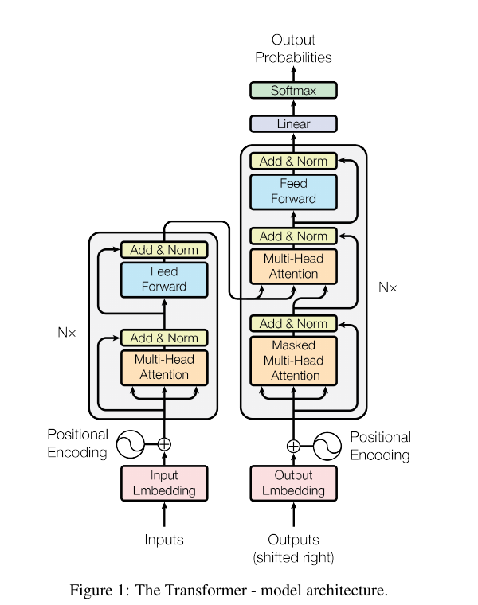

*Figure 1（原论文第 3 页）：左为 Encoder，右为 Decoder。两侧 embedding 均与位置编码相加；每个子层均包裹 Add & Norm；Decoder 的第一层注意力带 causal mask。来源：[原论文 PDF](https://arxiv.org/pdf/1706.03762)。*

**1. 总体结构：Encoder 理解，Decoder 生成**

- **Encoder（论文 Base 为 6 层）**：每层依次执行多头 self-attention、残差连接加 LayerNorm、逐位置 FFN、残差连接加 LayerNorm。它让源句中每个位置看见所有源 token。
- **Decoder（同为 6 层）**：多一个 encoder-decoder attention。先 masked self-attention 只看已生成前缀，再以 decoder 状态为 Query、encoder 输出为 Key/Value 读取源句，最后经过 FFN 预测下一个 token。
- **输出层**：decoder 顶部线性层投影到词表，再经 softmax 得到条件概率。训练时目标序列右移一位（teacher forcing）。

**2. Position Encoding：给无序注意力注入位置**

注意力本身对输入排列置换不敏感，所以 Transformer 将位置向量与 token embedding **逐元素相加**：\(x_{pos}=\mathrm{Embed}(token)+PE(pos)\)。论文使用固定正余弦编码：

$$
PE_{(pos,2i)}=\sin\!\left(pos/10000^{2i/d_{model}}\right),\quad
PE_{(pos,2i+1)}=\cos\!\left(pos/10000^{2i/d_{model}}\right)
$$

- 偶/奇维度形成不同频率的 sin/cos 对；低维变化快、高维变化慢，位置被编码为连续、多尺度的相位。
- 正余弦形式使相对位移可由线性关系表示，并可自然外推到训练中未见的长度；论文也实验了可学习位置向量，结果相近，选择正余弦是为外推便利。
- 注意：它是**绝对位置编码**；后来的 RoPE、ALiBi 等属于后续背景，并非本文结论。

**3. Attention：让 token 按内容读取其他 token**

每个 token 的隐状态经三个线性投影得到 \(Q,K,V\)。\(QK^T\) 给出“我该关注谁”的相似度，softmax 变成权重，再加权汇总 \(V\)：

$$
\mathrm{Attention}(Q,K,V)=\mathrm{softmax}\!\left(\frac{QK^T}{\sqrt{d_k}}+M\right)V
$$

其中 \(M\) 是可选 mask；decoder 的未来位置填 \(-\infty\)，从而 softmax 后概率为 0。\(1/\sqrt{d_k}\) 防止维度变大时点积过大、softmax 饱和、梯度变弱。

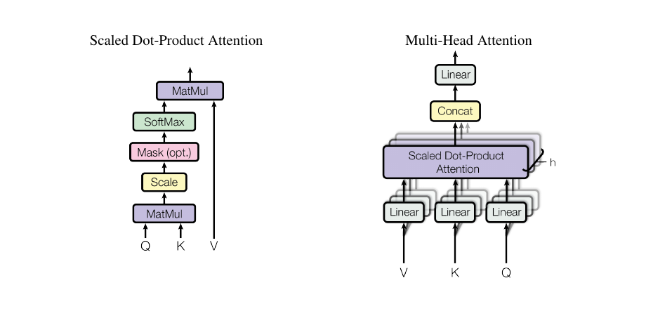

*Figure 2（原论文第 4 页）：左图是 MatMul → Scale →（可选 Mask）→ Softmax → 与 V 相乘；右图显示各 head 分别投影 Q/K/V、并行计算、拼接后线性投影。来源：[原论文 PDF](https://arxiv.org/pdf/1706.03762)。*

**Multi-Head Attention（MHA）**

单头只能在一个投影空间中建立关系。MHA 让 \(h\) 个 head 以独立投影并行计算：

$$
\mathrm{MHA}(Q,K,V)=\mathrm{Concat}(head_1,\ldots,head_h)W^O
$$

$$
head_i=\mathrm{Attention}(QW_i^Q,KW_i^K,VW_i^V)
$$

论文 Transformer-Base 使用 \(d_{model}=512\)、\(h=8\)、\(d_k=d_v=64\)。总投影维度保持约 \(d_{model}\)，因此多头并非简单把计算量乘 8；它的价值是让不同 head 能并行学习不同关系子空间。

三种 attention 的角色：

- **Encoder self-attention**：Q/K/V 都来自 encoder 当前层，双向整合源句上下文。
- **Masked decoder self-attention**：Q/K/V 来自生成前缀；causal mask 保证自回归性。
- **Cross-attention**：Q 来自 decoder，K/V 来自 encoder；用于条件生成时检索输入信息。

**4. FFN：每个位置独立的知识变换**

注意力解决“token 之间怎样通信”；FFN 解决“每个 token 得到信息后怎样非线性加工”。论文使用相同参数、对每个位置独立应用的两层 MLP：

$$
\mathrm{FFN}(x)=\max(0,xW_1+b_1)W_2+b_2
$$

Base 配置为 \(d_{model}=512\rightarrow d_{ff}=2048\rightarrow512\)。它不混合序列位置，因此可以完全并行；但因先扩张再压缩，提供了注意力之外的大部分逐 token 非线性容量。现代 LLM 常将 ReLU 换成 GELU/SwiGLU，但那是后续演化。

**5. 其他不可忽略的部件**

- **Residual + LayerNorm**：每个 attention/FFN 子层输出为 \(\mathrm{LayerNorm}(x+\mathrm{Sublayer}(x))\)。残差保留原表示并改善深层梯度传播；原论文为 post-norm，现代许多 LLM 改为 pre-norm。
- **Embedding 与权重共享**：源 embedding、目标 embedding 与预 softmax 线性层共享权重；embedding 按 \(\sqrt{d_{model}}\) 缩放。
- **正则化**：在子层输出、embedding 与位置编码之和上使用 dropout（Base 为 0.1）；使用 label smoothing \(\epsilon=0.1\)。
- **训练设置**：Adam + 特定 warmup 学习率调度 \(lr=d_{model}^{-0.5}\min(step^{-0.5},step\cdot warmup^{-1.5})\)，warmup 为 4000 steps；这些是原论文训练配方，不是 Transformer 数学定义的一部分。
- **复杂度**：全注意力每层时间/空间为 \(O(n^2d)\)，优点是任意两 token 的依赖路径长度为 1；这也是后续长上下文优化持续针对的瓶颈。

**带来的收益**

- **并行训练与更短依赖路径。** 相对 RNN，整段序列可并行计算；任意 token 对可在一个 attention 层直接交互。
- **机器翻译质量与成本。** 论文在 WMT14 英德取得 **28.4 BLEU**，比当时最佳结果（含 ensemble）高逾 2 BLEU；英法单模型取得 **41.8 BLEU**，用 8 GPU 训练 3.5 天。
- **模块化成为后续 LLM 基座。** Position Encoding、MHA、FFN、残差归一化与 causal mask 构成了后续 Transformer 变体的共同接口。
- **边界。** 原始全注意力的 \(O(n^2)\) 成本与 KV 缓存增长在长上下文中昂贵；编码器—解码器适合翻译，今天主流自回归 LLM 常仅保留 decoder stack。


# GPT-1：现代主流大模型“预训练 + 适配”的起点

## 来源

- Radford, Narasimhan, Salimans, Sutskever (2018). *Improving Language Understanding by Generative Pre-Training*. [OpenAI PDF](https://cdn.openai.com/research-covers/language-unsupervised/language_understanding_paper.pdf?file=language_understanding_paper.pdf)。

> **模型：** GPT（通常称 GPT-1）  **模型厂家：** OpenAI  
> **论文名称：** Improving Language Understanding by Generative Pre-Training  
> **作者：** Alec Radford、Karthik Narasimhan、Tim Salimans、Ilya Sutskever，2018  
> **发布时间：** 2018 年（OpenAI 预印本；本文未提供精确首次发布日期）  
> **原文：** [OpenAI PDF](https://cdn.openai.com/research-covers/language-unsupervised/language_understanding_paper.pdf?file=language_understanding_paper.pdf)

## 核心观点

这篇论文的重要性不在模型规模，而在于确立了今天主流 LLM 仍在遵循的训练范式：**先在大量无标注文本上做自回归语言模型预训练，再用少量任务数据适配同一个模型。** 它将“为每个 NLP 任务单独造模型”转为“一个通用生成式语言模型 + 极少任务层”。

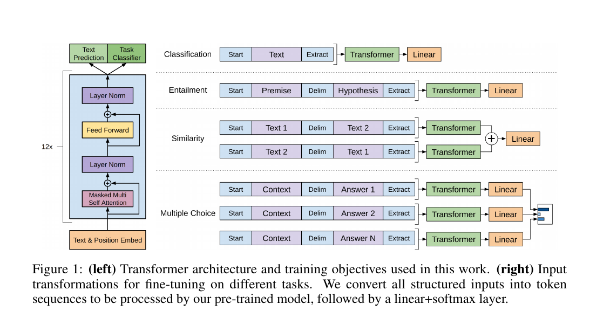

*Figure 1（原论文第 4 页）：左侧是 12 层 decoder-only Transformer，预训练目标为 next-token prediction；右侧展示分类、蕴含、相似度和多选问答都被转换为单一 token 序列，再接同一 Transformer 与线性分类头。来源：[原论文 PDF](https://cdn.openai.com/research-covers/language-unsupervised/language_understanding_paper.pdf?file=language_understanding_paper.pdf)。*

### 1. 生成式预训练：从原始文本学习通用能力

在无标注语料 \(U=\{u_1,\ldots,u_n\}\) 上，GPT-1 最大化自回归似然：

$$
\mathcal{L}_1(U)=\sum_i\log P(u_i\mid u_{i-k},\ldots,u_{i-1};\Theta)
$$

这就是今天 next-token prediction 的基本形式。论文使用 **decoder-only Transformer**：masked self-attention 保证每个位置只能读取左侧上下文；词嵌入与可学习位置嵌入相加，经过 Transformer block 后预测下一个 token。

### 2. 监督微调：保留主干，只增加轻量任务头

针对有标签样本 \((x,y)\)，取末层表示并接线性输出层：

$$
P(y\mid x)=\mathrm{softmax}(h_l^m W_y)
$$

作者还将语言模型目标作为微调辅助项：\(\mathcal{L}_3=\mathcal{L}_2+\lambda\mathcal{L}_1\)。其直觉是：既学习任务标签，又不立即遗忘预训练得到的语言规律。

### 3. 统一输入格式：Prompt 思想的早期形态

论文没有为每类任务重写网络，而是把结构化输入序列化：

- **蕴含**：`[start] premise [delimiter] hypothesis [extract]`；
- **相似度**：将两个句子以正反两种顺序分别编码，再合并表示；
- **多选题**：对每个候选答案构造 `[context; question; delimiter; answer]`，分别打分并归一化。

这不是今天的 in-context learning，但它展示了一个后来极具影响力的原则：**把任务表达为文本序列，让统一语言模型处理。**

### 4. 与今天主流 LLM 的关系

| GPT-1（本文）                               | 现代主流 LLM 的延续                                    |
| ------------------------------------------- | ------------------------------------------------------ |
| decoder-only、causal LM                     | 仍是 GPT 类、Llama、Qwen 等自回归模型的主干            |
| 无监督预训练 → 有监督微调                   | 发展为 pretraining → SFT → 偏好优化/RLHF 等后训练链路  |
| 统一序列化输入                              | 发展为 prompt、chat template、tool calling 的文本接口  |
| 12 层、768 hidden、12 heads、约 1.17 亿参数 | 规模、数据、上下文和后训练方式大幅扩大，但基本方向未变 |

需要区分：RLHF、指令微调、Transformer scaling law、MoE、长上下文与工具调用都不是这篇论文提出的；它们是在“通用生成式预训练模型可迁移”这一范式上继续发展。

## 带来的收益

- **验证通用预训练模型胜过专用任务模型。** 论文在研究的 12 个任务中有 9 个刷新当时最好结果；摘要报告 Stories Cloze、RACE、MultiNLI 分别有 8.9、5.7、1.5 个百分点的绝对提升。
- **大幅降低任务迁移的架构成本。** 同一 backbone 通过序列化输入与轻量线性头覆盖四类理解任务，减少任务专用网络设计。
- **确立后续路线。** GPT-2/3 的 zero-shot 与 in-context learning、指令微调和对齐训练，都依赖“先获得强生成式先验，再通过文本/训练信号适配”的基本思路。
- **边界。** GPT-1 仍主要依赖每个目标任务的有监督微调，模型与预训练数据规模远小于当代 LLM；它是范式原点，不等同于今天完整的聊天模型训练方案。

- 

# Scaling Laws for Neural Language Models：用幂律规划大模型训练

## 来源

- Kaplan et al. (2020). *Scaling Laws for Neural Language Models*. [arXiv:2001.08361](https://arxiv.org/abs/2001.08361)。

> **论文 ID：** arXiv:2001.08361  
> **论文名称：** Scaling Laws for Neural Language Models  
> **作者：** Jared Kaplan、Sam McCandlish、Tom Henighan、Tom B. Brown 等，2020  
> **发布时间：** 2020 年 1 月 23 日（arXiv 首次提交）  
> **原文：** [arXiv](https://arxiv.org/abs/2001.08361)｜[PDF](https://arxiv.org/pdf/2001.08361)

## 核心观点

这篇论文的改变在于：将“模型是否值得继续变大”的经验问题，变成可外推的定量关系。作者在 Transformer 语言模型上测量交叉熵损失 \(L\) 与**非 embedding 参数量** \(N\)、训练 token 数 \(D\)、训练计算量 \(C\) 的关系，发现它们在很宽尺度上呈平滑幂律。

### 1. 三条基础 Scaling Law：N、D、C 都能预测 loss

当其余资源不构成瓶颈时，论文拟合出近似关系：

$$
L(N)\propto N^{-0.076},\qquad L(D)\propto D^{-0.095},\qquad L(C_{min})\propto C_{min}^{-0.050}
$$

这里的关键是“条件充分”：只增加模型、数据或算力中的一个，而另两个不足时，增益会被瓶颈截断。

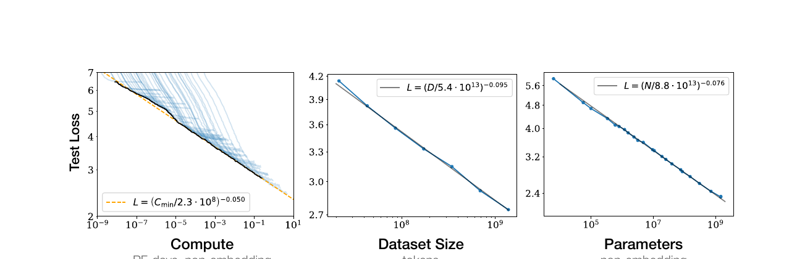

*Figure 1（原论文第 3 页）：左至右分别显示 loss 随 compute、dataset size、parameters 增大而稳定下降；对数坐标下近直线是幂律的直接证据。来源：[原论文 PDF](https://arxiv.org/pdf/2001.08361)。*

- **N scaling**：更大模型降低可达 loss，且更具 sample efficiency。
- **D scaling**：更多 token 有稳定收益，但如果模型太小，数据终将无法被充分利用。
- **C scaling**：固定训练预算下，关键不是盲目加训练步数，而是 N 与训练量的共同分配。

### 2. 模型形状影响较弱：优先看总非 embedding 参数

作者在固定 \(N\) 下改变 FFN 宽度比例、宽深比和 attention head dimension，发现 loss 只在较小范围内变化；例如很宽的 aspect-ratio 变化可只造成小幅损失差异。论文并非声称“架构永远不重要”，而是说在其实验 Transformer 家族与合理区间内，**总规模是比形状细节更强的一阶变量**。

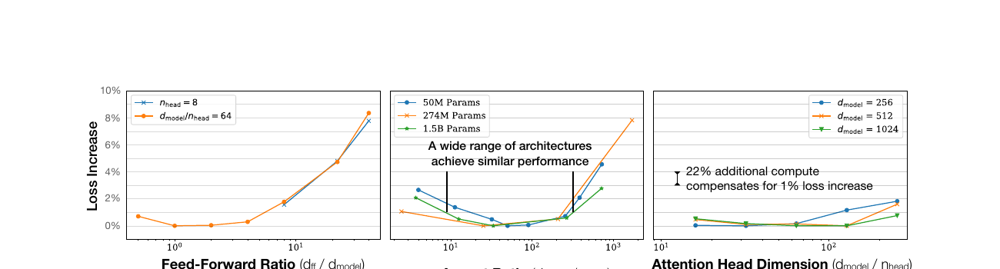

*Figure 5（原论文第 8 页）：FFN 比例、宽深 aspect ratio 与 head dimension 在广泛范围内变化时，loss 增加通常仅为几个百分点。来源：[原论文 PDF](https://arxiv.org/pdf/2001.08361)。*

### 3. 数据瓶颈与过拟合：N 与 D 必须一起扩展

论文提出 \(L(N,D)\) 的经验形式，表达两个独立误差来源：模型容量有限与数据有限。固定数据量时持续放大模型会进入过拟合/数据受限区；要保持接近最优，数据量应随模型规模显著增长。论文给出的经验结论是：将模型放大约 8 倍时，需要将数据规模放大约 5 倍左右，才能避免明显的数据瓶颈。

这也是为什么“参数更多”不能脱离训练 token 数讨论。损失下降、泛化、训练是否充分收敛，是三个不同但相互约束的问题。

### 4. Compute-efficient training：固定预算要选最优大小，并早停

论文的原始结论是：在固定计算预算 \(C\) 下，有一个 compute-efficient frontier。相比将小模型训练到完全收敛，更优的策略是训练**更大模型、使用相对少的数据、在收敛前停止**；原因是大模型达到同一性能所需优化步数更少、样本效率更高。

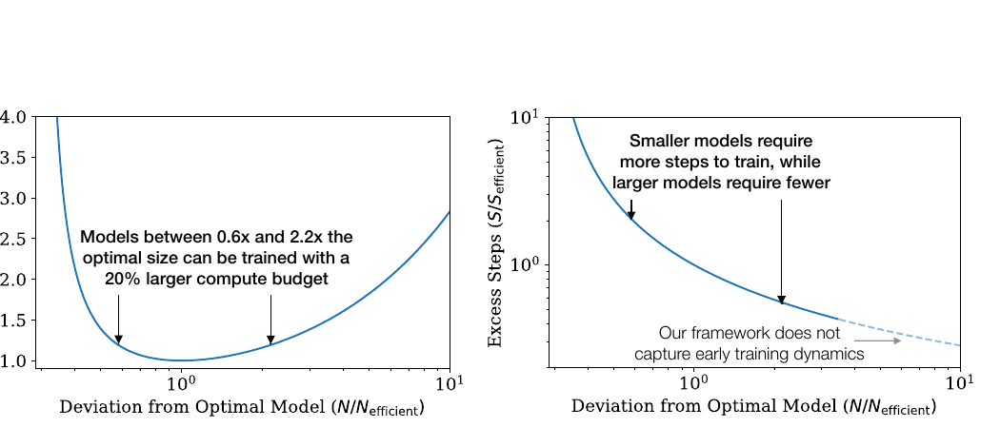

*Figure 12（原论文第 15 页）：左图显示偏离最优模型大小会增加所需算力；右图显示较小模型需要更多训练 steps，而较大模型所需 steps 更少。来源：[原论文 PDF](https://arxiv.org/pdf/2001.08361)。*

作者拟合的 compute-optimal 关系约为：

$$
N(C_{min})\propto C_{min}^{0.73},\qquad S_{min}(C_{min})\propto C_{min}^{0.03}
$$

即新增算力主要应投入到模型大小；最优训练步数增长很慢。这一结论对应本文特定数据、模型和训练设定，不能不加检验地套到所有训练配方。

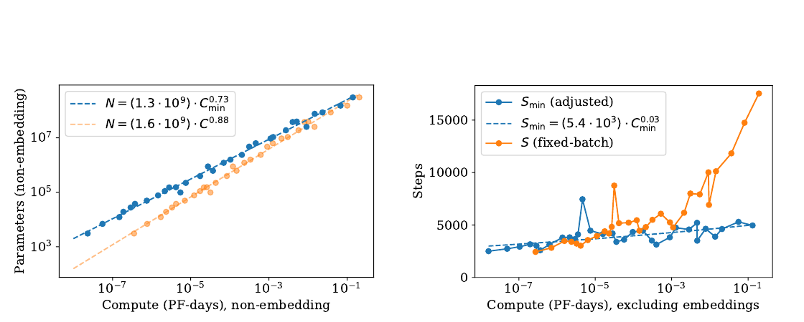

*Figure 14（原论文第 16 页）：左图显示最优模型大小随计算预算快速上升；右图显示经调整后的最优步数增长极慢。来源：[原论文 PDF](https://arxiv.org/pdf/2001.08361)。*

### 5. 如何正确理解 Chinchilla

**Chinchilla（Hoffmann et al., 2022）是后续补充背景，不是本文结论。** 它在不同实验设置下得出更“数据充分”的 compute-optimal 配比，并修正了 Kaplan 论文关于应大幅早停、相对少数据训练的实务建议。两者共同点是：最优训练必须联合决定参数、token 与计算；差异在于具体指数与配比受实验范围、训练预算和数据重复等条件影响。

## 带来的收益

- **训练前可预测。** 先用小规模 sweep 拟合 \(L(N,D,C)\)，再估计大训练的目标 loss 与资源需求，降低巨额训练的试错风险。
- **资源分配有了共同语言。** Parameters、Tokens、Compute 成为规划预训练的三元坐标，而不是只比较参数规模。
- **解释了规模为何有效。** 幂律跨多个数量级仍平滑，说明增大模型、数据和计算不是纯粹随机的工程赌注。
- **重要边界。** 本文测量的是语言建模 cross-entropy，不能直接推出所有下游能力、推理能力或安全性也严格按相同指数缩放；架构、数据质量、优化器与评测分布也会改变具体曲线。

- 


# Transformer 的三条核心优化主线总览

### 核心优化主线

``` text
                         Modern LLM
                             │
       ┌─────────────────────┼─────────────────────┐
       │                     │                     │
       ▼                     ▼                     ▼
Position Encoding         Attention             FFN / MoE
   「在哪」               「看谁」               「谁来算」
       │                     │                     │
      RoPE                  MHA                 Dense FFN
       │                     │                     │
   RoPE Scaling       ┌──────┴──────┐       ┌──────┴──────┐
       │              │             │       │             │
      YaRN        DeepSeek         Qwen  DeepSeek        Qwen
       │              │             │       │             │
 Partial / mRoPE     MLA           GQA   DeepSeekMoE      MoE
       │              │             │       │             │
       │             DSA           GDN      │             │
       │              │             │       │             │
       │          CSA / HCA        QSA      │             │
       ▼              ▼             ▼       ▼             ▼
    看得远          少存/少算      线性/稀疏  多参数/少激活  Sparse Experts
```

------------------------------------------------------------------------------------------
| 架构部分              | 回答的问题               | 代表技术                        | 主要目标           |
| --------------------- | ------------------------ | ------------------------------- | ------------------ |
| **Position Encoding** | Token 在哪里、相隔多远？ | RoPE、YaRN、Partial RoPE、mRoPE | **看得远**         |
| **Attention**         | Token 应该看谁、怎么看？ | MHA、GQA、MLA、DSA、GDN、QSA    | **少存、少算**     |
| **FFN / MoE**         | Token 由哪些参数处理？   | Dense FFN、MoE、DeepSeekMoE     | **多参数、少激活** |

可以用三句话记忆：

> **Position Encoding：在哪 / 看多远**\
> **Attention：看谁 / 怎么看**\
> **MoE：谁来算**

------------------------------------------------------------------------

# 第一部分：Position Encoding 技术演进

## 一、为什么 Transformer 需要位置编码？

Attention 本身并不知道 Token的先后顺序，因此需要额外注入顺序和相对距离信息。

原始 Transformer 使用 **Sinusoidal Positional Encoding**：

``` text
Token Embedding
      +
Position Encoding
      │
      ▼
Transformer
```

**论文**

-   Vaswani et al., **Attention Is All You Need**\ https://arxiv.org/abs/1706.03762

**论文解读：**

> **厂家：**Google Brain / Google Research  
> **论文 ID：** arXiv:1706.03762  
> **论文名称：** Attention Is All You Need  
> **作者：** Ashish Vaswani、Noam Shazeer、Niki Parmar、Jakob Uszkoreit 等，2017  
> **发布时间：** 2017 年 6 月 12 日（arXiv 首次提交）  
> **原文：** [arXiv](https://arxiv.org/abs/1706.03762)｜[PDF](https://arxiv.org/pdf/1706.03762)

**核心观点**

自注意力对输入 token 的排列天然不敏感：交换两个 token，若不含位置特征，注意力无法分辨顺序。因此 Transformer 在 encoder 和 decoder 的输入 embedding 上**逐元素相加位置编码（PE）**，让每个 token 同时携带“内容是什么”和“位于哪里”。

- **原论文采用固定正弦/余弦编码。** 对位置 `pos` 和维度索引 `i`：

  `PE(pos, 2i) = sin(pos / 10000^(2i/d_model))`  
  `PE(pos, 2i+1) = cos(pos / 10000^(2i/d_model))`。

- **不同维度对应不同频率。** 高频维度区分邻近位置，低频维度表达较长尺度的位置变化；全部维度共同给出一个连续的绝对位置表示。

- **相对位置可由线性关系表示。** 论文的动机是：对任意固定偏移 `k`，`PE(pos+k)` 可表示为 `PE(pos)` 的线性函数，便于注意力层学习基于相对距离的关系。

- **固定 PE 与学习式 PE 效果相近。** 作者也试验了 learned positional embeddings，结果与正弦编码相近；选择正弦编码是因为它理论上可外推到训练期间未见过的序列长度。

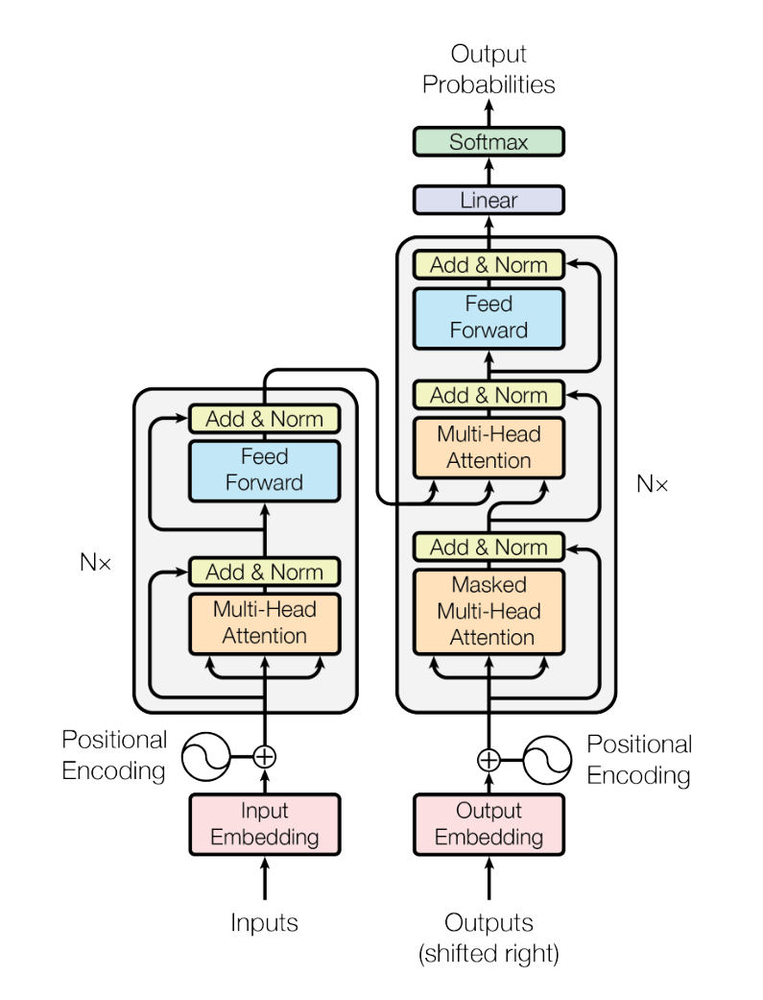

*位置编码分别加到 Encoder / Decoder 底部的 input embedding，再送入注意力层；它不是一个独立的 attention 模块，而是序列表示的组成部分。*

**带来的收益**：

- **让全局注意力理解词序。** 无需 RNN 的逐步递归或 CNN 的局部卷积，也能区分“狗咬人”和“人咬狗”等不同顺序。
- **支持并行训练。** PE 是一次性加到所有 token embedding 上，不引入时间步依赖；Transformer 仍可对整段序列并行计算。
- **具有长度外推动机。** 固定函数没有学习表的最大位置限制，因此比 learned absolute embeddings 更自然地覆盖更长位置；实际效果仍受训练数据、注意力计算与任务分布约束。
- **后续方法是补充演进。** RoPE、ALiBi、相对位置偏置等后来方案并非本论文结论；它们主要针对长上下文外推和相对位置信号进一步改进。


## 二、RoPE：把绝对位置旋转成注意力中的相对位置信号

现代 LLM 大量转向 **RoPE（Rotary Position Embedding）**。RoPE 在 Query / Key 空间通过旋转注入位置信息：

``` text
Q ──→ Rotary Transform(position)
K ──→ Rotary Transform(position)
             │
             ▼
       Attention Score
     携带相对位置信息
```

**论文**

-   Su et al. (2021). *RoFormer: Enhanced Transformer with Rotary Position Embedding*. [arXiv:2104.09864](https://arxiv.org/abs/2104.09864)。


> **论文 ID：** arXiv:2104.09864  
> **论文名称：** RoFormer: Enhanced Transformer with Rotary Position Embedding  
> **作者：** Jianlin Su、Yu Lu、Shengfeng Pan、Ahmed Murtadha、Bo Wen、Yunfeng Liu，2021  
> **发布时间：** 2021 年 4 月 20 日（arXiv 首次提交）  
> **原文：** [arXiv](https://arxiv.org/abs/2104.09864)｜[PDF](https://arxiv.org/pdf/2104.09864)

**核心观点**

RoPE（Rotary Position Embedding）不把位置向量直接加到 token embedding 上，而是对 Query、Key 的每一对通道施加与位置有关的二维旋转。这样 Attention 的点积天然只依赖**相对位置差**。

- **二维通道对就是复平面旋转。** 对第 `i` 对通道 `(x_2i, x_2i+1)`，位置 `m` 以角度 `mθ_i` 旋转：
  `R(mθ_i) = [[cos(mθ_i), -sin(mθ_i)], [sin(mθ_i), cos(mθ_i)]]`。
- **只旋转 Q 和 K。** 计算 attention 前，将 `q_m` 变成 `R_m q_m`，将 `k_n` 变成 `R_n k_n`；因此内积等价于 `q_m^T R_(n-m) k_n`，位置信息以差值 `n-m` 进入 attention score。
- **多频率编码距离。** 不同通道对使用不同 `θ_i`，类似正弦位置编码的多尺度频率；近距离和远距离都能形成可区分的相位关系。
- **位置在注意力计算处生效。** 相比 absolute PE 先污染 token 表示再由后续层自行学习位置关系，RoPE 直接将相对距离注入 QK 匹配，因此适合自注意力的“谁该关注谁”这一核心操作。

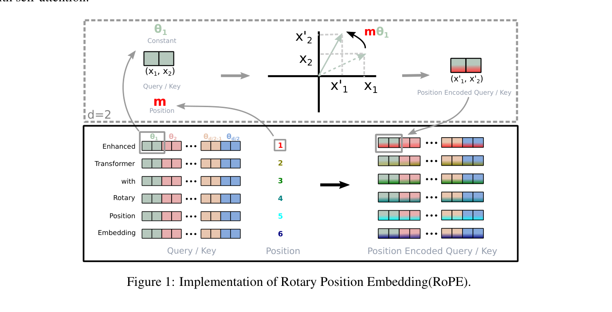

*位置相关旋转将绝对位置映射到 Q/K 的二维通道对；两个位置的内积可化为相对偏移的旋转关系。*

**带来的收益**

- **相对距离自然进入注意力分数。** 这为语序与距离建模提供了明确的数学结构，而不必额外设计相对位置表或偏置项。
- **实现轻量。** RoPE 不改变注意力的主干矩阵乘法，只在 Q/K 上做按元素重排与 sin/cos 组合，因此可直接嵌入常规 Transformer。
- **具备长度外推的结构基础。** 它是确定性函数，不受 learned position table 长度限制；但实际长上下文效果仍会受训练长度、频率基底和模型规模影响。
- **后续长上下文技术是补充。** NTK scaling、YaRN、RoPE 插值等是后续针对超训练长度外推的改造，不能当作原论文已经验证的结论。

------------------------------------------------------------------------

## 三、YaRN：高效扩展大语言模型上下文窗口

训练长度和部署长度不一致时，会产生 Context Extrapolation 问题：

``` text
训练：
0 ─────────────────── 32K

部署：
0 ───────────────────────────────────── 128K / 1M
```

因此出现 RoPE Scaling。YaRN 是代表方法之一：

``` text
RoPE
 │
 ▼
RoPE Scaling
 │
 ▼
YaRN
 │
 ▼
Long Context
```

**论文**

-   Peng, B. et al. *YaRN: Efficient Context Window Extension of Large Language Models*, arXiv:2309.00071，2023。[arXiv 摘要页](https://arxiv.org/abs/2309.00071)｜[PDF](https://arxiv.org/pdf/2309.00071)


> **论文 ID：** arXiv:2309.00071  
> **论文名称：** YaRN: Efficient Context Window Extension of Large Language Models  
> **作者：** Bowen Peng、Jeffrey Quesnelle、Honglu Fan、Enrico Shippole，2023  
> **发布时间：** 2023 年 8 月 31 日（arXiv 首次提交）  
> **原文：** [arXiv](https://arxiv.org/abs/2309.00071)｜[PDF](https://arxiv.org/pdf/2309.00071)

**核心观点**

- **问题：RoPE 模型的“位置尺度”会越界。** 模型预训练时只见过长度为 \(L\) 的序列；直接把上下文拉到 \(L'\) 后，旋转位置编码（RoPE）的相位模式落入训练分布之外，长文本能力会明显退化。
- **YaRN 的主张不是把所有位置维度一视同仁地缩放。** 它将已有的位置插值（PI）与 NTK-aware 插值归纳为一条路线，并提出 **NTK-by-parts**：按 RoPE 各维对应的波长分工。短波长维保留原状，以维持局部相对位置；长波长维做插值，以适配更长的全局位置；中间区域平滑过渡。
- **再配合注意力温度缩放。** 论文将这一组合称为 YaRN，使注意力在长度扩展后的分布更稳定；核心是同时处理“位置频率如何变化”和“注意力分数如何校准”两个问题。

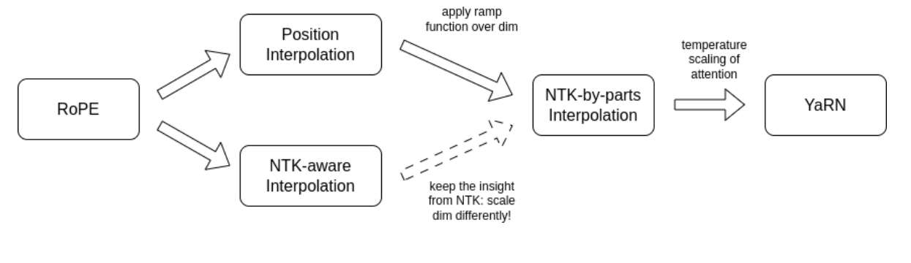

*YaRN 的方法脉络。RoPE 经由 Position Interpolation 与 NTK-aware 两条思路，汇入按维度分段处理的 NTK-by-parts；最后叠加 attention temperature scaling 得到 YaRN。*

**带来的收益**

- **更省的上下文扩展训练。** 论文报告，相比此前方法，YaRN 达到同类效果所需训练 token 约少 **10 倍**、训练步数约少 **2.5 倍**；在少于原始预训练数据约 **0.1%** 的微调数据后可取得当时领先结果。这些是论文在其 LLaMA 等实验设定下的报告结果。
- **让长上下文微调更可操作。** 它把“重训一个长窗口模型”的高成本问题，转化为相对轻量的 RoPE 参数调整与少量长文本微调，为后续长上下文模型的工程实践提供了常用思路。
- **支持一定程度的免微调延长。** 论文还提出 Dynamic-YaRN：结合推理时的动态缩放，可在不微调的情况下把上下文窗口扩展到原来的两倍以上；但实际可用长度仍依赖模型、任务与长文本评测。
- **边界：长度变长不等于计算免费。** YaRN 缓解的是位置编码外推与训练效率；标准全注意力的显存和计算量仍会随序列长度快速增长，因此常需与高效注意力、KV cache 或稀疏/分块机制配合。

------------------------------------------------------------------------

## 四、DeepSeek：RoPE 与 MLA 协同设计

DeepSeek-V2/V3 的 MLA 不能完全脱离位置编码理解。MLA对内容表示进行低秩压缩，同时使用解耦的 RoPE 分支保留位置关系：

``` text
                 Hidden State
                      │
          ┌───────────┴───────────┐
          ▼                       ▼
      Content 部分             Position 部分
          │                       │
 Low-Rank Compression             RoPE
          │                       │
          ▼                       ▼
      Latent KV              Positional Key
          │                       │
          └───────────┬───────────┘
                      ▼
                     MLA
```

核心是：

> **内容表示负责压缩，位置分支负责保留相对位置信息。**

### 论文

-   **DeepSeek-V2**\ https://arxiv.org/abs/2405.04434
-   **DeepSeek-V3 Technical Report**\ https://arxiv.org/abs/2412.19437

------------------------------------------------------------------------

## 五、Qwen：RoPE → YaRN → mRoPE / Partial RoPE

Qwen 的位置编码路线可以概括为：

``` text
RoPE
 │
 ├────────→ RoPE Scaling
 ▼
YaRN
 │
 ├────────→ Long Context
 ▼
Partial RoPE
 │
 ├────────→ 部分维度承担旋转位置编码
 ▼
mRoPE
 │
 └────────→ Text / Image / Video 多模态位置建模
```

### mRoPE

Qwen-VL 系列使用 **Multimodal Rotary Position Embedding**，将多模态位置拆分为时间和空间维度：

``` text
                 mRoPE
                   │
       ┌───────────┼───────────┐
       ▼           ▼           ▼
    Temporal     Height       Width
```

使文本、图片、视频能够进入统一的位置建模体系。

### 资料

-   **Qwen2-VL Technical Report**\ https://arxiv.org/abs/2409.12191
-   **Qwen3 Blog**\ https://qwenlm.github.io/blog/qwen3/
-   **Qwen3 Technical Report**\ https://arxiv.org/abs/2505.09388

**论文**

- Qwen Team et al. (2025). *Qwen3 Technical Report*. [arXiv:2505.09388](https://arxiv.org/abs/2505.09388)。


Qwen3 与 mRoPE：为多维位置关系保留 RoPE 的相对距离优势

> **模型：** Qwen3  **模型厂家：** Qwen / 阿里巴巴集团  
> **论文 ID：** arXiv:2505.09388  
> **论文名称：** Qwen3 Technical Report  
> **作者：** An Yang、Anfeng Li、Baosong Yang、Binyuan Hui 等，2025  
> **发布时间：** 2025 年 5 月 14 日（arXiv 首次提交）  
> **原文：** [arXiv](https://arxiv.org/abs/2505.09388)｜[PDF](https://arxiv.org/pdf/2505.09388)

**核心观点**

mRoPE（Multimodal Rotary Position Embedding）的目的，是将 RoPE 从单一文本序列位置扩展到多维位置：文本 token 主要沿一维序列编号；图像 / 视频 token 则可同时编码时间、高度、宽度等坐标。它让注意力在不同轴上分别获得相对位置信号。

- **基本算子仍是 RoPE。** 在 Q/K 的二维通道对上施加旋转；不同于普通 RoPE，mRoPE 将通道组分配给多个位置轴，而不是只使用单个 position id。
- **按模态分配坐标。** 文本 token 使用一维位置；视觉 token 使用时空坐标。混合输入中，位置 ID 的构造使模型既能识别文本顺序，也能表示图像网格和视频帧的相对关系。
- **相对位置仍由旋转差表达。** 每个轴的 QK 相位差对应该轴上的相对偏移，因此模型可学习“同一帧相邻 patch”“跨帧同位置”等关系。
- **它是模型设计的一部分。** mRoPE 本身不是推理时额外增加的模块，而是生成 Q/K 时的编码规则；需要与视觉 token 化、序列拼接和长上下文策略一致配置。

**带来的收益**

- **统一文本与视觉序列。** 同一个 Transformer 注意力层可处理文本、图像和视频 token，而不会将二维 / 三维空间关系压扁为任意的一维顺序。
- **更适合多模态长上下文。** 相对坐标关系由旋转结构持续提供，能支持跨 token、跨 patch、跨帧的匹配。
- **保持 RoPE 的实现优势。** 不依赖显式的巨大位置表，Q/K 旋转可高效实现并与常规 attention kernel 结合。
- **边界：不是自动解决长上下文。** mRoPE 的实际外推取决于训练范围、频率配置、视觉 token 数和长上下文扩展策略；不同实现的轴划分与 position-id 规则会直接影响效果。

------------------------------------------------------------------------

# 第二部分：Attention 技术演进

## 一、共同起点：Attention Is All You Need：多头注意力（MHA）

MHA（Multi-Head Attention）来自 Transformer：

``` text
Q1 ───────────→ K1 / V1
Q2 ───────────→ K2 / V2
Q3 ───────────→ K3 / V3
...
Qn ───────────→ Kn / Vn
```

**论文**

- Vaswani, A. et al. *Attention Is All You Need*, arXiv:1706.03762，2017。[arXiv 摘要页](https://arxiv.org/abs/1706.03762)｜[PDF](https://arxiv.org/pdf/1706.03762)


> **论文 ID：** arXiv:1706.03762  
> **论文名称：** Attention Is All You Need  
> **作者：** Ashish Vaswani、Noam Shazeer、Niki Parmar、Jakob Uszkoreit、Llion Jones、Aidan N. Gomez、Łukasz Kaiser、Illia Polosukhin，2017  
> **发布时间：** 2017 年 6 月 12 日（arXiv 首次提交）  
> **原文：** [arXiv](https://arxiv.org/abs/1706.03762)｜[PDF](https://arxiv.org/pdf/1706.03762)

**核心观点**

- **先有一个注意力头。** 给定 query \(Q\)、key \(K\)、value \(V\)，缩放点积注意力计算为：
  $$
  \operatorname{Attention}(Q,K,V)=\operatorname{softmax}\!\left(\frac{QK^\top}{\sqrt{d_k}}\right)V
  $$
  \(QK^\top\) 给出“当前 token 应关注哪些 token”的分数；softmax 将其变为权重；权重对 \(V\) 加权求和。除以 \(\sqrt{d_k}\) 能抑制高维点积过大造成的 softmax 饱和。

- **MHA 的关键：为同一组输入建立多组投影，并行做注意力。** 第 \(i\) 个头不是直接共享原始 \(Q,K,V\)，而是先投影到自己的子空间：
  $$
  \operatorname{head}_i=\operatorname{Attention}(QW_i^Q,KW_i^K,VW_i^V)
  $$
  所有头的输出拼接后再经一次线性投影：
  $$
  \operatorname{MultiHead}(Q,K,V)=\operatorname{Concat}(\operatorname{head}_1,\ldots,\operatorname{head}_h)W^O
  $$

- **“多头”的含义是多种关注视角。** 不同头可在不同表示子空间、不同位置关系上分工；单个头的加权平均可能混合多种关系，而多头先分别建模，再融合。

- **原论文的配置。** Transformer base 使用 \(h=8\) 个头，\(d_{model}=512\)，每头 \(d_k=d_v=64\)。因为每头维度缩小为总维度的 \(1/h\)，总体计算量与单个全维注意力大致同量级。

- **掩码是解码器 MHA 的必要条件。** 在自回归生成中，把未来位置对应的注意力分数置为 \(-\infty\)，softmax 后权重为 0，避免第 \(t\) 个 token 偷看后续答案。

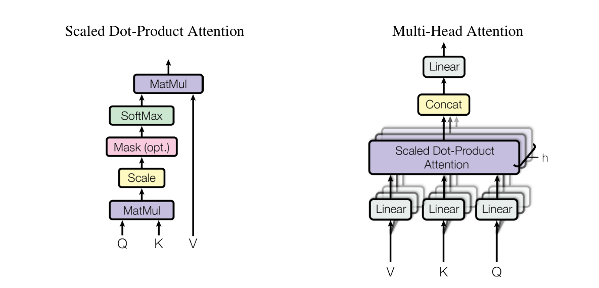

*左侧展示一个注意力头如何由 \(Q,K,V\) 经矩阵乘法、缩放、可选掩码和 softmax 得到输出；右侧展示多组独立线性投影与注意力头并行运行，随后 Concat 并经过线性层融合。*

**带来的收益**

- **表达能力更强而非只“加宽”。** 多头让模型能够同时保留不同类型的依赖信号，避免由一个注意力分布承担全部语义、句法和位置关系；这是 MHA 相比单头注意力的主要设计动机。
- **适用于三种注意力位置。** 同一 MHA 模块可用于编码器 self-attention、解码器 masked self-attention 和编码器-解码器 cross-attention，只是 \(Q,K,V\) 的来源与是否施加掩码不同。
- **兼顾并行与成本。** 每个 token 对所有位置的注意力可用矩阵乘法并行计算；原论文通过降低单头维度，使多头总计算成本与单头全维注意力接近。
- **边界：注意力矩阵仍随长度二次增长。** MHA 改善了表示分工，但标准全注意力仍需构建 \(n\times n\) 的关联，长序列时的显存和计算压力并未由 MHA 本身消除。


随着 Context 增长：

``` text
Context Length ↑
       │
       ├────────→ KV Cache ↑
       └────────→ Attention Compute ↑
```

于是 Attention 优化逐渐围绕两个核心问题：

1.  **KV 能不能少存？**
2.  **Attention 能不能少算？**

------------------------------------------------------------------------

## 二、DeepSeek Attention

### DeepSeek：MHA → MLA → DSA → CSA/HCA

``` text
MHA
 │
 │ 完整 KV
 ▼
MLA
 │
 │ 压缩 KV
 ▼
DSA
 │
 │ 选择重要历史 Token
 ▼
CSA + HCA
 │
 │ Compression
 │ + Sparse / Dense
 ▼
Hybrid Attention
```

#### DeepSeek-V2: MLA(Multi-head Latent Attention)

``` text
MHA：
K / V ───────────────→ KV Cache

MLA：
K / V
  │
  ▼
Low-Rank Compression
  │
  ▼
Latent Representation
  │
  ▼
KV Cache
```

**论文 / 项目**

-   **DeepSeek-V2**\ https://arxiv.org/abs/2405.04434
-   DeepSeek-V2 官方项目\ https://github.com/deepseek-ai/DeepSeek-V2


**DeepSeek-V2：围绕 MLA 的 KV Cache 压缩**

> **论文 ID：** arXiv:2405.04434  
> **论文名称：** DeepSeek-V2: A Strong, Economical, and Efficient Mixture-of-Experts Language Model  
> **作者：** DeepSeek-AI、Aixin Liu、Bei Feng、Bin Wang 等，2024  
> **发布时间：** 2024 年 5 月 7 日（arXiv 首次提交）  
> **原文：** [arXiv](https://arxiv.org/abs/2405.04434)｜[PDF](https://arxiv.org/pdf/2405.04434)

**核心观点**

- **MLA（Multi-Head Latent Attention）要解决的是 KV cache，而不是注意力本身。** 自回归生成每一步都要读取历史 token 的 K/V；标准 MHA 为每层、每个头缓存完整 K/V，长上下文时显存占用和带宽读取会成为推理瓶颈。
- **核心动作：把 K/V 联合压缩为一个低维 latent。** 对每个历史 token，MLA 不缓存所有头的 \(K,V\)，而是先下投影为共享的 KV latent \(c_t^{KV}\)，推理时只保存该 latent；需要计算注意力时再通过上投影得到各头所需的 key/value 成分。
- **为什么叫“latent attention”。** 缓存对象从“显式的多头 K/V 张量”变成承载其主要信息的低秩隐变量。若 \(d_c\) 是 latent 维度、远小于所有头 K/V 的总维度，缓存规模就近似按维度比缩小。
- **RoPE 不能直接和低秩吸收。** 位置旋转会使投影矩阵与位置相关，妨碍像普通低秩分解那样在推理前合并。MLA 因而将 RoPE 部分解耦：内容相关的 K/V 使用 latent 压缩，较小的 RoPE key/query 分支单独计算并缓存，从而保留位置建模。
- **MLA 与 MoE 分工不同。** MLA 减少推理时的 KV 带宽与显存；图中上半部分的 DeepSeekMoE 则是 FFN 稀疏化，用于降低每 token 的激活计算。两者共同构成 DeepSeek-V2 的效率设计，但本文档以 MLA 为重点。

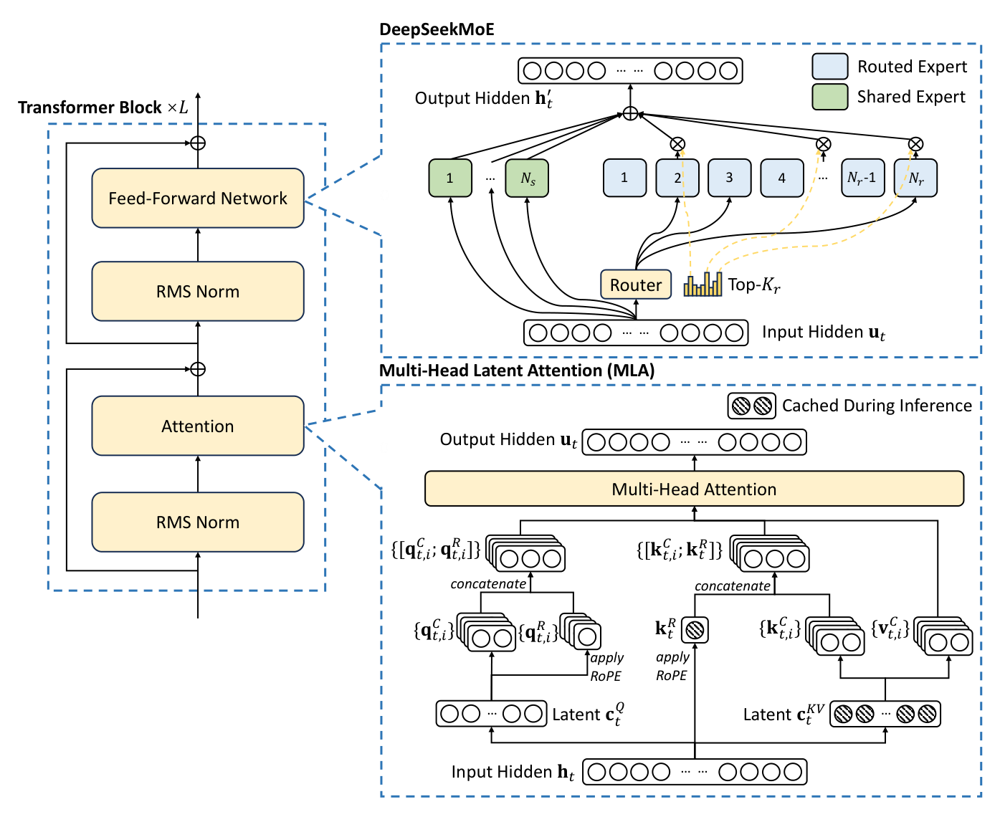

*Figure 2（原论文第 5 页）：下半部分为 MLA。带阴影标记的是推理期间缓存的内容：压缩后的 \(c_t^{KV}\) 与解耦的 RoPE key；它们替代了标准 MHA 中每头完整 K/V 的缓存。上半部分的 DeepSeekMoE 说明该模型的另一条效率路线。图源：[论文 PDF](https://arxiv.org/pdf/2405.04434#page=5)。*

**带来的收益**

- **大幅压缩长上下文 KV cache。** 论文相对 DeepSeek 67B 报告 KV cache 减少 **93.3%**。这会直接释放显存，并减少生成每一步为读取历史 KV 所需的数据传输。
- **提升生成吞吐。** 同一对比中，最大生成吞吐提升至 **5.76 倍**；这与 KV cache 缩小相对应，因为解码阶段常受内存带宽而非纯算力限制。
- **避免 MQA/GQA 的单一路径折中。** MQA/GQA 通过共享 KV 头压缩缓存，可能减少头级 KV 表达能力；MLA 改为在连续 latent 空间中联合压缩 KV，论文报告其在实现缓存压缩的同时保持较强性能。
- **边界：收益依赖低秩维度与实现。** latent 过小会损失信息，过大则减少压缩收益；同时，MLA 并未消除标准注意力随序列长度增长的全部计算，且 RoPE 解耦分支仍需缓存。论文的 93.3% 与 5.76× 是具体模型、硬件和实现下的对比结果。

------------------------------------------------------------------------

#### DeepSeek-V3.2：DSA(DeepSeek Sparse Attention)

DSA（DeepSeek Sparse Attention）进一步解决长上下文 Attention 计算成本，先筛选，再精算长上下文：

``` text
                   Query
                     │
                     ▼
              Lightning Indexer
                     │
              Relevance Score
                     │
                     ▼
          Important Historical Tokens
                     │
                     ▼
              Sparse Attention
```

因此可以记成：

> **MLA = 少存**\
> **DSA = 少算**

**论文**

- DeepSeek-AI et al. (2025). *DeepSeek-V3.2: Pushing the Frontier of Open Large Language Models*. [arXiv:2512.02556](https://arxiv.org/abs/2512.02556)。


> **模型：** DeepSeek-V3.2  **模型厂家：** DeepSeek-AI  
> **论文 ID：** arXiv:2512.02556  
> **论文名称：** DeepSeek-V3.2: Pushing the Frontier of Open Large Language Models  
> **作者：** DeepSeek-AI、Aixin Liu、Aoxue Mei 等，2025  
> **发布时间：** 2025 年 12 月 2 日（arXiv 首次提交）  
> **原文：** [arXiv](https://arxiv.org/abs/2512.02556)｜[PDF](https://arxiv.org/pdf/2512.02556)

**核心观点**

本文在 DeepSeek-V3.2 中正式采用 DSA（DeepSeek Sparse Attention）。它的核心不是让每个 query 与所有历史 token 做完整注意力，而是：**先用轻量索引器从长历史中选出少量最相关的 KV，再进行精确注意力。**

- **Lightning Indexer：为历史 token 快速打分。** 对 query token (h_t) 与历史 token (h_s) 计算索引分数 (I_{t,s})。它采用少量 head、可用 FP8 实现，目的是以远低于主注意力的成本判断“该看谁”。
- **细粒度 Top-k 选择：按 token，而非按固定块。** 每个 query 独立选取分数最高的 KV 条目，因此可直接命中远距离的关键信息；不是滑动窗口那样只关注最近位置。
- **在 MLA 内落地为 MQA 模式。** 所选 MLA latent KV 在一个 query token 的多个 query head 之间共享，满足高效 kernel 对共享 KV 的要求；主注意力只处理被选中的条目。
- **先模仿稠密注意力，再切换稀疏注意力。** 训练先冻结主模型、仅让 indexer 用 KL 散度对齐稠密注意力分布；之后启用 Top-k 并联合训练。论文的稀疏阶段对每个 query 选取 **2048** 个 KV token。

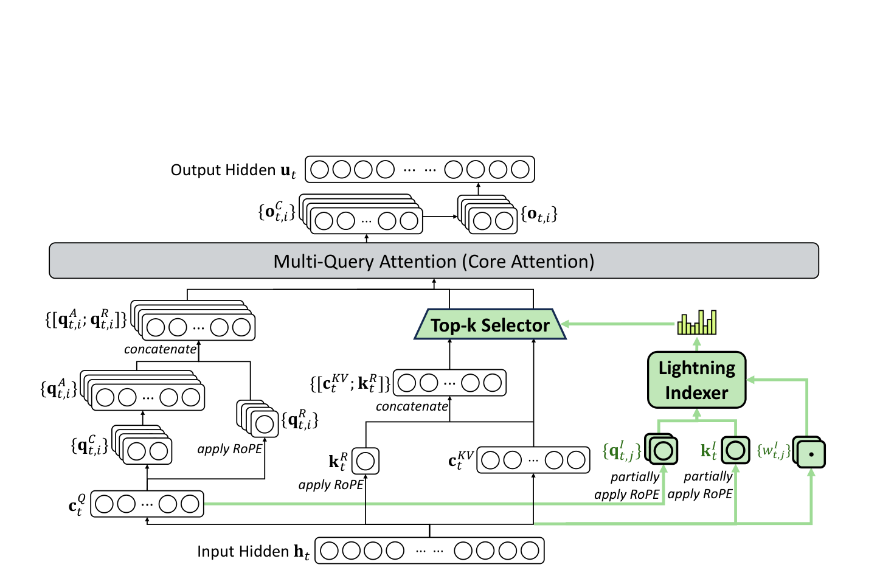

*绿色路径为 DSA。Lightning Indexer 对候选历史 token 打分，Top-k Selector 选出少量 KV 条目，随后送入 Multi-Query Attention 核心模块。*

**带来的收益**

- **核心注意力从 (O(L^2)) 变为 (O(Lk))。** (L) 为序列长度，(k \ll L) 为每个 query 的已选 token 数。Indexer 仍有 (O(L^2)) 量级，但作者指出其计算远轻于原 MLA 主注意力，因此端到端长上下文成本显著下降。
- **128K 长度下推理成本降幅明显。** 论文在 H800 集群、以 2 美元/GPU 小时估算的图表中，128K 位置的预填充成本约由 **0.70 美元/百万 token** 降至 **0.23**，解码约由 **2.2** 降至 **0.27**，分别约为 **3×** 与 **8×** 的量级改善。该数字受硬件、实现和成本假设影响。
- **保持长上下文能力。** 作者报告，与 DeepSeek-V3.1-Terminus 相比，DSA 版本在短、长上下文任务上未观察到实质性能退化；在 AA-LCR3 推理模式中高出 4 分。该结论来自论文所列评测与设置，不等同于所有任务均无损。
- **为更长上下文留出训练与部署预算。** 当计算不再对所有历史 token 一视同仁时，长序列的推理吞吐、服务成本和后训练可用算力都有更大的扩展空间。

------------------------------------------------------------------------

#### DeepSeek-V4：CSA + HCA混合注意力：CSA 负责检索，HCA 负责极致压缩

DeepSeek-V4 进一步形成 Hybrid Attention：

``` text
                   DeepSeek-V4
                        │
                Hybrid Attention
                        │
           ┌────────────┴────────────┐
           ▼                         ▼
          CSA                       HCA
 Compressed Sparse          Heavily Compressed
    Attention                  Attention
       │                          │
Sequence Compression      Heavy Compression
       +                          +
      DSA                  Dense Attention
```

路线从单纯 KV Compression 演进为：

``` text
KV / Sequence Compression
        +
Sparse Attention
        +
Dense Attention
        +
Hybrid Architecture
```

**论文**

- DeepSeek-AI et al. (2026). *DeepSeek-V4: Towards Highly Efficient Million-Token Context Intelligence*. [arXiv:2606.19348](https://arxiv.org/abs/2606.19348)。


> **模型：** DeepSeek-V4-Pro / DeepSeek-V4-Flash  **模型厂家：** DeepSeek-AI  
> **论文 ID：** arXiv:2606.19348  
> **论文名称：** DeepSeek-V4: Towards Highly Efficient Million-Token Context Intelligence  
> **作者：** DeepSeek-AI、Anyi Xu、Bangcai Lin 等，2026  
> **发布时间：** 2026 年 4 月 26 日（arXiv 首次提交）  
> **原文：** [arXiv](https://arxiv.org/abs/2606.19348)｜[PDF](https://arxiv.org/pdf/2606.19348)

**核心观点**

DeepSeek-V4 的混合注意力不是在同一层同时运行两种注意力，而是**将 CSA（Compressed Sparse Attention）与 HCA（Heavily Compressed Attention）在层间交错部署**：前者保留内容相关的远程检索能力，后者以更激进的压缩提供低成本的长程摘要。

- **CSA = 压缩 + 稀疏检索。** 先把每 (m) 个 token 的 KV 压成一个条目，再用 Lightning Indexer 与 top-k selector 从压缩条目中挑选最相关的少数 KV，最后做 Shared-KV MQA。
- **滑动窗口补回局部细节。** CSA 将选中的远程压缩 KV 与一小组原始滑窗 KV 拼接，让模型既能检索远处信息，也不会因压缩损失邻近 token 的细粒度依赖。
- **HCA = 更重的压缩层。** HCA 同样先经 token-level compressor，但将每 (m' >> m) 个 token 汇总为一个 KV 条目；它**不再进行 DSA 式 top-k 稀疏选择**，而是直接用极少量的压缩 KV 进行 MQA，并拼接滑窗 KV 以维持局部细节。V4-Pro 中 m'=128，远大于 CSA 的 m=4。
- **分层互补而非二选一。** V4 在 CSA 与 HCA 层之间交错：CSA 处理“应该精看哪些远程内容”，HCA 提供“长期历史的低成本概览”。V4-Pro 配置中 CSA 的 (m=4)、top-k=1024，HCA 的 (m'=128)，并使用 128-token 滑窗分支。

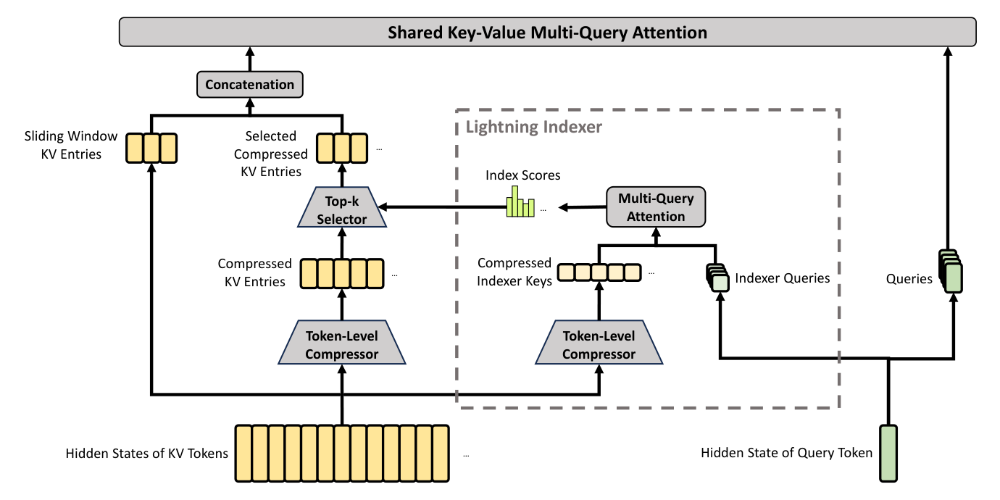

*Figure 3（原论文第 9 页）：CSA 先将 KV token 压缩；Lightning Indexer 对压缩条目打分，Top-k Selector 选择远程 KV；同时保留滑动窗口 KV，并将两者拼接后送入 Shared Key-Value MQA。图源：[论文 PDF](https://arxiv.org/pdf/2606.19348#page=9)。*

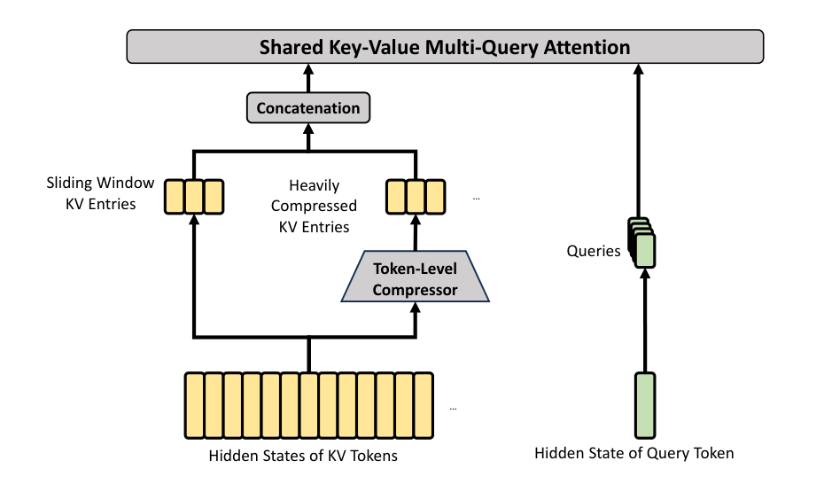

*Figure 4（原论文第 11 页）：HCA 将很长的一段 KV token 压成少量 Heavily Compressed KV Entries，不经过 indexer/top-k；这些全局粗粒度记忆与 Sliding Window KV Entries 拼接后进入 Shared Key-Value MQA。图源：[论文 PDF](https://arxiv.org/pdf/2606.19348#page=11)。*

**带来的收益**

- **百万上下文的单 token 解码显著更轻。** 在 1M context 下，论文报告 DeepSeek-V4-Pro 相比 DeepSeek-V3.2 只需 **27%** 的单 token inference FLOPs，KV cache 仅为 **10%**；即约 **3.7×** 更低计算量与 **9.5×** 更小 KV cache。
- **让百万 token 成为常规能力。** CSA 的“先压缩再 top-k”避免对全部历史做主注意力，HCA 则降低长期保留信息的缓存成本；两者共同将超长上下文从偶发的大型任务推向可持续服务场景。
- **模型规模与效率可以兼得。** DeepSeek-V4-Pro 为 1.6T 总参数、49B activated，V4-Flash 为 284B 总参数、13B activated；两者均支持 1M context，并在 32T+ token 预训练后进行完整后训练。
- **边界：压缩是信息选择而非无损存储。** CSA 通过稀疏检索和局部滑窗缓解信息损失，HCA 用于更粗粒度长期记忆；最终表现依赖压缩率、top-k、层间配比与任务所需的细节程度。

------------------------------------------------------------------------

## 三、Qwen Attention

### Qwen：MHA → GQA → GDN → QSA

``` text
MHA
 │
 ▼
GQA
 │
 │ KV Sharing
 ▼
GDN
 │
 │ Linear / Recurrent
 ▼
QSA
 │
 │ Sparse Attention
 ▼
GDN + QSA
 │
 ▼
Hybrid Attention
```

#### GQA：从 MHA 检查点训练分组查询 Transformer

``` text
MHA：

Q1 → K1 V1
Q2 → K2 V2
Q3 → K3 V3

GQA：

Q1 ─┐
Q2 ─┼──→ K1 V1
Q3 ─┘
```

本质：

> **多个 Query Head 共享 KV Head，从而降低 KV Cache 和 Decode内存带宽压力。**

**论文 / 官方资料**

-   **GQA**\
    https://arxiv.org/abs/2305.13245
-   **Qwen3 Blog**\
    https://qwenlm.github.io/blog/qwen3/
-   **Qwen3 Technical Report**\
    https://arxiv.org/abs/2505.09388

**论文**

- Ainslie, J. et al. *GQA: Training Generalized Multi-Query Transformer Models from Multi-Head Checkpoints*, arXiv:2305.13245，2023。[arXiv 摘要页](https://arxiv.org/abs/2305.13245)｜[PDF](https://arxiv.org/pdf/2305.13245)


> **论文 ID：** arXiv:2305.13245  
> **论文名称：** GQA: Training Generalized Multi-Query Transformer Models from Multi-Head Checkpoints  
> **作者：** Joshua Ainslie、James Lee-Thorp、Michiel de Jong、Yury Zemlyanskiy、Federico Lebrón、Sumit Sanghai，2023  
> **发布时间：** 2023 年 5 月 22 日（arXiv 首次提交）  
> **原文：** [arXiv](https://arxiv.org/abs/2305.13245)｜[PDF](https://arxiv.org/pdf/2305.13245)

**核心观点**

- **GQA 是 MHA 与 MQA 之间的连续谱。** 设有 \(H\) 个 query 头、\(G\) 个 KV 头：\(G=H\) 时就是每头独立 KV 的 MHA；\(G=1\) 时就是全部 query 头共享同一组 KV 的 MQA；\(1<G<H\) 时，每组 query 头共享一组 \(K,V\)，即 GQA。
- **核心价值是按比例缩小 KV cache。** MHA 需要为 \(H\) 个头保存 KV；GQA 只保存 \(G\) 组，因而推理时 KV cache 的体积和相关读写量约为 MHA 的 \(G/H\)。它缓解的是自回归解码的显存带宽瓶颈，而不是改变全注意力的基本计算。
- **方法上的另一个贡献是“uptraining”。** 不必从头训练：先将原 MHA checkpoint 中同一组的 K/V 投影矩阵做均值池化，得到 GQA/MQA 的共享 K/V；再按原预训练配方继续训练一小段，让模型适应新结构。论文报告使用原预训练计算量的 **5%**。
- **为什么不直接选 MQA？** MQA 将所有 KV 压为一组，速度很好但会更明显削弱模型容量。GQA 保留多组 KV，用少量额外带宽换回大部分质量，因此可按部署目标选择 \(G\)。

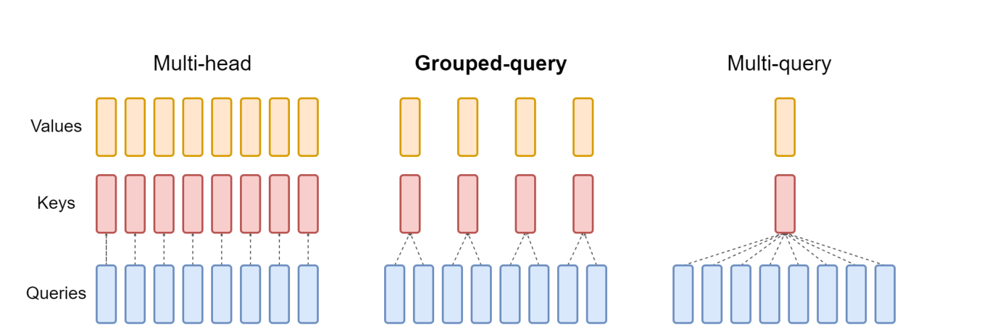

*Figure 2（原论文第 2 页）：左侧 MHA 的每个 query 头各有独立 K/V；右侧 MQA 的所有 query 头共享一组 K/V；中间 GQA 按 query 头分组，每组共享一组 K/V。图源：[论文 PDF](https://arxiv.org/pdf/2305.13245#page=2)。*

**带来的收益**

- **质量接近 MHA，速度接近 MQA。** 在作者的 T5-XXL 实验中，MHA-XXL 推理时间为 **1.51 s/样本**；MQA-XXL 为 **0.24 s**；GQA-8-XXL 为 **0.28 s**。论文的跨任务平均结果显示 GQA-8 的表现接近 MHA-XXL，而速度接近 MQA。
- **可复用已有高质量 checkpoint。** 均值池化后仅需 5% 原始预训练计算量继续训练，避免为了推理效率重新从头预训练一个 MQA/GQA 模型。论文还发现均值池化优于直接选一个头或随机初始化共享 KV。
- **为大模型提供较柔性的部署旋钮。** 增加 \(G\) 会提高 KV 表示容量但牺牲一部分速度；论文以 \(G=8\) 作为其 T5-XXL 设定下的有利折中。
- **边界：实验范围与评测有限。** 论文主要在 encoder-decoder T5 上将 GQA 应用于 decoder self-attention 与 cross-attention，不用于可并行计算的 encoder self-attention；作者也明确指出未与从头训练的 XXL GQA 对比，长序列质量的自动指标并不完备。

------------------------------------------------------------------------

#### Qwen3-Next：Gated Delta：以门控 Delta Rule 改善线性注意力记忆

GDN（Gated DeltaNet）属于 Linear/Recurrent Token Mixing 路线：

``` text
Token t
   │
   ▼
State Update
   │
   ▼
Historical State
   │
   ▼
Token t+1
```

Qwen 采用 Hybrid 设计：

``` text
GDN
 │
GDN
 │
GDN
 │
Attention
```

即：

> **大量低成本 Linear/Recurrent 层 + 少量强 Attention 层。**

**论文**

-   Yang, Kautz, Hatamizadeh (2024). *Gated Delta Networks: Improving Mamba2 with Delta Rule*. [arXiv:2412.06464](https://arxiv.org/abs/2412.06464)。


> **论文 ID：** arXiv:2412.06464  
> **论文名称：** Gated Delta Networks: Improving Mamba2 with Delta Rule  
> **作者：** Songlin Yang、Jan Kautz、Ali Hatamizadeh，2024  
> **发布时间：** 2024 年 12 月 9 日（arXiv 首次提交）  
> **原文：** [arXiv](https://arxiv.org/abs/2412.06464)｜[PDF](https://arxiv.org/pdf/2412.06464)

**核心观点**

Gated DeltaNet 将两类线性序列模型的优势结合：门控负责快速遗忘无关状态，delta rule 负责对指定 key-value 关联进行精确修正。目标是在固定大小循环状态中，改善纯线性注意力的检索与长上下文能力。

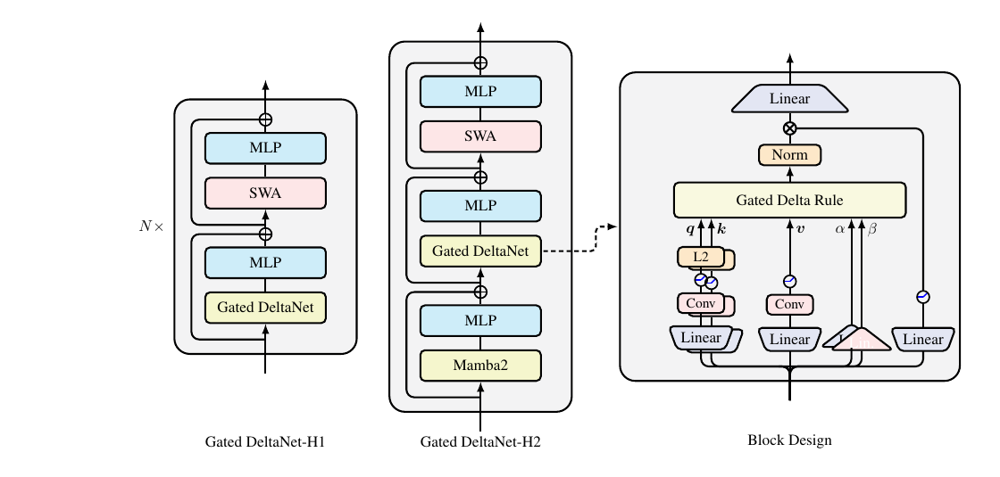

*Figure 1（原论文第 7 页）：左、中的 H1/H2 是两种混合堆叠方式；右侧展开单个 block。其输入经线性层形成 q、k、v 以及门控系数 α、β；中间的 Gated Delta Rule 承担状态更新，SWA 则补足局部显式注意力。来源：[原论文 PDF](https://arxiv.org/pdf/2412.06464)。*

- **Delta rule 是“纠错式写入”。** 状态不只是累加新的 `k v^T`，而是根据当前 key 的预测误差更新，减少新旧记忆相互干扰。
- **门控是“整体遗忘”。** 可学习 decay 控制已有状态保留比例，使模型能迅速清除不再相关的历史。
- **两者互补。** 只门控擅长遗忘但难以精确替换旧关联；只 delta update 能精确写入但缺少高效、全局的记忆清理。
- **支持硬件友好的并行训练。** 论文为 gated delta rule 给出并行化算法，并探索与 Sliding Window Attention 或 Mamba2 层混合的架构。

**带来的收益**

- **改善检索和长上下文。** 论文报告 Gated DeltaNet 在语言建模、常识推理、in-context retrieval、长度外推与长上下文理解上整体优于 Mamba2 与 DeltaNet。
- **保持线性状态规模。** 推理时通过递归状态传递，不需要像全注意力一样缓存全部历史 KV，因此适合长序列的内存约束环境。
- **可融入混合模型。** 用少量滑动窗口注意力补足局部显式检索，或与 Mamba2 分层组合，可在质量与训练效率间取折中。
- **边界：有限状态并非全局检索。** 虽然 delta rule 提升关联记忆，固定维度状态仍可能在复杂长程检索中成为瓶颈；具体收益依赖状态维度、训练任务和 kernel 实现。

------------------------------------------------------------------------

#### Qwen3.8-Flash-Next：GDN + QSA 的混合长上下文架构

QSA（Qwen Sparse Attention）使用轻量 Indexer 在 Micro-block 粒度选择重要上下文：

``` text
                    Query
                      │
                      ▼
            Compressed Indexer
                      │
                      ▼
            Context Micro-blocks
                      │
               Relevance Score
                      │
                      ▼
             Important Blocks
                      │
                      ▼
               Sparse Attention
```

整体：

``` text
GDN
 │
GDN
 │
GDN
 │
QSA
```

**官方资料 / 技术报告**

-   **Qwen3.8-Flash-Next Blog**\
    https://qwen.ai/blog?id=qwen3.8-flash-next
-   官方项目\
    https://github.com/QwenLM/Qwen3.8-Flash-Next
-   **On the Design of Qwen3.8-Next Architecture**\
    https://arxiv.org/abs/2608.30320

**论文**

- Qiu et al. (2026). *On the Design of Qwen3.8-Next Architecture: Evaluation, Efficiency, and Training Stability*. [arXiv:2608.30320](https://arxiv.org/abs/2608.30320)。


> **模型：** Qwen3.8-Flash-Next  **模型厂家：** 阿里巴巴集团 Qwen 团队  
> **论文 ID：** arXiv:2608.30320  
> **论文名称：** On the Design of Qwen3.8-Next Architecture: Evaluation, Efficiency, and Training Stability  
> **作者：** Zihan Qiu、Zekun Wang、Xiao Li、Yanpeng Li 等，2026  
> **发布时间：** 2026 年 8 月 31 日（arXiv 首次提交）  
> **原文：** [arXiv](https://arxiv.org/abs/2608.30320)｜[PDF](https://arxiv.org/pdf/2608.30320)｜[官方博客](https://qwen.ai/blog?id=qwen3.8-flash-next)｜[官方项目](https://github.com/QwenLM/Qwen3.8-Flash-Next)

**核心观点**

Qwen3.8-Flash-Next 的 token mixing 不再由全注意力一肩挑：**每 4 层为一个循环，3 层 Gated DeltaNet（GDN）+ 1 层 Qwen Sparse Attention（QSA）**。前者用固定大小的递归状态压缩历史，后者以稀疏方式做关键上下文的全局访问；两者分工，避免把长序列的每一层都付出全注意力成本。


*Figure 1（原论文第 2 页）：左侧显示 3 个 GDN layer 后插入 1 个 QSA layer；右侧将二者展开。GDN 以 Gated DeltaNet 更新隐藏状态，QSA 使用 Qwen Sparse Attention；二者都通过 GR Read/Write 读写扩展后的残差流。来源：[原论文 PDF](https://arxiv.org/pdf/2608.30320)。*

- **GDN：低成本地保留长历史。** Gated DeltaNet 将历史压入固定尺寸循环状态；门控控制遗忘，delta rule 以“预测误差校正”的方式写入 key-value 关联。它承担大多数层的序列混合，因此 decode 不随上下文长度线性增长 KV cache。
- **QSA：把少量层留给全局、选择性读取。** QSA 先用轻量压缩索引器在 micro-block 粒度评分，再只计算重要块的注意力。它补上纯递归状态难以可靠处理的显式、长程检索。
- **关键不是“GDN 或 QSA”，而是分层协同。** GDN 解决“广覆盖、低内存”的主干计算；QSA 解决“需要看哪里”的路由和精细访问。论文在 continued pre-training 阶段以 QSA 取代原先的全注意力层。
- **GR 是两者的共同接口。** 每个子层通过 Gated Residual（GR）从扩展残差流中按元素门控读取，并写回多个残差分支；这使稀疏注意力、递归状态和 MoE 能在同一 block 中组合。

**带来的收益**

- **长上下文效率。** 论文报告，在 1M token 上下文下，QSA 的 kernel 级 prefill 比 dense attention 快 **7.6×**、decode 快 **4.9×**；其压缩索引将索引开销从 \(O(n^2)\) 降为 \(O(n^2/r)\)。
- **更少激活计算。** 主模型为 125B 参数、每 token 激活 6B 参数，另有 51B n-gram embedding 表可置于加速器外；论文称相较 397B-A17B 前代，在 14 个预训练基准中 8 项领先、其余最多落后 2.6 分，同时使用约 **1/3** 激活参数、**1/3** 训练 token 与约 **1/9** 训练 FLOPs。
- **工程上的推理取舍更合理。** GDN 的固定递归状态降低 decode 的内存流量，QSA 则将昂贵的全局 attention 集中到稀疏选择步骤；这适合超长上下文的 prefill/decode 分别优化。
- **边界。** QSA 的质量取决于压缩索引能否召回关键块，GDN 的记忆也受有限状态容量限制；因此该设计不是“完全不要注意力”，而是以周期性稀疏全局访问弥补递归状态的盲点。

------------------------------------------------------------------------

# 第三部分：MoE 技术演进

## MoE 优化的是什么？

MoE（Mixture of Experts）主要优化 Transformer 的 **FFN / MLP**，不是Attention。

传统 Dense FFN：

``` text
Token
  │
  ▼
Dense FFN
  │
所有 FFN 参数参与
  ▼
Output
```

MoE：

``` text
                    Token
                      │
                      ▼
                    Router
                      │
             ┌────────┼────────┐
             ▼        ▼        ▼
          Expert 1 Expert 2 ... Expert N
             ▲                   ▲
             └────── Top-K ──────┘
```

核心价值：

> **让模型总参数规模与每个 Token 实际参与计算的参数量部分解耦。**

``` text
Total Parameters ≠ Active Parameters
```

也就是：

> **多参数，少激活。**

------------------------------------------------------------------------

**MoE 的经典演进**

``` text
Dense FFN
    │
    ▼
Sparsely-Gated MoE
    │
    ▼
GShard
    │
    ▼
Switch Transformer
    │
    ├───────────────┐
    ▼               ▼
DeepSeekMoE       Qwen MoE
```

**代表论文**

-   **Outrageously Large Neural Networks: The Sparsely-Gated Mixture-of-Experts Layer**\
    https://arxiv.org/abs/1701.06538
-   **GShard**\
    https://arxiv.org/abs/2006.16668
-   **Switch Transformers**\
    https://arxiv.org/abs/2101.03961


### 稀疏门控 MoE：条件计算的起点

**论文**

- Shazeer et al. (2017).Outrageously Large Neural Networks: The Sparsely-Gated Mixture-of-Experts Layer. [arXiv:1701.06538](https://arxiv.org/abs/1701.06538)。

> **论文 ID：** arXiv:1701.06538  
> **论文名称：** Outrageously Large Neural Networks: The Sparsely-Gated Mixture-of-Experts Layer  
> **作者：** Noam Shazeer、Azalia Mirhoseini、Krzysztof Maziarz 等，2017  
> **发布时间：** 2017 年 1 月 23 日（arXiv 首次提交）  
> **原文：** [arXiv](https://arxiv.org/abs/1701.06538)｜[PDF](https://arxiv.org/pdf/1701.06538)

**核心观点**

MoE 的核心是把一个稠密 FFN 换成许多独立专家 \(E_i\)，再用可学习 gate 只选 top-\(k\) 个：\(y=\sum_{i\in\mathrm{TopK}}g_i(x)E_i(x)\)。因此参数容量随专家数增长，而单个样本的计算量主要由被激活的少数专家决定。

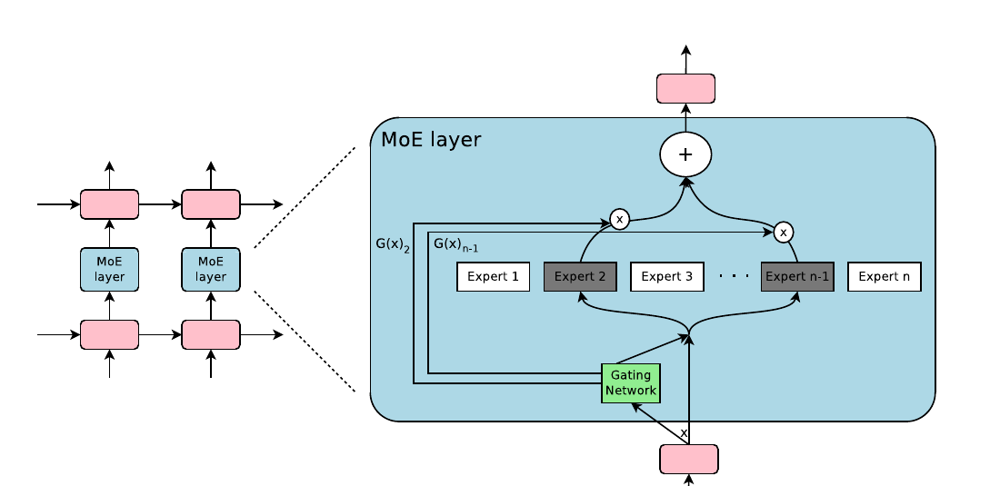

*Figure 1（原论文第 2 页）：gate 为每个输入给专家打分，仅选中的专家计算，输出再按门控权重加权合并。来源：[原论文 PDF](https://arxiv.org/pdf/1701.06538)。*

- **专家增加的是条件容量，而非每 token 的全量 FLOPs。**
- **挑战在路由。** 作者引入带噪声 top-k gate 和负载均衡辅助损失，避免少数专家被长期挤爆、其他专家闲置。

**带来的收益**

- 论文报告可使用数千个专家、达到 **137B** 参数，并在语言建模和机器翻译上以较低计算成本超过当时强基线。
- 其核心影响是确立了今天 MoE 的基本范式：**稀疏路由 + 专家并行 + 负载均衡**。
- 边界：专家路由会引入 all-to-all 通信、容量溢出和训练不稳定；参数总量不等同于每 token 的实际计算或质量。


### GShard：把 MoE 扩展到千设备训练

**论文**

- Lepikhin et al. (2020). [arXiv:2006.16668](https://arxiv.org/abs/2006.16668)。


> **论文 ID：** arXiv:2006.16668  
> **论文名称：** GShard: Scaling Giant Models with Conditional Computation and Automatic Sharding  
> **作者：** Dmitry Lepikhin、HyoukJoong Lee、Yuanzhong Xu 等，2020  
> **发布时间：** 2020 年 6 月 30 日（arXiv 首次提交）  
> **原文：** [arXiv](https://arxiv.org/abs/2006.16668)｜[PDF](https://arxiv.org/pdf/2006.16668)

**核心观点**

GShard 的贡献不只是在 Transformer 中插入 top-2 MoE，更关键是把专家层的 **dispatch / combine** 和设备切分交给自动分片系统。普通注意力、残差等层复制在各设备，专家 FFN 跨设备分片；token 通过 all-to-all 被发往选中的专家，计算后再聚合。

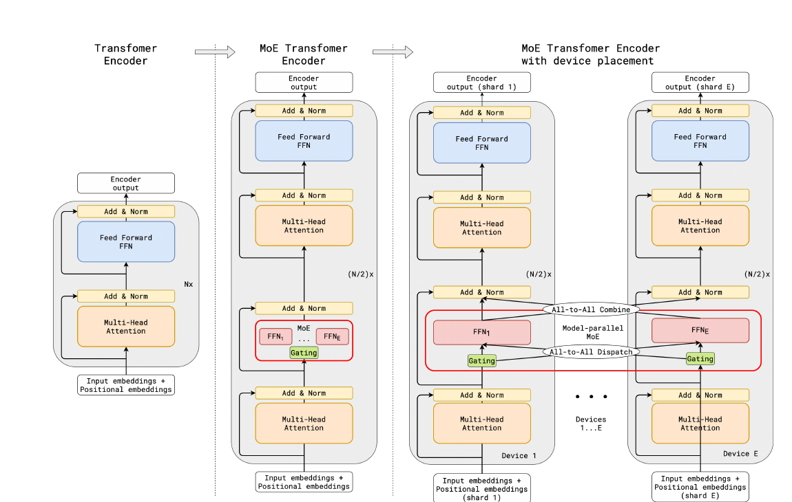

*中图将隔层 FFN 替换成 MoE；右图展示专家分布在多个设备上，token 通过 all-to-all dispatch/ combine 流动，而非专家层保持复制。*

- **模型代码与并行策略解耦。** 通过轻量注解表达切分意图，编译器生成 MPMD/SPMD 执行与跨设备通信。
- **MoE 的系统含义被明确。** 扩大专家数不是单机层内改动，而是把模型容量映射为可扩展的 expert parallelism。

**带来的收益**

- 论文训练了超过 **600B** 参数的多语翻译 Transformer，在 **2048 TPU v3、4 天** 内完成训练。
- 对 100 语种到英语翻译，论文报告该模型优于先前方法；模型增大时训练成本增长低于线性。
- 边界：all-to-all 通信、token 分布不均和分片策略仍会限制实际吞吐；GShard 解决的是“如何扩展”，并不自动保证路由质量。

### Switch Transformer：每 token 只路由一个专家

**论文**

- Fedus, Zoph, Shazeer (2021). [arXiv:2101.03961](https://arxiv.org/abs/2101.03961)。

> **论文 ID：** arXiv:2101.03961  
> **论文名称：** Switch Transformers: Scaling to Trillion Parameter Models with Simple and Efficient Sparsity  
> **作者：** William Fedus、Barret Zoph、Noam Shazeer，2021  
> **发布时间：** 2021 年 1 月 11 日（arXiv 首次提交）  
> **原文：** [arXiv](https://arxiv.org/abs/2101.03961)｜[PDF](https://arxiv.org/pdf/2101.03961)

**核心观点**

Switch Transformer 将经典 MoE 的 top-\(k\) 路由简化为 **top-1**：每个 token 只送至得分最高的一个专家，输出为 \(y=p_{i^*}(x)E_{i^*}(x)\)。它以一次专家计算替代多专家加权，减少通信和计算，同时保留条件参数容量。

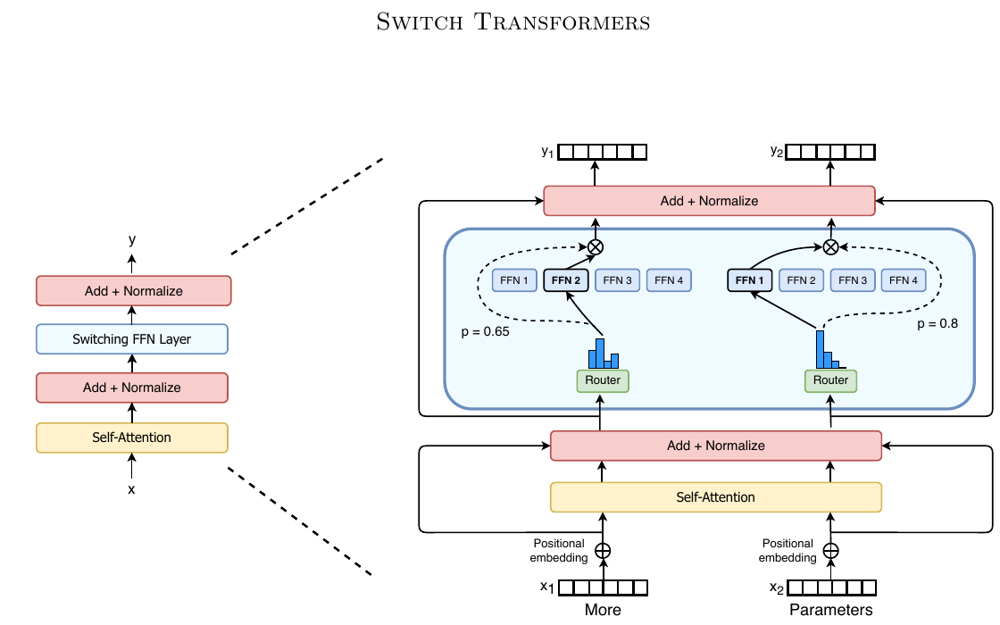

*Figure 2（原论文第 5 页）：两个 token 分别由 router 选择一个 FFN expert；Switch FFN 替换 Transformer 的稠密 FFN。来源：[原论文 PDF](https://arxiv.org/pdf/2101.03961)。*

- **简化是工程贡献。** top-1 避免同一 token 复制到多个专家，显著降低跨设备 dispatch/combine 压力。
- **但仍需训练稳定化。** 论文配套使用负载均衡、capacity factor、选择性精度和专家初始化等策略，才使 bfloat16 大规模稀疏训练可行。

**带来的收益**

- 论文在相同计算资源下报告最高 **7×** 预训练加速；万亿参数模型相对 T5-XXL 报告 **4×** 加速。
- 在 mT5-Base 的 101 种语言设置中，论文报告全语言增益，且 91% 语言受益于超过 4× 的速度提升。
- 边界：top-1 将路由决策做得更关键；若专家负载不均或容量不足，token 会被丢弃/退化，质量与吞吐都会受影响。

------------------------------------------------------------------------

## DeepSeekMoE：用细粒度专家与共享专家提升专门化

DeepSeekMoE 强调 Expert Specialization。

**Fine-grained Expert Segmentation**

``` text
较大的 Expert
      │
      ▼
E1 E2 E3 E4 E5 E6 E7 E8 ...
```

**Shared Expert Isolation**

``` text
                     Token
                       │
             ┌─────────┴─────────┐
             ▼                   ▼
      Shared Experts          Router
                                 │
                         ┌───────┼───────┐
                         ▼       ▼       ▼
                        E1      E7      E12
```

Shared Experts 负责较通用的能力，Routed Experts 更容易形成专业化。

DeepSeek-V3 的典型特征：

``` text
671B Total Parameters
        ↓
37B Activated / Token
```

## 

**论文**

- Dai et al. (2024). *DeepSeekMoE: Towards Ultimate Expert Specialization in Mixture-of-Experts Language Models*. [arXiv:2401.06066](https://arxiv.org/abs/2401.06066)。

> **模型：** DeepSeekMoE  **模型厂家：** DeepSeek  
> **论文 ID：** arXiv:2401.06066  
> **论文名称：** DeepSeekMoE: Towards Ultimate Expert Specialization in Mixture-of-Experts Language Models  
> **作者：** Damai Dai、Chengqi Deng、Chenggang Zhao 等，2024  
> **发布时间：** 2024 年 1 月 11 日（arXiv 首次提交）  
> **原文：** [arXiv](https://arxiv.org/abs/2401.06066)｜[PDF](https://arxiv.org/pdf/2401.06066)

**核心观点**

论文认为传统 top-\(K\) MoE 的核心问题不是“专家不够多”，而是专家知识会混杂、不同路由专家又会重复学习共性知识。DeepSeekMoE 用两项设计提高专家专门化：**细粒度专家切分**与**共享专家隔离**。

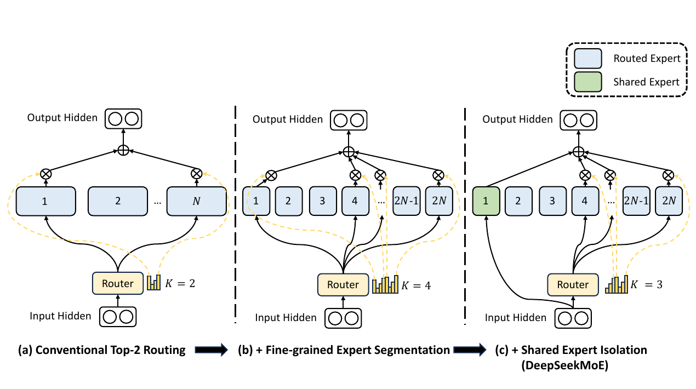

*Figure 2（原论文第 5 页）：(a) 传统 top-2；(b) 将每个专家切成更多、更小的专家，同时增加激活数以保持参数与计算基本不变；(c) 额外将部分专家固定为所有 token 均激活的共享专家。来源：[原论文 PDF](https://arxiv.org/pdf/2401.06066)。*

- **细粒度专家切分：组合比单个“大专家”更灵活。** 把原先 \(N\) 个专家切为 \(mN\) 个小专家，同时由 top-\(K\) 改为 top-\(mK\)；每个小专家的 FFN 中间维度缩小为原来的 \(1/m\)，所以单 token 总计算近似不变，却能组合更多专门模块。
- **共享专家隔离：把共性知识从路由专家中剥离。** 固定 \(K_s\) 个 shared experts，所有 token 都经过它们；其余 routed experts 更专注于有区分度的内容，减少跨专家的重复存储。
- **目标是更高的有效容量。** 总参数和激活计算可相同，但不同 token 的专家组合空间更大，且路由专家不再被通用模式占满。

**带来的收益**

- **小规模验证更高参数效率。** 论文报告 DeepSeekMoE 2B 达到 GShard 2.9B 的相近性能，后者专家参数与计算约为前者 **1.5×**；2B 也接近同总参数稠密模型的性能上界。
- **16B 的计算/能力取舍。** DeepSeekMoE 16B 以约 **40%** 的计算量达到 DeepSeek 7B 与 LLaMA2 7B 的可比性能。
- **更大规模的早期结果。** 论文报告 145B 版本与 DeepSeek 67B 可比，使用 **28.5%**（在部分设定下 18.2%）的计算量；这是论文自己的 preliminary result，应视为当时实验结论。
- **边界。** 细粒度切分增加路由与 expert-parallel 通信压力；共享专家数、激活专家数和负载均衡仍需随硬件与任务调节。

------------------------------------------------------------------------

## Qwen MoE

### Qwen3 MoE：细粒度专家与 128/8 稀疏激活

典型 Qwen3 MoE：

| 模型            | Total Parameters | Activated Parameters |
| --------------- | ---------------- | -------------------- |
| Qwen3-30B-A3B   | 30B              | 3B                   |
| Qwen3-235B-A22B | 235B             | 22B                  |

例如：

``` text
Qwen3-235B-A22B

235B Total
     │
     ▼
128 Experts
     │
     ▼
Router
     │
     ▼
8 Experts Activated
     │
     ▼
≈ 22B Active Parameters
```

**官方资料**

-   Qwen3 Blog https://qwenlm.github.io/blog/qwen3/
-   Qwen3 Technical Report https://arxiv.org/abs/2505.09388

**论文**

- Yang et al. (2025). *Qwen3 Technical Report*. [arXiv:2505.09388](https://arxiv.org/abs/2505.09388)。

> **模型：** Qwen3 MoE  **模型厂家：** 阿里巴巴集团 Qwen 团队  
> **论文 ID：** arXiv:2505.09388  
> **论文名称：** Qwen3 Technical Report  
> **作者：** An Yang、Anfeng Li、Baosong Yang 等，2025  
> **发布时间：** 2025 年 5 月 14 日（arXiv 首次提交）  
> **原文：** [arXiv](https://arxiv.org/abs/2505.09388)｜[PDF](https://arxiv.org/pdf/2505.09388)

**核心观点**

Qwen3 的两款 MoE 基座模型沿用 Qwen2.5-MoE 的主干，并采用 DeepSeekMoE 式的**细粒度专家切分**：总共 128 个专家，但每个 token 只激活 8 个。报告明确指出，Qwen3-MoE 不设置 shared experts，而改用 global-batch load-balancing loss 鼓励专家专门化。

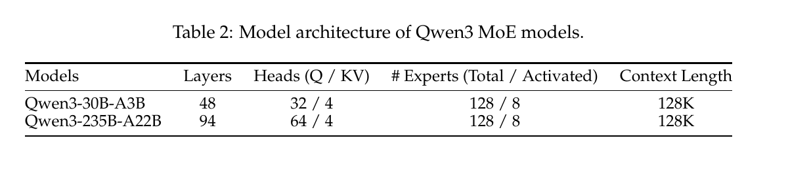

*Table 2（原论文第 3 页）：Qwen3-30B-A3B 与 Qwen3-235B-A22B 都是 128 个总专家、每 token 激活 8 个；型号中的 A3B/A22B 即激活参数量。来源：[原论文 PDF](https://arxiv.org/pdf/2505.09388)。*

- **128/8 路由。** 稀疏 FFN 中仅调用约 6.25% 的专家，令总参数容量与每 token 计算解耦。
- **细粒度组合。** 更小专家可被更灵活地组合，减轻单个专家同时承担大量异质知识的问题。
- **全局批次负载均衡。** 不用共享专家时，利用整个 batch 的路由统计约束各专家的利用率，避免专家塌缩并鼓励分工。

## 带来的收益

- **大容量、低激活计算。** 235B 总参数的旗舰 MoE 每 token 激活 22B；30B-A3B 仅激活约 3B。
- **报告中的质量/效率结论。** 在相同预训练数据下，Qwen3 MoE 基座模型以约稠密基座模型 **1/5** 的激活参数达到可比性能；报告也称 235B-A22B 在多数基准优于多个开源基线。
- **边界。** 低激活参数不代表没有通信和路由开销；实际吞吐仍取决于专家并行、负载分布与 deployment kernel。

------------------------------------------------------------------------

### Qwen3.8-Flash-Next：GDN + QSA + MoE

最新公开架构把 GDN、QSA 与 MoE 组合在同一个 Backbone：

``` text
12 × (
     3 × (Gated DeltaNet → MoE)
     →
     1 × (Qwen Sparse Attention → MoE)
)
```

因此：

``` text
             Qwen3.8-Flash-Next
                     │
        ┌────────────┴────────────┐
        │                         │
    Token Mixing                 FFN
        │                         │
   GDN + QSA                     MoE
        │                         │
 Linear + Sparse            Sparse Experts
```

> **Token 交互开始稀疏化，参数计算也开始稀疏化。**

**论文**

- Qwen Team (2026). [arXiv:2608.30320](https://arxiv.org/abs/2608.30320)。
- Qwen Team (2025). [Qwen3 Technical Report, arXiv:2505.09388](https://arxiv.org/abs/2505.09388)。

> **模型：** Qwen3.8-Flash-Next  **模型厂家：** 阿里巴巴集团 Qwen 团队  
> **论文 ID：** arXiv:2608.30320  
> **论文名称：** On the Design of Qwen3.8-Next Architecture: Evaluation, Efficiency, and Training Stability  
> **作者：** Zihan Qiu、Zekun Wang、Xiao Li 等，2026  
> **发布时间：** 2026 年 8 月 31 日（arXiv 首次提交）  
> **原文：** [arXiv](https://arxiv.org/abs/2608.30320)｜[PDF](https://arxiv.org/pdf/2608.30320)

## 核心观点

Qwen3.8-Flash-Next 仍是稀疏 MoE，但其设计重点从 Qwen3 的“128 选 8 细粒度专家”扩展为更综合的容量/成本配方：MoE 主干提供条件计算，GDN+QSA 降低 token mixing 成本，另有 51B n-gram embedding 表放在加速器外扩充容量。

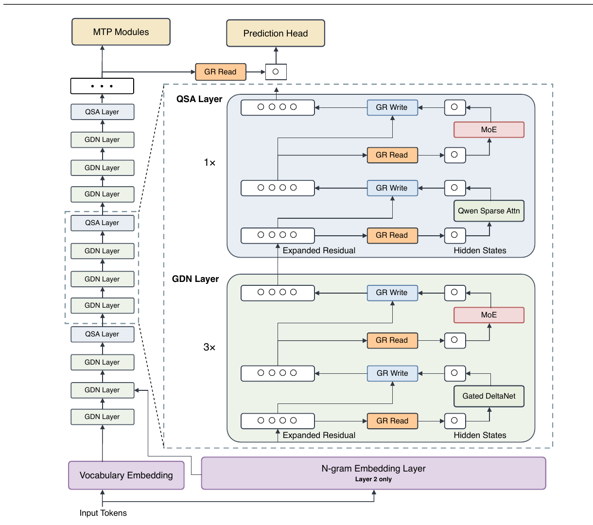

*MoE 位于 QSA/GDN block 的 FFN 支路；该图也显示模型将容量与效率问题同时分配给 MoE、GDN/QSA、GR 与 n-gram embedding。*

| 维度         | Qwen3 MoE（2505.09388）                                      | Qwen3.8-Flash-Next（2608.30320）                             |
| ------------ | ------------------------------------------------------------ | ------------------------------------------------------------ |
| 稀疏专家配置 | 128 总专家、每 token 激活 8 个                               | 报告给出 125B 总参数、每 token 激活 6B；未在论文中披露专家总数/每 token 专家数 |
| 代表规模     | 30B-A3B、235B-A22B                                           | 125B 主干 + 51B 外置 n-gram 表                               |
| 专家策略     | 细粒度专家切分；无 shared expert；global-batch load balancing | 仍用 MoE router（以 AdamW 训练）；论文重点转向整体架构/稳定性，未宣称替换 Qwen3 的专家路由范式 |
| 主要效率杠杆 | 稀疏激活降低 FFN 计算                                        | 稀疏 MoE + GDN 固定状态 + QSA 稀疏上下文访问 + 外置 embedding |

- **不要把两者简单看成“专家数更多”。** Qwen3 报告公开的是 128/8 路由配置；Qwen3.8 公开的是总/激活参数与全栈效率结果，未给出可一一对应的 expert count，不能据此反推其路由细节。
- **Qwen3.8 的新意在系统协同。** MoE 容量不再单独承担扩展任务：n-gram 表几乎不增加每 token 主干 FLOPs，GDN/QSA 则压低长上下文 token mixing 成本。

## 带来的收益

- **激活计算下降。** Qwen3-235B-A22B 每 token 激活 22B；Qwen3.8-Flash-Next 以 6B 激活参数运行，并有 125B 主干参数及 51B 外置 embedding 容量。两者口径不同，不能将总参数直接横向等同。
- **相对前代的端到端效率。** Qwen3.8 论文报告相较 397B-A17B 前代，使用约 **1/3** 激活参数、**1/3** 训练 token 与约 **1/9** 训练 FLOPs，并在 14 项预训练基准中 8 项领先、其余最多落后 2.6 分。
- **边界。** 这是架构级比较，不是两份报告在同一训练数据、规模与评测设定下的严格控制实验；对 MoE 路由本身的优劣，原文不足以支持强因果结论。

------------------------------------------------------------------------

# 第四部分：DeepSeek 与 Qwen 最终对比

## 三条技术主线

| 维度                   | DeepSeek                                   | Qwen                                 | 解决的问题                     |
|------------------------|--------------------------------------------|--------------------------------------|--------------------------------|
| **位置编码基础**       | RoPE / Decoupled<br>RoPE                   | RoPE                                 | Token 在哪里                   |
| **长上下文位置扩展**   | 与 MLA /<br>长上下文训练协同               | YaRN 等                              | 看得远                         |
| **多模态位置**         | ---                                        | mRoPE                                | 图像/视频时空位置              |
| **Attention 起点**     | MHA                                        | MHA                                  | Token-to-Token<br>Interaction  |
| **KV 优化**            | MLA                                        | GQA                                  | 少存                           |
| **核心方式**           | KV 压缩                                    | KV 共享                              | KV Cache                       |
| **长 Context 优化**    | DSA                                        | GDN                                  | 少算                           |
| **Sparse Attention**   | DSA / CSA                                  | QSA                                  | 少看一些历史                   |
| **Hybrid**             | CSA + HCA                                  | GDN + QSA                            | 效率 + 能力                    |
| **FFN 优化**           | DeepSeekMoE                                | MoE                                  | Sparse Activation              |
| **Expert 策略**        | Fine-grained +<br>Shared/Routed            | Routed Experts                       | 参数专业化                     |
| **整体趋势**           | Compression +<br>Sparse                    | Linear/Recurrent +<br>Sparse         | Efficient LLM                  |

# 第五部分：用三个问题理解现代 LLM

## Position Encoding：我在哪？

``` text
Position Encoding
      │
      ▼
RoPE
      │
      ▼
RoPE Scaling / YaRN
      │
      ▼
Long Context
```

> **让模型知道 Token 在哪里，并把位置坐标系扩展到更长 Context。**

------------------------------------------------------------------------

## Attention：我应该看谁？

``` text
MHA
 ↓
GQA / MLA
 ↓
DSA / GDN
 ↓
QSA / CSA
 ↓
Hybrid Attention
```

> **不再要求所有 Token 都以同样高的成本相互 Attention。**

------------------------------------------------------------------------

## MoE：应该由谁来算？

``` text
Dense FFN
    ↓
MoE
    ↓
Router
    ↓
Top-K Experts
```

> **不再要求所有参数都参与每个 Token 的计算。**

------------------------------------------------------------------------

# 第六部分：最终趋势------Long Context + Sparse Everything

``` text
                    Modern Efficient LLM
                             │
          ┌──────────────────┼──────────────────┐
          ▼                  ▼                  ▼
      Long Context       Sparse Context      Sparse Parameters
          │                  │                  │
   RoPE / YaRN          DSA / QSA / CSA          MoE
          │                  │                  │
          ▼                  ▼                  ▼
        看得远             少看一些            少算一些
```

可以最终概括为：

> **Position Encoding 决定"坐标系能延伸多远"；**\
> **Attention 决定"长上下文里到底看谁"；**\
> **MoE 决定"模型这么多参数到底由谁来算"。**

### DeepSeek

``` text
Position：
RoPE / Decoupled RoPE

Attention：
MHA → MLA → DSA → CSA/HCA

FFN：
Dense → DeepSeekMoE

最终：
Long Context
+
Compression
+
Sparse Attention
+
Sparse Experts
```

### Qwen

``` text
Position：
RoPE → YaRN / Partial RoPE / mRoPE

Attention：
MHA → GQA → GDN → QSA

FFN：
Dense → MoE

最终：
Long Context
+
Linear / Recurrent
+
Sparse Attention
+
Sparse Experts
```

------------------------------------------------------------------------

# 第七部分：核心论文与技术资料索引

## Position Encoding

1.  **Attention Is All You Need**\
    https://arxiv.org/abs/1706.03762

2.  **RoFormer: Enhanced Transformer with Rotary Position Embedding**\
    https://arxiv.org/abs/2104.09864

3.  **YaRN: Efficient Context Window Extension of Large Language
    Models**\
    https://arxiv.org/abs/2309.00071

4.  **Qwen2-VL Technical Report（mRoPE）**\
    https://arxiv.org/abs/2409.12191

## Attention

5.  **GQA**\
    https://arxiv.org/abs/2305.13245

6.  **DeepSeek-V2（MLA）**\
    https://arxiv.org/abs/2405.04434

7.  **DeepSeek-V3 Technical Report**\
    https://arxiv.org/abs/2412.19437

8.  **Gated Delta Networks**\
    https://arxiv.org/abs/2412.06464

9.  **Qwen3 Technical Report**\
    https://arxiv.org/abs/2505.09388

10. **Qwen3.8-Next Architecture**\
    https://arxiv.org/abs/2608.30320

## MoE

11. **Sparsely-Gated Mixture-of-Experts**\
    https://arxiv.org/abs/1701.06538

12. **GShard**\
    https://arxiv.org/abs/2006.16668

13. **Switch Transformers**\
    https://arxiv.org/abs/2101.03961

14. **DeepSeekMoE**\
    https://arxiv.org/abs/2401.06066

## DeepSeek 官方资料

15. **DeepSeek-V3.2 / Sparse Attention**\
    https://deepseek.com/news/v3-2-exp/

16. **DeepSeek-V4 Preview**\
    https://deepseek.com/news/v4-preview/

17. **DeepSeek Transparency Center**\
    https://www.deepseek.com/en/transparency/

18. **DeepSeek-V4 Model Card**\
    https://fe-static.deepseek.com/chat/transparency/deepseek-V4-model-card-EN.pdf

## Qwen 官方资料

19. **Qwen3 Blog**\
    https://qwenlm.github.io/blog/qwen3/

20. **Qwen3.8-Flash-Next Blog**\
    https://qwen.ai/blog?id=qwen3.8-flash-next

21. **Qwen3.8-Flash-Next GitHub**\
    https://github.com/QwenLM/Qwen3.8-Flash-Next
