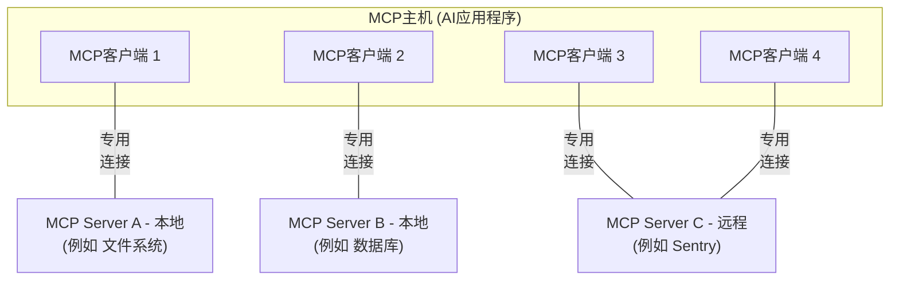
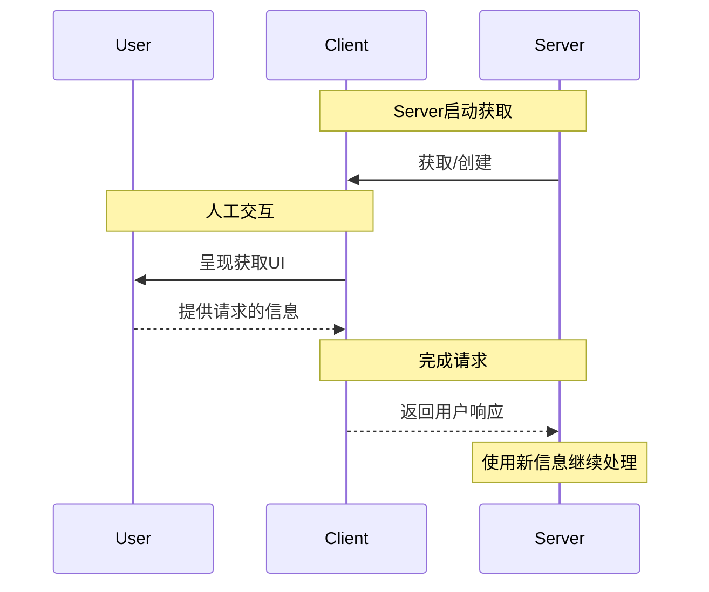
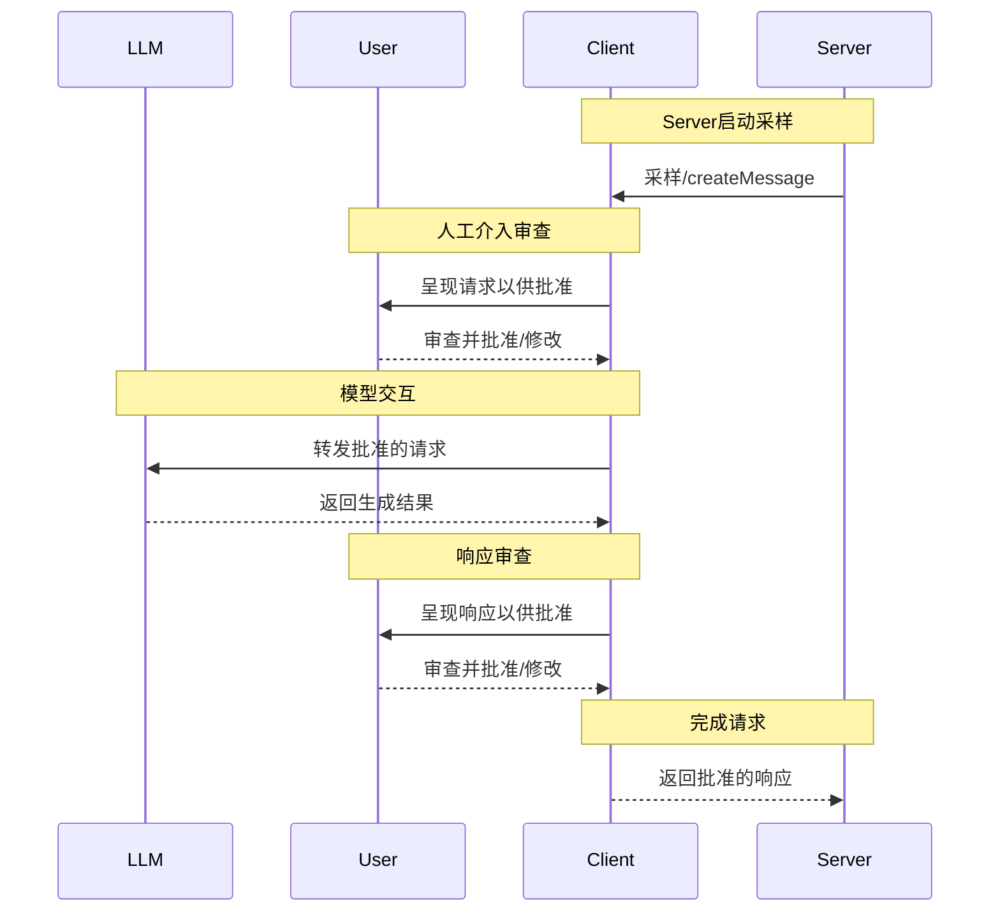

# 什么是模型上下文协议（MCP）？

[English](../english/02_mcp/01_mcp-theory.md) | 简体中文

MCP（Model Context Protocol，模型上下文协议）是一个用于将AI应用程序连接到外部系统的开源标准。

使用MCP，像Claude或ChatGPT这样的AI应用程序可以连接到数据源（例如本地文件、数据库）、工具（例如搜索引擎、计算器）和工作流（例如专用提示词）——使它们能够访问关键信息并执行任务。

将MCP想象成AI应用程序的USB-C端口。正如USB-C提供了一种连接电子设备的标准化方式，MCP提供了一种将AI应用程序连接到外部系统的标准化方式。


## MCP能实现什么？

* 智能体可以访问您的Google日历和Notion，充当更加个性化的AI助手。
* Claude Code可以使用Figma设计生成整个Web应用程序。
* 企业聊天机器人可以连接到组织内的多个数据库，使用户能够通过聊天分析数据。
* AI模型可以在Blender上创建3D设计，并使用3D打印机打印出来。

## 为什么MCP很重要？

根据您在生态系统中的位置，MCP可以带来一系列好处。

* **开发者**：MCP减少了构建或与AI应用程序或智能体集成时的开发时间和复杂性。
* **AI应用程序或智能体**：MCP提供对数据源、工具和应用程序生态系统的访问，这将增强能力并改善最终用户体验。
* **最终用户**：MCP带来更有能力的AI应用程序或智能体，它们可以在必要时访问您的数据并代表您采取行动。

## 广泛的生态系统支持

MCP是一个开放协议，在各种客户端和Server中得到广泛支持。像[Claude](https://claude.com/docs/connectors/building)和[ChatGPT](https://developers.openai.com/api/docs/mcp/)、开发工具如[Visual Studio Code](https://code.visualstudio.com/docs/copilot/chat/mcp-servers)、[Cursor](https://cursor.com/docs/context/mcp)、[MCPJam](https://docs.mcpjam.com/getting-started)以及[许多其他工具](https://modelcontextprotocol.io/clients)都支持MCP——使您能够一次构建，随处集成。


# MCP架构

本模型上下文协议（MCP）概述讨论其[范围](#范围)和[核心概念](#mcp的概念)，并提供一个[示例](#示例)演示每个核心概念。

由于MCP SDK抽象了许多关注点，大多数开发者可能会发现[数据层协议](#数据层协议)部分最有用。它讨论了MCP Server如何向AI应用程序提供上下文。

有关具体的实现细节，请参阅您的[语言特定SDK](https://modelcontextprotocol.io/docs/sdk)文档。

## 范围

模型上下文协议包括以下项目：

* [MCP规范](https://modelcontextprotocol.io/specification/latest)：MCP的规范，概述了客户端和Server的实现要求。

* [MCP SDK](https://modelcontextprotocol.io/docs/sdk)：实现MCP的不同编程语言的SDK。

* **MCP开发工具**：用于开发MCP Server和客户端的工具，包括[MCP Inspector](https://github.com/modelcontextprotocol/inspector)

* [MCP参考Server实现](https://github.com/modelcontextprotocol/servers)：MCP Server的参考实现。

MCP仅专注于上下文交换的协议——它不规定AI应用程序如何使用LLM或管理提供的上下文。


## MCP的概念

### 客户端-Server架构

MCP遵循客户端-Server架构，其中MCP主机——一个AI应用程序，如[Claude Code](https://www.anthropic.com/claude-code)或[Claude Desktop](https://www.claude.ai/download)——建立一个或多个MCP Server的连接。MCP主机通过为每个MCP Server创建一个MCP客户端来完成此操作。每个MCP客户端与其对应的MCP Server保持专用连接。

使用STDIO传输的本地MCP Server通常服务于单个MCP客户端，而使用Streamable HTTP传输的远程MCP Server通常服务于多个MCP客户端。

MCP架构中的关键参与者是：

* **MCP主机**：协调和管理一个或多个MCP客户端的AI应用程序
* **MCP客户端**：维护与MCP Server的连接并从MCP Server获取上下文供MCP主机使用的组件
* **MCP Server**：向MCP客户端提供上下文的程序

**例如**：Visual Studio Code充当MCP主机。当Visual Studio Code建立与MCP Server的连接时，例如[Sentry MCP Server](https://docs.sentry.io/product/sentry-mcp/)，Visual Studio Code运行时会实例化一个MCP客户端对象，该对象维护与Sentry MCP Server的连接。当Visual Studio Code随后连接到另一个MCP Server时，例如[本地文件系统Server](https://github.com/modelcontextprotocol/servers/tree/main/src/filesystem)，Visual Studio Code运行时会实例化另一个MCP客户端对象来维护此连接。



注意，**MCP Server**指的是提供上下文数据的程序，无论它在哪里运行。MCP Server可以在本地或远程执行。例如，当Claude Desktop启动[文件系统Server](https://github.com/modelcontextprotocol/servers/tree/main/src/filesystem)时，Server在同一台机器上本地运行，因为它使用STDIO传输。这通常被称为"本地"MCP Server。官方[Sentry MCP Server](https://docs.sentry.io/product/sentry-mcp/)在Sentry平台上运行，并使用Streamable HTTP传输。这通常被称为"远程"MCP Server。

### 分层架构

MCP由两层组成：

* **数据层**：定义基于JSON-RPC的客户端-Server通信协议，包括生命周期管理和核心原语，如工具、资源、提示词和通知。
* **传输层**：定义支持客户端和Server之间数据交换的通信机制和通道，包括传输特定的连接建立、消息帧和授权。

从概念上讲，数据层是内层，而传输层是外层。

#### 数据层

数据层实现了基于[JSON-RPC 2.0](https://www.jsonrpc.org/)的交换协议，定义了消息结构和语义。
此层包括：

* **生命周期管理**：处理客户端和Server之间的连接初始化、能力协商和连接终止
* **Server功能**：使Server能够提供核心功能，包括用于AI操作的工具、用于上下文数据的资源以及用于与客户端交互模板的提示词
* **客户端功能**：使Server能够要求客户端从主机LLM采样、向用户获取输入以及向客户端发送日志消息
* **实用功能**：支持附加功能，如实时更新的通知和长时运行操作的进度跟踪

#### 传输层

传输层管理客户端和Server之间的通信通道和身份验证。它处理连接建立、消息帧和MCP参与者之间的安全通信。

MCP支持两种传输机制：

* **Stdio传输**：使用标准输入/输出流进行同一机器上本地进程之间的直接进程通信，提供最佳性能，无网络开销。
* **Streamable HTTP传输**：使用HTTP POST进行客户端到Server的消息传输，可选地支持Server-Sent Events进行流式传输。此传输支持远程Server通信，并支持标准HTTP身份验证方法，包括bearer令牌、API密钥和自定义标头。MCP建议使用OAuth获取身份验证令牌。

传输层从协议层抽象通信细节，在所有传输机制中实现相同的JSON-RPC 2.0消息格式。

### 数据层协议

MCP的核心部分是定义MCP客户端和MCP Server之间的模式和语义。开发者可能会发现数据层——特别是[原语](#原语)集——是MCP最有趣的部分。它是MCP定义开发者如何将上下文从MCP Server共享到MCP客户端的部分。

MCP使用[JSON-RPC 2.0](https://www.jsonrpc.org/)作为其底层RPC协议。客户端和Server相互发送请求并相应响应。当不需要响应时，可以使用通知。

#### 生命周期管理

MCP是一个<Tooltip tip="MCP的一个子集可以使用Streamable HTTP传输实现无状态">有状态协议</Tooltip>，需要生命周期管理。生命周期管理的目的是协商客户端和Server都支持的<Tooltip tip="客户端或Server支持的功能和操作，如工具、资源或提示词">能力</Tooltip>。详细信息可以在[规范](https://modelcontextprotocol.io/specification/latest/basic/lifecycle)中找到，[示例](#示例)展示了初始化序列。

#### 原语

MCP原语是MCP中最重要的概念。它们定义了客户端和Server可以相互提供什么。这些原语指定了可以与AI应用程序共享的上下文信息类型以及可以执行的操作范围。

MCP定义了三个核心原语，*Server*可以公开：

* **工具**：AI应用程序可以调用的可执行函数，用于执行操作（例如文件操作、API调用、数据库查询）
* **资源**：向AI应用程序提供上下文信息的数据源（例如文件内容、数据库记录、API响应）
* **提示词**：可重用模板，帮助构建与语言模型的交互（例如系统提示词、少样本示例）

每种原语类型都有相关的方法用于发现（`*/list`）、检索（`*/get`），在某些情况下还有执行（`tools/call`）。
MCP客户端将使用`*/list`方法来发现可用的原语。例如，客户端可以首先列出所有可用的工具（`tools/list`），然后执行它们。这种设计允许列表是动态的。

作为一个具体示例，考虑一个提供关于数据库上下文的MCP Server。它可以公开用于查询数据库的工具、包含数据库模式的资源以及包含与工具交互的少样本示例的提示词。

有关Server原语的更多详细信息，请参阅[Server概念](https://modelcontextprotocol.io/docs/learn/server-concepts)。

MCP还定义了*客户端*可以公开的原语。这些原语允许MCP Server作者构建更丰富的交互。

* **采样**：允许Server从客户端的AI应用程序请求语言模型补全。当Server作者想要访问语言模型，但希望保持模型独立性并且不在其MCP Server中包含语言模型SDK时，这很有用。他们可以使用`sampling/complete`方法从客户端的AI应用程序请求语言模型补全。
* **获取**：允许Server向用户请求附加信息。当Server作者想要从用户获取更多信息或请求确认操作时，这很有用。他们可以使用`elicitation/request`方法向用户请求附加信息。
* **日志记录**：使Server能够向客户端发送日志消息以进行调试和监控。

有关客户端原语的更多详细信息，请参阅[客户端概念](https://modelcontextprotocol.io/docs/learn/client-concepts)。

除了Server和客户端原语之外，该协议还提供跨领域的实用原语，增强请求的执行方式：

* **任务（实验性）**：持久执行包装器，支持MCP请求的延迟结果检索和状态跟踪（例如昂贵的计算、工作流自动化、批处理、多步操作）

#### Notifications

该协议支持实时通知，以实现Server和客户端之间的动态更新。例如，当Server的可用工具发生变化时——例如当新功能可用或现有工具被修改时——Server可以发送工具更新通知以告知连接的客户端这些更改。通知以JSON-RPC 2.0通知消息的形式发送（不期望响应），并使MCP Server能够向连接的客户端提供实时更新。

## 示例

### 数据层

本节提供MCP客户端-Server交互的逐步演练，重点介绍数据层协议。我们将使用JSON-RPC 2.0消息演示生命周期序列、工具操作和通知。

初始化（生命周期管理
MCP通过能力协商握手开始生命周期管理。如[生命周期管理](#生命周期管理)部分所述，客户端发送`initialize`请求以建立连接并协商支持的功能。

#### **初始化请求**/**初始化响应**  

**初始化请求** 

```json 
{
  "jsonrpc": "2.0",
  "id": 1,
  "method": "initialize",
  "params": {
    "protocolVersion": "2025-06-18",
    "capabilities": {
      "elicitation": {}
    },
    "clientInfo": {
      "name": "example-client",
      "version": "1.0.0"
    }
  }
}
```

**初始化响应**    

```json
{
  "jsonrpc": "2.0",
  "id": 1,
  "result": {
    "protocolVersion": "2025-06-18",
    "capabilities": {
      "tools": {
        "listChanged": true
      },
      "resources": {}
    },
    "serverInfo": {
      "name": "example-server",
      "version": "1.0.0"
    }
  }
}
```

**理解初始化交换**

初始化过程是MCP生命周期管理的关键部分，具有几个关键目的：
    

1. **协议版本协商**：`protocolVersion`字段（例如"2025-06-18"）确保客户端和Server使用兼容的协议版本。这可以防止不同版本尝试交互时可能发生的通信错误。如果无法协商出相互兼容的版本，则应终止连接。

2. **能力发现**：`capabilities`对象允许各方声明它们支持的功能，包括它们可以处理的[原语](#原语)（工具、资源、提示词）以及是否支持[通知](#通知)等功能。这通过避免不支持的操作实现高效通信。

3. **身份交换**：`clientInfo`和`serverInfo`对象提供用于调试和兼容性目的的识别和版本信息。

在此示例中，能力协商演示了MCP原语的声明方式：

**客户端能力**：

* `"elicitation": {}` - 客户端声明它可以处理用户交互请求（可以接收`elicitation/create`方法调用）

**Server能力**：

* `"tools": {"listChanged": true}` - Server支持工具原语，并且可以在其工具列表更改时发送`tools/list_changed`通知
* `"resources": {}` - Server还支持资源原语（可以处理`resources/list`和`resources/read`方法）

成功初始化后，客户端发送通知以指示其已准备就绪：

```json
{
  "jsonrpc": "2.0",
  "method": "notifications/initialized"
}
```

**这在AI应用程序中如何工作**

在初始化期间，AI应用程序的MCP客户端管理器建立与配置的Server的连接，并存储其能力以供以后使用。应用程序使用此信息确定哪些Server可以提供特定类型的功能（工具、资源、提示词）以及它们是否支持实时更新。

```python AI应用程序初始化的伪代码 theme={null}
# Pseudo Code
async with stdio_client(server_config) as (read, write):
    async with ClientSession(read, write) as session:
        init_response = await session.initialize()
        if init_response.capabilities.tools:
            app.register_mcp_server(session, supports_tools=True)
        app.set_server_ready(session)
```

#### 工具发现（Primitives）

    现在连接已建立，客户端可以通过发送`tools/list`请求来发现可用工具。此请求是MCP工具发现机制的基础——它允许客户端在尝试使用工具之前了解Server上有哪些可用工具。

**Tools List Request**


```json
{
  "jsonrpc": "2.0",
  "id": 2,
  "method": "tools/list"
}
```

**Tools List Response**

```
{
  "jsonrpc": "2.0",
  "id": 2,
  "result": {
    "tools": [
      {
        "name": "calculator_arithmetic",
        "title": "Calculator",
        "description": "Perform mathematical calculations including basic arithmetic, trigonometric functions, and algebraic operations",
        "inputSchema": {
          "type": "object",
          "properties": {
            "expression": {
              "type": "string",
              "description": "Mathematical expression to evaluate (e.g., '2 + 3 * 4', 'sin(30)', 'sqrt(16)')"
            }
          },
          "required": ["expression"]
        }
      },
      {
        "name": "weather_current",
        "title": "Weather Information",
        "description": "Get current weather information for any location worldwide",
        "inputSchema": {
          "type": "object",
          "properties": {
            "location": {
              "type": "string",
              "description": "City name, address, or coordinates (latitude,longitude)"
            },
            "units": {
              "type": "string",
              "enum": ["metric", "imperial", "kelvin"],
              "description": "Temperature units to use in response",
              "default": "metric"
            }
          },
          "required": ["location"]
        }
      }
    ]
  }
}
```

**理解工具发现请求**

`tools/list`请求很简单，不包含任何参数。

**理解工具发现响应**

响应包含一个`tools`数组，提供有关每个可用工具的完整元数据。这种基于数组的结构允许Server同时公开多个工具，同时保持不同功能之间的清晰边界。

响应中的每个工具对象包含几个关键字段：

* **`name`**：Server命名空间中工具的唯一标识符。这充当工具执行的主键，应遵循清晰的命名模式（例如，`calculator_arithmetic`而不是简单的`calculate`）
* **`title`**：客户端可以显示给用户的工具的人类可读显示名称
* **`description`**：工具的详细说明，包括它的功能和使用时机
* **`inputSchema`**：定义预期输入参数的JSON模式，启用类型验证并提供有关必需和可选参数的清晰文档

这在AI**应用程序中如何工作**

AI应用程序从所有连接的MCP Server获取可用工具，并将它们组合成语言模型可以访问的统一工具注册表。这使LLM能够了解它可以执行哪些操作，并在对话期间自动生成适当的工具调用。

```python AI应用程序工具发现的伪代码 theme={null}
# 使用MCP Python SDK模式的伪代码
# Pseudo-code using MCP Python SDK patterns
available_tools = []
for session in app.mcp_server_sessions():
    tools_response = await session.list_tools()
    available_tools.extend(tools_response.tools)
conversation.register_available_tools(available_tools)
```

#### 工具执行（Primitives）

客户端现在可以使用`tools/call`方法执行工具。这演示了MCP原语如何在实践中使用：在发现可用工具后，客户端可以使用适当的参数调用它们。

**理解工具执行请求**

`tools/call`请求遵循结构化格式，确保客户端和Server之间的类型安全和清晰通信。请注意，我们使用的是发现响应中的正确工具名称（`weather_current`）而不是简化名称：


**工具执行的关键要素**

请求结构包括几个重要组件：

1. **`name`**：必须与发现响应中的工具名称完全匹配（`weather_current`）。这确保Server可以正确识别要执行的工具。

2. **`arguments`**：包含由工具的`inputSchema`定义的输入参数。在此示例中：

 * `location`: "San Francisco"（必需参数）
 * `units`: "imperial"（可选参数，如果未指定则默认为"metric"）

3. **JSON-RPC结构**：使用带有唯一`id`的标准JSON-RPC 2.0格式进行请求-响应关联。

   

**理解工具执行响应**

响应演示了MCP的灵活内容系统：

1. **`content`数组**：工具响应返回一个内容对象数组，允许富文本、多格式响应（文本、图像、资源等）

2. **内容类型**：每个内容对象都有一个`type`字段。在此示例中，`"type": "text"`表示纯文本内容，但MCP支持各种内容类型以满足不同的用例。

3. **结构化输出**：响应提供AI应用程序可以用作语言模型交互上下文可操作信息。

这种执行模式允许AI应用程序动态调用Server功能并接收结构化响应，这些响应可以集成到与语言模型的对话中。


**这在AI应用程序中如何工作**

当语言模型决定在对话期间使用工具时，AI应用程序拦截工具调用，将其路由到适当的MCP Server，执行它，并将结果作为对话流的一部分返回给LLM。这使LLM能够访问实时数据并在外部世界中执行操作。

```python  theme={null}
# AI应用程序工具执行的伪代码
# Pseudo-code for AI application tool execution
async def handle_tool_call(conversation, tool_name, arguments):
    session = app.find_mcp_session_for_tool(tool_name)
    result = await session.call_tool(tool_name, arguments)
    conversation.add_tool_result(result.content)
```


#### 实时更新（Notifications）

MCP支持实时通知，使Server能够在未被显式请求的情况下通知客户端有关更改。这演示了通知系统，这是一个保持MCP连接同步和响应的关键功能。

**理解工具列表更改通知**

当Server的可用工具发生变化时——例如当新功能可用、现有工具被修改或工具暂时不可用时——Server可以主动通知连接的客户端：

```json 请求 theme={null}
{
  "jsonrpc": "2.0",
  "method": "notifications/tools/list_changed"
}
```

**MCP通知的关键功能**

1. **不需要响应**：请注意通知中没有`id`字段。这遵循JSON-RPC 2.0通知语义，其中不期望或发送响应。

2. **基于能力**：此通知仅由在初始化期间在其工具能力中声明了`"listChanged": true`的Server发送（如步骤1所示）。

3. **事件驱动**：Server根据内部状态变化决定何时发送通知，使MCP连接动态且响应迅速。

**客户端对通知的响应**

收到此通知后，客户端通常通过请求更新的工具列表来响应。这创建一个刷新周期，使客户端对可用工具的理解保持最新：

```json 请求 theme={null}
{
  "jsonrpc": "2.0",
  "id": 4,
  "method": "tools/list"
}
```

**通知为什么重要**

此通知系统至关重要，原因有几个：

1. **动态环境**：工具可能根据Server状态、外部依赖项或用户权限而出现或消失
2. **效率**：客户端不需要轮询更改；它们在更新发生时收到通知
3. **一致性**：确保客户端始终拥有有关可用Server能力的准确信息
4. **实时协作**：使AI应用程序能够响应变化的上下文

此通知模式扩展到工具之外的其他MCP原语，实现客户端和Server之间的全面实时同步。

**这在AI应用程序中如何工作**

当AI应用程序收到有关已更改工具的通知时，它会立即刷新其工具注册表并更新LLM的可用能力。这确保正在进行的对话始终可以访问最新的工具集，并且LLM可以动态适应新功能。

```python  theme={null}
# AI应用程序通知处理的伪代码
# Pseudo-code for AI application notification handling
async def handle_tools_changed_notification(session):
    tools_response = await session.list_tools()
    app.update_available_tools(session, tools_response.tools)
    if app.conversation.is_active():
        app.conversation.notify_llm_of_new_capabilities()
```


# 理解MCP Server

MCP Server是通过标准化协议接口向AI应用程序公开特定功能的程序。

常见示例包括用于文档访问的文件系统Server、用于数据查询的数据库Server、用于代码管理的GitHubServer、用于团队通信的SlackServer以及用于日程安排的日历Server。

## 核心Server功能

Server通过三个构建块提供功能：

| 功能              | 说明                                                         | 示例                                         | 控制方   |
| ----------------- | ------------------------------------------------------------ | -------------------------------------------- | -------- |
| **Tools工具**     | LLM可以主动调用的函数，并根据用户请求决定何时使用。工具可以写入数据库、调用外部API、修改文件或触发其他逻辑。 | 搜索航班<br />发送消息<br />创建日历事件     | 模型     |
| **Resources资源** | 为上下文提供只读信息访问的被动数据源，如文件内容、数据库模式或API文档。 | 检索文档<br />访问知识库<br />读取日历       | 应用程序 |
| **Prompts提示词** | 预构建的指令模板，告诉模型如何使用特定的工具和资源。         | 规划假期<br />总结我的会议<br />起草电子邮件 | 用户     |

我们将使用一个假设场景来演示每个功能的作用，并展示它们如何协同工作。

### 工具

工具使AI模型能够执行操作。每个工具定义一个具有类型化输入和输出的特定操作。模型根据上下文请求工具执行。

#### 工具如何工作

工具是LLM可以调用的模式定义接口。MCP使用JSON模式进行验证。每个工具执行一个具有明确定义输入和输出的单一操作。工具在执行前可能需要用户同意，帮助确保用户保持对模型执行的操作的控制。

**协议操作：**

| 方法         | 目的         | 返回                   |
| ------------ | ------------ | ---------------------- |
| `tools/list` | 发现可用工具 | 带有模式的工具定义数组 |
| `tools/call` | 执行特定工具 | 工具执行结果           |

**工具定义示例：**

```typescript
{
  name: "searchFlights",
  description: "Search for available flights",
  inputSchema: {
    type: "object",
    properties: {
      origin: { type: "string", description: "Departure city" },
      destination: { type: "string", description: "Arrival city" },
      date: { type: "string", format: "date", description: "Travel date" }
    },
    required: ["origin", "destination", "date"]
  }
}
```

#### 示例：旅行预订

工具使AI应用程序能够代表用户执行操作。在旅行规划场景中，AI应用程序可能会使用几个工具来帮助预订假期：

**航班搜索**

```
searchFlights(origin: "NYC", destination: "Barcelona", date: "2024-06-15")
```

查询多个航空公司并返回结构化航班选项。

**日历**

```
createCalendarEvent(title: "Barcelona之旅", startDate: "2024-06-15", endDate: "2024-06-22")
```

在用户的日历中标记旅行日期。

**电子邮件通知**

```
sendEmail(to: "team@work.com", subject: "外出办公", body: "...")
```

向同事发送自动外出办公消息。

#### 用户交互模型

工具是模型控制的，意味着AI模型可以自动发现和调用它们。但是，MCP通过几种机制强调人工监督。

为了信任和安全，应用程序可以通过各种机制实现用户控制，例如：

* 在UI中显示可用工具，使用户能够定义工具是否应在特定交互中可用
* 单个工具执行的批准对话框
* 预批准某些安全操作的权限设置
* 显示所有工具执行及其结果的活动日志

### 资源

资源提供AI应用程序可以检索并作为上下文提供给模型的结构化信息访问。

#### 资源如何工作

资源公开来自文件、API、数据库或AI需要理解上下文的任何其他来源的数据。应用程序可以直接访问此信息并决定如何使用它——无论是选择相关部分、使用嵌入进行搜索，还是将所有数据传递给模型。

每个资源都有一个唯一的URI（例如，`file:///path/to/document.md`）并声明其MIME类型以进行适当的内容处理。

资源支持两种发现模式：

* **直接资源** - 指向特定数据的固定URI。示例：`calendar://events/2024` - 返回2024年的日历可用性
* **资源模板** - 具有参数的动态URI，用于灵活查询。示例：
  * `travel://activities/{city}/{category}` - 按城市和类别返回活动
  * `travel://activities/barcelona/museums` - 返回巴塞罗那的所有博物馆

资源模板包括元数据，如标题、描述和预期的MIME类型，使它们可发现和自文档化。

**协议操作：**

| 方法                       | 目的               | 返回                 |
| -------------------------- | ------------------ | -------------------- |
| `resources/list`           | 列出可用的直接资源 | 资源描述符数组       |
| `resources/templates/list` | 发现资源模板       | 资源模板定义数组     |
| `resources/read`           | 检索资源内容       | 带有元数据的资源数据 |
| `resources/subscribe`      | 监控资源变化       | 订阅确认             |

#### 示例：获取旅行规划上下文

继续旅行规划示例，资源为AI应用程序提供对相关信息的访问：

* **日历数据** (`calendar://events/2024`) - 检查用户可用性
* **旅行文档** (`file:///Documents/Travel/passport.pdf`) - 访问重要文档
* **以前的行程** (`trips://history/barcelona-2023`) - 参考过去的旅行和偏好

AI应用程序检索这些资源并决定如何处理它们，无论是使用嵌入或关键字搜索选择数据子集，还是将原始数据直接传递给模型。

在这种情况下，它向模型提供日历数据、天气信息和旅行偏好，使其能够检查可用性、查找天气模式并参考过去的旅行偏好。

**资源模板示例：**

```json  theme={null}
{
  "uriTemplate": "weather://forecast/{city}/{date}",
  "name": "weather-forecast",
  "title": "Weather Forecast",
  "description": "Get weather forecast for any city and date",
  "mimeType": "application/json"
}

{
  "uriTemplate": "travel://flights/{origin}/{destination}",
  "name": "flight-search",
  "title": "Flight Search",
  "description": "Search available flights between cities",
  "mimeType": "application/json"
}
```

这些模板支持灵活查询。对于天气数据，用户可以访问任何城市/日期组合的天气预报。对于航班，他们可以搜索任意两个机场之间的航线。当用户输入"NYC"作为`origin`机场并开始输入"Bar"作为`destination`机场时，系统可以建议"Barcelona (BCN)"或"Barbados (BGI)"。

#### 参数补全

动态资源支持参数补全。例如：

* 在`weather://forecast/{city}`中输入"Par"作为输入可能会建议"Paris"或"Park City"
* 在`flights://search/{airport}`中输入"JFK"可能会建议"JFK - John F. Kennedy International"

系统帮助发现有效值，而无需确切的格式知识。

#### 用户交互模型

资源是应用程序驱动的，使其在如何检索、处理和呈现可用上下文方面具有灵活性。常见的交互模式包括：

* 用于在熟悉的文件夹式结构中浏览资源的树或列表视图
* 用于查找特定资源的搜索和过滤界面
* 基于启发式或AI选择的自动上下文包含或智能建议
* 用于包含单个或多个资源的手动或批量选择界面

应用程序可以自由地通过适合其需求的任何界面模式实现资源发现。协议不强制特定的UI模式，允许使用具有预览功能的资源选择器、基于当前对话上下文的智能建议、用于包含多个资源的批量选择，或与现有文件浏览器和数据资源管理器的集成。

### 提示词

提示词提供可重用模板。它们允许MCP Server作者为域提供参数化提示词，或展示如何最佳使用MCP Server。

#### 提示词如何工作

提示词是定义预期输入和交互模式的结构化模板。它们是用户控制的，需要显式调用而不是自动触发。提示词可以是上下文感知的，引用可用的资源和工具来创建全面的工作流。与资源类似，提示词支持参数补全以帮助用户发现有效的参数值。

**协议操作：**

| 方法           | 目的               | 返回                     |
| -------------- | ------------------ | ------------------------ |
| `prompts/list` | 发现可用提示词     | 提示词描述符数组         |
| `prompts/get`  | 检索提示词详细信息 | 带有参数的完整提示词定义 |

#### 示例：简化工作流

提示词为常见任务提供结构化模板。在旅行规划上下文中：

**"规划假期"提示词：**

```json  theme={null}
{
  "name": "plan-vacation",
  "title": "Plan a vacation",
  "description": "Guide through vacation planning process",
  "arguments": [
    { "name": "destination", "type": "string", "required": true },
    { "name": "duration", "type": "number", "description": "days" },
    { "name": "budget", "type": "number", "required": false },
    { "name": "interests", "type": "array", "items": { "type": "string" } }
  ]
}
```

与无结构的自然语言输入相比，提示词系统支持：

1. 选择"规划假期"模板
2. 结构化输入：Barcelona, 7天, \$3000, \["海滩", "建筑", "美食"]
3. 基于模板的一致工作流执行

#### 用户交互模型

提示词是用户控制的，需要显式调用。协议使实现者可以自由地在应用程序中设计自然的界面。关键原则包括：

* 易于发现可用提示词
* 清晰描述每个提示词的功能
* 具有验证的自然参数输入
* 透明显示提示词的底层模板

应用程序通常通过各种UI模式公开提示词，例如：

* 斜杠命令（输入"/"查看可用提示词，如/plan-vacation）
* 用于可搜索访问的命令面板
* 用于常用提示词的专用UI按钮
* 建议相关提示词的上下文菜单

## 整合Server

当多个Server协同工作时，MCP的真正威力才会显现，通过统一界面结合其专门的能力。

### 示例：多Server旅行规划

考虑一个个性化的AI旅行规划器应用程序，连接三个Server：

* **旅行Server** - 处理航班、酒店和行程
* **天气Server** - 提供气候数据和天气预报
* **日历/电子邮件Server** - 管理日程安排和通信

#### 完整流程

1. **用户使用参数调用提示词：**

   ```json  theme={null}
   {
     "prompt": "plan-vacation",
     "arguments": {
    "destination": "Barcelona",
    "departure_date": "2024-06-15",
    "return_date": "2024-06-22",
    "budget": 3000,
    "travelers": 2
     }
   }
   ```

2. **用户选择要包含的资源：**

   * `calendar://my-calendar/June-2024`（来自日历Server）
   * `travel://preferences/europe`（来自旅行Server）
   * `travel://past-trips/Spain-2023`（来自旅行Server）

3. **AI使用工具处理请求：**

   AI首先读取所有选定的资源以收集上下文——从日历中识别可用日期，从旅行偏好中了解首选航空公司和酒店类型，从过去的旅行中发现以前喜欢的地点。

   使用此上下文，AI然后执行一系列工具：

   * `searchFlights()` - 查询航空公司从NYC到Barcelona的航班
   * `checkWeather()` - 检索旅行日期的气候预报

   AI然后使用此信息创建预订和后续步骤，在必要时请求用户批准：

   * `bookHotel()` - 查找指定预算内的酒店
   * `createCalendarEvent()` - 将旅行添加到用户的日历
   * `sendEmail()` - 发送包含旅行详细信息的确认邮件

**结果：**通过多个MCP Server，用户研究并预订了适合其日程的Barcelona之旅。"规划假期"提示词指导AI结合资源（日历可用性和旅行历史）与工具（搜索航班、预订酒店、更新日历）跨越不同的Server——收集上下文并执行预订。使用MCP，可能需要数小时的任务在几分钟内完成。


# 理解MCP Client

MCP客户端由主机应用程序实例化，以与特定的MCP Server通信。主机应用程序（如Claude.ai或IDE）管理整体用户体验并协调多个客户端。每个客户端处理与一个Server的一个直接通信。

理解这种区别很重要：*主机*是用户与之交互的应用程序，而*客户端*是启用Server连接的协议级组件。

## 核心客户端功能

除了利用Server提供的上下文之外，客户端还可以向Server提供几个功能。这些客户端功能允许Server作者构建更丰富的交互。

| 功能                | 说明                                                         | 示例                                                         |
| ------------------- | ------------------------------------------------------------ | ------------------------------------------------------------ |
| **Elicitation获取** | 获取使Server能够在交互期间向用户请求特定信息，为Server按需收集信息提供结构化方式。 | 预订旅行的Server可能会询问用户对飞机座位、房间类型的偏好或他们的联系电话以完成预订。 |
| **Roots**           | Roots允许客户端指定Server应关注的目录，通过协调机制传达预期范围。 | 预订旅行的Server可能被授予对特定目录的访问权限，从中可以读取用户的日历。 |
| **Sampling采样**    | 采样允许Server通过客户端请求LLM补全，实现智能体工作流。这种方法使客户端完全控制用户权限和安全措施。 | 预订旅行的Server可能会将航班列表发送给LLM，并请求LLM为用户选择最佳航班。 |

### 获取

获取使Server能够在交互期间向用户请求特定信息，创建更动态和响应的工作流。

#### 概述

获取为Server按需收集必要信息提供结构化方式。Server不必预先要求所有信息或在数据缺失时失败，而是可以暂停其操作以向用户请求特定输入。这创建更灵活的交互，Server适应用户需求而不是遵循刚性模式。

**获取流程：**



该流程支持动态信息收集。Server可以在需要时请求特定数据，用户通过适当的UI提供信息，Server使用新获取的上下文继续处理。

**获取组件示例：**

```typescript  theme={null}
{
  method: "elicitation/requestInput",
  params: {
    message: "Please confirm your Barcelona vacation booking details:",
    schema: {
      type: "object",
      properties: {
        confirmBooking: {
          type: "boolean",
          description: "Confirm the booking (Flights + Hotel = $3,000)"
        },
        seatPreference: {
          type: "string",
          enum: ["window", "aisle", "no preference"],
          description: "Preferred seat type for flights"
        },
        roomType: {
          type: "string",
          enum: ["sea view", "city view", "garden view"],
          description: "Preferred room type at hotel"
        },
        travelInsurance: {
          type: "boolean",
          default: false,
          description: "Add travel insurance ($150)"
        }
      },
      required: ["confirmBooking"]
    }
  }
}
```

#### 示例：假期预订批准

旅行预订Server通过最终预订确认过程展示获取的强大功能。当用户选择了他们理想的Barcelona度假套餐时，Server需要收集最终批准和任何缺失的详细信息，然后才能继续。

Server通过结构化请求获取预订确认，该请求包括旅行摘要（Barcelona航班6月15-22日，海滨酒店，总计\$3,000）和任何额外偏好的字段——例如座位选择、房间类型或旅行保险选项。

随着预订的进行，Server获取完成预订所需的联系信息。它可能会询问航班预订的旅行者详细信息、酒店的特殊要求或紧急联系信息。

#### 用户交互模型

获取交互设计为清晰、上下文相关且尊重用户自主权：

**请求呈现**：客户端显示获取请求，清楚说明哪个Server在询问、为什么需要信息以及如何使用它。请求消息解释目的，而模式提供结构和验证。

**响应选项**：用户可以通过适当的UI控件（文本字段、下拉菜单、复选框）提供请求的信息，可以选择提供解释来拒绝提供信息，或取消整个操作。客户端在将响应返回给Server之前根据提供的模式验证响应。

**隐私考虑**：获取从不请求密码或API密钥。客户端警告可疑请求，并让用户在发送之前查看数据。

### Roots

Roots为Server操作定义文件系统边界，允许客户端指定Server应关注的目录。

#### 概述

Root是客户端向Server传达文件系统访问边界的机制。它们由指示Server可以操作的目录的文件URI组成，帮助Server了解可用文件和文件夹的范围。虽然Root传达预期的边界，但它们不强制执行安全限制。实际安全必须在操作系统级别通过文件权限和/或沙盒强制执行。

**Root结构：**

```json  theme={null}
{
  "uri": "file:///Users/agent/travel-planning",
  "name": "Travel Planning Workspace"
}
```

Root完全是文件系统路径，始终使用`file://`URI方案。它们帮助Server了解项目边界、工作区组织和可访问目录。当用户使用不同的项目或文件夹工作时，Root列表可以动态更新，当边界更改时，Server通过`roots/list_changed`接收通知。

#### 示例：旅行规划工作区

处理多个客户旅行的旅行代理从Root中受益，以组织文件系统访问。考虑一个具有旅行规划各个方面不同目录的工作区。

客户端向旅行规划Server提供文件系统Root：

* `file:///Users/agent/travel-planning` - 包含所有旅行文件的主工作区
* `file:///Users/agent/travel-templates` - 可重用的行程模板和资源
* `file:///Users/agent/client-documents` - 客户护照和旅行文档

当代理创建Barcelona行程时，行为良好的Server尊重这些边界——在指定Root内访问模板、保存新行程和引用客户文档。Server通常通过使用Root目录的相对路径或使用尊重Root边界的文件搜索工具来访问Root内的文件。

如果代理打开存档文件夹，如`file:///Users/agent/archive/2023-trips`，客户端通过`roots/list_changed`更新Root列表。

有关尊重Root的完整Server实现，请参阅官方Server存储库中的[文件系统Server](https://github.com/modelcontextprotocol/servers/tree/main/src/filesystem)。

#### 设计理念

Root作为客户端和Server之间的协调机制，而不是安全边界。规范要求Server"应该尊重Root边界"，而不是"必须强制执行"它们，因为Server运行客户端无法控制的代码。

Root在Server受信任或经过审查、用户理解其咨询性质以及目标是防止事故而不是阻止恶意行为时效果最佳。它们在上下文范围（告诉Server关注哪里）、事故预防（帮助行为良好的Server保持在边界内）和工作流组织（如自动管理项目边界）方面表现出色。

#### 用户交互模型

Root通常由主机应用程序基于用户操作自动管理，尽管某些应用程序可能公开手动Root管理：

**自动Root检测**：当用户打开文件夹时，客户端自动将它们公开为Root。打开旅行工作区允许客户端将该目录公开为Root，帮助Server了解当前工作范围内哪些行程和文档在范围内。

**手动Root配置**：高级用户可以通过配置指定Root。例如，为可重用资源添加`/travel-templates`，同时排除包含财务记录的目录。

### 采样

采样允许Server通过客户端请求语言模型补全，在保持安全和用户控制的同时实现智能体行为。

#### 概述

采样使Server能够执行依赖AI的任务，而无需直接与AI模型集成或为其付费。相反，Server可以请求客户端——已经具有AI模型访问权限——代表它们处理这些任务。这种方法使客户端完全控制用户权限和安全措施。由于采样请求发生在其他操作的上下文中——如分析数据的工具——并作为单独的模型调用处理，它们在不同上下文之间保持清晰的边界，允许更有效地使用上下文窗口。

**采样流程：**



该流程通过多个人工介入检查点确保安全。用户在返回Server之前可以审查和修改初始请求和生成的响应。

**请求参数示例：**

```typescript  theme={null}
{
  messages: [
    {
      role: "user",
      content: "Analyze these flight options and recommend the best choice:\n" +
               "[47 flights with prices, times, airlines, and layovers]\n" +
               "User preferences: morning departure, max 1 layover"
    }
  ],
  modelPreferences: {
    hints: [{
      name: "claude-sonnet-4-20250514"  // Suggested model
    }],
    costPriority: 0.3,      // Less concerned about API cost
    speedPriority: 0.2,     // Can wait for thorough analysis
    intelligencePriority: 0.9  // Need complex trade-off evaluation
  },
  systemPrompt: "You are a travel expert helping users find the best flights based on their preferences",
  maxTokens: 1500
}
```

#### 示例：航班分析工具

考虑一个旅行预订Server，它有一个名为`findBestFlight`的工具，使用采样来分析可用航班并推荐最佳选择。当用户问"帮我预订下个月去Barcelona的最佳航班"时，该工具需要AI协助来评估复杂的权衡。

该工具查询航空公司API并收集47个航班选项。然后它请求AI协助来分析这些选项："分析这些航班选项并推荐最佳选择：\[47个航班，包含价格、时间、航空公司和中转信息] 用户偏好：早上出发，最多1次中转。"

客户端启动采样请求，允许AI评估权衡——如更便宜的红眼航班与方便的早上出发。该工具使用此分析来呈现前三个推荐。

#### 用户交互模型

虽然不是必需的，但采样设计为允许人工介入控制。用户可以通过几种机制保持监督：

**批准控制**：采样请求可能需要显式用户同意。客户端可以显示Server想要分析什么以及为什么。用户可以批准、拒绝或修改请求。

**透明功能**：客户端可以显示确切的提示词、模型选择和令牌限制，允许用户在响应返回Server之前审查AI响应。

**配置选项**：用户可以设置模型偏好、为受信任的操作配置自动批准，或要求对所有内容进行批准。客户端可以提供选项来编辑敏感信息。

**安全考虑**：客户端和Server在采样期间必须适当处理敏感数据。客户端应实现速率限制并验证所有消息内容。人工介入设计确保Server启动的AI交互不能在未经显式用户同意的情况下损害安全性或访问敏感数据。


# 欢迎使用 FastMCP

> 快速、Pythonic 的方式来构建 MCP Server、客户端和应用程序。

**FastMCP 是构建 MCP 应用程序的标准框架。** [模型上下文协议](https://modelcontextprotocol.io/)（MCP）将 LLM 连接到工具和数据。FastMCP 为你提供从原型到生产所需的一切 —— 构建暴露功能的Server，将客户端连接到任何 MCP 服务，并为你的工具提供交互式 UI：

```python {1} theme={"theme":{"light":"snazzy-light","dark":"dark-plus"}}
from fastmcp import FastMCP

mcp = FastMCP("演示 🚀")

@mcp.tool
def add(a: int, b: int) -> int:
    """两数相加"""
    return a + b

if __name__ == "__main__":
    mcp.run()
```

## 超越基础 MCP

FastMCP 开创了 Python MCP 开发，FastMCP 1.0 于 2024 年被并入[官方 MCP SDK](https://github.com/modelcontextprotocol/python-sdk)。**这是 FastMCP 2.0，** 当前积极维护的版本，远超基础协议实现。虽然 SDK 提供核心功能，但 FastMCP 2.0 提供生产所需的一切：高级 MCP 模式（服务器组合、代理、OpenAPI/FastAPI 生成、工具转换）、企业级认证（Google、GitHub、Azure、Auth0、WorkOS 等）、部署工具、测试框架和完整的客户端库。准备开始构建？从我们的[安装指南](https://fastmcp.wiki/zh/getting-started/installation)开始，或直接跳转到[快速开始](https://fastmcp.wiki/zh/getting-started/quickstart)。FastMCP 由 [Prefect](https://www.prefect.io/) 用 💙 制作。

## 什么是 MCP？

模型上下文协议允许您构建服务器，以安全、标准化的方式向 LLM 应用程序公开数据和功能。它经常被描述为”AI 的 USB-C 接口”，提供了连接 LLM 与其可用资源的统一方式。您可以将其视为一个 API，但专门为 LLM 交互而设计。MCP 服务器可以：

- 通过 `Resources` 公开数据（可以将其视为类似 GET 端点；用于将信息加载到 LLM 的上下文中）
- 通过 `Tools` 提供功能（类似 POST 端点；用于执行代码或产生副作用）
- 通过 `Prompts` 定义交互模式（LLM 交互的可重用模板）
- 以及更多！

FastMCP 提供了一个高级、Pythonic 的接口来构建、管理和与这些服务器交互。

## 为什么选择 FastMCP？

FastMCP 处理所有复杂的协议细节，让您专注于构建。在大多数情况下，装饰一个 Python 函数就是您所需要的 — FastMCP 处理其余部分。🚀 **快速**: 高级接口意味着更少的代码和更快的开发🍀 **简单**: 以最少的样板代码构建 MCP 服务器🐍 **Pythonic**: 对 Python 开发者来说感觉自然🔍 **完整**: 生产所需的一切 — 企业级认证（Google、GitHub、Azure、Auth0、WorkOS）、部署工具、测试框架、客户端库等FastMCP 提供从想法到生产的最短路径。可以本地部署、使用 [FastMCP Cloud](https://fastmcp.cloud/)（个人服务器免费）部署到云端，或部署到您自己的基础设施。


# 安装

> 安装 FastMCP 并验证你的设置

## 安装 FastMCP

我们建议使用 [uv](https://docs.astral.sh/uv/getting-started/installation/) 来安装和管理 FastMCP。

```bash  theme={"theme":{"light":"snazzy-light","dark":"dark-plus"}}
pip install fastmcp
```

或使用 uv：

```bash  theme={"theme":{"light":"snazzy-light","dark":"dark-plus"}}
uv add fastmcp
```

### 可选依赖

FastMCP 为特定功能提供可选的额外依赖。例如，要安装后台任务额外依赖：

```bash  theme={"theme":{"light":"snazzy-light","dark":"dark-plus"}}
pip install "fastmcp[tasks]"
```

有关任务系统的详细信息，请参阅[后台任务](https://gofastmcp.com/servers/tasks)。

### 验证安装

要验证 FastMCP 是否正确安装，你可以运行以下命令：

```bash  theme={"theme":{"light":"snazzy-light","dark":"dark-plus"}}
fastmcp version
```

你应该看到类似以下的输出：

```bash  theme={"theme":{"light":"snazzy-light","dark":"dark-plus"}}
$ fastmcp version

FastMCP 版本:                           3.0.0
MCP 版本:                               1.25.0
Python 版本:                            3.12.2
平台:            macOS-15.3.1-arm64-arm-64bit
FastMCP 根路径:            ~/Developer/fastmcp
```

### 依赖许可

FastMCP 依赖 Cyclopts 实现 CLI 功能。Cyclopts v4 包含 docutils 作为传递依赖，其许可复杂，可能会触发某些组织的合规审查。

如果这是一个问题，你可以安装移除此依赖的 Cyclopts v5 alpha：

  ```bash  theme={"theme":{"light":"snazzy-light","dark":"dark-plus"}}
pip install "cyclopts>=5.0.0a1"
  ```

或者，等待稳定的 v5 版本发布。详情请参阅 [此问题](https://github.com/BrianPugh/cyclopts/issues/672)。


## 升级

```
pip install --upgrade fastmcp
```


# 快速入门

欢迎！本指南将帮助你快速设置 FastMCP，运行你的第一个 MCP Server。

## 创建 FastMCP Server

FastMCP Server是工具、资源和其他 MCP 组件的集合。要创建Server，首先实例化 `FastMCP` 类。

创建一个名为 `my_server.py` 的新文件并添加以下代码：

```python my_server.py theme={"theme":{"light":"snazzy-light","dark":"dark-plus"}}
from fastmcp import FastMCP

mcp = FastMCP("My MCP Server")
```

就是这样！你已经创建了一个 FastMCP Server，尽管是一个非常无聊的Server。让我们添加一个工具让它更有趣。

## 添加工具

要添加一个返回简单问候语的工具，请编写一个函数并用 `@mcp.tool` 装饰它以向Server注册：

```python my_server.py {5-7} theme={"theme":{"light":"snazzy-light","dark":"dark-plus"}}
from fastmcp import FastMCP

mcp = FastMCP("My MCP Server")

@mcp.tool
def greet(name: str) -> str:
    return f"Hello, {name}!"
```

## 运行Server

运行 FastMCP Server的最简单方法是调用其 `run()` 方法。你可以在不同的传输方式之间选择，例如用于本地Server的 `stdio`，或用于远程访问的 `http`：
my_server.py (stdio) 

```python {"light":"snazzy-light","dark":"dark-plus"}}
from fastmcp import FastMCP

mcp = FastMCP("My MCP Server")

@mcp.tool
def greet(name: str) -> str:
    return f"Hello, {name}!"

if __name__ == "__main__":
    mcp.run()
```

my_server.py (HTTP) 

```python 
from fastmcp import FastMCP

mcp = FastMCP("My MCP Server")

@mcp.tool
def greet(name: str) -> str:
    return f"Hello, {name}!"

if __name__ == "__main__":
    mcp.run(transport="http", port=8000)
```

这让我们可以用 `python my_server.py` 运行Server。stdio 传输是将 MCP Server连接到客户端的传统方式，而 HTTP 传输支持远程连接。
为什么我们需要 `if __name__ == "__main__":` 块？

  `__main__` 块建议用于保持一致性和兼容性，确保你的Server与所有将Server文件作为脚本执行的 MCP 客户端一起工作。将专门使用 FastMCP CLI 运行Server的用户可以省略它，因为 CLI 直接导入Server对象。


### 使用 FastMCP CLI

你还可以使用 `fastmcp run` 命令来启动Server。请注意，FastMCP CLI **不会**执行Server文件的 `__main__` 块。相反，它导入你的Server对象并用你提供的任何传输和选项运行它。

例如，要使用默认的 stdio 传输运行此Server（无论你如何调用 `mcp.run()`），你可以使用以下命令：

```bash
fastmcp run my_server.py:mcp
```

要使用 HTTP 传输运行此Server，你可以使用以下命令：

```bash
fastmcp run my_server.py:mcp --transport http --port 8000
```

## 调用你的Server

一旦你的Server使用 HTTP 传输运行，你可以使用 FastMCP 客户端或任何支持 MCP 协议的 LLM 客户端连接到它：

`my_client.py`

```python my_client.py theme={"theme":{"light":"snazzy-light","dark":"dark-plus"}}
import asyncio
from fastmcp import Client

client = Client("http://localhost:8000/mcp")

async def call_tool(name: str):
    async with client:
        result = await client.call_tool("greet", {"name": name})
        print(result)

asyncio.run(call_tool("Ford"))
```

请注意：

* FastMCP 客户端是异步的，因此我们需要使用 `asyncio.run` 来运行客户端
* 我们必须在使用客户端之前进入客户端上下文（`async with client:`）
* 你可以在同一个上下文中进行多个客户端调用

## 为你的工具提供 UI

工具通常返回文本，但任何工具都可以返回交互式 UI。在你的工具装饰器中添加 `app=True` 并返回一个 [Prefab](https://prefab.prefect.io) 组件 —— 主机将其渲染为图表、表格、表单或对话中的任何其他视觉元素。这需要 `apps` 额外依赖（`pip install "fastmcp[apps]"`）。

`app=True` 标志告诉 FastMCP 自动连接渲染器和协议元数据。该工具仍然像任何其他 MCP 工具一样工作 —— 它接收参数并返回结果 —— 但结果是一个组件树，主机以视觉方式显示而不是纯文本。

`my_server.py`

```python my_server.py theme={"theme":{"light":"snazzy-light","dark":"dark-plus"}}
from prefab_ui.app import PrefabApp
from prefab_ui.components import Column, Heading, Text, Badge, Row
from fastmcp import FastMCP

mcp = FastMCP("My MCP Server")


@mcp.tool(app=True)
def greet(name: str) -> PrefabApp:
    """Greet someone with a visual card."""
    with Column(gap=4, css_class="p-6") as view:
        Heading(f"Hello, {name}!")
        with Row(gap=2, align="center"):
            Text("Status")
            Badge("Greeted", variant="success")

    return PrefabApp(view=view)
```

你可以使用 `fastmcp dev apps my_server.py` 在本地预览应用程序工具 —— 不需要 MCP 主机。有关完整指南，包括状态管理、表单、图表和Server连接交互性。

## 部署到 Prefect Horizon

[Prefect Horizon](https://horizon.prefect.io) 是由 [Prefect](https://www.prefect.io) 的 FastMCP 团队构建的企业级 MCP 平台。它为 MCP Server提供托管、认证、访问控制和可观测性。


Horizon **对个人项目免费**，并为团队提供企业治理。

要部署你的Server，你需要一个 [GitHub 账户](https://github.com)。一旦你有了，你可以通过三个步骤部署你的Server：

1. 将你的 `my_server.py` 文件推送到 GitHub 仓库
2. 使用你的 GitHub 账户登录 [Prefect Horizon](https://horizon.prefect.io)
3. 从你的仓库创建一个新项目，并输入 `my_server.py:mcp` 作为Server入口点

就是这样！Horizon 将构建并部署你的Server，使其在类似 `https://your-project.fastmcp.app/mcp` 的 URL 上可用。你可以与其聊天以测试其功能，或从任何支持 MCP 协议的 LLM 客户端连接到它。


# FastMCP Server专题

> 用于构建 MCP 应用程序的核心 FastMCP Server类

`FastMCP` 类是每个 FastMCP 应用程序的核心部分。它充当你的工具、资源和提示的容器，管理与 MCP 客户端的通信并协调整个Server生命周期。

## 创建Server

最简单的情况下，FastMCP Server只需要一个名称。其他一切都有合理的默认值。

```python  theme={"theme":{"light":"snazzy-light","dark":"dark-plus"}}
from fastmcp import FastMCP

mcp = FastMCP("MyServer")
```

说明帮助客户端（以及它们背后的 LLM）了解你的Server做什么以及如何有效使用它。

```python  theme={"theme":{"light":"snazzy-light","dark":"dark-plus"}}
mcp = FastMCP(
    "DataAnalysis",
    instructions="Provides tools for analyzing numerical datasets. Start with get_summary() for an overview.",
)
```

## 组件

FastMCP Server向客户端暴露三种类型的组件，每种在 MCP 协议中扮演不同的角色。

**Tools**是客户端调用以执行操作或访问外部系统的函数。

```python  theme={"theme":{"light":"snazzy-light","dark":"dark-plus"}}
@mcp.tool
def multiply(a: float, b: float) -> float:
    """Multiplies two numbers together."""
    return a * b
```

**Resources***暴露客户端可以读取的数据 —— 被动数据源而非可调用的函数。

```python  theme={"theme":{"light":"snazzy-light","dark":"dark-plus"}}
@mcp.resource("data://config")
def get_config() -> dict:
    return {"theme": "dark", "version": "1.0"}
```

**Prompts**是可重用的消息模板，用于指导 LLM 交互。

```python  theme={"theme":{"light":"snazzy-light","dark":"dark-plus"}}
@mcp.prompt
def analyze_data(data_points: list[float]) -> str:
    formatted_data = ", ".join(str(point) for point in data_points)
    return f"Please analyze these data points: {formatted_data}"
```

每种组件类型都有详细的文档：[工具](https://gofastmcp.com/servers/tools)、[资源](https://gofastmcp.com/servers/resources)（包括[资源模板](https://gofastmcp.com/servers/resources#resource-templates)）和[提示](https://gofastmcp.com/servers/prompts)。

## 运行Server

通过调用 `mcp.run()` 启动你的Server。`if __name__` 守卫确保与将Server作为子进程启动的 MCP 客户端兼容。

```python  theme={"theme":{"light":"snazzy-light","dark":"dark-plus"}}
from fastmcp import FastMCP

mcp = FastMCP("MyServer")

@mcp.tool
def greet(name: str) -> str:
    """Greet a user by name."""
    return f"Hello, {name}!"

if __name__ == "__main__":
    mcp.run()
```

FastMCP 支持多种传输方式：

* **STDIO**（默认）：用于本地集成和 CLI 工具
* **HTTP**：用于使用 Streamable HTTP 协议的 Web 服务
* **SSE**：传统 Web 传输（已弃用）

```python  theme={"theme":{"light":"snazzy-light","dark":"dark-plus"}}
# Run with HTTP transport
mcp.run(transport="http", host="127.0.0.1", port=9000)
```

Server也可以使用 FastMCP CLI 运行。有关传输和部署的详细信息，请参阅[运行你的Server](https://gofastmcp.com/deployment/running-server)。

## 配置参考

`FastMCP` 构造函数接受分为四类的参数：身份、组合、行为和处理器。

###  Identity身份

这些参数控制你的Server如何向客户端展示自己。

- "name" type="str" default="FastMCP"：Server的可读名称，显示在客户端应用程序和日志中

- "instructions" type="str | None"：描述如何与此Server交互。客户端显示这些说明以帮助 LLM 理解Server的用途和可用功能

- "version" type="str | None"：Server的版本字符串。如果未提供，默认为 FastMCP 库版本

- "website_url" type="str | None"：指向包含有关Server更多信息的网站的 URL。显示在客户端应用程序中

- "icons" type="list[Icon] | None"：Server的图标表示列表。有关详细信息，请参阅[图标](https://gofastmcp.com/servers/icons)


### 组合

这些参数控制你的Server由什么构建 —— 其组件、中间件、提供程序和生命周期。

- "tools" type="list[Tool | Callable] | None"：要在Server上注册的工具。当你需要以编程方式添加工具时，作为 `@mcp.tool` 装饰器的替代方案

- "auth" type="OAuthProvider | TokenVerifier | None"：用于保护基于 HTTP 的传输的认证提供程序。有关配置，请参阅[认证](https://gofastmcp.com/servers/auth/authentication)

- "middleware" type="list[Middleware] | None"：拦截和转换流经Server的每个 MCP 消息的[中间件](https://gofastmcp.com/servers/middleware) —— 双向的请求、响应和通知。用于横切关注点，如日志记录、错误处理和速率限制
- "providers" type="list[Provider] | None"：动态提供工具、资源和提示的[提供程序](https://gofastmcp.com/servers/providers)。提供程序在请求时查询，因此它们可以从数据库、API 或其他外部源提供组件

- "transforms" type="list[Transform] | None"：应用于所有组件的Server级[转换](https://gofastmcp.com/servers/transforms/transforms)。转换修改工具、资源和提示如何呈现给客户端 —— 例如，[搜索转换](https://gofastmcp.com/servers/transforms/tool-search)用按需发现替换大型目录
- "lifespan" type="Lifespan | AsyncContextManager | None"：Server启动和停止时运行的Server级设置和拆卸逻辑。有关可组合的生命周期，请参阅[生命周期](https://gofastmcp.com/servers/lifespan)


### 行为

这些参数调整Server如何处理请求以及与客户端通信。

- "on_duplicate" type="Literal[&#x22;warn&#x22;, &#x22;error&#x22;, &#x22;replace&#x22;, &#x22;ignore&#x22;]" default="warn"：如何处理重复的组件注册
- "strict_input_validation" type="bool" default="False"：当为 `False`（默认）时，FastMCP 使用 Pydantic 的灵活验证来强制兼容输入（例如 `"10"` → `10` 用于 int 参数）。当为 `True` 时，在调用函数之前根据确切的 JSON Schema 验证输入，拒绝类型不匹配。有关详细信息，请参阅[输入验证模式](https://gofastmcp.com/servers/tools#input-validation-modes)
- "mask_error_details" type="bool | None"：当为 `True` 时，将工具/资源响应中的内部错误详细信息替换为通用消息，以避免向客户端泄露实现细节。默认为 `FASTMCP_MASK_ERROR_DETAILS` 环境变量
- "list_page_size" type="int | None" default="None"：列表操作（`tools/list`、`resources/list` 等）每页的最大项目数。当为 `None` 时，所有结果在单个响应中返回。有关详细信息，请参阅[分页](https://gofastmcp.com/servers/pagination)
- "tasks" type="bool | None" default="False"：启用后台任务支持。当为 `True` 时，工具和资源可以返回 `CreateTaskResult` 以异步运行工作，同时客户端轮询结果
- "client_log_level" type="LoggingLevel | None"：通过 `context.log()` 发送到 MCP 客户端的消息的默认最小日志级别。设置后，低于此级别的消息将被抑制。各个客户端可以使用 MCP `logging/setLevel` 请求按会话覆盖此设置。其中之一为 `"debug"`、`"info"`、`"notice"`、`"warning"`、`"error"`、`"critical"`、`"alert"` 或 `"emergency"`
- "dereference_schemas" type="bool" default="True"：自动解引用从复杂 Pydantic 模型生成的 JSON schema 中的 `$ref` 指针。大多数客户端需要没有 `$ref` 的扁平 schema，因此这通常应保持启用


### 处理器和存储

这些参数为 MCP 功能提供自定义处理器，并为会话状态提供持久存储。

- "sampling_handler" type="SamplingHandler | None"：MCP 采样请求（Server发起的 LLM 调用）的自定义处理器。有关详细信息，请参阅[采样](https://gofastmcp.com/servers/sampling)

- "sampling_handler_behavior" type="Literal[&#x22;always&#x22;, &#x22;fallback&#x22;] | None" default="fallback"：当为 `"fallback"` 时，仅当不存在特定于工具的处理程序时才使用采样处理程序。当为 `"always"` 时，此处理程序用于所有采样请求
- "session_state_store" type="AsyncKeyValue | None"：跨请求持久化的会话状态的键值存储。默认为内存存储。提供自定义实现以在Server重启时持久化


## 基于标签的过滤

标签让你可以对组件进行分类并选择性地暴露它们。这对于为不同环境或用户类型创建Server的不同视图很有用。

```python  theme={"theme":{"light":"snazzy-light","dark":"dark-plus"}}
@mcp.tool(tags={"public", "utility"})
def public_tool() -> str:
    return "This tool is public"

@mcp.tool(tags={"internal", "admin"})
def admin_tool() -> str:
    return "This tool is for admins only"
```

过滤逻辑如下：

* **使用 `only=True` 启用**：切换到允许列表模式 —— 仅暴露至少有一个匹配标签的组件
* **禁用**：隐藏具有任何匹配标签的组件
* **优先级**：后续调用覆盖先前的调用，因此在允许列表后调用 `disable` 以排除


要确保组件永远不会被暴露，你可以在组件本身上设置 `enabled=False`。有关详细信息，请参阅特定于组件的文档。

```python  theme={"theme":{"light":"snazzy-light","dark":"dark-plus"}}
# Only expose components tagged with "public"
mcp = FastMCP()
mcp.enable(tags={"public"}, only=True)

# Hide components tagged as "internal" or "deprecated"
mcp = FastMCP()
mcp.disable(tags={"internal", "deprecated"})

# Combine both: show admin tools but hide deprecated ones
mcp = FastMCP()
mcp.enable(tags={"admin"}, only=True).disable(tags={"deprecated"})
```

此过滤适用于所有组件类型（工具、资源、资源模板和提示），并影响列表和访问。

## 自定义路由

当使用 HTTP 传输运行时，你可以使用 `@custom_route` 装饰器在 MCP 端点旁边添加自定义 Web 路由。

```python  theme={"theme":{"light":"snazzy-light","dark":"dark-plus"}}
from fastmcp import FastMCP
from starlette.requests import Request
from starlette.responses import PlainTextResponse

mcp = FastMCP("MyServer")

@mcp.custom_route("/health", methods=["GET"])
async def health_check(request: Request) -> PlainTextResponse:
    return PlainTextResponse("OK")

if __name__ == "__main__":
    mcp.run(transport="http")  # Health check at http://localhost:8000/health
```

自定义路由对于健康检查、状态端点和简单的 Webhook 很有用。对于更复杂的 Web 应用程序，请考虑[将 MCP Server挂载到 FastAPI 或 Starlette 应用程序中](https://gofastmcp.com/deployment/http#integration-with-web-frameworks)。


# FastMCP 客户端专题

> 通过类型安全、Pythonic 的接口与 MCP Server交互的编程客户端。

`fastmcp.Client` 类提供了一个用于与任何 MCP Server交互的编程接口。它自动处理协议细节和连接管理，让你专注于要执行的操作。

FastMCP 客户端设计用于确定性、受控的交互，而非自主行为，使其成为开发期间测试 MCP Server、构建需要可靠 MCP 交互的确定性应用程序，以及为代理或基于 LLM 的客户端创建具有结构化、类型安全操作的基础的理想选择。


  这是一个需要显式函数调用并为所有 MCP 操作提供直接控制的编程客户端。将其用作更高级系统的构建块。

## 创建客户端

你提供Server源，客户端自动推断适当的传输机制。

```python  theme={"theme":{"light":"snazzy-light","dark":"dark-plus"}}
import asyncio
from fastmcp import Client, FastMCP

# In-memory server (ideal for testing)
server = FastMCP("TestServer")
client = Client(server)

# HTTP server
client = Client("https://example.com/mcp")

# Local Python script
client = Client("my_mcp_server.py")

async def main():
    async with client:
        # Basic server interaction
        await client.ping()

        # List available operations
        tools = await client.list_tools()
        resources = await client.list_resources()
        prompts = await client.list_prompts()

        # Execute operations
        result = await client.call_tool("example_tool", {"param": "value"})
        print(result)

asyncio.run(main())
```

所有客户端操作都需要使用 `async with` 上下文管理器进行正确的连接生命周期管理。

## 选择传输方式

客户端根据你传递给它的内容自动选择传输方式，但不同的传输方式具有对你的用例很重要的不同特性。

**内存传输**直接连接到同一 Python 进程内的 FastMCP Server实例。用于测试和开发，你希望消除子进程和网络复杂性。Server共享你进程的环境和内存空间。

```python  theme={"theme":{"light":"snazzy-light","dark":"dark-plus"}}
from fastmcp import Client, FastMCP

server = FastMCP("TestServer")
client = Client(server)  # In-memory, no network or subprocess
```

**STDIO 传输**将Server作为子进程启动并通过 stdin/stdout 管道进行通信。这是 Claude Desktop 等桌面客户端使用的标准机制。子进程在隔离环境中运行，因此你必须显式传递Server所需的任何环境变量。

```python  theme={"theme":{"light":"snazzy-light","dark":"dark-plus"}}
from fastmcp import Client

# Simple inference from file path
client = Client("my_server.py")

# With explicit environment configuration
client = Client("my_server.py", env={"API_KEY": "secret"})
```

**HTTP 传输**连接到作为 Web 服务运行的Server。用于Server独立运行并管理其自身生命周期的生产部署。

```python  theme={"theme":{"light":"snazzy-light","dark":"dark-plus"}}
from fastmcp import Client

client = Client("https://api.example.com/mcp")
```

有关详细配置选项，包括认证头、会话持久性和多Server配置，请参阅[传输方式](https://gofastmcp.com/clients/transports)。

## 基于配置的客户端

从 MCP 配置字典创建客户端，其中可以包含多个Server。虽然没有 MCP 配置格式的官方标准，但 FastMCP 遵循 Claude Desktop 等工具使用的既定约定。

```python  theme={"theme":{"light":"snazzy-light","dark":"dark-plus"}}
config = {
    "mcpServers": {
        "weather": {
            "url": "https://weather-api.example.com/mcp"
        },
        "assistant": {
            "command": "python",
            "args": ["./assistant_server.py"]
        }
    }
}

client = Client(config)

async with client:
    # Tools are prefixed with server names
    weather_data = await client.call_tool("weather_get_forecast", {"city": "London"})
    response = await client.call_tool("assistant_answer_question", {"question": "What's the capital of France?"})

    # Resources use prefixed URIs
    icons = await client.read_resource("weather://weather/icons/sunny")
```

## 连接生命周期

客户端使用上下文管理器进行连接管理。当你进入上下文时，客户端建立连接并与Server执行 MCP 初始化握手。此握手交换功能、Server元数据和说明。

```python  theme={"theme":{"light":"snazzy-light","dark":"dark-plus"}}
from fastmcp import Client, FastMCP

mcp = FastMCP(name="MyServer", instructions="Use the greet tool to say hello!")

@mcp.tool
def greet(name: str) -> str:
    """Greet a user by name."""
    return f"Hello, {name}!"

async with Client(mcp) as client:
    # Initialization already happened automatically
    print(f"Server: {client.initialize_result.serverInfo.name}")
    print(f"Instructions: {client.initialize_result.instructions}")
    print(f"Capabilities: {client.initialize_result.capabilities.tools}")
```

对于需要精确控制初始化发生时间的高级场景，禁用自动初始化并手动调用 `initialize()`：

```python  theme={"theme":{"light":"snazzy-light","dark":"dark-plus"}}
from fastmcp import Client

client = Client("my_mcp_server.py", auto_initialize=False)

async with client:
    # Connection established, but not initialized yet
    print(f"Connected: {client.is_connected()}")
    print(f"Initialized: {client.initialize_result is not None}")  # False

    # Initialize manually with custom timeout
    result = await client.initialize(timeout=10.0)
    print(f"Server: {result.serverInfo.name}")

    # Now ready for operations
    tools = await client.list_tools()
```

## 操作

FastMCP 客户端与三种类型的Server组件交互。

**工具**是客户端可以使用参数执行的Server端函数。使用 `call_tool()` 调用它们并接收结构化结果。

```python  theme={"theme":{"light":"snazzy-light","dark":"dark-plus"}}
async with client:
    tools = await client.list_tools()
    result = await client.call_tool("multiply", {"a": 5, "b": 3})
    print(result.data)  # 15
```

有关详细文档，包括版本选择、错误处理和结构化输出，请参阅[工具](https://gofastmcp.com/clients/tools)。

**资源**是客户端可以使用 URI 读取的数据源，可以是静态的或模板化的。使用 `read_resource()` 访问它们。

```python  theme={"theme":{"light":"snazzy-light","dark":"dark-plus"}}
async with client:
    resources = await client.list_resources()
    content = await client.read_resource("file:///config/settings.json")
    print(content[0].text)
```

有关详细文档，包括模板和二进制内容，请参阅[资源](https://gofastmcp.com/clients/resources)。

**提示**是可以接受参数的可重用消息模板。使用 `get_prompt()` 检索渲染的提示。

```python  theme={"theme":{"light":"snazzy-light","dark":"dark-plus"}}
async with client:
    prompts = await client.list_prompts()
    messages = await client.get_prompt("analyze_data", {"data": [1, 2, 3]})
    print(messages.messages)
```

有关详细文档，包括参数序列化，请参阅[提示](https://gofastmcp.com/clients/prompts)。

## 回调处理器

客户端支持用于高级Server交互的回调处理器。这些让你响应Server发起的请求并接收通知。

```python  theme={"theme":{"light":"snazzy-light","dark":"dark-plus"}}
from fastmcp import Client
from fastmcp.client.logging import LogMessage

async def log_handler(message: LogMessage):
    print(f"Server log: {message.data}")

async def progress_handler(progress: float, total: float | None, message: str | None):
    print(f"Progress: {progress}/{total} - {message}")

async def sampling_handler(messages, params, context):
    # Integrate with your LLM service here
    return "Generated response"

client = Client(
    "my_mcp_server.py",
    log_handler=log_handler,
    progress_handler=progress_handler,
    sampling_handler=sampling_handler,
    timeout=30.0
)
```

每种处理器类型都有自己的文档：

* **[采样](https://gofastmcp.com/clients/sampling)** - 响应Server LLM 请求
* **[引出](https://gofastmcp.com/clients/elicitation)** - 处理用户输入的Server请求
* **[进度](https://gofastmcp.com/clients/progress)** - 监控长时间运行的操作
* **[日志记录](https://gofastmcp.com/clients/logging)** - 处理Server日志消息
* **[根目录](https://gofastmcp.com/clients/roots)** - 向Server提供本地上下文


FastMCP 客户端被设计为基础工具。直接用于确定性操作，或在其可靠、类型安全的接口之上构建更高级别的代理系统。


# CLI

> fastmcp 命令行界面

`fastmcp` CLI 随 FastMCP 自动安装。它是从终端运行、测试、安装和与 MCP Server交互的主要方式。

```bash  theme={"theme":{"light":"snazzy-light","dark":"dark-plus"}}
fastmcp --help
```

## 命令一览

| 命令                                                         | 功能                                                         |
| ------------------------------------------------------------ | ------------------------------------------------------------ |
| [`run`](https://gofastmcp.com/cli/running)                                        | 运行Server（本地文件、工厂函数、远程 URL 或配置文件）        |
| [`dev apps`](https://gofastmcp.com/cli/running#previewing-apps)                   | 启动基于浏览器的 Prefab App 工具预览 UI                      |
| [`dev inspector`](https://gofastmcp.com/cli/running#development-with-the-inspector) | 在 MCP Inspector 中启动Server以进行交互式测试                |
| [`install`](https://gofastmcp.com/cli/install-mcp)                                | 将Server安装到 Claude Code、Claude Desktop、Cursor、Gemini CLI 或 Goose |
| [`inspect`](https://gofastmcp.com/cli/inspecting)                                 | 将Server的工具、资源和提示打印为摘要或 JSON 报告             |
| [`list`](https://gofastmcp.com/cli/client)                                        | 列出Server的工具（以及可选的资源和提示）                     |
| [`call`](https://gofastmcp.com/cli/client#calling-tools)                          | 使用参数调用单个工具                                         |
| [`discover`](https://gofastmcp.com/cli/client#discovering-configured-servers)     | 在编辑器和工具中查找配置的 MCP Server                        |
| [`generate-cli`](https://gofastmcp.com/cli/generate-cli)                          | 从Server的工具模式搭建独立的类型化 CLI                       |
| [`project prepare`](https://gofastmcp.com/cli/running#pre-building-environments)  | 将依赖项预安装到可重用的 uv 项目                             |
| [`auth cimd`](https://gofastmcp.com/cli/auth)                                     | 创建和验证 OAuth 的 CIMD 文档                                |
| `version`                                                    | 打印版本信息（`--copy` 复制到剪贴板）                        |

## Server目标

大多数命令需要知道*要与之通信的*Server。你传递一个"Server规范"作为第一个参数，FastMCP 自动解析正确的传输方式。

**URL** 连接到正在运行的 HTTP Server：

```bash  theme={"theme":{"light":"snazzy-light","dark":"dark-plus"}}
fastmcp list http://localhost:8000/mcp
fastmcp call http://localhost:8000/mcp get_forecast city=London
```

**Python 文件**直接加载 —— 不需要 `mcp.run()` 样板。FastMCP 在文件中查找名为 `mcp`、`server` 或 `app` 的Server实例，或者你可以显式指定一个：

```bash  theme={"theme":{"light":"snazzy-light","dark":"dark-plus"}}
fastmcp list server.py
fastmcp run server.py:my_custom_server
```

**配置文件**也可以 —— FastMCP 自己的 `fastmcp.json` 格式和带有 `mcpServers` 键的标准 MCP 配置文件：

```bash  theme={"theme":{"light":"snazzy-light","dark":"dark-plus"}}
fastmcp run fastmcp.json
fastmcp list mcp-config.json
```

**Stdio 命令**连接到任何通过标准 I/O 通信的 MCP Server。使用 `--command` 而不是位置参数：

```bash  theme={"theme":{"light":"snazzy-light","dark":"dark-plus"}}
fastmcp list --command 'npx -y @modelcontextprotocol/server-github'
```

### 基于名称的解析

如果你的Server已在编辑器或工具中配置，你可以按名称引用它们。FastMCP 扫描来自 Claude Desktop、Claude Code、Cursor、Gemini CLI 和 Goose 的配置：

```bash  theme={"theme":{"light":"snazzy-light","dark":"dark-plus"}}
fastmcp list weather
fastmcp call weather get_forecast city=London
```

当同一名称出现在多个配置中时，使用 `source:name` 形式来明确：

```bash  theme={"theme":{"light":"snazzy-light","dark":"dark-plus"}}
fastmcp list claude-code:my-server
fastmcp call cursor:weather get_forecast city=London
```

运行 [`fastmcp discover`](https://gofastmcp.com/cli/client#discovering-configured-servers) 以查看你机器上可用的内容。

## 认证

当针对 HTTP URL 时，CLI 默认启用 OAuth 认证。如果Server需要它，你将通过流程进行引导（通常会打开浏览器）。如果不需要，设置是无操作。

要完全跳过认证 —— 对本地开发Server很有用 —— 传递 `--auth none`：

```bash  theme={"theme":{"light":"snazzy-light","dark":"dark-plus"}}
fastmcp call http://localhost:8000/mcp my_tool --auth none
```

你还可以直接传递持有者令牌：

```bash  theme={"theme":{"light":"snazzy-light","dark":"dark-plus"}}
fastmcp list http://localhost:8000/mcp --auth "Bearer sk-..."
```

## 传输覆盖

FastMCP 默认为 URL 目标使用 Streamable HTTP。如果Server仅支持Server发送事件（SSE），请强制使用旧传输：

```bash  theme={"theme":{"light":"snazzy-light","dark":"dark-plus"}}
fastmcp list http://localhost:8000 --transport sse
```

