# 引言（背景）

[English](../english/03_skills/skills-theory.md) | 简体中文

2025 年 12 月，Anthropic 将 Claude Code 中的 Skills 系统提炼为 **agentskills.io** 开放标准并正式发布。

**发布博客**：

- 产品博客：https://claude.com/blog/skills
- 工程博客：https://www.anthropic.com/engineering/equipping-agents-for-the-real-world-with-agent-skills

其中工程博客最初发表于 2025 年 10 月 Skills 功能首次推出时，12 月发布开放标准后，文首添加了醒目的更新说明，明确指出“已将 Agent Skills 发布为跨平台开放标准”。

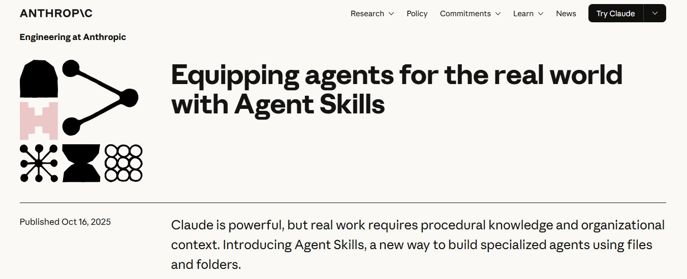

**托管地址**：[agentskills.io](https://agentskills.io/)

**Github地址**：https://github.com/agentskills/agentskills

该标准的核心是 **Agent Skills Specification V1.0**，同步开源了官方 SDK（支持 Python、TypeScript、Java），并公开了 `anthropics/skills` 技能库，包含 16 个生产级示例技能。

此后不到半年，该标准被 Claude Code、OpenAI Codex、GitHub Copilot、VS Code、Cursor 等 26+ 个平台采纳或实验性支持。到 2026 年 2 月，公开可用的技能数量已超过 **8.5 万个**。

与此同时，学术界也开始系统性审视 Skills 的安全性和架构设计——2026 年初的两篇安全研究论文发现，公开 Skills 仓库中超过 26% 存在安全漏洞，157 个 Skills 被确认为恶意。

> 1. Yi Liu et al. *Security Vulnerabilities in Agent Skills*. arXiv:2601.10338, January 2026.
> 2. Yi Liu et al. *Behavioral Testing of Malicious Agent Skills*. arXiv:2602.06547, February 2026.

Skills 到底是什么？它为什么能成为 AI Agent 生态中最快速的标准化运动之一？它的设计背后遵循怎样的工程哲学？

---


# Skills 简介

## 一、从聊天机器人到 AI 智能体

大家可能都使用过 ChatGPT、豆包、通义千问等 AI 产品。最常见的使用方式是提出问题，然后获得文字回答。这种形式可以称为**对话式 AI 应用**。

随着大模型能力和工具调用机制的发展，AI 不仅可以回答问题，还能在得到相应授权、连接和工具支持的情况下，进一步执行任务。例如查询实时天气、读取业务数据，或操作其他软件。

> **通俗地说，AI 智能体不仅能理解需求、规划步骤，还能够借助工具采取行动。**

聊天与行动并非绝对对立：现代对话产品也可能内置智能体能力。两者更重要的区别，在于具体任务中是否具备自主规划和调用工具执行操作的能力。

### 聊天回答与智能体执行，有什么不同？

| 任务                         | 仅进行文本回答                             | 具备相应工具的智能体                                         |
| ---------------------------- | ------------------------------------------ | ------------------------------------------------------------ |
| 今天北京天气怎么样？         | 根据已有信息回答，可能不具备实时性         | 调用天气接口，查询最新天气数据                               |
| 帮我查一下上个月的销售额     | 在没有数据访问权限时，无法提供真实销售数据 | 在获得数据库访问权限后查询并汇总数据                         |
| 帮我订一张明天去上海的高铁票 | 说明购票方法与注意事项                     | 在网站和授权条件允许时查询车次、辅助选票，并按要求执行后续步骤 |

关键差别不是回答是否流畅，而是**能否在真实环境中获取信息并执行操作**。涉及支付、下单等敏感动作时，仍需遵循平台规则和必要的用户确认。

### 智能体是如何工作的？


可以从三个简单步骤来理解：

1. **理解需求**：借助大模型识别用户想要完成什么。
2. **规划任务**：判断需要哪些步骤、知识和工具。
3. **执行与反馈**：调用可用工具、处理结果，再把进展或最终结果反馈给用户。

其中，**大模型负责理解与决策，工具负责连接和操作外部环境，而 Skills 主要提供可复用的操作指南**。三者可以协同工作。

### 生活中的相关例子

- **Siri、小爱同学、天猫精灵**：可通过语音设置闹钟、控制设备等，体现了从理解指令到执行动作的能力。
- **GitHub Copilot 等编程助手**：在支持的模式下，可以阅读代码、提出修改建议，甚至调用工具修改和测试代码。
- **AI 客服**：在接入业务系统后，可以查询订单、提交服务请求或协助处理售后流程。
- **自动驾驶系统**：也具有感知、决策与行动的特征，但其技术体系与基于大语言模型的 Agent 并不完全相同。

这些例子有助于理解“感知—决策—行动”的思路；并不是说所有上述产品都采用同一种智能体架构。

---

## 二、智能体的 Skills 是什么？

理解了智能体，再看 Skills 就更容易了。

假设有一位能力很强的新员工，虽然能理解任务，也会使用各种办公工具，但刚入职时并不了解公司的报销流程、客户投诉处理规范，或代码提交的审核要求。

这时，一份清晰的 **SOP（标准操作流程）手册**就非常有帮助。它告诉员工：遇到某类任务应该按什么步骤操作、使用哪些资源、注意哪些要求。

**Skill 就类似于提供给 AI 智能体的任务说明书。**


例如，我们可以编写一个“制作课程 PPT”的 Skill，规定页面结构、标题长度、配色规范、图表使用方式及交付检查项。下次遇到相似的任务，智能体就可以依据这些指引开展工作，而不必每次从头说明。

需要特别区分：

- **大模型**提供理解、推理和规划能力。
- **工具**提供文件读写、代码执行、API 调用等操作能力。
- **Skills**提供完成特定任务的步骤、知识、规范与可选资源。

因此，Skills 不等于智能体的“手和脚”；更准确地说，它是告诉智能体**如何更好地使用已有能力完成任务**的指南。


官方原文： 

```
What are Agent Skills?
Agent Skills are a lightweight, open format for extending AI agent capabilities with specialized knowledge and workflows.
At its core, a skill is a folder containing a SKILL.md file. This file includes metadata (name and description, at minimum) and instructions that tell an agent how to perform a specific task. Skills can also bundle scripts, reference materials, templates, and other resources.
```


### 一个 Skill 长什么样？

Agent Skills 的核心是一个包含 `SKILL.md` 的文件夹。`SKILL.md` 至少包含 `name` 和 `description` 元数据，并记录任务说明；必要时还可加入脚本、参考文档和素材。

```text
my-skill/
├── SKILL.md       # 必需：元数据与操作说明
├── scripts/       # 可选：可执行脚本
├── references/    # 可选：参考文档
├── assets/        # 可选：模板和其他资源
└── ...            # 其他文件或文件夹
```

最简单的 Skill 可以只包含一个 `SKILL.md` 文件。对于更复杂的任务，再逐步加入脚本、模板等资源即可。

---

## 三、Skills 与 Agent 如何协同工作？

Skill 记录的是“遇到这类任务如何做”，而**是否使用某个 Skill，通常由智能体或其运行环境根据当前任务来决定**。

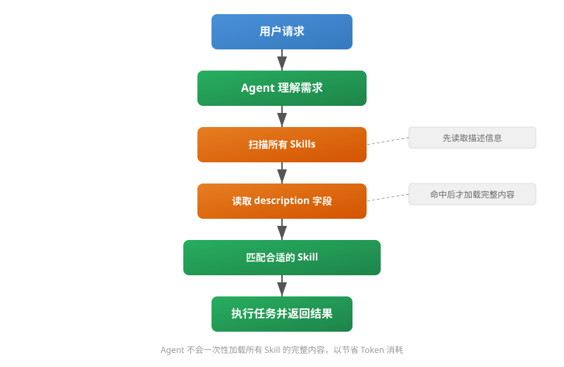

Agent Skills 采用**渐进式披露（Progressive Disclosure）**的方式，按需提供信息，大致分为三个阶段：

1. **发现（Discovery）**：智能体先了解可用 Skills 的名称和描述，判断哪些可能与当前任务有关。
2. **激活（Activation）**：识别到相关任务后，读取对应 Skill 的完整 `SKILL.md` 指令。
3. **执行（Execution）**：按照指令工作，并在需要时读取参考文件、运行附带脚本或调用可用工具。

这种机制的好处是：即使系统安装了很多 Skills，也不必在任务开始时将它们的所有内容一次性放入模型上下文，有助于**节省 Token 和管理上下文**。

---

## 四、Skills 能解决什么问题？

以“生成一份 Word 项目计划书”为例。

### 场景一：没有专门的 Skill

用户提出：“请帮我生成一份项目计划书 Word 文档。”

如果 AI 只具备对话能力，而没有相应的文件工具或制作规范，它可能只能输出一段计划书文本，由用户自行复制到 Word 中。即使 AI 已经可以生成文件，也可能因为缺少组织模板和格式要求，导致结果不够统一。

### 场景二：配置了文档处理 Skill

当运行环境既有**文件创建工具**，又配置了相应的 `docx` Skill 时，智能体就可以按照约定流程完成任务：

1. **识别任务**：发现用户需要真正的 `.docx` 文件。
2. **读取说明**：加载 `docx` Skill，了解文档结构、制作方法、排版要求和目标路径。
3. **调用工具**：使用环境允许的文档库或文件工具，创建和保存 `.docx` 文件。
4. **检查交付**：核对格式与内容，并提供生成的文件。

这并不意味着安装 Skill 本身就会自动增加文件生成权限。**Skill 提供方法，真正的文件创建仍依赖所连接的工具与执行环境。**


同样的思路还可以用在数据清洗、报告生成、代码审查、项目交付等场景中：把个人经验沉淀成团队可共享、可维护的工作流程。

---

## 五、Skills 的核心价值

结合前面的例子，可以把 Skills 的价值归纳为三个方面。

1. **沉淀专业经验**：将领域知识、最佳实践和执行规范写成智能体可读取的说明，减少反复解释。
2. **复用标准流程**：让相似任务尽可能遵循同一套步骤，提高执行的一致性和可检查性，但实际结果仍受模型、工具和任务环境影响。
3. **促进人与 AI 协作**：人负责定义目标、流程与约束，AI 在授权范围内理解并执行任务。

| 概念               | 一句话理解                                           |
| ------------------ | ---------------------------------------------------- |
| AI 智能体（Agent） | 可以理解需求、进行决策，并借助工具执行任务的 AI 系统 |
| Agent Skills       | 为智能体提供专业知识、步骤和资源的可复用技能包       |
| Skills 的价值      | 让经验可沉淀、流程可复用、任务执行更规范             |

---

## 六、Agent Skills 的三项核心优势（官方标准）

从 [Agent Skills 官方概览](https://agentskills.io/) 的角度，Skills 主要为智能体提供三个方面的价值：

- **领域专业知识（Domain Expertise）**：将法律审查、数据分析、演示文稿排版等领域的知识整理为指令及资源，供智能体复用。
- **可重复执行的工作流程（Repeatable Workflows）**：把多步骤任务转换为更一致、可审计的操作流程。
- **跨产品复用（Cross-Product Reuse）**：按开放格式构建一次 Skill，可以在支持该格式的不同智能体客户端中复用。不同客户端的工具权限和执行方式仍可能不同。

这些能力来自一种可移植、可版本控制的文件夹形式：不仅可以存放通用工作流程，也可以包含公司、团队和用户特定的业务背景。智能体不必在每次对话中重新获得整套说明，而能按照需要加载相关信息。

### 进一步理解 Skill 的文件结构

`SKILL.md` 是每个 Skill 的入口文件，其中至少要有 `name` 和 `description` 两项元数据以及操作指令；`scripts/`、`references/` 和 `assets/` 等目录则是可选资源。官方示例：

```text
my-skill/
├── SKILL.md          # 必需：元数据 + 指令
├── scripts/          # 可选：可执行代码
├── references/       # 可选：参考文档
├── assets/           # 可选：模板、资源
└── ...               # 可以按需添加文件或目录
```

实际使用时，**脚本不会因为放入 Skill 就自动获得执行权限**。能否运行脚本、读写文件或访问网络，由所使用的智能体客户端、可用工具及权限决定。

### 为什么渐进式披露很重要？

官方定义了三个加载阶段：**发现（Discovery）→ 激活（Activation）→ 执行（Execution）**。启动时只读取可用 Skills 的名称和描述；任务匹配时再读取完整 `SKILL.md`；真正执行时才按需加载引用文档或调用打包脚本。这使大量技能可以同时待命，而不必把所有细节一次性塞进上下文窗口。

---

## 七、Skills 与 MCP 的区别

理解 Skills 时，另一个经常遇到的概念是 **MCP（Model Context Protocol，模型上下文协议）**。

两者都可以扩展智能体的工作能力，但关注点不同：**Skills 更侧重知识与流程复用，MCP 更侧重连接外部数据和工具。**

| 对比维度       | Skills                                    | MCP                                           |
| -------------- | ----------------------------------------- | --------------------------------------------- |
| 核心定位       | 知识与流程复用                            | 外部能力连接与集成                            |
| 主要用途       | 沉淀经验、最佳实践、操作步骤              | 连接 API、数据库和外部工具等                  |
| 开发门槛       | 简单 Skill 可由 Markdown 文件创建         | 通常需要配置 MCP Server；复杂集成可能需要编程 |
| 加载机制       | 按需读取技能内容，采用渐进式披露          | 工具发现及定义加载方式由客户端实现决定        |
| 部署要求       | 纯文档型 Skill 无需独立服务器             | 通常需要可连接的 MCP Server（本地或远程）     |
| 适用环境       | 支持 Skills 的 Web、Desktop、CLI 等客户端 | 支持 MCP 的客户端或智能体运行环境             |
| 核心优势       | 轻量、易分享、易维护和复用                | 可标准化接入外部系统和操作能力                |
| Token 与复杂度 | 可以通过按需加载减少上下文占用            | 可能产生工具定义和交互开销，取决于具体实现    |

举个例子：如果需要智能体“每周从数据库提取销售数据，并按公司模板制作报告”，那么 MCP 可以负责**连接数据库、提供查询工具**，而 Skill 可以负责**规定数据提取、分析、排版和质量检查的具体流程**。

因此，Skills 与 MCP 并不冲突，实际应用中往往可以配合使用。

---

## 八、哪些 AI 产品支持 Agent Skills？

Agent Skills 已被众多 AI 产品和智能体客户端采用。官方[客户端展示页面](https://agentskills.io/clients)列出了相关代表如下

| 客户端 / 工具   | 中文介绍                                                     | 官方网站                                       | Skills 使用说明                                              | 开源代码                                             |
| --------------- | ------------------------------------------------------------ | ---------------------------------------------- | ------------------------------------------------------------ | ---------------------------------------------------- |
| Claude Code     | Claude Code 是一款智能体式编程工具，可以读取代码库、编辑文件、运行命令并集成开发工具。它可在终端、IDE、桌面应用和浏览器中使用。 | [访问](https://claude.ai/code)                 | [查看](https://code.claude.com/docs/en/skills)               | —                                                    |
| ChatGPT & Codex | ChatGPT 将面向不同工作类型的智能体汇聚在一起，其中包括用于软件开发的 Codex，以及面向更广泛工作的 ChatGPT Work。ChatGPT 可在桌面端、网页端和移动端使用；Codex 还可在编辑器和终端中使用。 | [访问](https://chatgpt.com/codex/)             | [查看](https://developers.openai.com/codex/skills/)          | [查看](https://github.com/openai/codex)              |
| OpenClaw        | OpenClaw 是一款开源个人 AI 助手，可在本地运行，并连接你已经使用的消息平台和工具。 | [访问](https://openclaw.ai/)                   | [查看](https://docs.openclaw.ai/tools/skills)                | [查看](https://github.com/openclaw/openclaw)         |
| Hermes Agent    | Hermes Agent 是 Nous Research 推出的个人 AI 智能体，可运行在 CLI、桌面应用和消息平台上。它开源、与模型无关，能够跨会话学习，并操作真实的终端和浏览器。 | [访问](https://hermes-agent.nousresearch.com/) | [查看](https://hermes-agent.nousresearch.com/docs/user-guide/features/skills) | [查看](https://github.com/NousResearch/hermes-agent) |
| Gemini CLI      | Gemini CLI 是一款开源 AI 智能体，可让你直接在终端中使用 Gemini 的能力。 | [访问](https://geminicli.com)                  | [查看](https://geminicli.com/docs/cli/skills/)               | [查看](https://github.com/google-gemini/gemini-cli)  |
| pi              | pi 是一个极简的终端编程智能体运行框架（harness）。你可以让 pi 适应自己的工作流程，而非反过来调整工作流程以适应它。 | [访问](https://shittycodingagent.ai/)          | [查看](https://github.com/badlogic/pi-mono/blob/main/packages/coding-agent/docs/skills.md) | [查看](https://github.com/badlogic/pi-mono)          |
| OpenCode        | OpenCode 是一款开源智能体，可帮助你在终端、IDE 或桌面环境中编写代码。 | [访问](https://opencode.ai/)                   | [查看](https://opencode.ai/docs/skills/)                     | [查看](https://github.com/sst/opencode)              |
| Cursor          | Cursor 是一款 AI 编辑器和编程智能体，可用于理解代码库、规划和构建功能、修复缺陷、审查改动，并配合你已有的工具工作。 | [访问](https://cursor.com/)                    | [查看](https://cursor.com/docs/context/skills)               | —                                                    |
| VS Code         | Visual Studio Code 兼具代码编辑器的简洁性与开发者在编辑、构建、调试核心流程中所需的功能。 | [访问](https://code.visualstudio.com/)         | [查看](https://code.visualstudio.com/docs/copilot/customization/agent-skills) | [查看](https://github.com/microsoft/vscode)          |
| TRAE            | TRAE 是一款自适应 AI 集成开发环境，通过协作式开发帮助你更快完成工作。 | [访问](https://trae.ai/)                       | [查看](https://www.trae.ai/blog/trae_tutorial_0115)          | [查看](https://github.com/bytedance/trae-agent)      |

---

## 九、总结：如何理解和使用 Skills

通过这一章，我们可以形成一个清晰的认识：

> **大模型负责理解与思考，工具提供执行能力，Skills 沉淀完成任务的方法。**

一个好的 Skill 不需要一开始就很复杂。可以先从某个常见任务入手，把经过验证的工作流程写成 `SKILL.md`，再根据实际需要补充脚本、模板和参考文档。这样，原本只属于个人的经验，就有机会成为团队和多个智能体共同使用的资产。


## 十、开放标准与进一步学习

Agent Skills 格式最初由 [Anthropic](https://www.anthropic.com/) 开发，随后作为开放标准发布，并由越来越多的智能体产品采用。开发者和社区可以通过以下资源了解与参与：

- [Agent Skills 官方网站](https://agentskills.io/)：开放格式与概览。
- [完整文档索引](https://agentskills.io/llms.txt)：发现官方文档页面。
- [快速入门（Quickstart）](https://agentskills.io/skill-creation/quickstart)：创建并运行第一个 Skill。
- [格式规范（Specification）](https://agentskills.io/specification)：查看 `SKILL.md` 与技能包的技术要求。
- [客户端展示（Client Showcase）](https://agentskills.io/clients)：了解支持 Skills 的工具。
- [Agent Skills GitHub](https://github.com/agentskills/agentskills)：参与标准开发与讨论。
- [Discord 社区](https://discord.gg/MKPE9g8aUy)：交流与协作。

---


# Skills 工作原理

你可能会好奇：智能体又不是人，它怎么知道某个 Skill 能做什么、该怎么做？

**答案很简单——靠读文件。**

每个 Skill 背后，都有一个描述文件，通常叫 **SKILL.md**，就像一份说明书。

### Skills 的工作原理

Skills 使用渐进式披露（Progressive Disclosure）的方式，让代理在不同的阶段加载不同详细程度的信息。这种设计使得代理可以同时管理大量技能，而不会耗尽上下文空间。

### 三个阶段

代理加载技能分为以下三个阶段：

- **1. 发现阶段（Discovery）：**当对话开始时，代理会扫描所有可用的技能文件夹，只读取每个技能的名称（name）和描述（description）。这是最轻量的信息，足以让代理判断某个技能是否可能与当前任务相关。
- **2. 激活阶段（Activation）：**当代理判断某个技能的描述与用户请求相匹配时，会将完整的 SKILL.md 文件内容加载到上下文中。这时代理会读取完整的指令和说明。
- **3. 执行阶段（Execution）：**代理按照 SKILL.md 中的指令执行任务。在这个过程中，代理可能会调用技能附带的脚本、读取参考资料或使用其他资源。

### 渐进式加载的优势

| 阶段     | 加载内容           | 典型大小               |
| :------- | :----------------- | :--------------------- |
| 发现阶段 | name + description | 约 100 tokens          |
| 激活阶段 | 完整 SKILL.md      | 建议不超过 5000 tokens |
| 执行阶段 | 脚本、参考资料等   | 按需加载               |

智能体在执行任务之前，会先读这份说明书，搞清楚三件事：

- 这个 Skill 能干什么？（能力描述）
- 要用它，我需要提供什么？（输入参数）
- 做这件事有什么规矩？（环境约束和注意事项）

读完之后，智能体就知道：哦，这个 Skill 适合用来解决当前的问题，我来调用它。

下面这张图展示了这个过程：

智能体如何"读懂"一个 Skill？🧠智能体大脑"我需要找一个能完成任务的技能"读取📄SKILL.md① 能做什么（描述）② 需要什么（参数）③ 有什么规矩（约束）↓ 读完就全懂了理解✅懂了！可以调用了💡 打个比方想象你新入职一家公司，拿到一本《岗位操作手册》：📖 岗位说明"你是客服，负责处理退款"📋 操作流程"先核实订单号，再提交退款"⚠️ 注意事项"超过500元需主管审批"读完手册，你就知道自己该干什么、怎么干、什么不能干了。SKILL.md 对智能体来说，就是这本"操作手册"。

### Skill 执行流程

- 从用户指令开始，先进行 Skill 意图识别，决定是否进入受控执行路径。
- 命中 Skill 后，系统加载 SKILL.md，建立工具权限与行为边界，再结合上下文进行推理。
- 只有在确实需要时才调用被允许的外部工具，否则在规则内完成逻辑。
- 最终结果经过约束整合后输出，用户的下一次输入触发新一轮完整流程。


------

## Skills 工作过程

用户提出需求后，Agent 首先理解任务内容，然后分析应该使用哪些能力（Skills）完成工作。

Skill 可以理解为一个独立能力模块或插件，例如天气查询、搜索、文件处理、数据库访问等。

Agent 负责思考和决策，Skill 负责执行动作，执行完成后结果再返回给 Agent，由 Agent 整理成用户容易理解的结果并输出。

整个流程形成一个完整闭环：理解 → 决策 → 执行 → 返回结果。

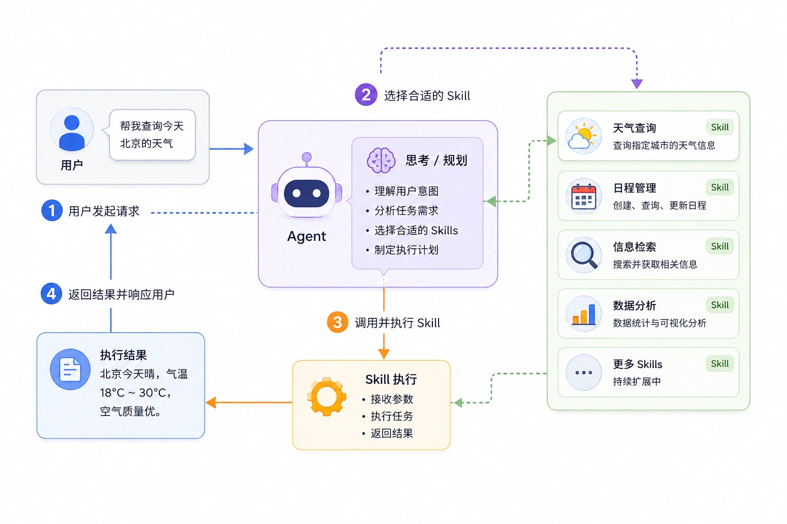

| 步骤 | 阶段         | Agent 内部动作                   | 示例                                 |
| :--- | :----------- | :------------------------------- | :----------------------------------- |
| ①    | 用户发起请求 | 接收自然语言任务                 | "帮我查询北京今天的天气"             |
| ②    | 理解用户意图 | 分析用户真正想做什么，并提取参数 | 动作：查询；类型：天气；地点：北京   |
| ③    | 制定执行计划 | 拆分任务步骤                     | 找天气服务 → 获取天气数据 → 整理结果 |
| ④    | 选择 Skill   | 匹配最适合的能力模块             | 选择 Weather Skill                   |
| ⑤    | 执行 Skill   | 调用外部工具或 API               | 请求天气接口                         |
| ⑥    | 获取执行结果 | 接收 Skill 返回的数据            | 温度、湿度、空气质量                 |
| ⑦    | 生成最终回复 | 整理并转换为自然语言             | "北京今天晴，18℃~30℃"                |
| ⑧    | 返回给用户   | 输出最终结果                     | 用户看到完整回复                     |

Skill 类型：

| Skill 类型     | 功能说明       | 常见场景           |
| :------------- | :------------- | :----------------- |
| 搜索 Skill     | 查询外部信息   | 搜索新闻、知识问答 |
| 天气 Skill     | 获取天气数据   | 天气查询           |
| 文件 Skill     | 读取文件内容   | PDF、Word、Excel   |
| 数据分析 Skill | 数据计算和统计 | 报表分析           |
| 数据库 Skill   | 查询数据库     | MySQL、PostgreSQL  |
| 浏览器 Skill   | 自动操作网页   | 自动登录、爬取内容 |
| 代码 Skill     | 执行代码       | Python、Node.js    |
| 图像 Skill     | 图像处理能力   | OCR、图片生成      |


# Skills 触发机制详解

Skills 不是被用户"调用"的，而是由 Claude 自主决定"是否使用"的。

理解这个触发机制，能帮助你写出更容易被准确触发的 Skill。

------

## 触发机制的工作原理

Claude 启动时，会将所有可用 Skill 的 **name** 和 **description** 加载到上下文中。

当用户发送消息后，Claude 会判断：这个任务，我需要参考某个 Skill 吗？

判断依据只有一个：**Skill 的 description 字段**。

> SKILL.md 的正文（body）不参与触发判断。Claude 只有在决定使用某个 Skill 之后，才会读取正文内容。

### 触发流程示意

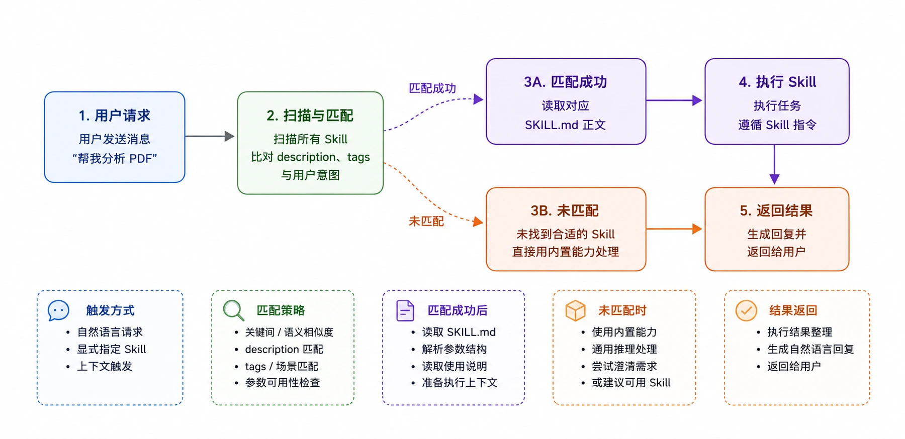

------

## 什么样的任务会触发 Skill

并非所有匹配 description 的请求都会触发 Skill。

Claude 有一个内在判断：**这个任务复杂到需要参考专门指令吗？**

| 请求类型           | 示例                               | 是否触发 Skill | 原因                  |
| :----------------- | :--------------------------------- | :------------- | :-------------------- |
| 简单单步任务       | "读取这个 PDF"                     | 通常不触发     | Claude 直接处理更高效 |
| 复杂多步任务       | "提取 PDF 中的表格并转为 Excel"    | 触发           | 需要专门的工作流程    |
| 专业领域操作       | "合并三个 PDF 并加水印"            | 触发           | 涉及特定工具链        |
| 输出有明确格式要求 | "生成符合我们公司模板的 Word 报告" | 触发           | 需要特定格式规范      |

> 如果你的 Skill 很少被触发，通常是因为任务描述过于简单，或者 description 写得不够精准。测试时应使用复杂、具体的用户请求。

------

## Description 的触发策略

description 是触发的唯一凭据，写法直接决定触发准确率。

### 策略一：列举具体场景

不要只写"这个 Skill 是做什么的"，还要写"在什么情况下应该用它"。

```
# 不推荐：只描述功能
description: 处理 Excel 文件。

# 推荐：描述功能 + 触发场景
description: >
  处理 Excel 和 CSV 文件，包括：读取数据、清洗格式、生成图表、
  计算统计指标、合并多个表格。当用户提到 Excel、xlsx、CSV、
  表格数据、数据清洗、财务报表时，应优先使用此 Skill。
```

### 策略二：使用"推动性"语言

Skills 系统天然倾向于"少触发"。在 description 中加入推动性语言可以提升触发率。

```
description: >
  生成专业的 PowerPoint 演示文稿。当用户需要制作幻灯片、PPT、演讲稿、
  汇报材料时，必须使用此 Skill，即使用户没有明确说"用 pptx 格式"。
  只要涉及演示文稿的创建或修改，都应触发此 Skill。
```

### 策略三：列出关键词

在 description 末尾附上触发关键词列表，是一种简单有效的补充手段。

```
description: >
  代码审查助手，分析代码质量、发现潜在 Bug、给出改进建议。
  关键词：code review、代码审查、代码分析、bug 检查、
  重构建议、代码质量、静态分析。
```

------

## 触发冲突：多个 Skill 同时匹配

当用户的请求可能匹配多个 Skill 时，Claude 会根据匹配程度选择最相关的一个。

为了避免冲突，需要让不同 Skill 的 description 保持清晰的边界。

| 冲突场景                     | 解决方案                                                    |
| :--------------------------- | :---------------------------------------------------------- |
| 两个 Skill 都处理 PDF        | 在 description 中区分具体操作，如"PDF 创建"vs"PDF 读取"     |
| 通用 Skill 与专用 Skill 重叠 | 专用 Skill 的 description 中明确写出区别于通用 Skill 的场景 |
| 功能相似的两个 Skill         | 考虑合并为一个 Skill，通过内部分支处理不同情况              |

> Skill 的 description 应当"排他性"地描述自己的适用场景，而不仅仅是描述自己"能做什么"。能做什么 ≠ 应该什么时候用。

------

## 使用 Description 优化工具测试触发

skill-creator Skill 提供了一个 description 优化脚本，可以自动评估触发准确率。

**示例**

```
# 运行 description 优化循环
# --eval-set：测试用例文件路径
# --skill-path：待优化的 Skill 路径
# --max-iterations：最大迭代次数
python -m scripts.run_loop \
  --eval-set evals/trigger-eval.json \
  --skill-path my-skill/ \
  --model claude-sonnet-4-20250514 \
  --max-iterations 5 \
  --verbose
```

脚本会自动运行测试、评估得分、修改 description，并输出最优结果。

------

# Skills 基本结构

Skills 的核心本质，是给 AI 制定标准化执行流程的操作指引，规则一经编写完成，就能像程序函数一样，被反复调用、直接复用。

Skills 以 Markdown 文本载体存储，本身不直接执行功能。

Skills 按需加载、渐进式调用的特性，高效沉淀工作经验，实现能力快速复用与精准传递。

------

## Skill 的核心结构

Skills 的核心就是：**一个文件夹 + 一个 SKILL.md 文件**。

**SKILL.md 文件包含：**

- 元数据（至少要有名称和描述）
- 告诉 AI 如何完成某一特定任务的指令


一个 Skill 本质上就是一个 Markdown 文件（文件名固定为 SKILL.md）

```
my-skill/
└── SKILL.md   （唯一必需）
```

SKILL.md 基本模板:

```
---
name: your-skill-name
description: 一句话描述该 Skill 的功能和使用场景
---

# Skill 名称

## 使用指引
[给 AI 的分步骤行为指引]

## 示例
[该 Skill 的具体使用示例]
```

整个 SKILL.md 分为上下两部分：用 **---** 包裹的 YAML frontmatter（头部配置），以及下方的 Markdown 正文（执行说明）。

| 字段          | 必填 | 说明                                                         | 示例                                |
| :------------ | :--- | :----------------------------------------------------------- | :---------------------------------- |
| `name`        | 是   | Skill 的唯一标识符，使用 kebab-case 命名。会被 / 命令引用，是系统识别 Skill 的关键字段。 | `web-design-guidelines`             |
| `description` | 是   | 一句话描述功能与触发场景。内容越具体，触发越准确。           | `UI/UX design review for web pages` |

接下来我们逐一拆解每个部分:

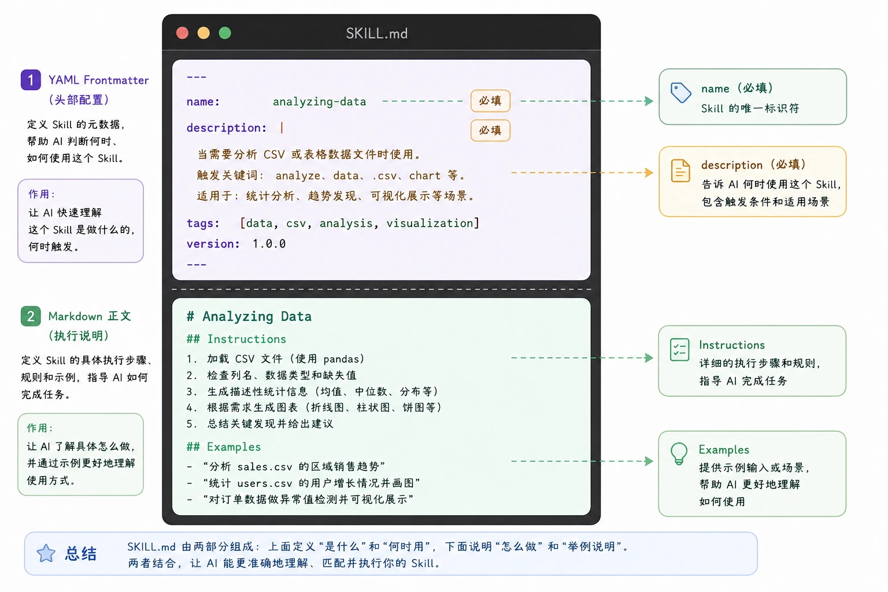

### Frontmatter：两个必填字段

Frontmatter 是 SKILL.md 顶部用 --- 包裹的 YAML 配置块，是整个 Skill 的身份信息。

官方只规定两个必填字段：

**字段一：name（技能名称）**

name 字段最多 64 个字符，只能包含小写字母、数字和连字符。

```
name: processing-pdfs        # 好：动名词形式，清晰描述功能
name: analyzing-spreadsheets # 好：一眼知道用途
name: my-brand-guidelines    # 好：组织专属知识

name: helper      # 差：太模糊
name: MySkill     # 差：包含大写字母（不合规）
name: data files  # 差：包含空格（不合规）
```

推荐使用动名词形式（动词 + -ing）来命名，如 processing-pdfs、analyzing-spreadsheets，这样能清晰描述 Skill 提供的活动或能力。

| 推荐            | 不推荐                 | 原因                                          |
| :-------------- | :--------------------- | :-------------------------------------------- |
| `code-reviewer` | `CodeReviewer`         | 统一使用小写和连字符，避免跨平台兼容问题      |
| `sql-optimizer` | `sql_optimizer`        | kebab-case 是约定俗成的格式，与目录名保持一致 |
| `deploy-check`  | `deploy-check-tool-v2` | 名称应简短，版本信息放在文件内部说明          |

**字段二：description（触发条件描述）**

这是最重要的字段。启动时，系统只会把所有 Skills 的 name 和 description 预加载进系统提示词。

只有当 description 被 AI 判断与当前任务相关时，才会进一步读取完整的 SKILL.md 内容。

description 应该同时包含两部分：**这个 Skill 做什么，以及什么时候 Claude 应该使用它。**

```
description: |
  Use when the user needs to create, read, edit, or generate Word
  documents (.docx). Triggers include: 'Word doc', 'word document',
  '.docx', 'report', 'letter', 'memo', or any request to produce
  a formatted document for sharing or printing.
```


### Markdown 正文：执行说明的内部结构

| 推荐                                                | 不推荐           | 原因                                   |
| :-------------------------------------------------- | :--------------- | :------------------------------------- |
| 「扫描 Python 代码中的 SQL 注入风险并给出修复建议」 | 「一个安全工具」 | 描述过于笼统，无法准确触发             |
| 「将 Markdown 转换为符合品牌规范的 HTML 邮件」      | 「转换文件格式」 | 缺少具体场景，可能在其他任务中被误触发 |

Frontmatter 之后是 Markdown 正文，告诉 AI 具体怎么做。

至少包含两个区块：


### SKILL.md 实例

SKILL.md 基本模板:

```
---
name: pdf-processing
description: 从 PDF 中提取文本和表格，填写表单，并合并文档
---

# PDF 处理

## 使用场景
当需要对 PDF 文件进行操作时使用，例如：

- 提取 PDF 文本或表格数据
- 填写 PDF 表单
- 合并多个 PDF 文件

## 提取文本
- 使用 `pdfplumber` 提取文本型 PDF 内容  
- 扫描版 PDF 需配合 OCR 工具  

## 填写表单
- 读取 PDF 表单字段  
- 按输入数据填充并生成新文件  
```

最小必填示例:

```
---
name: skill-name
description: 说明该 Skill 的功能以及适用场景
---
```

含可选字段示例:

```
---
name: pdf-processing
description: 从 PDF 中提取文本和表格，填写表单，并合并文档
license: Apache-2.0
metadata:
  author: example-org
  version: "1.0"
---
```

字段说明：

| 字段          | 必需 | 说明                                                         |
| :------------ | :--- | :----------------------------------------------------------- |
| name          | 是   | Skill 名称，最长 64 字符，只能使用小写字母、数字和 `-`，且不能以 `-` 开头或结尾 |
| description   | 是   | 功能与使用场景说明，最长 1024 字符，不能为空                 |
| license       | 否   | 许可证名称或指向随 Skill 附带的许可证文件                    |
| compatibility | 否   | 环境与依赖说明（产品、系统包、网络权限等），最长 500 字符    |
| metadata      | 否   | 自定义键值对，用于扩展元数据（如作者、版本号）               |
| allowed-tools | 否   | 允许使用的工具列表（空格分隔，实验性功能）                   |

------

## Skill 的文件目录结构

一个技能就是一个文件夹，至少包含一个 SKILL.md 文件，根据需要，还可以包含其他目录和文件。

为避免上下文膨胀：

- 核心规则 → `SKILL.md`
- 详细资料 → 单独文件
- 实用逻辑 → 脚本执行（不加载）

推荐结构:

```
my-skill/
├── SKILL.md          # 必需：元数据 + 指令
├── scripts/          # 可选：可执行代码
      └── helper.py
├── references/       # 可选：参考文档
├── assets/           # 可选：模板、资源
└── ...               # 其他文件或目录
```

各目录的作用如下：

- **SKILL.md**：必需文件，包含技能的元数据和执行指令
- **scripts/**：可选目录，包含代理可以执行的可执行代码
- **references/**：可选目录，包含详细的参考资料
- **assets/**：可选目录，包含静态资源如模板、图片等

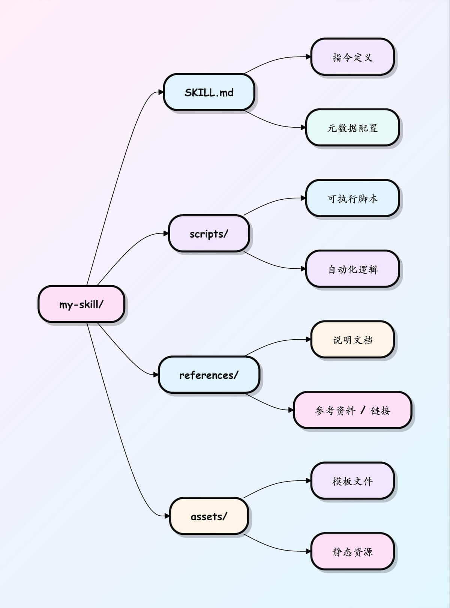


# Skills 目录结构详解

理解 Skill 的目录结构和运行机制，是构建可维护、可复用 AI Agent 能力的基础。

本文从零开始拆解一个标准 Skill 的目录结构、各文件作用和完整工作流程。

------

## Skill 的标准目录结构

一个完整的 Skill 不是单个文件，而是包含多个文件的目录。

以下是一个标准 Skill 的完整目录结构：

```
my-skill/
│
├── SKILL.md          ← 核心执行文件
├── metadata.json     ← 元信息
├── examples/         ← 示例目录
│   ├── example1.md
│   └── example2.md
│
├── scripts/          ← 可执行脚本
│   ├── main.py
│   └── utils.py
│
├── resources/        ← 资源目录
│   ├── prompt.md
│   └── config.yaml
│
├── tests/            ← 测试目录
│   ├── test_cases.md
│   └── eval.yaml
│
├── README.md         ← 使用说明
│
└── CHANGELOG.md      ← 变更日志
```

接下来逐个拆解每个文件和目录的作用。

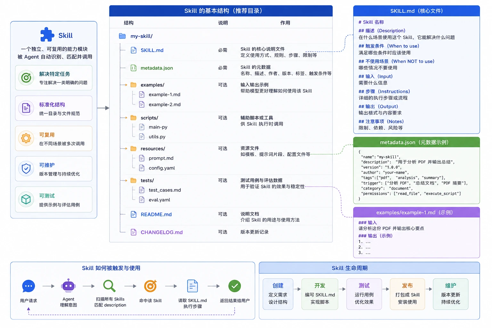

------

## SKILL.md：核心执行文件

这是 Skill 中最重要的文件，定义了 Skill 的所有执行逻辑。

它包含以下关键信息：

| 部分            | 说明             | 作用                  |
| :-------------- | :--------------- | :-------------------- |
| Description     | Skill 的功能描述 | 供 Agent 匹配使用     |
| When to use     | 明确适用场景     | 避免误触发            |
| When NOT to use | 明确不适用场景   | 防止与其他 Skill 冲突 |
| Input           | 定义输入格式     | 规范调用方式          |
| Instructions    | 执行步骤         | 指导任务执行          |
| Output          | 输出格式说明     | 保证结果一致性        |

以下是一个规范的 SKILL.md 示例：

```
# PDF 分析 Skill

## Description
用于分析 PDF 内容并生成摘要。

## When to use

适用于：

- PDF 阅读
- 摘要提取
- 内容分析

## When NOT to use

不适用于：

- 图片编辑
- 视频处理

## Input

PDF 文件

## Instructions

1. 提取文本
2. 识别章节结构
3. 总结主要内容
4. 输出重点

## Output

Markdown 格式摘要
```


### 常见的错误写法

很多初学者会写出过于简略的 SKILL.md，例如：

**不推荐写法**

```
# PDF Skill

读取 PDF
总结内容
返回结果
```

这种写法的问题在于：不知道什么时候使用、不知道什么时候不用、输出格式不明确、容易和其他 Skill 冲突。

> 一个合格的 SKILL.md 应该让 Agent 一眼就能判断：这个 Skill 适不适合当前任务。

------

## metadata.json：Skill 元信息

这个文件提供机器可读的结构化数据，帮助 Agent 快速筛选 Skill。

**示例**

```
{
  "name": "pdf-analyzer",
  "version": "1.0.0",
  "description": "分析 PDF 并生成摘要",
  "tags": ["pdf", "summary"],
  "category": "document"
}
```

### 常见字段说明

| 字段        | 作用                         | 重要性 |
| :---------- | :--------------------------- | :----- |
| name        | Skill 名称                   | 必填   |
| description | 功能说明，Agent 依靠它做匹配 | 最重要 |
| version     | 版本号                       | 推荐   |
| tags        | 标签，便于检索               | 推荐   |
| category    | 分类                         | 可选   |
| author      | 作者                         | 可选   |
| permissions | 所需权限                     | 可选   |

其中 **description** 字段最为重要，因为 Agent 通常依靠它做匹配。

匹配过程大致如下：用户提出请求后，Agent 扫描所有 Skill 的 description，发现匹配的描述后加载完整的 Skill 内容并执行。

------

## examples：示例目录

很多开发者忽略这一部分，但它实际上非常重要。

### 目录结构

```
examples/
├── example1.md
├── example2.md
```

### 示例文件内容

**示例**

```
输入：

帮我分析这个 PDF

输出：

# 文档总结

## 核心内容

1. ...
2. ...
3. ...
```

### examples 的作用

| 作用               | 说明                         |
| :----------------- | :--------------------------- |
| 提供 Few-shot 示例 | 帮助模型通过示例理解期望行为 |
| 规范输出格式       | 通过示例明确输出结构和风格   |
| 提高输出稳定性     | 减少随机行为，让结果更可预测 |

> 经验上，好的 examples 往往比增加提示词更有效。

------

## scripts：可执行脚本

Skill 不仅仅是提示词，有时需要真正执行代码来完成实际工作。

常见需要脚本的场景包括：读取 PDF、执行 OCR、调用数据库、数据处理、生成图表等。

### 目录结构

```
scripts/
├── main.py
└── utils.py
```

### Python 脚本示例

**示例**

```
# 文件路径：scripts/extract.py
# 功能：从 PDF 文件中提取文本内容

from pypdf import PdfReader

# 打开 PDF 文件
reader = PdfReader("demo.pdf")

# 存储提取的文本
text = ""

# 遍历每一页并提取文本
for page in reader.pages:
    text += page.extract_text()

# 输出全部文本内容
print(text)
```


Skill 的工作流程是：读取文件 → 执行脚本 → 获取结果，然后再将结果交给大模型处理。

------

## resources：资源目录

用于保存辅助内容，将配置与代码分离。

### 目录结构

```
resources/
├── prompt.md
├── config.yaml
```

### 可能包含的资源类型

| 资源类型    | 说明               | 示例         |
| :---------- | :----------------- | :----------- |
| Prompt 模板 | 可复用的提示词模板 | prompt.md    |
| 配置文件    | 参数和设置         | config.yaml  |
| 文本模板    | 邮件、报告模板     | template.txt |
| 图片资源    | 图标、示意图       | logo.png     |
| SQL 模板    | 预定义的查询模板   | query.sql    |

### 配置文件示例

**示例**

```
# 文件路径：resources/config.yaml
# 摘要相关配置

max_length: 1000    # 摘要最大长度（字符数）
language: zh        # 输出语言：zh=中文, en=英文
```

将配置放在独立文件中，以后修改参数就不需要改动代码。

------

## tests：测试目录

成熟项目通常都会包含测试，用于验证 Skill 的效果和稳定性。

### 目录结构

```
tests/
├── test_cases.md
└── eval.yaml
```

### 测试用例示例

**示例**

```
测试：

输入：

帮我分析 PDF

期望：

输出摘要
包含关键点
```

### 测试的作用

| 作用     | 说明                     |
| :------- | :----------------------- |
| 验证效果 | 确保 Skill 输出符合预期  |
| 回归测试 | 修改后验证旧功能不受影响 |
| 自动评估 | 配合自动化流程批量测试   |
| A/B 测试 | 对比不同版本的输出质量   |

> 没有测试的 Skill 容易出现"改了一句话，旧功能突然失效"的问题。

------

## README：使用说明

README 面向开发者，说明如何安装和使用这个 Skill。

**示例**

```
# 安装

复制到 skills 目录

# 使用方法

上传 PDF

# 输出格式

Markdown
```


它解决的核心问题是：以后自己都不知道怎么用自己写的 Skill。

------

## 完整案例：PDF 分析 Skill

下面用一个完整的例子串联以上所有概念。

### 目录结构总览

```
pdf-analyzer/
├── SKILL.md
├── metadata.json
├── examples/
│   └── summary.md
├── scripts/
│   └── extract.py
├── tests/
│   └── eval.md
└── README.md
```

### 完整调用流程

```
用户：
上传 PDF 并总结

        ↓

Agent：
扫描所有 Skills

        ↓

发现：
description: 分析 PDF 并生成摘要

        ↓

命中 pdf-analyzer

        ↓

读取 SKILL.md

        ↓

调用 extract.py

        ↓

提取 PDF 内容

        ↓

生成摘要

        ↓

返回结果
```

------

## 为什么 Skill 要设计成目录结构

很多人会问：为什么不用一个 prompt.txt 搞定所有事情？

原因是规模一大就会失控。

### 单文件方案的问题

| 问题         | 具体表现                       |
| :----------- | :----------------------------- |
| 无法维护     | 所有内容堆在一个文件，修改困难 |
| 无法测试     | 没有测试用例，改完不知是否正常 |
| 无法复用     | 每个 Skill 都要从头写          |
| 无法版本管理 | 难以追踪变更历史               |
| 无法多人协作 | 一个文件多人改容易冲突         |

### 目录化方案的优势

| 优势   | 实现方式                     |
| :----- | :--------------------------- |
| 可维护 | 各文件职责清晰，修改定位快   |
| 可复用 | 脚本和配置可以跨 Skill 共享  |
| 可测试 | 独立测试目录，支持自动化验证 |
| 可扩展 | 新增功能只需添加文件         |
| 可发布 | 目录打包即可分发             |

------

## 总结

Skill 本质上不是提示词，而是一套完整的软件能力包。

### 核心文件关系

```
SKILL.md
    ↓
定义行为

metadata.json
    ↓
定义信息

examples/
    ↓
定义示例

scripts/
    ↓
定义能力

tests/
    ↓
定义质量

README
    ↓
定义使用方式
```

> Prompt 只能解决一次问题，而 Skill 是把能力沉淀成资产。


# 第一个 Skill

让我们暂时忘掉复杂的创建过程，先从 **使用一个现成的 Skill** 开始，感受它带来的便利。

本文的演示基于 Claude Code，如果你还没安装，可以参考我们的 [Claude Code 教程](https://www.runoob.com/claude-code/claude-code-tutorial.html)。

### 创建 Skill 目录

Skills 存放在 **~/.claude/skills/**（个人全局）或项目目录下的 **.claude/skills/**（项目专用）。

本章节再项目目录下测试，先创建个目录 claude-test:

```
mkdir claude-test
```

进入该目录，创建 skills 的目录与文件：

```
mkdir -p .claude/skills/python-naming-standard
```

### 编写配置文件 SKILL.md

在目录下创建 SKILL.md，这是 Skill 的大脑 ，告诉 Claude 什么时候用它。

```
---
name: Python 内部命名规范技能
description: 当用户要求重构、审查或编写 Python 代码时，请参考此规范。
---

## 指令
1. 所有的内部辅助函数必须以 `_internal_` 前缀命名。
2. 如果发现不符合此规则的代码，请自动提出修改建议。
3. 在执行 `claude commit` 前，必须检查此规范。

## 参考示例
- 正确：`def _internal_calculate_risk():`
- 错误：`def _calculate_risk():`
```

字段要求：

- **name**：必须仅使用小写字母、数字和连字符（最多 64 个字符）
- **description**：Skill 的简要描述及其使用时机（最多 1024 个字符）

创建完后文件结构如下：

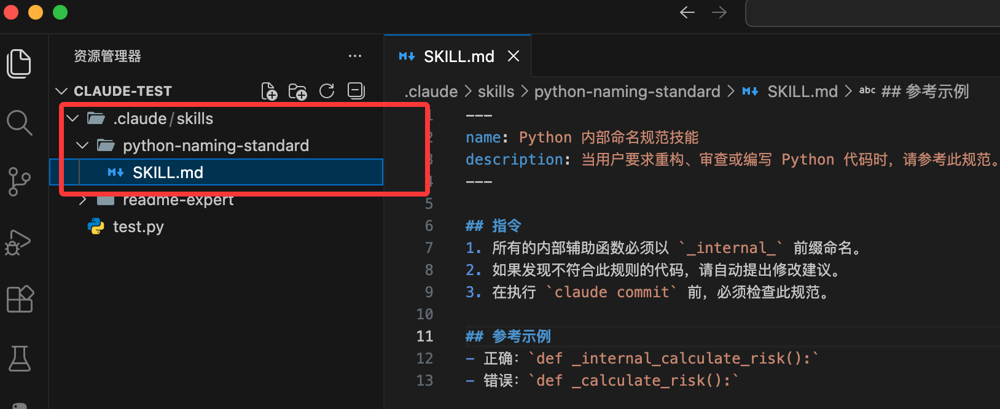

你的项目现在看起来应该是这样的：

```
my-project/
├─ src/
│  └─ test.py              # 项目源码
├─ .claude/
│  ├─ skills/
│  │  └─ hello-world/
│  │     ├─ skill.md       # Skill 定义（YAML + Instructions，机器可执行）
│  │     └─ README.md      # Skill 说明（人类阅读，可选）
│  └─ config.yml           # Claude 项目级配置（可选）
├─ .gitignore
└─ README.md               # 项目整体说明
```

接下来我们再终端执行以下命令启动 Claude Code：

```
claude
```

输入任务：

```
帮我写一个计算用户折扣的函数
```

Claude 就会会扫描已安装的 Skills，发现你的请求涉及 "Python 代码编写"，匹配了 python-naming-standard。


它会根据 SKILL.md 中的要求，生成如下代码：

```
def _internal_get_discount(user_score):
    # 计算逻辑...
    return discount
```

### 添加资源文件（可选）

另外我们可以在 **.claude/skills/** 下添加以下目录：

在同一文件夹添加：

- `examples/`：存放示例文件。
- `references/`：存放参考文档。
- `scripts/`：存放可执行脚本（例如 Python 处理 PDF）。

然后在 SKILL.md 中引用：

```
查看示例 commit：./examples/good-commit.txt
运行脚本：使用工具执行 ./scripts/process.py
```

------

## 官方市场

除了自己编写，你还可以利用 2025 年末发布的 Agent Skills 开放标准：

- 官方市场：访问 https://github.com/anthropics/skills 仓库下载预设的技能（如：React 优化器、SQL 调优工具）。
- Skill Creator：你可以对 Claude 说："帮我把我刚才教你的关于 Docker 的配置逻辑总结成一个 Skill"，它会自动在相应目录为你生成文件。

我们可以将本仓库注册为 Claude Code 的插件市场，只需在 Claude Code 中执行以下命令：

```
/plugin marketplace add anthropics/skills
```

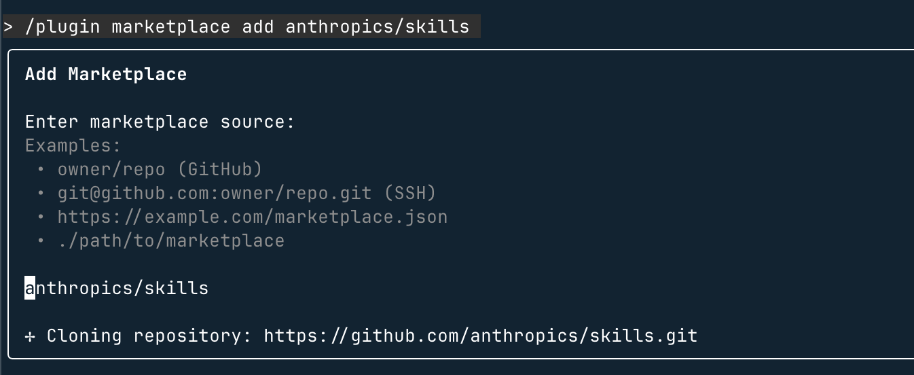

然后就可以使用 **/plugin** 查看：


**安装指定技能集的步骤：**

- 浏览并安装插件（Browse and install plugins）

- 选择 anthropic-agent-skills 插件源

- 选择 document-skills（文档技能） 或 example-skills（示例技能）

  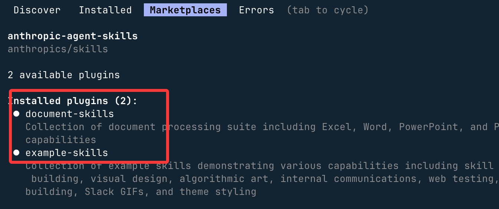

- 点击立即安装（Install now）

  

我们也可直接通过命令安装上述两类插件：

```
/plugin install document-skills@anthropic-agent-skills
/plugin install example-skills@anthropic-agent-skills
```

**注意：**使用插件安装的 skills 目录在 **～/claude/plugins/marketplaces/** 下。

插件安装完成后，需要重启一下 Claude Code。

使用的时候只需在指令中提及技能名称即可调用，例如安装 document-skills 插件后，可向 Claude Code 下达指令：

```
使用 PDF 技能提取 path/to/some-file.pdf 文件中的表单字段
```

或者创建一个 PPT：

```
创建一个 Agent Skill 的演示文稿
```

可以看到，调用了 **/document-skills:pptx**：

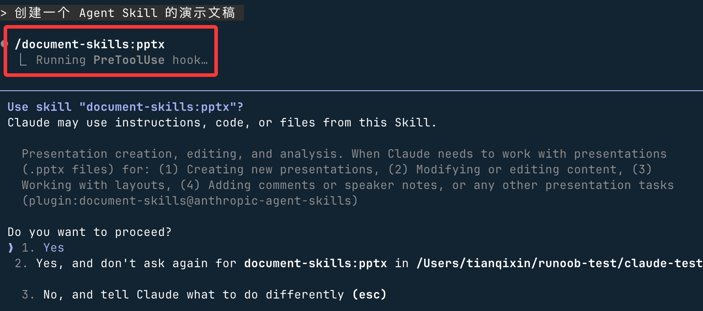

开始生成：


之后就会告诉你生成的文件位置：


# SKILL.md 文件

SKILL.md 是 Agent Skills 的核心文件。

本节将深入讲解 SKILL.md 的完整结构和所有可用字段。

------

## 基本结构

一个 SKILL.md 文件包含两个主要部分：

1. YAML Frontmatter（元数据区域）
2. Markdown 内容（指令区域）

**完整示例**

```markdown
---
name: my-skill
description: 技能描述，告诉我们什么时候使用这个技能
license: Apache-2.0
compatibility: 需要 Python 3.10+
metadata:
  author: your-name
  version: "1.0"
---

# 技能名称

这里是技能的详细指令...

## 第一步

具体的操作步骤...

## 第二步

更多操作步骤...
```


------

## 元数据字段详解

以下是 SKILL.md 支持的所有元数据字段：

| 字段          | 必需 | 约束                                                         |
| :------------ | :--- | :----------------------------------------------------------- |
| name          | 是   | 最多 64 字符，只能使用小写字母、数字和连字符，不能以连字符开头或结尾 |
| description   | 是   | 最多 1024 字符，描述技能的功能和使用场景                     |
| license       | 否   | 许可证名称或指向 bundled 许可证文件的引用                    |
| compatibility | 否   | 最多 500 字符，说明环境要求（目标产品、系统包、网络访问等）  |
| metadata      | 否   | 任意键值对，用于存储额外元数据                               |
| allowed-tools | 否   | 空格分隔的预批准工具列表（实验性功能）                       |

------

## name 字段详解

name 字段是技能的标识符，必须遵循以下规则：

- 长度：1-64 个字符
- 字符限制：只能使用 Unicode 小写字母（a-z）和连字符（-）
- 开头结尾：不能以连字符开头或结尾
- 连续字符：不能包含连续连字符（--）
- 匹配要求：必须与父目录名称一致

有效示例:

```
name: pdf-processing
name: data-analysis
name: code-review
```

无效示例:

```
name: PDF-Processing   # 错误：不能使用大写字母
name: -pdf           # 错误：不能以连字符开头
name: pdf--processing  # 错误：不能包含连续连字符
```

------

## description 字段详解

description 字段是最重要的字段之一，它告诉代理什么时候应该激活这个技能。

一个好的描述应该：

- 描述技能的功能（做什么）
- 说明使用场景（什么时候用）
- 包含关键词，帮助代理识别相关任务

好的描述示例:

```
description: 从 PDF 文件中提取文本和表格，填写 PDF 表单，合并多个 PDF。处理 PDF 文档或用户提及 PDF、表单或文档提取时使用。
```

不好的描述示例:

```
description: 帮助处理 PDF 文件。  # 太笼统，代理无法判断何时使用
```

> 提示：description 字段会在对话开始时被加载。请确保它包含足够的关键词，以便代理能够正确识别何时需要激活该技能。

------

## license 字段详解

license 字段用于指定技能的许可证。这是可选字段。

```
license: Apache-2.0
# 或者引用 bundled 的许可证文件
license: Proprietary. LICENSE.txt has complete terms
```

------

## compatibility 字段详解

compatibility 字段用于说明技能的环境要求。只有当技能有特殊的环境要求时才需要添加。

```
# 指定目标产品
compatibility: Designed for Claude Code

# 指定系统依赖
compatibility: Requires git, docker, jq, and access to the internet

# 指定编程语言版本
compatibility: Requires Python 3.14+ and uv
```

> 注意：大多数技能不需要 compatibility 字段。只有当技能确实有特定的环境要求时才添加。

------

## metadata 字段详解

metadata 字段可以存储任意的键值对信息。客户端可以使用它来存储规范中未定义的额外属性。

```
metadata:
  author: example-org
  version: "1.0"
  tags:
    - pdf
    - document
    - extraction
```

> 提示：建议使用相对独特的键名，以避免与其他技能发生冲突。

------

## allowed-tools 字段详解

allowed-tools 是一个实验性字段，用于指定技能可以使用的预批准工具。

```
allowed-tools: Bash(git:*) Bash(jq:*) Read
```

> 注意：这是一个实验性功能，不同的代理实现可能支持程度不同。

------

## 指令区域详解

元数据区域之后的 Markdown 内容是技能的指令部分。这里没有格式限制，你可以根据需要编写任何内容。

建议包含以下内容：

- 分步操作说明
- 输入输出示例
- 常见边界情况处理

```
# 技能名称

## 功能说明

简要描述这个技能做什么。

## 操作步骤

1. 第一步：执行某个操作
2. 第二步：执行另一个操作
3. 第三步：完成最终操作

## 示例

### 输入示例
描述输入是什么...

### 输出示例
描述输出是什么...

## 注意事项

- 注意点 1
- 注意点 2
```

> 注意：一旦技能被激活，整个 SKILL.md 文件会被加载到上下文中。建议将主要指令保持在 500 行以内、5000 tokens 以下。将详细的参考材料移到单独的文件中。

# Skills 脚本扩展

除了在 SKILL.md 中编写指令外，你还可以通过 scripts 目录为技能添加可执行代码。

本节将教你如何使用脚本来扩展技能的功能。

------

## 为什么使用脚本

使用脚本可以：

- 封装复杂的逻辑，避免在 SKILL.md 中写大量代码
- 提供经过测试的可靠实现
- 让代理可以重复使用相同的工具和函数
- 处理更复杂的输入输出操作

> 提示：当你在多次执行中发现代理重复实现相同逻辑时，这往往是创建脚本的好时机。

------

## 脚本目录结构

脚本应该放在技能目录的 scripts/ 子目录下：

**目录结构**

```
my-skill/
├── SKILL.md
└── scripts/
    ├── script1.py
    ├── script2.sh
    └── helper.js
```


------

## 脚本编写规范

### 1. 自包含性

脚本应该尽量自包含，或者清楚地记录依赖关系。

**自包含脚本示例**

```
#!/usr/bin/env python3
"""
PDF 文本提取脚本

依赖：pip install pdfplumber
运行：python scripts/extract_pdf.py input.pdf
"""

import sys
import pdfplumber

def extract_text_from_pdf(pdf_path):
    """从 PDF 文件提取文本"""
    with pdfplumber.open(pdf_path) as pdf:
        text = ""
        for page in pdf.pages:
            text += page.extract_text() or ""
    return text

if __name__ == "__main__":
    if len(sys.argv) < 2:
        print("用法: python extract_pdf.py <pdf 文件>")
        sys.exit(1)

    pdf_path = sys.argv[1]
    text = extract_text_from_pdf(pdf_path)
    print(text)
```


### 2. 清晰的错误处理

脚本应该提供有用的错误信息，帮助代理理解出了什么问题。

**错误处理示例**

```
import sys

def main():
    if len(sys.argv) < 2:
        print("错误：缺少必需的参数", file=sys.stderr)
        print("用法: python script.py <输入文件> [输出文件]", file=sys.stderr)
        sys.exit(1)

    input_file = sys.argv[1]

    try:
        # 执行主要逻辑
        process_file(input_file)
    except FileNotFoundError:
        print(f"错误：找不到文件 {input_file}", file=sys.stderr)
        sys.exit(1)
    except PermissionError:
        print(f"错误：没有权限读取文件 {input_file}", file=sys.stderr)
        sys.exit(1)
    except Exception as e:
        print(f"错误：处理文件时发生未知错误: {e}", file=sys.stderr)
        sys.exit(1)

if __name__ == "__main__":
    main()
```


### 3. 处理边界情况

脚本应该优雅地处理各种边界情况，而不是崩溃。

**边界情况处理示例**

```
def validate_input(text):
    """验证输入是否有效"""
    if not text:
        return False, "输入不能为空"

    if len(text) > 10000:
        return False, "输入长度超过限制（最大 10000 字符）"

    return True, ""

# 使用验证
is_valid, error_msg = validate_input(user_input)
if not is_valid:
    print(f"验证失败: {error_msg}")
    sys.exit(1)
```


------

## 在 SKILL.md 中引用脚本

当技能需要执行脚本时，在 SKILL.md 中说明如何调用它。

引用脚本:

````
## PDF 文本提取

使用脚本提取 PDF 中的文本：

```bash
python scripts/extract_pdf.py input.pdf
```

脚本会从 input.pdf 提取所有文本并输出到标准输出。

如果需要将结果保存到文件：

```bash
python scripts/extract_pdf.py input.pdf > output.txt
```
````

> 注意：引用脚本时使用相对于技能根目录的路径。

------

## 支持的脚本语言

支持的脚本语言取决于你使用的代理实现。常见的选项包括：

| 语言       | 说明                             |
| :--------- | :------------------------------- |
| Python     | 最常用的选择，功能强大且易于编写 |
| Bash       | 适合系统操作和命令行工具         |
| JavaScript | 适合 Web 相关的任务              |

> 提示：在选择脚本语言时，考虑目标用户的运行环境。如果不确定，Python 是最安全的选择。

------

## 完整示例：PDF 处理技能

让我们看一个完整的示例，展示如何结合 SKILL.md 和脚本：

**技能结构**

```
pdf-tool/
├── SKILL.md
└── scripts/
    ├── extract.py
    ├── fill_form.py
    └── merge.py
```

SKILL.md 内容:

````
---
name: pdf-tool
description: 处理 PDF 文件，包括提取文本、填写表单、合并文件。使用场景：处理 PDF、提取文本、填写表单、合并 PDF。
---

## 提取 PDF 文本

从 PDF 文件中提取文本内容：

```bash
python scripts/extract.py input.pdf
```

输出是提取的纯文本内容。

## 填写 PDF 表单

使用 JSON 数据填写 PDF 表单：

```bash
python scripts/fill_form.py input.pdf data.json output.pdf
```

data.json 格式：
```json
{
  "field_name": "字段值",
  "another_field": "另一个值"
}
```

## 合并 PDF

将多个 PDF 文件合并为一个：

```bash
python scripts/merge.py output.pdf input1.pdf input2.pdf input3.pdf
```

## 依赖安装

需要安装 pdfplumber 和 PyPDF2：

```bash
pip install pdfplumber PyPDF2
```
````

------

## 两种使用方式

在 Skill 中使用代码有两种方式：

| 方式           | 适用场景                         | 是否需要 scripts/ 目录 |
| :------------- | :------------------------------- | :--------------------- |
| **一次性命令** | 只需调用现有工具，无需自定义逻辑 | 不需要                 |
| **自包含脚本** | 需要复用的复杂逻辑               | 需要                   |

------

## 一次性命令

当现有的包管理器工具已经能满足需求时，直接在 SKILL.md 的指令中引用即可，无需创建 scripts/ 目录。

以下是各语言生态的常用运行方式：

### uvx（Python）

uvx 是 uv 自带的工具运行命令，会在隔离环境中运行 Python 包，且缓存积极，重复运行几乎瞬间完成。

**示例**

```
# 运行指定版本的 ruff 检查代码
uvx ruff@0.8.0 check .

# 运行指定版本的 black 格式化代码
uvx black@24.10.0 .
```


### pipx（Python）

pipx 是 uvx 的成熟替代方案，可通过系统包管理器安装（如 `brew install pipx`）。

**示例**

```
# 运行指定版本的 black
pipx run 'black==24.10.0' .

# 运行指定版本的 ruff
pipx run 'ruff@0.8.0' check .
```


### npx（Node.js）

npx 随 npm 自带，按需下载并运行 npm 包。

**示例**

```
# 运行 ESLint 检查
npx eslint@9 --fix .

# 使用 Vite 创建项目
npx create-vite@6 my-app
```


### go run（Go）

Go 自带的工具运行命令，直接编译并运行远程包。

**示例**

```
# 运行 goimports 格式化导入
go run golang.org/x/tools/cmd/goimports@v0.28.0 .

# 运行 golangci-lint 检查
go run github.com/golangci/golangci-lint/cmd/golangci-lint@v1.62.0 run
```


> 编写一次性命令的建议：固定版本号（如 `npx eslint@9.0.0`）以确保行为一致；在 SKILL.md 中声明前置条件（如"需要 Node.js 18+"）；当命令变得复杂时，应将其提取到 scripts/ 目录。

------

## 在 SKILL.md 中引用脚本

使用从 Skill 目录根开始的 **相对路径** 来引用打包的文件。

Agent 会自动解析这些路径，无需使用绝对路径。

首先在 SKILL.md 中列出可用脚本：

**示例**

```
## 可用脚本

- `scripts/validate.sh` — 验证配置文件
- `scripts/process.py` — 处理输入数据
- `scripts/report.py` — 生成分析报告
```


然后在操作步骤中引用它们：

**示例**

```
## 操作流程

1. 运行验证脚本：
   bash scripts/validate.sh "$INPUT_FILE"

2. 处理数据：
   python3 scripts/process.py --input results.json
```

> 脚本执行路径是相对于 Skill 目录根的，因为 Agent 会从 Skill 目录中运行命令。这在 references/*.md 等辅助文件中同样适用。

------

## 自包含脚本

当你需要可复用的逻辑时，可以将脚本打包在 `scripts/` 目录中，并在脚本内声明依赖。

Agent 只需一条命令即可运行，无需额外的安装步骤。

**Python 自包含脚本（PEP 723）**

```
# /// script
# dependencies = [
#   "beautifulsoup4",
# ]
# ///

from bs4 import BeautifulSoup

# 示例 HTML 内容
html = '<html><body><h1>Welcome</h1><p class="info">RUNOOB 测试</p></body></html>'

# 使用 BeautifulSoup 解析 HTML
soup = BeautifulSoup(html, "html.parser")

# 提取 class="info" 的段落文本
info_text = soup.select_one("p.info").get_text()
print(info_text)

```


运行方式：

**示例**

```
# 使用 uv 运行（推荐）
uv run scripts/extract.py

# 使用 pipx 运行
pipx run scripts/extract.py
```

### Deno 自包含脚本

Deno 通过 `npm:` 和 `jsr:` 导入说明符实现自包含：

**示例**：Deno 自包含脚本

```
#!/usr/bin/env -S deno run

import * as cheerio from "npm:cheerio@1.0.0";

const html = `<html><body><h1>Welcome</h1><p class="info">RUNOOB 测试</p></body></html>`;
const $ = cheerio.load(html);
console.log($("p.info").text());
```

**示例**

```
deno run scripts/extract.ts
```


### Bun 自包含脚本

Bun 在没有 `node_modules` 目录时会自动安装缺失的包：

**示例**：Bun 自包含脚本

```
#!/usr/bin/env bun

import * as cheerio from "cheerio@1.0.0";

const html = `<html><body><h1>Welcome</h1><p class="info">RUNOOB 测试</p></body></html>`;
const $ = cheerio.load(html);
console.log($("p.info").text());
```


**示例**

```
bun run scripts/extract.ts
```


### Ruby 自包含脚本

Ruby 使用 `bundler/inline` 在脚本中声明 gem 依赖：

**示例**：Ruby 自包含脚本

```
require 'bundler/inline'

gemfile do
  source 'https://rubygems.org'
  gem 'nokogiri'
end

html = '<html><body><h1>Welcome</h1><p class="info">RUNOOB 测试</p></body></html>'
doc = Nokogiri::HTML(html)
puts doc.at_css('p.info').text
```


**示例**

```
ruby scripts/extract.rb
```


------

## 为 Agent 设计脚本的要点

Agent 通过读取 stdout 和 stderr 来决定下一步操作，脚本的设计要考虑 Agent 的使用特点。

### 避免交互式提示

这是硬性要求。Agent 在非交互式 Shell 中运行，无法响应 TTY 提示、密码对话框或确认菜单。

所有输入应通过命令行参数、环境变量或 stdin 传入。

**示例**：错误做法 vs 正确做法

```
# 错误：会卡住等待输入
$ python scripts/deploy.py
Target environment: _

# 正确：清晰的错误信息和引导
$ python scripts/deploy.py
Error: --env is required. Options: development, staging, production.
Usage: python scripts/deploy.py --env staging --tag v1.2.3
```


### 提供 --help 文档

`--help` 输出是 Agent 了解脚本接口的主要方式。

包含简要说明、可用参数和使用示例：

**示例**：良好的 --help 输出

```
Usage: scripts/process.py [OPTIONS] INPUT_FILE

处理输入数据并生成摘要报告。

Options:
  --format FORMAT    输出格式: json, csv, table (默认: json)
  --output FILE      将输出写入文件而非 stdout
  --verbose          在 stderr 中打印进度信息

Examples:
  scripts/process.py data.csv
  scripts/process.py --format csv --output report.csv data.csv
```


### 编写有用的错误信息

Agent 看到错误信息后会据此调整策略，信息越具体，Agent 越容易自我纠正。

**示例**

```
# 不好的错误信息
Error: invalid input

# 好的错误信息
Error: --format must be one of: json, csv, table.
       Received: "xml"
```


### 使用结构化输出

优先使用 JSON、CSV、TSV 等结构化格式输出，而非自由文本。

结构化格式可同时被 Agent 和标准工具（jq、cut、awk）消费，方便组合使用。

**示例**

```
# 不推荐：对齐文本，难以程序化解析
NAME          STATUS    CREATED
my-service    running   2025-01-15

# 推荐：JSON 格式，字段边界清晰
{"name": "my-service", "status": "running", "created": "2025-01-15"}
```


> 将结构化数据输出到 stdout，将进度消息和诊断信息输出到 stderr。这样 Agent 可以获取干净的、可解析的输出，同时需要时也能查看诊断信息。

------

## 更多脚本设计建议

| 建议                 | 说明                                                         |
| :------------------- | :----------------------------------------------------------- |
| **幂等性**           | Agent 可能重试命令。"不存在则创建"比"创建并在重复时报错"更安全 |
| **输入约束**         | 用清晰的错误拒绝模糊输入，而非猜测用户意图                   |
| **Dry-run 支持**     | 对于破坏性或有状态操作，提供 `--dry-run` 标志让 Agent 预览操作 |
| **有意义的退出码**   | 不同失败类型使用不同退出码（未找到、参数无效、认证失败等）   |
| **可预测的输出大小** | 默认输出摘要，提供 `--offset` 等参数让 Agent 按需获取更多信息 |
| **安全默认值**       | 破坏性操作应要求明确的确认标志（`--confirm`、`--force`）     |

------

## 完整的 Skill 脚本示例

下面是一个包含脚本的完整 Skill 目录结构：

**示例**

```
csv-analyzer/
├── SKILL.md              # 主指令文件
├── scripts/
│   ├── overview.py       # 数据概览脚本
│   ├── summary.py        # 统计摘要脚本
│   └── validate.py       # 数据验证脚本
├── references/
│   └── api-errors.md     # API 错误参考
└── assets/
    └── report-template.md  # 报告模板
```


对应的 SKILL.md 内容：

**示例**

```
---
name: csv-analyzer
description: >
  分析 CSV 和表格数据文件。当用户有 CSV、TSV 或 Excel 文件
  并想探索、转换或可视化数据时使用。
---

# CSV 数据分析

## 可用脚本

- **`scripts/overview.py`** — 显示数据概览（行数、列名、类型）
- **`scripts/summary.py`** — 生成统计摘要
- **`scripts/validate.py`** — 验证数据质量

## 操作流程

1. 首先运行概览脚本了解数据结构：
   uv run scripts/overview.py input.csv

2. 生成统计摘要：
   uv run scripts/summary.py input.csv --output summary.json

3. 验证数据质量：
   uv run scripts/validate.py input.csv

## 注意事项

- 大文件使用 `--chunk-size` 参数分块处理
- 中文 CSV 尝试 `--encoding gbk` 参数
```

------

## 脚本分发和依赖

如果脚本需要外部依赖，你有几个选择：

### 1. 在 SKILL.md 中说明依赖

最简单的方式是在 SKILL.md 中记录所需的依赖。

### 2. 使用虚拟环境

对于复杂的项目，可以创建一个虚拟环境。

### 3. 使用 Docker

如果需要完整的运行环境，可以使用 Docker 容器。

> 注意：确保脚本可以在目标环境中运行。在编写脚本之前，了解目标用户的运行环境。

------

## 总结

本节我们学习了如何使用脚本扩展技能功能：

- 脚本放在 scripts/ 目录下
- 脚本应该自包含、有清晰的错误处理
- 在 SKILL.md 中引用脚本时使用相对路径
- 确保脚本可以在目标环境中运行


# Skills 参数传递与接收

Skills 不像传统函数那样接收显式参数，它通过 Claude 的上下文来感知输入信息。

理解这种"隐式参数传递"机制，是写出实用 Skill 的关键。

------

## Skills 如何获取参数

当 Claude 读取一个 Skill 后，整个对话上下文就是这个 Skill 的参数。

这意味着用户说的话、上传的文件、历史对话记录，都可以成为 Skill 的输入来源。

| 输入来源     | 示例                   | 说明               |
| :----------- | :--------------------- | :----------------- |
| 用户当前消息 | "帮我处理这份 PDF"     | 最直接的输入       |
| 上传的文件   | 用户上传了 report.pdf  | 通过路径或内容传入 |
| 历史对话     | 之前讨论过的数据格式   | 上下文中可引用     |
| 系统变量     | 当前日期、工作目录路径 | Claude 自动感知    |

------

## 在 SKILL.md 中声明期望输入

SKILL.md 中可以通过自然语言描述，告诉 Claude 需要从上下文中提取哪些信息。

以下是一个处理 CSV 文件的 Skill 示例，演示如何在指令中声明输入预期：

**示例**

```
---
name: csv-analyzer
description: 分析用户上传的 CSV 文件，输出统计摘要。当用户提到 CSV、表格数据分析时触发。
---

# CSV 分析器

## 输入要求

用户应提供以下信息（从对话上下文中获取）：
- **文件路径**：已上传 CSV 文件的路径（位于 /mnt/user-data/uploads/）
- **分析目标**（可选）：用户希望了解什么，如"找出空值"、"统计分布"
- **输出格式**（可选）：表格、图表或文字摘要

若上述信息未明确，主动向用户确认后再执行。
```


> Skill 中的"输入要求"是写给 Claude 自己看的。Claude 会根据这份说明，主动从上下文中提取信息，或在信息不足时向用户追问。

------

## 通过脚本接收结构化参数

当 Skill 附带 Python 或 Shell 脚本时，参数通过命令行参数或标准输入传递。

这与普通脚本的参数处理方式完全一致。

**示例**

```
# 文件路径：scripts/analyze.py
import argparse
import pandas as pd

def main():
    # 定义命令行参数
​    parser = argparse.ArgumentParser(description="CSV 文件分析脚本")
​    parser.add_argument("file",        help="必填：CSV 文件路径")
​    parser.add_argument("--col",       help="可选：指定分析的列名")
​    parser.add_argument("--limit", type=int, default=10,
​                        help="可选：最多显示的行数，默认 10")
​    args = parser.parse_args()

    # 读取文件
    df = pd.read_csv(args.file)
    
    # 按需筛选列
    if args.col:
        df = df[[args.col]]
    
    # 输出统计信息
    print(df.head(args.limit).to_string())
    print("\n--- 统计摘要 ---")
    print(df.describe())

if __name__ == "__main__":
    main()
```


Claude 在 SKILL.md 中调用该脚本的写法：

**示例**

```
## 执行分析

获取文件路径后，运行以下命令：  
python scripts/analyze.py <文件路径> [--col <列名>] [--limit <行数>]

将命令行输出展示给用户，并提供文字解读。
```


------

## 文件路径参数的处理规范

用户上传的文件统一位于 **/mnt/user-data/uploads/** 路径下。

在 Skill 脚本中，始终使用绝对路径访问文件，避免路径解析错误。

**示例**

```
import os

# 正确：使用绝对路径
UPLOAD_DIR = "/mnt/user-data/uploads"
file_path = os.path.join(UPLOAD_DIR, "report.csv")

# 错误：使用相对路径（会因工作目录不同而失败）
# file_path = "uploads/report.csv"

# 检查文件是否存在
if not os.path.exists(file_path):
    print(f"错误：文件不存在 → {file_path}")
    exit(1)
```


------

## 参数验证：在执行前检查输入

Skill 脚本在执行前，应始终验证关键参数是否合法。

这可以防止因参数缺失或格式错误导致的运行时崩溃。

**示例**

```python
# 文件路径：scripts/validate_input.py
import sys
import os

def validate_csv_input(file_path: str) -> bool:
    """验证 CSV 文件输入是否有效"""

    # 检查文件路径是否提供
    if not file_path:
        print("错误：未提供文件路径")
        return False

    # 检查文件是否存在
    if not os.path.exists(file_path):
        print(f"错误：文件不存在 → {file_path}")
        return False

    # 检查文件扩展名
    if not file_path.lower().endswith(".csv"):
        print(f"错误：文件类型不支持，期望 .csv，实际 → {file_path}")
        return False

    # 检查文件大小（超过 100MB 时警告）
    size_mb = os.path.getsize(file_path) / (1024 * 1024)
    if size_mb > 100:
        print(f"警告：文件较大（{size_mb:.1f} MB），处理可能较慢")

    return True

if __name__ == "__main__":
    if len(sys.argv) < 2:
        print("用法：python validate_input.py <文件路径>")
        sys.exit(1)

    ok = validate_csv_input(sys.argv[1])
    sys.exit(0 if ok else 1)
```

> 参数验证的失败信息应清晰说明期望什么和实际得到什么，方便 Claude 向用户反馈具体原因。

# Skills 错误处理与容错

一个只能在理想情况下运行的 Skill 是脆弱的。

健壮的 Skill 需要预见常见错误，给出清晰的反馈，并尽可能自动恢复。

------

## 错误处理的三个层次

| 层次         | 发生位置   | 处理方式                                   |
| :----------- | :--------- | :----------------------------------------- |
| 输入验证错误 | 执行前     | 检查输入，若不合法直接拒绝并说明原因       |
| 运行时错误   | 脚本执行中 | 捕获异常，输出结构化错误信息               |
| 结果异常     | 执行完成后 | 验证输出是否符合预期，若不符合触发补救流程 |

------

## 在 SKILL.md 中定义错误处理策略

SKILL.md 中应当包含一个明确的错误处理章节，告诉 Claude 遇到问题时该怎么做。

**实例**

```
## 错误处理

### 输入问题
- 文件不存在：告知用户文件路径有误，请重新上传
- 文件格式不支持：列出支持的格式（pdf、docx、txt），请用户转换后重试
- 文件为空：告知文件内容为空，无法处理

### 执行问题
- 脚本运行失败：将完整错误信息展示给用户，不要隐藏
- 依赖未安装：先尝试自动安装（pip install），若失败则告知用户手动安装
- 超时：若超过 60 秒未完成，输出当前进度并询问用户是否继续等待

### 结果问题
- 输出文件为空：重新检查处理逻辑，向用户说明可能原因
- 输出格式不符合预期：展示实际输出，询问用户是否满意
```


------

## 脚本中的标准错误处理模式

Python 脚本应使用 try-except 结构，并统一返回包含 status 字段的 JSON。

**实例**

```
# 文件路径：scripts/error_handling_demo.py
import json
import sys
import os

class SkillError(Exception):
    """Skill 自定义异常基类"""
    def __init__(self, message: str, code: str):
        self.message = message
        self.code    = code     # 错误码，便于程序判断错误类型
        super().__init__(message)

class InputError(SkillError):
    """输入验证错误"""
    pass

class ProcessError(SkillError):
    """处理过程错误"""
    pass

def validate_input(file_path: str) -> None:
    """验证输入，出错时抛出 InputError"""
    if not file_path:
        raise InputError("未提供文件路径", "MISSING_FILE")
    if not os.path.exists(file_path):
        raise InputError(f"文件不存在：{file_path}", "FILE_NOT_FOUND")
    if os.path.getsize(file_path) == 0:
        raise InputError(f"文件内容为空：{file_path}", "EMPTY_FILE")

def process(file_path: str) -> dict:
    """主处理逻辑"""
    try:
        validate_input(file_path)

        with open(file_path, "r", encoding="utf-8") as f:
            content = f.read()

        # 实际处理逻辑（此处简化为行数统计）
        lines = content.split("\n")
        return {
            "status": "success",
            "data": {
                "file":  file_path,
                "lines": len(lines),
                "chars": len(content)
            }
        }

    except InputError as e:
        # 输入错误：用户可以修正后重试
        return {
            "status":  "input_error",
            "code":    e.code,
            "message": e.message,
            "hint":    "请检查文件路径是否正确，文件是否存在且非空"
        }
    except UnicodeDecodeError:
        # 编码错误：给出具体的修复建议
        return {
            "status":  "process_error",
            "code":    "ENCODING_ERROR",
            "message": "文件编码不是 UTF-8，无法读取",
            "hint":    "请将文件另存为 UTF-8 编码后重试"
        }
    except Exception as e:
        # 未预期的错误：完整记录，便于调试
        return {
            "status":  "unexpected_error",
            "code":    "UNKNOWN",
            "message": str(e),
            "hint":    "请将上述错误信息反馈给开发者"
        }

if __name__ == "__main__":
    file_path = sys.argv[1] if len(sys.argv) > 1 else ""
    result    = process(file_path)
    print(json.dumps(result, ensure_ascii=False, indent=2))
```


```
# 文件存在时的成功输出：
{
  "status": "success",
  "data": {
    "file": "/mnt/user-data/uploads/runoob.txt",
    "lines": 128,
    "chars": 5432
  }
}

# 文件不存在时的错误输出：
{
  "status": "input_error",
  "code": "FILE_NOT_FOUND",
  "message": "文件不存在：/mnt/user-data/uploads/missing.txt",
  "hint": "请检查文件路径是否正确，文件是否存在且非空"
}
```

------

## 依赖自动安装的容错模式

当脚本依赖的 Python 包未安装时，可以在脚本中自动尝试安装。

**实例**

```
# 文件路径：scripts/auto_install_demo.py
import subprocess
import sys

def ensure_package(package_name: str, import_name: str = None) -> bool:
    """
    确保 Python 包已安装，若未安装则自动安装

    参数：
        package_name: pip 安装时使用的包名（如 "python-docx"）
        import_name:  import 时使用的名称（如 "docx"），默认与 package_name 相同
    """
    import_name = import_name or package_name
    try:
        __import__(import_name)
        return True  # 已安装
    except ImportError:
        print(f"正在安装依赖：{package_name}...")
        result = subprocess.run(
            [sys.executable, "-m", "pip", "install", package_name,
             "--break-system-packages", "--quiet"],
            capture_output=True, text=True
        )
        if result.returncode == 0:
            print(f"安装成功：{package_name}")
            return True
        else:
            print(f"安装失败：{package_name}")
            print(result.stderr)
            return False

# 使用示例：在脚本开头确保所有依赖已就绪
if not ensure_package("pandas"):
    sys.exit(1)
if not ensure_package("openpyxl"):
    sys.exit(1)

# 依赖就绪后，正常 import
import pandas as pd
print("所有依赖已就绪，开始执行...")
```


> 自动安装只适用于开发和轻量级场景。在生产环境的 Skill 中，应将依赖写入文档，由用户预先安装，而不是在运行时自动安装。

------

## 错误信息的书写规范

好的错误信息能帮助用户快速定位问题，差的错误信息只会让人困惑。

| 维度     | 差的写法 | 好的写法                               |
| :------- | :------- | :------------------------------------- |
| 描述问题 | "出错了" | "文件 report.csv 不存在于上传目录"     |
| 说明原因 | （无）   | "可能是文件名拼写有误，或文件尚未上传" |
| 提供行动 | （无）   | "请重新上传文件，或检查文件名是否正确" |

**实例**

```
# 差的错误信息
raise Exception("Error")

# 好的错误信息
raise InputError(
    "文件 runoob_data.csv 未在上传目录中找到。"
    "可能原因：文件名拼写有误，或文件尚未上传。"
    "请重新上传文件后再试。",
    code="FILE_NOT_FOUND"
)
```


# Skills skill-creator 创建 Skill

skill-creator 不是一个普通 Skill，而是一个创建 Skill 的 Skill，属于典型的 Meta Skill（元技能）。

skill-creator 是 Anthropic 官方提供的 Skill 开发助手，帮助开发者创建、优化和打包技能。

skill-creator 的作用不是完成用户任务，而是帮助 AI 或开发者设计、生成、测试、优化、发布新的 Skills。

skill-creator 最初出现在 AI Agent / Claude Skills 生态中，用于标准化 Skill 的创建流程。

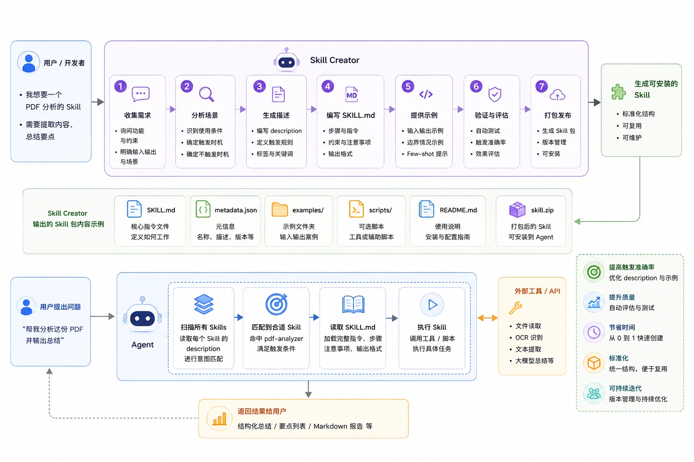

GitHub 地址：https://github.com/anthropics/skills/tree/main/skills/skill-creator

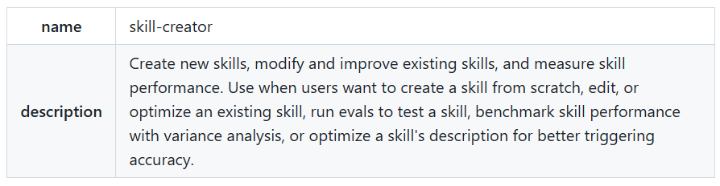

### 安装 skill-creator

首先安装 Anthropic 的 skills 集合。

```
npx skills add https://github.com/anthropics/skills --skill skill-creator
```

或者：

```
claude install anthropics/skills/skill-creator
```

安装完成后，你就可以在 Claude 中调用：

```
/skill-creator
```


skill-creator 提供完整的 Skill 开发流程工具链。

安装完成后，本地会下载该 Skill，其中包含：

```
skills/skill-creator/
├── SKILL.md          ← 核心说明文件
├── agents/           ← 内置的评审助手
├── eval-viewer/      ← 测试结果可视化工具
├── references/       ← 参考文档（数据格式说明等）
└── scripts/          ← 自动化脚本（打包、测评等）
```

Skill Creator 的工作流程可以概括为一个循环：

```
想清楚需求
    ↓
起草 SKILL.md
    ↓
设计测试用例
    ↓
运行测试（有 Skill vs 没有 Skill，对比效果）
    ↓
评估结果（看报告 + 打分）
    ↓
根据反馈修改 SKILL.md
    ↓
重复，直到满意
    ↓
打包成 .skill 文件
```

------

## 用 skill-creator 创建 Skill

### 需求询问

Claude 会先问你几个问题，帮你把需求想清楚。你不需要一次说完所有细节，像聊天一样回答就行。

**Claude 通常会问：**

1. 这个 Skill 具体做什么？
2. 什么情况下触发（用户说什么、上传什么文件）？
3. 输出是什么格式？
4. 有没有特殊要求（固定模板、特定格式规范……）？

**示例对话：**

```
你：我想做一个 Skill，把会议录音的文字稿整理成结构化的会议纪要。

Claude：好的，我来问几个问题帮你确认需求：
        1. 纪要里需要包含哪些内容？（比如：时间、参与人、决议、行动事项……）
        2. 输出格式是 Word 文档、Markdown，还是直接在对话里回复？
        3. 有没有固定的纪要模板？

你：需要包含会议主题、时间、参与人、讨论要点、决议事项、
    下一步行动（含负责人和截止日期）。
    输出 Word 文档。
    有模板，我来上传。
```


可以按 Tab 键或方向按键切换菜单详情，并提交。

这个阶段你的目标： 把所有细节和边界情况说清楚，不要跳过，后面测试时踩的坑大多源于这里没说清楚。

也可以直接回车，它也能帮我们创建：


之后 Claude 会写出 SKILL.md 草稿，大致长这样：


接下来还会创建参考文件：

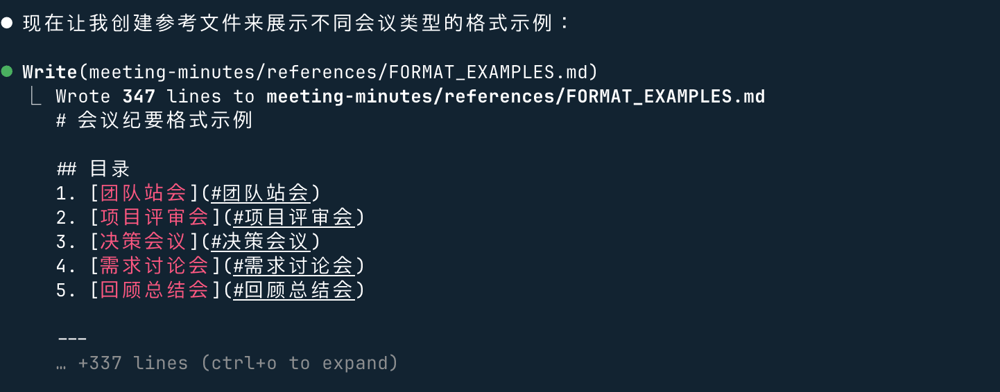

创建完成后，会验证技能结构是否正确，等待就好了。

验证通过！就会打包 Skill，并展示目录结构：


测试下，输入会议内容：

```
整理以下会议纪要：一、会议基本信息
  会议主题：学习平台内容优化会议
  参会人员：张三、李四、王五
  会议时间：2025-XX-XX 14:00-15:00
  记录人：张三
  二、会议内容
  讨论当前团队在编程教学中使用的案例素材，一致认为runoob教程简洁易懂，适合作为新手入门参考。
  确定后续内部培训将优先采用 runoob 上的基础语法、实战小案例进行讲解。
  安排李四整理 runoob 中 Python、Java 高频知识点，形成内部速查文档。
  下次会议检查文档完成情况。
  三、待办事项
  李四：整理 runoob 核心知识点文档，下周一前完成。
  全体：提前熟悉 runoob 对应章节，便于下次讨论。
```

