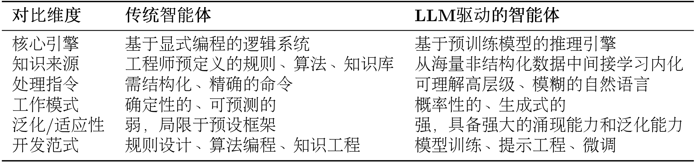
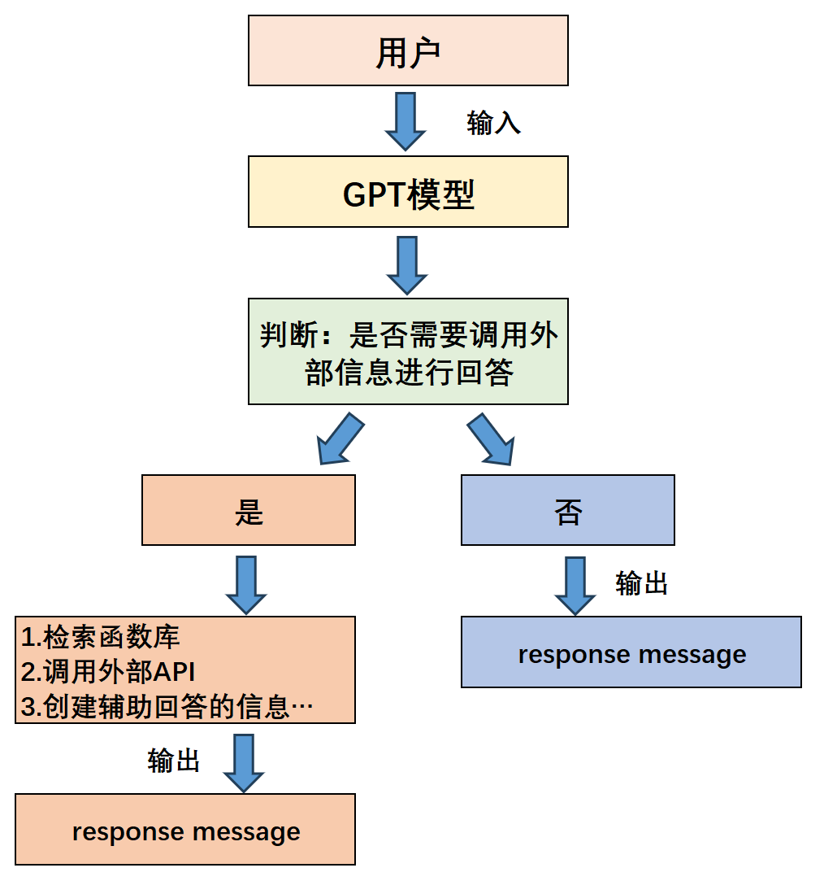
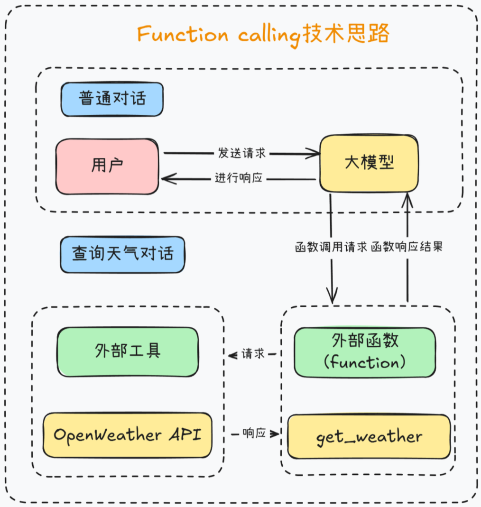
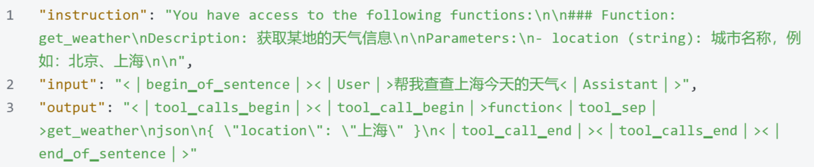
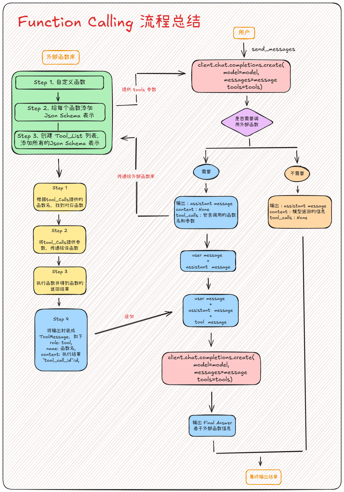
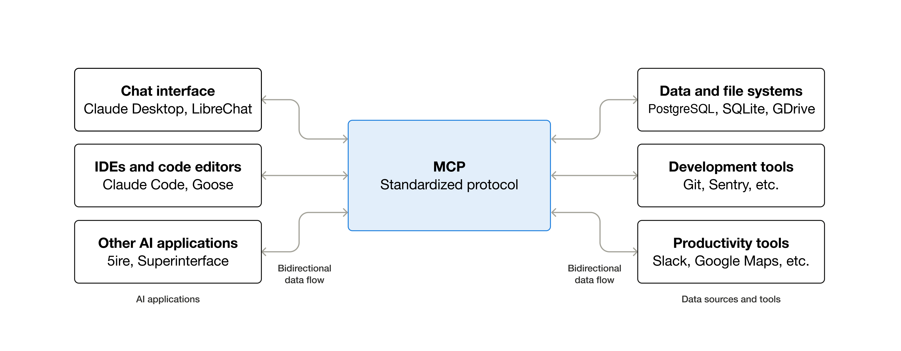
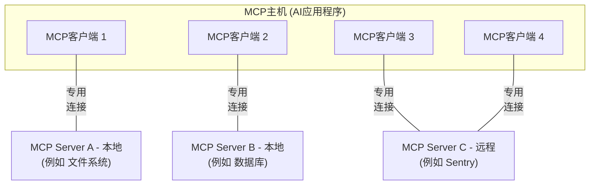
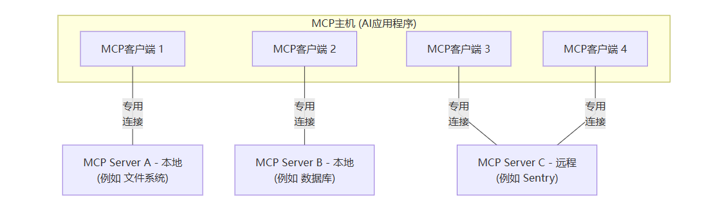
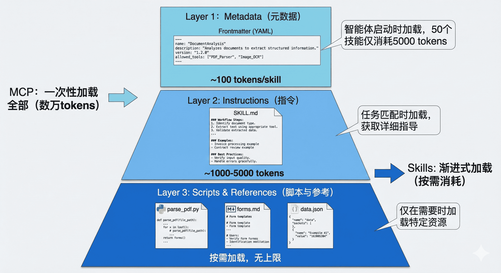

# 智能体Agent与工具的关系

[English](overview.md) | 简体中文

## 什么是智能体？

在探索任何一个复杂概念时，我们最好从一个简洁的定义开始。在人工智能领域，智能体被定义为任何能够通过<strong>传感器（Sensors）</strong>感知其所处<strong>环境（Environment）</strong>，并<strong>自主</strong>地通过<strong>执行器（Actuators）</strong>采取<strong>行动（Action）</strong>以达成特定目标的实体。

这个定义包含了智能体存在的四个基本要素。环境是智能体所处的外部世界。对于自动驾驶汽车，环境是动态变化的道路交通；对于一个交易算法，环境则是瞬息万变的金融市场。智能体并非与环境隔离，它通过其传感器持续地感知环境状态。摄像头、麦克风、雷达或各类<strong>应用程序编程接口（Application Programming Interface, API）</strong>返回的数据流，都是其感知能力的延伸。

获取信息后，智能体需要采取行动来对环境施加影响，它通过执行器来改变环境的状态。执行器可以是物理设备（如机械臂、方向盘）或虚拟工具（如执行一段代码、调用一个服务）。

然而，真正赋予智能体"智能"的，是其<strong>自主性（Autonomy）</strong>。智能体并非只是被动响应外部刺激或严格执行预设指令的程序，它能够基于其感知和内部状态进行独立决策，以达成其设计目标。这种从感知到行动的闭环，构成了所有智能体行为的基础，如图1.1所示。


## 传统视角下的智能体

人工智能的先驱们已经对“智能体”这一概念进行了数十年的探索与构建。这些如今我们称之为“传统智能体”的范式，并非单一的静态概念，而是经历了一条从简单到复杂、从被动反应到主动学习的清晰演进路线。

这个演进的起点，是那些结构最简单的<strong>反射智能体（Simple Reflex Agent）</strong>。它们的决策核心由工程师明确设计的“条件-动作”规则构成，如图所示。经典的自动恒温器便是如此：若传感器感知的室温高于设定值，则启动制冷系统。

这种智能体完全依赖于当前的感知输入，不具备记忆或预测能力。它像一种数字化的本能，可靠且高效，但也因此无法应对需要理解上下文的复杂任务。它的局限性引出了一个关键问题：如果环境的当前状态不足以作为决策的全部依据，智能体该怎么办？

<div align="center">
  
</div>


## 大语言模型驱动的新范式

以<strong>GPT（Generative Pre-trained Transformer）</strong>为代表的大语言模型的出现，正在显著改变智能体的构建方法与能力边界。由大语言模型驱动的LLM智能体，其核心决策机制与传统智能体存在本质区别，从而赋予了其一系列全新的特性。

这种转变，可以从两者在核心引擎、知识来源、交互方式等多个维度的对比中清晰地看出，如表所示。简而言之，传统智能体的能力源于工程师的显式编程与知识构建，其行为模式是确定且有边界的；而LLM智能体则通过在海量数据上的预训练，获得了隐式的世界模型与强大的涌现能力，使其能够以更灵活、更通用的方式应对复杂任务。

<div align="center">
  <p>表 传统智能体与LLM驱动智能体的核心对比</p>
  
</div>

这种差异使得LLM智能体可以直接处理高层级、模糊且充满上下文信息的自然语言指令。让我们以一个“智能旅行助手”为例来说明。

在LLM智能体出现之前，规划旅行通常意味着用户需要在多个专用应用（如天气、地图、预订网站）之间手动切换，并由用户自己扮演信息整合与决策的角色。而一个LLM智能体则能将这个流程整合起来。当接收到“规划一次厦门之旅”这样的模糊指令时，它的工作方式体现了以下几点：

- <strong>规划与推理</strong>：智能体首先会将这个高层级目标分解为一系列逻辑子任务，例如：`[确认出行偏好] -> [查询目的地信息] -> [制定行程草案] -> [预订票务住宿]`。这是一个内在的、由模型驱动的规划过程。
- <strong>工具使用</strong>：在执行规划时，智能体识别到信息缺口，会主动调用外部工具来补全。例如，它会调用天气查询接口获取实时天气，并基于“预报有雨”这一信息，在后续规划中倾向于推荐室内活动。
- <strong>动态修正</strong>：在交互过程中，智能体会将用户的反馈（如“这家酒店超出预算”）视为新的约束，并据此调整后续的行动，重新搜索并推荐符合新要求的选项。整个“<strong>查天气 → 调行程 → 订酒店</strong>”的流程，展现了其根据上下文动态修正自身行为的能力。

总而言之，我们正从开发专用自动化工具转向构建能自主解决问题的系统。核心不再是编写代码，而是引导一个通用的“大脑”去规划、行动和学习。

# Function Calling

## FC功能简介

尽管大语言模型的知识储量巨大，且具备非常强大的涌现能力，但很多时候我们实际使用大语言模型时仍然会明显的感受到模型能力上的局限，例如模型无法获取最新的信息、模型只能给出文字的建议但无法直接帮我们解决某些问题（如自动回复邮件、自动查询订阅机票等）。

在2023年4月，AutoGPT项目的横空出世则为这些解决问题提出了一个极具潜力的方案——那就是进一步赋予大语言模型调用外部工具API的能力，从而大幅拓展大语言模型的能力。

在这一基本背景下，经过数月的研发和优化，OpenAI在2023.0613的更新中为Chat类模型增加了Function Calling功能，  
（Function Calling最早由OpenAI与2023年6月13号正式提出，该项技术的名字也由此命名：https://openai.com/index/function-calling-and-other-api-updates/ ）

Function Calling功能功能的本质是让大语言模型调用外部函数的能力，即Chat模型可以不再仅仅根据自身的数据库知识进行回答，而是可以额外挂载一个函数库，然后根据用户提问进行函数库检索，根据实际需求调用外部函数并获取函数运行结果，再基于函数运行结果进行回答。

毫无疑问，Function Calling的诞生意义重大，这项技术目前也成为大模型调用外部工具的基本技术范式，哪怕是MCP盛行的今天，底层仍然是Function Calling执行流程。

其基本过程如下：



例如一个典型的Function Calling示例，我们希望让大模型能够调用一些天气API查询即时天气，此时我们就需要创建一个查询天气的外部函数，负责调用天气API来查询天气，同时将外部函数的说明传递给大模型，使其能够根据用户意图，在必要的时候向外部函数发起调用请求。



## 模型如何具备FC能力

答案是通过模型训练。对于DeepSeek-V3模型来说，由于在训练阶段（指令微调阶段）就带入了大量的类似如下的工具调用对话数据进行训练，因此能够识别外部工具并发起对外部工具调用的请求。而类似的，R1模型的训练过程没有工具调用数据，因此就不具备Function Calling能力。




## Function Calling 流程总结




# 什么是模型上下文协议（MCP）？

MCP（Model Context Protocol，模型上下文协议）是一个用于将AI应用程序连接到外部系统的开源标准。

使用MCP，像Claude或ChatGPT这样的AI应用程序可以连接到数据源（例如本地文件、数据库）、工具（例如搜索引擎、计算器）和工作流（例如专用提示词）——使它们能够访问关键信息并执行任务。

将MCP想象成AI应用程序的USB-C端口。正如USB-C提供了一种连接电子设备的标准化方式，MCP提供了一种将AI应用程序连接到外部系统的标准化方式。



## MCP能实现什么？

* 智能体可以访问您的Google日历和Notion，充当更加个性化的AI助手。
* Claude Code可以使用Figma设计生成整个Web应用程序。
* 企业聊天机器人可以连接到组织内的多个数据库，使用户能够通过聊天分析数据。
* AI模型可以在Blender上创建3D设计，并使用3D打印机打印出来。

## 为什么MCP很重要？

根据您在生态系统中的位置，MCP可以带来一系列好处。

* **开发者**：MCP减少了构建或与AI应用程序或智能体集成时的开发时间和复杂性。
* **AI应用程序或智能体**：MCP提供对数据源、工具和应用程序生态系统的访问，这将增强能力并改善最终用户体验。
* **最终用户**：MCP带来更有能力的AI应用程序或智能体，它们可以在必要时访问您的数据并代表您采取行动。

## 广泛的生态系统支持

MCP是一个开放协议，在各种客户端和Server中得到广泛支持。像[Claude](https://claude.com/docs/connectors/building)和[ChatGPT](https://developers.openai.com/api/docs/mcp/)、开发工具如[Visual Studio Code](https://code.visualstudio.com/docs/copilot/chat/mcp-servers)、[Cursor](https://cursor.com/docs/context/mcp)、[MCPJam](https://docs.mcpjam.com/getting-started)以及[许多其他工具](https://modelcontextprotocol.io/clients)都支持MCP——使您能够一次构建，随处集成。


# MCP架构

本模型上下文协议（MCP）概述讨论其[范围](#范围)和[核心概念](#mcp的概念)，并提供一个[示例](#示例)演示每个核心概念。

由于MCP SDK抽象了许多关注点，大多数开发者可能会发现[数据层协议](#数据层协议)部分最有用。它讨论了MCP Server如何向AI应用程序提供上下文。

有关具体的实现细节，请参阅您的[语言特定SDK](https://modelcontextprotocol.io/docs/sdk)文档。

## 范围

模型上下文协议包括以下项目：

* [MCP规范](https://modelcontextprotocol.io/specification/latest)：MCP的规范，概述了客户端和Server的实现要求。

* [MCP SDK](https://modelcontextprotocol.io/docs/sdk)：实现MCP的不同编程语言的SDK。

* **MCP开发工具**：用于开发MCP Server和客户端的工具，包括[MCP Inspector](https://github.com/modelcontextprotocol/inspector)

* [MCP参考Server实现](https://github.com/modelcontextprotocol/servers)：MCP Server的参考实现。

MCP仅专注于上下文交换的协议——它不规定AI应用程序如何使用LLM或管理提供的上下文。


## MCP的概念

### 客户端-Server架构

MCP遵循客户端-Server架构，其中MCP主机——一个AI应用程序，如[Claude Code](https://www.anthropic.com/claude-code)或[Claude Desktop](https://www.claude.ai/download)——建立一个或多个MCP Server的连接。MCP主机通过为每个MCP Server创建一个MCP客户端来完成此操作。每个MCP客户端与其对应的MCP Server保持专用连接。

使用STDIO传输的本地MCP Server通常服务于单个MCP客户端，而使用Streamable HTTP传输的远程MCP Server通常服务于多个MCP客户端。

MCP架构中的关键参与者是：

* **MCP主机**：协调和管理一个或多个MCP客户端的AI应用程序
* **MCP客户端**：维护与MCP Server的连接并从MCP Server获取上下文供MCP主机使用的组件
* **MCP Server**：向MCP客户端提供上下文的程序

**例如**：Visual Studio Code充当MCP主机。当Visual Studio Code建立与MCP Server的连接时，例如[Sentry MCP Server](https://docs.sentry.io/product/sentry-mcp/)，Visual Studio Code运行时会实例化一个MCP客户端对象，该对象维护与Sentry MCP Server的连接。当Visual Studio Code随后连接到另一个MCP Server时，例如[本地文件系统Server](https://github.com/modelcontextprotocol/servers/tree/main/src/filesystem)，Visual Studio Code运行时会实例化另一个MCP客户端对象来维护此连接。






注意，**MCP Server**指的是提供上下文数据的程序，无论它在哪里运行。MCP Server可以在本地或远程执行。例如，当Claude Desktop启动[文件系统Server](https://github.com/modelcontextprotocol/servers/tree/main/src/filesystem)时，Server在同一台机器上本地运行，因为它使用STDIO传输。这通常被称为"本地"MCP Server。官方[Sentry MCP Server](https://docs.sentry.io/product/sentry-mcp/)在Sentry平台上运行，并使用Streamable HTTP传输。这通常被称为"远程"MCP Server。

### 分层架构

MCP由两层组成：

* **数据层**：定义基于JSON-RPC的客户端-Server通信协议，包括生命周期管理和核心原语，如工具、资源、提示词和通知。
* **传输层**：定义支持客户端和Server之间数据交换的通信机制和通道，包括传输特定的连接建立、消息帧和授权。

从概念上讲，数据层是内层，而传输层是外层。

#### 数据层

数据层实现了基于[JSON-RPC 2.0](https://www.jsonrpc.org/)的交换协议，定义了消息结构和语义。
此层包括：

* **生命周期管理**：处理客户端和Server之间的连接初始化、能力协商和连接终止
* **Server功能**：使Server能够提供核心功能，包括用于AI操作的工具、用于上下文数据的资源以及用于与客户端交互模板的提示词
* **客户端功能**：使Server能够要求客户端从主机LLM采样、向用户获取输入以及向客户端发送日志消息
* **实用功能**：支持附加功能，如实时更新的通知和长时运行操作的进度跟踪

#### 传输层

传输层管理客户端和Server之间的通信通道和身份验证。它处理连接建立、消息帧和MCP参与者之间的安全通信。

MCP支持两种传输机制：

* **Stdio传输**：使用标准输入/输出流进行同一机器上本地进程之间的直接进程通信，提供最佳性能，无网络开销。
* **Streamable HTTP传输**：使用HTTP POST进行客户端到Server的消息传输，可选地支持Server-Sent Events进行流式传输。此传输支持远程Server通信，并支持标准HTTP身份验证方法，包括bearer令牌、API密钥和自定义标头。MCP建议使用OAuth获取身份验证令牌。

传输层从协议层抽象通信细节，在所有传输机制中实现相同的JSON-RPC 2.0消息格式。

### 数据层协议

MCP的核心部分是定义MCP客户端和MCP Server之间的模式和语义。开发者可能会发现数据层——特别是[原语](#原语)集——是MCP最有趣的部分。它是MCP定义开发者如何将上下文从MCP Server共享到MCP客户端的部分。

MCP使用[JSON-RPC 2.0](https://www.jsonrpc.org/)作为其底层RPC协议。客户端和Server相互发送请求并相应响应。当不需要响应时，可以使用通知。

#### 生命周期管理

MCP是一个<Tooltip tip="MCP的一个子集可以使用Streamable HTTP传输实现无状态">有状态协议</Tooltip>，需要生命周期管理。生命周期管理的目的是协商客户端和Server都支持的<Tooltip tip="客户端或Server支持的功能和操作，如工具、资源或提示词">能力</Tooltip>。详细信息可以在[规范](https://modelcontextprotocol.io/specification/latest/basic/lifecycle)中找到，[示例](#示例)展示了初始化序列。

#### 原语

MCP原语是MCP中最重要的概念。它们定义了客户端和Server可以相互提供什么。这些原语指定了可以与AI应用程序共享的上下文信息类型以及可以执行的操作范围。

MCP定义了三个核心原语，*Server*可以公开：

* **工具**：AI应用程序可以调用的可执行函数，用于执行操作（例如文件操作、API调用、数据库查询）
* **资源**：向AI应用程序提供上下文信息的数据源（例如文件内容、数据库记录、API响应）
* **提示词**：可重用模板，帮助构建与语言模型的交互（例如系统提示词、少样本示例）

每种原语类型都有相关的方法用于发现（`*/list`）、检索（`*/get`），在某些情况下还有执行（`tools/call`）。
MCP客户端将使用`*/list`方法来发现可用的原语。例如，客户端可以首先列出所有可用的工具（`tools/list`），然后执行它们。这种设计允许列表是动态的。

作为一个具体示例，考虑一个提供关于数据库上下文的MCP Server。它可以公开用于查询数据库的工具、包含数据库模式的资源以及包含与工具交互的少样本示例的提示词。

有关Server原语的更多详细信息，请参阅[Server概念](https://modelcontextprotocol.io/docs/learn/server-concepts)。

MCP还定义了*客户端*可以公开的原语。这些原语允许MCP Server作者构建更丰富的交互。

* **采样**：允许Server从客户端的AI应用程序请求语言模型补全。当Server作者想要访问语言模型，但希望保持模型独立性并且不在其MCP Server中包含语言模型SDK时，这很有用。他们可以使用`sampling/complete`方法从客户端的AI应用程序请求语言模型补全。
* **获取**：允许Server向用户请求附加信息。当Server作者想要从用户获取更多信息或请求确认操作时，这很有用。他们可以使用`elicitation/request`方法向用户请求附加信息。
* **日志记录**：使Server能够向客户端发送日志消息以进行调试和监控。

有关客户端原语的更多详细信息，请参阅[客户端概念](https://modelcontextprotocol.io/docs/learn/client-concepts)。

除了Server和客户端原语之外，该协议还提供跨领域的实用原语，增强请求的执行方式：

* **任务（实验性）**：持久执行包装器，支持MCP请求的延迟结果检索和状态跟踪（例如昂贵的计算、工作流自动化、批处理、多步操作）

#### Notifications

该协议支持实时通知，以实现Server和客户端之间的动态更新。例如，当Server的可用工具发生变化时——例如当新功能可用或现有工具被修改时——Server可以发送工具更新通知以告知连接的客户端这些更改。通知以JSON-RPC 2.0通知消息的形式发送（不期望响应），并使MCP Server能够向连接的客户端提供实时更新。

## 示例

### 数据层

本节提供MCP客户端-Server交互的逐步演练，重点介绍数据层协议。我们将使用JSON-RPC 2.0消息演示生命周期序列、工具操作和通知。

初始化（生命周期管理
MCP通过能力协商握手开始生命周期管理。如[生命周期管理](#生命周期管理)部分所述，客户端发送`initialize`请求以建立连接并协商支持的功能。

#### **初始化请求**/**初始化响应**  

**初始化请求** 

```json 
{
  "jsonrpc": "2.0",
  "id": 1,
  "method": "initialize",
  "params": {
    "protocolVersion": "2025-06-18",
    "capabilities": {
      "elicitation": {}
    },
    "clientInfo": {
      "name": "example-client",
      "version": "1.0.0"
    }
  }
}
```

**初始化响应**    

```json
{
  "jsonrpc": "2.0",
  "id": 1,
  "result": {
    "protocolVersion": "2025-06-18",
    "capabilities": {
      "tools": {
        "listChanged": true
      },
      "resources": {}
    },
    "serverInfo": {
      "name": "example-server",
      "version": "1.0.0"
    }
  }
}
```

**理解初始化交换**

初始化过程是MCP生命周期管理的关键部分，具有几个关键目的：
    

1. **协议版本协商**：`protocolVersion`字段（例如"2025-06-18"）确保客户端和Server使用兼容的协议版本。这可以防止不同版本尝试交互时可能发生的通信错误。如果无法协商出相互兼容的版本，则应终止连接。

2. **能力发现**：`capabilities`对象允许各方声明它们支持的功能，包括它们可以处理的[原语](#原语)（工具、资源、提示词）以及是否支持[通知](#通知)等功能。这通过避免不支持的操作实现高效通信。

3. **身份交换**：`clientInfo`和`serverInfo`对象提供用于调试和兼容性目的的识别和版本信息。

在此示例中，能力协商演示了MCP原语的声明方式：

**客户端能力**：

* `"elicitation": {}` - 客户端声明它可以处理用户交互请求（可以接收`elicitation/create`方法调用）

**Server能力**：

* `"tools": {"listChanged": true}` - Server支持工具原语，并且可以在其工具列表更改时发送`tools/list_changed`通知
* `"resources": {}` - Server还支持资源原语（可以处理`resources/list`和`resources/read`方法）

成功初始化后，客户端发送通知以指示其已准备就绪：

```json
{
  "jsonrpc": "2.0",
  "method": "notifications/initialized"
}
```

**这在AI应用程序中如何工作**

在初始化期间，AI应用程序的MCP客户端管理器建立与配置的Server的连接，并存储其能力以供以后使用。应用程序使用此信息确定哪些Server可以提供特定类型的功能（工具、资源、提示词）以及它们是否支持实时更新。

```python AI应用程序初始化的伪代码 theme={null}
# Pseudo Code
async with stdio_client(server_config) as (read, write):
    async with ClientSession(read, write) as session:
        init_response = await session.initialize()
        if init_response.capabilities.tools:
            app.register_mcp_server(session, supports_tools=True)
        app.set_server_ready(session)
```

#### 工具发现（Primitives）

    现在连接已建立，客户端可以通过发送`tools/list`请求来发现可用工具。此请求是MCP工具发现机制的基础——它允许客户端在尝试使用工具之前了解Server上有哪些可用工具。

**Tools List Request**


```json
{
  "jsonrpc": "2.0",
  "id": 2,
  "method": "tools/list"
}
```

**Tools List Response**

```
{
  "jsonrpc": "2.0",
  "id": 2,
  "result": {
    "tools": [
      {
        "name": "calculator_arithmetic",
        "title": "Calculator",
        "description": "Perform mathematical calculations including basic arithmetic, trigonometric functions, and algebraic operations",
        "inputSchema": {
          "type": "object",
          "properties": {
            "expression": {
              "type": "string",
              "description": "Mathematical expression to evaluate (e.g., '2 + 3 * 4', 'sin(30)', 'sqrt(16)')"
            }
          },
          "required": ["expression"]
        }
      },
      {
        "name": "weather_current",
        "title": "Weather Information",
        "description": "Get current weather information for any location worldwide",
        "inputSchema": {
          "type": "object",
          "properties": {
            "location": {
              "type": "string",
              "description": "City name, address, or coordinates (latitude,longitude)"
            },
            "units": {
              "type": "string",
              "enum": ["metric", "imperial", "kelvin"],
              "description": "Temperature units to use in response",
              "default": "metric"
            }
          },
          "required": ["location"]
        }
      }
    ]
  }
}
```

**理解工具发现请求**

`tools/list`请求很简单，不包含任何参数。

**理解工具发现响应**

响应包含一个`tools`数组，提供有关每个可用工具的完整元数据。这种基于数组的结构允许Server同时公开多个工具，同时保持不同功能之间的清晰边界。

响应中的每个工具对象包含几个关键字段：

* **`name`**：Server命名空间中工具的唯一标识符。这充当工具执行的主键，应遵循清晰的命名模式（例如，`calculator_arithmetic`而不是简单的`calculate`）
* **`title`**：客户端可以显示给用户的工具的人类可读显示名称
* **`description`**：工具的详细说明，包括它的功能和使用时机
* **`inputSchema`**：定义预期输入参数的JSON模式，启用类型验证并提供有关必需和可选参数的清晰文档

这在AI**应用程序中如何工作**

AI应用程序从所有连接的MCP Server获取可用工具，并将它们组合成语言模型可以访问的统一工具注册表。这使LLM能够了解它可以执行哪些操作，并在对话期间自动生成适当的工具调用。

```python AI应用程序工具发现的伪代码 theme={null}
# 使用MCP Python SDK模式的伪代码
# Pseudo-code using MCP Python SDK patterns
available_tools = []
for session in app.mcp_server_sessions():
    tools_response = await session.list_tools()
    available_tools.extend(tools_response.tools)
conversation.register_available_tools(available_tools)
```

#### 工具执行（Primitives）

客户端现在可以使用`tools/call`方法执行工具。这演示了MCP原语如何在实践中使用：在发现可用工具后，客户端可以使用适当的参数调用它们。

**理解工具执行请求**

`tools/call`请求遵循结构化格式，确保客户端和Server之间的类型安全和清晰通信。请注意，我们使用的是发现响应中的正确工具名称（`weather_current`）而不是简化名称：


**工具执行的关键要素**

请求结构包括几个重要组件：

1. **`name`**：必须与发现响应中的工具名称完全匹配（`weather_current`）。这确保Server可以正确识别要执行的工具。

2. **`arguments`**：包含由工具的`inputSchema`定义的输入参数。在此示例中：

 * `location`: "San Francisco"（必需参数）
 * `units`: "imperial"（可选参数，如果未指定则默认为"metric"）

3. **JSON-RPC结构**：使用带有唯一`id`的标准JSON-RPC 2.0格式进行请求-响应关联。

   

**理解工具执行响应**

响应演示了MCP的灵活内容系统：

1. **`content`数组**：工具响应返回一个内容对象数组，允许富文本、多格式响应（文本、图像、资源等）

2. **内容类型**：每个内容对象都有一个`type`字段。在此示例中，`"type": "text"`表示纯文本内容，但MCP支持各种内容类型以满足不同的用例。

3. **结构化输出**：响应提供AI应用程序可以用作语言模型交互上下文可操作信息。

这种执行模式允许AI应用程序动态调用Server功能并接收结构化响应，这些响应可以集成到与语言模型的对话中。


**这在AI应用程序中如何工作**

当语言模型决定在对话期间使用工具时，AI应用程序拦截工具调用，将其路由到适当的MCP Server，执行它，并将结果作为对话流的一部分返回给LLM。这使LLM能够访问实时数据并在外部世界中执行操作。

```python  theme={null}
# AI应用程序工具执行的伪代码
# Pseudo-code for AI application tool execution
async def handle_tool_call(conversation, tool_name, arguments):
    session = app.find_mcp_session_for_tool(tool_name)
    result = await session.call_tool(tool_name, arguments)
    conversation.add_tool_result(result.content)
```


#### 实时更新（Notifications）

MCP支持实时通知，使Server能够在未被显式请求的情况下通知客户端有关更改。这演示了通知系统，这是一个保持MCP连接同步和响应的关键功能。

**理解工具列表更改通知**

当Server的可用工具发生变化时——例如当新功能可用、现有工具被修改或工具暂时不可用时——Server可以主动通知连接的客户端：

```json 请求 theme={null}
{
  "jsonrpc": "2.0",
  "method": "notifications/tools/list_changed"
}
```

**MCP通知的关键功能**

1. **不需要响应**：请注意通知中没有`id`字段。这遵循JSON-RPC 2.0通知语义，其中不期望或发送响应。

2. **基于能力**：此通知仅由在初始化期间在其工具能力中声明了`"listChanged": true`的Server发送（如步骤1所示）。

3. **事件驱动**：Server根据内部状态变化决定何时发送通知，使MCP连接动态且响应迅速。

**客户端对通知的响应**

收到此通知后，客户端通常通过请求更新的工具列表来响应。这创建一个刷新周期，使客户端对可用工具的理解保持最新：

```json 请求 theme={null}
{
  "jsonrpc": "2.0",
  "id": 4,
  "method": "tools/list"
}
```

**通知为什么重要**

此通知系统至关重要，原因有几个：

1. **动态环境**：工具可能根据Server状态、外部依赖项或用户权限而出现或消失
2. **效率**：客户端不需要轮询更改；它们在更新发生时收到通知
3. **一致性**：确保客户端始终拥有有关可用Server能力的准确信息
4. **实时协作**：使AI应用程序能够响应变化的上下文

此通知模式扩展到工具之外的其他MCP原语，实现客户端和Server之间的全面实时同步。

**这在AI应用程序中如何工作**

当AI应用程序收到有关已更改工具的通知时，它会立即刷新其工具注册表并更新LLM的可用能力。这确保正在进行的对话始终可以访问最新的工具集，并且LLM可以动态适应新功能。

```python  theme={null}
# AI应用程序通知处理的伪代码
# Pseudo-code for AI application notification handling
async def handle_tools_changed_notification(session):
    tools_response = await session.list_tools()
    app.update_available_tools(session, tools_response.tools)
    if app.conversation.is_active():
        app.conversation.notify_llm_of_new_capabilities()
```


# Agent Skills 与 MCP：智能体能力扩展的两种范式

## 引言：MCP 之后，我们还需要什么？

MCP，你会遇到两个根本性的问题：

<strong>第一个问题是上下文爆炸</strong>。为了让智能体能够灵活查询数据库，MCP 服务器通常会暴露数十甚至上百个工具（不同的表、不同的查询方法）。这些工具的完整 JSON Schema 在连接建立时就会被加载到系统提示词中，可能占用数万个 token。据社区开发者反馈，仅加载一个 Playwright MCP 服务器就会占用 200k 上下文窗口的 8%，这在多轮对话中会迅速累积，导致成本飙升和推理能力下降。

<strong>第二个问题是能力鸿沟</strong>。MCP 解决了"能够连接"的问题，但没有解决"知道如何使用"的问题。拥有数据库连接能力，不等于智能体知道如何编写高效且安全的 SQL；能够访问文件系统，不意味着它理解特定项目的代码结构和开发规范。这就像给一个新手程序员开通了所有系统的访问权限，但没有提供操作手册和最佳实践。

这正是 <strong>Agent Skills</strong> 要解决的核心问题。2025年初，Anthropic 在推出 MCP 之后，进一步提出了 Agent Skills 的概念，引发了业界的广泛关注。有开发者评论说："Skills 和 MCP 是两种东西，Skills 是领域知识，告诉模型该如何做，本质上是高级 Prompt；而 MCP 对接外部工具和数据。" 也有人认为："从 Function Call 到 Tool Call 到 MCP 到 Skills，核心大差不差，就是工程实践和表现形式的优化演进。"

那么，Agent Skills 到底是什么？它与 MCP 有何本质区别？两者是竞争关系还是互补关系？本章将深入探讨这些问题。


## 什么是 Agent Skills？

### 核心设计理念

<strong>Agent Skills 是一种标准化的程序性知识封装格式</strong>。如果说 MCP 为智能体提供了"手"来操作工具，那么 Skills 就提供了"操作手册"或"SOP（标准作业程序）"，教导智能体如何正确使用这些工具。

这种设计理念源于一个简单但深刻的洞察：<strong>连接性（Connectivity）与能力（Capability）应该分离</strong>。MCP 专注于前者，Skills 专注于后者。这种职责分离带来了清晰的架构优势：

- <strong>MCP 的职责</strong>：提供标准化的访问接口，让智能体能够"够得着"外部世界的数据和工具
- <strong>Skills 的职责</strong>：提供领域专业知识，告诉智能体在特定场景下"如何组合使用这些工具"

用一个类比来理解：MCP 像是 USB 接口或驱动程序，它定义了设备如何连接；而 Skills 像是软件应用程序，它定义了如何使用这些连接的设备来完成具体任务。你可以拥有一个功能完善的打印机驱动（MCP），但如果没有告诉你如何在 Word 里设置页边距和双面打印（Skill），你仍然无法高效地完成打印任务。

### 渐进式披露：破解上下文困境

Agent Skills 最核心的创新是<strong>渐进式披露（Progressive Disclosure）机制</strong>。这种机制将技能信息分为三个层次，智能体按需逐步加载，既确保必要时不遗漏细节，又避免一次性将过多内容塞入上下文窗口。

<div align="center">
  
  <p>图 1 Agent Skills 渐进式披露三层架构</p>
</div>


#### 第一层：元数据（Metadata）

在 Skills 的设计中，每个技能都存放在一个独立的文件夹中，核心是一个名为 `SKILL.md` 的 Markdown 文件。这个文件必须以 YAML 格式的 Frontmatter 开头，定义技能的基本信息。

当智能体启动时，它会扫描所有已安装的技能文件夹，<strong>仅读取每个 `SKILL.md` 的 Frontmatter 部分</strong>，将这些元数据加载到系统提示词中。根据实测数据，每个技能的元数据仅消耗约 <strong>100 个 token</strong>。即使你安装了 50 个技能，初始的上下文消耗也只有约 5,000 个 token。

这与 MCP 的工作方式形成了鲜明对比。在典型的 MCP 实现中，当客户端连接到一个服务器时，通常会通过 `tools/list` 请求获取所有可用工具的完整 JSON Schema，可能立即消耗数万个 token。

#### 第二层：技能主体（Instructions）

当智能体通过分析用户请求，判断某个技能与当前任务高度相关时，它会进入第二层加载。此时，智能体会读取该技能的完整 `SKILL.md` 文件内容，将详细的指令、注意事项、示例等加载到上下文中。

此时，智能体获得了完成任务所需的全部上下文：数据库结构、查询模式、注意事项等。这部分内容的 token 消耗取决于指令的复杂度，通常在 1,000 到 5,000 个 token 之间。

#### 第三层：附加资源（Scripts & References）

对于更复杂的技能，`SKILL.md` 可以引用同一文件夹下的其他文件：脚本、配置文件、参考文档等。智能体<strong>仅在需要时才加载这些资源</strong>。

例如，一个 PDF 处理技能的文件结构可能是：

```
skills/pdf-processing/
├── SKILL.md              # 主技能文件
├── parse_pdf.py          # PDF 解析脚本
├── forms.md              # 表单填写指南（仅在填表任务时加载）
└── templates/            # PDF 模板文件
    ├── invoice.pdf
    └── report.pdf
```

在 `SKILL.md` 中，可以这样引用附加资源：

- 当需要执行 PDF 解析时，智能体会运行 `parse_pdf.py` 脚本
- 当遇到表单填写任务时，才会加载 `forms.md` 了解详细步骤
- 模板文件只在需要生成特定格式文档时访问

这种设计有两个关键优势：

1. <strong>无限的知识容量</strong>：通过脚本和外部文件，技能可以"携带"远超上下文限制的知识。例如，一个数据分析技能可以附带一个 1GB 的数据文件和一个查询脚本，智能体通过执行脚本来访问数据，而无需将整个数据集加载到上下文中。

2. <strong>确定性执行</strong>：复杂的计算、数据转换、格式解析等任务交给代码执行，避免了 LLM 生成过程中的不确定性和幻觉问题。

### 渐进式披露的效果：从 16k 到 500 Token

社区开发者分享的实践案例充分证明了渐进式披露的威力。在一个真实场景中：

- <strong>传统 MCP 方式</strong>：直接连接一个包含大量工具定义的 MCP 服务器，初始加载消耗 <strong>16,000 个 token</strong>
- <strong>Skills 包装后</strong>：创建一个简单的 Skill 作为"网关"，仅在 Frontmatter 中描述功能，初始消耗仅 <strong>500 个 token</strong>

当智能体确定需要使用该技能时，才会加载详细指令并按需调用底层的 MCP 工具。这种架构不仅大幅降低了初始成本，还使得对话过程中的上下文管理更加精准和高效。

## Agent Skills vs MCP：本质区别与协作关系

现在，我们可以系统地比较这两种技术的本质区别了。

<div align="center">
  
  <p>图 2 MCP 与 Agent Skills 设计哲学对比</p>
</div>

### 从工程视角理解差异

让我们通过一个具体的例子来理解这种差异。假设你要构建一个智能体来帮助团队进行代码审查：

<strong>MCP 的职责</strong>：

```python
# MCP 提供对 GitHub 的标准化访问
github_mcp = MCPTool(server_command=["npx", "-y", "@modelcontextprotocol/server-github"])

# MCP 暴露的工具（简化示例）：
# - list_pull_requests(repo, state)
# - get_pull_request_details(pr_number)
# - list_pr_comments(pr_number)
# - create_pr_comment(pr_number, body)
# - get_file_content(repo, path, ref)
# - list_pr_files(pr_number)
```

MCP 让智能体"能够"访问 GitHub，能够调用这些 API。但它不知道"应该"做什么。

<strong>Skills 的职责</strong>：

```markdown
---
name: code-review-workflow
description: 执行标准的代码审查流程，包括检查代码风格、安全问题、测试覆盖率等
---

# 代码审查工作流

## 审查清单

当执行代码审查时，按以下步骤进行：

1. **获取 PR 信息**：调用 `get_pull_request_details` 了解变更背景
2. **分析变更文件**：调用 `list_pr_files` 获取文件列表
3. **逐文件审查**：
   - 对于 `.py` 文件：检查是否符合 PEP 8，是否有明显的性能问题
   - 对于 `.js/.ts` 文件：检查是否有未处理的 Promise，是否使用了废弃的 API
   - 对于测试文件：验证是否覆盖了新增的代码路径
4. **安全检查**：
   - 是否硬编码了敏感信息（密钥、密码）
   - 是否有 SQL 注入或 XSS 风险
5. **提供反馈**：
   - 严重问题：使用 `create_pr_comment` 直接评论
   - 建议改进：在总结中提出

## 公司特定规范

- 所有数据库查询必须使用参数化查询
- API 端点必须有权限验证装饰器
- 新功能必须附带单元测试（覆盖率 > 80%）

## 示例评论模板

**严重问题**：

⚠️ 安全风险：第 45 行直接拼接 SQL 字符串，存在注入风险。
建议改用参数化查询：`cursor.execute("SELECT * FROM users WHERE id = ?", (user_id,))`

```

Skills 告诉智能体"应该"做什么、如何组织审查流程、需要关注哪些公司特定的规范。它是领域知识和最佳实践的容器。


### 上下文管理策略的本质差异

<div align="center">
  
  <p>图 3 MCP 急切加载 vs Skills 惰性加载对比</p>
</div>


### 互补而非竞争：Skills + MCP 的混合架构

理解了两者的差异后，我们会发现：<strong>Skills 和 MCP 不是竞争关系，而是互补关系</strong>。最佳实践是将两者结合，形成分层架构：

<div align="center">
  
  <p>图 4 Skills + MCP 混合架构设计</p>
</div>
<strong>典型工作流</strong>：

1. 用户问："分析公司内部谁的话语权最高"
2. <strong>Skills 层</strong>识别这是一个数据分析任务，加载 `mysql-employees-analysis` 技能
3. <strong>Skills 层</strong>根据技能指令，将任务分解为子步骤：查询管理关系、薪资对比、任职时长等
4. <strong>MCP 层</strong>执行具体的 SQL 查询，返回结果
5. <strong>Skills 层</strong>根据技能中的领域知识，解读数据并生成综合分析
6. 返回结构化的答案给用户

这种架构的优势是：

- <strong>关注点分离</strong>：MCP 专注于"能力"，Skills 专注于"智慧"
- <strong>成本优化</strong>：渐进式加载大幅降低 token 消耗
- <strong>可维护性</strong>：业务逻辑（Skills）与基础设施（MCP）解耦
- <strong>复用性</strong>：同一个 MCP 服务器可以被多个 Skills 使用

## 技术实现：如何创建和使用 Skills

### SKILL.md 规范详解

让我们深入了解 `SKILL.md` 文件的标准结构：

```markdown
---
# === 必需字段 ===
name: skill-name
  # 技能的唯一标识符，使用 kebab-case 命名

description: >
  简洁但精确的描述，说明：
  1. 这个技能做什么
  2. 什么时候应该使用它
  3. 它的核心价值是什么
  # 注意：description 是智能体选择技能的唯一依据，必须写清楚！

# === 可选字段 ===
version: 1.0.0
  # 语义化版本号

allowed_tools: [tool1, tool2]
  # 此技能可以调用的工具列表（白名单）

required_context: [context_item1]
  # 此技能需要的上下文信息

license: MIT
  # 许可协议

author: Your Name <email@example.com>
  # 作者信息

tags: [database, analysis, sql]
  # 便于分类和搜索的标签
---

# 技能标题

## 概述
（对技能的详细介绍，包括使用场景、技术背景等）

## 前置条件
（使用此技能需要的环境配置、依赖项等）

## 工作流程
（详细的步骤说明，告诉智能体如何执行任务）

## 最佳实践
（经验总结、注意事项、常见陷阱等）

## 示例
（具体的使用案例，帮助智能体理解）

## 故障排查
（常见问题和解决方案）
```

### 编写高质量 Skills 的原则

根据 Anthropic 官方文档和社区最佳实践，编写有效的 Skills 需要遵循以下原则：

#### 1. 精准的 Description

`description` 是智能体决策的关键。它应该：

- <strong>精确定义适用范围</strong>：避免模糊的描述如"帮助处理数据"
- <strong>包含触发关键词</strong>：让智能体能够匹配用户意图
- <strong>说明独特价值</strong>：与其他技能区分开来

❌ <strong>不好的 description</strong>：
```yaml
description: 处理数据库查询
```

✅ <strong>好的 description</strong>：
```yaml
description: >
  将中文业务问题转换为 SQL 查询并分析 MySQL employees 示例数据库。
  适用于员工信息查询、薪资统计、部门分析、职位变动历史等场景。
  当用户询问关于员工、薪资、部门的数据时使用此技能。
```

#### 2. 模块化与单一职责

一个 Skill 应该专注于一个明确的领域或任务类型。如果一个 Skill 试图做太多事情，会导致：

- Description 过于宽泛，匹配精度下降
- 指令内容过长，浪费上下文
- 难以维护和更新

<strong>建议</strong>：与其创建一个"通用数据分析"技能，不如创建多个专门的技能：
- `mysql-employees-analysis`：专门分析 employees 数据库
- `sales-data-analysis`：专门分析销售数据
- `user-behavior-analysis`：专门分析用户行为数据

#### 3. 确定性优先原则

对于复杂的、需要精确执行的任务，优先使用脚本而不是依赖 LLM 生成。例如，在数据导出场景中，与其让 LLM 生成 Excel 二进制内容（容易出错），不如编写一个专门的脚本来处理这个任务，SKILL.md 中只需要指导智能体何时调用这个脚本即可。

#### 4. 渐进式披露策略

合理利用三层结构，将信息按重要性和使用频率分层：

- <strong>SKILL.md 主体</strong>：放置核心工作流、常用模式
- <strong>附加文档</strong>（如 `advanced.md`）：放置高级用法、边缘情况
- <strong>数据文件</strong>：放置大型参考数据，通过脚本按需查询
