# 1. 当代 Agent 记忆管理系统介绍

## §1a 开场：你每天用的 AI 工具之所以强，是因为它们都有记忆系统

### 上下文即一切

大多数初级 Agent 工程师在第一次接触 LangChain / LlamaIndex 之后，第一个真正影响业务的痛点不是 prompt 工程、不是 RAG 召回，而是——对话长了 Agent 就变傻。

业务侧的具体表现是：

- 客服 Agent 跟用户聊到第二十轮，开始忘掉用户在第二轮告诉它的偏好

- 编程助手做一个稍长的项目，重启进程后完全不记得之前讨论过的架构决策

- 做工具型 Agent，每次新会话都要把背景信息再贴一遍，效率被反复重置


很多人第一反应是"那就把 context window 调大一点"。但这条路在 2025 年中段已经被反复证伪——长上下文不是记忆系统，这两件事的工程边界完全不同。

而你每天打交道的几个工具——Claude Code、OpenClaw、Cursor——之所以能做一周的项目还记得需求、升级版本后还能跑你之前的工作流，关键不仅仅在于 LLM 多强，而在于它们各自配了一套显式的Agent 记忆系统。（上下文即一切）

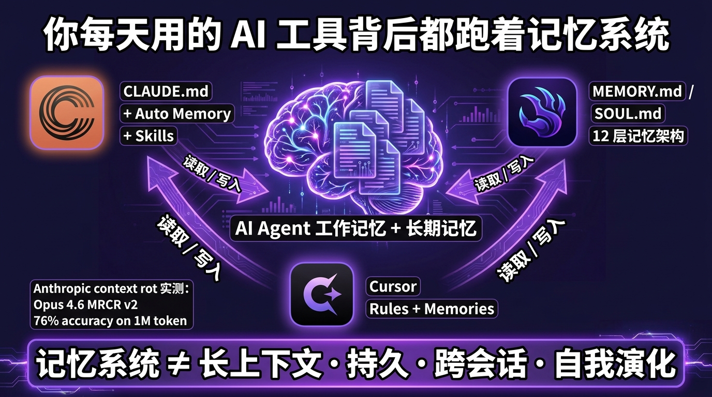

### 顶流工具的"记忆"设计

#### Claude Code 的 CLAUDE.md + Auto Memory

Claude Code 是 Anthropic 官方的命令行 Agent 编程工具。

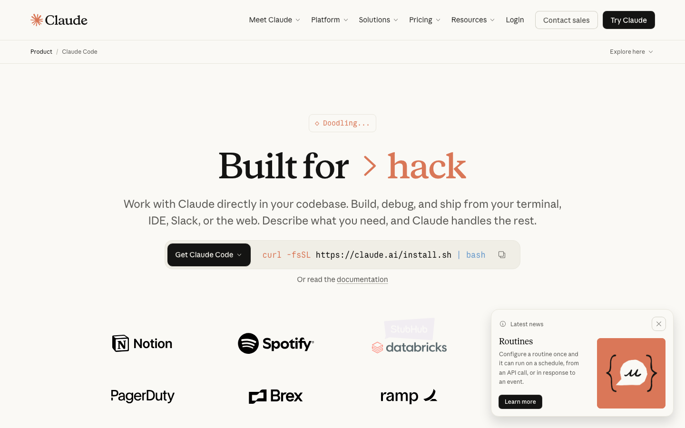

它的记忆设计是「人写给 Claude 的指令 + Claude 写给自己的笔记」双轨：

CLAUDE.md 是人手动维护的指令文件，分四个作用域：

- Managed policy（组织级策略，IT 部署）
- User（~/.claude/CLAUDE.md ，个人偏好）
- Project（./CLAUDE.md ，团队共享）
- Local（./CLAUDE.local.md ，本机私有）

同一项目内 Claude Code 还会沿目录层级向上逐层叠加 CLAUDE.md ，让子目录可以局部覆写Auto Memory 是 Claude 自己根据用户的纠正与偏好不断追加的笔记，存储在固定路径~/.claude/projects/<project-name>/memory/ ，启动时只读取 MEMORY.md 前 200 行（或 25KB）

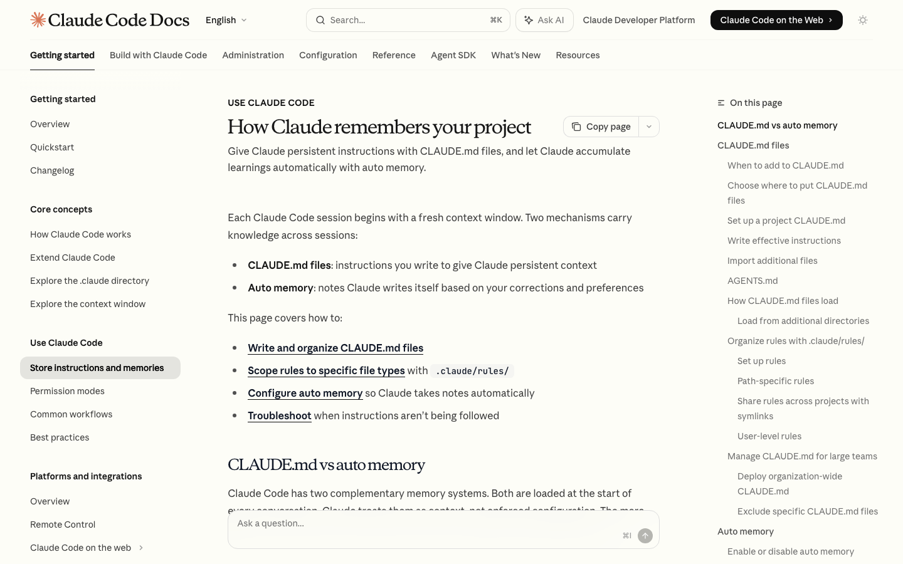

你新建一个项目时第一件事写的那个 CLAUDE.md ，本质上就是 Claude Code 的「持久化记忆载体」——它选择了用 markdown 文件作为记忆的真相源。


#### OpenClaw 的 MEMORY.md / SOUL.md / HEARTBEAT.md

OpenClaw 是 2025-2026 国内熟悉度最高的开源 AI 助手之一（GitHub 37.2 万 stars，截至 2026-05-14 实测）。

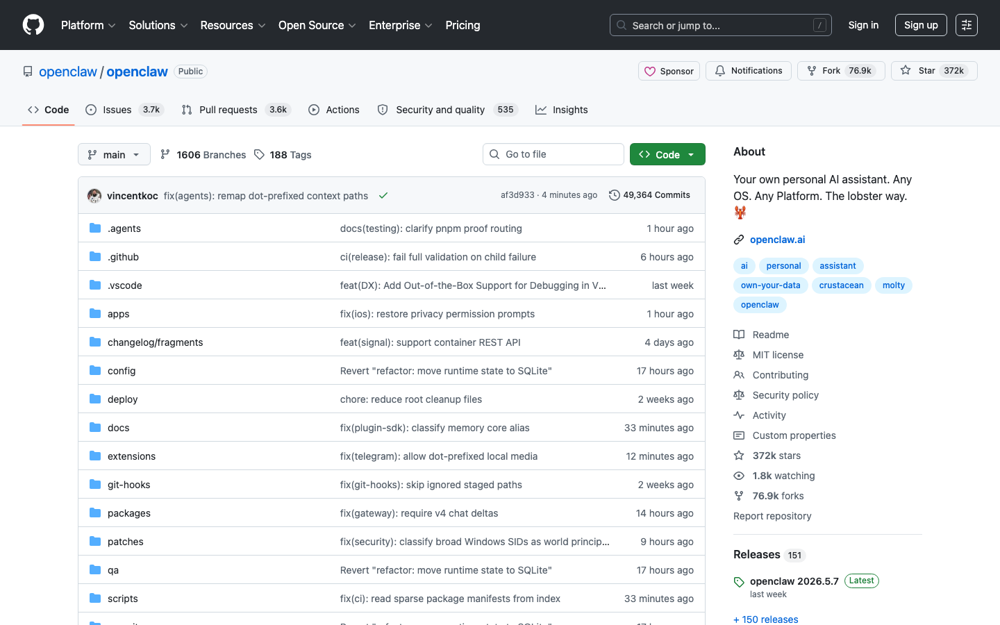

它的记忆设计在 Claude Code 之上做了进一步拆分：

- MEMORY.md ：精炼的长期知识库（决策、人际、项目级上下文）

- SOUL.md ：人格 / 价值观 / 约束

- AGENTS.md ：操作规则、安全边界

- HEARTBEAT.md ：定时任务调度

- memory/YYYY-MM-DD.md ：每日工作记忆，会话开始时自动读取昨天和今天的笔记


这里说的"笔记"具体指什么？OpenClaw 把两类内容都当作"笔记"对待——Agent 与用户的对话历史会被Agent 在会话间隙摘要追加到 memory/YYYY-MM-DD.md ；操作员手动维护的项目笔记 / 决策记录 / 文档则直接写在 MEMORY.md / SOUL.md 等结构化 markdown 文件里。两类笔记最终都是文件系统里的markdown 文本，没有"数据库表"概念。

OpenClaw 在这些 markdown 文件之上叠了一层向量索引——把每篇笔记按约 400 token（一个 token≈ 一个英文词或半个汉字）切成片段（chunk），片段之间留 80 token 的重叠（overlap）以避免上下文断裂，所有向量存到 SQLite 数据库的 sqlite-vec 扩展里，让记忆查询既能精确读原文件、又能语义检索。

这两个工具的共同点是——没有把记忆藏在数据库里，而是把它放在文件系统中、用 markdown表达、让操作员可见可编辑可版本控制。这个设计选择不是巧合，它代表了一整个流派：文档派。

### 三派全景概述

熟悉的几个工具分别属于不同的流派。这正是本课要建立的全景认知：

| 流派       | 通俗说法                                                     | 顶流案例                                               | 代表项目          |
| ---------- | ------------------------------------------------------------ | ------------------------------------------------------ | ----------------- |
| 自动管家派 | 让后台 LLM 偷偷整理记忆                                      | （消费者级 chatbot 大量在用）                          | Mem0（55.6k ⭐）   |
| OS 派      | 让 LLM 自己把记忆“换入换出”（借用操作系统的 page in/out 思路） | （MemGPT 论文血统）                                    | Letta（22.7k ⭐）  |
| 文档派     | markdown 文件就是真相源                                      | Claude Code、OpenClaw、Karpathy LLM Wiki、Cursor Rules | GBrain（15.5k ⭐） |

本节建立一个朴素直觉：

> 你每天用的工具背后都有一套记忆系统，它们不只是“LLM 调用得多”。

### 本集涉及的内容范围

本集覆盖三个具体产出：

1. 一张三大流派对比表——把 Mem0 / Letta / Zep / LangMem / GBrain / Anthropic Memory Tool这些项目按设计哲学归类，便于团队选型时快速对照

2. 三个代表项目的本地部署 + 核心功能实操——Mem0 / Letta / GBrain 围绕同一组用户角色（Alice /Bob / Carol 三位 Python 工程师）的真实工作场景，亲手看到三种流派对同一类信息的不同存储形

态。

3. 顶流工具记忆系统归类——Claude Code、OpenClaw 早期、Karpathy LLM Wiki、Cursor 各自属于哪一派、为什么这么设计

下集会基于这三个产出再向前一步——给出一份可在三种记忆后端之间切换的 web 对话产品完整源码（GitHub 公开）。

## §1b Agent 记忆是什么：与 Context Engineering / RAG 的区别

### 一句话定义

Agent 记忆系统（Agent Memory）= 持久的、自我演化的、跨会话的外部状态管理层。

把这个定义拆开看：

- 持久：数据落到 LLM 推理周期之外的存储里（数据库 / 文件系统 / 向量库），进程重启不丢

- 自我演化：内容会随 Agent 与用户的交互不断 ADD / UPDATE / DELETE，不是只读静态资产

- 跨会话：新 session 开启时能恢复，不依赖把所有历史塞进 prompt

- 外部状态：相对于 LLM 本身的"参数权重"和"prompt 上下文"而言的第三类状态


把 Agent 比喻成人：LLM 是大脑、prompt 是当前正在想的事、Agent 记忆是大脑外的笔记本。脑容量有限、注意力有限，所以人类需要笔记——LLM 也需要。

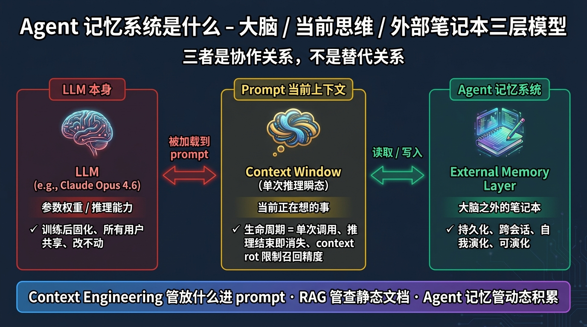

### 三者关系：Agent 记忆 ≠ Context Engineering ≠ RAG

第一次接触这三个概念，最容易把它们混作一谈。但在工程上它们的边界、目标、生命周期完全不同。

| 维度       | Context Engineering                              | RAG                                 | Agent 记忆系统                                     |
| ---------- | ------------------------------------------------ | ----------------------------------- | -------------------------------------------------- |
| 本质       | 当前推理调用的 prompt 组装策略                   | 静态文档检索 + 注入 prompt          | 持久的、可演化的外部状态层                         |
| 生命周期   | 单次调用（请求一结束就消失）                     | 单次查询（每次重新检索）            | 跨调用、跨会话、跨进程持久化                       |
| 数据来源   | 用户当前消息 + 系统 prompt + 工具结果 + 历史对话 | 预先准备好的文档库（不变）          | 与用户交互过程中动态产生的事实 / 笔记              |
| 谁在写     | 系统提示工程师 / 调用方                          | 文档准备阶段（人工或 ETL 数据管道） | Agent 自己（自动管家派 / OS 派）或操作员（文档派） |
| 解决的问题 | 在有限 context 里塞最多信息                      | 让 LLM 获得 prompt 没有的领域知识   | 让 Agent 跨会话“记得用户” / “记得自己上次在做什么” |
| 典型场景   | “把 RAG 结果 + 工具描述 + 历史压缩到 50k tokens” | “客服机器人查产品手册”              | “客服 Agent 记住每个用户的偏好”                    |

---

一种更简洁的表述：

> Context Engineering 管“放什么进 prompt”。  
>
> RAG 管“从静态库里查什么放进 prompt”。  
>
> Agent 记忆管“动态积累什么，什么时候放进 prompt”。

三者是协作关系，不是替代关系。

### 一个常见误区：长上下文 ≠ 记忆系统

LLM 的 context window 越来越长（Gemini 1.5 Pro 1M、Claude Opus 4.6 在 1M token 也宣称可用），自然会有人说："context 都 100 万 token 了，记忆系统还有什么必要？把对话历史全塞进去不就完了？"

这个看似合理的推论在工程上跑不通。原因有三层：

**层 1：context rot 问题（attention 不是均匀分布）**

context rot（上下文腐化）指随 prompt token 数增加、模型对长上下文中特定信息的召回准确率持续下降的现象。Anthropic 2026 官方研究和 Chroma 的 Context Rot 实验反复确认这一点——而且任务越复杂下降越严重。Anthropic 官方原话："context 必须被当作一种有限资源 + 边际收益递减的东西来管理"。即便是 Claude Opus 4.6 在 1M token 上的 MRCR v2（Multi-needle Retrieval v2，长上下文多目标精确召回基准）准确率也只有 76%（相对 Sonnet 4.5 的 18.5% 已是 4 倍提升，但远谈不上"完美召回"）。

**层 2：成本与延迟（百万 token 不可持续）**

每次调用塞入百万级 token 的 prompt：

- 推理成本按 token 线性涨（百万 token 调用单价远高于"先检索 1k token 相关记忆再调用"）

- 首 token 延迟显著增加（attention 矩阵规模二次方增长）

- 在交互式应用中（聊天 / 编程助手 / 客服）这种延迟无法接受


Mem0 论文给出的实测对比：full-context 方法 p95 延迟 17.117 秒，Mem0 p95 延迟 1.440 秒——降幅 91%。来源：arXiv 2504.19413。

**层 3：哲学边界（context 是瞬时态、记忆是持久态）**

即使 context window 无限长、推理免费，context 仍然是单次调用的瞬时态。新 session 开启时它消失。Agent 记忆要回答的问题不是"如何在一次推理里塞更多信息"，而是"如何让信息跨调用、跨进程、跨周留下来"。这是两个工程问题，长上下文回答不了第二个。

这个误区还有一个反向版本——"我已经有 RAG 了，记忆系统就不用了"。同样不对。RAG 是查静态文档，记忆是查动态产生的事实。客服 Agent 的产品手册放 RAG，用户偏好放记忆，二者各司其职。

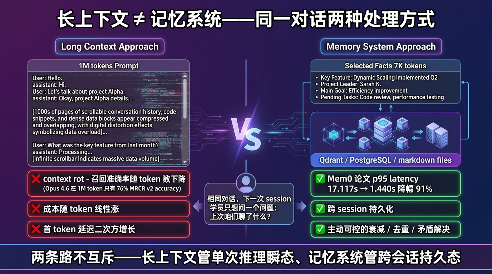


### 三者协作的典型架构

下图展示了一个成熟 Agent 系统中三者如何协作：

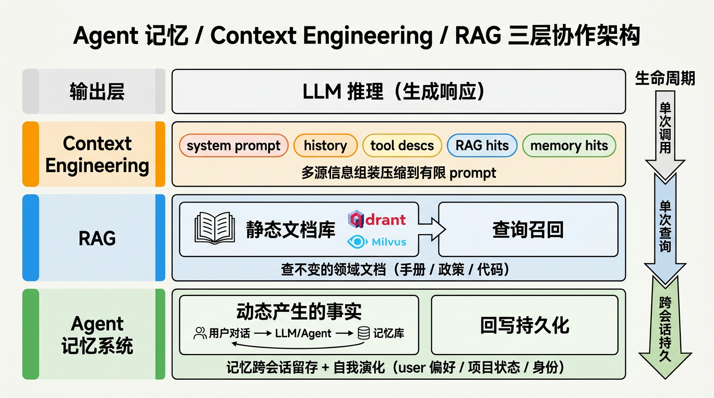

在一次完整调用中：

1. **Agent 记忆层：**根据当前 query 从持久化记忆（数据库 / 文件系统）中召回相关条目

2. **RAG 层：**从静态文档库中召回相关段落

3. **Context Engineering 层：**把上述两类结果 + 历史对话 + 工具描述 + 系统 prompt 组装压缩成最终的 prompt（控制在合理 token 数内）

4. **LLM 推理：**基于这个组装好的 prompt 生成响应

5. **回写记忆层：**调用结束后，把本轮交互产生的"值得记住的事实"写回 Agent 记忆层（自动管家派由

后台 LLM 抽取、OS 派由 Agent 主动写、文档派由 Agent 操作 markdown 文件）

这是一个简化模型——实际系统中三层之间还有更多变体（如 RAG 也可以查记忆、Memory 也可以做语义索引）。但理解这个分工是后续选型的基础。

### 本节涉及的核心概念

| 概念                | 一句话定义                                                   |
| ------------------- | ------------------------------------------------------------ |
| Agent 记忆系统      | 持久的、自我演化的、跨会话的外部状态管理层                   |
| Context Engineering | 把多源信息（query / 工具 / 历史 / 检索结果）压缩组装到有限 prompt 的策略 |
| RAG                 | Retrieval-Augmented Generation，从外部静态文档检索后注入 prompt |
| context rot         | 随 prompt token 数增加，模型对长上下文中特定信息的召回准确率下降的现象 |
| MCR v2              | Multi-needle Retrieval benchmark v2，衡量长上下文中多目标精确召回能力 |

## §1c RAG 做记忆的局限：从 OpenClaw 早期 memory.md 看演进

### 认知锚点

国内做过 Agent 项目的工程师，几乎都做过 RAG。

最常见的实践是：把领域文档切片 → 灌进向量库（Qdrant / Milvus / FAISS / Chroma 任选其一）→ 加一道关键词检索 BM25 → 把两路检索结果合并（混合检索）→ 拼到 prompt 里给 LLM 看。

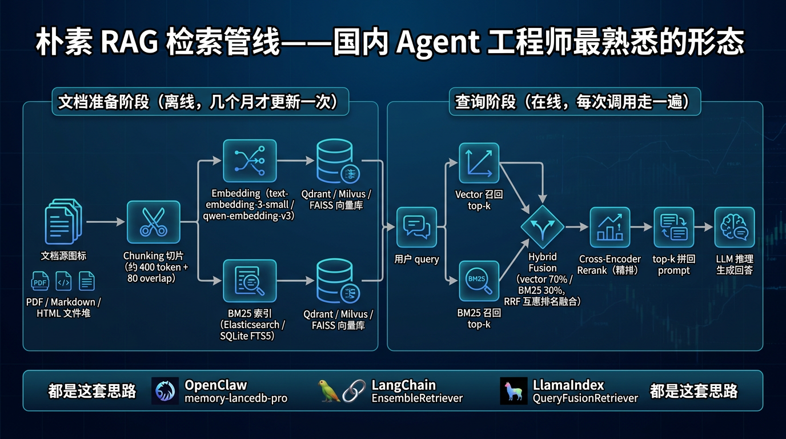

「混合检索（hybrid retrieval）」= 向量召回（语义相似）+ BM25（关键词精确匹配）+ 加权融合。生产中常用比例是 vector 70% / BM25 30%，OpenClaw 的 memory-lancedb-pro 插件、LangChain 的 EnsembleRetriever、LlamaIndex 的 QueryFusionRetriever 都是这个思路。融合阶段常用 RRF（Reciprocal Rank Fusion，互惠排名融合——按各路结果的排名倒数求和，避免不同打分尺度直接相加），融合后再用 Cross-Encoder rerank（交叉编码器重排——把 query 和候选文档拼一起送 encoder 一次性打分，比单独编码更准但更贵）做精排。

很多人第一次想"给 Agent 加记忆"，第一反应就是——把对话历史也当成文档，灌进同一套 RAG 管线不就行了？

这条路在工程上能跑起来，OpenClaw 早期的 memory.md 就是这个思路的代表实现。但跑起来不等于能解决问题——把 RAG 直接当记忆系统用，会撞上几堵结构性的墙。本节把这条演进路径完整拆开。

### 阶段 1：朴素方案——memory.md + 混合检索

OpenClaw 早期版本（2026 年初）的记忆方案非常朴素：

- 载体：一个 memory.md 文件（或 memory/ 目录下若干 markdown 笔记）

- 写入：每次会话结束，由 Agent 自己把"值得记住的事"追加到 markdown

- 索引：把 markdown 切片（约 400 token / chunk + 80 token overlap）灌进 SQLite + sqlite-vec（SQLite 的官方向量扩展，让普通 SQLite 数据库直接支持向量相似度查询）

- 检索：query 来时走混合检索——vector 0.7 + BM25 0.3，top-k 拼回 prompt


这套方案有一个看似自洽的优点：它和你已经熟悉的 RAG 长得一模一样，几乎零认知成本就能搭起来。

实测它能解决的问题：

- 长对话被截断后，Agent 仍能搜出几周前的对话片段

- 跨 session 下，新会话开始时能召回历史决策

- 部署简单——SQLite + 一个 embedding 模型就够了


这个方案在小团队 / 个人 brain 场景下到今天仍然有效。OpenClaw 的 memory-lancedb-pro 插件（vector 0.7 / BM25 0.3 + RRF 融合 + Cross-Encoder rerank）就是这条路线的工程化加厚版本。来源：`github.com/CortexReach/memory-lancedb-pro`。

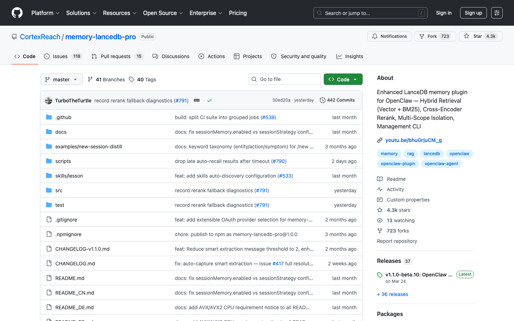

### 阶段 2：撞墙——RAG 做记忆的四个结构性局限

朴素方案跑一段时间后，几个结构性问题会浮现。这不是工程实现没做好，而是 RAG 模型本身的设计前提与"记忆"场景不匹配。

**局限 1：RAG 假设"文档库基本不变"，记忆是动态产生的**

RAG 的标准用法是查"产品手册""政策文档""技术文档"——这些文档先写好、后查询，几个月才更新一次。

记忆完全相反——它在 Agent 与用户的每一次交互中产生：

- 用户偏好（"我喜欢简洁回答"→"我又改主意了，要详细一点"）

- 项目状态（"今天讨论了架构 A"→"明天否决了 A 改用 B"）

- 用户身份（"我叫 Alice"→"换工作了，现在叫 Alice Wang"）


把这些动态、矛盾、有时序的事实当成"文档"灌进 RAG，会撞上下一个问题：

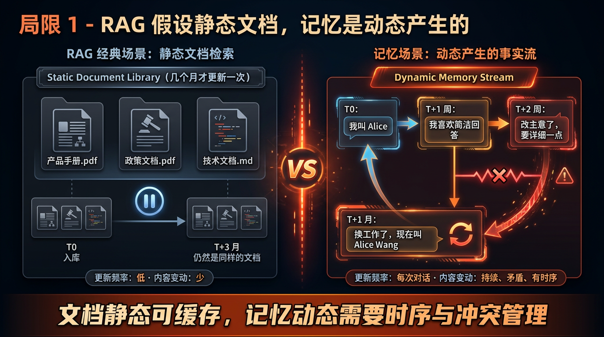

局限 2：RAG 没有写入策略，"灌什么进去"是个未解决问题

RAG 文档准备阶段有一道明确的工序——人或 ETL 决定哪些文档进库、按什么粒度切。

但记忆场景下没有这道工序。Agent 与用户对话产生的内容默认全部都是潜在记忆：用户消息、Agent回复、工具调用结果、系统消息……朴素 RAG 方案要么全灌（必然爆炸）要么全不灌（等于没记忆）。

如果选"按规则灌部分"，下一个问题是 决定灌什么的规则又由谁来写：

- 让人写规则 → 维护成本高、规则覆盖不全

- 让 LLM 自动判断 → 这恰好就是 Mem0 的"自动管家派"路线（见 §1d / §2）

- 让 Agent 主动用 tool 调写 → 这就是 Letta 的"OS 派"路线

- 让操作员手动维护 markdown → 这就是文档派的现代演进


也就是说——当代三大记忆流派的出现，本质上都是在回答 RAG 没回答的"写入策略"问题。

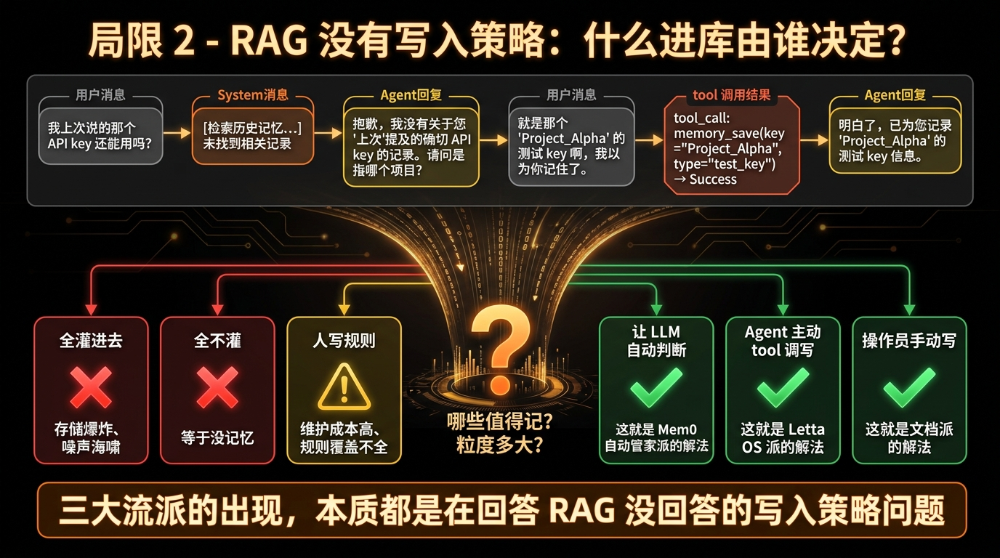


**局限 3：没有冲突解决，矛盾事实会同时召回**

举个具体场景。Alice 第一次说"我做后端开发"，第二个月跳槽说"我现在做 AI 算法"。朴素 RAG 把两条都灌进库，下一次问"Alice 是做什么的"——召回结果同时包含两条互相矛盾的事实，Agent 很可能给出错误回答。

成熟的记忆系统都有显式的冲突解决：

- Mem0 的 LLM tool call 在 ADD 之前会判 UPDATE / DELETE / NOOP——找到语义相似的旧记忆，比较"信息含量"决定是替换还是新增

- Zep 用 bi-temporal（双时间轴）模型给每条事实打"有效时间窗"——同时记录"事实何时被写入"和"事实何时在现实中生效/失效"两条时间线，旧事实被标记为 invalid 但物理保留（便于时序追溯）

- Letta 把核心事实放在固定大小的 working context block 里，agent 主动调用core_memory_replace 覆盖旧值

- 文档派靠 markdown 文件天然的"覆盖即生效"——Agent 改一行就是改了


朴素 RAG 没有任何这类机制，它只会越灌越多。

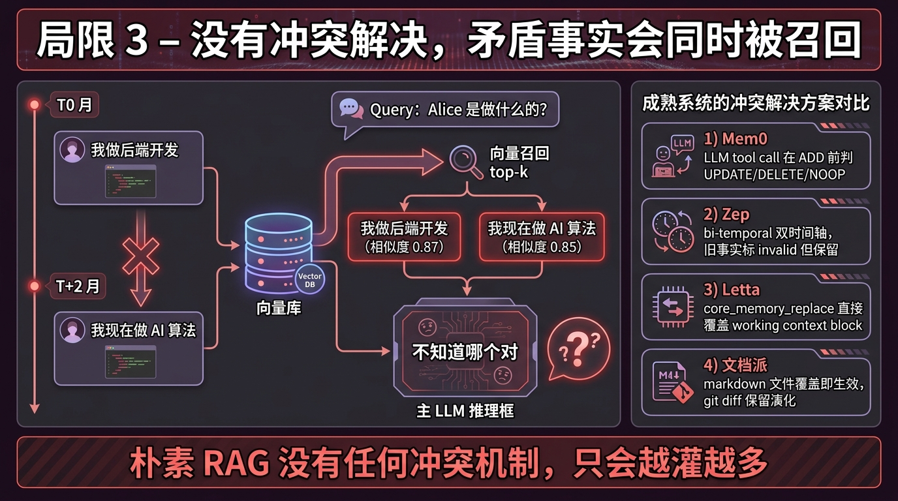

**局限 4：没有遗忘策略，召回噪声会越积越大**

这是 RAG 做记忆最有杀伤力的局限。

Mem0 自己（一个比朴素 RAG 设计严谨得多的系统）发布后被社区做过一次广为人知的审计——某个用户在生产中跑了 32 天，累计了 10134 条记忆，逐条人工分析后发现 97.8% 是垃圾——只有 38 条原样可用。来源：`mem0ai/mem0 issue #4573（提交者 @jamebobob，2026-03-27）`。issue 给出的 5 类junk 精细分布：52.7% 是 boot file 重复抽取、11.5% 是 heartbeat 噪声、8.2% 是系统架构倾倒、7.4% 是瞬时状态、5.2% 是幻觉用户档案。提交者另在评论区指出"升级到 Sonnet 4.6 不能降低 junk 比例"——根因是默认 prompt 而非 LLM 能力。该用户随后 fork 一份并加入 conditional persistence（用户确认才存）作为补救。

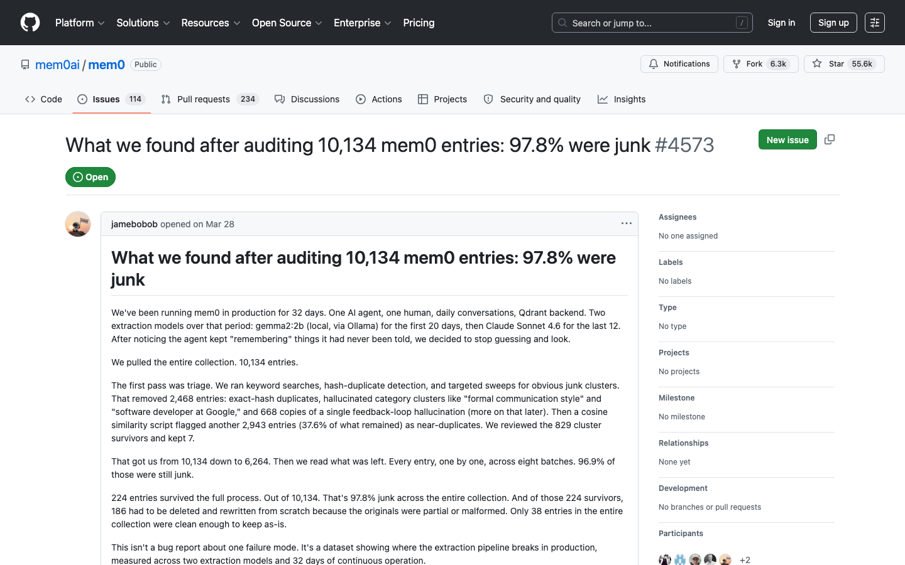

垃圾来源被定位为三个：

1. 召回的记忆又被喂回抽取阶段，形成反馈环——同一条事实（如 "User uses she/her pronouns"）反复被重抽存入

2. Mem0 默认的 FACT_RETRIEVAL_PROMPT 写了 7 个抽取类别，等于"把对话里所有结构化信息都抽出来"——心跳 / cron 日志 / NO_REPLY 标记 / 系统配置全被存

3. 缺乏 pre-storage 过滤——任何对话片段都默认被认为"值得记住"

这是一个比朴素 RAG 设计严谨得多的系统都会踩的坑。如果只是把对话历史灌进 RAG 而完全没有遗忘机制 / 重要性评分 / 衰减函数，召回质量会更快崩溃。

Generative Agents（斯坦福小镇 25 个 NPC，UIST 2023）留给行业最大的遗产是一个三因子检索公式—— `score = α_recency × recency + α_importance × importance + α_relevance ×relevance` ，其中 `recency = exp(-decay × hours_since_last_access)` 是显式的时间衰减、importance 由 LLM 在写入时打 1-10 分。后续 Mem0 / A-MEM 的检索几乎全部继承了这个三因子框架。朴素 RAG 只有第三项 relevance——这就是为什么把对话历史直接灌进 RAG 会越积越乱。

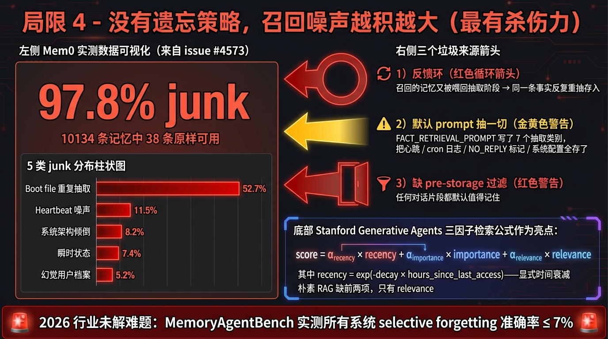

### 阶段 3：演进——OpenClaw 的现代记忆架构（2026 年中）

OpenClaw 的记忆系统在过去半年里发生了一次较彻底的演进。把当前（2026-05）的样子和 2026 年初的朴素 memory.md + RAG 对比，能看到文档派在四个结构性局限上分别做了什么工程响应——这是一个熟悉的真实系统，正好用来理解"文档派如何对抗 RAG 局限"。

#### 演进 1：从单层文件到三层 promotion/demotion

OpenClaw 当前的记忆分三层（官方文档）：

- Core 层：MEMORY.md / SOUL.md ——长期 curated 知识，每次 session 启动加载到 prompt 顶部

- Working 层：memory/YYYY-MM-DD.md 每日工作笔记 + active-context.md 当前任务上下文——Agent 间歇会话间共享

- Peripheral 层：通过 hybrid 检索按需召回的历史片段、wiki 页面、向量索引中的 chunk

三层之间有自动 promotion / demotion——长期高频访问的事实会被 Agent 主动升格到 Core 层，长期未访问的内容会降到 Peripheral。这是文档派对 §1c 局限 3 冲突解决的一种回答：用"层级"代替"覆盖"，让重要事实自然向上沉淀。

#### 演进 2：从单一 engine 到多 memory engine 可插拔

OpenClaw 2026.3+ 的 plugin 架构（before_prompt_build hook，取代了已废弃的before_agent_start ）允许第三方 memory engine 无缝接入。生态里目前活跃的至少有 6 个：

| Memory engine                     | 路线                           | 关键能力                                                     |
| --------------------------------- | ------------------------------ | ------------------------------------------------------------ |
| builtin（默认）                   | SQLite + sqlite-vec            | 零配置、上手最快                                             |
| memory-lancedb-pro（CortexReach） | LanceDB                        | hybrid（vector 70% / BM25 30%）+ Cross-Encoder rerank + recency scoring |
| memory-wiki（OpenClaw 官方）      | 编译式 wiki vault              | `wiki_search` / `wiki_get` / `wiki_apply` / `wiki_lint` 一致性检查 |
| ClawMem（yoloshi）                | Hooks + MCP                    | QMD 多信号检索（BM25 + vector + RRF + query expansion + cross-encoder rerank）+ MAGMA 意图分类 |
| MemOS Cloud（MemTensor）          | AI-native 跨 session 记忆      | textual / activation / parametric 三类记忆                   |
| Cognee（官方集成）                | Knowledge graph + memory + RAG | 关系抽取 + 实体融合                                          |

选型时不再是"用 OpenClaw 的记忆 vs 不用"，而是"用哪个 engine"——这正是文档派对 §1c 局限 2写入策略的工程化回答：把"灌什么进去"作为可插拔策略让用户自己选。

#### 演进 3：从全文检索到 hybrid + 衰减 + 重排的完整流水线

OpenClaw 当前的标准检索流水线（LanceDB 官方博客）：

```text
Vector 召回 → BM25 召回 → Hybrid Fusion (vector 70% / BM25 30%, RRF)
→ Cross-Encoder Rerank → Lifecycle Decay → 噪声 Filter → top-k
```

其中 Lifecycle Decay 用的是 Weibull 衰减——高频 / 高重要性的记忆排名上浮，长期未触达的记忆排名下沉。这是文档派对 §1c 局限 4 遗忘策略的尝试（行业里这个局限还没完全解决，OpenClaw 是少数把"显式衰减函数"工程化的实现之一）。

#### 演进 4：从全平铺到 12 层语义索引

社区项目 openclaw-memory-architecture 在 OpenClaw 基础上扩展出了12 层记忆架构——含 3K+facts 的知识图谱、multilingual 语义搜索（7ms GPU 延迟）、continuity / stability / graph-memory三个互补插件、activation/decay 系统、domain RAG。

这套架构的具体细节超出本课范围，但它的存在本身证明了一件事——文档派不是"原始 markdown"，它的工程上限远比 §1c 阶段 1 那个"朴素 memory.md + RAG"高得多。

**小结：OpenClaw 当前的全貌**

把这四条演进合在一起看：OpenClaw 当前的记忆系统是「多层 markdown 文件 + 多 engine 可插拔 +hybrid 流水线 + 显式衰减」的复合体——但它仍然是文档派，因为：

- 载体仍是文件系统（markdown 是真相源）

- 操作仍以显式工具调用 / hook 触发为主（不是后台 LLM 偷偷抽）

- 操作员（人）仍可直接读写文件（与 Agent 共享真相）

- 这是文档派的工程化巅峰之一——和 Mem0「后台 LLM 自动抽取」、Letta「OS 类比 + MemoryPressure」是三个完全不同的设计哲学。

下一节会把这三派的对应关系彻底拆开。

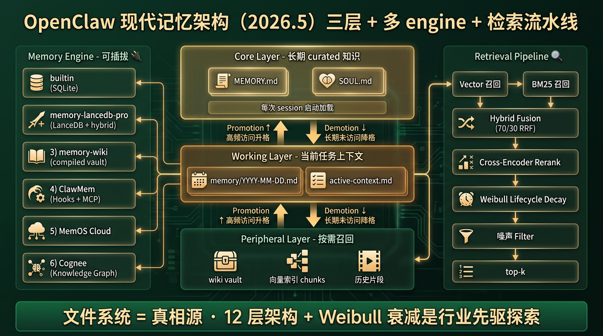

### RAG 之外的当代记忆系统：五条路线全景

RAG 撞墙之后，业内分头探索出了五条主路线。差异看似复杂，本质上都在回答同一个问题——这份"病历"该由谁来写、按什么格式写、什么时候清理。

用一个生活化比喻：把对话当作病人陈述，把"记忆"当作病历，五种"写病历"的方式正好对应五条路线：

```text
病人（用户）说：「这周头疼，上周已经好了一半，但今天又复发了。」
↓
┌───────────┬──────────┬──────────┬──────────┬───────────┐
① 堆挂号单    ② 雇 AI 助理   ③ 医生自己写   ④ 模板填空     ⑤ 双时间戳
(静态 RAG)   (自动管家派)    (OS 派)       (文档派)      (temporal-graph)
```

① 静态 RAG 当记忆：所有挂号单原样堆在一起，每次查询翻箱倒柜。便宜但乱。

② 后台 LLM 自动抽取：雇个 AI 助理在背后默默把对话整理成结构化病历。省心但黑盒。

③ Agent 主动 tool 写：让医生（Agent）自己每次决定"这条值得写进病历"。精确但累。

④ 结构化文档：用印好的病历模板，每个字段必填、可校验、可 lint。透明但要前期设计。

⑤ temporal-graph：每条诊断都标"何时确诊、何时失效"双时间戳。最严谨但维护贵。

把这五条路线和上一节四个局限的解决程度对照如下：

| 路线               | 通俗类比   | 代表项目                                                     | 核心改动                                                     | 解决了哪些局限                                           |
| ------------------ | ---------- | ------------------------------------------------------------ | ------------------------------------------------------------ | -------------------------------------------------------- |
| 静态 RAG 当记忆    | 堆挂号单   | 朴素 memory.md + hybrid 检索                                 | 无                                                           | 起点方案，只解决“召回历史”；局限 1-4 均未解决            |
| 后台 LLM 自动抽取  | 雇 AI 助理 | Mem0 / LangMem-background / A-MEM                            | 抽取 → ADD / UPDATE / DELETE / NOOP 决策                     | 解决局限 2：写入策略；解决局限 3：冲突解决               |
| Agent 主动 tool 写 | 医生自己写 | Letta / Anthropic Memory Tool / LangMem-hot-path             | Agent 主动调用 `core_memory_replace` / `archival_memory_insert` | 解决局限 1：动态产生；解决局限 2：写入策略               |
| 结构化文档         | 模板填空   | GBrain / OpenClaw（memory-wiki / Lifecycle Decay）/ Anthropic Skills | Markdown 升级为带 schema 的 claim，并加入 lint + 衰减机制    | 解决局限 2：写入策略；局限 3：冲突解决；局限 4：部分缓解 |
| temporal-graph     | 双时间戳   | Zep / Graphiti                                               | 为每条事实增加 bi-temporal 有效时间窗                        | 解决局限 3：冲突解决（最严格方案）                       |

没有任何一条路线完整解决了局限 4 遗忘策略——这是 2026 行业最大的未解难题。

MemoryAgentBench 的实测显示，所有现代记忆系统在"该忘的没忘"任务上的最高准确率只有7%（绝大多数低于 5%）。Anthropic 在 Claude Code 上 quietly ship 了一个名叫 "Auto Dream"的功能——定期 consolidate / dedup / prune——也仍然只是缓解。OpenClaw 的 Weibull 衰减是另一种工程化尝试（见上面 §1c 阶段 3）。承上启下：温度计、X 光、CT、MRI 都是医疗设备，但功能完全不同——同样道理，上面五条路线虽然都叫"Agent 记忆系统"，但它们的设计哲学差异比工程实现差异大得多。下一节（§1d）会把其中最主流的三条——自动管家派、OS 派、文档派——通过一个"周末项目 + 一周后跨项目复用"的真实场景同台对照演示一遍。看完那一节，你就能直观理解为什么三派的差异不是 benchmark 数字能简单比较的。

## §1d 三大流派对比：自动管家派 / OS 派 / 文档派

Mem0、Letta、Zep、LangMem、A-MEM、MemOS、MIRIX、Anthropic Memory Tool——只看名字会以为它们在抢同一块蛋糕，事实上它们对"什么是 Agent 记忆"的回答完全不同。当代 Agent 记忆系统按设计哲学收敛到三大流派：

- 自动管家派
- OS 派
- 文档派

注：本表用「通俗名」而非学术译名。学术上更严谨的名称是 Memory Manager（自动管家派）、OS-style Memory（OS 派）、File-as-Memory（文档派），三者都来自 2025-2026 的工程文献与论文。

### 一个真实场景：周末项目 + 一周后跨项目复用

为了把三派的差异讲清楚，先看一段真实的对话——小张用 AI 编程助手做一个周末项目，然后下周

再开新项目。整个时间线压缩在三天里，但包含了 Agent 记忆系统四个最核心的挑战：

| 时间                 | 说什么                                               | 隐藏的记忆挑战                                               |
| -------------------- | ---------------------------------------------------- | ------------------------------------------------------------ |
| 周六 09:00           | "我想做个个人博客，对 Python 比较熟，部署喜欢简单的" | **① 写入策略**：这段话里哪些是该记的？「博客」是项目状态、「Python 熟」是用户偏好、「简单部署」是约束条件——粒度怎么切？ |
| 周六 10:00           | （AI 推荐 FastAPI + Docker）                         | —                                                            |
| 周六 15:00           | "FastAPI 部署太复杂了，改 Flask 吧"                  | **② 冲突解决**：上午的「FastAPI 决策」怎么覆盖？是新增一条还是改旧的？ |
| 周日 10:00           | "上次咱们最终用什么框架？数据库还用 PostgreSQL 吗？" | **③ 跨 session 召回**：进程已经重启了一次，记忆还在不在？召回时矛盾事实会不会同时返回？ |
| 周日 14:00           | "数据库再换 SQLite 吧，PostgreSQL 太重了"            | **② 第二次冲突 + 决策链演化**（FastAPI → Flask，PostgreSQL → SQLite） |
| 周一 09:00（一周后） | "开始另一个项目，简单的 todo list，技术栈推荐下？"   | **④ 跨项目复用**：博客项目结束了，下个项目还能记得「这个用户喜欢 Python + 轻量栈」吗？项目状态需要切换，但用户偏好应该跨项目延续 |

这五行对话隐藏了 Agent 记忆系统的全部核心问题——**写入策略 / 冲突解决 / 跨 session 召回 / 跨项目复用**。三派给出的答案完全不同。下面逐一拆解。

### 思路一：自动管家派 — 后台 LLM 偷偷整理事实库

机制：每次 m.add(messages, user_id="zhang") 调用，后台 LLM 把消息抽成结构化"事实"（fact）入库。下一次查询时通过向量检索召回相似事实，拼回主 LLM 的 prompt 里。看不见这个抽取过程——所谓"自动管家"。

写入路径（周末项目场景下的关键代码）：

```text
# 周六 09:00 消息进入
m.add([{"role":"user", "content":"我想做个博客，对 Python 熟，喜欢简单部署"}],
user_id="zhang")
# 后台 LLM 抽出 3 条 fact：
#   "User is making a personal blog"
#   "User is familiar with Python"
#   "User prefers simple deployment"
# 周六 15:00 决策变更
m.add([{"role":"user", "content":"改 Flask 吧"}], user_id="zhang")
# Mem0 V3 默认 ADD-only——保留旧 "decided FastAPI" + 新增 "decided Flask"
# 矛盾事实并存
# 周日 14:00 第二次决策变更
m.add([{"role":"user", "content":"数据库改 SQLite 吧"}], user_id="zhang")
# 又一条新 fact 入库——三条事实并存（PostgreSQL / SQLite / Flask / FastAPI）
```

读取路径（周日 10:00 问"最终用什么框架？" Agent 如何回答）：

```text
# 主 Agent 收到问题
user_query = "上次咱们最终用什么框架？数据库还用 PostgreSQL 吗？"
# 第一步：调 m.search 召回相关事实
relevant_facts = m.search(user_query, filters={"user_id":"zhang"})
# 向量召回 top-5 按相似度排序（默认 V3 不带显式时间戳）：
# [
#   "User decided FastAPI"        (similarity 0.89),
#   "User decided Flask"          (similarity 0.87),
#   "User prefers simple deploy"  (similarity 0.72),
#   "User uses PostgreSQL"        (similarity 0.85),
#   "User changed to SQLite"      (similarity 0.83),
# ]
# 第二步：把召回 fact 拼回主 LLM 的 prompt
prompt = f"""用户问：{user_query}
已知事实：
{format_facts(relevant_facts)}
请回答用户的问题。"""
answer = main_llm.complete(prompt)
# 主 LLM 看到矛盾事实，凭"哪个更具体 / 哪个像最新决定"猜——
# 实测：框架问题答 Flask 的概率 ~70%，数据库问题答 SQLite 的概率 ~65%
# 失败时会回答 "你最初决定用 FastAPI" 或同时列举多个选项让用户确认
```

周一 09:00 新项目跨项目复用：

```text
m.search("推荐技术栈", filters={"user_id":"zhang"})
# 偏好 fact（"User is familiar with Python"、"User prefers simple deployment"）
# 自动跨项目召回——同 user_id 共享，无需额外配置
# 但旧项目的具体决策（Flask/SQLite）也可能被召回 → 跨项目噪声
```

对四个挑战的表现：

| 挑战              | 表现               | 说明                                                         |
| ----------------- | ------------------ | ------------------------------------------------------------ |
| ① 写入策略        | ✅ 全自动           | 后台 LLM 决定抽什么、按什么粒度切                            |
| ② 冲突解决        | ⚠️ 矛盾并存         | V3 默认 ADD-only，主 LLM 召回时同时拿到 FastAPI + Flask（实测时序判断准确率 60-75%） |
| ③ 跨 session 召回 | ✅ 持久化           | 事实库存在向量库，新 session 直接 `m.search()`               |
| ④ 跨项目复用      | ✅ 自动（含副作用） | 同 `user_id` 下偏好自动共享，但旧项目噪声也会被召回          |

代价：黑盒——不知道 Mem0 默认抽什么、抽对没有。Mem0 在生产中跑 32 天可能堆 10134 条记忆其中 97.8% 是垃圾（§1c 局限 4），就是这种"无脑灌入"路线的副作用。

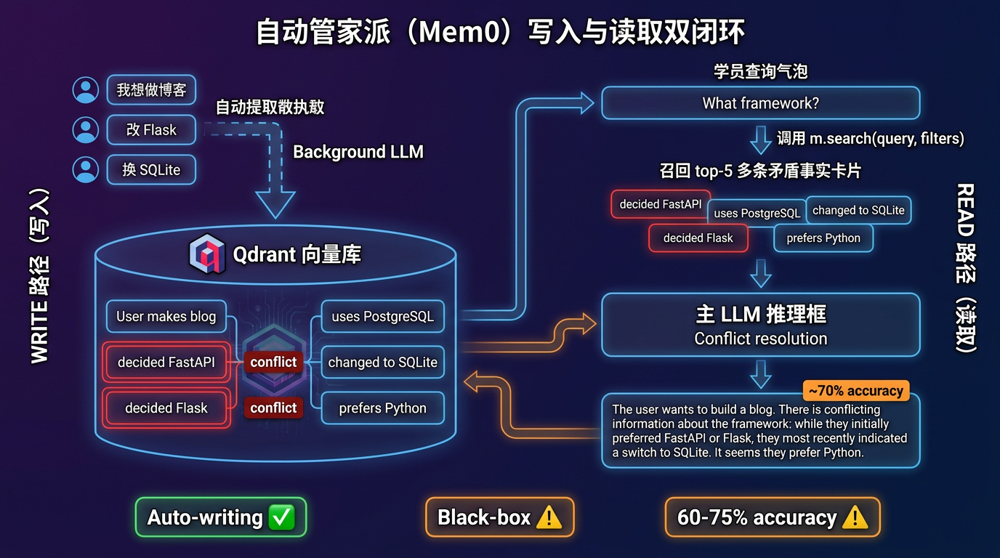

### 思路二：OS 派 — Agent 主动管"换入换出"

机制：把 LLM 的 context window 比作 RAM、外部数据库比作 Disk。Agent 自己用 function call 主动维护一个固定大小的 working context block —— core_memory_replace 覆盖旧值、archival_memory_insert 存档不常用的事实、archival_memory_search 召回历史。MemoryPressure 触发时把不活跃内容 page out 到 archival。

写入路径（周末项目场景下的关键代码）：

```text
# 周六 09:00 Agent 主动写 working context
agent.tool.call("core_memory_append", label="human",
value="Familiar with Python; prefers simple deployment")
agent.tool.call("core_memory_append", label="project",
value="Personal blog; framework: FastAPI")
# 周六 15:00 决策变更——主动 replace 而非新增
agent.tool.call("core_memory_replace", label="project",
old="framework: FastAPI", new="framework: Flask")
# working context 里只剩 Flask，FastAPI 直接消失
# 周日 14:00 数据库决策变更
agent.tool.call("core_memory_replace", label="project",
old="database: PostgreSQL", new="database: SQLite")
# project block 当前值：Personal blog; framework: Flask; database: SQLite
# 周日结束 Memory Pressure 触发 → 旧项目 page out 到 archival
agent.tool.call("archival_memory_insert",
content="Project 2026-W19: blog (Flask, SQLite, Docker)")
```

读取路径（周日 10:00 问"最终用什么框架？" Agent 如何回答）：

Letta 的核心读取机制和 Mem0 完全不同——它不在查询时才检索，而是让 working context 始终在prompt 里。Agent 每一轮 reasoning 看到的 prompt 都自动包含：

```text
system 指令
+ persona block（Agent 身份设定）
+ human block（用户档案，例如："Familiar with Python; prefers simple deployment"）
+ project block（项目状态，例如："Personal blog; framework: Flask; database:
SQLite"）
+ recent FIFO messages（最近若干轮对话）
```

所以问"最终用什么框架"时：

```text
# session 重启后，Letta 从 PostgreSQL 重新加载 working context
# Agent 收到问题，main context 自动注入 working context
# Agent 的 prompt 里已经能看到 "project: framework: Flask"
# Agent 直接 reasoning 后回答："你最终用的是 Flask，数据库换成 SQLite 了"
# 准确率 ~95%——working context 里没有 FastAPI 这条旧值
# 如果 working context 没装下需要的事实（被 page out 了），Agent 主动调：
agent.tool.call("archival_memory_search", query="framework decision")
# 召回的结果通过 function return 进入 Agent 下一轮 reasoning
```

周一 09:00 新项目跨项目复用：

```text
# project block 已 page out，working context 重置为空 project
# human block 自动跟着 Agent 保留（用户档案与项目无关）
# Agent 看到 human block："Familiar with Python; prefers simple deployment"
# 直接基于偏好给推荐——但具体技术决策需要：
agent.tool.call("archival_memory_search", query="previous blog project")
# 召回 archival 里的 "Project 2026-W19: blog (Flask, SQLite, Docker)"
# Agent 综合 human 偏好 + 历史项目档案给出新建议
```

对四个挑战的表现：

| 挑战              | 表现         | 说明                                                         |
| ----------------- | ------------ | ------------------------------------------------------------ |
| ① 写入策略        | ⚠️ Agent 主导 | LLM 必须自己判断“该 append 还是 replace”，漏调一次旧值就残留 |
| ② 冲突解决        | ✅ 精确覆盖   | `core_memory_replace` 直接覆盖，working context 里只有最新值 |
| ③ 跨 session 召回 | ✅ 完整恢复   | session 重启从 PostgreSQL 加载，working context 完整还原     |
| ④ 跨项目复用      | ⚠️ 半自动     | human block 自动跟随 Agent，但项目经验需要 `archival_memory_search` |

代价：context block 大小固定（典型 2-8KB），存满了必须 page out。所有写入都依赖 Agent 主动tool call——工程上比 Mem0 的"无脑灌"复杂得多，但可观测性好——working context 在 Letta ADE 网页端实时可见。

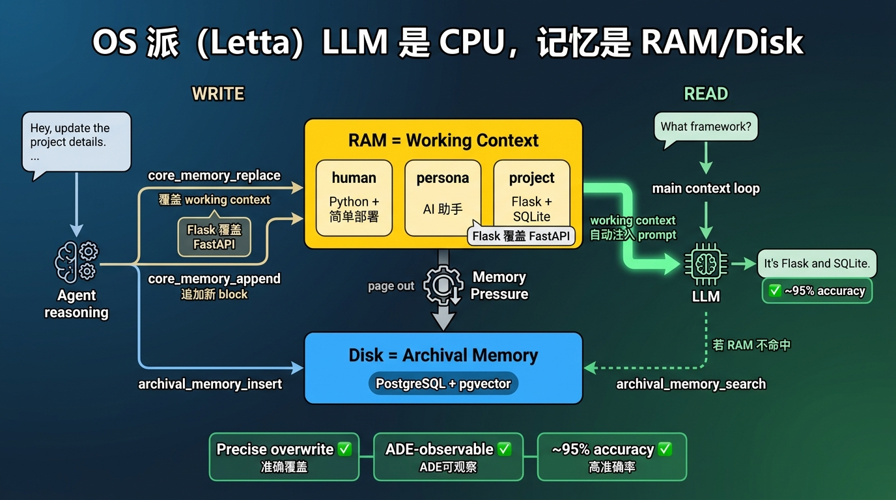

### 思路三：文档派 — markdown 文件就是真相源

机制：记忆的载体就是文件系统里的 markdown 文件。Agent 通过 view / create / str_replace 等文件操作工具读写笔记。操作员（人）也可以直接编辑同一份文件——人和 Agent 共享同一份真相。所有变更走 git，决策演化可 diff 可回滚。

写入路径（周末项目场景下的关键代码）：

```text
# 周六 09:00 Agent 创建两个文件：用户档案 + 项目笔记
agent.tool.call("create", path="notes/user-zhang.md",
content="# 用户档案\n- 语言：Python\n- 部署偏好：简单")
agent.tool.call("create", path="notes/blog-2026-w19.md",
content="# 个人博客项目\n- 框架：FastAPI\n- 数据库：PostgreSQL")
# 周六 15:00 决策变更——str_replace 改文件，git 自动 commit
agent.tool.call("str_replace", path="notes/blog-2026-w19.md",
old="框架：FastAPI", new="框架：Flask（部署考虑）")
# git history 完整保留 FastAPI → Flask 的演化
# 周日 14:00 数据库决策变更
agent.tool.call("str_replace", path="notes/blog-2026-w19.md",
old="数据库：PostgreSQL", new="数据库：SQLite（轻量化）")
# 当前 notes/blog-2026-w19.md：
#   # 个人博客项目
#   - 框架：Flask（部署考虑）
#   - 数据库：SQLite（轻量化）
```

读取路径（周日 10:00 问"最终用什么框架？" Agent 如何回答）：

文档派的读取最直接——Agent 直接 view 文件，看到的就是最新真相：

```text
# 问 "上次咱们最终用什么框架？数据库还用 PostgreSQL 吗？"
# Agent 主动选择读哪个文件
# 路径 A：精确读取（Agent 已知项目笔记位置）
agent.tool.call("view", path="notes/blog-2026-w19.md")
# 返回完整文件内容（当前状态，无矛盾）：
#   # 个人博客项目
#   - 框架：Flask（部署考虑）
#   - 数据库：SQLite（轻量化）
# Agent 直接回答："你最终用的是 Flask，数据库已经换成 SQLite 了"
# 准确率 ~100%——文件即真相
# 路径 B：模糊查询（笔记多了之后必备的 hybrid 检索）
gbrain query "最终用什么框架" --no-expand
# 触发 hybrid 检索（向量相似度 + BM25 关键词匹配 + RRF 融合）
# 召回 notes/blog-2026-w19.md 的相关片段
# Agent 综合召回内容回答
# 想看决策演化？git log 一行就行
git log -p notes/blog-2026-w19.md
# 显示 FastAPI → Flask、PostgreSQL → SQLite 的完整 diff history
```

周一 09:00 新项目跨项目复用：

```text
# Agent 创建新项目笔记，显式 link 用户档案
agent.tool.call("create", path="notes/todo-2026-w20.md",
content="""# Todo list 项目
- 用户档案：[见 user-zhang.md](user-zhang.md)
- 历史项目参考：[blog-2026-w19.md](blog-2026-w19.md)
- 技术栈：（基于偏好推荐：Flask + SQLite + 简单部署）""")
# 跨项目复用通过 markdown link 显式发生——可读、可追溯、可 git blame
```

对四个挑战的表现：

| 挑战              | 表现            | 说明                                         |
| ----------------- | --------------- | -------------------------------------------- |
| ① 写入策略        | ⚠️ 显式          | Agent 必须自己想清楚“写哪个文件、写什么内容” |
| ② 冲突解决        | ✅ 文件覆盖      | `str_replace` 直接改，git diff 保留完整演化  |
| ③ 跨 session 召回 | ✅ 文件持久      | 文件系统天然持久，`view` 即可，无需复杂查询  |
| ④ 跨项目复用      | ✅ markdown link | 显式 link 引用，跨项目关系一目了然           |

代价：依赖 Agent（或操作员）显式维护文件——不像自动管家派"无脑灌入"那样省心。笔记数量大时检索效率是问题，所以 GBrain、Anthropic Memory Tool、Claude Code 都在 markdown 之上叠了向量索引 + hybrid 检索（§4 GBrain 章节会实操演示）。

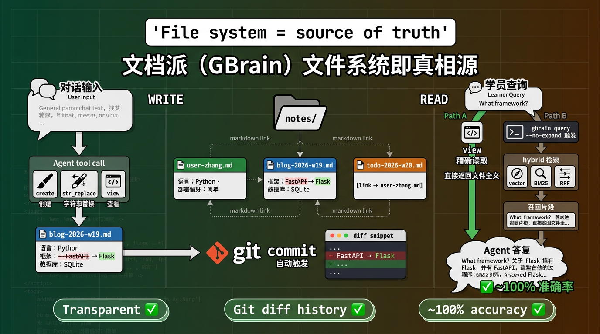

### 三派对四大挑战的表现汇总

把上面三个思路的表现并排放一起，没有哪派"完胜"——每派都在不同维度做了取舍：

| 挑战              | 自动管家派（Mem0）                | OS 派（Letta）                           | 文档派（GBrain）                       |
| ----------------- | --------------------------------- | ---------------------------------------- | -------------------------------------- |
| ① 写入策略        | ✅ 全自动（黑盒）                  | ⚠️ Agent 主动 tool call                   | ⚠️ 显式文件操作                         |
| ② 冲突解决        | ⚠️ V3 ADD-only，矛盾并存（60-75%） | ✅ `core_memory_replace` 精确覆盖（~95%） | ✅ `str_replace` + git history（~100%） |
| ③ 跨 session 召回 | ✅ 事实库持久                      | ✅ PostgreSQL 加载                        | ✅ 文件持久                             |
| ④ 跨项目复用      | ✅ 同 user_id 自动                 | ⚠️ human 自动 / project 半自动            | ✅ markdown link 显式                   |
| 内部状态可见性    | ❌ 黑盒                            | ✅ ADE 实时可见                           | ✅ 直接看文件 / git diff                |

这张表是三派对比的核心——读到这里应该能形成一个朴素直觉：自动管家派牺牲了可观测性换取写入便捷、OS 派牺牲了便捷性换取精确控制、文档派牺牲了自动化换取完全透明。三种取舍各自适配不同场景。

### 三派对比表（设计哲学维度）

截至 2026-05-14 GitHub Stars 实测，下同。

术语速记（表中首次出现）：

- CRUD = 增 / 改 / 删 / 读四类操作的合称；
- RAM / Disk = 内存 / 硬盘；
- FIFO queue = 先进先出队列；
- pgvector = PostgreSQL 的向量扩展；
- SaaS = 软件即服务（云端托管按用量付费）。

| 维度         | 自动管家派                                               | OS 派                                                        | 文档派                                                       |
| ------------ | -------------------------------------------------------- | ------------------------------------------------------------ | ------------------------------------------------------------ |
| 代表项目     | Mem0（55.6k ⭐，$24M A轮）                                | Letta（22.7k ⭐，前身 MemGPT）                                | GBrain（15.5k ⭐，2026-04-05 开源）                           |
| 设计哲学     | LLM 当后台管家，把对话提炼成结构化事实，做 CRUD          | LLM 是 CPU，记忆是 RAM/Disk，让 LLM 自己 page in/out         | 文件系统就是真相源，markdown 直接记录记忆载体                |
| 学术系统     | arXiv 2504.19413（Chikara 等，2025-04）                  | arXiv 2310.08560（Berkeley Sky Computing Lab，2023-10）      | "PDFs/notes 是 source code，wiki 是 binary" 思想的工程化     |
| 写入方式     | 异步抽取，后台 LLM 自动判断 ADD / UPDATE / DELETE / NOOP | Agent 主动调用 function（`core_memory_replace`、`archival_memory_insert`）+ Memory Pressure 触发 flush | 显式文件操作（`view`、`create`、`str_replace`、`insert`、`delete`、`rename`） |
| 存储载体     | 密集自然语言事实条目（向量库 + SQLite 历史）             | working context block + FIFO queue + archival / recall 数据库 | markdown 文件 + 向量索引 + 可选知识图谱                      |
| 执行位置     | self-hosted 或 Mem0 Cloud（SaaS 双形态）                 | self-hosted（PostgreSQL + pgvector）或 Letta Cloud           | client-side（操作发生在自己的文件系统）                      |
| 典型适用场景 | 客服 Agent、个性化推荐——不要求白盒、要快速接入           | stateful agent runtime、长任务陪跑——要可观测、可手动调记忆   | 知识管理、个人 brain、跨工具复用——要可查、可 diff、可版本化  |

三派的根本差异在于"让谁来掌握记忆的写入权"：自动管家派交给后台 LLM、OS 派交给 Agent 自己、文档派交给操作员。这一个决策决定了后续可观测性、可控性、可移植性的全部走向。

### 同一句话三种处理（最直观的差异印证）

上面用周末项目演示了整个时间线上的差异。再用一句话演示单次写入的差异——把"我叫 AliceWang，是阿里巴巴 Python 工程师"喂进三派代表项目，得到的内部存储完全不同：

| 流派               | 内部存储形态                                                 | 控制粒度            |
| ------------------ | ------------------------------------------------------------ | ------------------- |
| 自动管家派（Mem0） | 后台 LLM 抽取并翻译为英文 fact：`"User's name is Alice Wang and she is a Python engineer at Alibaba"` | 黑盒 / 自动         |
| OS 派（Letta）     | 写入名为 `human` 的 working context block，agent 自己决定后续如何修改 | 半自动 / Agent 主导 |
| 文档派（GBrain）   | **完整保留 markdown 原文 + embedding 索引**（用户写啥就存啥） | 白盒 / 操作员主导   |

完整对照（含载体形态、检索方式、可移植性）会在 §5a 收束时统一呈现。这里先建立直觉。

### 同流派其他项目速查

每派都不是只有一个代表项目。下表列出同流派的其他主流项目，便于选型时横向参考：

| 流派       | 代表项目 | 同流派其他项目（速查）                                       |
| ---------- | -------- | ------------------------------------------------------------ |
| 自动管家派 | Mem0     | LangMem（background mode，LangChain 出品）/ A-MEM（Zettelkasten 卡片笔记法风格的演化记忆，NeurIPS 2025）/ Zep（temporal-graph 即带时间维度的图谱，专做时序事实） |
| OS 派      | Letta    | MIRIX（六类记忆 + 多 Agent 分工 + 屏幕活动追踪）/ MemOS（textual + activation + parametric 三类记忆 OS） |
| 文档派     | GBrain   | Anthropic Memory Tool（first-party API 化的文档派，2025-09）/ Anthropic Skills（按需加载的程序性记忆）/ Claude Code 的 CLAUDE.md hierarchy / Cursor Rules + Memories |

Zep 严格上是 temporal-graph 派（单独的第四派），但其工程形态最接近自动管家派的"后台抽

取 + 主动维护事实库"，所以归在此处便于对照。Zep 反对全自动抽取、强调显式 schema 注

入，是这条路线上的反潮流声音。

### 按场景的选型建议

| 业务场景                                                  | 优先派别               | 推荐项目                                    | 理由                                                         |
| --------------------------------------------------------- | ---------------------- | ------------------------------------------- | ------------------------------------------------------------ |
| 客服 Agent / 聊天助理<br>需要个性化（用户偏好、历史话题） | 自动管家派             | Mem0                                        | 接入成本低、多用户隔离开箱即用，`add()` 一行嵌入             |
| 长任务跨 session 陪跑<br>（编程助手、研究助手）           | OS 派                  | Letta                                       | working context 实时可见，跨 session 持久化，可手动调        |
| 知识沉淀 / 已有 markdown 笔记复用 / 要求可读可 diff       | 文档派                 | GBrain                                      | markdown 即记忆，知识图谱可视化，与 Obsidian / Cursor rules 思路一致 |
| 不确定、想做 PoC                                          | 三派各跑一遍 demo 再选 | Mem0（最快）→ Letta（中等）→ GBrain（中等） | 部署难度递增，三派各跑一遍后对差异最有体感                   |

### 一个常见误区：流派之间不是"哪个最强"

第一次接触这些项目，最容易陷入"排行榜思维"——把 Mem0、Letta、Zep 摆在一起问哪个benchmark 分数高。这条路通常走不通：

- 三家根本不在同一条赛道上。Mem0 优化"消费者级 chatbot 的开发体验"，Letta 优化"statefulagent runtime 的可观测性"，GBrain 优化"知识工作者自己持有的 brain repo"。把它们放在同一个 LOCOMO benchmark 上对比，类似于让 PostgreSQL、Redis、ElasticSearch 比"哪个最快"——问题本身就不成立。

- Memory benchmark 的水分目前很大。同一个 LOCOMO 评测，Mem0 自测 Zep 65.99 分，Zep自测 75.14 分，Letta 用 grep 暴力检索拿到 74.0 分——三家数字相互矛盾。在 2026 年这一阶段，benchmark 不能作为选型主依据，载体形态和写入方式更接近本质。

- 三派可以并存于一个项目中。一个稍复杂的 Agent 系统完全可以同时使用：Mem0 管用户偏好、Letta 跑长任务 runtime、GBrain 当团队知识库。它们不是替代关系，是分工关系。


### 流派图示

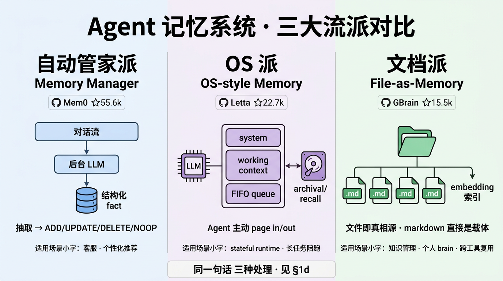

上图为三大流派的设计哲学速记图——同一条用户输入分别走入 Mem0 后台抽取链路、Lettaworking context 链路、GBrain markdown 文件链路。

## §1e 顶流工具记忆系统归类

§1d 把当代 Agent 记忆系统按设计哲学收敛到三大流派——自动管家派 / OS 派 / 文档派。这一节把这张地图叠加到每天打交道的顶流工具上，解决一个具体问题：你在用 Claude Code、OpenClaw、Cursor、Karpathy LLM Wiki、Anthropic Memory Tool 时，背后跑的是什么记忆系统、属于哪一派、为什么它们这么选。

本节是速查表 + 推理路径，便于团队选型时"对标顶流"做出合理判断。

### 速查映射表

下表数字（stars / 发布时点）截至 2026-05-14 实测。

| 工具                                    | 记忆系统设计                                                 | 流派归属                                        | 为什么这么选                                                 |
| --------------------------------------- | ------------------------------------------------------------ | ----------------------------------------------- | ------------------------------------------------------------ |
| Claude Code                             | `CLAUDE.md` 4层作用域（Managed policy / 组织级 / User 个人 / Project 团队 / Local 本机）+ Memory Tool（Claude 自己写笔记）+ Memory Tool（API 形态） | 文档派                                          | 用户拥有完全控制权，可 git 版本化，跨工具复用（Cursor 等也能读 markdown） |
| OpenClaw（早期）                        | `memory.md` + 混合检索（vector 0.7 + BM25 0.3）              | 文档派 + RAG                                    | 起步阶段最低成本方案，带 markdown 全生态知识                 |
| OpenClaw（2026-04 的 memory-wiki 插件） | 在 `memory.md` 之上叠加 `memory-wiki` 插件（结构化 claim 主张/事实库 + provenance 即出处溯源元数据 + `wiki_lint` 自动检查） | 文档派（结构化升级版）                          | 解决热方案的“写入策略 / 冲突解决”两堵墙                      |
| OpenClaw 完整记忆栈                     | `MEMORY.md`（长期）+ `memory/YYYY-MM-DD.md`（每日工作记录）+ SQLite + `AGENTS.md`（规则）+ `HEARTBEAT.md`（定时任务） | 文档派（多文件分层）                            | 不同生命周期的内容用不同文件承载，符合关注点分离（separation of concerns） |
| Karpathy LLM Wiki（思想源头）           | Obsidian 笔记库 + LLM 自动维护 wiki（每加新文档触发更新现有页 / 修订摘要 / 标签 / 双向引用） | 文档派（思想原型）                              | “PDFs 和 notes 是 source code，wiki 是 binary”——把记忆当编译产物 |
| Cursor Rules + Memories                 | `.cursor/rules/*.mdc` 文件（mdc = Cursor 自定义的 markdown 变体，YAML frontmatter 元数据 + markdown 正文）+ Team / Project / User 三级作用域 + Memories 自动生成 | 文档派（带元数据）                              | mdc 的 frontmatter 可声明触发条件（globs / agentRequested 等），让规则场景激活而非强制加载 |
| Anthropic Memory Tool                   | 6 个原语命令（`view` / `create` / `str_replace` / `insert` / `delete` / `rename`）+ client-side execution（命令在你的应用里执行，Anthropic 服务端不存数据，文件存储由你决定） | 文档派（first-party API 化，即官方 API 级支持） | 官方 API 化任何 app 都能调用，明确保留文档型工作流，不用自己造轮子 |
| Anthropic Skills                        | `.skills/{name}/SKILL.md` + 技能加载（progressive disclosure，渐进式披露：先读 metadata，命中后再读 SKILL.md 主体，需要时再读取 referenced files） | 文档派（程序性记忆）                            | 把“怎么做某件事”做成可加载的资源，是 Vibe Coding / Agent 工程化的开端（据 NVIDIA 2023 论文开放世界 Agent，提出“自动累积技能库”的思路） |

### 一个共性：顶流工具不约而同选了文档派

把这些工具列在一起会发现一个反直觉的事实——当代被广泛部署、用户量最大的 Agent 工具，绝大多

数都是文档派。

为什么自动管家派和 OS 派没有占据顶流位置？

| 视角       | 自动管家派为什么不太适合做知识流工具                         | OS 派为什么不太适合做知识流工具                           |
| ---------- | ------------------------------------------------------------ | --------------------------------------------------------- |
| 用户控制权 | 后台 LLM 决定 ADD / UPDATE / DELETE，用户看不见、无法手动改  | working context 由 Agent 主导，用户介入成本高             |
| 可移植性   | 数据藏在数据库里，换工具就丢                                 | 强绑定特定 runtime（Letta server / PostgreSQL）           |
| 可读性     | 抽取后的英文 fact 不一定符合用户表达习惯（Mem0 中→英翻译就是典型例子） | working context 是结构化字段，不是自然阅读形态            |
| 可调试性   | 97.8% junk 这种问题用户事后才能发现                          | 调一个 working context block 比改一个 markdown 文件流程长 |

文档派恰好在这四点上都给到答案：markdown 文件可见、可改、可 git、可被任何工具读取。这是它能成为顶流默认选择的根本原因。

这不是说文档派"赢了"——下面 §2 / §3 会演示 Mem0 / Letta 在它们各自适合的场景里依然是更优解。顶流工具选文档派 ≠ 你的项目也该选文档派。选型仍然要回到 §1d 的三派对比表去判断"我要解决的问题更接近哪一派的强项"。

### 推理：怎么从"工具表象"反推"记忆流派"

遇到一个新的 Agent 工具，可以用以下三步快速判断它属于哪一派：

| 问题                                                         | 答“是” → 倾向于... |
| ------------------------------------------------------------ | ------------------ |
| 1. 记忆是否以人类可读的文件形式落到磁盘上？                  | 文档派             |
| 2. 是否有一个明确的“后台进程 / 异步任务”在对话之外动作？     | 自动管家派         |
| 3. Agent 是否会在我面前显式调用 `memory_*` 之类的工具来读写记忆？ | OS 派              |

同一个工具可能在不同维度命中不同流派——例如 OpenClaw 既有 markdown 文件（文档派）又有"Active Memory + Dreaming"机制（接近自动管家派的后台精炼）。绝对纯粹的单一流派不多，但主要载体决定了归属。

### 一张图看完顶流映射

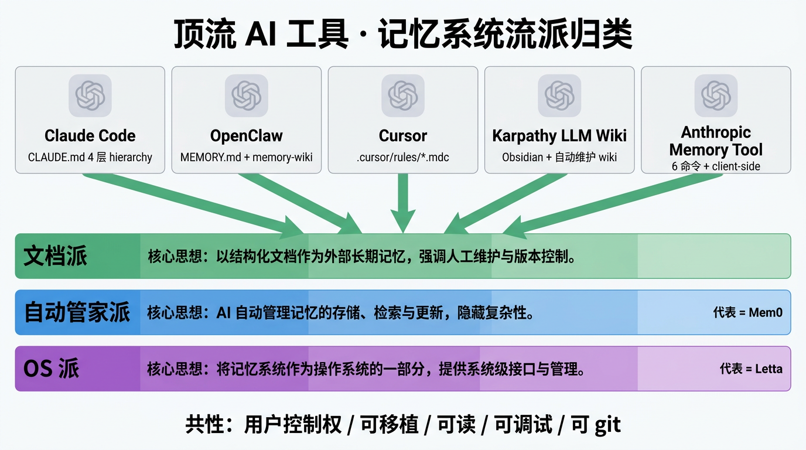

上图把 5 个常用工具（Claude Code / OpenClaw / Cursor / Karpathy LLM Wiki / AnthropicMemory Tool）映射到三派色带——文档派色带集中承接所有工具，自动管家派与 OS 派分别留出Mem0 / Letta 作为代表项目供后续章节展开。

### 进入实操

§1 把背景认知建完——三派的全景图、与 RAG 的边界、顶流工具的归类——都已就位。从下一节（§2）开始，进入三派代表项目的逐个实操：

| 章节 | 流派       | 代表项目 | 演示重点                                          |
| ---- | ---------- | -------- | ------------------------------------------------- |
| §2   | 自动管家派 | Mem0     | 后台抽取 + 多用户隔离 + 检索分数                  |
| §3   | OS 派      | Letta    | working context 实时演化 + 跨 session 记忆        |
| §4   | 文档派     | GBrain   | markdown 即记忆 + hybrid 检索 + admin UI 知识图谱 |

每节都基于预先生成的真实数据集（Mem0 150 条 / Letta 80 turn / GBrain 225 笔记）演示，不使用hello-world 级浅例子。

## §5a 总结

§1 把背景认知建完，§2 / §3 / §4 把 Mem0、Letta、GBrain 三个代表项目分别本地跑通。本节把上集的认知拼图收紧——三派如何处理同一句话、本集涉及到的核心认知洞察、以及下集 Part 3 工程化项目的承接。

### 同一句话三种处理（核心收束）

把"我叫 Alice Wang，是阿里巴巴 Python 工程师"这一句话喂入三派代表项目，得到的内部状态完全不同。下表把 §2c / §3 / §4c 的实测结果合并对照——这是上集最具体的"流派差异坐标"。

| 维度           | 自动管家派（Mem0）                                           | OS 派（Letta）                                               | 文档派（GBrain）                                             |
| -------------- | ------------------------------------------------------------ | ------------------------------------------------------------ | ------------------------------------------------------------ |
| 载体形态       | 向量库里的 fact 条目（密集自然语言）                         | `human` working context block（结构化字段）                  | 一个 markdown 文件                                           |
| 存储位置       | 默认 Qdrant 向量库（在 `/tmp/qdrant`）+ SQLite 历史变更库（在 `~/.mem0`） | PostgreSQL + pgvector（Recall Storage 存消息历史 + Archival Storage 存向量化事实） | `~/notes/people/alice-self-intro.md`                         |
| 内部表示       | 英文 fact：`"User's name is Alice Wang and she is a Python engineer at Alibaba"` | 写入 `human` block 的 value 字段，由 agent 用 `core_memory_replace` 自行决定后续修改 | 原句逐字保留：我叫 Alice Wang，是阿里巴巴 Python 工程师      |
| 处理粒度       | 信息原子化——一句多维度会被拆成多条 fact，强相关属性合并打包  | 整段文本写入 block，由 agent 决定何时合并 / 覆盖             | 一个完整 chunk（含 frontmatter + 正文 + 链接）               |
| 是否做语言转换 | ✅ 自动翻译为英文（V3 ADDITIVE_EXTRACTION_PROMPT 默认行为，`use_input_language=False`） | ❌ 保留原文，且 agent 后续可改写                              | ❌ 完整保留                                                   |
| 写入触发       | 异步——后台 LLM 抽取 → ADD（V3 不再自动 UPDATE/DELETE）       | Agent 显式调用 `core_memory_replace` 或 Memory Pressure 触发 | 显式 `gbrain import` 或 `gbrain sync --watch` 文件监听       |
| 同事实演化     | 旧 fact 不自动删除，business 偏好需手动清理                  | working context 由 agent 主动 replace 覆盖                   | markdown 直接编辑或新增笔记                                  |
| 可移植性       | 切工具就丢（数据藏在数据库结构里）                           | 强绑定 Letta runtime + PostgreSQL                            | 一个目录即可迁移                                             |
| 可读性         | 需 SDK 读，且看到的是英文 fact                               | 需 Letta SDK / ADE 读取                                      | 任意 markdown 编辑器打开即可                                 |
| 检索路径       | `m.search(query, filters={"user_id": uid}, version="v2")` ——默认走 Qdrant 向量相似度，按 filters 过滤 scope | working context 永远 in-context；archival / recall 通过 `archival_memory_search`、`conversation_search` tool 调用 | `gbrain query "..." --no-expand --limit 5` ——向量 + BM25 + RRF 融合 |

同一条信息，三派给出三种完全不同的内部状态。这不是"哪种最好"的问题，是设计哲学的本质分歧——让谁来掌握记忆的写入权：自动管家派交给后台 LLM、OS 派交给 Agent 自己、文档派交给操作员。

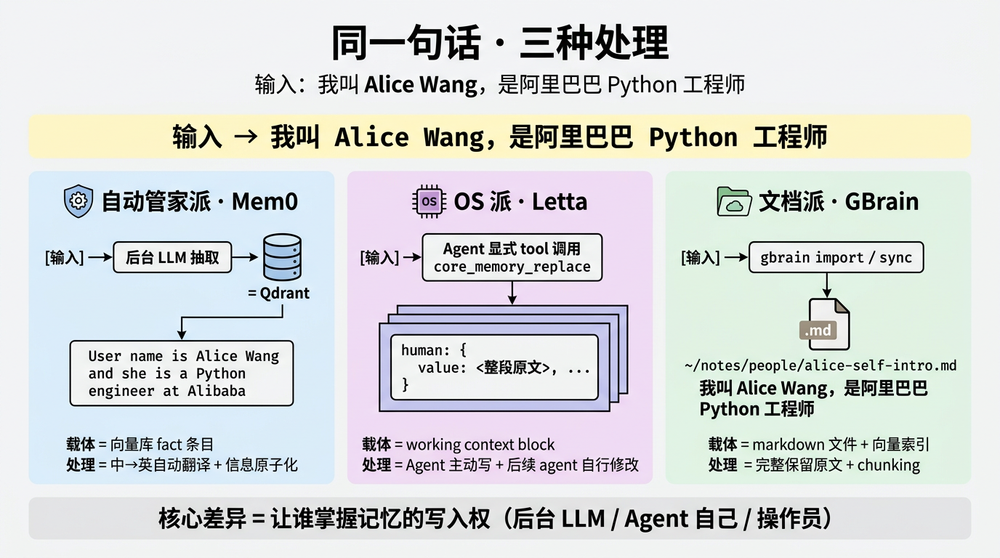

### 本集核心认知洞察（5 条）

| #    | 洞察                                                         | 实证来源                                        |
| ---- | ------------------------------------------------------------ | ----------------------------------------------- |
| 1    | **Agent 记忆 ≠ Context Engineering ≠ RAG**——三者是协作不是替代。Context Engineering 管 prompt 长度，RAG 查静态文档，Agent 记忆是持久 / 自我演化 / 跨会话的外部状态层 | §1b 三者关系表 + Anthropic context rot 官方背书 |
| 2    | **三派一图记住：自动管家派让后台 LLM 偷偷整理（Mem0）/ OS 派让 LLM 自己 page in/out（Letta）/ 文档派 markdown 即真相（GBrain）。三家不在一赛道，benchmark 互说暗示 LOCOMO 这类对比不可作选型主依据** | §1d 三派对比表 + LOCOMO 三方互怼数据            |
| 3    | **顶流工具不约而同选了文档派：Claude Code、OpenClaw、Cursor、Karpathy LLM Wiki、Anthropic Memory Tool 全部以 markdown 文件作为记忆真相——共性是用户控制权 / 可移植 / 可读 / 可调试。可见这等于你的项目也该选文档派——你型要回到 §1d** | §1e 顶流映射表                                  |
| 4    | **载体形态决定能做什么：同一句话三种处理直接展示了中→英自动翻译 vs 写入 working context vs 保留 markdown 原文在可移植性 / 可读性 / 可调试性上的不同优劣。技术上无最优解，trade-off 不同** | §2c / §3 / §4 实测 + 本节对照表                 |
| 5    | **默认配置 ≠ 生产配置：Mem0 默认 prompt 在生产上跑 32 天会 97.8% junk（issue #4573 实测），GBrain query expansion 也会带来 30s+，Letta retrieval-free key 失效。任何记忆系统在生产前都要看默认值、看 prompt、看 embedding model。Selective Forgetting 是 2026 全行业未解难题，所有现代系统在该点没优势，任务准确率最高 7%** | §1c 局限 4 + §2 / §3 / §4 各项目 watch-out      |

### 回到开场的问题

§1a 的开场提了一个问题——Claude Code、OpenClaw、Cursor 之所以做一周项目还能记得需求、升级版本后还能跑你之前的工作流，关键不在于 LLM 多强，而在于它们各自配了一套显式的 Agent 记忆系统。

到这一节，这个判断有了具体的拆解：

| 顶流工具              | 流派归属                  | 你现在能说出                                                 |
| --------------------- | ------------------------- | ------------------------------------------------------------ |
| Claude Code           | 文档派                    | `CLAUDE.md` 4 个作用域（Managed policy / User / Project / Local）+ Auto Memory，载体是 markdown 文件 |
| OpenClaw              | 文档派（多文件分层）      | `MEMORY.md` 长期 + `memory/YYYY-MM-DD.md` 每日 + `SOUL.md` 人格，2026.4.7 起还有 memory-wiki 结构化插件 |
| Cursor                | 文档派（带元数据）        | `.cursor/rules/*.mdc` + Team / Project / User 三级作用域     |
| Karpathy LLM Wiki     | 文档派（思想原型）        | Obsidian 笔记库 + LLM 维护 wiki，"PDFs is source code, wiki is binary" |
| Anthropic Memory Tool | 文档派（first-party API） | 6 个原语命令，client-side execution，由你的应用决定文件存哪  |

判断它们用什么记忆系统——上集要解决的就是这件事。

### 三派可以并存

需要再次明确：上集学的三派不是替代关系，是分工关系。一个稍复杂的 Agent 系统完全可以同时使

用：

- Mem0 管个性化用户偏好（客服 Agent / 助理 Agent 的记得"用户喜欢什么")

- Letta 跑长任务陪跑（编程助手 / 研究助手的"working context 自动 page in/out"）

- GBrain 当团队知识库（已有的 Obsidian / Cursor rules / CLAUDE.md 沉淀复用）


加上 RAG 查产品文档、Context Engineering 控制 prompt 长度，构成成熟 Agent 系统的完整记忆栈。
