<!-- 第 1 页 -->

# 2. Mem0 项目快速入门实战

Agent 记忆系统公开课（上集）· Part 2 · 自动管家派代表项目

## §2a Mem0：LLM 当后台管家自动整理记忆

§1d 把三派并排放在一张表里时，自动管家派对应的设计哲学是「LLM 在后台抽取事实做 CRUD」、写

入方式是「异步抽取 + LLM 自动判 ADD/UPDATE/DELETE/NOOP」。本节把这两行的代表项目 Mem0

完整展开——先说清它是什么、谁在用、论文怎么定义；再讲它内部的两阶段流水线机制；最后用上一

节 §1d 的「周末项目」例子把机制走一遍。部署细节和真实生产坑放在 §2b 跑通 hello world 之后再

讲，避免在概念阶段就被陷阱劝退。

### Mem0 三视角速览：流程 · 实例 · 优劣势

在深入项目背景和机制细节之前，先用三张图 + 三段文字把 Mem0 是什么、跑起来是什么样、好坏在哪

里——一次性看完。看完这一段，再往下读项目背景 / 主页矩阵 / 机制详解会更顺。

视角 1：用人话讲，Mem0 在干什么

想象你在做一个 AI 学习助教 SaaS。用户 alice 第一次跟 AI 说："我想做博客，对 Python 熟，喜欢简单

部署"。Mem0 在背后偷偷做的事是：

1. AI 助教把 alice 说的话变成几条"笔记"存进自己的记忆库——比如"alice 会 Python"、"alice 喜欢简

单部署"、"alice 在做博客项目"。这一步靠一次 LLM 调用完成，AI 自己判断哪些信息值得记

2. 这些笔记都带 alice 的名字（标签）——后续 bob、carol 跟同一个 AI 助教说的话不会混进 alice 的

笔记里

3. 第二天 alice 回来问"我之前想做什么项目"——AI 助教自动从 alice 的笔记里翻出"想做博客"那条

相关的笔记，把这条笔记作为背景塞进 prompt，主 AI 看到背景就能答对

下图把这套数据流完整画出来——左边是写入路径（用户聊天 → 笔记 → 入库），中间是笔记库（默认

用 Qdrant 向量数据库 + 每条笔记带归属标签），右边是读取路径（用户新问题 → 自动翻笔记 → 拼回

prompt → 主 AI 答复）：

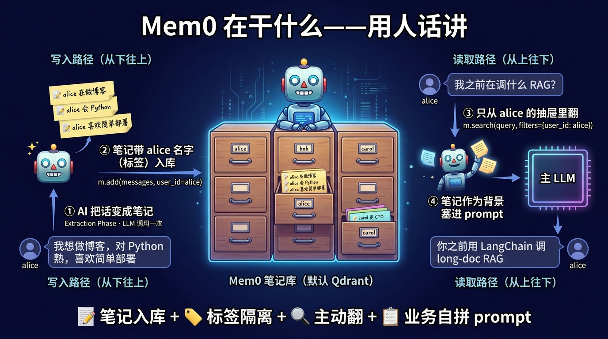

人话 vs 工程名词的对照（看完图之后想看技术细节时用）：

<!-- 第 2 页 -->

| 人话 | 内部叫什么 | 工具调用 |
| --- | --- | --- |
| AI 把话变成笔记 | Extraction Phase（抽<br>取阶段） | 第 1 次 LLM 调用 |
| 决定这条笔记是新增<br>还是改旧的 | Update Phase（决策<br>阶段） | 第 2 次 LLM 调用，输出<br>ADD/UPDATE/DELETE/NOOP |
| 笔记入库 | 写入向量数据库 | m.add(messages, user_id="alice") |
| 翻笔记找相关的 | 向量检索 + 标签过滤 | m.search(query, filters) |
| 把笔记塞进 prompt | 业务代码自己拼 | 不是 Mem0 自动做的 |

和 Letta 的本质差异——Mem0 翻出来的笔记不会自动塞进 prompt，业务代码自己决定塞几条、放哪

里；Letta 的工作笔记区是直接在 prompt 里 LLM 都看得到（§3a 已讲）。这是两条不同的设计哲学。

视角 2：换一组实际数据，这流程跑出来什么

用 §1d 周末项目 alice 的真实对话走一遍——周六 09:00 alice 说"我想做博客，对 Python 熟，喜欢简单

部署"，周六 15:00 改 Flask，周日 10:00 回来问"我之前在调什么 RAG"。下图按时间线展示对话经过

Mem0 处理后实际产出的 fact 内容、score 数值、调用次数、延迟：

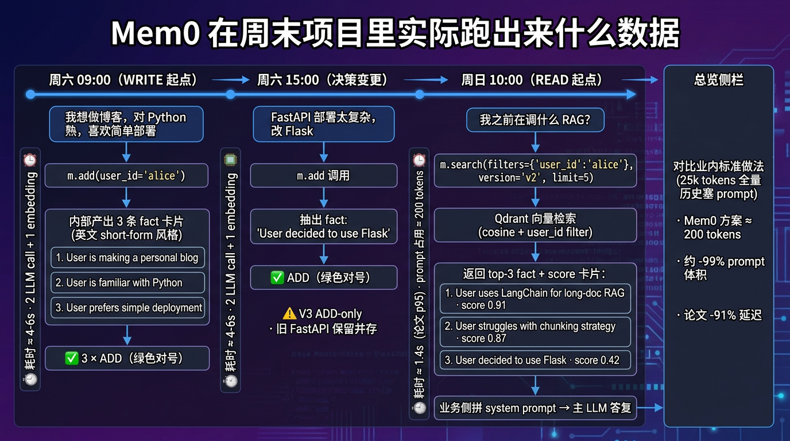

读图重点（这些数字会在 §2b / §2c 实操中被反复印证）：

| 指标 | 实际数值 | 含义 |
| --- | --- | --- |
| 单次 add 耗时 | 4-6 秒 | 含 2 次 LLM call + 1 次 embedding |
| 抽出 fact 条数 | 1-4 条不等 | LLM 决定，非确定性（V3 prompt 挑剔） |
| fact 文本格式 | 英文 short-form | 中文输入也翻译成英文 |
| 单次 search 耗<br>时 | ≈ 1.4s（论文 p95） | 远低于 full-context 17.1s |
| 返回 fact 条数 | ≤ limit （默认 10） | 业务方可调 limit / threshold |

<!-- 第 3 页 -->

| 指标 | 实际数值 | 含义 |
| --- | --- | --- |
| prompt 占用 | ≈ 200 tokens<br>（limit=5 ） | 对比业内标准 25k 全量历史塞 prompt 小约<br>99% |

视角 3：什么场景适合用 Mem0，什么场景容易翻车

不讲优劣势卡片，只讲场景：

✅ 这些场景非常适合用 Mem0 —— 它能解决你的核心问题

客服 SaaS 想给用户做个性化 —— alice 第二次咨询时 AI 能"认识她"，记得她的偏好、之前问过的

问题。Mem0 把"跨 session 记住用户"这件事变成两个 API 调用

多用户 chatbot 平台（Character.AI / Replika / 极客时间答疑助手类）—— 单 Agent 实例服务上

千用户，每个用户独立记忆。Mem0 的 user_id 隔离 + 向量库就是为这种场景设计的

个人 AI 助手 / 长期陪伴 Agent —— 跨周、跨月维持用户长期偏好（饮食 / 工作风格 / 兴趣）。

Mem0 的 ADD-only 风格在"只记不删"的场景反而是优势

多 Agent 协作系统 —— CrewAI / AutoGen 都内置 Mem0 集成。多个 Agent 共享同一用户的偏好

层，而各自的工作状态用 agent_id 隔离

想快速给现有 chatbot 接长期记忆 —— pip install mem0ai + m.add / m.search 两个 API 就

跑起来，所有派别里工程改造最少

⚠️ 这些场景用 Mem0 容易翻车 —— 应该选别的派

强一致性 / 可审计场景（金融交易、合规审计、法律咨询）—— Mem0 默认 ADD-only 会让"alice

跳槽前后的公司"都留在库里，主 LLM 在矛盾事实间猜，答错就是事故。这种场景选 Letta（OS

派）或 GBrain（文档派）

要求每条记忆可追溯（何时写、为什么写、谁写的） —— Mem0 的 m.add() 是黑盒：LLM 抽

fact 你看不见过程，没法 git blame、没法回滚。这种场景选 GBrain——所有改动走 git，可 diff、

可 revert

个人知识管理 / Markdown 笔记沉淀 —— 用户想直接读写自己的笔记，Mem0 把笔记锁在向量库

里看不见、改不了。这种场景选 GBrain——markdown 文件就是真相源，可以用 Obsidian /

VSCode 直接打开

长任务 stateful runtime（agent 跨 session 自动维持工作状态、自动 page in/out）—— Mem0

的笔记需要业务代码主动 m.search 拉回来；Letta 的 working context 直接在 prompt 里。这种

场景选 Letta

生产直接照用默认配置 —— 这不是翻车场景，是翻车原因：97.8% junk 真实坑（issue #4573）会

咬人。Mem0 上生产必须自己写 custom_fact_extraction_prompt + 治理脚本，否则 32 天后记

忆库 98% 是垃圾

下图把这两组场景并排放在一起，作为选型时的速查：

<!-- 第 4 页 -->

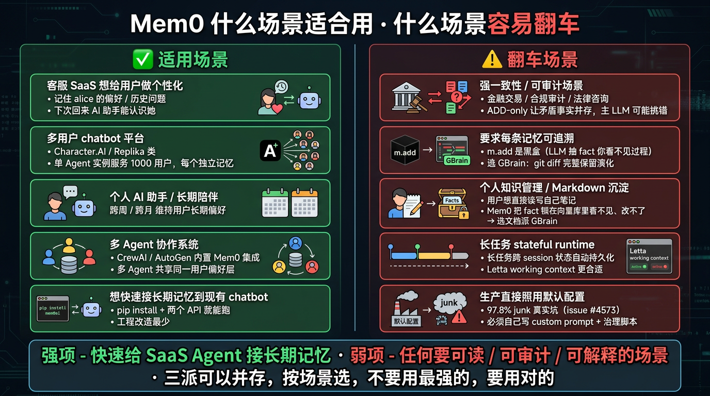

一句话总结：Mem0 的强项是"快速给 SaaS Agent 接长期记忆"，弱项是"任何要可读、可审计、

可解释的场景"。三派可以并存（§1d 已说），关键是用对地方而不是「用最强的」。

下面把这三张速览里提到的事实展开——项目背景、主页矩阵、机制流水线、生产坑——逐一深入。

### 项目背景

Mem0 由 Taranjeet Singh 和 Deshraj Yadav 在 2024 年 YC W24 创立，定位是 "AI Agent 的通用记忆

层"——目标是把"记住用户偏好、跨 session 持久化、自适应个性化"这套能力从每个 Agent 项目里抽出

来，做成可独立部署的 SaaS / OSS 双形态服务。

发展轨迹（截至 2026-05）：

| 时间点 | 里程碑 |
| --- | --- |
| 2024<br>Q1 | YC W24 加入，初版 OSS 发布 |
| 2025-<br>04 | Mem0 论文（arXiv 2504.19413） 首发，提出"抽取 + 决策"两阶段流水线 + LOCOMO<br>benchmark 实测 |
| 2025-<br>10 | 累计融资公布（ 3.9M Kindred Ventures 领投 + Series A $20M Basis Set<br>Ventures 领投，参与方含 Y Combinator、Peak XV Partners、GitHub Fund） |
| 2025-<br>12 | GitHub Stars 突破 50k，月度 API 调用达 1.86 亿次（创始团队对外披露） |
| 2026-<br>02 | OSS 主线升级到 2.0 系列，引入 ADDITIVE_EXTRACTION_PROMPT ，对 1.x 是 breaking<br>change |
| 2026-<br>04 | 推出"单次扫描分层抽取 + 多信号检索"算法，进一步压缩 token 与延迟 |

论文是它和其他记忆框架的最大差异——绝大多数同期项目（包括很多自动管家派同行）只有 README

没有 paper。Mem0 论文用 LOCOMO 数据集（10 个长对话 × 约 600 轮 × 约 26K tokens 每对话）跑过

一组实测对照：

<!-- 第 5 页 -->

| 方法 | p95 响应延<br>迟 | 存储 token<br>数 | J 指标（与人类标注对齐<br>度） |
| --- | --- | --- | --- |
| Full-context（整段历史塞进<br>prompt） | 17.117s | 26,031 | baseline |
| Mem0 | 1.440s | ~7,000 | 更高 |

p95 延迟降低 91%、存储 token 减少 73%，同时检索质量反而更高——这是 Mem0 给"用一次额外 LLM

调用做抽取，换上下文体积大幅压缩"这个 trade-off 的官方答案。

企业落地情况（2025-2026 年公开案例）：

客服 / 个人助手 SaaS：50k+ 开发者集成（来自 Mem0 官方公告），主要用于"记住用户偏好、跨

次会话延续"场景

多 Agent 系统：CrewAI 把 Mem0 作为默认记忆后端之一，AutoGen 与 AG2 提供官方集成示例

垂直领域：医疗、金融、教育平台的 AI 助手（SOC 2 Type II + HIPAA 合规打开了这些行业的采购

可能）

### 项目主页矩阵

记忆框架选型时第一件事是确认信息源齐全可信——下面 4 个官方页面就是 Mem0 的"完整入口"，建议

学员先把这四个标签页打开备用。

官网（mem0.ai）——最新功能、Pricing、Mem0 Cloud 入口、企业咨询通道。

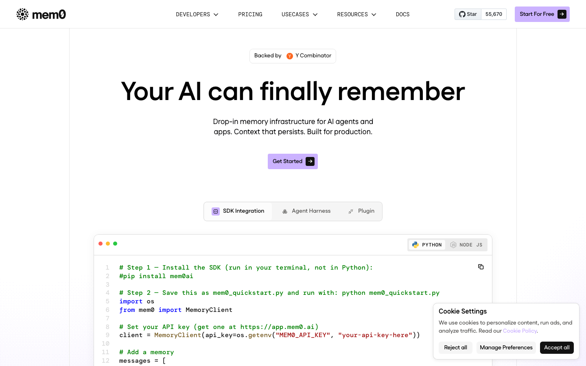

GitHub（github.com/mem0ai/mem0）——OSS 源码、issue 与社区讨论、Release Notes、贡献者

列表。所有 watch-out 都能在这里反查——比如 §1c 提到的 issue #4573 那份 97.8% junk 审计。

<!-- 第 6 页 -->

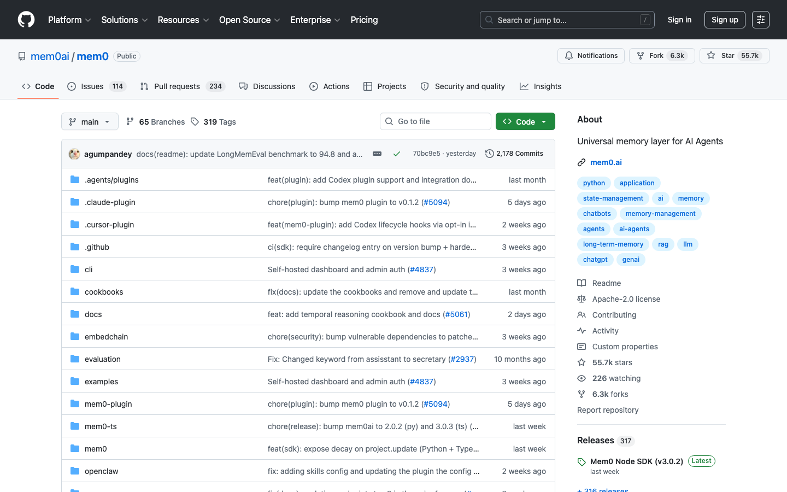

官方文档（docs.mem0.ai）——Platform Overview、API Reference、Migration Guide、Integration

列表。所有版本差异（如 1.x → 2.0 的 filters 写法变更）都以这里为准。

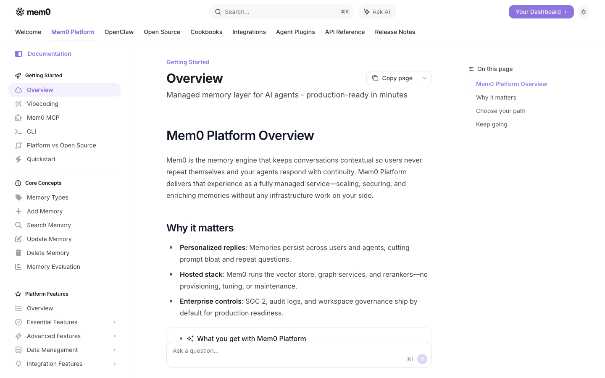

学术论文（arXiv 2504.19413）——"Mem0: Building Production-Ready AI Agents with Scalable

Long-Term Memory"，Chhikara 等 2025-04 首发，定义了抽取 + 决策两阶段流水线和 LOCOMO 测评

方法。本节后面讲机制时直接引用论文术语。

<!-- 第 7 页 -->

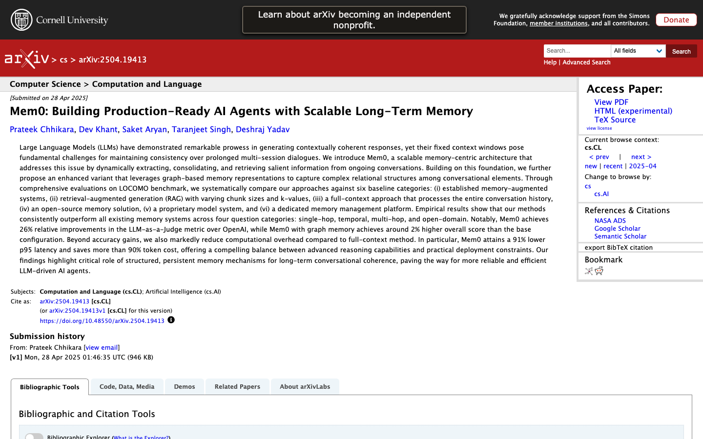

### 项目情况

把上面 4 个主页背后的关键事实压缩到一张表，作为后续选型对照用：

| 项 | 值 |
| --- | --- |
| 项目名 | Mem0（github.com/mem0ai/mem0） |
| 当前版本 | 2.0.2（OSS 主线，截至 2026-05 公开课录制周） |
| GitHub<br>Stars | 55.6k（截至 2026-05 公开课录制周） |
| 许可 | Apache-2.0 |
| 团队 | Mem0 Inc.（YC W24 校友，Taranjeet Singh / Deshraj Yadav 创立） |
| 学术血统 | Mem0 论文，arXiv 2504.19413（Chhikara 等，2025-04 首发） |
| 融资 | （ 3.9M 由 Kindred Ventures 领投 + Series A $20M 由 Basis Set<br>Ventures 领投，2025-10 公布） |
| 部署形态 | OSS 自托管（pip install mem0ai ）/ Mem0 Cloud SaaS（app.mem0.ai） |
| 客户端 | Python SDK（mem0 ）/ TypeScript SDK / REST API |
| 默认栈 | Qdrant（向量库）+ OpenAI gpt-5-mini（抽取与决策 LLM）+ text-embedding-3-<br>small（embedding，1536 维）+ SQLite（历史） |
| 合规 | SOC 2 Type II + HIPAA |

| 主流集成 | CrewAI、AutoGen、AG2、LangChain、LlamaIndex |

<!-- 第 8 页 -->

注：截至 2026-05 OSS 主线版本是 2.0.2；2.0 系列相对 1.x 是 breaking change（最显眼的是

search API 从 search(user_id=...) 改成 search(filters={"user_id": ...},

version="v2") ），网上很多 Mem0 教程写于 1.x 时代，照搬会拿到空结果。后续 §2b 会把这个

差异显式说清。

### 抽取 + 决策两阶段流水线

理解 Mem0 的核心是看清它每次 m.add(messages, user_id="zhang") 内部做了什么——这不是简

单的"把消息存进数据库"，而是 2 次 LLM 调用 + 1 次 embedding 的完整流水线。下面用 §1d 的「周末

项目」例子走一遍——学员对那个场景已经熟悉，正好用来印证机制。

回顾场景：周六 09:00 学员说"我想做博客，对 Python 熟，喜欢简单部署"，AI 推荐 FastAPI；周六

15:00 学员改主意 "FastAPI 太复杂，改 Flask"。下面看 Mem0 怎么处理。

阶段 1：Extraction Phase（抽取）

调一次 LLM，把当前消息对 + 对话摘要 + 最近若干条上下文（默认窗口 m=10）提炼成显著事实集合：

```text
周六 09:00 消息对：
user:      "我想做博客，对 Python 熟，喜欢简单部署"
assistant: "推荐 FastAPI，部署简单"
→ LLM 抽取（一次调用）:
fact_1: "User is making a personal blog"
fact_2: "User is familiar with Python"
fact_3: "User prefers simple deployment"
```

Mem0 默认的抽取 prompt 在 V3（2.0 系列）改名为 ADDITIVE_EXTRACTION_PROMPT ，源码在

mem0.configs.prompts 。它默认把对话事实翻译为英文 short-form 后存储

（use_input_language 默认 False）——这也解释了为什么上面的 fact 是英文。这是 §2b 演示

中"中文输入 → 英文 fact"现象的源头。

阶段 2：Update Phase（决策）

对每条抽出的 fact，从向量库查语义相似度最高的若干条已有记忆（默认 top 10），让 LLM 再调一次决

定四种操作之一：

| 操作 | 触发条件 | 周末项目场景示例 |
| --- | --- | --- |
| ADD | 新 fact 在已有记忆<br>中没有语义等价 | 周六 09:00 三条 fact 全部 ADD（库里之前没东西） |
| UPDATE | 新 fact 增强 / 细化<br>了某条已有记忆 | 假设已存 "User prefers Python"，新 fact "User is familiar<br>with Python for 5 years" 应触发 UPDATE（细化） |
| DELETE | 新 fact 与某条已有<br>记忆直接矛盾 | 周六 15:00 "改 Flask" 理论上应 DELETE 旧 "decided<br>FastAPI"——但 2.0 默认 ADD-only 不做这个判断 |
| NOOP | 已存在或与对话无<br>关 | 第二次说"我用 Python"——LLM 判定与库内重复 |

<!-- 第 9 页 -->

关键设计取舍：Mem0 2.0 的 ADDITIVE_EXTRACTION_PROMPT 把默认决策收敛到 ADD-only——

源码第一句就是 "Your sole operation is ADD" 。1.x 时代有自动 UPDATE / DELETE 决策

（FACT_RETRIEVAL_PROMPT + DEFAULT_UPDATE_MEMORY_PROMPT 两步），2.0 把它拿掉，

理由是"召回率优先于一致性"。后果是矛盾事实会并存——这就是 §1d 那张周末项目"自动管家派

60-75% 准确率"表中"主 LLM 在矛盾 fact 间猜"的源头。完整的 UPDATE / DELETE 决策依赖业务

侧自己用 update_memory_template 配合 m.add() 的可选参数触发，并不在默认管线里，§2c

会用真实数据印证。

隐藏成本

每次 m.add() 至少触发两次 LLM 调用（抽取 + 决策），加一次 embedding 调用。一段 5 轮对话的

add 通常耗时 4-6 秒（用 deepseek-chat 实测）。批量加载 100 条对话约等于 200+ 次 LLM 调用——成

本与时间需要纳入预算，这是用 LLM 当后台管家的代价。Mem0 提供 AsyncMemory 类用于异步化，调

用方式与 Memory 一致。

阶段 3：Retrieval Phase（检索）

写入流水线讲完，读取流水线对应——每次 m.search() 内部做什么、能带多少 fact 进 prompt、业务

侧怎么用召回结果。

继续周末项目场景：alice 周日 10:00 重新打开对话问"我之前在调什么 RAG 问题？"——业务侧怎么用

Mem0 答这个问题？

```text
# 一次完整的 search 调用
hits = m.search(
query="我之前在调什么 RAG 问题",
filters={"user_id": "alice"},   # 拉 alice 的 fact，不是全用户
version="v2",                    # 必填，2.0 API 铁律
limit=10,                        # 默认 10 条，可改
threshold=None,                  # 默认无门槛
)
# Mem0 内部三步：
#   1) query embedding ：用配置的 embedder 把 query 编成向量（一次 embedding 调用）
#   2) 向量检索        ：在向量库（默认 Qdrant）按 cosine similarity 检索 top-limit 条
fact
#   3) metadata filter ：按 filters 过滤——只返回 user_id=alice 的条目
#
# 返回结构：
hits["results"]
# [
#   {"memory": "User uses LangChain for long-doc RAG", "score": 0.91, "id":
"..."},
#   {"memory": "User struggles with chunking strategy", "score": 0.87, "id":
"..."},
#   {"memory": "User prefers Cursor over VSCode",       "score": 0.42, "id":
"..."},
#   ... 共 N 条（≤ limit）
# ]
```

召回结果怎么进 LLM prompt —— Mem0 不接管 prompt 构造，业务侧自己拼：

```text
# 业务侧拿到 hits 后自己拼 system prompt
context = "\n".join(f"- {h['memory']}" for h in hits["results"][:5])
```

<!-- 第 10 页 -->

```text
system = f"""你是 SaaS 学习助教。已知该用户的事实：
{context}
请基于这些事实回答用户问题。"""
resp = client.chat.completions.create(
model="deepseek-chat",
messages=[
{"role": "system", "content": system},
{"role": "user", "content": "我之前在调什么 RAG 问题？"},
],
)
```

这是与 Letta 的关键差异——Mem0 的检索是主动拉（业务侧自己 m.search() 、自己拼

prompt），Letta 是被动看（working context 自动在 prompt 里）。所以 Mem0 把"什么时候召

回、召回几条、塞到 prompt 哪个位置"这些决策全交给业务方，灵活度高、但也意味着这些决策

业务方要自己设计好。

带几条进 prompt？三个参数生产侧实际会调：

| 参数 | 默认值 | 调整动机 |
| --- | --- | --- |
| limit | 10 | 想要更多 / 更少 fact 进 prompt。limit=20 召回更全但 prompt<br>占用翻倍；limit=3 极简但容易漏掉关键 fact |
| threshold | None<br>（不过<br>滤） | 加 threshold=0.5 只保留相似度 ≥ 0.5 的 fact，过滤低相关性噪<br>声——score < 0.5 的 fact 通常是被强行召回的不同主题，进<br>prompt 反而干扰 LLM |
| filters | None | 按 user_id / agent_id / run_id 隔离命名空间，按<br>categories 按业务类别筛选（§2c 步骤 5 详谈） |

生产侧调优经验：limit=5 + threshold=0.5 是最常用组合——既控成本又保质量。低于 threshold

的 fact 不进 prompt 反而提升回答质量。

关于 limit 的 token 估算：每条 Mem0 fact 平均约 30-50 tokens（V3 prompt 默认抽英文 short-

form）。limit=5 ≈ 200 tokens 进 prompt，limit=20 ≈ 800 tokens。相比 §2c 步骤 1 算

的"业内标准 25k tokens 全量历史塞 prompt"，Mem0 召回方案的 prompt 体积小一个量级——

这是 Mem0 论文 91% 延迟降幅的来源。

### 架构示意

把抽取 / 决策两阶段流水线和默认存储栈整合在一张图上：

<!-- 第 11 页 -->

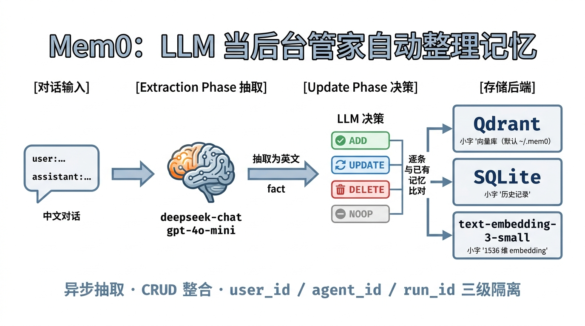

图中第 4 列的存储后端是 Mem0 OSS 默认配置——Qdrant 走 local mode 持久化在 ~/.mem0/ ，

SQLite 存历史变更，text-embedding-3-small 提供 1536 维向量。这三件套都是可替换的：换

Pinecone / Chroma / Milvus 改 vector_store.provider ，换 Anthropic / DeepSeek / Qwen

改 llm.provider ，换 Cohere / Qwen embedding 改 embedder.provider 。完整的可替换矩

阵在 §2d 速查给出。

### 本节涉及的核心概念

| 概念 | 一句话定义 |
| --- | --- |
| 自动管家派 | 用 LLM 当后台管家把对话异步提炼成结构化事实并做 CRUD<br>的 Agent 记忆设计范式 |
| Mem0 | 自动管家派的代表项目，2024 年 YC W24 校友 Taranjeet<br>Singh / Deshraj Yadav 创立 |
| Extraction Phase | Mem0 流水线第一阶段，调一次 LLM 把对话提炼成显著事<br>实集合 |
| Update Phase | Mem0 流水线第二阶段，对每条新 fact 与已有记忆比对后决<br>策 ADD / UPDATE / DELETE / NOOP |
| ADDITIVE_EXTRACTION_PROMPT | Mem0 V3（2.0 系列）默认抽取 prompt，源码在<br>mem0.configs.prompts ，默认 ADD-only 且翻译为英文 |
| LOCOMO benchmark | Mem0 论文使用的长对话记忆基准，10 个对话 × 约 600 轮<br>× 约 26K tokens 每对话 |
| Mem0 Cloud | Mem0 提供的 SaaS 形态（app.mem0.ai），SOC 2 Type II<br>+ HIPAA 合规 |

抽象的机制讲到这里。下面 §2b 把这一切跑起来——一条 pip install 、一段 config、一行 add()

——验证完概念再回头看默认配置下会撞上哪些真实生产坑。

<!-- 第 12 页 -->

## §2b 实操：装机、配 LLM、跑通 hello mem0

Mem0 的入门路径在三派代表项目里最短：一条 pip install 、一段 OpenAI 风格的 config、一行

add() 。本节按学员开发机的真实流程跑一遍，验证 deepseek-chat 通过 OpenAI 协议接入 Mem0、并

看到 Mem0 把中文对话自动抽取成英文事实存储的关键现象。后续 §2c 的客服 Agent 案例直接复用本节

产出的环境与数据。

### 前置条件

| 项目 | 要求 | 检查命令 |
| --- | --- | --- |
| Python | 3.10–3.12（本节用 3.11） | python3 --<br>version |
| 包管理器 | pip 或 uv （推荐 uv ，安装快 5–10 倍） | pip --version 或<br>uv --version |
| DeepSeek<br>API Key | 在 platform.deepseek.com 注册后申请（首次访问<br>见下方截图） | 写入下文 config |
| OpenAI API<br>Key | 仅用于 embedding（text-embedding-3-small ，<br>1536 维），不用 OpenAI 的 chat | 写入下文 config |
| 网络 | DeepSeek 国内可直连；OpenAI embedding 需经代<br>理 | 见下方「Mac 代理注<br>意」 |

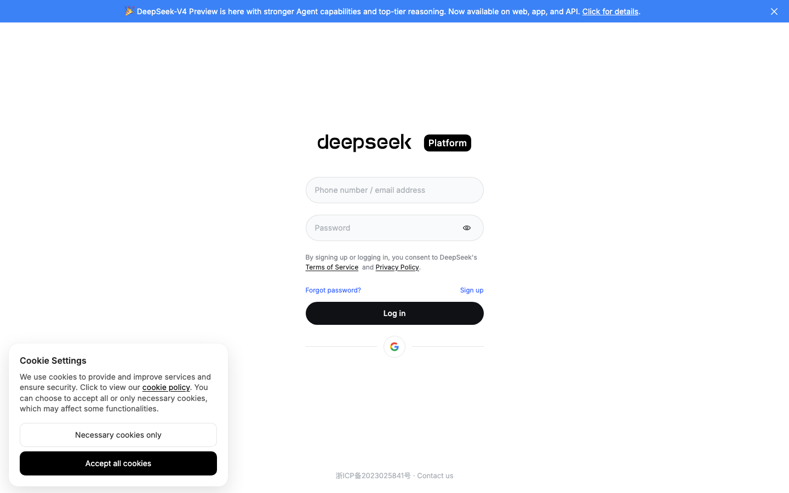

Mac 代理注意：若开了系统代理（如 http_proxy=http://127.0.0.1:10080 ），需要确保

NO_PROXY 包含 localhost,127.0.0.1 ，否则后续连本机 Qdrant 的请求会被代理误拦。下文示

例代码已显式设置。

<!-- 第 13 页 -->

关于演示用模型：本节固定用 deepseek-chat + text-embedding-3-small 。deepseek-chat

是 DeepSeek 提供的别名，截至 2026-05 实际指向 DeepSeek V4-Flash 的 non-thinking 模式

（同期 deepseek-reasoner 指向 thinking 模式）。DeepSeek 官方公告这两个别名将在 2026-

07-24 deprecated，届时迁移到显式名（如 deepseek-v4-flash ）。本节代码是"当下能跑"的

写法，2026-07 之后要按当时官方 Models & Pricing 页面 替换 model 字符串。

想换 OpenAI / Anthropic / Qwen 等其他 OpenAI 协议兼容的模型，只需改 config 里的

model 、openai_base_url 与 api_key 三个字段，其余流程不变。

### 步骤 1：装包

工作目录里建一个独立 venv，然后装 mem0ai 。本节用 uv ，命令也给出 pip 的等价写法。

```text
# 推荐：uv（快）
uv venv --python 3.11 .venv
VIRTUAL_ENV=$PWD/.venv uv pip install mem0ai
# 或：pip
python3.11 -m venv .venv
.venv/bin/pip install mem0ai
```

装包尾部输出（截取依赖列表的尾段）：

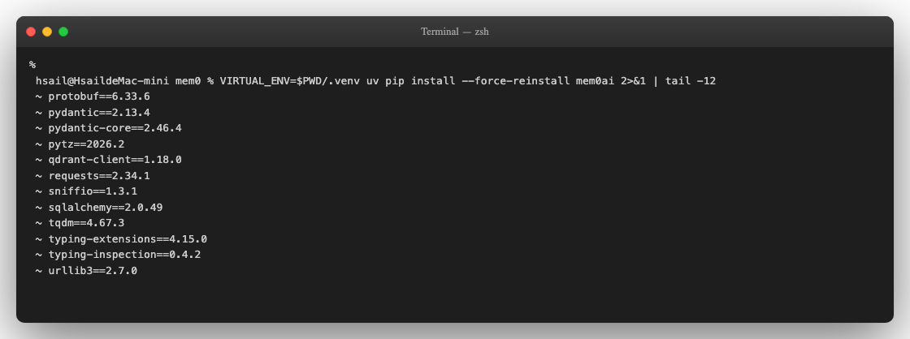

成功标志：装机过程不报红，最终列出 qdrant-client 、pydantic 、sqlalchemy 、tqdm 等依赖。

Mem0 默认用 Qdrant 作为本地向量库（持久化在 ~/.mem0/ ），无需单独装 Qdrant 服务。

关于 spaCy / fastembed 的提示：后续运行时会看到 Failed to load spaCy lemma model 与

fastembed not installed — BM25 keyword search disabled 两条 warning。这两个是可选

依赖（spaCy 做 NLP 词形还原、fastembed 做 BM25 关键词检索），不装也不影响向量检索。需

要这两项再 pip install mem0ai[nlp] fastembed 。

### 步骤 2：验证版本与 import

装完直接 import 一下，确认 Mem0 2.0 系列版本到位。

`.venv/bin/python -c 'import mem0; print("mem0 version:", mem0.__version__)'`

<!-- 第 14 页 -->

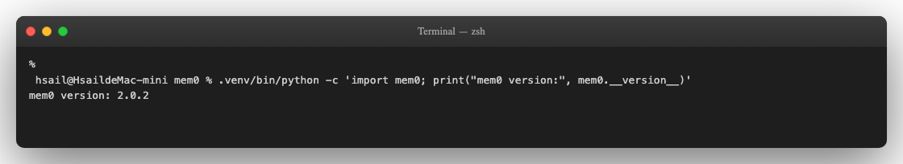

关键提醒（API breaking change）：本节所有代码都基于 Mem0 2.0 写。Mem0 1.x 与 2.0 的

search API 不兼容——1.x 写 m.search(query, user_id="alice") ，2.0 必须写

m.search(query, filters={"user_id": "alice"}, version="v2") 。网上很多 Mem0 教程

是 1.x 的，复制粘贴会拿到空结果但不报错。看到 pip show mem0ai 显示 2.0.x 后，请按本节

代码而非搜来的旧文章操作。

### 步骤 3：配 LLM 与 embedding，单独探活

把 mem0 的网络后端先各跑一遍，把鉴权 / 网络 / 模型名三类问题前置筛掉。下面这段代码做三件事：

导入 Mem0、用 DeepSeek API 跑一句对话、用 OpenAI API 取一次 embedding。

```text
# demo_step1_install_check.py
import os
# Mac 系统代理对 OpenAI 必须开（DeepSeek 走代理也能通），但本机服务要 NO_PROXY
os.environ["HTTPS_PROXY"] = "http://127.0.0.1:10080"
os.environ["HTTP_PROXY"]  = "http://127.0.0.1:10080"
os.environ["NO_PROXY"]    = "localhost,127.0.0.1,::1"
import mem0
print(f"mem0 version: {mem0.__version__}")
from openai import OpenAI
# DeepSeek (OpenAI 协议)
ds = OpenAI(api_key="sk-deepseek-...", base_url="https://api.deepseek.com/v1")
r = ds.chat.completions.create(
model="deepseek-chat",
messages=[{"role": "user", "content": "回答一个字：好"}],
max_tokens=8,
)
print(f"deepseek-chat ok: {r.choices[0].message.content}")
# OpenAI Embedding
oa = OpenAI(api_key="sk-proj-...")
e = oa.embeddings.create(model="text-embedding-3-small", input="hello")
print(f"text-embedding-3-small ok: {len(e.data[0].embedding)} dim")
```

执行：

`.venv/bin/python demo_step1_install_check.py`

<!-- 第 15 页 -->

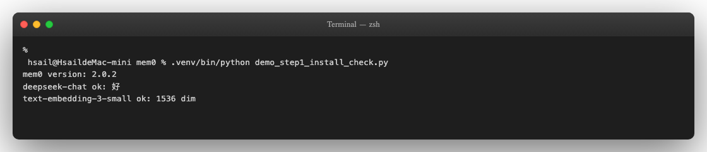

成功标志：三行连续 ok 输出。任何一行卡住或抛异常，先按下表对症排查：

| 现象 | 原因 | 解决 |
| --- | --- | --- |
| httpx.ConnectTimeout:<br>timed out 在<br>embeddings.create 这一步 | OpenAI API<br>国内直连超时 | 把系统代理开起来，并<br>os.environ["HTTPS_PROXY"]=... 同步<br>给 Python |
| 502 Bad Gateway 后续连本<br>机服务时 | 代理把<br>localhost<br>流量也劫走了 | 严格设置<br>NO_PROXY=localhost,127.0.0.1 |
| 401 Authentication Fails<br>from DeepSeek | API Key 错或<br>没有余额 | platform.deepseek.com → API Keys 与额<br>度页面确认 |
| 404 model not found from<br>DeepSeek | DeepSeek 模<br>型名拼错或别<br>名已下线 | 当下用 deepseek-chat （指向 V4-<br>Flash）；2026-07-24 后官方会下掉这个别<br>名，看 Models & Pricing 替换 |

### 步骤 4：跑通 hello mem0——5 轮对话喂入，看 Mem0 自动抽取

下面这段代码把"客服 Agent 与 Alice 的 5 轮对话"作为一次 m.add() 输入，由 Mem0 自动抽取事实。

这是后续 §2c 案例的最小骨架。

```text
# demo_step3_hello_mem0.py
import os
os.environ["HTTPS_PROXY"] = "http://127.0.0.1:10080"
os.environ["HTTP_PROXY"]  = "http://127.0.0.1:10080"
os.environ["NO_PROXY"]    = "localhost,127.0.0.1,::1"
OPENAI_KEY   = "sk-proj-..."
DEEPSEEK_KEY = "sk-..."
os.environ["OPENAI_API_KEY"] = OPENAI_KEY  # mem0 的 embedder 默认从这里取
from mem0 import Memory
m = Memory.from_config({
"llm": {"provider": "openai", "config": {
"model": "deepseek-chat",
"openai_base_url": "https://api.deepseek.com/v1",
"api_key": DEEPSEEK_KEY,
"temperature": 0.0,
}},
"embedder": {"provider": "openai", "config": {
"model": "text-embedding-3-small",
```

<!-- 第 16 页 -->

```text
"api_key": OPENAI_KEY,
}},
})
dialog = [
{"role": "user",      "content": "你好，我叫 Alice Wang，2021 年加入阿里通义实验
室，做 RAG 优化方向。"},
{"role": "assistant", "content": "你好 Alice！请问今天我能帮你解决什么问题？"},
{"role": "user",      "content": "我习惯用 Cursor 写代码，比 VSCode 顺手。最近在调
一个 LangChain RAG，长文档检索效果不好。"},
{"role": "assistant", "content": "对长文档 RAG，建议尝试 hierarchical chunking +
parent document retrieval。"},
{"role": "user",      "content": "好的，下周我会试。另外我对 Multi-Agent 系统很感兴
趣，有入门资料推荐吗？"},
]
# add 触发 Mem0 内部两步：① LLM 抽取事实 ② LLM 决策 ADD/UPDATE/DELETE/NONE
res = m.add(dialog, user_id="alice")
for ev in res["results"]:
print(f"[{ev['event']}] {ev['memory']}")
# search 用 2.0 的 filters 写法 + version='v2'
hits = m.search("Alice 喜欢用什么编辑器？",
filters={"user_id": "alice"}, version="v2")
for h in hits["results"][:3]:
print(f"score={h['score']:.3f}  {h['memory']}")
```

执行（先清空 ~/.mem0 保证干净起点）：

```text
rm -rf ~/.mem0
.venv/bin/python demo_step3_hello_mem0.py
```

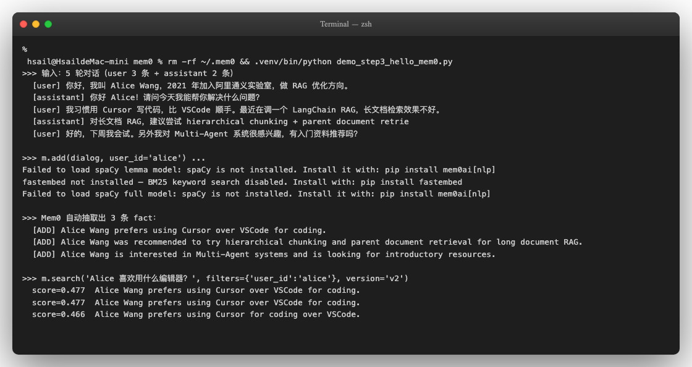

输出值得逐条看：

1. 抽出的 fact 全部是英文 short-form——输入是中文对话，Mem0 在内部把事实翻译为英文后存储

（如 "Alice Wang prefers using Cursor for coding over VSCode"）。这是 Mem0 抽取式记忆派

的典型行为，§2c 会作为高光对照演示。

<!-- 第 17 页 -->

Warning

关于抽取条数的非确定性：Mem0 V3 的抽取流水线是 LLM 驱动的，同一段对话每次跑出来的 fact

数量并不稳定——本截图实测产出 3 条，但学员实际复跑可能拿到 1-4 条不等（取决于 LLM 当时

对"哪些信息值得存"的判断）。这并非配置错误，是抽取式记忆派的固有特性。看到条数与截图不

一致不必紧张，下一步 m.search() 能查到 alice 名字 + Python 偏好即合格。

2. search 用中文 query 仍能命中英文 fact—— text-embedding-3-small 是多语种 embedding，

中英在向量空间相邻。学员不用提前自己翻译。

3. filters={"user_id":"alice"} + version="v2" 是 Mem0 2.0 的 search 写法，1.x 的

search(user_id=...) 在 2.0 不会报错而是被静默忽略，调试时会以为索引坏了——这是 Mem0

2.0 升级时最容易踩的坑。

### 本节产出与后续衔接

至此 2b 跑通的"成果"有四样：

| 产出 | 后续在哪里用 |
| --- | --- |
| .venv 里装好的 mem0ai 2.0.x | §2c 全程复用 |
| ~/.mem0/ 里 alice 的 3 条英文 fact | §2c 多用户演示对比基准 |
| 验证过的 deepseek + openai embedding 双 API 通路 | §2c 完整案例继续走这套配置 |

### Watch-out：跑通之后必须知道的真实生产坑

§2a 末段提过"部署细节和真实生产坑放在 §2b 跑通 hello world 之后再讲"——现在到了讲它们的位置。

下面 5 件事不是 Mem0 实现 bug，是 "让 LLM 在后台自动判什么该记"这条路线的工程代价。在把 §2b

这套环境推到生产之前必须看一遍。

1. 默认 prompt 抽一切——97.8% junk 的真实生产坑（架构性代价）

§1c 局限 4 提过的那份审计：跑 32 天后入库 10134 条记忆，逐条人工评估发现仅 38 条原样可用——

97.8% 是垃圾。垃圾来源不是抽取错了，而是默认 prompt 把"什么值得记"完全交给 LLM——心跳 /

cron 日志 / NO_REPLY 标记 / 系统配置全被存。更隐蔽的是反馈环：召回的记忆又被喂回抽取阶段，同

一条 "User uses she/her pronouns" 反复重抽多次。

呼应步骤 4 跑 hello world 时看到的"ADD 接连冒出"——刚跑出来很爽，但在生产环境会失控。这是

Mem0 不能直接 ship 生产的核心原因。生产侧两条缓解路径：

Custom Prompt：Memory.from_config({"custom_fact_extraction_prompt": "..."}) 替

换默认 prompt，明确告诉 LLM 只抽与你业务相关的几类事实

Conditional Persistence：在 m.add() 之前用一个轻量分类器过滤，决定是否进入抽取——社

区 fork 已有相关实现，issue #4573 评论区也有官方对该问题的迁移指引

2. V3 ADDITIVE_EXTRACTION_PROMPT 比 1.x 更挑剔——单条裸字符串频繁 
NOOP

Mem0 2.0.2 的 V3 默认 prompt 比 1.x / 早期 2.0 都更挑剔——单条裸字符串 m.add("我用 Python 5

年了", user_id="alice") 在 deepseek 上常返回 {"results": []} （NOOP）。稳妥做法是

messages 数组 + 多轮上下文 + 信息密度高的内容。这个设计趋势是 Mem0 团队主动收紧"什么算值得

记的事实"——同样数据下 gpt-4o-mini 抽取也比早期版本保守。

<!-- 第 18 页 -->

3. 2.0 是 breaking change——search API 静默 fallback

步骤 2 已经强调过的坑：m.search(query, user_id="alice") （1.x 写法）在 2.0 不会报错——它会

被静默忽略，返回全用户混合结果。正确写法是 m.search(query, filters={"user_id":

"alice"}, version="v2") 。网上 2024 年的 Mem0 教程绝大多数是 1.x 的，复制粘贴会以为索引坏

了——实际是 silent fallback。

4. 默认 model 在 OpenAI 协议兼容场景可能失效

Mem0 2.0 OSS 不显式配置时默认 LLM 是 OpenAI gpt-5-mini。在两类场景会出问题：

OpenAI key 余额不足或被限流——抽取阶段直接抛 401 / 429，整个 add 失败

走 DeepSeek / Qwen 等 OpenAI 协议兼容 endpoint——某些模型不支持 GPT-5 系列特有的

max_completion_tokens 参数，会抛参数不支持错

显式指定 LLM provider 是必做项——步骤 3 的 Memory.from_config({...}) 配置可以直接复用。

5. m.add() 同步阻塞 4-6 秒——批量加载要预算时间

每次 m.add() 至少触发两次 LLM 调用 + 一次 embedding 调用。5 轮对话约 4-6 秒（deepseek-chat

实测）。批量加载 100 条对话 ≈ 200+ 次 LLM 调用——成本与时间不能忽略。生产环境用

AsyncMemory 异步化（调用方式与 Memory 完全一致）是必备做法。

默认存储位置

默认在 ~/.mem0/ （Qdrant local mode）。演示完想清空重来直接 rm -rf ~/.mem0 即可。生产环境

换远程 Qdrant / Postgres + pgvector 的写法见 §2d。

## §2c 案例：技术学习 SaaS AI 助教——单 Agent 实例服务
多用户

§2b 跑通了 Mem0 单用户最小骨架。本节把它放到一个真实的 SaaS 产品架构里——一个 AI 学习助教平

台，单 Mem0 实例服务多个独立用户——并演示 Mem0 在产品级落地时真正发挥差异化价值的三个核

心功能（不是 add/search 那种基础）：

1. 四范围记忆模型（user_id / agent_id / run_id / app_id ）—— 单实例多 scope 隔离，SaaS

产品架构基石

2. Custom Categories + 按类别筛选检索 —— 让 fact 按业务维度归档，避免噪声干扰精准推荐

3. get_all + metadata 时间过滤 + delete 治理 —— 生产运营时的批量管理与遗忘策略

这三个功能合起来覆盖了"产品架构 / 检索精准度 / 生产治理"的完整链路，是把 Mem0 真正用起来的"三

件套"——比 add/search 深得多。

### 真实场景：SaaS 产品架构挑战

设想你在做一个面向技术工程师的 AI 学习助教 SaaS（类似极客时间的内置答疑助手、Coursera

Coach、ChatGPT 的 Custom GPT）。产品架构核心特征：

| 维度 | 说明 |
| --- | --- |
| Agent 实<br>例 | 一个核心 Agent 模板（"友好的技术学习助教"），服务整个平台所有学员 |

<!-- 第 19 页 -->

| 维度 | 说明 |
| --- | --- |
| 用户规模 | 1000+ 注册用户，每人独立的学习路径 + 卡点 + 工具偏好 |
| 典型交互 | 学员发起会话 → Agent 答疑 / 推荐 / 校对 → 关掉、第二天再来 |
| 架构约束 | 不可能为每个用户起一个 Agent 进程（成本爆炸）；也不可能把所有用户对话塞同一<br>context（context window 几小时就撑爆 + 跨用户串台） |
| 真正的需<br>求 | 单 Agent 实例 + 多用户独立持久记忆 + 跨 session 个性化 |

这个产品架构在 SaaS 行业是普遍模式——Character.AI、Replika、Notion AI、Cursor 的 Personal

Memories 都是同一类。本节用这个真实场景把 Mem0 的三个核心功能演示透。

### 演示数据集：3 用户 × 50 条 × 5 主题 = 150 条预生成对话

本节用预生成的数据集 experiments/data-gen/output/mem0/conversations.jsonl 。这份数据规

模虽小但设计有讲究——拆开看：

数据集字段与规模

```text
{"user_id": "alice", "content": "我在用LangChain做RAG，但长文档总是丢上下文，怎么优
化？"}
{"user_id": "bob",   "content": "周末写博客时总想引用论文，但看论文效率低，有没有速读工具推
荐？"}
{"user_id": "carol", "content": "我想让 Agent 能自动对比新旧合同版本的差异，类似
diff。"}
```

每条 jsonl 包含 user_id 和 content 两个字段（精简模式，便于 Mem0 直接喂入）。规模 3 用户 ×

50 条 = 150 条。

三个用户角色（真实背景）

| user id<br>_ | 角色背景 | 数据特征 |
| --- | --- | --- |
| alice | 阿里通义实验室基础架构组高级 Python<br>工程师，5 年 Python 经验，RAG 优化<br>方向 | 覆盖 RAG 优化 / FastAPI 性能 / Qwen-VL<br>集成 / Multi-Agent 学习 / P7 晋升 / 工具<br>偏好 |
| bob | 腾讯反欺诈团队 Python 工程师，4 年<br>Go 后端经验，转向 LLM 应用方向 | 覆盖反欺诈实时性 / LLM 推理延迟 / Go<br>工具栈 / 学习路径 / 周末博客 / 引用论文 |
| carol | AI 法律科技公司 CTO（曾任腾讯产品经<br>理 + 字节技术负责人，清华本 + 斯坦福<br>硕） | 覆盖合规要求 / 合同 diff 工具 / 国内云部<br>署 / Node.js + React 栈 / 团队管理 / 商务<br>对接 |

主题分布（覆盖广度）

每个 user 的 50 条对话横跨 5 大主题——这是设计上有意为之的：单一主题（如只覆盖"技术问题"）无

法演示 Custom Categories 按类别归档的价值。

<!-- 第 20 页 -->

| 主题类别 | 内容样例 |
| --- | --- |
| 技术问题 | RAG / FastAPI / Qwen-VL / LangChain / Vector DB |
| 工作场景 | 团队协作 / 系统设计 / 性能调优 / 上线流程 |
| 工具偏好 | 编辑器（Cursor / VSCode / Vim）/ LLM 框架 / 部署平台 |
| 学习与成长 | 学习路径 / 课程推荐 / 论文阅读 / 技能图谱 |
| 个人偏好 | 周末活动 / 沟通风格 / 时间管理 / 长期目标 |

检查数据集就绪

```text
head -3 experiments/data-gen/output/mem0/conversations.jsonl
wc -l experiments/data-gen/output/mem0/conversations.jsonl
python3 -c '
import json
from collections import Counter
d = [json.loads(l) for l in open("experiments/data-
gen/output/mem0/conversations.jsonl")]
print("by user:", Counter(x["user_id"] for x in d))
'
```

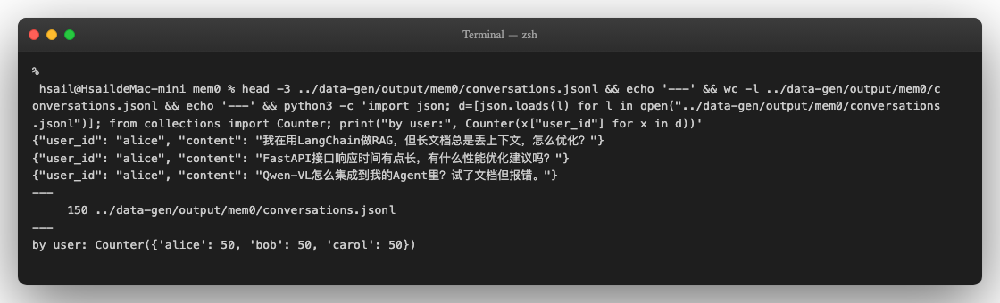

成功标志：3 行 sample 都是 {"user_id": ..., "content": ...} 格式，wc -l 报 150，三个 user

各 50 条。

### 步骤 1：业内标准做法 + 它在哪三种场景撞墙

讲 Mem0 价值之前先把业内已有的方案讲清楚——不上 Mem0 的话，SaaS 多用户场景的标准做法是给

每个用户分配独立的 conversation session，每次 API 调用拼装该用户的对话历史。这种做法根本不会

出现跨用户串台——因为 user A 的 session 和 user B 的 session 在数据层就完全隔离了。

业内标准做法：Per-user Session + 数据库存对话历史

OpenAI 官方推荐的 Responses API 是这条思路的官方实现；Redis、PostgreSQL、MongoDB 也广泛

用作 conversation history 后端（Azure Redis 官方教程）。一个最小可工作的实现：

```text
# 业内标准做法（不上 Mem0）：每个用户独立 session
import json, redis
from openai import OpenAI
client = OpenAI(api_key=DEEPSEEK_KEY, base_url="https://api.deepseek.com/v1")
r = redis.Redis()
```

<!-- 第 21 页 -->

```text
SYSTEM_PROMPT = "你是 SaaS 平台的 AI 学习助教，回答用户的技术问题。"
def chat(user_id: str, message: str) -> str:
# 1. 从 Redis 拿该用户的对话历史
history_key = f"conv:{user_id}"
history = json.loads(r.get(history_key) or "[]")
# 2. 加入当前消息
history.append({"role": "user", "content": message})
# 3. 调 LLM，把该用户的全量历史塞 prompt
resp = client.chat.completions.create(
model="deepseek-chat",
messages=[{"role": "system", "content": SYSTEM_PROMPT}, *history],
)
answer = resp.choices[0].message.content
# 4. assistant 回复也写回 Redis
history.append({"role": "assistant", "content": answer})
r.set(history_key, json.dumps(history))
return answer
# alice 和 bob 的 session 在 Redis 里物理隔离（不同 key），LLM prompt 里也只看到当前用户
的对话
chat("alice", "我喜欢用 Claude Code")
chat("bob",   "你之前提过我喜欢什么编辑器？")   # bob 的 prompt 里没有 alice 的偏好
```

这个方案在用户对话量小、单 session 时长短时完全够用——大量生产 SaaS 都跑在这上面，不需要任

何记忆框架。

但当业务规模和时长上去之后，这条标准做法会在三种场景撞墙——下面三个痛点是 Mem0 在标准做法

之上真正解决的问题，不是用 Mem0 替代 session，而是叠加在 session 之上。

痛点 1：单用户长对话累积 → context 爆炸 + 成本飙升

alice 在你的 SaaS 助教上活跃 30 天，累积 200+ 轮对话（≈ 25k tokens）。每次她发新消息：

API 调用塞 25k tokens 历史 + 几百 tokens 新消息 → 每次调用都在为"重传历史"付费

假设每天 5 轮对话 × 30 天 × 1000 用户：全平台 ~75% 的 token 成本花在重传历史上

单次首 token 延迟随 attention 矩阵规模 O(n²) 增长——25k tokens 的 prompt 比 1k tokens 慢一

个数量级

业内常见对应做法：滑动窗口（只留最近 20 轮）+ 手动摘要前面对话（Context Window Management

Strategies）。但滑动窗口会丢早期重要 fact（如"alice 是阿里通义的 Python 工程师"），手动摘要的质

量决定记忆质量——做不好就是 alice 第 50 轮被问"你叫什么名字"。

痛点 2：长 context 下 context rot → 召回准确率下降

即使学员愿意为长 context 付钱，LLM 在长 context 里的召回精度本身就在下降——这是 Anthropic

2026 官方研究的 context rot 现象（§1b 已展开）。在 SaaS 助教场景：

<!-- 第 22 页 -->

```text
alice 周一聊：
"我在阿里通义实验室做 Python 工程师，调 long-doc RAG 用 LangChain"
"我特别喜欢 Cursor，因为 LSP 集成最好"
... 累积到 50 轮 ...
alice 周五新会话直接问：
"我之前提过我喜欢什么编辑器？"
业内标准做法：把周一到周四全部 50 轮历史拼成 messages 数组传 LLM
后果：context rot——25k tokens 中召回特定 fact 的准确率约 70-80%（Claude Opus 4.6 在 1M
token 实测 MRCR v2 准确率 76%）
学员体验：每 5 个学员就有 1 个被回答"你之前没提过"——明明历史里有
```

痛点 3：多端 / 多 Agent 状态同步 → 标准 session 表达不出层次

业内标准 session 是一份扁平的 conversation history——它表达不出"哪些是用户长期偏好（跨端共

享）、哪些是当前 Agent 的 working state（不跨 Agent）、哪些是本次会话临时状态（结束即丢）"这

种层次。

具体场景：

```text
alice 在 web 端用「助教 Agent」聊 RAG（应该跨端共享 alice 的 Python 偏好 + 助教 working
state）
↓ 切到 mobile 端，用「推荐 Agent」找 Multi-Agent 课程
业内做法：所有内容都在一份 alice 的 conversation history 里
后果：
- alice 在 web 端"调 LangChain"的卡点污染 mobile 端的「推荐 Agent」prompt → 错误推荐
LangChain 入门课
- 如果想隔离 Agent，必须自己额外建一层 agent_id → conv_id 映射，工程量翻倍
- 跨 Agent 共享 alice 的"喜欢 Python + 简单部署"偏好，又要自己再建一层
user_preferences 表
```

Mem0 的真正位置

Mem0 不是替代 per-user session（那个继续用 Redis / Postgres），而是叠加在标准 session 之上

的"结构化长期记忆层"：

| 角色 | 业内标准做法 | Mem0 在其上叠加什么 |
| --- | --- | --- |
| 短期对话历史（当前<br>会话 / 最近 N 轮） | Redis + conversation id<br>_ | 不替代——继续用 session |
| 长期用户事实（偏好 /<br>身份 / 长期目标） | ❌ 没有——只能让 LLM 在长<br>context 中自己找 | ✅ Mem0 抽取成结构化 fact，按<br>query 智能召回 top-k（5-10 条） |
| 多 Agent / 多端层次 | ❌ 扁平 conversation history | ✅ 四范围记忆模型（user id /<br>_<br>agent id / run id / app id）<br>_ _ _ |
| 类别归档与精准检索 | ❌ 无 | ✅ Custom Categories |
| 批量治理 / 衰减清理 | ❌ 手动写脚本 | ✅ get all + metadata 时间过滤 +<br>_<br>delete |

<!-- 第 23 页 -->

真正的演进路径：

```text
方案 0：什么都不做，每次 API 调用都重传全量历史               ← 业内门槛最低
方案 1：滑动窗口 + 手动摘要                                ← 业内中级方案
方案 2：RAG over conversation history（向量化历史 + 召回）  ← 业内进阶方案
方案 3：用 Mem0 等专门记忆框架                             ← 本节要演示的
```

下面三个步骤把方案 0/1/2 解决不了的问题用 Mem0 跑一遍——注意演示的 alice / bob / carol 三人对

话是为了把"长期 fact 抽取 + 多用户 + 多 Agent 隔离"等场景压缩在公开课时长内可演示，不是用三个

用户 demo Mem0 解决"用户隔离"（用户隔离 Redis 已经做了）。

### 步骤 2：基础——用 m.add() 把对话抽成结构化长期 fact

针对步骤 1 的痛点 1+2（长对话 context 爆炸 + context rot），Mem0 的核心动作是：让对话经过抽取

阶段沉淀为结构化长期 fact——之后 LLM 不再看原始对话历史，只看 Mem0 召回的几条相关 fact。下

面给三个用户各喂入 6 条"自我介绍 + 工作场景 + 偏好"对话，让 Mem0 真做一次抽取，看看长 context

是怎么被压缩成 fact 库的。

注：user_id 在这里的作用是"给 fact 打用户归属标签"——后续 m.search() 时按 user_id 拉

回该用户的 fact 库，与步骤 1 的 Redis session 隔离机制是两个维度（前者管"长期 fact 归属"、后

者管"短期对话历史归属"）。两者叠加使用——不是替代关系。

```text
# demo_2c_resolution.py 的核心
PROFILES = {
"alice": [
"我是华中科技大学本科毕业，2021 年校招进的阿里。",
"我在通义实验室基础架构组，做高级 Python 工程师。",
"我特别喜欢用 Claude Code 来做架构思考，比 Cursor 顺手。",
"我不喜欢过度抽象的框架，黑盒系统让我头疼。",
"我正在负责一个内部知识 Agent，给销售团队用，要支持多轮对话。",
"我今年想晋升 P7，需要拿出一个完整的 Multi-Agent 项目。",
],
"bob": [
"我是 Bob Chen，腾讯反欺诈团队的 Python 工程师，今年 31 岁。",
"我后端用 Go 写了四年多，调优经验挺多，但大模型这块完全新手上路。",
"反欺诈需要实时，LLM 推理延迟不能超过 200ms。",
# ... 6 条
],
"carol": [
"我本科清华，硕士斯坦福 CS，回国后做过腾讯产品经理和字节技术负责人。",
# ... 6 条
],
}
for uid, items in PROFILES.items():
msgs = []
for txt, reply in zip(items, ASSIST_REPLIES[uid]):
msgs.append({"role": "user", "content": txt})
msgs.append({"role": "assistant", "content": reply})
res = m.add(msgs, user_id=uid)            # ← 关键：user_id 把三人完全隔离
facts = [ev for ev in res["results"] if ev["event"] == "ADD"]
```

<!-- 第 24 页 -->

关键操作：必须 rm -rf ~/.mem0 /private/tmp/qdrant 后再跑。Mem0 默认把元数据放在

~/.mem0 ，但 qdrant 向量库默认存在 /tmp/qdrant ——只清前者会让旧 fact 残留并污染新加

载的 existing memories，三个用户里只有第一个能正常 ADD，后两个会被 LLM 误判"已存在"。

运行结果（21 条 fact 全部完成中→英自动翻译）：

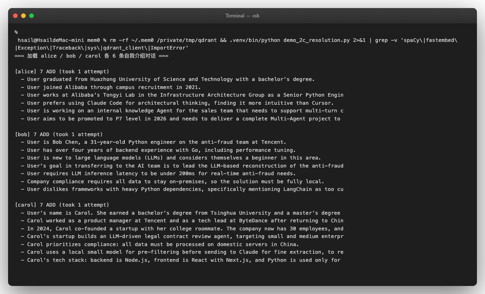

值得逐项看的几个点：

1. alice 的 7 条 fact 把 6 条对话拆成更细的事实。最后一条对话「想晋升 P7 + Multi-Agent 项目」被

拆成"P7 目标"和"需要交付一个 Multi-Agent 项目"两条 fact。这是 Mem0 V3 的"信息原子化"特性

——一句话里多个独立维度会被拆成多条 fact。

2. bob 的 7 条 fact 中，"31 岁 + Python 工程师 + 腾讯反欺诈"被合并成一条信息密集的 fact。同一

句话里强相关的属性会被打包，弱相关的会被分拆——分合标准由 LLM 在抽取时即时判断。

3. carol 的 7 条 fact 全部以 "Carol" 开头（不是 "User"），因为她在第一条就给出了名字。bob 同样

给了名字但只有第一条用 "Bob Chen"，后续都用 "User"——这种命名一致性的小不稳定，是

Mem0 默认 prompt 在 deepseek 上的常见现象，不会影响检索。

4. 全部 21 条 fact 都是英文——这是 Mem0 默认 prompt（V3 ADDITIVE_EXTRACTION_PROMPT）

的下游效果，源码里的 use_input_language 默认 False。需要中文 fact 的话要手动构造 custom

prompt 或换用 mem0.configs.prompts 里的旧版 USER_MEMORY_EXTRACTION_PROMPT 。

### 步骤 3：基础验证——用 m.search() 按用户拉 top-k 相关 fact

步骤 2 已经把对话沉淀进 fact 库。下面验证关键的读取行为——给同一句 query，Mem0 在每个用户的

fact 库里独立做语义检索，只返回该用户的相关 fact。这一步对应步骤 1 痛点 2 的解法：主 LLM 的

prompt 不再塞全量对话历史，只塞 top-k 召回的相关 fact。

```text
# demo_2c_search_isolation.py
QUERY = "工作中遇到的关键技术挑战是什么？"
for uid in ("alice", "bob", "carol"):
hits = m.search(QUERY, filters={"user_id": uid}, version="v2")
for h in hits["results"][:3]:
print(f"  score={h['score']:.3f}  {h['memory'][:90]}")
```

<!-- 第 25 页 -->

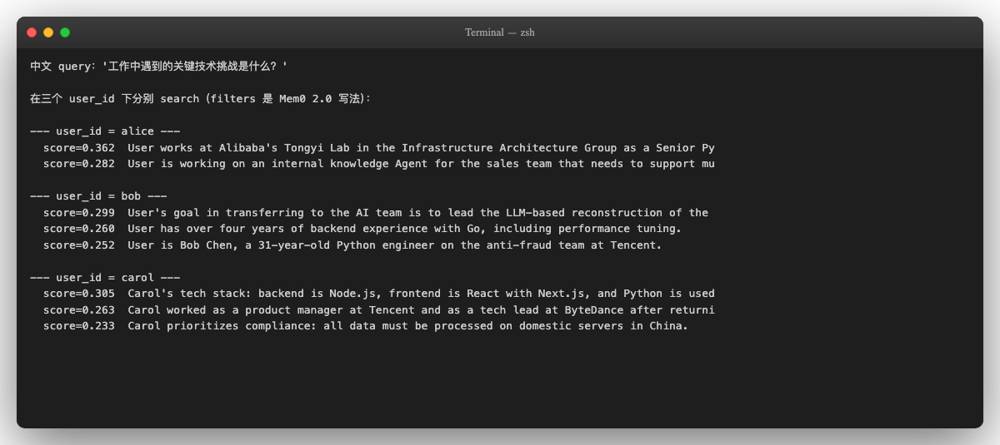

每个用户都拿到与 query 相关的 top-3 fact，且只来自自己的 fact 库：

| user id<br>_ | top-3 fact 主题 |
| --- | --- |
| alice | 阿里通义实验室高级 Python 工程师 / 销售团队知识 Agent |
| bob | 转 AI 团队主导反欺诈系统 LLM 化重构 / Go 四年后端经验 |
| carol | Node.js + React 技术栈 / 腾讯字节经历 / 国内合规要求 |

到这里步骤 1 痛点 1+2 的核心闭环已经跑通——对话经过抽取沉淀为 fact、按 query 智能召回 top-k

——LLM 不再需要在 25k tokens 长 context 中自己找东西。alice 累积 200 轮对话后再来问问题，主

LLM 的 prompt 只需要 5-10 条相关 fact（约 500-1000 tokens），既省钱又避开了 context rot。

2.0 API 关键铁律：必须写 m.search(query, filters={"user_id": uid}, version="v2") 。

Mem0 1.x 的 m.search(query, user_id=uid) 在 2.0 不会报错——它会返回全用户的混合结

果。这个 silent fallback 是 §2b 提过的、在升级 Mem0 版本时最容易踩的坑。

到这里基础"抽取 + 召回"闭环已经搞定，但步骤 1 的痛点 3（多 Agent / 多端层次表达不出）还没

解决—— user_id 只是 Mem0 四范围记忆模型的第一个维度。下面三个步骤展开 Mem0 在产品

级真正发挥差异化价值的三个核心功能——四范围记忆模型 / Custom Categories / 生产治理。

### 步骤 4：核心功能 ① — 四范围记忆模型（user_id / agent_id / 
run_id / app_id）

user_id 只是 Mem0 四范围记忆模型的第一个维度。SaaS 产品架构通常需要更细颗粒——同一个用户

在不同 Agent / 不同会话 / 不同 App 端的状态都应该独立隔离。Mem0 的四范围让单个实例同时承载这

四个隔离维度。

四个 scope 的语义

| Scope | 隔离粒度 | 典型应用 |
| --- | --- | --- |
| user_id | 一个用户独立记忆 | 跨 session 持久化的个人偏好（已在步骤<br>2-3 演示） |
| agent_id | 同一用户下不同 Agent 的 working<br>state 隔离 | SaaS 平台多 Agent 服务（助教 / 推荐 / 校<br>对 Agent） |

<!-- 第 26 页 -->

| Scope | 隔离粒度 | 典型应用 |
| --- | --- | --- |
| run_id | 单次任务执行的短期记忆 | 单次答疑会话的 working memory，结束<br>后可丢弃 |
| app_id | 应用级命名空间 | 同一公司 web 端 / mobile 端 / 桌面端隔离 |

生产场景下的组合用法

```text
# 学员 alice 在 web 端用助教 Agent 发起一次答疑会话
m.add(messages,
user_id="alice",
agent_id="tutor",
run_id="session-2026-05-14-001",
app_id="learnsmart-web")
# 检索时按业务需求组合 scope
# 案例 A：学员个人偏好（跨 agent / 跨 run，长期个性化的核心数据）
m.search("学习偏好", filters={"user_id": "alice"}, version="v2")
# 案例 B：本次答疑会话的 working memory（短期，run 结束后可清理）
m.search("刚才问的问题", filters={
"user_id": "alice",
"run_id": "session-2026-05-14-001"
}, version="v2")
# 案例 C：alice 在助教 Agent 下的所有交互（排除推荐 / 校对 Agent 的污染）
m.search("助教对话历史", filters={
"user_id": "alice",
"agent_id": "tutor"
}, version="v2")
```

演示：用同一用户喂入两个 agent_id 看 working state 隔离

```text
# alice 用助教 Agent 学习 long-doc RAG
m.add([
{"role": "user", "content": "我在调 LangChain 的 long-doc RAG，效果不好"},
{"role": "assistant", "content": "建议试试 hierarchical chunking..."},
], user_id="alice", agent_id="tutor")
# alice 同时用推荐 Agent 找 Multi-Agent 系统资源
m.add([
{"role": "user", "content": "推荐一些 Multi-Agent 系统的好课"},
{"role": "assistant", "content": "..."},
], user_id="alice", agent_id="recommender")
# 助教 Agent 下检索：拿到 long-doc RAG / hierarchical chunking 相关 fact
print(m.search("alice 在学什么",
filters={"user_id": "alice", "agent_id": "tutor"}, version="v2"))
# 推荐 Agent 下检索：拿到 Multi-Agent 相关 fact
print(m.search("alice 在学什么",
filters={"user_id": "alice", "agent_id": "recommender"},
version="v2"))
```

<!-- 第 27 页 -->

```text
# 不限 agent 检索：跨 Agent 看 alice 的全部学习状态（适用于跨 Agent 协同）
print(m.search("alice 的学习全貌",
filters={"user_id": "alice"}, version="v2"))
```

为什么这是 SaaS 产品架构基石

不用 agent_id 的话，平台所有 Agent 共享 alice 的同一份 fact 库——推荐 Agent 会拿到 alice 在助教

Agent 里的"调试 LangChain"卡点，错误推荐"LangChain 入门课"——但 alice 此刻在推荐 Agent 下的

目标是"Multi-Agent 系统"。agent_id 隔离让每个 Agent 的 working state 不互相污染，同时

user_id 层的个人偏好依然跨 Agent 共享——这种"个人偏好共享 + 业务状态独立"的双层结构是 SaaS

Agent 产品架构的关键。

run_id 用于亚秒级响应场景——一次答疑产生的临时 working memory（"刚才咱们讨论到了哪一

步"）在 run 结束时清理，避免污染长期记忆。app_id 用于跨端隔离——web 端的对话和 mobile 端的

对话可以独立，也可以通过同 user_id 在跨 app 时共享个人档案。

### 步骤 5：核心功能 ② — Custom Categories + 按类别筛选检索

默认 Mem0 抽出的 fact 是平铺的——alice 的 50 条对话被抽成 50+ 条 fact，它们在向量库里没有显式

分类。检索时只能按"语义相似度 + recency"召回，没法按业务维度精准筛选。

举个具体痛点：Agent 想给 alice 推荐学习资料时，它只想看 alice 的学习历史（已掌握什么 / 卡在哪

里），不想看 alice 的周末活动偏好 —— 但默认 search 不区分这两类，会被无关 fact 干扰，推荐质量

打折。

Custom Categories 是 Mem0 给生产环境的工程化答案 —— 在 m.add() 时声明业务类别，检索时按

metadata 筛选。

```text
# 1. 配置时声明自定义类别
config = {
"llm": {...},
"embedder": {...},
"custom_categories": [
{"name": "technical_stack",     "description": "技术栈偏好（语言、框架、工
具）"},
{"name": "learning_history",    "description": "学习历史（已掌握 / 卡在哪 /
学习路径）"},
{"name": "personal_preferences","description": "个人偏好（沟通风格、时间、长期
目标）"},
{"name": "work_context",        "description": "工作场景（团队 / 项目 / 上线
流程）"},
],
}
m = Memory.from_config(config)
# 2. 喂入对话时让 LLM 同时归类
m.add([
{"role": "user", "content": "我特别喜欢 Cursor，因为 LSP 集成最好"},
{"role": "assistant", "content": "..."},
], user_id="alice")
# 抽出的 fact: "User prefers Cursor for LSP integration"
# 自动归类: categories=['technical_stack']
m.add([
```

<!-- 第 28 页 -->

```text
{"role": "user", "content": "我今年想拿 P7，需要交付一个 Multi-Agent 项目"},
{"role": "assistant", "content": "..."},
], user_id="alice")
# 抽出的 fact: "User aims for P7 promotion and needs a Multi-Agent project"
# 自动归类: categories=['learning_history', 'personal_preferences']
# 3. 检索时按类别精准筛选
recommend_context = m.search(
"推荐学习资料",
filters={"user_id": "alice", "categories": ["learning_history"]},
version="v2"
)
# → 只召回学习历史相关 fact，不会被工具偏好 / 周末活动等无关内容干扰
style_context = m.search(
"用户沟通偏好",
filters={"user_id": "alice", "categories": ["personal_preferences"]},
version="v2"
)
# → 用于 Agent 调整回复风格
# 跨类别检索（业务交叉场景）
plan_context = m.search(
"学习规划",
filters={"user_id": "alice", "categories": ["learning_history",
"work_context"]},
version="v2"
)
# → 同时召回学习历史 + 工作背景，给 Agent 综合视角
```

对比：不用 categories 时的噪声

```text
# 默认 search（不带 categories）
hits = m.search("推荐学习资料", filters={"user_id": "alice"}, version="v2")
# top-5 结果里混入：


#   "User uses Cursor"                                  ❌ technical_stack（不该出

`现）`

#   "User watches funny videos on weekends"             ❌ personal_preferences

`（不该出现）`

#   "User wants P7 promotion"                           ✅ learning_history（该出

`现）`

#   "User has 5 years Python experience"                ⚠️ technical_stack（边缘相

`关）`

#   "User joins Alibaba via 2021 campus recruitment"    ❌ work_context（不该出现）

`# 主 LLM 拿到这堆混杂内容，推荐质量打折`

为什么 categories 是生产必备

回到 §1c 局限 4 的 97.8% junk 问题——根因是默认 prompt 把"什么值得记"全交给 LLM。Custom

Categories 是对这条局限的工程化抑制：把"按业务维度分类"作为抽取阶段的硬约束，让 LLM 在抽 fact

时同时决定它属于哪个业务类别。生产环境通常用 4-8 个类别，覆盖 90% 业务场景——剩下的"未分类"

fact 走默认通道，不影响主路径。


### 步骤 6：核心功能 ③ — get_all + metadata 时间过滤 +

### delete 治理（结合信息演化）

生产环境运营 Mem0 时绕不开两件事——已有 fact 的批量管理（按时间窗 / 按 score / 按类别清理）+

新旧矛盾事实的治理（不会自动 DELETE 时怎么办）。这一步把这两件事串成一条完整治理链路演示。
```
6.1 信息演化场景：alice 跳槽

业务场景里用户的状态会变：alice 升 P7、跳槽、换工具栈。Mem0 怎么处理这些"和旧 fact 矛盾的新事

实"？

```text
# demo_2c_evolution.py
# 跳槽前 search
hits_before = m.search("Alice 现在在哪家公司？",
filters={"user_id": "alice"}, version="v2")
# 喂入新事实
m.add([
{"role": "user", "content": "其实我已经从阿里离职了，下个月入职 Anthropic 中国办公
室。"},
{"role": "assistant", "content": "恭喜！Anthropic 中国办公室是个新机会。"},
], user_id="alice")
# 跳槽后再 search 同一问题
hits_after = m.search("Alice 现在在哪家公司？",
filters={"user_id": "alice"}, version="v2")
```

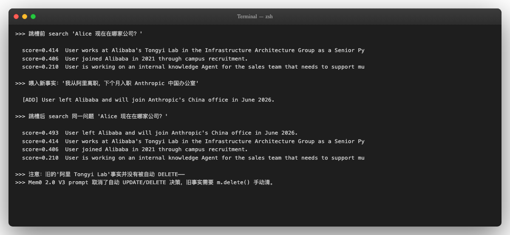

观察结果：

1. 喂入"我从阿里离职"→ Mem0 ADD 一条新 fact "User left Alibaba and will join

Anthropic's China office in June 2026" 。

2. 旧 fact "User works at Alibaba's Tongyi Lab" 仍然存在，没有被自动 DELETE。

3. 跳槽后 search 同一问题，top-1 是新 fact（score 0.493），top-2 是旧 fact（score 0.414）——

两条矛盾事实并存，按相关性排序。

<!-- 第 30 页 -->

这是 Mem0 2.0 V3 ADDITIVE_EXTRACTION_PROMPT 的设计取舍——只做 ADD，不做

UPDATE/DELETE。源码里这个 prompt 的第一句就是 "Your sole operation is ADD" 。1.x 时代有

自动 UPDATE/DELETE 决策（FACT_RETRIEVAL_PROMPT + DEFAULT_UPDATE_MEMORY_PROMPT 两

步），2.0 把它拿掉换成 ADD-only 单步管线，理由是"召回率优先于一致性"。

代价是：业务方需要自己负责清理过期 fact。如果 Agent 系统对一致性敏感（比如要根据"用户当前公

司"路由到不同合规分区），不能直接用 Mem0 的 search 结果——要自己加一层"按 created_at 取最新

+ LLM 摘要去重"的后处理，或者周期性扫一遍 history 调 m.delete() 。

```text
# 手动清旧 fact 的最小写法
old_alibaba = next(h for h in hits_after["results"]
if "Tongyi Lab" in h["memory"])
m.delete(memory_id=old_alibaba["id"])
```

6.2 批量治理：get_all + metadata 时间过滤

生产环境的治理不能靠人工逐条 delete——下面是 SaaS 平台运营时常用的批量治理脚本骨架：

```text
# 1. 列出某用户的全部 fact（按 created_at 排序）
all_facts = m.get_all(filters={"user_id": "alice"}, version="v2")
print(f"alice 当前共 {len(all_facts['results'])} 条 fact")
for f in all_facts["results"]:
# 每条 fact 自带 metadata：id / memory / categories / score / created_at /
updated_at
print(f"  [{f['created_at'][:10]}] {f['memory'][:80]}")
# 2. 按时间窗清理旧 fact（如：清理 90 天前的低价值 fact）
from datetime import datetime, timedelta, timezone
cutoff = datetime.now(timezone.utc) - timedelta(days=90)
for f in all_facts["results"]:
created = datetime.fromisoformat(f["created_at"].replace("Z", "+00:00"))
if created < cutoff and f.get("score", 1.0) < 0.5:
# 90 天前 + 低重要性 → 清理
m.delete(memory_id=f["id"])
# 3. 按类别批量重新分类（Custom Categories 升级时常用）
# 例：把 'personal_preferences' 中关于"工具偏好"的 fact 重新归到 'technical_stack'
hits = m.search("工具偏好", filters={
"user_id": "alice",
"categories": ["personal_preferences"]
}, version="v2")
for h in hits["results"][:10]:
# 重新喂入，让 LLM 重新分类（带新的 categories 配置）
m.delete(memory_id=h["id"])
m.add([{"role": "user", "content": h["memory"]}],
user_id="alice")  # 新配置下重抽 + 自动归类
```

<!-- 第 31 页 -->

6.3 治理对应 §1c 局限 4 遗忘策略

回到 §1c 局限 4 那条铁律——没有任何记忆系统完整解决遗忘问题（MemoryAgentBench 实测 ≤ 7% 准

确率）。Mem0 的治理方案不是自动遗忘，而是给业务方完整的运营接口（get_all / metadata 时间

过滤 / delete / 重新分类）。生产侧通常配 cron 定期跑治理脚本，结合 §1c 介绍的 Generative

Agents 三因子检索公式（recency × importance × relevance）做"按 score + 时间窗清理"——这就是

把"自动遗忘"问题转化为"工程化治理"问题的标准范式。

### 步骤 7：把 Mem0 嵌进 SaaS 助教 Agent 的真实代码骨架

把前面 6 步拼起来——一个完整的"基于 Mem0 的 SaaS 助教 Agent"骨架。每次学员问问题：先用四范

围 filter 拉本用户的相关 fact，拼进 system prompt，再让 LLM 回答；最后把这一轮对话写回 Mem0。

```text
def serve_learner(user_id: str, question: str,
agent_id: str = "tutor",
run_id: str = None) -> str:
# 1. 从 Mem0 拉本用户的相关历史 fact（四范围 filter 组合）
#    user_id 必传 → 跨 session 个性化的核心
#    agent_id 可选 → 隔离不同 Agent（助教 vs 推荐 vs 校对）的 working state
#    categories 可选 → 按业务维度精准筛选（推荐用 learning_history，闲聊用
personal_preferences）
filters = {"user_id": user_id, "agent_id": agent_id}
if "推荐" in question or "学" in question:
filters["categories"] = ["learning_history", "technical_stack"]
```

```text
hits = m.search(question, filters=filters, version="v2")
context = "\n".join(f"- {h['memory']}" for h in hits["results"][:5])
# 2. 构造 system prompt（只包含本用户、本 agent_id 下的相关 fact）
system = f"""你是 SaaS 平台的 AI 学习助教，正在服务用户 {user_id}。
以下是关于该用户的已知事实：
{context}
请按这些事实个性化响应，不要混入其他用户的信息，不要泛泛回答。"""
# 3. 调 LLM 生成答复
resp = ds.chat.completions.create(
model="deepseek-chat",
messages=[
{"role": "system", "content": system},
{"role": "user", "content": question},
],
temperature=0.0,
)
answer = resp.choices[0].message.content
# 4. 把这一轮对话写回 Mem0，作为后续记忆增量
#    带 run_id 让本次会话的临时 working memory 可被独立清理
m.add([
{"role": "user", "content": question},
{"role": "assistant", "content": answer},
], user_id=user_id, agent_id=agent_id, run_id=run_id)
return answer
```

<!-- 第 32 页 -->

```text
# 用 Bob 身份在助教 Agent 下提问（呼应步骤 1 的串台案例）
print(serve_learner("bob", "你之前提过我喜欢用什么编辑器？", agent_id="tutor"))
```

真实运行结果：

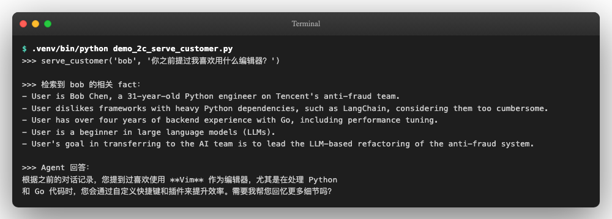

观察这次的输出：

1. Mem0 检索到的 4 条 fact 全部属于 Bob 自己——Tencent 反欺诈 Python 工程师、不喜欢

LangChain、4 年 Go 后端经验、LLM 新手。Alice 的 Cursor / Claude Code 偏好和 Carol 的

Node.js 技术栈完全没出现。

2. Agent 回答基于这 4 条 fact 推断 Bob 用 Vim——这是 LLM 基于"Go 工程师 + 反对重 Python 框

架 + 性能调优偏好"做出的合理推断（Vim 在 Go 圈是常见选择）。Bob 的 fact 里其实没明确提过

编辑器，但推断方向正确，没有出现步骤 1 那种把 Alice 的 Claude Code 偏好张冠李戴的串台。

回到步骤 1 的串台案例做对照：

| 维度 | 步骤 1 朴素方案 | 步骤 5 接入 Mem0 |
| --- | --- | --- |
| 同一问题（"Bob 之前提过喜<br>欢什么编辑器"） | Claude Code（Alice 的偏好） | Vim（基于 Bob 的 Go + 性<br>能偏好推断） |
| 是否串台 | 是 | 否 |
| 上下文长度 | 9 条全用户历史 | 4 条 Bob 专属 fact |
| 可扩展性 | 用户越多越糟（O(N) context 增<br>长 + context rot） | 与用户数无关（每次<br>search 只取 top-k） |

一个生产侧的注意：步骤 4 的 m.add() 会触发一次 LLM 抽取调用（≈3-5 秒）。如果客服 Agent

要求亚秒级响应，建议把这一步异步化—— asyncio.create_task(m_async.add(...)) 后立刻

返回 answer 给用户，让记忆写入在后台跑。Mem0 提供了 AsyncMemory 类，调用方式与

Memory 完全一致。

### 本节做了什么 / 没做什么 + 适用场景判断

本节产出汇总

| 演示了 | 演示要点 |
| --- | --- |
| 朴素方案在 SaaS 架构下必然撞墙 | system prompt 塞全用户上下文 → 串台 + context<br>rot |

<!-- 第 33 页 -->

| 演示了 | 演示要点 |
| --- | --- |
| 基础：user_id 单维度隔离 | 同一 Mem0 实例下 3 用户独立 fact 库 |
| 核心功能 ① 四范围记忆模型 | user_id / agent_id / run_id / app_id 组合，<br>SaaS 产品架构基石 |
| 核心功能 ② Custom Categories + 按类别<br>筛选 | 抽取阶段强制业务归类，检索精准化 |
| 核心功能 ③ get_all + metadata 时间过<br>滤 + delete 治理 | 生产运营接口，把"自动遗忘"转化为"工程化治理" |
| 完整 SaaS 助教 Agent 集成骨架 | serve_learner 函数 + 四范围 filter + categories<br>筛选 |

适用场景判断

Mem0 适合的场景——核心特征是"个人偏好 / 跨 session 个性化 / SaaS 多用户"：

✅ AI 学习助教 / Custom GPT / 个人 AI 助手（Character.AI 类）

✅ 客服 SaaS（智能客服记住每个用户的偏好、历史问题）

✅ 推荐系统（基于 user_id 下的长期兴趣画像生成推荐）

✅ 多 Agent 协作（不同 Agent 共享个人偏好，独立 working state）

✅ Anthropic Memory Tool / OpenAI Conversation memory 类需求的开源替代

Mem0 不太适合的场景 —— 用别的派别更好：

❌ 强一致性的状态机系统（如金融交易 / 合规审计）—— ADD-only 副作用 + 矛盾事实并存会出

错；选 Letta 或 Zep（temporal-graph）

❌ 知识管理 / 个人 brain repo（如 Obsidian 风格的笔记沉淀）—— 没有可读 markdown / 没有

git 可控；选 GBrain

❌ stateful agent runtime（如长任务陪跑、可观测的 Memory Pressure 触发）—— 没有

working context 实时可见；选 Letta

❌ 重型 multi-hop 关系推理（如知识图谱构建）—— OSS 默认无 graph store；选 Cognee 或

Zep

❌ 审计 / 合规要追溯每条 fact 的写入历史 —— m.add() 黑盒，过程不可追溯；选文档派

（GBrain / OpenClaw memory-wiki）

§2d 速查里会列出 Mem0 的所有"没展开"接口（m.update() / m.get_all() 完整参数 / 远程 Qdrant

切换 / Mem0 Cloud 接入 / Graph Memory Pro 特性），方便复用本节代码骨架时按需扩展。

## §2d Mem0 速查

§2b / §2c 演示了 Mem0 三个核心 API（add / search / delete ）和 user_id 隔离一个维度。本节把

Mem0 的其余能力——三级隔离、向量后端切换、Mem0 Cloud、主流集成——压缩成速查表，方便后

续开发时按图索骥。

<!-- 第 34 页 -->

### 三级记忆隔离

Mem0 的 add / search / get_all / delete 都接收三个独立的 scope 字段，组合使用就是三级隔

离：

| scope 字<br>段 | 作用 | 典型业务场景 |
| --- | --- | --- |
| user_id | 隔离不同终端用户的记忆 | 客服 Agent 服务多个客户、Copilot 服务多个<br>开发者 |
| agent_id | 隔离同一用户接入的多个 Agent | 一个用户既用「邮件助手」又用「代码助<br>手」，两边的事实分库 |
| run_id | 隔离同一 (user id, agent id) 的<br>_ _<br>多个 session | 长任务陪跑场景下，每个 task 跑一个独立<br>run，避免跨任务串台 |

```text
# 示例：alice 同时使用「邮件助手」和「代码助手」两个 Agent
m.add(messages, user_id="alice", agent_id="email_assistant")
m.add(messages, user_id="alice", agent_id="code_assistant")
# search 时只看「代码助手」的事实，不会捞到邮件助手的内容
m.search("alice 的工具偏好", filters={"user_id": "alice", "agent_id":
"code_assistant"}, version="v2")
# 加 run_id 进一步隔离到当前 task
m.search("...", filters={"user_id": "alice", "agent_id": "code_assistant",
"run_id": "task_2026_q1_refactor"}, version="v2")
```

隔离粒度由调用方决定——Mem0 不强制要求三层都填。add 时填了哪些字段，search 时就用

相同字段过滤，规则保持对称即可。

### 完整 API 表

| API | 作用 | 关键参数 |
| --- | --- | --- |
| Memory.from_config(config) | 创建 Memory<br>实例 | llm / embedder / vector_store<br>/ history_db_path /<br>custom_instructions |
| m.add(messages, user_id,<br>agent_id?, run_id?, metadata?) | 写入新事实 | infer=False 跳过抽取直接存原文 |
| m.add(messages, user_id, | （默认会触发<br>LLM 抽取） |  |
| m.search(query, filters,<br>version="v2", limit=5) | 向量检索 | filters 接 user/agent/run 三 ID<br>任意组合 |
| m.get_all(filters,<br>version="v2") | 列出 scope 内<br>所有 fact | 用于审计 / 周期清理 |
| m.update(memory_id, data) | 修改某条 fact<br>的内容 | 业务侧自己负责 |

<!-- 第 35 页 -->

| API | 作用 | 关键参数 |
| --- | --- | --- |
| m.delete(memory_id) | 删除某条 fact | 配合 get_all 做批量清理 |
| m.delete_all(filters) | 按 scope 批量<br>删除 | 用户注销 / GDPR 数据擦除 |
| m.history(memory_id) | 查某条 fact 的<br>修改历史 | 审计 / 调试 |
| m.reset() | 清空整个<br>Memory 实例 | 测试场景常用 |

### 向量后端切换

Mem0 默认用 Qdrant 本地模式（写到 /tmp/qdrant ），可换成下面任意后端，写法都是改

config["vector_store"] ：

| 后端 | provider 字段 | 适用 |
| --- | --- | --- |
| Qdrant Local（默认） | qdrant （带 path） | 单机开发 / Demo |
| Qdrant Cloud / 远程 | qdrant （带<br>host/port/api key）<br>_ | 生产，要持久化 + 多实<br>例共享 |
| Postgres + pgvector | pgvector | 已有 PG 集群、想统一<br>存储栈 |
| Pinecone | pinecone | 想要 SaaS、不想自管<br>vector DB |
| Weaviate / Milvus / OpenSearch /<br>Redis / MongoDB | 同名 provider | 已有对应栈、按<br>namespace 复用 |
| Chroma / FAISS | chroma / faiss | 离线场景 / 嵌入式 |

切换写法（以 Postgres + pgvector 为例）：

```text
config["vector_store"] = {
"provider": "pgvector",
"config": {
"host": "localhost", "port": 5432,
"user": "mem0", "password": "...", "database": "mem0_prod",
"collection_name": "mem0_alice",
"embedding_model_dims": 1536,  # text-embedding-3-small 的维度
},
}
```

<!-- 第 36 页 -->

### LLM 与 Embedding 切换

LLM 与 embedding 的切换原则一致——Mem0 把它们抽象成 provider + OpenAI 兼容 config：

| provider 字段 | 实际后端 | 备注 |
| --- | --- | --- |
| openai | OpenAI / 任何 OpenAI 协议兼容（DeepSeek /<br>Qwen / Anthropic via Compat / 自部署 vLLM） | 本课用法 |
| anthropic | Anthropic 原生 API | 不走 OpenAI<br>compat |
| gemini | Google Gemini | 原生 API |
| together / groq / xai<br>/ litellm 等 | 各家原生 SDK | 见 mem0<br>docs |
| ollama | 本地 Ollama | 完全离线场景 |
| huggingface | HF Transformers 本地 | 自部署小模型 |

国内常见组合：LLM 用 deepseek-chat （通过 openai provider 配 base_url）+ embedding 用

text-embedding-v3 （Qwen DashScope，OpenAI 兼容模式）→ 全栈国内 API。本课用

OpenAI embedding 是因为它的多语种 1536 维做 demo 最稳，生产换 Qwen embedding 仅需改

config。

### OSS 与 Mem0 Cloud 的差异

| 维度 | OSS（自托管） | Mem0 Cloud（SaaS） |
| --- | --- | --- |
| 部署 | pip install mem0ai<br>即用 | 调 MemoryClient(api_key=...) |
| 运维 | 自己管 vector DB /<br>Postgres / 备份 | 全托管 |
| 鉴权 | 无内置，自己加 | OAuth 2.0 / API key 体系 |
| Dashboard | 无 | Web UI 看 / 改 fact，含审计日志 |
| 周期清理 | 自己写 cron | 内置 auto-cleanup 策略 |
| Graph<br>Memory | 2.0 已移除 | 仍提供（基于 Neo4j） |
| 合规 | 看自己部署的环境 | SOC 2 Type I 已认证、HIPAA-ready、SOC 2<br>Type II 审计中 |
| 价格 | 免费 | 按 fact 数 / API 调用计费 |
| 适合 | 开发期 / 小规模 / 内网部<br>署 | 生产期 / 多租户 SaaS / 需合规凭证 |

<!-- 第 37 页 -->

从 OSS 切到 Cloud 的代码改动：把 Memory.from_config(config) 换成

MemoryClient(api_key=os.environ["MEM0_API_KEY"]) ，其余 add / search / delete 调

用方式完全一致。

### Graph Memory 的当前状态

§2a 提到的「Mem0^g 图增强」需要更正：Mem0 OSS 2.0 已移除 graph_store 和 enable_graph

配置项，本地 Neo4j 集成不再支持。Graph Memory 现在仅在 Mem0 Cloud 提供。

如果业务确实需要 entity-relationship 级别的图查询（"Alice 的下属管理的下属是谁"这种 traversal

题），当前两条路径：

1. 切到 Mem0 Cloud，用其 graph 功能。

2. 用 Mem0 OSS 存事实 + 自己另搭 Neo4j / KuzuDB 做 entity 关系层，两边按 memory_id 关联。

### 主流集成清单

Mem0 已经做了一批官方集成，开发时可以直接 pip install 接入而不用自己写 adapter：

| 集成对象 | 包名 | 说明 |
| --- | --- | --- |
| OpenAI Agents SDK | 内置 | 把 Mem0 作为 Agent 的 memory tool |
| LangChain /<br>LangGraph | langchain-mem0 | LangChain Memory interface 的 Mem0<br>实现 |
| LlamaIndex | 内置 chat memory | Mem0Memory |
| Vercel AI SDK | 内置 provider | TS / JS 项目 |
| CrewAI | 内置 memory<br>backend | 多 Agent 协作 |
| Pydantic AI | 内置 | 结构化输出 Agent |
| MCP server | mem0-mcp | 给 Claude Code / 任何 MCP 客户端用 |

### 什么时候不该用 Mem0

把"什么时候用"反过来——以下场景 Mem0 不是首选：

| 场景 | 更适合 |
| --- | --- |
| 主要需求是 RAG（查静态知识库，不需要"记用<br>户偏好"） | 直接用向量库 + LangChain RetrievalQA |
| 需要 Agent 自己掌控记忆何时 page in / out | Letta（OS 派） |
| 业务对一致性敏感、不能容忍"新旧 fact 共存" | 自己写 fact 层，或改用 Letta 的 working<br>context block |
| 主要数据载体是 markdown / 文档 / 代码 | GBrain（文档派），Mem0 抽取后丢失原文结<br>构 |
| 单次会话足够，不需要跨 session | 直接用 LLM 的 context window |

<!-- 第 38 页 -->

| 场景 | 更适合 |
| --- | --- |
| 全离线 / 不能调云端 LLM 抽取 | Letta self-host + 本地 LLM，或 GBrain |

### 官方文档与社区资源

| 资源 | URL | 用途 |
| --- | --- | --- |
| 项目主页 | mem0.ai | 综合介绍、Cloud 注册 |
| 官方文档 | docs.mem0.ai | API ref、集成指南、迁移指<br>南 |
| GitHub 仓库 | mem0ai/mem0 | 源码、Issue、Release<br>Notes |
| OSS V2→V3 迁移 | docs.mem0.ai/migration/oss-v2-to-v3 | 1.x 升 2.0 的 breaking<br>change 列表 |
| 安全合规 | mem0.ai/security | SOC 2 / HIPAA 文档 |
| Series A 公告 | mem0.ai/series-a | $24M 融资详情、投资方背<br>景 |
| 论文 | arXiv 2504.19413 | Mem0 vs full-context p95<br>latency 论证 |
| State of AI Agent<br>Memory 2026 | mem0.ai/blog/state-of-ai-agent-<br>memory-2026 | Mem0 团队对 2026 年记忆<br>赛道全景的判断 |

### 一句话场景推荐

| 业务 | 是否上 Mem0 | 备注 |
| --- | --- | --- |
| 客服 Agent 的多用户偏好 | 直接上 | user_id 隔离开箱即用 |
| Copilot 跨会话记开发者偏好 | 直接上 | agent_id 区分不同 Copilot |
| 多 Agent 共享一个客户的"客户<br>档案" | 上 + 自己加去重<br>层 | 默认 ADD-only 会累积冗余 |
| Agent 的 long-task 内部状态 | 不上——用 Letta | Mem0 做不了 working context |
| 已有的 markdown 知识库要变<br>Agent 记忆 | 不上——用<br>GBrain | Mem0 抽取后会丢原文结构 |
| 需要审计每条记忆的修改历史 | OSS 自己做 / 上<br>Cloud | OSS 的 m.history() 够基础场景，复<br>杂审计需 Cloud |
