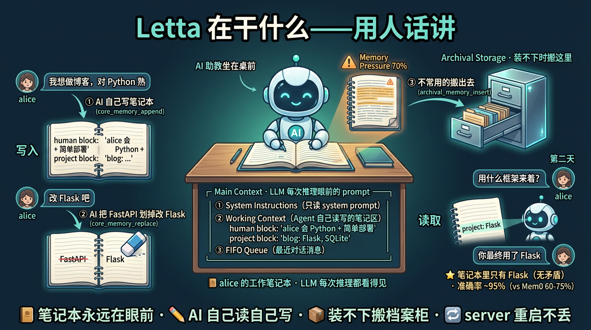
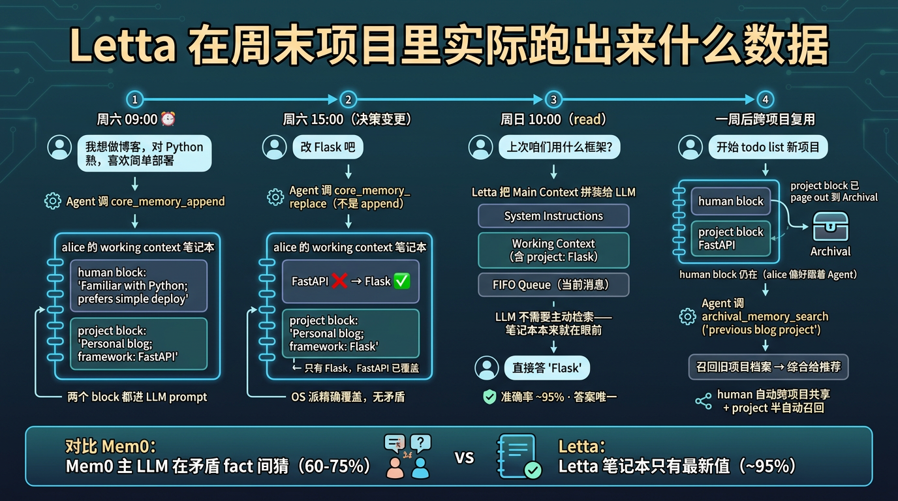
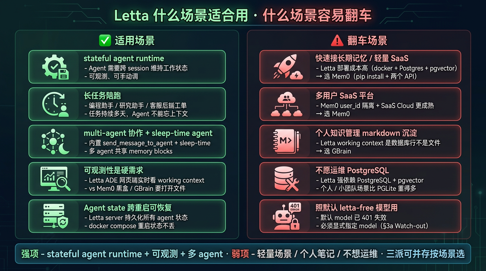
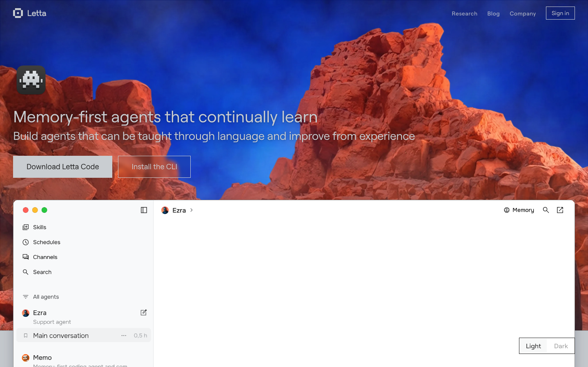
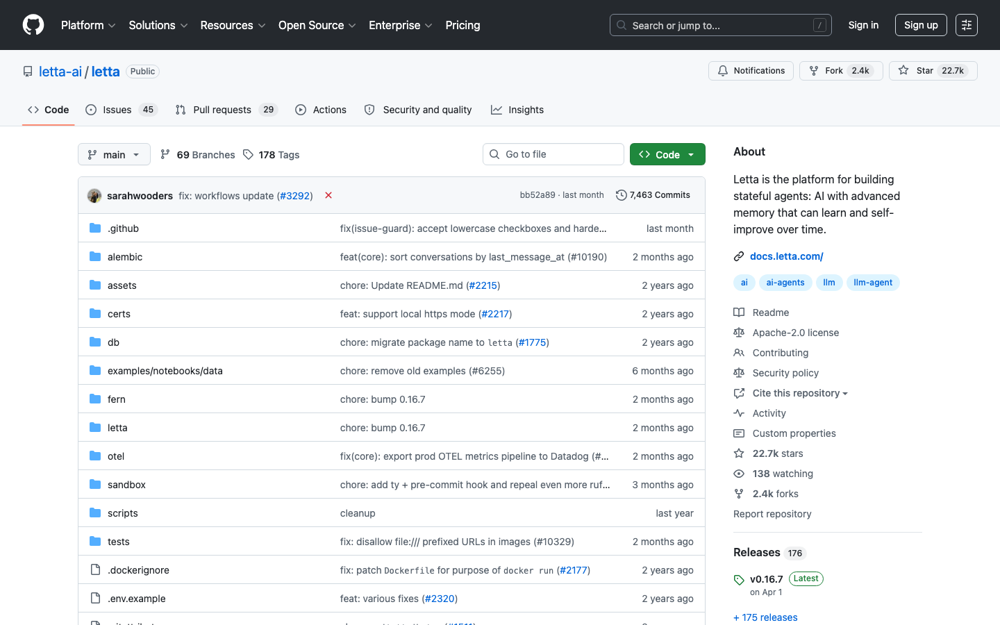
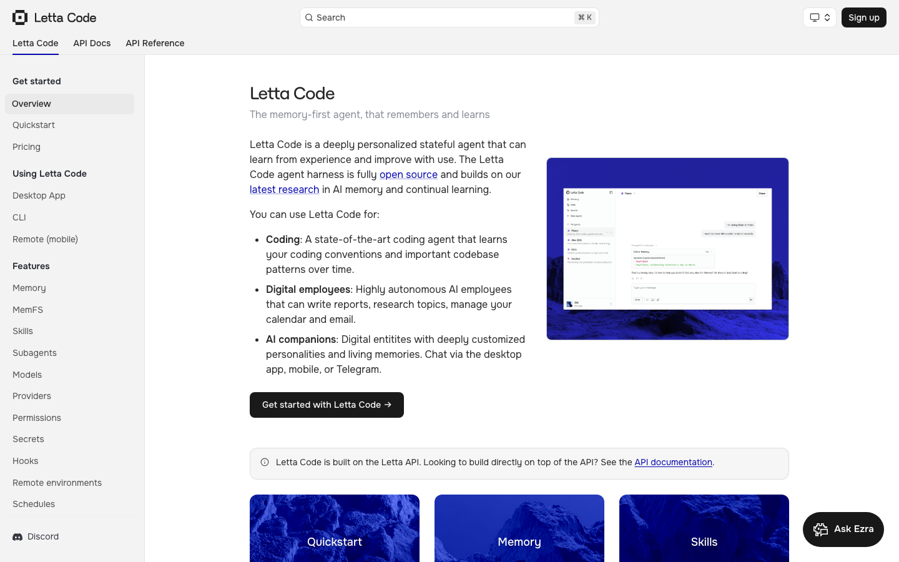
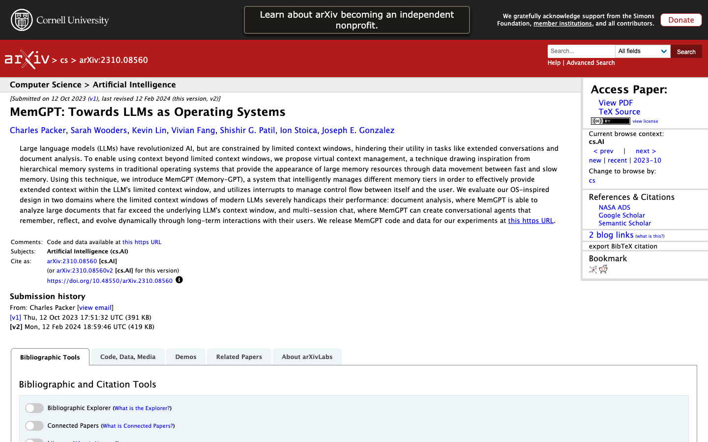
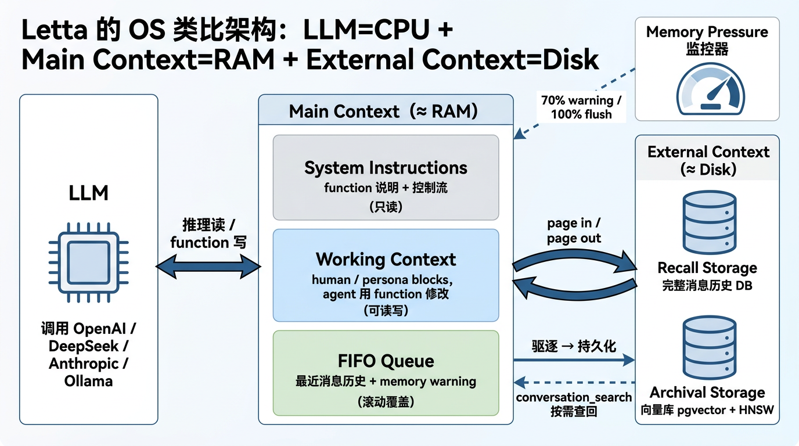

<!-- 第 1 页 -->

# 3. Letta 项目快速入门实战

Agent 记忆系统公开课（上集）· Part 3 · OS 派代表项目

## §3a Letta：LLM 是 CPU，记忆是 RAM/Disk，自己 page 
in/out

§1d 把三派并排放在一张表里时，OS 派对应的设计哲学是「把 LLM 当 CPU、context window 当

RAM、外部存储当 disk，让 LLM 自己决定何时把内容 page in / page out」、写入方式是「Agent 主动

调 function（core_memory_replace 、archival_memory_insert ）+ Memory Pressure 触发

flush」。本节把这两行的代表项目 Letta 完整展开——先说清它是什么、谁在用、论文怎么定义；再讲

它内部的分层记忆 + Memory Pressure 机制；最后用上一节 §1d 的「周末项目」例子把机制走一遍。

### Letta 三视角速览：流程 · 实例 · 优劣势

视角 1：用人话讲，Letta 在干什么

Letta 跟 Mem0 的核心差别——Mem0 是"AI 在背后偷偷做笔记，下次需要时翻出来用"；Letta 是"给

AI 一个固定的小本本，本本永远在 AI 眼前，AI 自己读自己写"。

想象同一个场景——alice 跟 AI 学习助教说"我想做博客，对 Python 熟"。Letta 在背后做的事是：

1. AI 助教在自己的"工作笔记本"上写下 alice 的信息——这个笔记本是 LLM 每次回答问题时眼前一直

放着的（不像 Mem0 是另外的库等被翻出来）

2. alice 说"改 Flask"时，AI 直接在笔记本上把 FastAPI 划掉改成 Flask——不是再加一条新笔记，

是覆盖（这是和 Mem0 的关键差异）

3. 小本本写满了怎么办？AI 自己判断"哪些不常用了"，主动把它们搬到旁边的"档案柜"（外部数据

库）里——后面如果再用到，再翻档案柜拿回来

下图把这套"小本本 + 档案柜"机制画出来——左边是 alice 的对话，中间是 LLM 每次推理都看得见的笔

记本（含 system / working context / 最近消息三段），右边是装不下时搬出去的档案柜：



人话对应工程术语：

<!-- 第 2 页 -->

| 人话 | 内部叫什么 |
| --- | --- |
| AI 每次推理眼前的笔记<br>本 | Main Context（含 System / Working Context / FIFO Queue 三段） |
| AI 主动写笔记本 | core_memory_append / core_memory_replace |
| 笔记本写满搬出去 | Memory Pressure 触发 → archival_memory_insert |
| 后面需要再翻回来 | Agent 主动调 archival_memory_search 召回 |
| 小本本 / 档案柜 | working context block / Archival Storage（PostgreSQL +<br>pgvector） |

和 Mem0 的本质差异：Mem0 的笔记是 LLM 看不到的（要主动 search 翻出来）；Letta 的工作笔记本

是 LLM 每轮推理都看得见、可以自己读自己写。

视角 2：换一组实际数据，这流程跑出来什么

继续 alice 周末项目场景——周六 09:00 alice 说做博客、周六 15:00 改 Flask、周日早上回来问问题。下

图按时间线展示 alice 的笔记本和档案柜里实际存了什么、Agent 怎么读怎么写：



读图重点：

| 时间点 | Agent 做了什么 | 笔记本里看到什么 |
| --- | --- | --- |
| 周六<br>09:00 | Agent 在 human block 写"alice 会 Python + 简单部署"；在<br>project block 写"博客项目 + FastAPI" | 笔记本 ② working<br>context 有 2 个<br>block |
| 周六<br>15:00 | Agent 把 project block 里的 FastAPI 直接覆盖成 Flask | 笔记本里只有<br>Flask，FastAPI 消失<br>了 |
| 周日<br>10:00 | alice 新会话开始；Letta 从数据库重新加载笔记本；alice<br>问"用什么框架"；Agent 不需要做检索——笔记本本来就在眼<br>前，直接答 Flask | 答对，准确率接近<br>100% |

<!-- 第 3 页 -->

| 时间点 | Agent 做了什么 | 笔记本里看到什么 |
| --- | --- | --- |
| 周一新<br>项目 | 旧项目档案已搬到档案柜；Agent 主动调<br>archival_memory_search("blog project") 翻回来 | 召回结果作为消息进<br>FIFO Queue，<br>Agent 下轮看到 |

和 Mem0 同款场景对比：

| 维度 | Mem0 | Letta |
| --- | --- | --- |
| 周日问"用什么<br>框架" | 矛盾 fact 并存（FastAPI + Flask），主 LLM<br>在 prompt 里猜 | 笔记本里只有 Flask，直接<br>答对 |
| 准确率 | 60-75%（LLM 猜对的概率） | ~95%（笔记本即真相） |
| 业务代码复杂<br>度 | 业务侧自己 search + 拼 prompt | working context 自动在<br>prompt 里 |

视角 3：什么场景适合用 Letta，什么场景容易翻车

✅ 这些场景非常适合用 Letta —— 它能解决你的核心问题

stateful agent runtime（Agent 需要跨 session 维持工作状态、可观测、可手动调）—— Letta

就是为这个场景设计的，server 形态持久化所有 agent 状态，重启不丢

长任务陪跑（编程助手、研究助手、客服后端工单）—— 任务持续多天，Agent 不能忘上下文。

Letta 的 working context 永远在 prompt 里，Agent 不会"今天还记得明天就忘"

multi-agent 协作 + sleep-time agent —— Letta 内置 send_message_to_agent 多 agent 通信

+ sleep-time agent（后台 agent 闲时自动整理 memory）

可观测性是硬需求 —— Letta ADE 网页端实时可见 working context 内容（Mem0 是黑盒、

GBrain 要打开 markdown 文件看）

需要 Agent state 跨进程 / 跨重启可恢复 —— Letta server 持久化所有 agent 状态到 PostgreSQL

⚠️ 这些场景用 Letta 容易翻车 —— 应该选别的派

想快速给 chatbot 接长期记忆 / 轻量 SaaS —— Letta 部署成本高（docker compose +

PostgreSQL + pgvector），这种场景选 Mem0（pip install + 两个 API 就跑）

多用户 SaaS 平台 —— Letta server 服务多用户也能跑，但 Mem0 的 user_id 隔离 + Mem0 Cloud

更成熟。这种场景选 Mem0

个人知识管理 / Markdown 笔记沉淀 —— Letta 的 working context block 是数据库行不是文件，

用户改不了笔记内容。这种场景选 GBrain

不愿运维 PostgreSQL —— Letta 强依赖 PostgreSQL + pgvector，个人 / 小团队场景比 PGLite 重

得多

直接照默认 letta-free 模型用 —— 这不是翻车场景，是翻车原因：默认 model 已 401 失效。必须

显式指定 model（§3a Watch-out 详谈）

下图把这两组场景并排放在一起，作为选型时的速查：

<!-- 第 4 页 -->



一句话总结：Letta 的强项是"stateful agent runtime + 可观测 + 多 agent"，弱项是"轻量场景

/ 个人笔记 / 不想运维"。三派可以并存（§1d 已说），按场景选——不要"用最强的"，要"用对

的"。

下面把这三张速览里提到的事实展开——项目背景、主页矩阵、机制流水线、生产坑——逐一深入。

### 项目背景

Letta 由 Charles Packer 和 Sarah Wooders 在 2024 年从 UC Berkeley Sky Computing Lab 拆分成立，

前身是同一支团队 2023 年的 MemGPT 研究项目。两位创始人是 Berkeley PhD 学生，导师为 Joseph

Gonzalez 与 Ion Stoica（Databricks 联合创始人），同一实验室还孕育了 Anyscale、SiFive 等公司。

Letta 把 MemGPT 论文里的"LLMs as Operating Systems"思路工程化为一个真正可以跑在生产里的

stateful agent server——agent 状态持久化、跨 session 恢复、多 agent 协同都是 server 形态的能

力。

发展轨迹（截至 2026-05）：

| 时间点 | 里程碑 |
| --- | --- |
| 2023-10 | MemGPT 论文（arXiv 2310.08560） 在 Berkeley Sky Computing Lab 发表，首次把<br>OS 虚拟内存思想映射到 LLM 上 |
| 2024-09 | Letta 公司正式出 stealth，宣布 $10M seed 轮（投资方含 Jeff Dean、Clem<br>Delangue、Felicis），项目从 cpacker/MemGPT 迁移至 letta-ai/letta |
| 2025-04 | Agent File（.af ）开放标准发布——把 stateful agent 的 system prompt、<br>memory blocks、tool 配置、LLM 设置整个打包成单文件，支持 checkpoint 与跨框<br>架迁移 |
| 2025-08 | Letta Desktop 开放公测，把 ADE（Agent Development Environment）与<br>embedded server 打包成桌面 app，覆盖 Mac、Windows、Linux |
| 2026-<br>03-31 | server 升级到 0.16.7，默认 context window 从 32k 提升到 128k、context window<br>reset bug 修复、compaction 整体重写 |

<!-- 第 5 页 -->

论文是这一派的根——MemGPT 论文中的 嵌套 KV 实验给出了一组很有说服力的数据。任务是在 ~8k

tokens 中嵌入 140 个 UUID（Universally Unique Identifier，128-bit 全局唯一标识符）对，要求模型

沿引用链一直查到 Level 4：

| 模型 | Level 0 | Level 2 | Level 4 |
| --- | --- | --- | --- |
| GPT-4（裸 prompt） | ~90% | ~10% | 0% |
| GPT-4 Turbo（裸 prompt） | ~95% | ~5% | 0% |
| MemGPT + GPT-4 | ~95% | ~95% | ~85%¹ |

所有 baseline 在 Level 3 就崩到 0%，而 MemGPT + GPT-4 在 Level 4 仍保持约 85% 准确率。这是 "OS

类比 + 主动 page + function chaining" 路线的核心实证——单纯堆 context 解决不了长引用链问题。

¹ 论文 arXiv 2310.08560 正文用定性表述"unaffected with the number of nesting levels"，具体

数字取自 Figure 7 的柱状图（目测估计，精确值未在表格中列出）。本数据仅作为定量参考，复

现请直接查 Figure 7。

企业落地情况（2025-2026 年公开案例）：

Letta Cloud 多租户 runtime：Pro / Enterprise 计划支持无上限 agent 数，覆盖 OpenAI、

Anthropic Claude、Google Gemini，自动扩缩容、24/7 可用性，适配规模化客服与多用户场景

AWS Marketplace + Aurora PostgreSQL：Letta 发布 AWS AMI 镜像与 Aurora 集成方案，把

Archival Storage 的 pgvector 后端托管化

Sleep-time agent 真实部署：Letta 官方博客披露 一个 support agent 在 Discord 上学习了一个

月、推荐 agent Built Rewards 上线——sleep-time agent 是 OS 派多 agent 架构的延伸（主

agent 与 sleep-time agent 共享 memory block，后者在后台异步整理 memory）

### 项目主页矩阵

OS 派选型时第一件事是确认信息源齐全可信——下面 4 个官方页面就是 Letta 的"完整入口"，建议学员

先把这四个标签页打开备用。

官网（letta.com）——产品定位、Letta Cloud 入口、Pricing、Blog（sleep-time agent、Agent

File、设计哲学博客都在这里）。

<!-- 第 6 页 -->



GitHub（github.com/letta-ai/letta）——OSS 源码、Release Notes、issue 与社区讨论。所有

watch-out 都能在这里反查——比如 0.16.7 默认 context window 从 32k 提升到 128k 的具体改动、

context reset bug 修复细节都在 release tag 里。



官方文档（docs.letta.com）——Quickstart、Core Concepts（stateful agents、memory blocks、

Memory Pressure 的官方定义）、Sleep-time Agents 指南、ADE 操作手册、Letta Cloud Overview。

所有概念以这里为准。

<!-- 第 7 页 -->



学术论文（arXiv 2310.08560）——"MemGPT: Towards LLMs as Operating Systems"，Packer 等

2023-10 首发，提出 main context、external context 双层架构与 function chaining + Memory

Pressure 机制。本节后面讲机制时直接引用论文术语。



### 项目情况

把上面 4 个主页背后的关键事实压缩到一张表，作为后续选型对照用：

| 项 | 值 |
| --- | --- |
| 项目名 | Letta（github.com/letta-ai/letta） |
| 当前版本 | server 0.16.7（2026-03-31 发布，默认 context window 32k→128k） |

<!-- 第 8 页 -->

| 项 | 值 |
| --- | --- |
| GitHub<br>Stars | 22.7k（截至 2026-05 公开课录制周） |
| 许可 | Apache-2.0 |
| 团队 | Letta Inc.（Charles Packer / Sarah Wooders 创立，2024-09 出 stealth） |
| 学术血统 | MemGPT 论文，arXiv 2310.08560（Packer 等，2023-10 首发） |
| 融资 | （ 公布，估值70M，投资方含 Jeff Dean、Clem Delangue、<br>Felicis） |
| 部署形态 | 自托管 docker compose（PostgreSQL + pgvector）/ Letta Desktop（embedded<br>server）/ Letta Cloud SaaS / AWS Marketplace AMI |
| 客户端 | Python SDK（letta-client ）/ TypeScript SDK / REST API / ADE 网页与桌面<br>（Agent Development Environment，Letta 提供的可视化 agent 编辑器） |
| 默认栈 | PostgreSQL + pgvector + HNSW（HNSW 即 Hierarchical Navigable Small<br>World，主流近似最近邻向量索引）/ Recall Storage 关系型消息 DB |
| 开放标准 | Agent File（.af ）——把 system prompt、memory blocks、tools、LLM 设置打<br>包成单文件，支持跨框架迁移 |
| 主流集成 | LangChain、LlamaIndex、CrewAI、AWS Aurora PostgreSQL |

注：Letta 项目最早叫 MemGPT（github.com/cpacker/MemGPT ），2024-09 原作者团队成立公

司后改名 Letta 并启动商业化，仓库迁到 letta-ai/letta 。技术血统连续，是同一支团队，论文

也仍以 MemGPT 为名引用。

### Letta 怎么干活：从动机到完整流程

讲机制之前先理解一个关键前提：LLM 本身是无状态的——它只是一个"看到 prompt、输出

response"的函数，没法监控自己的 token 占用，也没法在两次调用之间自动整理记忆。所以 Letta 在

LLM 外面套了一层"外部管家"，干两件事：

1. 决定每次 prompt 里塞什么——让 LLM 始终看到关键信息（不丢用户身份 / 当前任务）

2. 监控 prompt 容量，逼 LLM 主动整理——把过时内容搬到外部存储，避免撑爆 context window

下面用 §1d 的周末项目例子走一遍——alice 周六做博客、改 Flask、周日回来问问题——把上面两件事

拆成 6 个具体环节看清楚。

环节 ①：Letta 给 LLM 的工作空间，是三段拼接的 prompt

LLM 每次推理时看到的不是一段连续文字，而是 Letta 拼装好的三段 prompt（合在一起叫 Main

Context）：

```text
┌─ Main Context（每次推理 LLM 实际看到的 prompt 总和）─────────┐
│                                                              │
│  ① System Instructions（只读）                               │
│     - 启动 agent 时确定的 system prompt                      │
│     - 含 8 个内置 tool 的函数说明 + Letta 控制流提示          │
│                                                              │
```

<!-- 第 9 页 -->

```text
│  ② Working Context（Agent 自己读写，固定容量）                │
│     - 几个固定 block，每个 block 是一段 markdown             │
│     - 例：human block: "Familiar with Python..."             │
│          project block: "Personal blog; FastAPI"             │
│     ↑ 每次推理都看得到，是 Agent 真正的"工作笔记"             │
│                                                              │
│  ③ FIFO Queue（最近对话，自动滚动）                          │
│     - 用户消息 + Agent 回复 + 系统消息（如 memory warning）  │
│     - 装满后旧消息被驱逐                                     │
└──────────────────────────────────────────────────────────────┘
↓ Working Context 装不下时，page out 到 ↓
┌─ External Context（落在 LLM 视野之外的外部存储）─────────────┐
│                                                              │
│  ④ Archival Storage（向量数据库）                            │
│     - PostgreSQL + pgvector + HNSW                          │
│     - 存任意长度文本：事实、笔记、文档片段                    │
│     - Agent 主动调 archival_memory_search 召回               │
│                                                              │
│  ⑤ Recall Storage（关系型对话历史 DB）                       │
│     - 按时间索引的完整对话记录                                │
│     - Agent 主动调 conversation_search 翻历史                │
└──────────────────────────────────────────────────────────────┘
```

简化的 OS 类比帮助记忆：① 像内核（开机加载、不可变）/ ② 像 RAM（Agent 在这读写笔记）/ ③ 像

消息栈（最近内容滚动）/ ④⑤ 像 Disk（容量大但要主动加载）。

关键设计 = Working Context（②）始终在 prompt 里——这是 Letta 与"裸 prompt"最大的差异。

OpenAI chat completions 想让 LLM "记住"什么，要么塞 system prompt（占名额）、要么塞历史消息

（被冲掉）。Letta 给 LLM 提供了一个 Agent 自己可以读写的固定笔记区——LLM 在每次推理都看得

到、不会被消息滚动冲掉。

环节 ②：写入路径 —— alice 说话 → Agent 写 Working Context

```text
# ── 周六 09:00：alice 第一次发消息 ──
# alice → "我想做个博客，对 Python 熟，喜欢简单部署"
#
# Agent 的 reasoning loop 判断：
#   "这条信息有长期价值——alice 的偏好 + 项目状态。
#    需要写入 working context，避免下次会话忘掉。"
#
agent.tool.call("core_memory_append", label="human",
value="Familiar with Python; prefers simple deployment")
agent.tool.call("core_memory_append", label="project",
value="Personal blog; framework: FastAPI")
#
# 此后每次推理，LLM 在 ② Working Context 都能看到这两条 block
```

<!-- 第 10 页 -->

```text
# ── 周六 15:00：alice 改主意 ──
# alice → "FastAPI 部署太复杂，改 Flask"
#
# Agent reasoning：
#   "项目状态变了。要 replace 而不是 append——
#    否则同时有 FastAPI 和 Flask 两条冲突信息。"
#
agent.tool.call("core_memory_replace", label="project",
old="framework: FastAPI", new="framework: Flask")
#
# 此后 Working Context 中 project block 只剩 "framework: Flask"
# 这是 Letta 与 Mem0 ADD-only 的本质差异——OS 派让 Agent 主动管理冲突
```

Agent 主动写记忆的四个核心工具：core_memory_append （追加新值）/

core_memory_replace （覆盖旧值）/ archival_memory_insert （写入向量库）/

archival_memory_search （从向量库召回）—— 这是 Letta agent 默认自带的内置 tool，不需

要操作员注册。

环节 ③：读取路径 —— alice 回来问问题 → LLM 在 prompt 里直接看到

```text
# ── 周日 10:00：alice 新会话问"上次咱们用什么框架？" ──
#
# Letta 在调用 LLM 之前，把整个 Main Context 拼装好：
#
# ┌─ Main Context（喂给 LLM 的实际 prompt）───────────────┐
# │ ① System Instructions: ...                          │
# │ ② Working Context:                                  │
# │     human block: "Familiar with Python; prefers..." │
# │     project block: "Personal blog; framework: Flask"│ ← LLM 直接看到
# │ ③ FIFO Queue:                                       │
# │     [当前消息] "上次咱们用什么框架？"                  │
# └──────────────────────────────────────────────────────┘
#
# LLM 看到 project block 里的 "framework: Flask"，直接回答：
# → "你最终决定用 Flask"
```

和 Mem0 的关键差异——Mem0 每次查询都要主动 m.search() 拉相关 fact，主 LLM 被动接受召回结

果。Letta 的 Working Context 始终在 prompt 里，LLM 在每轮推理都"看得见"——是设计层面

的"Agent 工作笔记"。

环节 ④：空间压力机制（Memory Pressure）—— page out / page in 完整循环

Working Context 每个 block 有 limit 字段（默认几千 token），FIFO Queue 也会累积消息逼近

context window 上限。LLM 自己看不到"prompt 还剩多少容量"，所以 Letta 在外面套了一层 Queue

Manager，按容量百分比触发两个动作：

<!-- 第 11 页 -->

| 阈值 | 默认值（占<br>context<br>window） | 触发后做什么 |
| --- | --- | --- |
| warning_token_count | ≈ 70% | 在 FIFO Queue 末尾插入一条 system<br>message："memory usage 70%, please<br>consolidate"。提醒 LLM 主动整理——把过时字<br>段从 working context 压缩、把对话里的事实搬到<br>archival |
| flush_token_count | ≈ 100% | 强制刷新队列——驱逐约 50% 旧消息，对被驱逐<br>的内容做 recursive summarization 后塞回 FIFO<br>Queue 前端 |

借用 OS 类比理解这个完整循环——page out（容量满时把不活跃内容换到 disk）+ page in（需要时再

从 disk 加载回 RAM）。Letta 的"disk"就是 Archival Storage（PostgreSQL + pgvector）。下面分两步

走通整个循环。

Step 1：page out —— 容量逼近时把内容写出到 Archival

```text
# ── 周日深夜：alice 累积聊了几十轮，FIFO Queue 逼近 70% ──
# Queue Manager 自动在 FIFO Queue 末尾追加 system message：
# {"role": "system", "content": "memory warning: usage 70%, please consolidate"}
#
# LLM 下一轮推理时看到这条 warning，自己决定哪些内容值得归档：
agent.tool.call("archival_memory_insert",
content="Project 2026-W19: blog (Flask, SQLite, Docker, deploy on Vercel)")
agent.tool.call("archival_memory_insert",
content="alice debug FastAPI deployment, gave up due to complexity")
#
# 物理效果：
#   - 这些条目落入 Archival Storage（PostgreSQL + pgvector）
#   - 每条 archival 都自带 embedding 向量，便于后续语义检索
#   - working context 中的 project block 也可以被 core_memory_replace 压缩成更短版本
#   - FIFO Queue 中的旧消息可以被驱逐
```

到这里 working context 释放了容量。但这只是一半——重点是后面怎么 page in 回来用。

Step 2：page in —— 后续相关问题来时，主动从 Archival 召回

```text
# ── 一周后：alice 再来问相关问题 ──
# alice → "上次咱们最终用什么数据库来着？还要不要换成 SQLite？"
#
# Letta 把 Main Context 拼装好喂给 LLM：
#
# ┌─ Main Context ───────────────────────────────────────┐
# │ ① System Instructions: ...                          │
# │ ② Working Context:                                  │
# │     human block: "Familiar with Python..."          │
# │     project block: "Personal blog (compressed)"     │ ← 上周压缩过的版本
# │ ③ FIFO Queue:                                       │
# │     [当前消息] "上次咱们最终用什么数据库来着？"        │
# └──────────────────────────────────────────────────────┘
#
```

<!-- 第 12 页 -->

```text
# LLM reasoning：
#   "working context 里只有压缩版项目档案，没有数据库的具体决策。
#    需要去 archival 翻一下历史档案。"
#
# Agent 主动调 page in：
results = agent.tool.call("archival_memory_search",
query="blog project database choice")
# 返回 archival 里的相关条目（按向量相似度排序）：
#   ["Project 2026-W19: blog (Flask, SQLite, Docker, deploy on Vercel)"]
#
# 这条召回结果会作为 function return value 注入到 FIFO Queue 末尾，
# LLM 下一轮推理时就在 prompt 里"看见"它了——这就是 page in 完成。
#
# LLM 下一轮回答：
# → "你最终决定用 SQLite + Docker 部署到 Vercel。是的，上次你换成了 SQLite。"
```

关键细节：archival_memory_search 的返回值不是直接进入 working context，而是作为

function call 的结果附加到 FIFO Queue 里——LLM 在下一轮推理时看到这条新消息，决定要不

要把内容沉淀进 working context（如果是长期重要事实）。这是 Letta 与"自动 RAG 注入" 的差异

——召回与沉淀是两步，由 Agent 自己控制。

完整 page out / page in 循环

```text
Working Context (RAM, 容量有限)
↑
│ ④a page out: archival_memory_insert
│   （容量逼近时主动归档）
↓
Archival Storage (Disk, pgvector，容量无限)
│
│ ④b page in: archival_memory_search
│   （后续相关问题来时主动召回）
↓
召回结果回到 FIFO Queue
↓
LLM 下一轮推理看到 → 决定是否进一步沉淀到 working context
```

这就是 Memory Pressure 的完整闭环——名字来自 OS 内核的内存压力监控原理。与 OS 真正的虚拟

内存的关键差别：OS 缺页中断由硬件自动触发，Letta 的 page in 是 LLM 在 reasoning 里自己判断"我

需要更多上下文"并主动调用——是 Agent 行为不是中断。

Letta 0.16.7 把默认 context window 从 32k 提升到 128k 后，warning 触发点从 ≈ 22k 提升到 ≈

90k——这是 0.16 系列的关键改动，意味着 Agent 在容量 100k 之前不需要主动整理，page out

频率显著下降。

环节 ⑤：跨 session 持久化 —— Letta server 重启后从 PostgreSQL 恢复

```text
# ── 周一 09:00：alice 开新对话或 Letta server 重启 ──
# Letta 从 PostgreSQL 重新加载该 agent 的状态：
#   - Working Context（human / persona / project 三个 block 的内容）
#   - Archival Storage（pgvector 里的所有 archival 条目）
#   - Recall Storage（完整对话历史）
#
# Agent 看到 human block 里还有 "Familiar with Python; prefers simple deployment"
```

<!-- 第 13 页 -->

```text
# project block 可能在周日 page out 后被重置为空
#
# alice → "再开个新项目，做 todo list"
# Agent 主动调：
agent.tool.call("archival_memory_search", query="previous blog project")
# 召回 "Project 2026-W19: blog (Flask, SQLite, Docker)"
# Agent 综合 human 偏好 + 历史项目档案给 alice 新建议
```

这种"server 重启状态不丢"是 Letta 与"内存 chatbot"的关键差异——Letta 是 stateful agent server

（不是 SDK），所有 agent 状态都持久化在 PostgreSQL 里，跨进程、跨重启可恢复。

环节 ⑥：six tool, two storages, one space —— 完整工具清单

把上面所有动作汇总成 Agent 一定要会的内置 tool：

| 工具 | 作用 | 操作哪段 |
| --- | --- | --- |
| core_memory_append(label, value) | 给 block 追加新值 | ② Working<br>Context |
| core_memory_replace(label, old,<br>new) | 把 block 中旧值替换为新值 | ② Working<br>Context |
| archival_memory_insert(content) | 把任意文本写入向量库 | ④ Archival<br>Storage |
| archival_memory_search(query) | 在向量库中召回相关条目 | ④ Archival<br>Storage |
| conversation_search(query) | 翻完整对话历史 | ⑤ Recall<br>Storage |
| send_message(content) | 给用户回复（这是 Letta 区分"思考"<br>vs "说话"的关键设计——Agent 必<br>须主动调用才会给用户回话） | 输出 |

这 6 个 tool + 2 个存储 + 1 个 working context 区域，构成 Letta agent 的全部基础能力。后面 §3d 速

查会列出进阶能力（sleep-time agent、multi-agent、tool 注册等）。

OS 类比的边界（不要过度套）

OS 类比是 Letta 最直观的桥梁，但不是所有 OS 概念都能照搬到 LLM 上。三个常见的过度类比要避开：

1. "虚拟内存"不是字面意义的虚拟内存——OS 的虚拟内存按 4KB page 整齐切分，Letta 的"page

in/out"是 LLM 用自然语言判断挪哪段，不存在固定 page size

2. 没有"缺页中断"——OS 缺页是硬件信号自动触发，Letta 的"page in"是 LLM 自己判断"我需要更多

上下文"并主动调 archival_memory_search ，本质是 Agent 行为不是中断

3. 没有"内核态 / 用户态"——Letta 的所有 function call 由 LLM 决定，没有特权分级，没有 syscall

OS 类比走到"分层记忆 + 主动 page in/out + 容量压力管理"这三点就够了。再深入就把学员引向"OS

课"，偏离了本节目标。

<!-- 第 14 页 -->

### 架构示意

把上面的 LLM、Main Context、External Context、Memory Pressure 整合在一张图上：



图中三段 Main Context（System / Working / FIFO）的方向箭头表达"page in / page out"路径

——LLM 一次输出可能把 FIFO Queue 中的信息提取后写入 Working Context（page in），也可

能把 Working Context 中过时的内容压缩后写入 Archival Storage（page out）。

### 本节涉及的核心概念

| 概念 | 一句话定义 |
| --- | --- |
| OS 派 | 把 LLM 当 CPU、context window 当 RAM、外部存储当 disk 的<br>Agent 记忆设计范式 |
| Letta | OS 派的代表项目，前 MemGPT 团队（Berkeley Sky Computing<br>Lab）2024 年商业化产物 |
| Main Context | LLM 推理时实际看到的 prompt 整体，由 System Instructions +<br>Working Context + FIFO Queue 三段组成 |
| Working Context<br>block | Main Context 中可被 Agent 用 function 显式读写的固定容量区域<br>（典型如 human / persona block） |
| Archival Storage | External Context 中的可读写向量库（pgvector + HNSW），存任意<br>长度文本对象 |
| Memory Pressure | 双阈值（warning 70% / flush 100%）触发 LLM 主动 page out 的容<br>量压力机制 |
| core_memory_replace | Letta agent 默认内置 tool，对 working context block 做精确覆盖<br>（旧值消失，没有矛盾并存） |
| ADE | Agent Development Environment，Letta 提供的可视化 agent 编辑<br>器（网页 + 桌面双形态） |

<!-- 第 15 页 -->

### Watch-out：实际部署时必须知道的三件事

抽象的机制讲完，进入部署前必须知道的三个真实生产坑：

1. 默认 letta/letta-free 模型已失效

Letta 0.16.x 默认 model 是 letta/letta-free ，使用 Letta 团队提供的服务账号 key（sk-

svcac... ）。这个 key 目前已 401 不可用——团队已不再维护免费试用通道。自托管时必须显式指定

LLM provider，例如：

```text
from letta_client import Letta
client = Letta(base_url="http://localhost:8283")
agent_state = client.agents.create(
model="openai/gpt-4o-mini",
embedding="openai/text-embedding-3-small",
memory_blocks=[
{"label": "human",   "value": "Name: Alice. Job: Python engineer."},
{"label": "persona", "value": "I am a helpful assistant."},
],
)
```

照搬官方 quickstart 没改 model，第一次发消息就会撞 401。生产使用时配 OpenAI 协议兼容的国产

LLM 替代默认。

2. 自托管依赖 PostgreSQL + pgvector

docker compose up 会拉起 PostgreSQL 容器（含 pgvector 扩展），不能改用 SQLite——这是

Archival Storage 的底层依赖。对个人开发机不是问题，但轻量场景或资源受限环境要把这部分开销纳入

预算。Letta Cloud 与 Letta Desktop 把这部分托管掉，付出的代价是数据出本地（Cloud 形态）或

embedded server 性能受限于本机（Desktop 形态）——选型权衡。

3. Working Context 的 block_limit 是硬约束

每个 working context block（如 human block）有 limit 字段，默认几千 token。超出后写入会失败

——OS 派的"分页"思路意味着工作集大小有刚性约束，agent 必须学会自己淘汰过时的事实。这一点

和"无限往 prompt 里塞"的朴素做法根本不同，是 Letta 的设计哲学体现，不是 bug。可以在创建 block

时显式设大 limit （如 {"label": "human", "value": "...", "limit": 8000} ），但 OS 派的本

意就是用容量约束逼 agent 主动管理，无脑放大 limit 会失去这一派的核心价值。

抽象的机制和踩坑讲到这里。下面 §3d 是 Letta 的能力速查（含 sleep-time agent 与 multi-agent 的形

态预览），便于把 Letta 的功能边界与三派对比定位读完。

## §3d Letta 速查：更多功能 + Sleep-time agent + multi-
agent

本节是 Letta 的能力速查页。除前文讲到的"三层 Memory Block + working context 自动 page

in/out"外，Letta 还有四类配套能力，按使用频率与项目热度排序，便于团队选型阶段定位"我的场

景该不该上 Letta、要不要用进阶特性"。

<!-- 第 16 页 -->

### 速查总表

下表覆盖 Letta v0.16.x 在三层 Memory Block 之外的核心能力。每行的"接入位置"列直接指向官方文档

锚点，配套 SDK 示例可在对应页面找到。

| 能力 | 解决什么问题 | 接入位置 |
| --- | --- | --- |
| Sleep-<br>time<br>agent | 用户离线时后台异步整理记<br>忆，长对话/文档/笔记的事<br>实精炼不阻塞用户回复 | docs.letta.com/guides/agents/architectures/sleeptime |
| Multi-<br>agent<br>通信 | 多个 agent 之间发消息协<br>作，支持同步阻塞、异步推<br>送、按 tag 广播三种模式 | docs.letta.com/guides/agents/multi-agent |
| Agent<br>Groups | 把若干 agent 编排为<br>Supervisor-Worker 等固定<br>协作模式 | docs.letta.com/guides/agents/groups |
| MCP 工<br>具接入 | 让 agent 复用 Model<br>Context Protocol 生态的外<br>部工具（如 web 搜索、文<br>件操作、第三方 SaaS） | docs.letta.com/guides/mcp/overview |
| Agent<br>File<br>（.af） | 把 agent 完整状态<br>（system prompt +<br>memory blocks + tool 配<br>置 + LLM 设置）打包为单<br>文件，可跨实例迁移、版本<br>控制、团队共享 | docs.letta.com/guides/agents/agent-file |
| Letta<br>Cloud | 不想自部署 docker / 不想<br>维护<br>PostgreSQL+pgvector 时<br>的托管版 | docs.letta.com/guides/cloud/overview |

注：上表"截至 2026-05 公开课录制周"为参考状态。Letta 仍在快速迭代，写到自己项目里前请按

官方文档复核 SDK 字段名。

### Sleep-time agent

是什么

Sleep-time agent 是与主 agent 共享 memory block 的后台 agent。当主 agent 与用户对话时，sleep-

time agent 在后台异步运行——每 N 步触发一次（默认 N=5），输入"主 agent 最新的消息历史"，输

出"对原始上下文的反思与提炼"，并把结论写回共享 memory block。

用得到的典型场景

| 场景 | sleep-time 做什么 |
| --- | --- |
| 长对<br>话 | 把分散在 50 turn 中的用户偏好、目标演化、阶段性结论压缩成几行结构化摘要 |

<!-- 第 17 页 -->

| 场景 | sleep-time 做什么 |
| --- | --- |
| 文档<br>上传 | 用户上传一份长文档作为数据源，sleep-time agent 在后台通读，把关键发现写入主<br>agent 的 memory，避免主 agent 每次回答都重新检索全文 |
| 笔记<br>累积 | 一段时间累积的零散笔记（如出差记录、技术调研）由 sleep-time agent 定期整理成主<br>题块 |

调用模型

sleep-time agent 本身也是 agent，每次触发会消耗一次 LLM 调用。系统总 token 成本相比单 agent

会上升——这是用"用户回复时延"换"上下文质量"的工程权衡。

注：Letta 把这一思路称为 Sleep-time Compute——把"记忆维护"从在线推理路径中剥离，idle

时异步做。官方博客有专题介绍：letta.com/blog/sleep-time-compute

### Multi-agent 通信

内置三类工具

Multi-agent 通信不是单独搭一套消息队列，而是把 agent 间通信做成 三个内置 tool——给某个 agent

挂上对应 tool 后，它就能在推理过程中自主决定何时调谁。

| 工具名 | 调用语义 | 典型用法 |
| --- | --- | --- |
| send_message_to_agent_async | 异步，发<br>出去不等<br>回复 | 通知型协作，A 把事件推给<br>B 后继续自己的任务 |
| send_message_to_agent_and_wait_for_reply | 同步，阻<br>塞直到对<br>方回复 | 问答型协作，A 等 B 给出结<br>果才能继续 |
| send_message_to_agents_matching_all_tags | 按 tag 广<br>播给一组<br>agent | Supervisor-Worker 模式，<br>主 agent 给所有打了<br>worker:* tag 的子 agent<br>派活 |

在 ADE 中挂载

在 Agent Development Environment（ADE）的 agent 配置页可直接勾选这三类 tool。SDK 侧

client.agents.create(..., tools=["send_message_to_agent_async", ...]) 显式声明。

Agent Groups（编排层）

Multi-agent 通信工具是底层原语，Letta 在其上提供 Agent Groups 抽象，预置常用的协作模式

（Supervisor / Round-robin 等）。Supervisor 模式中，supervisor agent 把同一份 prompt 转发给所

有 worker，收集回复后聚合输出。

注：本课不展开 Agent Groups 编排细节——对一般 Agent 工程师而言，掌握三个内置 tool 已能

覆盖 80% 的多 agent 场景。

<!-- 第 18 页 -->

### MCP 工具接入

与 Letta 原生 tool 的差异

Letta 支持三类 tool，它们的差异在"工具代码在哪执行"：

| 类型 | 工具代码执行位置 | 典型例子 |
| --- | --- | --- |
| Server<br>tool | Letta 服务端沙箱内 | Letta 内置的 core_memory_replace /<br>archival_memory_search |
| Client<br>tool | 调用方 app 进程内 | 你自己写的 Python 函数注册成 tool |
| MCP tool | 远端 MCP 服务器进<br>程内 | 社区 MCP server，如 web 搜索 / 文件操作 / GitHub /<br>Slack |

MCP tool 的特殊性：agent 不持有任何凭证，认证与执行都由 MCP server 完成，Letta 只负责把

tool_call 转发出去再把结果转发回来。

接入流程

```text
# 注册 MCP server（一次性）
weather_server = client.mcp_servers.create(
server_name="weather-server",
config={
"mcp_server_type": "streamable_http",
"server_url": "https://weather-mcp.example.com/mcp",
},
)
# 列出该 server 提供的 tool
tools = client.mcp_servers.tools.list(weather_server.id)
# 把 tool 挂到 agent
client.agents.tools.attach(agent_id=..., tool_id=tools[0].id)
```

支持的 MCP 传输类型

| 类型 | 适用 |
| --- | --- |
| streamable_http | 远端 HTTP 服务（生产推荐） |
| sse | Server-Sent Events，部分老版 MCP server |
| stdio | 本地进程，开发调试用 |

注：MCP 是 Anthropic 2024 年提出的开放协议，Claude Code / OpenClaw 等顶流工具都在用

——同一份 MCP server 可以同时给 Letta agent 和 Claude Code 提供工具，这是把 Letta 嵌入团

队既有工具链的最低成本路径。

<!-- 第 19 页 -->

### Agent File（.af）

设计目的

.af 是 Letta 主导的 开放文件格式，目标是让 stateful agent 像 docker 镜像一样可移植：把 agent 的

完整状态打包成一个文件，可以 checkout 到 git、可以发给同事、可以从自托管实例迁移到 Letta

Cloud。

打包的内容

system prompt

memory blocks（human / persona / 自定义 block 的完整内容）

tool 配置（代码 + schema）

LLM 设置（model 名 / embedding 名 / 温度等）

agent 元数据（创建时间、tag、描述）

导入导出方式

| 方式 | 操作 |
| --- | --- |
| ADE（图形界面） | 右上角"Export Agent"按钮 / 拖拽 .af 文件到首页导入 |
| Python SDK | client.agents.import_file(file=open('agent.af', 'rb')) |
| REST API | POST /v1/agents/import |

安全注意

导出 .af 时，所有 secret 字段被自动置为 null——API Key 等敏感凭证不会随文件外发。接收方需要

自己重新配置 LLM provider 的凭证后才能跑起来。

注：跨大版本（如 0.15→0.16）的 .af 兼容性以官方 CHANGELOG 为准——周级迭代项目的

schema 偶尔会演进，团队内部分发时建议同时记录 Letta server 版本号。

### Letta Cloud 与自托管的取舍

| 维度 | 自托管（docker compose） | Letta Cloud |
| --- | --- | --- |
| 部署 | 自己跑 PostgreSQL + pgvector +<br>letta server<br>_ | 零运维 |
| 数据所在 | 你自己的机器 / VPC | Letta 托管 |
| LLM<br>provider | 任选，配 API Key 即可（含国产 LLM、<br>本地 Ollama） | 平台提供 OpenAI / Anthropic /<br>Gemini 直连 |
| 计费 | 基础设施成本 + 你自己付的 LLM<br>token 费 | usage-based（具体价格需联系官方） |
| 适用 | 数据合规要求 / 用国产模型 / 长期托管 | 快速 POC（Proof of Concept，概念<br>验证）/ 不想运维 |

<!-- 第 20 页 -->

注：Letta Cloud 上的 agent 可以通过 .af 文件随时下载到自托管实例，反之亦然——这是 Letta

与"绑死在某家平台"的托管型 Agent 服务最大的差异。

### 接入与文档

| 资源 | 位置 |
| --- | --- |
| 官方文档总入口 | docs.letta.com |
| 项目仓库 | github.com/letta-ai/letta |
| Python SDK | letta-client |
| TypeScript SDK | @letta-ai/letta-client |
| Agent File 仓库与规范 | github.com/letta-ai/agent-file |
| MemGPT 论文 | arXiv 2310.08560 |
| 自托管完整指南 | docs.letta.com/guides/selfhosting |

### 场景到能力的映射

最后给一个反查表，便于在选型阶段对照。

| 业务场景 | 推荐叠加的能力 |
| --- | --- |
| 单 agent 长对话个性化 | 只需基础三层 Memory Block，本节速查项可不开 |
| 长对话 + 大量背景资料 | + Sleep-time agent，让后台 agent 在 idle 时把资料消化进<br>memory |
| 客服系统多 agent 协作（一线<br>接待 + 后端工单） | + Multi-agent 通信<br>（send_message_to_agent_and_wait_for_reply ） |
| 研究型多 agent（一个查资<br>料、一个写报告、一个审稿） | + Agent Groups（Supervisor 模式） |
| 要给 agent 接外部能力（搜<br>索、IDE、邮件） | + MCP 工具接入 |
| agent 配置要进 git 做版本管<br>理 | + Agent File（.af checkout 到仓库） |
| 不想自部署、快速 POC | Letta Cloud |
| 数据不能出 VPC、要用国产<br>LLM | 自托管 + 自配 OpenAI 协议兼容的国产 endpoint |

注：上述能力两两之间基本无冲突，可叠加使用。本课的演示路径只用到三层 Memory Block 与基

础 working context 演化——这是 Letta 入门的最小集。进阶能力按真实业务需要逐步引入即可。
