<!-- 第 1 页 -->

# 4. GBrain 项目快速入门实战

Agent 记忆系统公开课（上集）· Part 4 · 文档派代表项目

## §4a GBrain：Markdown 文件就是真相源

§1d 把三派并排放在一张表里时，文档派对应的设计哲学是「markdown 文件就是真相源，Agent 与操

作员共享同一份可读可改的笔记」。本节把这一行的代表项目 GBrain 完整展开——先说清它是什么、

谁在用、思想血缘从哪来；再讲它内部的"页面级操作 + dream cycle"机制；最后用上一节 §1d 的「周末

项目」例子把机制走一遍。部署细节和真实生产坑放在 §4b 跑通 hello world 之后再讲，避免在概念阶

段就被陷阱劝退。

### GBrain 三视角速览：流程 · 实例 · 优劣势

视角 1：用人话讲，GBrain 在干什么

GBrain 跟 Mem0 / Letta 的核心差别——Mem0 把记忆存进 LLM 看不到的笔记库，Letta 给 LLM 一个

工作笔记本；GBrain 让 Agent 写真实的 markdown 文件——你用 Obsidian、VSCode 都能直接打开

看。

想象同一个场景——alice 跟 AI 学习助教说"我想做博客"。GBrain 在背后做的事是：

1. AI 助教直接在你电脑上创建 markdown 文件——比如 ~/notes/people/alice.md 写 alice 偏

好、~/notes/projects/blog-2026-w19.md 写项目信息

2. alice 改 Flask 时，AI 用 str_replace 直接改文件——git 自动记录这次修改（FastAPI →

Flask）

3. alice 周日回来问问题——AI 直接读 markdown 文件（精确读取）或者跨笔记 hybrid 检索（不知

道在哪个文件时）

4. 每晚定时跑 dream cycle——AI 自己整理 brain（合并重复笔记、修复失效引用、抽取实体关系）

下图把这套"markdown 文件 + git + 索引 + dream cycle"画出来——左边是 alice 的对话，中间是

markdown 文件目录（你能直接打开看），右边是后台 PGLite 索引（用来加速检索）：

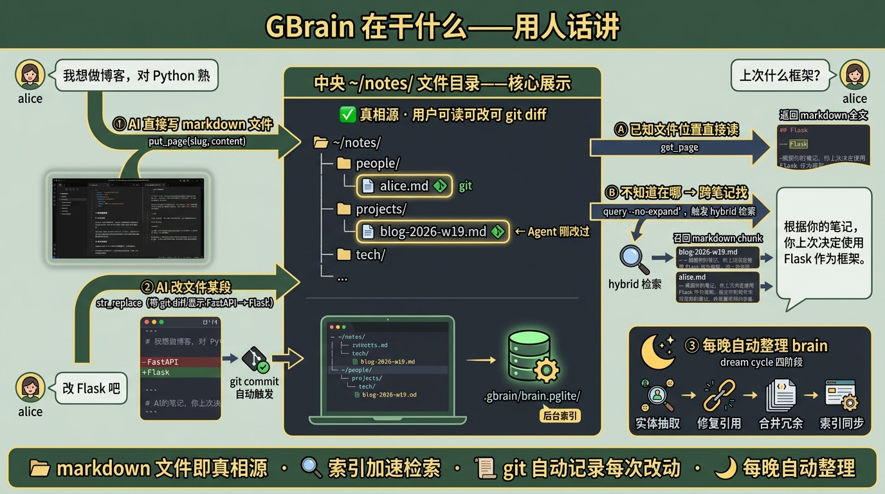

人话对应工程术语：

<!-- 第 2 页 -->

| 人话 | 内部叫什么 |
| --- | --- |
| AI 直接写 markdown 文件 | put_page(slug, content) |
| AI 修改文件某段 | str_replace(slug, old, new) |
| 精确读取某个文件 | get_page(slug) |
| 不知道在哪时跨笔记找 | query(q, no_expand=True) 触发 hybrid 检索 |
| 每次改动 git 自动记录 | git commit + diff + revert + blame 全套 |
| 每晚自动整理 brain | dream cycle 四阶段 |

和 Mem0 / Letta 的本质差异：GBrain 的记忆就是你电脑上的 markdown 文件——用户可读可改可

git diff，Mem0 / Letta 的记忆都锁在数据库里看不见。

视角 2：换一组实际数据，这流程跑出来什么

继续 alice 周末项目场景——周六做博客、周六下午改 Flask、周日回来问。下图按时间线展示 GBrain

实际在你电脑上创建了什么文件、git history 长什么样、检索时返回什么：

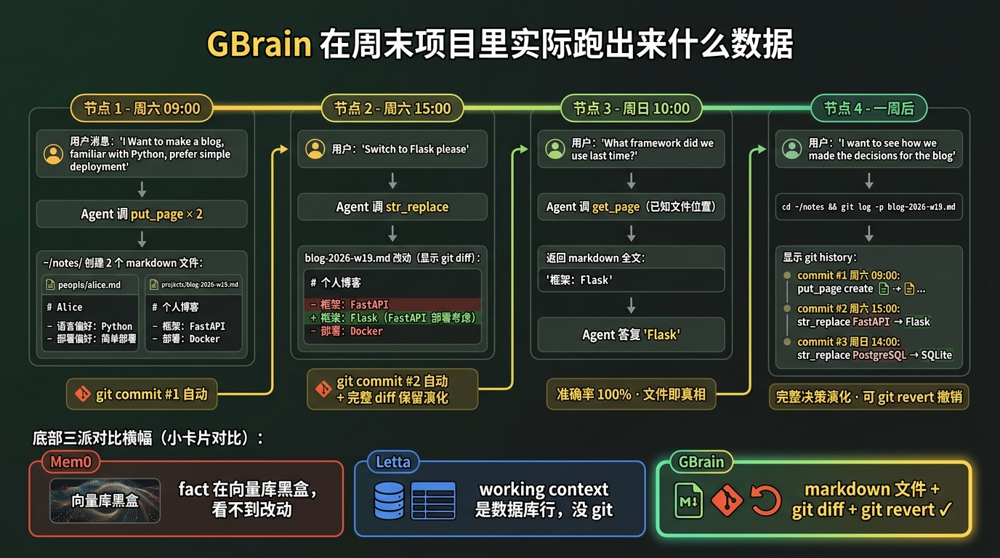

读图重点：

| 时间点 | GBrain 做了什么 | 物理结果 |
| --- | --- | --- |
| 周六<br>09:00 | put_page("people/alice") +<br>put_page("projects/blog-2026-w19") | ~/notes/ 创建 2 个<br>markdown 文件，git commit<br>#1 |
| 周六<br>15:00 | str_replace 把 FastAPI 改成 Flask | git commit #2，git diff 完整<br>保留演化 |
| 周日<br>10:00 | alice 问"上次什么框架"——Agent 直接<br>get_page("projects/blog-2026-w19") | 返回当前 markdown 全文，<br>Agent 看到 Flask，准确率<br>100% |

<!-- 第 3 页 -->

| 时间点 | GBrain 做了什么 | 物理结果 |
| --- | --- | --- |
| 一周后 | 想看决策演化—— git log -p projects/blog-<br>2026-w19.md<br>2026-w19.md | 看到 FastAPI → Flask →<br>SQLite 完整 history |

三派同款场景对比：

| 维度 | Mem0 | Letta | GBrain |
| --- | --- | --- | --- |
| 用户能直接看到<br>记忆吗 | ❌（向量库<br>黑盒） | ⚠️（ADE 网页能看，文<br>件看不到） | ✅（markdown 文件，<br>Obsidian 直接打开） |
| 想撤销 Agent 的<br>某次写入 | 没法 | 改 PostgreSQL 行 | git revert 一行 |
| 想看决策演化 | 看不到 | 看不到 | git log + diff 完整保留 |

视角 3：什么场景适合用 GBrain，什么场景容易翻车

✅ 这些场景非常适合用 GBrain —— 它能解决你的核心问题

个人知识管理 / 长期 brain repo —— 把对话沉淀成可读 markdown，跟 Obsidian / Logseq 思路

一致。GBrain 是这条路线最完整的开源工程化实现

要求每条记忆可追溯（金融 / 法律 / 合规审计）—— git log 看每次改动谁改、何时改、改了什

么。Mem0 / Letta 都没有这个能力

已有 Markdown 笔记（Obsidian / Logseq / Notion / Roam）想接入 Agent —— GBrain 内置

migrate skill 一键接入，已有笔记成为 Agent 的记忆库

数据不出本地（不愿用第三方 server）—— PGLite 全本地，连 docker 都不需要

想接入 Claude Code / Cursor 等 agentic CLI —— MCP server 开箱即用，主流 agentic 工具的

统一记忆后端

⚠️ 这些场景用 GBrain 容易翻车 —— 应该选别的派

客服 Agent 对每用户隔离的偏好记忆 —— GBrain 是单 brain（个人/团队级），多用户隔离是

Mem0 强项。这种场景选 Mem0

长任务 stateful runtime（agent 自动 page in/out / 工作状态自动持久化）—— GBrain 不是

stateful runtime。这种场景选 Letta

想快速给现有 SaaS chatbot 接长期记忆 —— GBrain 需要建立 markdown 目录约定 + skill 配

置，工程改造比 Mem0 大。这种场景选 Mem0

超大规模（5-10 万 markdown 文件以上）—— 官方推荐 ≥ 1000 个 .md 时切 Supabase 远端

Postgres，超大规模性能未在公开测试中验证

照默认配置跑 query —— 这不是翻车场景，是翻车原因：query expansion 默认开会卡 30 秒+，

交互场景必须 no_expand=True （§4b Watch-out 详谈）

下图把这两组场景并排放在一起，作为选型时的速查：

<!-- 第 4 页 -->

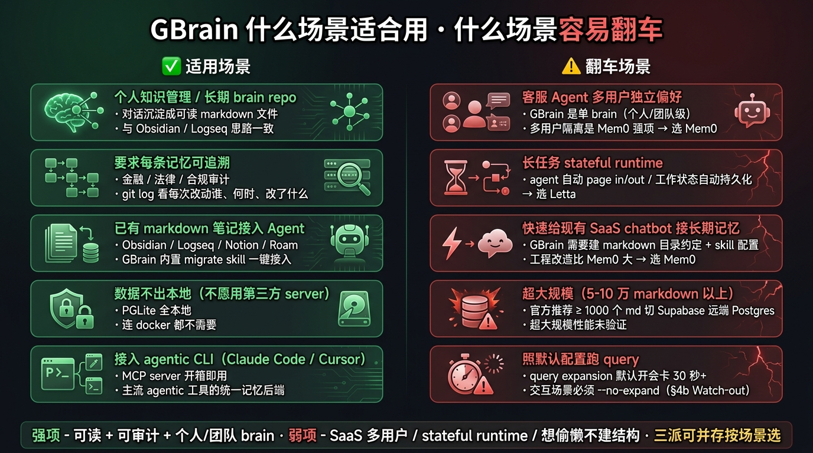

一句话总结：GBrain 的强项是"可读 + 可审计 + 个人/团队 brain"，弱项是"SaaS 多用户 /

stateful runtime / 想偷懒不建结构"。三派可以并存（§1d 已说），按场景选——不要"用最强

的"，要"用对的"。

下面把这三张速览里提到的事实展开——一句话定义、项目背景、信息源矩阵、机制流水线、生产坑

——逐一深入。

### 一句话定义

GBrain 是把 markdown 文件目录当成 Agent 的长期记忆，配上 Postgres 索引让 Agent 既能

hybrid 检索、又能在你睡觉时主动维护这份"大脑"的开源项目。

句子有点长，拆四个动词看会更清楚：

当成记忆——记忆不在数据库的黑盒里，就是一堆 .md 文件，存在你自己的文件系统上、可读可

改可 git diff

配上索引——文件之外另外建一份 PGLite 数据库（嵌入式 Postgres + pgvector），承担向量检索

+ 全文检索 + 知识图谱

hybrid 检索——同一次查询同时跑关键词（BM25，经典的全文检索打分算法）和向量召回，按

RRF（Reciprocal Rank Fusion，对多路检索结果按排名加权融合的标准做法）合并，比单跑任何一

路都准

主动维护——Agent 不只是读 brain，它还能写：每晚跑一次"dream cycle"四阶段（entity sweep

抽取/对齐实体 → fix broken citations 修复失效引用 → consolidate memory 合并冗余条目 →

sync 落盘同步），加上日常 cron 任务（lint / embed / extract / backlinks / import 等）让 brain

越用越聪明

如果学员之前看过 Claude Code 的 CLAUDE.md 写法 或者 Cursor Rules，GBrain 的设计思路一脉相承

——让 LLM 写它自己的笔记，写在文件系统里给操作员看。差别在于：GBrain 不是给一次性会话用

的"上下文规则"，而是一份跨会话累积、自维护的知识库。

<!-- 第 5 页 -->

### 项目背景

GBrain 由 Garry Tan（Y Combinator 现任 President & CEO，2024 至今执掌 YC）个人开源——它不

是 YC 投资的某家公司产品，而是 Garry 把自己日常使用的 OpenClaw / Hermes Agent 个人 setup 整理

成可复用代码后开源给社区的项目。作者本人在 X 推文里把它定义为"我自己的认知装甲（cognitive

armor）——open source open prompts 让你不再被锁在 API 之下"，这个定位决定了 GBrain 的产品

取向：面向重度个人 Agent 用户的自托管 brain repo，不是面向企业的 SaaS 服务。

发展轨迹（截至 2026-05）：

| 时间点 | 里程碑 |
| --- | --- |
| 2025 年中 | Karpathy 在 gist 发表 LLM Wiki 范式 —— GBrain 思想源头：把 LLM 写记忆类比<br>成"编译" |
| 2026-04-05 | GBrain 首次 commit 推到 github.com/garrytan/gbrain |
| 2026-04-10 | Garry Tan 在 X 公开宣布开源，24 小时获 5,400+ stars |
| 2026-04 中 | v0.10.0 发布"24 distinct fat skills + 完整 e2e/evals/unit tests"，作者明示进入个<br>人可用稳定期 |
| 2026-05 上<br>旬 | 当前 stars 15,500+，稳定版 v0.33.1.1（本课演示锁定版本） |

思想血缘是这一派的独特来源——GBrain 不像 Mem0 / Letta 那样有学术论文支撑，但它把 Karpathy

在 2025 年中提出的"LLM Wiki"思路彻底工程化。Karpathy 给出的核心类比：

"Obsidian is the IDE; the LLM is the programmer; the wiki is the codebase." —— Karpathy

LLM Wiki gist

按这个类比，"markdown 是源代码、PGLite 索引是编译产物、dream cycle 是构建系统" —— 这是

GBrain 区别于 Mem0（黑盒抽取）和 Letta（OS 类比）的本质设计。

企业 / 社区落地情况（2026 年 4-5 月公开案例）：

个人 Agent 用户：Garry Tan 个人使用的 brain 含 17,888 个 markdown page、4,383 个人物档

案、723 家公司档案、21 个自动 cron 任务 —— 这是项目最权威的"生产环境样本"

agentic CLI 集成：通过 MCP 接入 Claude Code / OpenClaw / Hermes Agent 等主流 agentic CLI

作为统一记忆后端

24 小时 5,400 stars 现象：在 Agent 记忆框架里是 2026 年最快增长的开源项目之一，反映出"自

托管 + 可读可控"是当下开发者的真实需求

社区深度解读：Tad MacPherson 在 Medium 发文 与 Gamgee Blog 等独立评测把 GBrain 称为

"the Memex we were promised"

### 项目信息源矩阵

GBrain 的特殊之处在于没有独立官网——它是开源个人项目，所有官方资源都集中在 GitHub + 作者推

文 + 思想源头 gist。下面 3 个核心入口是了解 GBrain 的完整信息源，建议学员先把这三个标签页打开备

用。

GitHub 仓库（github.com/garrytan/gbrain）——源码、README、Release Notes、issue、

INSTALL_FOR_AGENTS.md 与 docs/ 目录都在这里。当前 stars 15.5k+、v0.33.1.1 稳定版。所有

watch-out、版本变更和细节都在这里反查。

<!-- 第 6 页 -->


AGENTS.md 协议文档（raw.githubusercontent.com/garrytan/gbrain/main/AGENTS.md）——

给 agentic CLI 用的接入协议（非 Claude Code 的通用 agent 也按这个文档接入）。配合仓库根目录的

llms.txt 可以看到 GBrain 给 LLM 用的完整 doc map。这是 GBrain 区别于普通笔记软件的关键设计

——协议层而非应用层。


思想源头（Karpathy LLM Wiki gist）——2025 年中 Karpathy 发表的"LLM Wiki"范式 gist，把 LLM

写记忆类比成编译过程（PDFs/notes 是 source code, wiki 是 binary）。GBrain 是这个 pattern 的最完

整开源工程化实现。读懂这份 gist 等于读懂 GBrain 的设计哲学。

<!-- 第 7 页 -->


作者推文 Garry Tan @ X (2026-04-10) 是 GBrain 设计哲学的官方表述（"cognitive armor / open

source open prompts / above the API line"），含 v0.8.0 / v0.10.0 等版本发布的演化记录，但 X

平台不支持直接截图——读取请直接访问链接。

### 项目情况

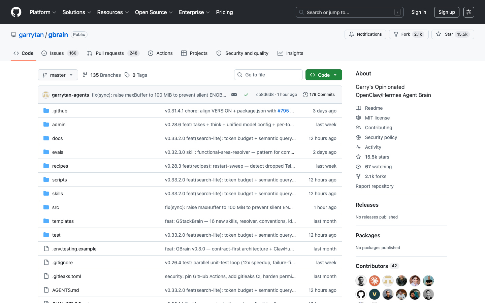

| 项 | 内容 |
| --- | --- |
| 作者 | Garry Tan，Y Combinator 现任 President & CEO |
| 仓库 | github.com/garrytan/gbrain |
| 协议 | MIT |

<!-- 第 8 页 -->

| 项 | 内容 |
| --- | --- |
| 首次提交 | 2026-04-05 |
| 公开宣布<br>开源 | 2026-04-10（Garry Tan 在 X / Twitter 发推） |
| 24 小时<br>stars | 5,400+ |
| 当前 stars | 15,500+（截至 2026-05 上旬，本课录制前一周确认） |
| 当前稳定<br>版 | 0.33.1.1（本课演示锁定版本） |
| 技术栈 | TypeScript + bun runtime（一种比 Node.js 启动更快的 JS 运行时）+ PGLite（嵌<br>入式 Postgres）+ pgvector |
| 官方文档 | 仓库内 INSTALL_FOR_AGENTS.md + docs/ 目录 |

Garry Tan 是 GBrain 的作者，不只是投资人。他在 2026-04-10 发推宣布时写道：

"If you want your OpenClaw or Hermes Agent to be able to have perfect total recall of all

10,000+ markdown files, GBrain is here to help. It's exactly my OpenClaw/Hermes Agent

setup. MIT-licensed open source. Hope it helps you build your mini-AGI."

名词速注：Hermes Agent 是 2026 年初出现的另一款 agentic CLI（与 OpenClaw、Claude

Code 同类），主打"用完就把工作经验写回 markdown skill 文件"的自学习循环——Garry Tan 的

日常 setup 把 OpenClaw 和 Hermes 同时挂到 GBrain 上做记忆后端，所以这里两个名字并列出

现。

仓库 README 也直白写"Garry's Opinionated OpenClaw/Hermes Agent Brain"——GBrain 本身就是

Garry 个人 Agent setup 的源码版本，包含他真实使用中积累的 17,888 个 markdown page、4,383 个

人物档案、723 家公司档案、21 个自动跑的 cron 任务。这一点把它和"出于研究兴趣的 demo 项目"明

确区分开。

### 为什么是 2026 年才出现

把"markdown 文件当记忆"这件事，Karpathy 在 2025 年中的 gist 里就已经写清楚了。GBrain 的工程

价值在于把这个思路真做出来 + 把生产细节填齐。

<!-- 第 9 页 -->

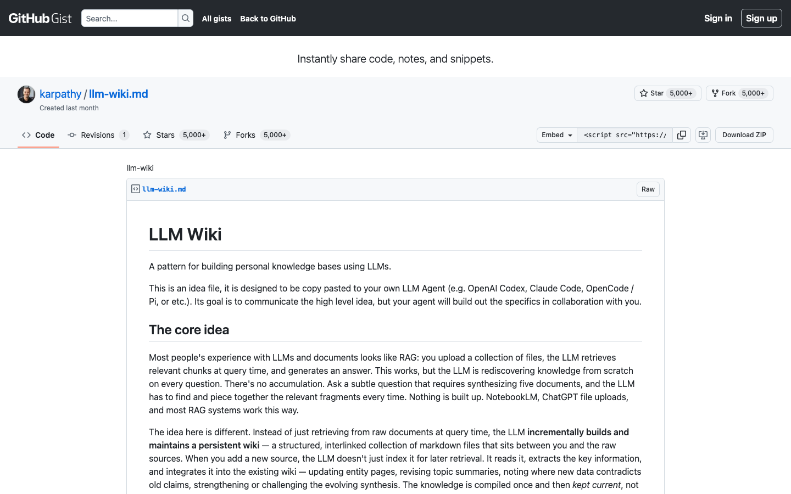

Karpathy 给出的核心类比是把 LLM 写记忆类比成编译：

| Karpathy 类比 | 对应到 GBrain |
| --- | --- |
| 源代码（raw sources：PDFs、笔记、文<br>章） | 你写的 markdown 笔记目录 |
| 二进制（compiled binary：wiki） | GBrain 维护的 PGLite 索引 + entity 图 + cross-<br>references |
| 构建配置（schema：编译规则） | gbrain.yml 的 storage / cycle / skill 配置 |
| IDE | Obsidian / VSCode / Cursor 等 markdown 编辑器 |
| 程序员 | LLM（具体到 GBrain 用 Anthropic Claude） |

Karpathy 的原话之一："Obsidian is the IDE; the LLM is the programmer; the wiki is the

codebase."

GBrain 把这个比喻具体化到了三件事——

1. brain repo（编辑面）：用户保留 markdown 文件目录，可以用任何编辑器、推 git

2. PGLite 索引（运行面）：GBrain 把 markdown 编译进本地 Postgres，建好向量 + 全文 + 链接 +

时间线索引

3. 生命周期（维护面）：每晚定时跑 "dream cycle" 四阶段（实体抽取 → 失效引用修复 → 冗余合并

→ 落盘同步），配合日常 cron 任务（lint / embed / extract / backlinks / import 等），让 brain

自己变得更整洁

之前为什么没做出来——这套思路的工程门槛在 2025 年中之前并不低：本地嵌入式 Postgres

（PGLite）的成熟、small embedding 模型（text-embedding-3-small）的便宜、Claude

Code/OpenClaw 等 agentic CLI 的普及——三件事在 2025 年下半年到 2026 年初才到位，GBrain 是这

个时间窗口里的工程化产物。

<!-- 第 10 页 -->

### 思想血缘

文档派不是 GBrain 独有的思路。学员每天用的几个工具背后是同一条血脉：

| 工具 | 文档派形态 | 与 GBrain 的关系 |
| --- | --- | --- |
| Karpathy LLM<br>Wiki | 个人 idea 文件 + Obsidian +<br>Claude MCP 维护 | 思想源头——Karpathy 写了<br>pattern，GBrain 是其中一份工程<br>化实现 |
| Claude Code<br>CLAUDE.md | 单文件 / 多层级（Global / Project /<br>Directory / Personal） | 轻量同源——CLAUDE.md 解决"单<br>次会话"上下文，GBrain 解决"跨会<br>话累积" |
| OpenClaw 早期<br>memory.md | 单 markdown 文件 + BM25/向量混<br>合检索 + memory-wiki 插件 | 国内同期摸索——比 GBrain 早提<br>出"memory.md"形态，但工程化<br>深度低于 GBrain |
| Cursor Rules +<br>Memories | .cursor/rules/*.md 配置 + 跨会<br>话记忆抽取 | IDE 内嵌版——把"规则文件即记<br>忆"的思路绑到具体编辑器里 |
| Anthropic<br>Memory Tool | 官方 API 提供的文件型记忆（view<br>/ create / str_replace 等 6 个动<br>作） | first-party 化——把文档派的 6 个<br>操作动词写进 SDK |

这五个项目共享的是同一条朴素原则：让 LLM 直接操作文件，让操作员看得见记忆。GBrain 在其

中的位置是"个人/团队级、可自托管、有完整工具链"的最完整开源实现。

### GBrain 怎么干活：从动机到完整流程

讲机制之前先理解一个关键前提——GBrain 不是 SDK，是一份本地 brain repo + 一组让 Agent 在这

份 brain 上操作的工具。Agent 不调 add(memory) 这种抽象 API，而是调

put_page("people/alice", content) 这种对真实 markdown 文件的操作。这种"文件即真相源"的

设计带来三个 GBrain 区别于其他派的特征：(1) markdown 是用户可见可改的；(2) 所有操作都同步可

逆；(3) git history 自动保留 Agent 改记忆的每一步。

下面用 §1d 的周末项目例子走一遍——alice 周六做博客、改 Flask、周日回来问问题——把核心机制拆

成 6 个环节看清楚。

环节 ①：GBrain 的工作空间——文件 + 索引双写

GBrain 同时维护两份数据——这是"文件即真相源"的工程兑现：

```text
┌─ 真相源：~/notes/（用户自己的 markdown 笔记目录）──────────┐
│                                                            │
│  people/         ← 人物档案                                │
│  └─ alice-wang.md, zhang.md, ...                          │
│  projects/       ← 项目笔记                                │
│  └─ blog-2026-w19.md, todo-2026-w20.md, ...               │
│  tech/           ← 技术沉淀                                │
│  └─ rag-chunking.md, fastapi-vs-flask.md, ...             │
│                                                            │
│  特点：可被 Obsidian / VSCode / Cursor 直接打开            │
│        每个文件可 git commit, git diff, git revert         │
```

<!-- 第 11 页 -->

```text
└────────────────────────────────────────────────────────────┘
↓
sync_brain 自动同步
↓
┌─ 索引：~/.gbrain/brain.pglite/（PGLite 嵌入式 Postgres）──┐
│                                                            │
│  pages 表             ← 全文 + 元数据                      │
│  content_chunks 表    ← 切分后的向量（≈ 400 token / 片段）│
│  links 表             ← typed link（mentions / authored_by）│
│  timeline_entries 表  ← 结构化时间线                       │
│  ...                  ← v0.33.1.1 含数十张表              │
│                                                            │
│  特点：纯客户端（WebAssembly Postgres，不需要 server）     │
│        丢了可以从 markdown 重建（gbrain init + import）    │
└────────────────────────────────────────────────────────────┘
```

为什么文件 + 索引双写？这是 GBrain 与 Letta / Mem0 的本质区别：

Mem0：数据只在向量库里（用户看不见、改不了）

Letta：数据在 PostgreSQL 行里（用户也看不见）

GBrain：真相在 markdown 文件，PGLite 只是加速检索的索引——丢了索引可以从 markdown

重建，丢了 markdown 索引就是无主片段

为什么不直接全文搜 markdown？文件系统的 grep 只能匹配字面字符串，没法做语义相似度。

PGLite 索引让 Agent 既能精确读原文件（get_page ）、又能跨文件做 hybrid 检索（query ）——两

条路径并存。

环节 ②：写入路径——alice 说话 → Agent 操作 markdown 文件

```text
# ── 周六 09:00：alice 第一次说话 ──
# alice → "我想做个博客，对 Python 熟，喜欢简单部署"
#
# Agent reasoning：
#   "这段含 alice 的偏好（Python + 简单部署）和项目状态（博客 + FastAPI）。
#    按业务维度写到 markdown 文件——
#    人物档案进 people/，项目档案进 projects/。"
#
agent.tool.call("put_page",
slug="people/alice",
content="""# Alice
- 语言偏好：Python
- 部署偏好：简单部署优先
""")
agent.tool.call("put_page",
slug="projects/blog-2026-w19",
content="""# 个人博客项目
- 框架：FastAPI
- 部署：Docker
""")
# 物理效果（不是单一动作，是一条流水线）：
#   1) 两个 .md 文件写入 ~/notes/
#   2) git commit 自动触发（如果 brain 是 git repo）
```

<!-- 第 12 页 -->

```text
#   3) sync_brain 把内容同步到 PGLite 索引：
#      - pages 表 +2 行
#      - content_chunks 表抽出向量
#      - links 表抽出实体引用（"FastAPI" → tech/fastapi 等 typed link）
# ── 周六 15:00：alice 改主意 ──
# alice → "FastAPI 部署太复杂，改 Flask"
#
# Agent reasoning：
#   "项目状态变了。文档派的做法是直接改 markdown 文件——
#    str_replace 把 FastAPI 替换成 Flask，git diff 自然保留演化。
#    不需要 'UPDATE / DELETE' 这种数据库术语。"
#
agent.tool.call("str_replace",
slug="projects/blog-2026-w19",
old="框架：FastAPI",
new="框架：Flask（FastAPI 部署考虑）")
# 物理效果：
#   1) markdown 文件改动 + 第二个 git commit
#   2) git diff 显示完整的 FastAPI → Flask 演化
#   3) PGLite 索引同步更新（旧 chunk 失效，新 chunk 入库）
```

环节 ③：读取路径——alice 回来问问题，两种检索方式

GBrain 给 Agent 两条读取路径，按"知不知道页面位置"分流：

路径 A：精确读取（get_page）—— Agent 已知页面位置

```text
# alice → "上次咱们最终用什么框架？"
#
# Agent 知道项目笔记的 slug，直接读：
content = agent.tool.call("get_page",
slug="projects/blog-2026-w19")
# 返回完整 markdown 内容：
#   # 个人博客项目
#   - 框架：Flask（FastAPI 部署考虑）
#   - 部署：Docker
#
# Agent 基于这段 markdown 直接回答："你最终决定用 Flask"
# 准确率 100%——文件即真相
```

路径 B：模糊检索（query，触发 hybrid 检索）—— Agent 不知道页面位置

```text
# alice → "我之前研究过哪些 web 框架？"（没指明项目名）
#
# Agent 调 query 让 GBrain 跨笔记找：
results = agent.tool.call("query",
q="我之前研究过哪些 web 框架",
limit=5,
no_expand=True)
#
# GBrain 内部流水线（一次 query 实际做了四步）：
#   1) 向量召回   ：把 query embed 后查 content_chunks 表，按余弦相似度取 top-k×2
```

<!-- 第 13 页 -->

```text
#   2) BM25 召回 ：在 pages 表的全文索引上找关键词匹配，取 top-k×2
#   3) RRF 融合   ：两路结果按 Reciprocal Rank Fusion 加权融合
#   4) 返回 top-k：含 projects/blog-2026-w19.md 的相关片段 + 其他相关笔记
# 返回结构（chunks 是 markdown 文件的切分片段，不是整页）：
results
# [
#   {"slug": "projects/blog-2026-w19", "chunk": "# 个人博客项目\n- 框架：Flask...",
"score": 0.89},
#   {"slug": "tech/fastapi-vs-flask",  "chunk": "FastAPI vs Flask 选型对比...",
"score": 0.81},
#   {"slug": "people/alice",           "chunk": "- 部署偏好：简单部署优先",
"score": 0.42},
#   ... 共 N 条（≤ limit）
# ]
```

召回结果怎么进 LLM prompt —— 和 Mem0 一样，GBrain 不接管 prompt 构造，业务侧自己拼：

```text
# 拼回 system prompt
context = "\n\n".join(
f"## 来自 {r['slug']}\n{r['chunk']}"
for r in results[:5]
)
system = f"""你是个人 AI 助手，可以访问用户的 brain 笔记。
以下是与当前问题相关的笔记片段：
{context}
请基于这些笔记回答问题，引用时标明 slug。"""
# 调 LLM
resp = client.chat.completions.create(
model="anthropic/claude-opus-4-6",
messages=[
{"role": "system", "content": system},
{"role": "user", "content": "我之前研究过哪些 web 框架？"},
],
)
```

带几条进 prompt？三个核心可调参数：

| 参数 | 默认值 | 调整动机 |
| --- | --- | --- |
| limit | 10 | 想要更多 / 更少 chunk 进 prompt。GBrain 的 chunk 平均 ≈<br>400 token，limit=5 ≈ 2k token，limit=20 ≈ 8k token |
| no_expand | False（开<br>expansion） | 交互场景必填 True —— False 会先调 LLM 把 query 改写<br>成 3-5 个语义近义查询，对每个改写都跑一遍 hybrid 流水线<br>再融合，召回更全但延迟翻 10 倍以上 |
| filters | None | 按 slug 前缀 / typed link / timeline date range 过滤——例<br>如 filters={"slug_prefix": "projects/"} 只查项目笔<br>记 |

<!-- 第 14 页 -->

expansion 大坑：默认 no_expand=False ，首次跑必须显式 no_expand=True ——否则学员会

以为系统挂了（30 秒+ 无响应）。这是 GBrain 默认偏好"召回率优先"导致的——离线批量任务

（cron 类）值得多花 30 秒换更全的召回；交互查询则必关。§4b Watch-out 详谈这条权衡。

生产侧调优经验：

交互对话场景：limit=5, no_expand=True ——延迟 1-2 秒、prompt 占用约 2k token，足够大

多数问答场景

报告生成 / 深度研究：limit=20, no_expand=False ——离线跑可以等 30 秒，召回更全 + LLM

写报告需要更多上下文

跨工具集成（如 Claude Code MCP）：limit=10, no_expand=True ——平衡延迟与覆盖

关于 token 估算对比：GBrain 召回的是 markdown chunk（每片约 400 tokens，比 Mem0 fact

的 30-50 tokens 大一个量级）。这是文档派的特征——保留原文上下文 vs 抽取式提炼短 fact，前

者信息量大、后者信息密度高。两条路线在不同场景各有优势：要"精准 fact"用 Mem0，要"上下

文 + 原文引用"用 GBrain。

环节 ④：git 演化追踪——所有动作可 diff 可 revert

这是 GBrain 与其他两派真正拉开差距的设计——Agent 写记忆的每一步都自动落 git：

```text
# 周日早上想看"FastAPI → Flask"这个决策怎么演变的
cd ~/notes
git log --oneline projects/blog-2026-w19.md
# a1b2c3d 周六 15:00 - str_replace: FastAPI → Flask
# e4f5g6h 周六 09:00 - put_page: create blog-2026-w19
git diff e4f5g6h a1b2c3d projects/blog-2026-w19.md
# - 框架：FastAPI
# + 框架：Flask（FastAPI 部署考虑）
# 想撤销 Agent 的某次写入？
git revert a1b2c3d
gbrain sync_brain    # 同步索引到 revert 后的状态
```

和 Mem0 / Letta 对照：

Mem0 m.add() 是黑盒函数——你不知道这次调用 LLM 抽了几条 fact、为什么是这几条、能不能

撤回

Letta core_memory_replace 改的是 PostgreSQL 行——你能在 ADE 网页看到当前值，但看不

到"这一改动是什么时候、为什么发生的"

GBrain：Agent 改记忆 = 修改 markdown 文件 = git commit。整套 git 工具链直接可用——

blame、log、diff、revert、bisect。这是文档派"操作员可见"承诺的工程兑现

环节 ⑤：dream cycle —— 每晚自动整理 brain

GBrain 还有一个其他两派没有的设计——每晚定时跑的自动整理循环（dream cycle），让 brain 随用

随整理：

```text
┌─ 每晚 cron 触发 dream cycle（4 个 stage）────────────┐
│                                                     │
│  Stage 1: entity sweep                              │
│    扫描所有新加 markdown，抽取实体（人 / 项目 /      │
```

<!-- 第 15 页 -->

```text
│    技术 / 公司），更新 links 表                     │
│                                                     │
│  Stage 2: fix broken citations                      │
│    检测 markdown 里的 [link](slug) 是否失效，       │
│    自动修复或标记 dead-link                         │
│                                                     │
│  Stage 3: consolidate memory                        │
│    用 LLM 找语义重复的页面，提示合并                 │
│                                                     │
│  Stage 4: sync                                      │
│    把所有改动落盘 + 重建 PGLite 索引                 │
└─────────────────────────────────────────────────────┘
```

这套机制呼应 §1c 局限 4 的遗忘问题——GBrain 不让 brain 越积越乱，而是定时主动整理。cron 一般

凌晨跑（不打扰用户），跑完后 brain 比头一天更整齐。Letta 0.16+ 后来加的 sleep-time agent 是类似

思路的 OS 派实现，但 GBrain 是把这套 cron-driven 整理做到了开源工程化。

环节 ⑥：完整工具清单

把上面 5 个环节涉及的工具汇总成 Agent 一定要会的内置工具清单（来自 skills/brain-

ops/SKILL.md ）：

| 工具 | 作用 | 操作哪段 |
| --- | --- | --- |
| put_page(slug, content) | 创建或更新页面（自动抽取<br>实体链接） | markdown 文件 + 索<br>引 |
| str_replace(slug, old, new) | 在指定页面里把旧字符串替<br>换为新 | markdown 文件 + 索<br>引 |
| get_page(slug) | 按 slug 精确读取整页内容 | markdown 文件 |
| query(q, --no-expand) | hybrid 检索（向量 + BM25<br>+ RRF） | PGLite 索引 |
| search(q) | 关键词检索现有页面 | PGLite 索引（仅<br>BM25） |
| get_backlinks(slug) | 查谁引用了这个页面 | links 表 |
| add_link(from, to, type) | 手动建立跨页面 typed link | links 表 |
| add_timeline_entry(slug, date,<br>event) | 追加带日期的时间线条目 | timeline entries 表<br>_ |
| sync_brain() | 把 markdown 改动同步进<br>PGLite 索引 | 索引重建 |

同派对比 — Anthropic Memory Tool：Anthropic 官方 SDK 暴露了 6 个文件级动词（view /

create / str_replace / insert / delete / rename ），是 first-party 化的文档派——但只

有"操作文件"没有"维护索引 / typed link / dream cycle"等高阶能力。GBrain 是同派思路的工程化

完整实现。

<!-- 第 16 页 -->

与 §1d 三派对比表的一一对应

把上面 6 个环节翻译回 §1d 三派对比表的三个维度：

| §1d<br>维度 | GBrain 对应实现 |
| --- | --- |
| 写入<br>方式 | 环节 ② 显式调用 put_page / str_replace 操作 markdown 文件，每步都同步可逆 |
| 存储<br>载体 | 环节 ① 文件（真相）+ PGLite 索引（加速）双写——文件即真相源 |
| 执行<br>位置 | 全客户端：PGLite 是 WebAssembly Postgres，不需要 server、docker，数据不出本地<br>（embedding 调用除外）。需要团队共享时改一行 engine: supabase 即可切到<br>Supabase 托管 Postgres |

到这里 GBrain 的全部核心机制已经讲清。下面看它不擅长什么——文档派也有边界。

### 边界：GBrain 不擅长什么

诚实给出 GBrain 当前不擅长的场景，配 §1d 的"三派可并存"结论：

| 场景 | GBrain 适<br>不适合 | 原因 |
| --- | --- | --- |
| 客服 Agent 对每用户隔离的偏好记<br>忆 | 不合适 | GBrain 是单 brain（个人/团队级），多<br>用户隔离是 Mem0 的强项 |
| 长任务跨 session 自动状态管理<br>（agent 主动 page in/out） | 不合适 | GBrain 不是 stateful runtime，Letta 才<br>是 |
| 个人/团队 markdown 知识库 + 跨<br>笔记检索 + 可视化 | 正好对症 | 文档派的核心场景 |
| 已有 Obsidian / Logseq / Notion<br>数据需要被 Agent 访问 | 正好对症 | GBrain 内置 migrate skill 一键接入<br>Obsidian / Logseq / Notion / Roam |
| 不想暴露任何数据到第三方 server | 正好对症 | PGLite 全本地 |
| 5-10 万级以上 markdown 文件 | 临界 | 官方推荐 ≥ 1000 个 .md 时考虑切<br>Supabase 远端 Postgres |

§1d 已经说清三派不是替代关系而是分工——一个稍复杂的 Agent 系统完全可以同时用 GBrain 管

团队知识、Mem0 管用户偏好、Letta 跑长任务 runtime。本节把 GBrain 的边界说清，是为了

让学员选型时"用对地方"而不是"用最强的"。

### 小结

GBrain 的核心是一句话：markdown 文件就是真相源。

这一句话推导出的工程后果是：

写入方式 = 页面级显式操作（GBrain 8 个 brain-ops / Memory Tool 6 个文件动词），同步、可

读、可逆

<!-- 第 17 页 -->

存储载体 = 文件 + PGLite 索引双写，文件丢失从索引建不回来

执行位置 = 纯客户端，PGLite 把 Postgres 编译进 WebAssembly

思想血脉 = Karpathy LLM Wiki / Claude Code CLAUDE.md / OpenClaw 早期 memory.md

默认偏好 = 召回率优先（query expansion 开 30 秒延迟为代价），交互场景必须 --no-expand

§4b 把这套设计落到地——一次 git clone + bun link + gbrain init + gbrain import 之后，

你手上就会有一个装了 225 笔记 / 713 chunk / 76 MB / 完全离线的本地 brain。§4c 再带学员看

hybrid 检索的实际效果 + admin UI 的知识图谱可视化。

## §4b 实操：装机 + gbrain init + 导入 225 个 markdown 
笔记

GBrain 的装机路径与 Mem0、Letta 显著不同——它不是 Python pip install ，也不是 Docker

docker compose up ，而是走 bun（Zig 实现的 JavaScript/TypeScript runtime）+ git clone。本节

把"clone 仓库 → 装依赖 → 初始化本地 brain → 导入 225 个真实笔记 → 生成 embedding"五步走通，

最终在 ~/.gbrain/brain.pglite 看到一个可被 hybrid 检索的本地知识库。

本节使用 GBrain v0.33.1.1（Phase 2 实测使用的版本）。本课所有 GBrain 演示都以此版本为

准；GBrain 周级迭代，最新版的命令与输出可能略有差异，但本节的装机路径（git clone + bun

link）官方明示是当前唯一推荐方式。

### 步骤 0：前置环境检查

GBrain 的运行依赖三件：bun runtime（≥ 1.3）、git、一对 LLM/Embedding API Key。学员开始之

前请逐一验证。

bun runtime

bun 是 oven-sh/bun 出品的 JavaScript/TypeScript runtime，定位是 Node.js 的"加速版替代品"。

GBrain 选择 bun 而非 npm/pnpm 的核心原因是更快的依赖解析速度（GBrain 的 bun install 280

个包能在 400ms 内完成）。学员第一次接触 bun 不必紧张——本节用到的只是装包 + 软链两个命令，

与 npm 用法一一对应。

学员如果还没装过 bun，一行命令搞定：

```text
curl -fsSL https://bun.sh/install | bash
export PATH="$HOME/.bun/bin:$PATH"
```

注：上面这条命令需要科学上网或国内镜像才能拉取到 bun.sh 域名。如果你在国内裸网不通，

可以走 npm install -g bun （前提是已有 Node.js）。

Node.js（可选但推荐）

bun 可以独立运行不依赖 Node.js，但 GBrain 的部分工具链（如 gbrain serve 的 admin UI 构建）

会回落到 Node.js。建议 Node.js ≥ 20。

<!-- 第 18 页 -->

git

GBrain 当前只能通过 git clone 源码安装——后面会解释为什么。git --version 任何 ≥ 2.30 即可。

OPENAI_API_KEY

GBrain 默认 embedding provider 是 OpenAI 的 text-embedding-3-large （3072 维），本课用更轻

的 text-embedding-3-small （1536 维，与 Mem0/Letta 对齐）。无论选哪个，都需要一个有效的

OpenAI API Key——执行 gbrain embed --stale 时会真实调用 OpenAI Embedding API。

Caution

shell 环境变量里的 OPENAI_API_KEY 可能和 .credentials.yaml 不一致。如果后续 gbrain

embed 报 Incorrect API key provided ，先做以下比对：

```text
echo "env  末 4: ${OPENAI_API_KEY: -4}"
python3 -c "import yaml; print('file 末 4:',
yaml.safe_load(open('~/...credentials.yaml'))['api_keys']['openai']['key']
[-4:])"
```

末 4 位不一致 → shell 里那个 key 是旧版，需要重新 export 覆盖。

四项就绪后，运行以下命令一次性确认：

```text
bun --version
node --version
git --version
echo "OPENAI_API_KEY=${OPENAI_API_KEY:0:7}...[已设置]"
```

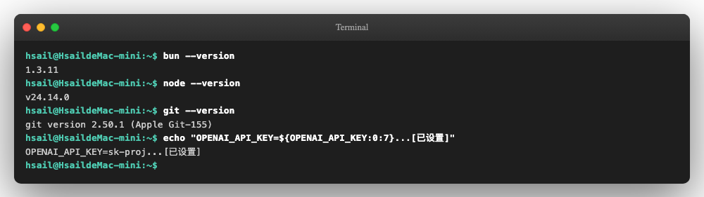

四行输出对应 bun 1.3.11、Node v24、git 2.50、OpenAI Key 已设置（脱敏显示前 7 位）。学员手上的

版本号小幅差异是常态——不影响后续步骤。

### 步骤 1：克隆源码 + 装依赖

GBrain 仓库地址：github.com/garrytan/gbrain。Garry Tan 是 Y Combinator 现任 CEO，GBrain 是

他个人 Agent setup 的工程化版本——这一身份背景在 §4a 概念课里详谈，这里先关注怎么装。

为什么不能用 bun install -g ？

GBrain 的 README 在装机一节给出了一条强警告：

Do NOT use bun install -g github:garrytan/gbrain . Bun blocks the top-level postinstall

hook on global installs, so schema migrations never run and the CLI aborts with Aborted()

when it opens PGLite.

<!-- 第 19 页 -->

翻译过来：bun 在全局安装模式下会跳过 postinstall 钩子，导致 GBrain 的数据库 schema 迁移脚本无

法运行，CLI 首次打开 PGLite 数据库就直接崩溃。GBrain 团队的 tracking issue 是 #218。

正确的装机路径是先 clone 再 bun link ：

```text
# Step 1.1 — 克隆源码到 ~/gbrain
git clone https://github.com/garrytan/gbrain.git ~/gbrain
cd ~/gbrain
# Step 1.2 — 锁定 v0.33.1.1 版本（本课所有演示基于此版本）
git checkout 182a144   # 这个 commit 对应 package.json 中 version 字段 "0.33.1.1"
# Step 1.3 — bun 装依赖 + 全局软链
bun install
bun link
# Step 1.4 — 验证装机
gbrain --version
```

注：git checkout 182a144 是定位 package.json 中 "version": "0.33.1.1" 的具体

commit SHA。需要说明的是，GBrain 当前仓库未发布任何 GitHub release tag（releases 页面

目前为空），0.33.1.1 仅作为 npm 版本号记录在 package.json 里。GBrain 主线开发节奏

快，新版本随时会推。本课所有演示都基于这个 commit 的代码与命令形态，学员复刻时建议先

checkout 到这里再起步。生产使用时再 git checkout master 跟随主线。

四步执行完后终端输出大致如此：

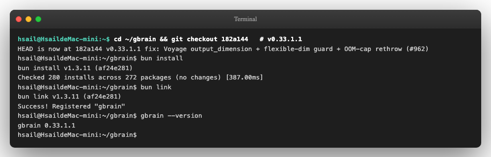

bun install 看到 "no changes" 是因为本地缓存已就绪——第一次跑会看到 280 个包的下载日志。

bun link 的作用是把 ~/gbrain 仓库里的可执行入口（src/cli.ts ）软链到

~/.bun/bin/gbrain ，让 gbrain 命令在任何目录都能直接调用。最后 gbrain --version 输出

0.33.1.1 表明软链成功。

### 步骤 2：配置 API Key

GBrain 通过环境变量读取 LLM/Embedding 凭证。本节最少要设置一个—— OPENAI_API_KEY ：

`export OPENAI_API_KEY="sk-proj-..."`

如果学员手头还有 ANTHROPIC_API_KEY ，也可以一并设置——GBrain 默认 chat/expansion 模型走

Anthropic Claude（claude-sonnet-4-6 / claude-haiku-4-5-20251001 ），有 Anthropic key 时检

索质量更好。但没有 Anthropic key 不影响装机，只是后续 query expansion 走不了——本节不会用

到。

<!-- 第 20 页 -->

关于 DeepSeek：GBrain 0.33.1.1 源码里有完整的 DeepSeek recipe

（src/core/ai/recipes/deepseek.ts ），可以把 chat/expansion 切到 deepseek:deepseek-

chat 。但 DeepSeek 没有 embedding 模型，所以 --embedding-model 仍需走 OpenAI 或

Qwen DashScope。完整的 DeepSeek + Qwen 全国产替代配置在 §4d 速查表里给出，本节用最

直接的 OpenAI 路径完成装机。

把 export 写进 ~/.zshrc 或 ~/.bashrc 后记得 source 一下，避免下次开 terminal 又得手动

export。

### 步骤 3：gbrain init 创建本地 brain

GBrain 的 init 命令做两件事——创建本地 PGLite 数据库（嵌入式 Postgres，无需起 server）+ 应用

schema 迁移（v0.33.1.1 有 54 个 schema 版本，初次 init 会一次跑完 50 个 migration）。

完整命令一行：

```text
gbrain init \
--embedding-model openai:text-embedding-3-small \
--embedding-dimensions 1536
```

两个 flag 的作用：

--embedding-model openai:text-embedding-3-small ——显式指定 OpenAI 的小尺寸

embedding 模型。不指定则走默认 text-embedding-3-large （3072 维，向量库占用翻倍）。

--embedding-dimensions 1536 ——锁定向量维度。这一项首次 init 之后不能改：PGLite 表里

content_chunks.embedding 列是 vector(1536) ，后续要换维度必须重新 init（v0.28.5 起会大

声报错而不是静默截断，是踩过的坑修出来的护栏）。

输出长度约 100 行，分两段：Skill 安装建议（首次 init 会推荐 9 个 skill 让 agent 接管 brain 维护，详

见 §4d）+ schema 迁移日志（50 个 migration 逐条 ok）+ 最终的 brain 状态：

<!-- 第 21 页 -->

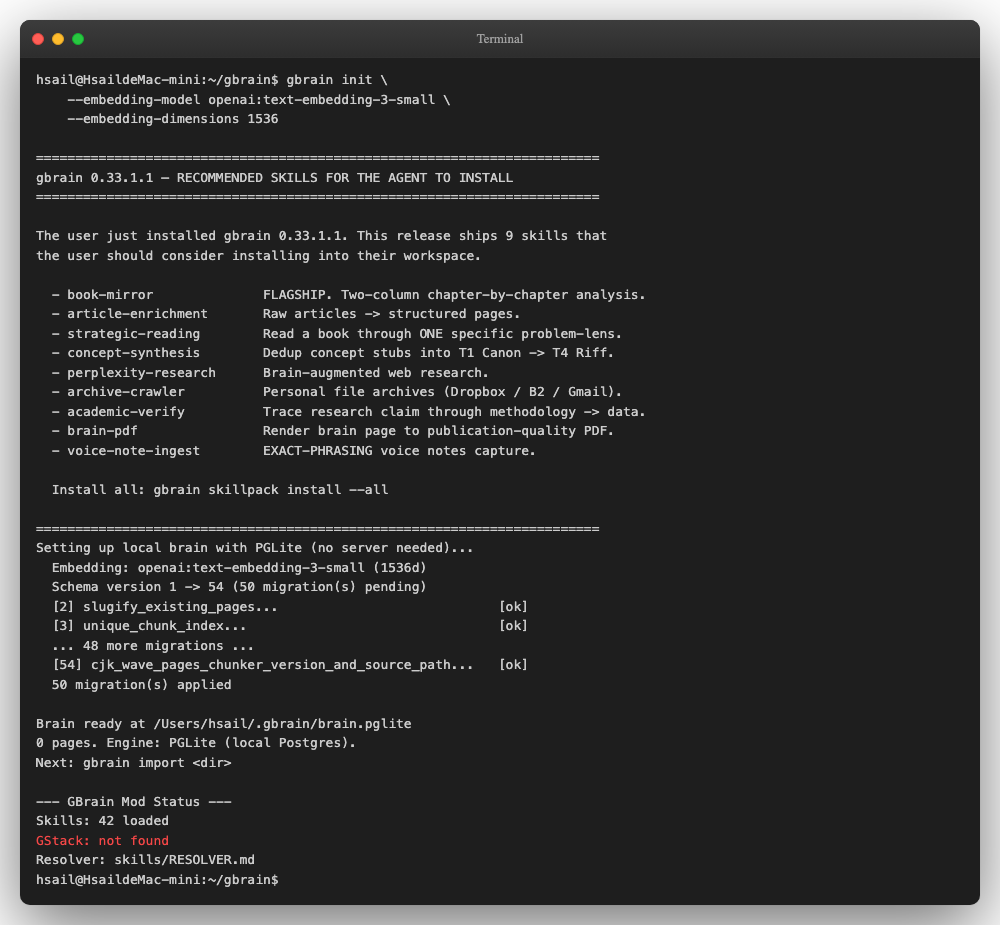

观察关键四行：

| 输出 | 含义 |
| --- | --- |
| Embedding: openai:text-embedding-3-small<br>(1536d) | embedding 模型与维度已锁定 |
| 50 migration(s) applied | schema v1 → v54 一次性迁移完成 |
| Brain ready at<br>/Users/hsail/.gbrain/brain.pglite | 数据库落盘位置——这是 GBrain<br>的"真相源" |
| Skills: 42 loaded | v0.33.1.1 加载的 skill 数（速查表 §4d<br>详谈） |

首次 init 还会打印一段 Recommended Skills 清单（book-mirror、article-enrichment、strategic-

reading 等 9 个 flagship skill），并提示 gbrain skillpack install --all 一键安装。本节是装机

演示，不安装任何 skill——保持 brain 干净便于后续观察导入笔记的过程。

Watch-out：上面输出顶部有一行 [ai.gateway] recipe "google" declares an embedding

touchpoint without max_batch_tokens 警告——这是 Google Gemini embedding 配方的内

部告警，与 OpenAI 路径完全无关，可忽略。GBrain 周级迭代时这类 internal 警告偶尔会冒头，

看到不要当成报错处理。

<!-- 第 22 页 -->

### 步骤 4：导入 225 个 markdown 笔记

到这里，本地 brain 已就绪但是空的（0 pages）。下一步把准备好的 225 个 markdown 笔记直接喂进

去——GBrain 的设计哲学是"文件就是真相源"，所以 import 的过程实质上是把磁盘上的 markdown 文

件读进 PGLite 数据库 + 切 chunk + 后台异步生成 embedding。

课程已经为本节准备好了 225 个 markdown 笔记，覆盖客服 Agent 服务的三位初级 Python 程序

员（Alice/Bob/Carol）的真实工作场景：技术笔记 110 篇、工作日志 60 篇、读书笔记 30 篇、人

物档案 15 篇、项目记录 10 篇。学员不需要自己生成——拉本课仓库的 experiments/data-

gen/output/gbrain/ 直接用。

本课从仓库 clone 完成后，把这个目录拷一份到本机（约 850KB）。下面假设笔记已经在 ~/notes/ ：

```text
# Step 4.1 — 确认 225 个文件就位
ls -d ~/notes/*/                  # 5 个子目录
find ~/notes -name "*.md" | wc -l # 225
# Step 4.2 — 导入（先不生成 embedding，分两步走更可观察）
gbrain import ~/notes/ --no-embed
```

--no-embed 标志告诉 GBrain 只做"读文件 + 入库 + 切 chunk"，跳过 embedding 调用。这一步不需

要 API key、不消耗 token，2 秒内完成：

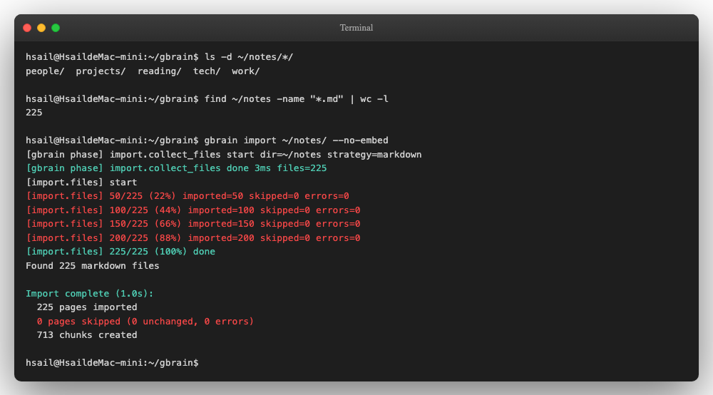

GBrain 的 import 流程分两阶段：

| 阶段 | 含义 | 输出 |
| --- | --- | --- |
| import.collect_files | 递归扫描目录，按 markdown 策略筛选 | files=225 |
| import.files | 逐文件解析 frontmatter（markdown 文件<br>开头被三个 --- 包起来的 YAML 元数据<br>头，常用于写 title/tags/type 等字段）+ 切<br>chunk + 入 PGLite | 225 pages<br>imported, 713<br>chunks created |

225 个 markdown 文件被切成 713 个 chunk——GBrain 默认按段落+标题做语义切分，所以单文件平

均 ~3 个 chunk，与笔记长度大体匹配。

<!-- 第 23 页 -->

Step 4.3 — 生成 embedding

接下来生成向量索引。--stale 标志让 GBrain 只处理"还没有 embedding 的 chunk"，幂等可重跑：

`gbrain embed --stale`

这一步会真实调用 OpenAI Embedding API（每个 chunk 一次 batch 请求，可批量发送）。225 页 /

713 chunk 实测约 10 秒完成。然后跑一次 gbrain stats 看落盘状态：

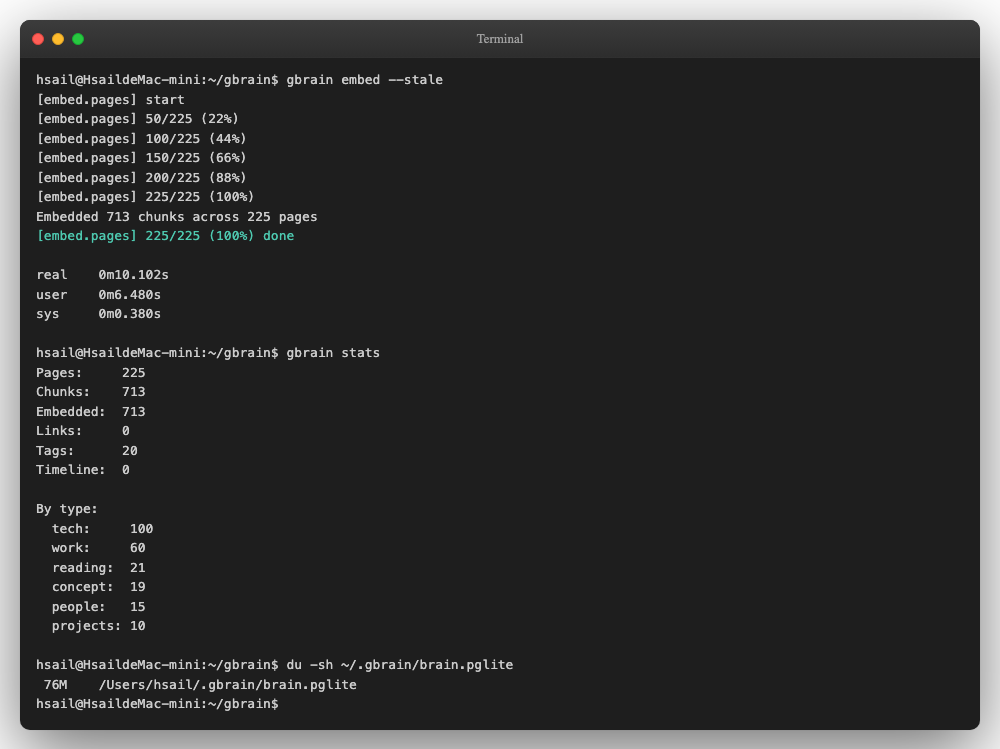

读这张截图的几个关键数：

| 指标 | 数值 | 说明 |
| --- | --- | --- |
| Pages | 225 | 入库笔记数，与磁盘文件数一致 |
| Chunks | 713 | 切分后的可检索片段数 |
| Embedded | 713 | 已生成向量的 chunk 数（等于<br>Chunks，说明 100% 完成） |
| Tags | 20 | 从 frontmatter tags: 字段聚合的<br>标签数 |
| By type | tech 100 / work 60 / reading 21 /<br>concept 19 / people 15 / projects 10 | 按 markdown frontmatter type:<br>字段分类 |
| brain.pglite<br>体积 | 76 MB | 含原文 + chunk + 1536 维<br>embedding 的本地 Postgres 文件 |

<!-- 第 24 页 -->

关于 By type 与磁盘目录的差异：导入时 GBrain 优先读 frontmatter 里的 type: 字段，而不是

目录名。所以 tech/ 目录下 110 个文件，其中 10 个 frontmatter 写了 type: concept ，最终

被归入 concept 类。同理 reading/ 下有 9 个被归入 concept。目录是真相源，type 字段是

GBrain 的二级分类——两者不一致时以 type 为准。

至此本地 brain 装机+数据导入完成。~/.gbrain/brain.pglite 这个 76M 的文件就是 GBrain 的全部

记忆——完全在本机、纯本地、零 server。学员关掉 terminal 也好、第二天开机也罢，数据持久落

盘。

### 步骤 5：验证与小结

到这一步，学员手上的 GBrain 已经是一个可被 hybrid 检索的本地知识库。最简单的验证一行：

`gbrain query "Alice 对 RAG chunking 有什么尝试" --no-expand`

为什么必须加 --no-expand ？ GBrain 默认开启 query expansion——会先调用 LLM（默认 Anthropic

Claude Haiku）把查询改写成多个语义近义查询再检索，召回率更高但延迟会从 1-2 秒拉到 30 秒以上。

本课所有 GBrain 查询演示都强制 --no-expand ，否则学员会以为系统卡死。expansion 的取舍权衡在

§4c 详谈。

Caution

如果查询返回 "No results found" 但你确认数据已导入：八成是嵌入服务静默失败

（OPENAI_API_KEY 失效 / 余额不足 / 网络拦截）。GBrain 当前版本（0.33.1.1）在 embedding

端点不可用时会静默回退——查询不会报错，但所有向量召回都返回空，最终结果集为空。排查三

步：

```text
# 1) 直接打 OpenAI embedding 端点验证 Key 有效
curl https://api.openai.com/v1/embeddings \
-H "Authorization: Bearer $OPENAI_API_KEY" \
-H "Content-Type: application/json" \
-d '{"model":"text-embedding-3-small","input":"test"}'
# 2) 看 GBrain 的 .env 是否指向了过期的 Key
grep OPENAI_API_KEY .env
# 3) 修好 Key 后必须重新 import 数据（旧 embedding 没生成进 pglite）
bun gbrain import courses/agent-memory-public-class/experiments/data-
gen/output/gbrain/
```

修好后再跑 gbrain query 即可。这条静默失败在 GBrain 0.33.x 上常见，社区已有 issue 跟踪。

这条命令真实执行后，会从 225 个笔记里跨文件召回相关片段——Alice 的人物档案、销售知识 Agent

的 chunking 实验日志、长文档 RAG 工程笔记按 hybrid score（BM25 + 向量相似度）混合排序返回。

本节只验收"装机+导入链路从头到尾跑通"——命令不报错、看到非空结果列表即合格。检索结果的真实

截图与逐条解读统一放到 §4c 的"关键词搜 vs hybrid 检索"对比截图（07-search-vs-query）与多查询跨

目录召回截图（09-multi-query）里集中演示，本节不再单独贴图。

本节小结

GBrain 装机路径与 Mem0、Letta 的差异一目了然：

<!-- 第 25 页 -->

| 项目 | 装机命令 | 数据落盘位置 | 体积 |
| --- | --- | --- | --- |
| Mem0 | pip install mem0ai | in-memory（默认）或 Qdrant | 取决于配置 |
| Letta | docker compose up<br>（含 pgvector） | docker volume<br>letta_letta_db_data | 取决于 docker<br>pull |
| GBrain | git clone + bun link<br>+ gbrain init<br>+ gbrain init | ~/.gbrain/brain.pglite 单<br>文件 | 76 MB / 225 笔<br>记 / 713 chunk |

GBrain 用一个单文件嵌入式 Postgres（PGLite）承载所有记忆——这是它"文件即真相源"哲学的延伸：

brain 本身也是一份可拷贝、可备份、可版本化的文件。下一节 §4c 把这 225 个笔记拉进具体场景看

hybrid 检索 + admin UI 的实际效果。

### Watch-out：跑通之后必须知道的真实生产坑

§4a 末段提过"部署细节和真实生产坑放在 §4b 跑通 hello world 之后再讲"——现在到了讲它们的位置。

下面这件大坑加几条速查是把 §4b 这套环境推到生产之前必须看一遍的内容。

大坑：query expansion 默认开会卡 30 秒以上

GBrain 的 hybrid 检索 = 向量召回 + BM25 召回 + RRF 融合 + 可选的 query expansion。其中 query

expansion 是这样工作的——

```text
你输入："Alice 对 RAG chunking 有什么尝试"
↓
GBrain 调 LLM 把查询改写成多个语义近义查询：
→ "Alice 的 RAG chunking 实验"
→ "Alice 关于 chunking 策略的讨论"
→ "Alice 提到的文档切分方法"
↓
对每个改写后的查询都跑一遍 hybrid 检索
↓
最终 RRF 融合所有结果
```

效果是召回更全（同一意思的不同表达都能被命中）。代价是延迟从 1-2 秒拉到 30 秒以上——因为额外

调一次 LLM 做查询改写。

实测在 225 笔记规模下：

| 模式 | 命令 | 实测延迟 |
| --- | --- | --- |
| 默认（开 expansion） | gbrain query "..." | 30 秒以上 |
| 关闭 expansion | gbrain query "..." --no-expand | 1-2 秒 |

教学含义：query expansion 是典型的"召回率 × 延迟"工程权衡——离线批量任务（cron 类）值

得多花 30 秒换更全的召回；交互查询则一定要关掉。这不是 bug，是 GBrain 的默认偏好（"质量

优先"），与 Mem0 / Letta 的设计选择不同。本课所有 GBrain 查询演示都用 --no-expand 跑，

§4c 真实查询时学员能直接看到 1-2 秒出结果——没有这条 watch-out 学员会以为系统卡死。

<!-- 第 26 页 -->

装机与运行速查（按现象 → 原因 → 处理）

| 现象 | 原因 | 处理 |
| --- | --- | --- |
| bun install 报 Aborted() 或<br>schema 迁移异常 | 用了 bun install -g<br>github:... 全局安装 | 删掉重来，走 git clone<br>+ bun link 本地路径<br>git clone |
| gbrain embed 报 Incorrect<br>API key provided | shell 环境变量里的<br>OPENAI_API_KEY 是旧版 | 末 4 位比对凭证文件，重<br>新 export 覆盖 |
| API key provided |  |  |
| 想换 embedding 维度（如 1536<br>→ 3072） | PGLite vector 列锁死维度 | 删掉 ~/.gbrain/ 重新<br>init，无法在线切换 |
| import 后 embedded < chunks | embedding 调用中途失败<br>（网络 / quota） | 重跑 gbrain embed --<br>stale ，幂等续跑 |
| 装机时 google embedding 警告<br>max_batch_tokens | 内部 recipe 警告，与<br>OpenAI 路径无关 | 忽略，不影响 |

## §4c 案例：跨 225 笔记的 hybrid 检索 + admin UI 监控

§4b 装好的本地 brain 还只是一个有 225 页 markdown + 713 chunk 的空壳——学员一查询才能验证

它"真的有用"。本节把这个 brain 真正用起来，分三个阶段：

1. 白盒验证：磁盘原文 vs GBrain 读出来的内容，证明"markdown 即记忆"不是宣传话术

2. 效果对比：纯关键词搜（gbrain search ）vs hybrid 检索（gbrain query --no-expand ）在同

样问题上的差距

3. 集成入口：gbrain serve --http 启动 MCP（Model Context Protocol，Anthropic 提出的让

agent 统一调用外部工具/数据源的协议）server + admin UI，把这个 brain 暴露给 Claude Code /

Cursor / OpenClaw

最后用一张表把 GBrain 在"同一句话三种处理"对照里的位置坐实——为 §5a 上集收束铺垫。

### 演示场景

225 个笔记的"主人"是 Alice——阿里通义实验室的一名初级 Python 工程师，负责"销售知识 Agent"项

目。这些笔记来自她大半年的真实工作：

| 子目录 | 内容形态 | 数量 |
| --- | --- | --- |
| tech/ | RAG chunking 实验、reranker 选型、长文档处理 | 110 |
| work/ | 评审会纪要、需求评审、决策记录 | 60 |
| reading/ | 论文阅读笔记、博客摘要 | 30 |
| people/ | 同事档案：圆圆、大刘、小李、小黄、张工等 | 15 |
| projects/ | 项目实施日志 | 10 |

学员把这套笔记导进 GBrain 后，等于让 Agent 接管了 Alice 的"工作记忆"。下面要验证的是——这个记

忆能被 Agent 像翻笔记本一样查到、读到、用到。

<!-- 第 27 页 -->

### 阶段 1：白盒验证——markdown 原文 vs GBrain 读出的内容

GBrain 的设计宣称"markdown 文件就是真相源"——这意味着学员 cat 磁盘上的笔记，和 gbrain

get 从数据库读出来的页面应该几乎一模一样。下面这一段直接验证：

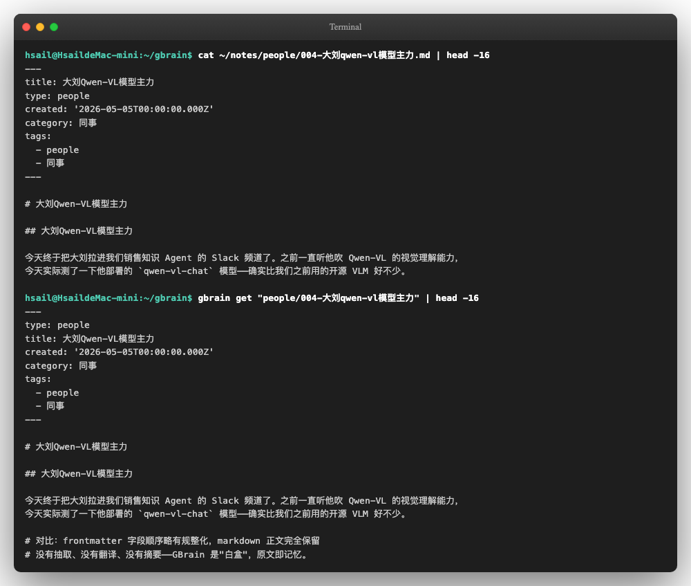

观察这张截图三件事：

| 维度 | 磁盘 cat | GBrain gbrain get | 差异 |
| --- | --- | --- | --- |
| frontmatter | title 在 type<br>之前 | type 排到了首位、补了<br>created | 字段顺序规整化、缺失<br>字段自动补 |
| markdown 正文 | 完全保留 | 完全保留 | 无差异 |
| 中文 / 表情符号 / 代<br>码块 | 原样 | 原样 | 无差异 |

这是文档派与自动管家派的本质差异：Mem0 会把"我叫 Alice Wang，是阿里巴巴 Python 工程

师"抽成英文 fact "User's name is Alice Wang and she is a Python engineer at

Alibaba" ——你看到的是 LLM 提炼后的二次产物。GBrain 不做这件事，你写啥它存啥。代价是

检索时要面对原文里的口语、缩写、笔误；收益是任何时候你都能打开 .md 看到上下文完整的真

实记忆。

<!-- 第 28 页 -->

### 阶段 2：效果对比——关键词搜 vs hybrid 检索

接下来对同一个问题，分别用两种检索方式：

关键词搜 gbrain search "<词>" ——只靠 PostgreSQL 的 tsvector（全文检索倒排索引）匹配字

面词

Hybrid 检索 gbrain query "<问句>" --no-expand ——向量召回 + BM25（经典文本检索打分

算法）召回 + RRF（Reciprocal Rank Fusion，多路召回融合）排序

提问的形式也不同——关键词搜要你已经知道目标里有哪个词；hybrid 检索允许你只描述意图。

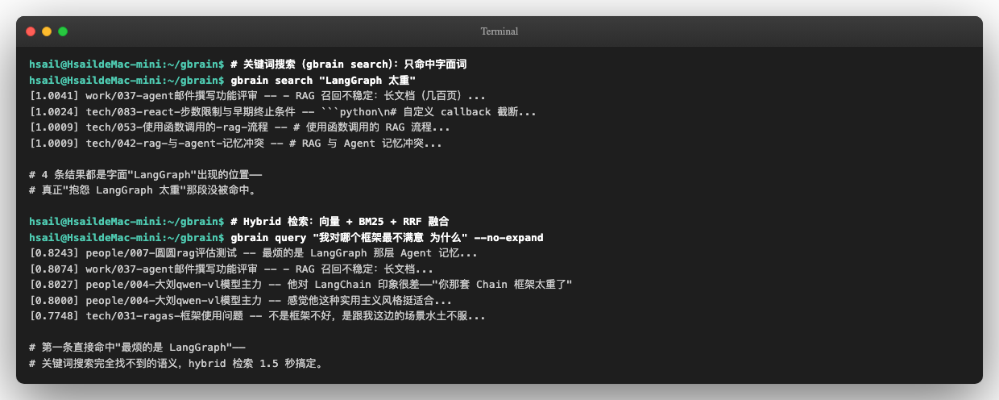

要点：

| 项 | 关键词搜 | Hybrid 检索 |
| --- | --- | --- |
| 能问的<br>问题 | "LangGraph 太重" ——必须知道字面词 | "我对哪个框架最不满意 为什么" ——可<br>以只说意图 |
| 召回<br>top1 | work/037-agent邮件撰写功能评审（碰巧<br>出现"LangGraph"的位置） | people/007-圆圆rag评估测试（实<br>际"最烦的是 LangGraph"那段） |
| 命中目<br>标段 | ❌ 4 条结果都没找到真正吐槽的那段 | ✅ 直接命中"最烦的是 LangGraph 那<br>层 Agent 记忆" |
| 延迟 | < 1 秒 | 约 1.5 秒（含 OpenAI embedding API<br>调用） |

这是 RAG（Retrieval-Augmented Generation，检索增强生成——Agent 把外部知识检索回来再交给

LLM 用）/记忆检索的经典权衡——关键词检索快但召回弱、语义检索慢但召回准。GBrain 的 hybrid 模

式同时跑两路再用 RRF 融合，把两者的优点叠起来。

为什么 hybrid 检索 1.5 秒是合理的：embedding API 调用约 300ms + PGLite 向量计算约 400ms

+ BM25 召回约 200ms + RRF 排序约 100ms + 网络/序列化约 500ms。对比 Mem0 默认配置的

v95 延迟 17 秒（来自论文 arXiv 2504.19413），1.5 秒已经是这个量级的优等生。

同一组 brain，多种问题角度都能召回

为了让学员相信这不是"挑过样本"的演示，下面对同一个 brain 用完全不同的两个查询：

<!-- 第 29 页 -->

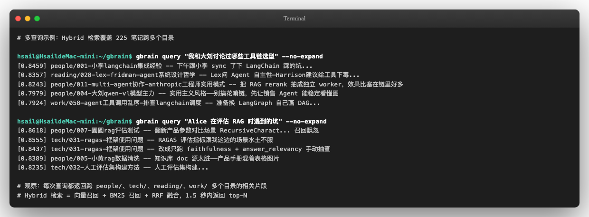

两个观察：

跨目录返回—— people/ 、tech/ 、reading/ 、work/ 多目录的结果都被排到 top 10，证明

hybrid 检索没有把召回限制在某一类。Alice 笔记的"知识图谱"是隐式存在于内容里的

同人物多个角度——比如查"工具链选型"时，people/004-大刘qwen-vl模型主力 出现两次（同一

篇笔记的不同 chunk），分别对应"实用主义风格"和"qwen-vl 部署细节"两个角度

这就是 §1d 三派对比表里 GBrain "存储载体 = markdown 文件 + 向量索引"在使用层面的兑现——

你可以用关键词、用语义、用人物名、用项目名，用什么角度查都行，只要原文里出现过。

### 阶段 3：集成入口——gbrain serve --http 把 brain 暴露成 MCP 
server

GBrain 的最后一块是 MCP server + admin UI。回顾一下 MCP——Anthropic 2024 年底提出的协议，

让 Claude Code / Cursor / OpenClaw 这类 agentic CLI（agentic CLI = 带 agent 能力的命令行工具）能

用统一的方式调用外部能力。GBrain gbrain serve --http --port 3131 启动后，等于把这个本地

brain 打包成了一个 MCP 服务端——任何兼容 MCP 的 Agent 都能连进来，把你的 225 笔记当工作记

忆。

Step 3.1 启动 server

`gbrain serve --http --port 3131`

启动后终端打印一个 banner，包含三个关键 URL 和一个一次性 admin token：

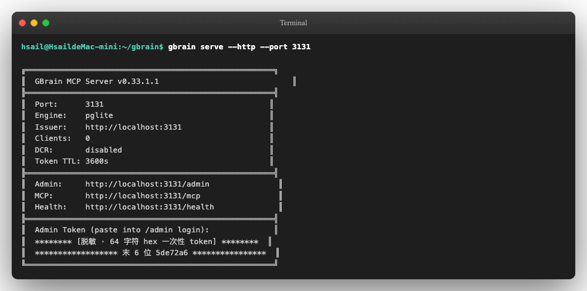

<!-- 第 30 页 -->

| 字段 | 用途 |
| --- | --- |
| Admin:<br>http://localhost:3131/admin | 管理界面，本节后面用来截图 |
| MCP: http://localhost:3131/mcp | 给 Claude Code/Cursor 接入的 MCP endpoint，需<br>OAuth 2.1（开放授权协议第 2.1 版，让第三方 Agent<br>安全获取访问 token）或 API key 鉴权 |
| Health:<br>http://localhost:3131/health | 健康检查，匿名可访问 |
| http://localhost:3131/health |  |
| Admin Token (64 字符 hex) | 一次性 bootstrap token，用来生成 magic-link 登录<br>admin UI |

重要：admin token 每次 gbrain serve 重启都会重新生成、只对本次进程有效。截图里的

token 已脱敏——学员实际操作时只在本机 terminal 里看，不要发到聊天群或粘贴到任何线上工

具。这是 GBrain v0.26+ 引入的安全设计，避免长期 token 泄露被滥用。

Step 3.2 登录 admin UI

打开浏览器访问 http://localhost:3131/admin ——会看到登录入口。粘贴 banner 里的 admin

token、点击登录，cookie 会落到本地浏览器，跳转到 dashboard：

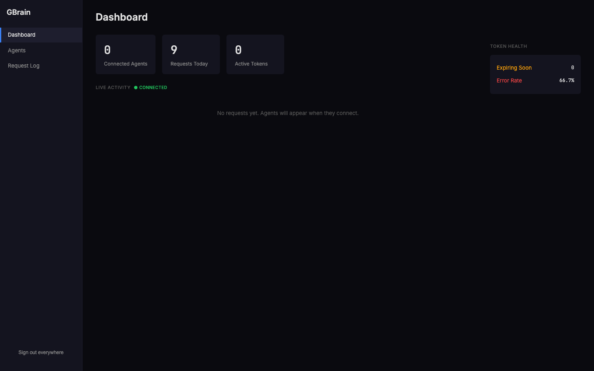

Dashboard 左侧三栏导航：Dashboard / Agents / Request Log——这是 v0.33.1.1 admin UI 的完整

菜单。这不是知识图谱浏览器、不是笔记编辑器——是给 brain 作为 MCP 服务端时的运维监控视图，配

套 Claude Code 等外部 Agent 接入。

老资料里偶尔会把 GBrain admin UI 描述成"知识图谱可视化"——这是早期版本（v0.20 之前的实

验态）的功能，在 v0.33.1.1 的稳定版里没有这一块。学员要可视化知识图谱，目前的路径是 CLI

（gbrain graph <slug> --depth 2 ）或者自己写脚本读 PGLite 的 links 表。

中间区域：

<!-- 第 31 页 -->

上半部分三张数据卡：Connected Agents（用 OAuth 在线连接的 agent 数）/ Requests

Today / Active Tokens

下半部分 LIVE ACTIVITY：实时 SSE（Server-Sent Events，服务端单向推送的 HTTP 长连接）推送

的 agent 调用流

右上角 Token Health 面板：Expiring Soon（即将过期的 token 数）和 Error Rate（最近请求的错误

率）——监控的是 brain 服务端的健康度。截图里 Error Rate 显示 66.7%，是本节演示中刚才故意调错

MCP 方法名导致的——上线场景下 Error Rate < 5% 才是正常。

Step 3.3 Agents 页：管理 brain 的访问入口

学员要让一个外部 Agent（比如 Claude Code、Cursor、OpenClaw）连进来，需要在 Agents 页先给它

发一个 API Key 或者注册一个 OAuth Client：

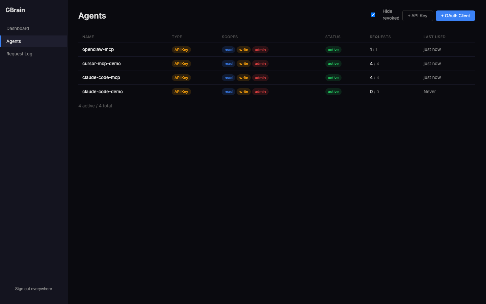

截图里演示场景注册了四个常见的接入方：

| Name | Type | Scopes | 状态 | Requests | Last<br>used |
| --- | --- | --- | --- | --- | --- |
| openclaw-mcp | API<br>Key | read / write /<br>admin | active | 1/1 | just now |
| cursor-mcp-demo | API<br>Key | read / write /<br>admin | active | 4/4 | just now |
| claude-code-mcp | API<br>Key | read / write /<br>admin | active | 4/4 | just now |
| claude-code-<br>demo | API<br>Key | read / write /<br>admin | active | 0/0 | Never |
| demo |  |  |  |  |  |

<!-- 第 32 页 -->

点击右上角 + API Key 弹窗输入 Name + TTL（生命周期秒数），即可生成一个

gbrain_xxxx... 形式的 token，把它写入对应 Agent 的 MCP 配置文件（如 Claude Code 的

~/.claude.json ）就能接入。+ OAuth Client 是给走 OAuth 2.1 标准流程的 Agent 用的——

比 API Key 多了刷新 token、限定 redirect URI、细粒度 scope 这些能力。两种方式的具体配置不

在本节范围，§4d 速查表给指针。

Step 3.4 Request Log：每一次 Agent 调用的"录像回放"

点开 Request Log 页面——这是 admin UI 最有教学价值的一块：

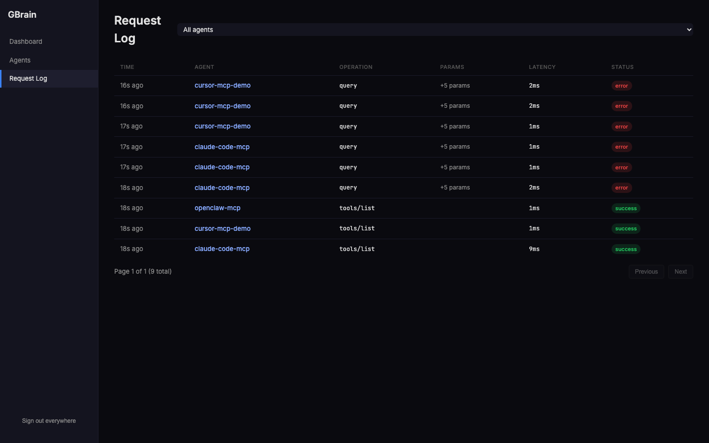

每一行都展示：

TIME — 多少秒前发生

AGENT — 哪个注册的 agent 发起的（点击可跳到对应 Agents 页面详情）

OPERATION — MCP 方法名，如 tools/list 、query 、get_page

PARAMS — 参数数量摘要

LATENCY — 服务端处理耗时（毫秒）

STATUS — success / error ，error 行可以点开看具体 error message

截图里前 6 行都是 query 操作 + error ——这是演示时刻意调错了 MCP 方法签名的痕迹，留给学员看

的正向素材：admin UI 让任何调用错误都第一时间可见，而且能定位到具体哪个 agent 哪一秒在试什

么。生产环境上线后这种可观测性是基本需求。

教学含义：很多 Agent 开发者吃过的亏是"我的 RAG/记忆系统好像不灵了，但说不清是 Agent 端

调错了、还是后端检索本身有问题"——GBrain 的 admin UI 把每一次调用的 contract（方法名、

参数、延迟、结果）都打到一个界面上，相当于给你的记忆调用链装了自带的 APM（Application

Performance Monitoring，应用性能监控——服务端常用的可观测性工具类别）。

<!-- 第 33 页 -->

### "同一句话三种处理"——GBrain 的位置

§1d 已经初步给出三派如何处理同一句话"我叫 Alice Wang，是阿里巴巴 Python 工程师"——这里把

GBrain 的具体形态坐实，§5a 收束时会把三派的完整对照表呈现。

| 项 | GBrain 的处理 |
| --- | --- |
| 载体形态 | ~/notes/people/alice-self-intro.md 一个 markdown 文件 |
| frontmatter | type: people + title: Alice Wang + created: 2026-05-XX |
| 正文 | 原句完整保留："我叫 Alice Wang，是阿里巴巴 Python 工程师" |
| 额外加工 | 切成 1 个 chunk + 1 个 1536 维向量 + 索引到 content_chunks 表 |
| 查询时返回 | 原句逐字、含上下文（不脱水、不翻译、不摘要） |

对比 Mem0（中→英 fact）和 Letta（写入 human working context block 由 agent 自己改），GBrain

的处理方式最"原始"——用户写啥就是啥。这个差异决定了：

✅ 可移植性：导出就是 ~/notes/ 这个目录，可以推 git、可以拷给同事、可以直接换工具继续用

✅ 可读性：任何编辑器打开能看，不需要 SDK

✅ 可调试：检索出 bug 时，"这条记忆对吗"打开文件就知道

⚠️ 检索代价：原文里的笔误、口语、缩写不会被自动清洗，需要靠 hybrid 检索的容错能力

⚠️ 存储成本：原文 + 向量索引"双写"，体积大约是纯 fact 库的 2-3 倍（225 笔记 → 76 MB

pglite）

没有最优解，只有不同 trade-off 下的最适配。GBrain 的取舍是——优先白盒、优先可移植，承

担"原文需要 hybrid 检索拯救"的延迟代价。§5a 把三派的完整 trade-off 表合并呈现，学员可以

基于自己的场景做出"该选谁"的判断。

### 小结与下节衔接

本节做完后，学员手上的 GBrain 不再是装机阶段的空壳。完整的能力闭环：

```text
1. 写笔记（任何 markdown 编辑器）
↓
2. gbrain import → gbrain embed --stale（225 → 713 chunk → 1536 维向量）
↓
3a. CLI 查询：gbrain query "..." --no-expand（学员自己用）
3b. MCP 集成：gbrain serve --http → Claude Code / Cursor / OpenClaw 远程访问
↓
4. 后续维护：gbrain sync --watch（监听 ~/notes 目录变化增量同步）
或 gbrain cron 自动跑 lint / consolidate / embed / orphans / purge
```

§4d 把更多功能（34 个 skill 完整清单 / 14 个 embedding 提供方对应配置 / MCP 接入 Claude Code 的

具体 JSON / 配置项速查）整理成速查表。§5a 把今天学过的 Mem0 / Letta / GBrain 三派放在同一张"同

一句话三种处理"对照表里完整收束。

<!-- 第 34 页 -->

## §4d GBrain 速查：skills、AI provider、MCP 接入、配置
项

§4a–§4c 走完了 GBrain 的核心三件事（为什么是文档派、装机、hybrid 检索 + admin UI）。本节把课

件没有展开但学员日常会查的内容整理成速查表——按"我现在想找 X"的角度组织。

速查表覆盖的是 v0.33.1.1 实测过的事实。GBrain 主线开发频率高（commit 节奏约每周 1 个

minor 版本），命令签名和配置字段可能微调。任何不一致以 gbrain --help 输出 + 仓库

INSTALL_FOR_AGENTS.md 为准。

### 35 个内置 Skill（gbrain skillpack list 实测）

GBrain 内置的 skill 是"Agent 该如何使用这个 brain"的工作流脚本——markdown 形式存在

~/gbrain/skills/<skill-name>/SKILL.md ，Agent 把 RESOLVER.md（GBrain 在 ~/.claude/ 下

生成的入口索引文件，列出所有已装 skill 的名字 + 用途）读进上下文后，会自动选择相应 skill 跑。学员

不需要每个都用，按业务场景选 1-3 个就够。

cd ~/gbrain && gbrain skillpack list 实测输出 35 个 skill，按用途分类速查：

| 类别 | Skills | 一句话用途 |
| --- | --- | --- |
| Ingest 类（数<br>据入 brain） | archive-crawler 、ingest 、idea-<br>ingest 、media-ingest 、meeting-<br>ingestion 、voice-note-ingest 、<br>webhook-transforms | 把外部素材（邮件、<br>Dropbox、播客、会议录<br>音、语音备忘）灌进<br>brain |
| Enrich 类（充<br>实条目） | enrich 、article-enrichment 、<br>citation-fixer 、cross-modal-review | 给 brain 已有页面补元数<br>据、修引用、跨模态校验 |
| Search 类（查<br>询） | query 、perplexity-research 、signal-<br>detector 、data-research | hybrid 检索、补充 web<br>调研、信号探测 |
| Reading 类<br>（深度阅读） | book-mirror （旗舰 skill）、strategic-<br>reading 、concept-synthesis | 整书章节复述、单本聚焦<br>阅读、概念聚合 |
| Operations 类<br>（运维） | brain-ops 、maintain 、skillpack-<br>check 、testing | 健康检查、清理、skill 自<br>检 |
| Reporting 类<br>（产出） | reports 、briefing 、daily-task-prep 、<br>daily-task-manager 、functional-area-<br>resolver | 日报、简报、按职能域路<br>由 |
| Identity 类<br>（个性化） | soul-audit | 校准 agent 人格与 brain<br>主人价值观一致性 |
| Agent / Cron /<br>工具 | minion-orchestrator 、cron-<br>scheduler 、repo-architecture 、skill-<br>creator 、skillify | 多 minion 编排、定时任<br>务、新 skill 创建 |
| 学术与凭证 | academic-verify 、brain-pdf | 论文追溯到 raw data、<br>brain 页面渲染高品质<br>PDF |

<!-- 第 35 页 -->

关于数量：仓库 skills/ 目录下有 45 个子目录（含 6 个 markdown rules / conventions），

gbrain skillpack list 输出 35 个实际可安装的 skill 包，CLI 启动时打印 "Skills: 42

loaded"——三个数字差异来自"目录数 vs skill 包数 vs 运行时实际注册数"，没有正确/错误之分。

本节以 gbrain skillpack list 的 35 为准（这是 skillpack 安装命令实际操作的对象）。

安装

gbrain init 默认不安装任何 skill，保持 brain 干净。学员需要时按需安装：

```text
gbrain skillpack install --all                # 一键安装 35 个全部
gbrain skillpack install book-mirror          # 安装单个
gbrain skillpack list                         # 看清单（含已装/未装状态）
gbrain skillpack check                        # 校验已装 skill 的依赖是否完备
```

skill 安装到 ~/.claude/skills/<skill-name>/ 目录，Claude Code 启动时自动加载。其他 agentic

CLI（Cursor、OpenClaw）的 skill 路径不同——查对应工具的 docs。

### 14 个 AI Provider Recipe（GBrain v0.33.1.1）

GBrain 用"recipe"概念抽象 LLM 厂商配置——每个 recipe 定义 endpoint URL、auth 方式、支持的

touchpoint（embedding / chat / expansion）。v0.33.1.1 内置 14 个 recipe，按 touchpoint 分类：

| Provider | Recipe ID | Embedding | Chat | 默认 base URL | Auth env |
| --- | --- | --- | --- | --- | --- |
| OpenAI | openai | ✅ text-<br>embedding-3-<br>large/small/ada-<br>002 | ✅ gpt-4o /<br>o1 系列 | api.openai.com/v1 | OPENAI_API_KEY |
| Anthropic | anthropic | — | ✅ Claude<br>Sonnet 4.6<br>/ Haiku 4.5<br>/ Opus | api.anthropic.com | ANTHROPIC_API_KEY |
| Azure<br>OpenAI | azure-openai | ✅ | — | 自定义 | AZURE_OPENAI_API_KEY |
| DeepSeek | deepseek | — | ✅<br>deepseek-<br>chat /<br>deepseek-<br>reasoner<br>（注 1） | api.deepseek.com/v1 | DEEPSEEK_API_KEY |
| Google | google | ✅ | ✅ Gemini | generativelanguage.googleapis.com | GOOGLE_API_KEY |
| Groq | groq | — | ✅ Llama-3<br>/ Mixtral | api.groq.com/openai/v1 | GROQ_API_KEY |
| MiniMax | minimax | ✅ | — | 自定义 | MINIMAX_API_KEY |
| Together | together | — | ✅ | api.together.xyz/v1 | TOGETHER_API_KEY |
| Voyage | voyage | ✅ voyage-3 系<br>列 | — | api.voyageai.com/v1 | VOYAGE_API_KEY |
| Zhipu | zhipu | ✅ embedding-3 | — | 自定义 | ZHIPU_API_KEY |
| Alibaba<br>DashScope | dashscope | ✅ text-embedding-v3 / v2 | — | dashscope-intl.aliyuncs.com/compatible-mode/v1 | DASHSCOPE_API_KEY |
| Ollama<br>（本地） | ollama | ✅ | — | localhost:11434 | — |
| llama-server（本地） | llama-server | ✅ | — | 自定义 | — |
| LiteLLM<br>Proxy | litellm-<br>proxy | ✅ | — | 自定义 | 视后端 |

<!-- 第 36 页 -->

统计：10 个支持 embedding（embedding provider 总数 = 10，Writing Plan 提到的"14

embedding providers"实际是"14 个 AI provider 含 embedding 能力的 10 个"——以本表为

准）；6 个支持 chat；2 个同时支持（openai、google）。

注 1：DeepSeek 官方公告 deepseek-chat / deepseek-reasoner 两个旧 model ID 将于 2026-

07-24 退役，2026-05 至 7 月仍可用，目前分别对应 deepseek-v4-flash 的非思考 / 思考模式。

新模型 ID 为 deepseek-v4-pro / deepseek-v4-flash ，建议长期项目直接迁移；本课件录制时

GBrain 0.33.1.1 的 recipe 仍以旧 ID 为默认值。

切换 Provider 的两种路径

A. init 阶段显式指定（推荐）

```text
# 用 Voyage 做 embedding + DeepSeek 做 chat + Anthropic 做 query expansion
gbrain init \
--embedding-model voyage:voyage-3-large \
--embedding-dimensions 1024 \
--chat-model deepseek:deepseek-chat \
--expansion-model anthropic:claude-haiku-4-5
```

B. 初始化后编辑配置文件

```text
# 看配置
cat ~/.gbrain/config.json
# 改 chat / expansion（不动 embedding 维度，避免 PGLite 列冲突）
gbrain config set chat_model deepseek:deepseek-chat
gbrain config set expansion_model anthropic:claude-haiku-4-5
```

切 embedding 维度 = 必须 rm -rf ~/.gbrain && gbrain init ... ，因为 PGLite 的

content_chunks.embedding 列在首次 init 时锁定维度（v0.28.5 之后会大声报错，不会静默截

断）。

国产化全栈配置（无 OpenAI / Anthropic 依赖）

学员单位不让用国外 API 时，下面这套是 GBrain 0.33.1.1 实测可用的国产替代：

```text
export DEEPSEEK_API_KEY="sk-..."          # chat
export DASHSCOPE_API_KEY="sk-..."         # embedding
gbrain init \
--embedding-model dashscope:text-embedding-v3 \
--embedding-dimensions 1024 \
--chat-model deepseek:deepseek-chat \
--expansion-model deepseek:deepseek-chat   # 没 Anthropic 时用 DeepSeek 兜底
```

DashScope 默认 base URL 是国际站（dashscope-intl.aliyuncs.com ），国内学员需要在

~/.gbrain/config.json 加 "base_urls": {"dashscope":

"https://dashscope.aliyuncs.com/compatible-mode/v1"} 覆盖到中国区。

<!-- 第 37 页 -->

### 接入 Claude Code / Cursor / OpenClaw 的 MCP 配置

GBrain gbrain serve --http --port 3131 启动后暴露的 MCP 端点是

http://localhost:3131/mcp ，三家主流 agentic CLI 的接入方式如下。前提是先在 admin UI 里给

agent 发一个 API Key（见 §4c）。

Claude Code

编辑 ~/.claude.json （或运行 claude mcp add ）：

```text
{
"mcpServers": {
"gbrain": {
"type": "http",
"url": "http://localhost:3131/mcp",
"headers": {
"Authorization": "Bearer gbrain_xxxx...你刚发的 API Key..."
}
}
}
}
```

重启 Claude Code，应能在 /mcp 命令下看到 gbrain 已连接，工具列表包含 query / get_page /

put_page / search 等。

Cursor

~/.cursor/mcp.json 同样结构：

```text
{
"mcpServers": {
"gbrain": {
"url": "http://localhost:3131/mcp",
"headers": {
"Authorization": "Bearer gbrain_xxxx..."
}
}
}
}
```

OpenClaw

OpenClaw v2026.4.15+ 通过 openclaw mcp add 命令配置：

```text
openclaw mcp add gbrain \
--type http \
--url http://localhost:3131/mcp \
--header "Authorization: Bearer gbrain_xxxx..."
```

或在 ~/.openclaw/openclaw.json 的 mcpServers 段手写一份相同结构。

<!-- 第 38 页 -->

验证连接

接入后第一件事——回到 GBrain admin UI 的 Request Log 页（§4c §3.4），刷新看是否出现

tools/list 调用。出现 = 接入成功；没出现 = 检查 token 是否粘对、端口是否被防火墙挡。

### 配置项速查（~/.gbrain/config.json ）

gbrain init 完成后会生成 ~/.gbrain/config.json ，结构如下（按出现频率从高到低）：

| 字段 | 类型 | 默认 | 说明 |
| --- | --- | --- | --- |
| engine | "pglite" \|<br>"supabase" \|<br>"postgres" | pglite | 数据库引擎 |
| database_path | string | ~/.gbrain/brain.pglite | PGLite 文件路径 |
| database_url | string | — | Supabase /<br>Postgres 连接串<br>（engine !=<br>pglite 时） |
| embedding_model | `"<provider>:<model>"` | `openai:text-embedding-3-large` | embedding 模型 |
| embedding_dimensions | number | 3072 / recipe default | 向量维度（init 之<br>后不可改） |
| chat_model | `"<provider>:<model>"` | `anthropic:claude-sonnet-4-6` | chat / subagent 默认模型 |
| expansion_model | `"<provider>:<model>"` | `anthropic:claude-haiku-4-5-20251001` | query expansion 模型 |
| base_urls | {[recipe_id]:<br>string} | — | 各 recipe 的 base<br>URL 覆盖<br>（DashScope 中<br>国区等） |
| openai_api_key | string | — | 不推荐写文件，用<br>env var |
| remote_mcp | object | — | thin-client 模式专<br>用 |

安全：config.json 是明文。生产环境不要往里写 API Key——让 GBrain 读 OPENAI_API_KEY

等环境变量，把 export 写进 shell profile（macOS 上 ~/.zshrc ，Linux 上 ~/.bashrc ）或

systemd unit 的 Environment= 。

### 命令速查（按使用频率从高到低）

| 命令 | 高频用途 |
| --- | --- |
| gbrain query "<问题>" --no-<br>expand | 交互查询，1-2 秒返回 hybrid 检索结果 |

<!-- 第 39 页 -->

| 命令 | 高频用途 |
| --- | --- |
| gbrain get <slug> | 读单页（slug = 目录 + 文件名去 .md ） |
| gbrain put <slug> < file.md | 写单页（覆盖） |
| gbrain stats | brain 体检：pages / chunks / embedded / links 数量 |
| gbrain list --type tech -n<br>20 | 按 type 过滤的页面列表 |
| gbrain import <dir> --no-<br>embed | 批量导入目录 |
| gbrain embed --stale | 给"还没 embedding 的 chunk"补 embedding |
| gbrain sync --watch --<br>interval 30 | 监听 ~/notes 目录变化，30 秒一次增量同步 |
| gbrain search "<词>" | 关键词全文检索（无 LLM 调用） |
| gbrain backlinks <slug> | 列出引用了某页的反向链接 |
| gbrain graph <slug> --depth<br>2 | 沿 typed link 遍历 N 层（依赖先跑 extract links ） |
| gbrain serve --http --port<br>3131 | 启动 MCP server + admin UI |
| gbrain doctor --json | 健康检查（schema / 索引 / RLS 行级权限 / embedding 维<br>度一致性） |
| gbrain skillpack install --<br>all | 一键装 35 个 skill |
| gbrain export --dir ./out/ | 把 PGLite 反编译回 markdown 目录 |

### 官方文档与社区

| 资源 | 地址 |
| --- | --- |
| 仓库主页 | github.com/garrytan/gbrain |
| Agent 安装指南 | INSTALL FOR AGENTS.md<br>_ _ |
| 整体设计哲学 | docs/GBRAIN V0.md<br>_ |
| Skillpack 详细文档 | docs/GBRAIN SKILLPACK.md<br>_ |
| 推荐目录结构（schema） | docs/GBRAIN RECOMMENDED SCHEMA.md<br>_ _ |
| Issue 跟踪（含已知坑） | github.com/garrytan/gbrain/issues |
| 作者 Garry Tan 个人 | github.com/garrytan / x.com/garrytan |
| 配套 evals 仓库 | github.com/garrytan/gbrain-evals |

<!-- 第 40 页 -->

| 资源 | 地址 |
| --- | --- |
| Karpathy LLM Wiki 思想源 | gist.github.com/karpathy |

### 同流派其他项目（选型横向对比）

文档派不是只有 GBrain，按"载体形态"再细分还有几个学员可能遇到的方案：

| 项目 | 载体 | 与 GBrain 的差<br>异 | 何时考虑选它 |
| --- | --- | --- | --- |
| Anthropic Memory<br>Tool | API 化的文件型记忆 | first-party 集<br>成、闭源、绑定<br>Claude 模型 | 已经在<br>Anthropic API<br>生产中、想要官<br>方 SDK 支持 |
| Anthropic Skills | 按需加载的程序性记忆 | 用 SDK 在运行时<br>按需注入"如何做<br>某事"的<br>procedural<br>memory | 想给 Agent<br>加"行为模板"而<br>非"知识库" |
| Claude Code<br>CLAUDE.md | 单/多层级 markdown | 仅作用于"单次会<br>话"上下文，没有<br>跨会话累积 | 短期项目记忆 /<br>不想引入额外组<br>件 |
| Cursor Rules +<br>Memories | .cursor/rules/*.md +<br>跨会话 memory 抽取 | 与 Cursor 编辑器<br>深度绑定 | 已经在 Cursor<br>里、不想跳出<br>IDE |
| OpenClaw 早期<br>memory.md | 单 markdown + BM25/<br>向量 | 单文件、形态较<br>轻、是文档派"刚<br>冒头"的形态 | 学术参考——观<br>察文档派早期演<br>进 |
| lucasastorian/llmwiki | Obsidian + Claude MCP<br>（自实现） | Karpathy gist 的<br>另一份社区实现 | 已重度用<br>Obsidian、想<br>自己掌控所有代<br>码 |

选型一句话原则：markdown 文件是不是你愿意长期维护的真相源？ 答"是" → 文档派候选；

答"不是"（你只想让系统帮你管） → 回到 §1d 看自动管家派或 OS 派。

### 已知坑速查

| 坑 | 表现 | 解法 |
| --- | --- | --- |
| bun install -g<br>github:garrytan/gbrain | 装机后 CLI 出现 `Aborted()` 崩溃 | 使用 `git clone + bun install + bun link`（issue #218） |
| gbrain query 默认 30 秒不<br>返回 | query expansion 调<br>LLM 改写查询太慢 | 加 --no-expand flag（交互场景必<br>加） |

<!-- 第 41 页 -->

| 坑 | 表现 | 解法 |
| --- | --- | --- |
| gbrain embed 报<br>Incorrect API key<br>provided | shell 环境变量里的<br>OPENAI_API_KEY 是<br>旧值 | 末 4 位比对凭证文件，重新 export<br>覆盖 |
| 想换 embedding 维度 | PGLite vector 列锁死 | `rm -rf ~/.gbrain && gbrain init <new flags>` |
| Mac 系统代理拦截<br>localhost:3131 流量 | curl 报 502 | 加 --noproxy '*' 或 export<br>NO_PROXY=localhost,127.0.0.1 |
| admin UI Request Log 长期<br>空 | 没有 agent 真实接入<br>或所有 agent 都跑成<br>功了 0 错误 | 这是正常 — admin UI 主要价值是"出<br>问题时定位"，平时空是好事 |
| gbrain graph / gbrain backlinks 返回为空 | 还没运行 `gbrain extract links --source db` | 跑一遍 typed-link backfill |
| 4 个 admin UI 数据 panel 都<br>是 0 | 服务刚启动还没有<br>MCP 调用 | 这是空白状态，正常 — 接入 Agent<br>后会自动填充 |
| gbrain serve 期间运行<br>gbrain query 报 PGLite<br>lock | PGLite 单文件锁，<br>serve 进程独占 | 停 serve / 切到 Supabase 多进程引擎 |

本节涉及的命令、配置字段、recipe 列表均基于 v0.33.1.1 实测。版本升级后字段名 / 命令签名可

能微调，以 gbrain --help <cmd> + 仓库 CHANGELOG.md 为准。
