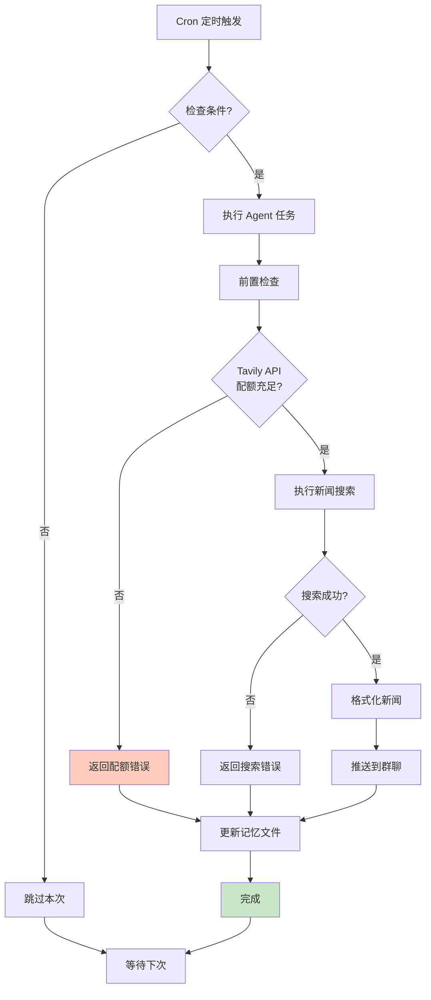
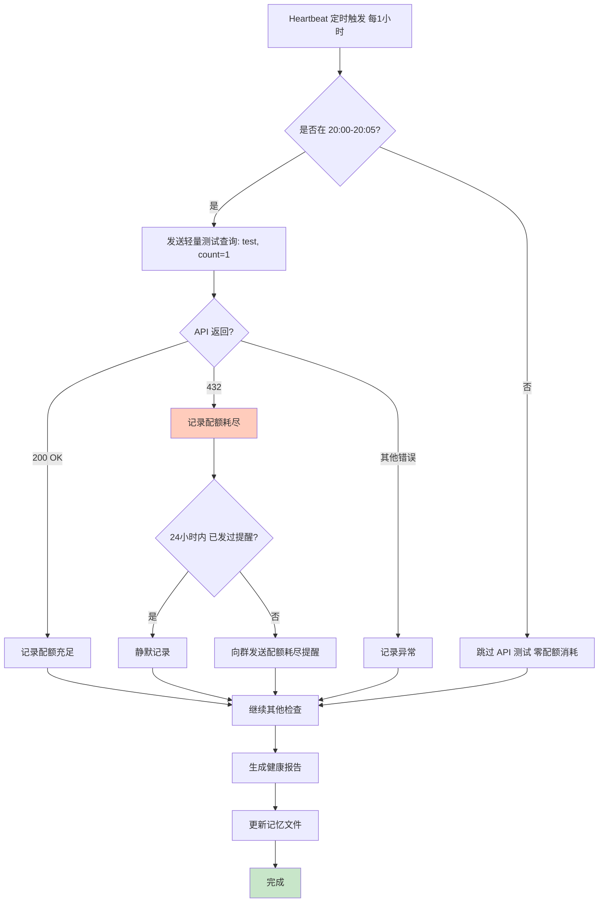
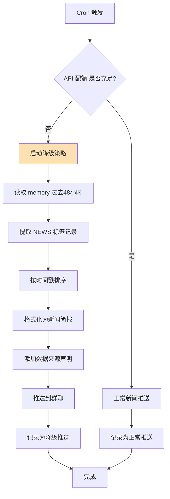

# Heartbeat

https://docs.openclaw.ai/zh-CN/gateway/heartbeat


# Cron 

https://docs.openclaw.ai/zh-CN/automation/cron-jobs


# Cron 与 Heartbeat：怎么选

心跳和定时任务都能按计划执行工作。这份指南帮你根据场景选对机制。

软件实用程序


## 快速决策表

| 场景                     | 推荐方式               | 原因                             |
| :----------------------- | :--------------------- | :------------------------------- |
| 每 30 分钟检查收件箱     | Heartbeat              | 可以和其他检查合批，有上下文感知 |
| 每天早上 9 点准时发报告  | Cron（隔离模式）       | 需要精确时间                     |
| 监控日历里即将到来的事件 | Heartbeat              | 天然适合周期性感知               |
| 每周做一次深度分析       | Cron（隔离模式）       | 独立任务，可以用不同的模型       |
| 20 分钟后提醒我          | Cron（主会话，`--at`） | 一次性精确定时                   |
| 后台项目健康检查         | Heartbeat              | 搭现有周期的顺风车               |

## Heartbeat：周期性感知

心跳在**主会话**中以固定间隔运行（默认 30 分钟）。它的设计目的是让 agent 定期检查各类事项，有重要的就浮出来。

社会科学


### 什么时候用 heartbeat

- **多项周期检查**：与其搞 5 个独立的 cron 任务分别查收件箱、日历、天气、通知和项目状态，不如一次心跳全搞定。
- **需要上下文判断**：agent 有完整的主会话上下文，能聪明地判断什么紧急什么可以缓。
- **对话连续性**：心跳运行共享同一个会话，agent 记得最近的对话，跟进起来很自然。
- **轻量监控**：一次心跳替代一堆小轮询任务。

### Heartbeat 的优势

- **合批多项检查**：一次 agent 轮次就能查收件箱、日历和通知。
- **省 API 调用**：一次心跳比 5 个隔离 cron 任务便宜。
- **有上下文**：agent 知道你在忙什么，据此设优先级。
- **智能静默**：如果没什么需要关注的，agent 回复 `HEARTBEAT_OK`，不发消息打扰你。
- **自然时序**：会因队列负载略有漂移，但大多数监控场景完全够用。

### Heartbeat 示例：HEARTBEAT.md 清单

```
# Heartbeat checklist

- Check email for urgent messages
- Review calendar for events in next 2 hours
- If a background task finished, summarize results
- If idle for 8+ hours, send a brief check-in
```


agent 每次心跳时读这个清单，一个轮次把所有项目处理完。

### 配置 heartbeat

```
{
  agents: {
    defaults: {
      heartbeat: {
        every: "30m", // 间隔
        target: "last", // 显式告警投递目标（默认 "none"）
        activeHours: { start: "08:00", end: "22:00" }, // 可选
      },
    },
  },
}
```


完整配置见 [Heartbeat](https://openclaws.io/docs/gateway/heartbeat)。

## Cron：精确调度

Cron 任务在精确时间点执行，可以在隔离会话中运行而不影响主上下文。循环的整点调度会自动在 0-5 分钟窗口内施加确定性偏移。

软件实用程序


### 什么时候用 cron

- **需要精确时间**：“每周一早上 9:00 发”（不是”大约 9 点左右”）。
- **独立任务**：不需要对话上下文的工作。
- **不同的模型/思考级别**：需要更强模型的重度分析。
- **一次性提醒**：“20 分钟后提醒我”，用 `--at`。
- **嘈杂/高频任务**：会把主会话历史搞乱的那种。
- **外部触发**：不管 agent 是否活跃都要独立运行的任务。

### Cron 的优势

- **精确时序**：5 字段或 6 字段（含秒）cron 表达式，支持时区。
- **内置负载均衡**：循环的整点调度默认偏移最多 5 分钟。
- **逐任务控制**：用 `--stagger <duration>` 覆盖偏移，或用 `--exact` 强制精确执行。
- **会话隔离**：在 `cron:<jobId>` 中运行，不污染主历史。
- **模型覆盖**：每个任务可以用更便宜或更强的模型。
- **投递控制**：隔离任务默认 `announce`（摘要）；按需选 `none`。
- **即时投递**：announce 模式直接发送，不用等心跳。
- **不依赖 agent 上下文**：主会话空闲或压缩了也能跑。
- **一次性支持**：`--at` 指定精确的未来时间戳。

### Cron 示例：每日早间简报

```
openclaw cron add \
  --name "Morning briefing" \
  --cron "0 7 * * *" \
  --tz "America/New_York" \
  --session isolated \
  --message "Generate today's briefing: weather, calendar, top emails, news summary." \
  --model opus \
  --announce \
  --channel whatsapp \
  --to "+15551234567"
```


这个任务在纽约时间早上 7:00 精确执行，用 Opus 保证质量，把摘要直接播报到 WhatsApp。

### Cron 示例：一次性提醒

```
openclaw cron add \
  --name "Meeting reminder" \
  --at "20m" \
  --session main \
  --system-event "Reminder: standup meeting starts in 10 minutes." \
  --wake now \
  --delete-after-run
```


完整 CLI 参考见 [定时任务](https://openclaws.io/docs/automation/cron-jobs)。

## 决策流程图

```
任务需要在精确时间执行吗？
  是 -> 用 cron
  否 -> 继续...

任务需要和主会话隔离吗？
  是 -> 用 cron（隔离模式）
  否 -> 继续...

这个任务能和其他周期检查合批吗？
  能 -> 用 heartbeat（加到 HEARTBEAT.md 里）
  不能 -> 用 cron

这是一次性提醒吗？
  是 -> 用 cron 加 --at
  否 -> 继续...

需要用不同的模型或思考级别吗？
  是 -> 用 cron（隔离模式）加 --model/--thinking
  否 -> 用 heartbeat
```


## 两者搭配使用

最高效的方案是**两个都用**：

1. **Heartbeat** 处理日常监控（收件箱、日历、通知），每 30 分钟一次合批轮次。
2. **Cron** 处理精确调度（日报、周报）和一次性提醒。

### 示例：高效的自动化配置

**HEARTBEAT.md**（每 30 分钟检查一次）：

软件实用程序


```
# Heartbeat checklist

- Scan inbox for urgent emails
- Check calendar for events in next 2h
- Review any pending tasks
- Light check-in if quiet for 8+ hours
```


**Cron 任务**（精确时序）：

```
# 每天早上 7 点早间简报
openclaw cron add --name "Morning brief" --cron "0 7 * * *" --session isolated --message "..." --announce

# 每周一早上 9 点项目回顾
openclaw cron add --name "Weekly review" --cron "0 9 * * 1" --session isolated --message "..." --model opus

# 一次性提醒
openclaw cron add --name "Call back" --at "2h" --session main --system-event "Call back the client" --wake now
```


## 主会话 vs 隔离会话

heartbeat 和 cron 都能与主会话交互，但方式不同：

|        | Heartbeat                | Cron（主会话）         | Cron（隔离模式） |
| :----- | :----------------------- | :--------------------- | :--------------- |
| 会话   | 主会话                   | 主会话（通过系统事件） | `cron:<jobId>`   |
| 历史   | 共享                     | 共享                   | 每次运行全新     |
| 上下文 | 完整                     | 完整                   | 无（干净启动）   |
| 模型   | 主会话模型               | 主会话模型             | 可覆盖           |
| 输出   | 非 `HEARTBEAT_OK` 时投递 | 心跳提示词 + 事件      | 播报摘要（默认） |

### 何时用主会话 cron

当你需要以下效果时，用 `--session main` 配合 `--system-event`：

- 提醒/事件出现在主会话上下文中
- agent 在下次心跳时带着完整上下文处理
- 不要单独的隔离运行

```
openclaw cron add \
  --name "Check project" \
  --every "4h" \
  --session main \
  --system-event "Time for a project health check" \
  --wake now
```


### 何时用隔离 cron

当你需要以下效果时，用 `--session isolated`：

- 干净的环境，没有之前的上下文
- 不同的模型或思考设置
- 摘要直接播报到频道
- 历史不要污染主会话

```
openclaw cron add \
  --name "Deep analysis" \
  --cron "0 6 * * 0" \
  --session isolated \
  --message "Weekly codebase analysis..." \
  --model opus \
  --thinking high \
  --announce
```


## 成本考量

| 机制             | 成本特征                                        |
| :--------------- | :---------------------------------------------- |
| Heartbeat        | 每 N 分钟一个轮次；开销随 HEARTBEAT.md 大小增长 |
| Cron（主会话）   | 在下次心跳中加一个事件（不产生隔离轮次）        |
| Cron（隔离模式） | 每个任务一个完整 agent 轮次；可以用更便宜的模型 |

**省钱建议**：

- `HEARTBEAT.md` 保持精简，减少 token 开销。
- 相似的检查合批到 heartbeat 里，别搞多个 cron 任务。
- heartbeat 如果只需要内部处理，用 `target: "none"`。
- 隔离 cron 搭配便宜模型处理常规任务。


# 协同样例一

https://applink.feishu.cn/client/message/link/open?token=Amm6Lt6mAIzDabwXppUZS9Y%3D


## 📊 一、架构总览

```markdown
┌─────────────────────────────────────────────────────────┐
│                    OpenClaw 调度系统                     │
├─────────────────────────────────────────────────────────┤
│                                                          │
│  ┌─────────────────┐    ┌─────────────────┐             │
│  │     Cron        │    │   Heartbeat     │             │
│  │   (定时任务)     │    │   (心跳检查)     │             │
│  │                 │    │                 │             │
│  │ • 时间触发       │    │ • 周期触发       │             │
│  │ • 独立执行       │    │ • 状态监控       │             │
│  │ • 隔离会话       │    │ • 补充检查       │             │
│  │                 │    │                 │             │

│  └────────┬────────┘    └────────┬────────┘             │

│           │                      │                       │

│           │    ┌─────────────────┘                       │

│           │    │                                          │

│           ▼    ▼                                          │

│    ┌─────────────────┐                                   │

│    │   数据共享机制   │                                   │

│    │  runs/ 文件记录  │◄────── 检查执行状态                │

│    └─────────────────┘                                   │

│           │                                              │

│           ▼                                              │

│    ┌─────────────────┐                                   │

│    │   Agent 执行层   │                                   │

│    │  (003weatherman)│                                   │

│    └─────────────────┘                                   │

│                                                          │

└─────────────────────────────────────────────────────────┘
```
⏰ 二、Cron 定时任务详解

2.1 配置位置

文件：~/.openclaw/cron/jobs.json

2.2 当前任务清单

| 任务ID      | 名称          | Agent         | 执行时间     | 时区          | 目标      |
| ----------- | ------------- | ------------- | ------------ | ------------- | --------- |
| b85e7b88... | daily-weather | 003weatherman | 0 7 * * *    | Asia/Shanghai | 私信 Will |
| 1f684866... | 定时任务晨检  | 003weatherman | 0 7 * * *    | Asia/Shanghai | 私信 Will |
| 669c0ffd... | 新闻定时推送  | 002newsanchor | 0 8,14 * * * |               | 新闻群    |

2.3 核心字段解析

{

  "schedule": {

​    "kind": "cron",

​    "expr": "0 7 * * *",      **// 每天 07:00**

​    "tz": "Asia/Shanghai"      **// 北京时间（UTC+8）**

  },

  "sessionTarget": "isolated",  **// 隔离会话执行**

  "wakeMode": "now",           **// 立即唤醒**

  "payload": {

​    "message": "开始工作。"     **// 触发时发送给 Agent**

  },

  "state": {

​    "nextRunAtMs": 1773982800000,  **// 下次执行：明天 07:00**

​    "lastRunAtMs": 1773896400007,  **// 上次执行：今天 12:00（手动）**

​    "lastRunStatus": "ok"          **// 上次状态：成功**

  }

}

2.4 执行流程

时间到达 07:00

​    │

​    ▼

Cron 调度器触发

​    │

​    ▼

创建隔离会话（isolated）

​    │

​    ▼

加载 Agent 配置（003weatherman）

​    │

​    ▼

发送 payload 消息："开始工作。"

​    │

​    ▼

Agent 读取 SOUL.md/HEARTBEAT.md

​    │

​    ▼

执行天气查询 → 生成播报 → 发送私信

​    │

​    ▼

记录执行结果到 runs 文件

​    │

​    ▼

更新 state（nextRunAtMs, lastRunStatus）

2.5 执行记录存储

位置：~/.openclaw/cron/runs/<job-id>.jsonl

示例记录：

{

  "ts": 1773896400007,

  "jobId": "b85e7b88-08f9-4e92-9b92-e91c25ec5d80",

  "action": "finished",

  "status": "ok",

  "summary": "🌤️ 南京今日天气...",

  "delivered": true,

  "runAtMs": 1773896400007

}

💓 三、Heartbeat 心跳检查详解

3.1 配置位置

文件：~/.openclaw/openclaw.json

3.2 当前配置

"heartbeat": {

  "every": "2h",              // 每 2 小时触发

  "model": "kimi-coding/k2p5", // 使用 Kimi 模型

  "target": "last",            // 在上次会话执行

  "prompt": "Read HEARTBEAT.md..."  // 系统提示词

}

3.3 执行流程

每 2 小时触发（00:00, 02:00, 04:00...）

​    │

​    ▼

在上次会话中唤醒 Agent

​    │

​    ▼

读取 HEARTBEAT.md

​    │

​    ▼

按优先级执行 7 步检查：

3.4 HEARTBEAT.md 检查清单

| 步骤 | 检查项           | 动作                               |
| ---- | ---------------- | ---------------------------------- |
| 1    | 记忆系统检查     | 确保 MEMORY.md/memory/TAGS.md 存在 |
| 2    | 配置一致性检查   | 对比 HEARTBEAT.md 与 cron 时间     |
| 3    | 数据源健康检查   | 测试 wttr.in 可用性                |
| 4    | 定时任务状态检查 | 检查 daily-weather 今天是否执行    |
| 5    | 极端天气检查     | 每 6 小时检查未来 24 小时预报      |

- 1/2
- 
- 1
- 2
- 

📊 一、架构总览

┌─────────────────────────────────────────────────────────┐

│                    OpenClaw 调度系统                     │

├─────────────────────────────────────────────────────────┤

│                                                          │

│  ┌─────────────────┐    ┌─────────────────┐             │

│  │     Cron        │    │   Heartbeat     │             │

│  │   (定时任务)     │    │   (心跳检查)     │             │

│  │                 │    │                 │             │

│  │ • 时间触发       │    │ • 周期触发       │             │

│  │ • 独立执行       │    │ • 状态监控       │             │

│  │ • 隔离会话       │    │ • 补充检查       │             │

│  │                 │    │                 │             │

│  └────────┬────────┘    └────────┬────────┘             │

│           │                      │                       │

│           │    ┌─────────────────┘                       │

│           │    │                                          │

│           ▼    ▼                                          │

│    ┌─────────────────┐                                   │

│    │   数据共享机制   │                                   │

│    │  runs/ 文件记录  │◄────── 检查执行状态                │

│    └─────────────────┘                                   │

│           │                                              │

│           ▼                                              │

│    ┌─────────────────┐                                   │

│    │   Agent 执行层   │                                   │

│    │  (003weatherman)│                                   │

│    └─────────────────┘                                   │

│                                                          │

└─────────────────────────────────────────────────────────┘

⏰ 二、Cron 定时任务详解

2.1 配置位置

文件：~/.openclaw/cron/jobs.json

2.2 当前任务清单

| 任务ID      | 名称          | Agent         | 执行时间     | 时区          | 目标      |
| ----------- | ------------- | ------------- | ------------ | ------------- | --------- |
| b85e7b88... | daily-weather | 003weatherman | 0 7 * * *    | Asia/Shanghai | 私信 Will |
| 1f684866... | 定时任务晨检  | 003weatherman | 0 7 * * *    | Asia/Shanghai | 私信 Will |
| 669c0ffd... | 新闻定时推送  | 002newsanchor | 0 8,14 * * * |               | 新闻群    |

2.3 核心字段解析

{

  "schedule": {

​    "kind": "cron",

​    "expr": "0 7 * * *",      **// 每天 07:00**

​    "tz": "Asia/Shanghai"      **// 北京时间（UTC+8）**

  },

  "sessionTarget": "isolated",  **// 隔离会话执行**

  "wakeMode": "now",           **// 立即唤醒**

  "payload": {

​    "message": "开始工作。"     **// 触发时发送给 Agent**

  },

  "state": {

​    "nextRunAtMs": 1773982800000,  **// 下次执行：明天 07:00**

​    "lastRunAtMs": 1773896400007,  **// 上次执行：今天 12:00（手动）**

​    "lastRunStatus": "ok"          **// 上次状态：成功**

  }

}

2.4 执行流程

时间到达 07:00

​    │

​    ▼

Cron 调度器触发

​    │

​    ▼

创建隔离会话（isolated）

​    │

​    ▼

加载 Agent 配置（003weatherman）

​    │

​    ▼

发送 payload 消息："开始工作。"

​    │

​    ▼

Agent 读取 SOUL.md/HEARTBEAT.md

​    │

​    ▼

执行天气查询 → 生成播报 → 发送私信

​    │

​    ▼

记录执行结果到 runs 文件

​    │

​    ▼

更新 state（nextRunAtMs, lastRunStatus）

2.5 执行记录存储

位置：~/.openclaw/cron/runs/<job-id>.jsonl

示例记录：

{

  "ts": 1773896400007,

  "jobId": "b85e7b88-08f9-4e92-9b92-e91c25ec5d80",

  "action": "finished",

  "status": "ok",

  "summary": "🌤️ 南京今日天气...",

  "delivered": true,

  "runAtMs": 1773896400007

}

💓 三、Heartbeat 心跳检查详解

3.1 配置位置

文件：~/.openclaw/openclaw.json

3.2 当前配置

"heartbeat": {

  "every": "2h",              // 每 2 小时触发

  "model": "kimi-coding/k2p5", // 使用 Kimi 模型

  "target": "last",            // 在上次会话执行

  "prompt": "Read HEARTBEAT.md..."  // 系统提示词

}

3.3 执行流程

每 2 小时触发（00:00, 02:00, 04:00...）

​    │

​    ▼

在上次会话中唤醒 Agent

​    │

​    ▼

读取 HEARTBEAT.md

​    │

​    ▼

按优先级执行 7 步检查：

3.4 HEARTBEAT.md 检查清单

| 步骤 | 检查项           | 动作                               |
| ---- | ---------------- | ---------------------------------- |
| 1    | 记忆系统检查     | 确保 MEMORY.md/memory/TAGS.md 存在 |
| 2    | 配置一致性检查   | 对比 HEARTBEAT.md 与 cron 时间     |
| 3    | 数据源健康检查   | 测试 wttr.in 可用性                |
| 4    | 定时任务状态检查 | 检查 daily-weather 今天是否执行    |
| 5    | 极端天气检查     | 每 6 小时检查未来 24 小时预报      |

- 1/2
- 
- 1
- 2
- 

🔗 四、Cron 与 Heartbeat 协同机制

4.1 核心关系：主次 + 监控

Cron（主执行）          Heartbeat（监控）

​    │                        │

​    │ 07:00 执行天气播报      │

​    ▼                        │

  执行成功 ─────────────────►│ 09:00 检查

​    │                        │ 发现已执行

​    ▼                        ▼

  记录到 runs            HEARTBEAT**Heartbeat 与 Cron 机制详细梳理** --- ## 📊 一、架构总览 ``` ┌─────────────────────────────────────────────────────────┐ │ OpenClaw 调度系统 │ ├─────────────────────────────────────────────────────────┤ │ │ │ ┌─────────────────┐ ┌─────────────────┐ │ │ │ Cron │ │ Heartbeat │ │ │ │ (定时任务) │ │ (心跳检查) │ │ │ │ │ │ │ │ │ │ • 时间触发 │ │ • 周期触发 │ │ │ │ • 独立执行 │ │ • 状态监控 │ │ │ │ • 隔离会话 │ │ • 补充检查 │ │ │ │ │ │ │ │ │ └────────┬────────┘ └────────┬────────┘ │ │ │ │ │ │ │ ┌─────────────────┘ │ │ │ │ │ │ ▼ ▼ │ │ ┌─────────────────┐ │ │ │ 数据共享机制 │ │ │ │ runs/ 文件记录 │◄────── 检查执行状态 │ │ └─────────────────┘ │ │ │ │ │ ▼ │ │ ┌─────────────────┐ │ │ │ Agent 执行层 │ │ │ │ (003weatherman)│ │ │ └─────────────────┘ │ │ │ └─────────────────────────────────────────────────────────┘ ``` --- ## ⏰ 二、Cron 定时任务详解 ### 2.1 配置位置 **文件**：`~/.openclaw/cron/jobs.json` ### 2.2 当前任务清单 | 任务ID | 名称 | Agent | 执行时间 | 时区 | 目标 | |--------|------|-------|---------|------|------| | `b85e7b88...` | daily-weather | 003weatherman | `0 7 * * *` | Asia/Shanghai | 私信 Will | | `1f684866...` | 定时任务晨检 | 003weatherman | `0 7 * * *` | Asia/Shanghai | 私信 Will | | `669c0ffd...` | 新闻定时推送 | 002newsanchor | `0 8,14 * * *` | - | 新闻群 | ### 2.3 核心字段解析 ```json { "schedule": { "kind": "cron", "expr": "0 7 * * *", // 每天 07:00 "tz": "Asia/Shanghai" // 北京时间（UTC+8） }, "sessionTarget": "isolated", // 隔离会话执行 "wakeMode": "now", // 立即唤醒 "payload": { "message": "开始工作。" // 触发时发送给 Agent }, "state": { "nextRunAtMs": 1773982800000, // 下次执行：明天 07:00 "lastRunAtMs": 1773896400007, // 上次执行：今天 12:00（手动） "lastRunStatus": "ok" // 上次状态：成功 } } ``` ### 2.4 执行流程 ``` 时间到达 07:00 │ ▼ Cron 调度器触发 │ ▼ 创建隔离会话（isolated） │ ▼ 加载 Agent 配置（003weatherman） │ ▼ 发送 payload 消息："开始工作。" │ ▼ Agent 读取 SOUL.md/HEARTBEAT.md │ ▼ 执行天气查询 → 生成播报 → 发送私信 │ ▼ 记录执行结果到 runs 文件 │ ▼ 更新 state（nextRunAtMs, lastRunStatus） ``` ### 2.5 执行记录存储 **位置**：`~/.openclaw/cron/runs/<job-id>.jsonl` **示例记录**： ```json { "ts": 1773896400007, "jobId": "b85e7b88-08f9-4e92-9b92-e91c25ec5d80", "action": "finished", "status": "ok", "summary": "🌤️ 南京今日天气...", "delivered": true, "runAtMs": 1773896400007 } ``` --- ## 💓 三、Heartbeat 心跳检查详解 ### 3.1 配置位置 **文件**：`~/.openclaw/openclaw.json` ### 3.2 当前配置 ```json "heartbeat": { "every": "2h", // 每 2 小时触发 "model": "kimi-coding/k2p5", // 使用 Kimi 模型 "target": "last", // 在上次会话执行 "prompt": "Read HEARTBEAT.md..." // 系统提示词 } ``` ### 3.3 执行流程 ``` 每 2 小时触发（00:00, 02:00, 04:00...） │ ▼ 在上次会话中唤醒 Agent │ ▼ 读取 HEARTBEAT.md │ ▼ 按优先级执行 7 步检查： ``` ### 3.4 HEARTBEAT.md 检查清单 | 步骤 | 检查项 | 动作 | |------|--------|------| | 1 | **记忆系统检查** | 确保 MEMORY.md/memory/TAGS.md 存在 | | 2 | **配置一致性检查** | 对比 HEARTBEAT.md 与 cron 时间 | | 3 | **数据源健康检查** | 测试 wttr.in 可用性 | | 4 | **定时任务状态检查** | 检查 daily-weather 今天是否执行 | | 5 | **极端天气检查** | 每 6 小时检查未来 24 小时预报 | | 6 | **强制记忆写入** | 记录本次心跳操作到 memory | | 7 | **返回 HEARTBEAT_OK** | 完成所有检查 | --- ## 🔗 四、Cron 与 Heartbeat 协同机制 ### 4.1 核心关系：主次 + 监控 ``` Cron（主执行） Heartbeat（监控） │ │ │ 07:00 执行天气播报 │ ▼ │ 执行成功 ─────────────────►│ 09:00 检查 │ │ 发现已执行 ▼ ▼ 记录到 runs```**Heartbeat 与 Cron 机制详细梳理**

\---

\## 📊 一、架构总览

┌─────────────────────────────────────────────────────────┐
│                    OpenClaw 调度系统                     │
├─────────────────────────────────────────────────────────┤
│                                                          │
│  ┌─────────────────┐    ┌─────────────────┐             │
│  │     Cron        │    │   Heartbeat     │             │
│  │   (定时任务)     │    │   (心跳检查)     │             │
│  │                 │    │                 │             │
│  │ • 时间触发       │    │ • 周期触发       │             │
│  │ • 独立执行       │    │ • 状态监控       │             │
│  │ • 隔离会话       │    │ • 补充检查       │             │
│  │                 │    │                 │             │
│  └────────┬────────┘    └────────┬────────┘             │
│           │                      │                       │
│           │    ┌─────────────────┘                       │
│           │    │                                          │
│           ▼    ▼                                          │
│    ┌─────────────────┐                                   │
│    │   数据共享机制   │                                   │
│    │  runs/ 文件记录  │◄────── 检查执行状态                │
│    └─────────────────┘                                   │
│           │                                              │
│           ▼                                              │
│    ┌─────────────────┐                                   │
│    │   Agent 执行层   │                                   │
│    │  (003weatherman)│                                   │
│    └─────────────────┘                                   │
│                                                          │
└─────────────────────────────────────────────────────────┘

\---

\## ⏰ 二、Cron 定时任务详解

\### 2.1 配置位置

**文件**：`~/.openclaw/cron/jobs.json`

\### 2.2 当前任务清单

| 任务ID | 名称 | Agent | 执行时间 | 时区 | 目标 |

|--------|------|-------|---------|------|------|

| `b85e7b88...` | daily-weather | 003weatherman | `0 7 * * *` | Asia/Shanghai | 私信 Will |

| `1f684866...` | 定时任务晨检 | 003weatherman | `0 7 * * *` | Asia/Shanghai | 私信 Will |

| `669c0ffd...` | 新闻定时推送 | 002newsanchor | `0 8,14 * * *` | - | 新闻群 |

\### 2.3 核心字段解析

\```json

{

  "schedule": {

​    "kind": "cron",

​    "expr": "0 7 * * *",      // 每天 07:00

​    "tz": "Asia/Shanghai"      // 北京时间（UTC+8）

  },

  "sessionTarget": "isolated",  // 隔离会话执行

  "wakeMode": "now",           // 立即唤醒

  "payload": {

​    "message": "开始工作。"     // 触发时发送给 Agent

  },

  "state": {

​    "nextRunAtMs": 1773982800000,  // 下次执行：明天 07:00

​    "lastRunAtMs": 1773896400007,  // 上次执行：今天 12:00（手动）

​    "lastRunStatus": "ok"          // 上次状态：成功

  }

}

2.4 执行流程

时间到达 07:00

​    │

​    ▼

Cron 调度器触发

​    │

​    ▼

创建隔离会话（isolated）

​    │

​    ▼

加载 Agent 配置（003weatherman）

​    │

​    ▼

发送 payload 消息："开始工作。"

​    │

​    ▼

Agent 读取 SOUL.md/HEARTBEAT.md

​    │

​    ▼

执行天气查询 → 生成播报 → 发送私信

​    │

​    ▼

记录执行结果到 runs 文件

​    │

​    ▼

更新 state（nextRunAtMs, lastRunStatus）

2.5 执行记录存储

位置：~/.openclaw/cron/runs/<job-id>.jsonl

示例记录：

{

  "ts": 1773896400007,

  "jobId": "b85e7b88-08f9-4e92-9b92-e91c25ec5d80",

  "action": "finished",

  "status": "ok",

  "summary": "🌤️ 南京今日天气...",

  "delivered": true,

  "runAtMs": 1773896400007

}

💓 三、Heartbeat 心跳检查详解

3.1 配置位置

文件：~/.openclaw/openclaw.json

3.2 当前配置

"heartbeat": {

  "every": "2h",              // 每 2 小时触发

  "model": "kimi-coding/k2p5", // 使用 Kimi 模型

  "target": "last",            // 在上次会话执行

  "prompt": "Read HEARTBEAT.md..."  // 系统提示词

}

3.3 执行流程

每 2 小时触发（00:00, 02:00, 04:00...）

​    │

​    ▼

在上次会话中唤醒 Agent

​    │

​    ▼

读取 HEARTBEAT.md

​    │

​    ▼

按优先级执行 7 步检查：

3.4 HEARTBEAT.md 检查清单

| 步骤 | 检查项           | 动作                               |
| ---- | ---------------- | ---------------------------------- |
| 1    | 记忆系统检查     | 确保 MEMORY.md/memory/TAGS.md 存在 |
| 2    | 配置一致性检查   | 对比 HEARTBEAT.md 与 cron 时间     |
| 3    | 数据源健康检查   | 测试 wttr.in 可用性                |
| 4    | 定时任务状态检查 | 检查 daily-weather 今天是否执行    |
| 5    | 极端天气检查     | 每 6 小时检查未来 24 小时预报      |

- 1/2
- 
- 1
- 2
- 

🔗 四、Cron 与 Heartbeat 协同机制

4.1 核心关系：主次 + 监控

Cron（主执行）          Heartbeat（监控）

​    │                        │

​    │ 07:00 执行天气播报      │

​    ▼                        │

  执行成功 ─────────────────►│ 09:00 检查

​    │                        │ 发现已执行

​    ▼                        ▼

  记录到 runs            HEARTBEAT_OK

4.2 数据共享：runs 文件

Heartbeat 如何知道 Cron 执行了？

Heartbeat 检查 daily-weather 状态

​    │

​    ▼

读取 ~/.openclaw/cron/runs/b85e7b88-....jsonl

​    │

​    ▼

获取 lastRunAtMs 时间戳

​    │

​    ▼

转换为日期 vs 今天日期

​    │

​    ├──► 同一天 → 已执行 ✅

​    └──► 不同天 → 未执行 ⚠️

4.3 故障处理协同

| 场景       | Cron 行为        | Heartbeat 行为              |
| ---------- | ---------------- | --------------------------- |
| 正常执行   | 07:00 成功执行   | 09:00 检查发现已执行        |
| 执行失败   | 失败，记录 error | 09:00 发现未执行 → 提醒用户 |
| 数据源故障 | 查询失败，停止   | 检测到故障 → 启用降级策略   |
| 配置不一致 | 按配置执行       | 检测到时间差异 → 记录提醒   |

📋 五、职责对比表

| 职责     | Cron              | Heartbeat        |
| -------- | ----------------- | ---------------- |
| 定时播报 | ✅ 每天 07:00 执行 | ❌ 不执行         |
| 极端预警 | ❌ 不检查          | ✅ 每 6 小时检查  |
| 失败检测 | ❌ 无              | ✅ 检查 runs 文件 |
| 配置监控 | ❌ 无              | ✅ 每天检查一致性 |
| 降级策略 | ❌ 失败即停        | ✅ 启用备用方案   |

- 1/2
- 
- 1
- 2
- 

⏱️ 六、时间线示例（明天）

| 时间  | 事件                          | 执行者               |
| ----- | ----------------------------- | -------------------- |
| 07:00 | 天气播报 + 晨检               | Cron                 |
| 08:00 | 新闻推送                      | Cron (002newsanchor) |
| 09:00 | 心跳检查（发现 07:00 已执行） | Heartbeat            |
| 11:00 | 心跳检查 + 极端天气检查       | Heartbeat            |
| 13:00 | 心跳检查                      | Heartbeat            |

- 1/3
- 
- 1
- 2
- 3
- 

🎯 七、核心设计原则

| 原则                  | 说明                                          |
| --------------------- | --------------------------------------------- |
| Cron 做，Heartbeat 看 | Cron 负责执行具体任务，Heartbeat 负责监控状态 |
| 独立不依赖            | Cron 失败不影响 Heartbeat，反之亦然           |
| 通过文件间接交互      | runs 文件作为数据共享媒介                     |
| 分层保障              | 数据源 → 备用 API → 本地缓存，三层降级        |
| 人工最终决策          | 补救操作建议需用户确认后执行                  |

💡 八、总结

一句话概括：

Cron 是"闹钟+执行者"，Heartbeat 是"护士+监控员"。两者通过 runs 文件间接协作，确保任务按时执行、异常及时发现、故障有备用方案。

关键数据流：

Cron 执行 ──► 写入 runs 文件 ──► Heartbeat 读取检查 ──► 发现问题提醒用户

当前状态： ✅ 配置一致，系统正常运行


# 协同样例二

 **OpenClaw 的 heartbeat 和 cron 机制**，这是平台调度 Agent 执行任务的两大核心组件。

## 一、架构总览

```
┌────────────────────────────────────────────────────────────┐
│                    OpenClaw Platform                       │
├────────────────────────────────────────────────────────────┤
│                                                            │
│  ┌────────────────────┐      ┌────────────────────┐      │
│  │     Cron Scheduler │      │  Heartbeat Monitor │      │
│  │   (定时任务触发器)   │      │  (周期唤醒机制)     │      │
│  └──────────┬─────────┘      └──────────┬─────────┘      │
│             │                           │                  │
│             │ 08:00, 14:00, 18:00      │ 每 1 小时        │
│             │ (固定时间表)              │ (可配置间隔)     │
│             │                           │                  │
│             └───────────┬───────────────┘                  │
│                         │                                  │
│                         ▼                                  │
│              ┌────────────────────┐                       │
│              │   Agent Runner     │                       │
│              │  (Agent 执行器)     │                       │
│              └──────────┬─────────┘                       │
│                         │                                  │
│                         ▼                                  │
│              ┌────────────────────┐                       │
│              │   Agent (002News)  │                       │
│              │   - 检测配置        │                       │
│              │   - 执行任务        │                       │
│              │   - 更新状态        │                       │
│              └────────────────────┘                       │
│                                                              │
└────────────────────────────────────────────────────────────┘
```

---

## 二、Cron 机制（定时任务）

### 2.1 配置文件

**位置**: `/Users/will/.openclaw/cron/jobs.json`

**当前配置**:
```json
{
  "jobs": [
    {
      "id": "news-push",
      "agentId": "002newsanchor",
      "schedule": "0 8,14 * * *",
      "task": "推送新闻简报",
      "enabled": true
    }
  ]
}
```

**调度表达式**: `0 8,14 * * *`
- 含义：每天 **08:00** 和 **14:00**（小时:分钟）
- 分钟：0（整点）
- 小时：8 和 14
- 每日、每月、每周：`*`（每天执行）

---

### 2.2 执行流程



---

### 2.3 执行条件

Cron 触发后，Agent 会检查：

| 条件 | 检查方式 | 失败处理 |
|------|---------|---------|
| **Tavily 配额充足** | 发送测试查询（count=1） | 返回 432 → 降级推送 |
| **有新新闻迹象** | 搜索时间范围=最近6小时 | 无新新闻 → 跳过推送 |
| **Agent 可用** | 检查 agent 状态 | 停止/维护中 → 跳过 |

---

### 2.4 任务执行

新闻推送任务 (`news-push`) 执行步骤：

1. **调用 `tavily_search`**
   ```javascript
   const results = await tavily_search({
     query: 'latest AI and technology news',
     time_range: 'day',
     count: 10,
     include_answer: true
   });
   ```

2. **过滤与排序**
   - 按相关性评分排序
   - 去重（相同事件）
   - 按优先级筛选（AI/大模型、国际政治、科技公司等）

3. **格式化输出**
   - 每条新闻 5-6 句话
   - 3-5 条新闻
   - 客观事实，无个人观点
   - 适合移动端阅读

4. **推送到群聊**
   ```javascript
   await message({
     action: 'send',
     target: 'oc_927cfcc0ed18dbfb99b4c414963045fb',
     message: formattedNews
   });
   ```

5. **更新记忆**
   - 追加到 `memory/2026-03-19.md`
   - 标签：`[NEWS]`

---

### 2.5 时间表与调度

**当前配置**: 08:00 和 14:00（2次/天）

**历史变更**:
- 原配置包含 18:00（"0 8,14,18 * * *"）
- 3月19日修改为仅 08:00 和 14:00（用户偏好调整，推送太频繁）

**未来扩展**:
- 可添加 18:00 推送（如需每日3次）
- 可调整时间间隔（如周末不同时间）

---

## 三、Heartbeat 机制（周期唤醒）

### 3.1 配置文件

**位置**: `/Users/will/.openclaw/openclaw.json`

**当前配置**:
```json
{
  "heartbeat": {
    "every": "1h",
    "task": "health-check"
  }
}
```

**含义**:
- 每 **1 小时** 触发一次 heartbeat
- 执行 `health-check` 任务（系统健康检查）

---

### 3.2 执行流程



---

### 3.3 Heartbeat 职责范围

**Heartbeat 核心职责**（健康检查）：

| 检查项 | 频率 | 说明 |
|--------|------|------|
| **API 配额测试** | 仅在 20:00-20:05 窗口 | 发送轻量查询，检测 Tavily 状态 |
| **系统健康** | 每次 heartbeat | Agent 运行状态、内存使用、错误计数 |
| **任务队列** | 每次 heartbeat | 待处理任务数量 |
| **配置文件** | 每次 heartbeat | 检查 cron、heartbeat 配置变更 |

---

### 3.4 API 配额测试（20:00 窗口）

**为什么只在 20:00-20:05 测试？**
- Heartbeat 每小时执行一次（共24次/天）
- 如果每次测试，将消耗 **24个配额/天**
- 限制在 5 分钟窗口，只测试 **1次/天**，配额消耗最小化

**测试逻辑**:
```javascript
if (now >= 20:00 && now <= 20:05) {
  const testResult = await tavily_search({
    query: 'test',
    count: 1
  });
  
  if (testResult.status === 200) {
    // 配额充足
  } else if (testResult.error?.includes('432')) {
    // 配额耗尽 → 发送群提醒（24h一次）
  }
}
```

---

### 3.5 配额耗尽提醒

**触发条件**:
- Heartbeat 测试检测到 432 错误
- 过去 24 小时内**未发送过提醒**

**提醒内容**:
```
⚠️ [Heartbeat] Tavily API 配额已耗尽

时间: 2026-03-19 20:01 (Asia/Shanghai)
检测: 心跳 API 测试（每天20:00-20:05窗口）

📌 后续计划:
• 下次推送（约 10 小时后）将使用本地 Memory 降级
• 降级内容: 过去48小时热点新闻，明确标注来源
• 系统将继续每小时监测配额状态

💡 建议: 升级 Tavily 计划或配置备用搜索源以恢复正常推送。
```

**频率限制**: 24 小时内只发送一次，避免刷屏。

---

### 3.6 与 Cron 的职责分离

**关键规则**（已通过 HEARTBEAT.md 明确）：

| 组件 | 搜索权限 | 推送权限 | 配额检测 | 说明 |
|------|---------|---------|---------|------|
| **Heartbeat** | ❌ 永不搜索<br>（仅20:00测试） | ❌ 不推送<br>（仅告警） | ✅ 每日测试<br>记录状态 | 纯监控角色 |
| **Cron** | ✅ 执行搜索<br>（08:00, 14:00） | ✅ 推送新闻<br>（完整或降级） | ✅ 执行前检查<br>实时判断 | 生产角色 |

**协同机制**:
1. Heartbeat 只**记录**配额状态，不修改 `last_search_time`
2. Cron 执行前**独立检查**配额（实时）
3. 两者不共享状态，避免冲突
4. 职责分离确保 ≥4h 间隔天然满足（cron 固定时间表）

---

## 四、降级策略（Fallback）

### 4.1 触发条件

**仅当**:
- **Cron 窗口触发**（08:00 或 14:00）
- **Tavily 配额检测失败**（返回 432 或其他网络错误）
- **API 不可用**

**注意**：Heartbeat 不触发降级，它只监控和告警。

---

### 4.2 降级执行流程



---

### 4.3 降级内容来源

**数据源**: `memory/YYYY-MM-DD.md` 过去 2 天（48小时）

**提取规则**:
- 搜索所有带 `[NEWS]` 标签的章节
- 按时间戳倒序排列（最新的优先）
- 选择覆盖不同主题的 3-5 条

**内容重加工**:
- 每条重新组织为 2-3 句摘要
- 标注原始日期：`[原始: 2026-03-18]`
- 保持客观，不添加新观点

**添加来源声明**（必须位于第一条新闻前）:
```
【数据来源】本推送内容来自本地 Memory 档案（过去 48 小时热点），非实时搜索
```

---

### 4.4 降级输出格式

**标签**: `[NEWS]`（非 `[TREND]`）
- 降级输出的是**新闻**（基于历史新闻重述）
- 不是趋势分析（TREND 是另一类记忆标签）

**示例**:
```
[NEWS]

[NVIDIA 双轨中国市场策略]
[原始: 2026-03-18]
NVIDIA 在中国市场采取双轨策略...
影响分析：...

[中国 AI 应用层首次超越美国]
[原始: 2026-03-17]
...
```

---

## 五、配置参数对照表

| 参数 | Cron | Heartbeat | 说明 |
|------|------|-----------|------|
| **配置位置** | `cron/jobs.json` | `openclaw.json` | 不同配置文件 |
| **调度类型** | 固定时间（cron 表达式） | 间隔时间（every: 1h） | 两种调度模式 |
| **触发频率** | 2次/天 (08:00, 14:00) | 24次/天 (每小时) |  heartbeat 更频繁 |
| **主要任务** | 新闻搜索 + 推送 | 健康检查 + 配额测试 | 职责明确分离 |
| **搜索权限** | ✅ 可调用 tavily_search | ❌ 禁止搜索（仅20:00测试） | heartbeat 不生产 |
| **API 配额** | 消耗实时配额（按count） | 仅1次/天轻量测试 | heartbeat 配额消耗极小 |
| **输出目标** | 群聊推送（news-push） | 群提醒（仅配额耗尽时） | 输出渠道不同 |
| **状态记录** | memory/ 追加 [NEWS] | memory/ 追加 [CONFIG] | 记忆类型区分 |

---

## 六、时间线示例（完整24小时）

```markdown
timeline
    title OpenClaw 24小时调度时间线（示例：2026-03-19）
    section 00:00-06:00
        睡眠时段
        : Heartbeat 仍每小时触发（静默）
        : 无 Cron 任务
    section 06:00-08:00
        Heartbeat 06:00
        : 健康检查，API 测试跳过（非20:00窗口）
    section 08:00-09:00
        Cron 08:00 ✅
        : 新闻搜索 → 推送（正常或降级）
        Heartbeat 07:00
        : 健康检查
    section 09:00-14:00
        Heartbeat 09:00、10:00、11:00、12:00、13:00
        : 每小时健康检查
        : 10:00-15:00 期间 API 配额耗尽（连续432错误）
    section 14:00-15:00
        Cron 14:00 ❌
        : API 配额耗尽 → 降级推送（基于memory）
        Heartbeat 14:00
        : 健康检查
    section 15:00-20:00
        Heartbeat 15:00、16:00、17:00、18:00、19:00
        : 持续监控，API 仍失败
        : 16:30 用户手动请求 → 降级推送（非cron）
    section 20:00-20:05
        Heartbeat 20:01 ⚠️
        : API 配额测试 → 仍返回432
        : 24小时内首次发送配额耗尽告警到群
    section 20:00-22:00
        Heartbeat 21:00
        : 健康检查，API 仍失败
        : 等待配额重置或人工修复
    section 22:00-24:00
        Heartbeat 22:00、23:00
        : 持续监控
        : 等待下次Cron窗口（次日08:00）
```

---

## 七、错误处理与恢复

### 7.1 常见错误场景

| 错误类型 | 发生组件 | 处理方式 | 用户影响 |
|---------|---------|---------|---------|
| **配额耗尽 (432)** | Cron 搜索 / Heartbeat 测试 | Cron → 降级推送<br>Heartbeat → 告警（24h一次） | 实时新闻 → 降级热点新闻 |
| **网络中断** | Cron 搜索 | Cron → 降级推送 | 同上 |
| **Agent 停止** | Cron/Heartbeat 触发器 | 跳过本次，记录错误 | 无推送，heartbeat 告警 |
| **磁盘满** | 写入 memory/ | 捕获异常，记录 error | 记忆更新失败，任务仍算完成 |

---

### 7.2 恢复流程

**场景**: Tavily API 配额耗尽后自动恢复

```
1. Heartbeat 20:01 测试 → 仍 432 → 告警（24h内不再重复）
2. 用户更新 .env 配置新 API Key
3. 下次 Heartbeat 窗口（21:00 或 22:00）测试 → 200 OK
4. Heartbeat 记录 "API 已恢复，切换回正常模式"
5. 下次 Cron 窗口（次日 08:00）执行完整新闻搜索 → 成功
```

**关键点**:
- Heartbeat 持续监控，自动检测恢复
- 恢复后 Cron 自动恢复正常（无需人工干预）
- 记忆文件记录完整状态变更历史

---

## 八、状态管理

### 8.1 Agent 模式状态

| 状态 | 描述 | 触发条件 | 行为 |
|------|------|---------|------|
| **正常模式** | API 可用，正常搜索推送 | Heartbeat 测试返回 200 | Cron 执行完整搜索 |
| **监控模式** | API 疑似不可用 | Heartbeat 测试连续失败 | Cron 禁止搜索，仅 Heartbeat 每小时检查 |
| **降级模式** | Cron 触发时 API 不可用 | Cron 执行前实时检查失败 | Cron 执行降级推送（基于 memory） |

**状态转换**:
```
正常模式 ──(Heartbeat 失败)──> 监控模式
监控模式 ──(Heartbeat 恢复)──> 正常模式
正常模式 ──(Cron 检测失败)──> 降级推送（单次）
降级推送 ──(后续 Cron)──────> 继续降级或恢复正常
```

---

### 8.2 配置文件热重载

**支持热重载**:
- `cron/jobs.json` 修改后**立即生效**（无需重启）
- `openclaw.json` 中 `heartbeat.every` 修改后**下次心跳生效**

**检查机制**:
- 每次心跳会对比文件修改时间戳
- 检测到变更 → 重新加载配置 → 更新调度器

---

## 九、记忆系统中的记录

### 9.1 Heartbeat 记录（示例）

```
### [CONFIG] 方案 A：删除约束描述，保持职责分离
**时间**: 2026-03-19 15:53 (Asia/Shanghai)
**动作**: 修改 HEARTBEAT.md 第 5.1 节
**变更**: 删除"距离上次成功搜索 ≥ 4 小时"条件描述
...
```

**标签**: `[CONFIG]` 或 `[CHAT]`

---

### 9.2 Cron 新闻推送记录（示例）

```
## 📊 手动新闻推送 [NEWS|TREND] - 降级执行
**记录时间**: 2026-03-19 16:30 (Asia/Shanghai)
**触发原因**: 用户请求"再推送一次新闻试试"
**执行方式**: 手动触发（用户请求，非Cron窗口）
**Tavily状态**: 配额耗尽（432错误）
**执行策略**: 降级模式 - 基于历史数据生成趋势总结
...
```

**标签**: `[NEWS]` 或 `[NEWS|TREND]`

---

## 十、关键配置命令

### 10.1 查看当前配置

```bash
# 查看 cron 配置
cat ~/.openclaw/cron/jobs.json

# 查看 heartbeat 配置
cat ~/.openclaw/openclaw.json | grep -A 5 heartbeat
```

### 10.2 修改调度时间

```bash
# 编辑 cron 配置（修改 schedule 字段）
vim ~/.openclaw/cron/jobs.json

# 示例：改为 08:00, 14:00, 18:00
"schedule": "0 8,14,18 * * *"
```

### 10.3 修改 heartbeat 间隔

```bash
# 编辑 openclaw.json
vim ~/.openclaw/openclaw.json

# 修改为每30分钟
{
  "heartbeat": {
    "every": "30m",
    "task": "health-check"
  }
}
```

---

## 十一、总结

| 机制 | 类型 | 频率 | 职责 | 搜索权限 | 输出 |
|------|------|------|------|---------|------|
| **Cron** | 定时触发器 | 2次/天 (08:00, 14:00) | 新闻生产 | ✅ 可搜索 | 群聊推送 |
| **Heartbeat** | 周期唤醒 | 24次/天 (每小时) | 健康监控 | ❌ 仅20:00测试 | 仅告警（异常时） |

**核心原则**:
- ✅ **职责分离**: Heartbeat 只监控，Cron 只生产
- ✅ **配额保护**: Heartbeat 测试 + Cron 检测双保险
- ✅ **降级策略**: Cron 失败时自动降级，保证最低服务
- ✅ **状态隔离**: 两者不共享状态，避免竞态条件

---

**版本**: 2026-03-19  
**维护**: 通过 `HEARTBEAT.md` 和 `cron/jobs.json` 管理  
**下次检查**: Heartbeat 每小时自动执行

---

**保存路径**: `workspace/record/2026-03-19-225422-好的-skill-就告一段落了.md`