# Codex 实践：安装与模型接入

本文介绍 Codex 的安装，以及通过 CC Switch 或直接编辑配置文件接入模型的方法。课程实践使用本地模型。

## 一、安装 Codex

### 方式一：官网下载（推荐）

直接访问官网下载安装：https://openai.com/codex/

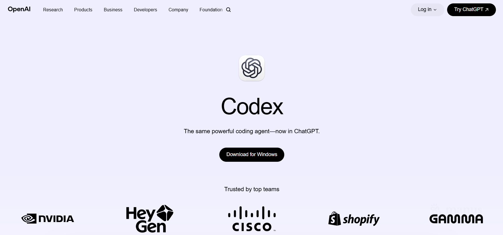


### 方式二：通过 Microsoft Store 安装包安装

中国区微软商店无法直接搜索到 Codex，可借助第三方商店解析网站抓取安装包：

1. 打开Microsoft Store，找到ChatGPT(Codex)，复制链接

   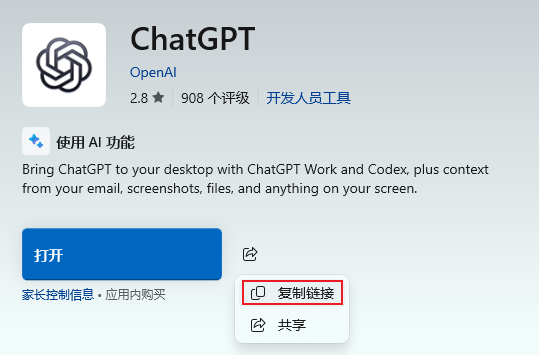

2. 打开解析网站：https://store.rg-adguard.net/

3. 在输入框中粘贴应用链接，选择 Retail：
   `https://apps.microsoft.com/detail/9PLM9XGG6VKS?hl=neutral&gl=CN&ocid=pdpshare`

4. 在解析结果中找到 `OpenAI.Codex_26.915.4065.0_x64__2p2nqsd0c76g0.msix`（版本号会随更新变化，请核对发布者及 x64 架构）；

   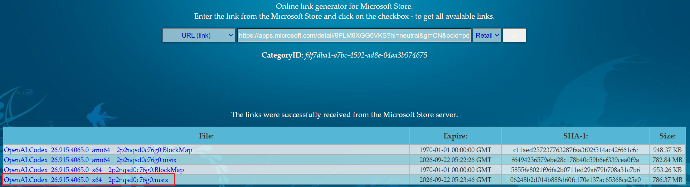

5. 下载后双击安装。

> 该方式经过第三方解析网站，优先使用官方安装渠道。

## 二、Codex 官方套餐说明

以下截图供课堂展示。套餐权益和额度可能调整，请以 [Codex 官方页面](https://openai.com/codex/)为准。


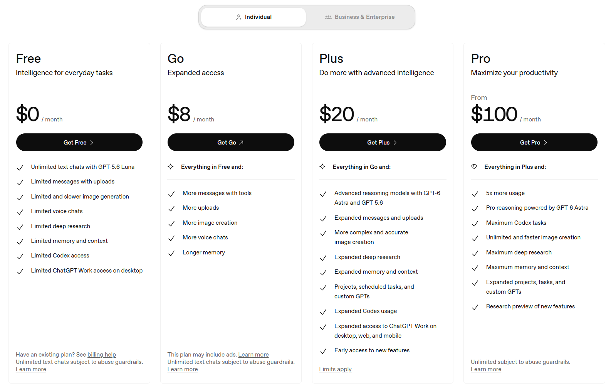

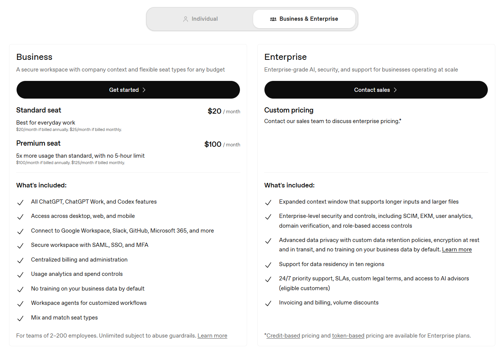

## 三、通过 CC Switch 接入模型

### 3.1 CC Switch 是什么

CC Switch 是一款开源的跨平台桌面工具，可用于管理 Codex 等工具的模型提供商配置，并切换第三方 API。

下面先以 DeepSeek 演示第三方平台接入，再介绍课程使用的本地模型接入。


------

### 3.2 工作方式

启用路由后，CC Switch 可在本机转发 Codex 的请求，将其发送到选定的模型服务，并把响应返回给 Codex。

它也会管理 Codex 的本地配置。具体请求路径取决于路由和提供商设置。


### 3.3 前置条件

在开始配置之前，请确保你已满足以下条件：

| 条件             | 说明                                                         |
| :--------------- | :----------------------------------------------------------- |
| Codex 已安装     | 通过 https://openai.com/codex/ 下载安装                      |
| DeepSeek API Key | 前往 [platform.deepseek.com](https://platform.deepseek.com/) 注册并获取 |
| 操作系统         | Windows 10+、macOS 12+ 或主流 Linux 发行版                   |

------

### 3.4 安装 CC Switch

下载方式一：访问 [CC Switch 网站](https://ccswitch.io/zh/)下载安装包。

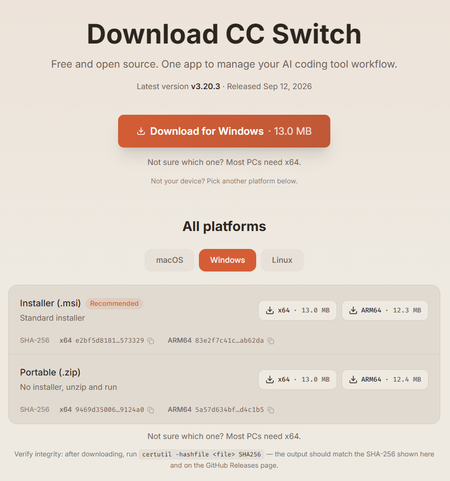

下载方式二：访问 [GitHub Releases](https://github.com/farion1231/cc-switch/releases/latest)，选择对应平台的安装包。


根据你的操作系统选择对应的安装方式。

### macOS

macOS 版本已通过公证，可直接使用 Homebrew 安装：

```
# 使用 Homebrew 安装 CC Switch（已公证版本）
brew install --cask cc-switch
```

### Windows

从 [GitHub Releases](https://github.com/farion1231/cc-switch/releases/latest) 下载 **.msi** 安装包，双击运行即可。

### Linux（Ubuntu/Debian）

```
# 安装 CC Switch deb 包
sudo dpkg -i CC-Switch-*.deb
```

安装完成后启动 CC Switch，主界面会出现在桌面或系统托盘。


> 更多 CC Switch内容参考：https://www.runoob.com/ai-agent/cc-switch.html

------

### 3.5 添加 DeepSeek 提供商（示例）

在 CC Switch 中添加 DeepSeek 作为 API 提供商，让 Codex 的请求可以转发到 DeepSeek。

操作步骤如下：

1. 打开 CC Switch，在顶部应用切换栏选择 Codex。

2. 点击左侧「Providers」区域的 + Add Provider。

   

3. 在预设列表中搜索 **DeepSeek**，选择适合的预设。预设名称与可用模型以当前版本为准。

   

4. 在表单中填写自己的 **DeepSeek API Key**，并核对其余字段。

   

5. 开启本地路由映射，然后点击保存。

   

#### 开启路由

切换到 DeepSeek，系统会提示我们开启路由，我们可以点击左上角的设置按钮进入设置页面开启：


点击路由设置菜单，开启路由：


然后选择 Codex：


重新打开 Codex，检查模型标志并发送测试消息，确认接入成功：


### 3.6 添加本地模型（本课程采用）

在 CC Switch 中为 Codex 添加本地模型提供商，填写课程所用的模型 ID、API 地址和鉴权信息，保存后切换到该提供商。

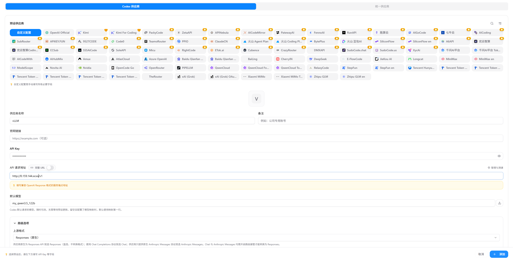


CC Switch 会管理 Codex 的用户级配置文件 `C:\Users\<username>\.codex\config.toml`。可以打开文件核对提供商配置，并按界面提示设置路由。


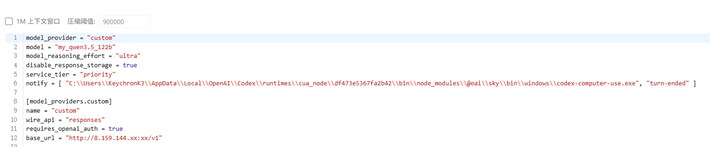


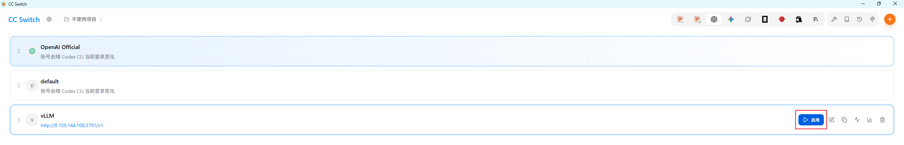

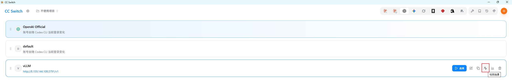


**验证：** 重启 Codex，发送一条测试消息，确认本地模型能够正常响应。

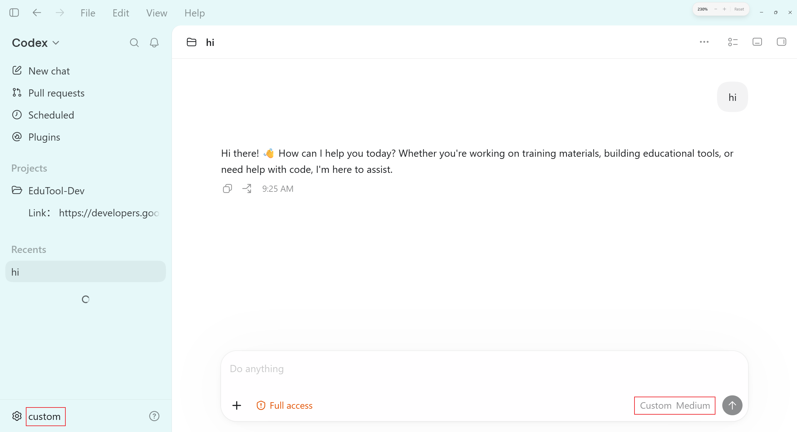

---

如果不使用 CC Switch，也可以手动修改配置文件。

## 四、直接配置本地模型（vLLM）

> 前提：vLLM 服务已启动，本例地址为 `http://127.0.0.1:8000/v1`，并且服务端支持 Codex 使用的 Responses API。仅提供 Chat Completions 接口时，下面的配置不能直接使用。

### 4.1 设置 API Key 环境变量

打开 PowerShell 执行（`setx` 为永久写入，需重新打开终端才生效）：

```powershell
setx VLLM_API_KEY "YOUR_API_KEY"
```

**重新打开** PowerShell 后验证：

```powershell
echo $env:VLLM_API_KEY
```

### 4.2 修改 Codex 配置文件

编辑用户级配置 `C:\Users\<username>\.codex\config.toml`。如果已有同名键或提供商配置，修改原条目，避免重复定义：

```toml
model_provider = "vllm"
model = "my_qwen3.5_122b"
disable_response_storage = true
model_reasoning_effort = "medium"

[model_providers.vllm]
name = "vLLM"
env_key = "VLLM_API_KEY"                    # 注意：填环境变量的【名字】，不是 Key 值
base_url = "http://127.0.0.1:8000/v1"
wire_api = "responses"
requires_openai_auth = false
```

**配置要点：**

- `env_key` 填写环境变量的**名称** `VLLM_API_KEY`，不是密钥内容。
- 自定义提供商使用环境变量鉴权时，`requires_openai_auth` 应设为 `false`；设为 `true` 会让 Codex 忽略 `env_key`。
- 修改配置后重启 Codex，并发送测试消息验证连接。如果同时使用 CC Switch，检查它是否覆盖了手动配置。

---

> **图片说明：** 文中部分图片引用作者电脑上的 `C:\...` 路径，复制到其他电脑时可能无法显示。分发教材前，建议将图片放入文档旁的 `assets/` 目录并改用相对路径。外部网站的截图和 CC Switch 界面可能随版本变化。


## 五、界面结构

安装完成后，按以下步骤开始：

1、打开 Codex App

2、登录成功后界面如下：

Codex App 主要包含以下区域：

| 区域           | 功能                         |
| :------------- | :--------------------------- |
| **项目侧边栏** | 管理多个项目，快速切换       |
| **项目列表**   | 显示所有会话，支持筛选和归档 |
| **审查面板**   | 查看 Codex 所做的文件更改    |
| **终端面板**   | 每个项目独立的内置终端       |
| **技能选择器** | 浏览和启用自定义技能         |


左侧是工作流导航区，中间是 Agent 对话与任务执行区。

左侧菜单说明：

| 左侧菜单     | 说明                                                         |
| :----------- | :----------------------------------------------------------- |
| 新对话       | 创建一个全新的 AI 工作线程，重新开始任务。                   |
| 搜索         | 快速查找历史对话、项目记录和上下文内容。                     |
| 插件         | 给 Codex 增加浏览器、GitHub、Gmail 等外部能力。              |
| 自动化       | 让 Codex 按时间或规则自动执行任务。                          |
| 项目         | 绑定本地文件夹或代码仓库，让 Codex 理解并操作项目。          |
| 普通对话     | 不绑定项目的纯聊天模式，适合日常提问和内容生成。             |
| 历史项目线程 | 查看某个项目下之前执行过的任务和聊天记录。                   |
| 设置         | 配置权限、模型、外观、Git、MCP、浏览器和电脑操控等系统功能。 |

点击下图右上角的图标，可以显示右侧的多功能区域：


### 搜索

查找历史对话、项目记录和上下文内容：


### 插件（Plugins）

插件可以理解成：给 Codex 安装能力包。

点开左侧**插件**，你会进入 Codex 的能力扩展中心。


安装不同插件后，Codex 就能完成不同类型的工作。

常见插件：

| 插件                     | 作用                           |
| :----------------------- | :----------------------------- |
| Browser Use              | 操作浏览器、打开网页、搜索内容 |
| Computer Use（电脑使用） | 操作 Mac 上的软件和界面        |
| Spreadsheets             | 处理 Excel 和表格数据          |
| Presentations            | 制作 PPT 和演示文稿            |
| GitHub                   | 读取和协作 GitHub 项目         |
| Gmail                    | 读取和整理邮件                 |
| Google Drive             | 访问云端文件                   |
| Slack                    | 团队协作与消息处理             |

### 自动化（Automation）

自动化可以理解成：让 Codex 按时间自动帮你执行任务。

点开左侧**自动化**，你会进入 Codex 的页面。


你可以设置：

- 某个时间执行
- 每天执行
- 每周执行
- 定时循环执行

自动化能做什么？

| 场景         | 示例                         |
| :----------- | :--------------------------- |
| 项目跟踪     | 每天自动整理项目状态         |
| 仓库检查     | 每周检查 GitHub 仓库问题     |
| 定时继续任务 | 半小时后继续当前线程         |
| 内容监控     | 定期检查网页、邮箱、任务列表 |
| 自动报告     | 自动生成日报、周报、复盘     |

### 右侧多功能区

Codex 的右侧区域可以理解成：AI 的工作结果展示区。

这里主要用来查看：

- Codex 做了什么
- 修改了什么
- 生成了什么
- 任务执行结果是什么


右侧区域常见功能:

| 功能            | 作用                                 |
| :-------------- | :----------------------------------- |
| 文件预览        | 查看生成的代码、Markdown、文档等文件 |
| 网页预览        | 直接预览网页或前端页面效果           |
| 图片预览        | 查看生成的图片和截图                 |
| PDF / 文档预览  | 查看 PDF、PPT、Word 等内容           |
| Browser 面板    | 让 Codex 在内置浏览器中操作网页      |
| Git Diff        | 查看代码修改前后的差异               |
| Sources（来源） | 查看 AI 使用的网页或参考来源         |
| Review（审核）  | 检查并确认 AI 的改动                 |

Git Diff 是我们开发最常用的功能之一，它会显示：

- 哪些代码被新增
- 哪些代码被删除
- 哪些文件被修改

Codex 可以直接在右侧打开浏览器：

- 访问网页
- 测试前端页面
- 截图
- 检查 UI
- 操作网站

甚至还能：

- 点击页面元素
- 标记界面问题
- 根据截图修改网页 UI


汇总清单： 

| 区域                 | 位置                                                         | 功能说明                                                     |
| :------------------- | :----------------------------------------------------------- | :----------------------------------------------------------- |
| 导航按钮             | 左上角返回/前进箭头 | 用于在历史会话或页面之间切换，类似浏览器的前进后退。         |
| 新对话               | 左侧菜单顶部                                                 | 快速开启一个临时 AI 对话，不进入具体项目上下文，适合直接提问、代码解释、命令生成等轻量任务。 |
| 搜索                 | 左侧菜单                                                     | 搜索历史对话、项目内容、文件或任务记录。大型项目中非常重要，相当于 AI IDE 的全局搜索入口。 |
| 插件                 | 左侧菜单                                                     | 管理和调用插件能力，例如 GitHub、终端、数据库、文件系统、浏览器工具等扩展能力。 |
| 自动化               | 左侧菜单                                                     | 创建自动执行任务，例如：定时生成日报、定期检查仓库、自动执行脚本、提醒任务等。 |
| 项目（Projects）     | 左侧中部                                                     | 项目工作区管理区域。每个项目通常绑定一个代码仓库、目录或工作空间。 |
| New project          | 左侧项目区域                                                 | 创建新项目。创建后通常会关联本地文件夹、Git 仓库或远程代码环境。 |
| 对话（Chats）        | 左侧底部                                                     | 全局聊天记录区域，用于管理非项目类会话。                     |
| 过滤按钮             | 对话栏右侧漏斗图标 | 对聊天记录进行筛选，例如按项目、时间、类型过滤。             |
| 新建聊天按钮         | 对话栏右侧编辑图标                                           | 创建一个新的独立聊天项目。                                   |
| 主工作区             | 中央黑色区域                                                 | Codex 的核心交互区域。包括 AI 对话、代码生成、Agent 执行、文件修改结果展示等。 |
| "我们该做什么？"     | 主区域中央                                                   | 欢迎界面提示语，引导用户开始任务。                           |
| 输入框               | 底部中央大输入框                                             | 向 Codex 输入自然语言指令，例如：生成代码、修复 Bug、分析项目、重构架构等。 |
| **@** 插件提示       | 输入框提示文字                                               | 支持通过 `@` 调用插件或工具，例如 `@terminal`、`@github`、`@browser` 等。 |
| 文件提及功能         | 输入框提示文字                                               | 可以直接拖拽文件或引用项目文件，让 AI 分析具体代码。         |
| "+"按钮              | 输入框左下                                                   | 添加附件、文件、图片或额外上下文。                           |
| 默认权限             | 输入框底部左侧                                               | 控制 AI Agent 的执行权限，例如：只读、允许编辑文件、允许执行命令等。 |
| 模型选择器（5.5 中） | 输入框右下                                                   | 当前使用的模型版本切换区域。通常可切换不同能力等级模型。     |
| 麦克风按钮           | 输入框右下                                                   | 语音输入功能。                                               |
| 发送按钮             | 输入框最右侧圆形箭头                                         | 提交当前任务给 Codex。                                       |
| "进入项目工作"       | 输入框下方                                                   | 进入真正的项目 Agent 模式。AI 会基于整个代码仓库进行上下文理解，而不是普通聊天。 |
| 地球图标             | 右上角                                                       | 网络或远程连接相关功能，可能用于在线模式、同步或远程环境。   |
| 右上角侧栏按钮       | 右上角矩形图标                                               | 控制右侧附加面板显示，例如日志、终端、文件树、Agent 状态等。 |


## 六、初次使用

我们刚使用可以先关注对话和项目就好了，对话就跟普通的 ChatGPT 的网页版一样进行聊天就可以了。

项目（ Project ）我们可以把它理解成：ChatGPT 的聊天 + IDE 的工程目录 + AI Agent 的长期记忆 的组合体。

项目（ Project ） 会绑定到你电脑上的一个文件夹，Codex 只会在这个目录内工作。


我这里选择 "添加新项目"，把 codex-runoob-test 添加：


进来，之后左右两侧都可以看到该项目的名称，多个项目可以在列表中选择：


3、发送第一条 Prompt 开始使用


------

