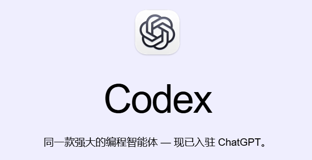
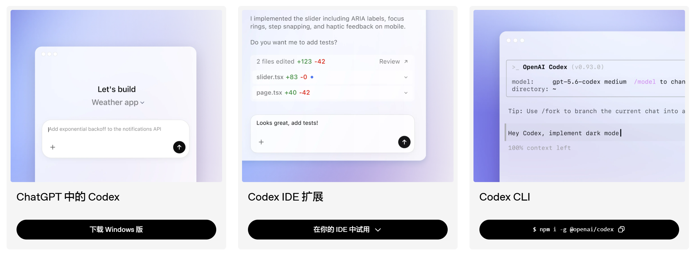
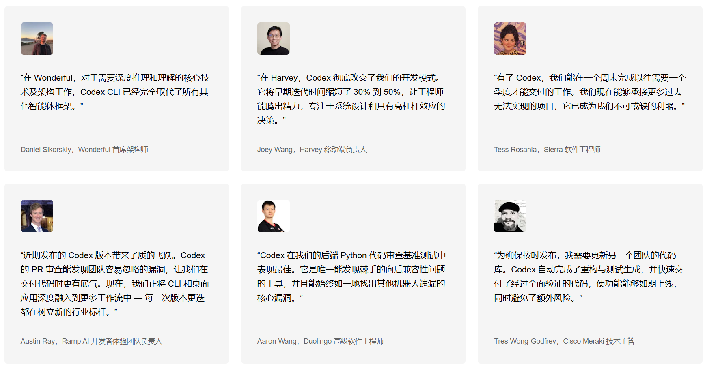

# ChatGPT（Codex）


Codex 是 OpenAI 推出的 **AI 编程智能体（AI Coding Agent）**，面向真实的软件开发任务。

它不仅能够生成代码，还可以自主理解代码库、修改项目文件、运行命令、调试问题、执行测试、审查代码，并处理较长的软件工程任务。

官方对 Codex 的描述是：

> **One agent for everywhere you code**

可以把 Codex 理解为：

> **一个能够参与并完成软件工程任务的 AI Agent。**

2026 年 7 月 10 日后，Codex 与 ChatGPT 进一步整合，Codex 能力作为 ChatGPT 中的重要开发能力继续提供。




---

# Codex 与传统 ChatGPT / AI 编程工具的区别

它和普通聊天机器人最大的区别在于：**它不是只负责回答，而是开始真正执行**。

比如：

- 读取本地项目
- 修改代码
- 浏览网页
- 运行终端命令
- 操作浏览器
- 调用 Git
- 使用插件
- 自动化执行任务

它本质上已经不是传统意义上的聊天 AI，而是：一个以 AI 为核心的桌面工作操作系统。

OpenAI 官方对它的定义是：**A command center for agents（Agent 指挥中心）**。

它支持：

- 多 Agent 并行工作
- Worktree 隔离项目
- 长时间任务执行
- 自动化工作流
- Skills 技能系统
- 浏览器与电脑操控
- 云端与本地协同

这也是为什么很多人第一次打开 Codex，会有一种：这不像聊天工具，更像 **IDE + AI + 自动化平台 + 浏览器 + 助理系统**的融合体的感觉

下面主要强调工作模式上的区别。

| 对比维度 | Codex                         | 传统对话式 AI                        |
| :------- | :---------------------------- | :----------------------------------- |
| 工作模式 | Agent Loop，持续执行          | 以问答为主                           |
| 文件操作 | 可读取、创建、修改项目文件    | 通常以内容建议为主                   |
| 命令执行 | 可在受控环境中执行 Shell 命令 | 普通聊天场景通常不直接操作项目 Shell |
| 项目理解 | 可围绕整个仓库持续工作        | 主要依赖当前提供的上下文             |
| 任务执行 | 可以围绕目标执行多步任务      | 通常需要用户分步骤交互               |
| 测试验证 | 可以修改后直接运行测试        | 往往需要人工复制执行                 |
| 工具调用 | 可以主动调用开发工具          | 以对话能力为主                       |

因此两者最大的区别可以概括为：

```text
传统 ChatGPT：
你问 → AI 答

Codex：
你给目标 → AI 执行
```


# Codex 四年兴衰史：从开创者到弃子，再到 AI 编程 Agent 归来

## **01 纪元开启：从代码堆中诞生的奇迹**

- **2021年08月10日**

  **OpenAI 正式发布 Codex。Codex 是 GPT-3 的后代，并进一步在大规模公开源代码上训练，首次将强大的自然语言理解能力与 Python、JavaScript、TypeScript、Go 等编程语言连接起来。**

  Codex 论文披露，其 Python 数据集最初从约 **5400 万个 GitHub 公共软件仓库**中收集，经过过滤和去重后形成大规模训练数据。

  **官方链接：**
  [OpenAI Codex（2021）](https://openai.com/index/openai-codex/?utm_source=chatgpt.com)

- **2021年06月29日**

  GitHub 发布 **GitHub Copilot Technical Preview**。Copilot 由 GitHub 与 OpenAI 合作开发，底层由 **OpenAI Codex** 驱动，可以根据当前代码和注释自动生成代码行、函数甚至完整的方法。

  **官方链接：**
  [GitHub：Introducing GitHub Copilot](https://github.blog/news-insights/product-news/introducing-github-copilot-ai-pair-programmer/?utm_source=chatgpt.com)

- **2022年06月21日**

  **GitHub Copilot 正式 GA（Generally Available）**，从技术预览走向大规模商业应用，AI 编程助手开始真正进入开发者的日常 IDE 工作流。

  **官方链接：**
  [GitHub Copilot is generally available](https://github.blog/news-insights/product-news/github-copilot-is-generally-available-to-all-developers/?utm_source=chatgpt.com)

在 Codex 出现之前，程序员主要通过编程语言与计算机进行交互。Codex 则展示了一种新的交互方式：开发者可以直接使用自然语言描述意图，由模型生成对应代码。

它又通过初代 GitHub Copilot 进入 IDE，使 AI 从实验性的“代码生成模型”进一步成为日常开发过程中的 **AI Pair Programmer**。

这一阶段可以概括为：

**Code Model → Coding Assistant**

Codex 也由此成为生成式 AI 编程浪潮的重要起点。

## **02 残酷转折：专用代码模型退场**

然而，Codex 的第一段辉煌并没有持续太久。

2022 年底 ChatGPT 出现之后，GPT-3.5、GPT-4 等通用大模型迅速展现出强大的代码生成、代码解释、调试和推理能力。

这意味着：

**代码能力不再一定需要一个独立存在的 Codex 专用模型，而可以成为通用大模型的一项基础能力。**

- **2023年03月**

  **OpenAI 弃用第一代 Codex Models。**

  包括 `code-davinci`、`code-cushman` 等 Codex 系列模型逐渐退出，OpenAI 开始将开发者引导至 GPT 系列模型。

  OpenAI 当前的 Codex 官方历史页面也明确注明：

  **“OpenAI Codex models were deprecated in March 2023.”**

  **官方链接：**
  [OpenAI Codex 历史页面](https://openai.com/index/openai-codex/?utm_source=chatgpt.com)

Codex 的退场并不意味着 AI 编程路线失败。

恰恰相反，它所代表的代码能力开始被吸收到更强大的通用大模型中：

**Codex → GPT-3.5 / GPT-4**

AI 编程也从主要完成：

**代码补全 / Code Generation**

逐渐扩展到：

**代码理解、解释、Debug、重构和复杂逻辑推理。**

这一阶段可以概括为：

**Code Model → General-purpose LLM Capability**

第一代 Codex 虽然退出历史舞台，但 Coding 已经成为通用大模型不可缺少的核心能力。

## **03 战局重燃：2025 年 Coding Agent 混战**

经过近两年的沉寂，“Codex”这个名字在 2025 年重新出现。

但此时整个 AI 编程领域已经发生根本变化。

各家厂商不再满足于：

**“帮程序员生成下一段代码。”**

新的目标变成：

**“让 AI 自己理解项目、修改文件、执行命令、运行测试，并完成整个软件工程任务。”**

AI 编程开始从 **Coding Assistant** 进入 **Coding Agent** 时代。

- **2025年02月24日**

  **Anthropic 推出 Claude Code Research Preview。**

  Claude Code 将 Claude 带入终端环境，使模型可以理解代码库、编辑文件、运行命令并协助完成复杂的软件工程任务。

  这代表 Anthropic 正式进入 Coding Agent 赛道。

  **官方链接：**
  [Anthropic：Claude 3.7 Sonnet and Claude Code](https://www.anthropic.com/news?utm_source=chatgpt.com)

- **2025年04月16日**

  **OpenAI 推出 Codex CLI。**

  沉寂两年的 **Codex** 品牌正式回归。

  但这一次 Codex 已经不再只是一个“自然语言生成代码”的模型，而是可以运行在开发者终端中的 **Coding Agent**。

  它能够围绕真实代码仓库工作，读取和编辑文件、运行 Shell 命令，并根据执行结果持续完成任务。

  **官方链接：**
  [OpenAI Codex CLI GitHub](https://github.com/openai/codex?utm_source=chatgpt.com)

- **2025年05月16日**

  **OpenAI 发布新版 Codex Cloud。**

  OpenAI 对新版 Codex 的定位已经从 Code Model 完全改变为：

  **Cloud-based Software Engineering Agent**

  Codex 可以在独立的云端沙箱环境中加载代码仓库，并执行：

  - 编写功能
  - 修复 Bug
  - 回答代码库问题
  - 修改文件
  - 执行命令
  - 运行测试
  - 并行处理多个软件工程任务

  新版 Codex Cloud 由 **codex-1** 驱动，而 codex-1 是针对软件工程任务优化的 **OpenAI o3** 版本。

  **官方链接：**
  [OpenAI：Introducing Codex](https://openai.com/index/introducing-codex/?utm_source=chatgpt.com)

- **2025年05月20日**

  **Google 在 Google I/O 期间宣布 Jules 进入 Public Beta。**

  Jules 是 Google 推出的 **异步 Coding Agent**。

  它可以连接 GitHub Repository，在独立云端环境中自动读取代码、制定计划、修复 Bug、编写测试，并在任务完成后将结果交给开发者审核。

  与传统 Copilot 最大的区别在于：

  **Jules 不只是实时给出代码建议，而是接受任务后自主完成一段软件工程工作。**

  **官方链接：**
  [Google：Jules, asynchronous coding agent](https://blog.google/innovation-and-ai/models-and-research/google-labs/jules/?utm_source=chatgpt.com)

- **2025年06月25日**

  **Google 发布 Gemini CLI。**

  Gemini CLI 是 Google 推出的开源终端 AI Agent，将 Gemini 的 Agent 能力直接带入命令行环境。

  它与 Claude Code、Codex CLI 一样，代表 Coding Agent 开始从 IDE 插件进一步进入：

  **Terminal + Tools + Agent Loop**

  的新阶段。

  **官方链接：**
  [Google：Introducing Gemini CLI](https://blog.google/technology/developers/introducing-gemini-cli-open-source-ai-agent/?utm_source=chatgpt.com)

到了这一阶段，竞争的核心已经不再只是：

**“谁生成的代码更好？”**

而开始变成：

**“谁能够自主完成更多软件工程工作？”**

AI Coding 的技术范式也由此发生变化：

**Code Completion
↓
Coding Assistant
↓
Coding Agent**

## **04 现状与总结：从轮回看未来**

进入 2026 年，AI 编程已经不再是单纯的“代码补全工具”竞争。

OpenAI、Anthropic、Google 等厂商都在推动 AI 编程从 **Assistant** 向 **Agent** 演进，竞争重点逐渐转向：

- 理解完整代码库
- 自主规划任务
- 调用 Shell 与开发工具
- 修改多个文件
- 自动运行测试
- 根据运行结果继续迭代
- 长时间自主执行
- 多任务并行处理
- 多 Agent 协作

产品最新进展如下：

| 厂商          | 主要产品 / 平台                       | 当前最新模型 / 技术路线                       | 主要特点                                                     |
| ------------- | ------------------------------------- | --------------------------------------------- | ------------------------------------------------------------ |
| **OpenAI**    | **Codex**                             | **GPT-6 Astra / GPT-5.6 Sol + Codex Harness** | OpenAI 当前帮助文档显示，**GPT-6 Astra 已可用于 Codex**；同时 GPT-5.6 Sol 仍是 Codex 的重要模型，OpenAI 还要求仍在使用 GPT-5.5 的 Codex 用户迁移到 `gpt-5.6-sol`。Codex 继续沿 CLI、Desktop、Cloud、Agent Harness 路线发展。 [OpenAI Help Center](https://help.openai.com/en/articles/20001354-gpt-5-6?utm_source=chatgpt.com) |
| **Anthropic** | **Claude Code**                       | **Claude Fable 5.1 / Mythos 5.1**             | 2026 年 9 月 1 日发布。Anthropic 将 Fable 5.1 定义为目前面向 **coding 与 knowledge work** 的最强通用可用模型；Mythos 5.1 能力更高，但只通过受控访问计划提供。Claude Code 继续作为终端式 Coding Agent。 [Anthropic](https://www.anthropic.com/claude-fable-and-mythos-5-1?frmapp=yes&utm_source=chatgpt.com) |
| **Google**    | **Antigravity 2.0 / Antigravity CLI** | **Gemini 3.8 Flash + Antigravity Harness**    | Google 已把面向个人开发者的 Gemini CLI 路线迁移到 **Antigravity CLI**，并与 Antigravity 2.0 共享同一 Agent Harness。Gemini 3.8 Flash 于 2026 年 9 月 2 日发布，Google 称其为目前最强的 reasoning/coding Flash 模型。 [Google 开发者博客](https://developers.googleblog.com/an-important-update-transitioning-gemini-cli-to-antigravity-cli/?utm_source=chatgpt.com) |

从 2021 年那个“根据自然语言生成代码”的 Codex，到 2025 年重新以 Software Engineering Agent 身份回归，Codex 所经历的变化实际上也是整个 AI 编程领域技术范式变化的缩影：

**Code Model
↓
Coding Assistant
↓
General-purpose Coding Capability
↓
Coding Agent**

Codex 并不是简单地“消失后重新发布”。

真正发生的是：

> **2021 年的 Codex 是一个帮助人写代码的模型；2025 年回归的 Codex，则已经开始成为一个能够自己完成软件工程任务的 Agent。**

这也是 AI 编程从 **“辅助程序员”** 走向 **“自主执行软件工程任务”** 的关键转折。


---

# Codex 的工作原理

Codex 的关键特点是：

> **不是只生成一次答案，而是在任务执行过程中持续循环。**

其典型 Agent Loop 可以表示为：

```text
理解任务
   ↓
分析项目
   ↓
选择下一步操作
   ↓
读取 / 修改文件
   ↓
执行命令
   ↓
观察结果
   ↓
继续推理
   ↓
再次行动
   ↓
直到任务完成
```

对于云端任务，每个任务通常会运行在独立的 **云端沙箱环境** 中。

典型流程：

```text
输入任务
   ↓
创建云环境
   ↓
加载仓库
   ↓
分析代码
   ↓
修改代码
   ↓
运行测试
   ↓
生成结果 / PR
   ↓
等待人工审查
```

两个关键优势：

- **并行执行**：多个任务可以同时运行，彼此之间互不阻塞
- **安全隔离**：任务在沙箱环境中执行，减少对本地系统和其他任务的影响


所有操作都可以追踪，例如：

- Shell 执行日志
- 测试输出
- 文件修改
- Git Diff
- Agent 执行过程

---

## Codex 系统架构

Codex 的能力并不只来自模型。

一个完整 Coding Agent 通常包含：

```text
             Model
               │
               ▼
         Agent Harness
               │
    ┌──────────┼──────────┐
    │          │          │
 Context     Tools      State
    │          │          │
 Files       Shell      Memory
    │          │
 Git / Test / Build
               │
               ▼
            Runtime
```


可以简单理解为：

> **Codex = Model + Context + Tools + Runtime + Agent Loop**

---

# Codex 的使用方式

Codex 提供多种使用方式，可覆盖桌面、IDE、终端和云端场景。

| 使用场景               | 描述                                                         |
| ---------------------- | ------------------------------------------------------------ |
| **ChatGPT 中的 Codex** | **面向完整开发任务的可视化工作区。** 可直接描述需求，让 Codex 读取项目、修改代码、运行测试，并对结果进行审查。 |
| **Codex IDE 扩展**     | **融入日常 IDE 开发流程。** Codex 可以结合当前代码与项目上下文，完成代码生成、修改、解释、重构和调试。 |
| **Codex CLI**          | **面向终端与开发者工作流。** 通过自然语言直接操作本地代码库，适合编码、执行命令、自动化任务以及脚本化集成。 |



---

# Codex App

Codex App 可以理解为一个面向开发任务的 **AI Agent 工作台**。

它不仅可以进行对话，还能够围绕项目执行实际操作，例如：

- 读取本地文件
- 修改项目
- 浏览网页
- 运行命令
- 调用外部工具
- 自动执行任务
- 与浏览器及其他开发工具协作

一句话定义：

> **Codex App 是一个面向软件工程任务的 AI Agent 工作平台。**

Codex App 采用典型的三栏布局：

- 左侧：任务列表
- 中间：对话与任务执行区域
- 右侧：文件、变更、工具等辅助区域


---

# 开发者的真实反馈




# Codex 官方案例：从代码开发走向完整工作流

OpenAI 官方 **Use Cases** 页面汇集了大量 **ChatGPT 与 Codex 的真实工作流案例**，覆盖软件工程、应用开发、测试与安全、数据分析、知识工作、跨工具协作以及自动化等场景。

官网支持按照 **Category、Team、Task Type** 等维度筛选案例，帮助用户快速了解 Codex 可以如何参与真实的软件开发与业务工作流。

**官方地址：learn.chatgpt.com/use-cases**

为便于理解 Codex 的能力边界，可以将其中具有代表性的案例归纳为 **6 大类：**

| 归类                     | Use Case 名称                               |
| ------------------------ | ------------------------------------------- |
| **① 代码理解与开发**     | **Understand large codebases**              |
|                          | **Refactor your codebase**                  |
|                          | **Run code migrations**                     |
|                          | **Upgrade your API integration**            |
|                          | **Create a CLI Codex can use**              |
|                          | **Keep documentation up-to-date**           |
| **② 应用与产品构建**     | **Get from idea to proof of concept**       |
|                          | **Build responsive front-end designs**      |
|                          | **Turn Figma designs into code**            |
|                          | **Deploy an app or website**                |
|                          | **Create browser-based games**              |
|                          | **Build for iOS**                           |
|                          | **Build for macOS**                         |
|                          | **Build React Native apps with Expo**       |
|                          | **Build and deploy internal apps**          |
| **③ 测试、安全与质量**   | **Run your first security scan**            |
|                          | **Run a deep security scan**                |
|                          | **Fix a finding from your security scan**   |
|                          | **Scan code changes for security**          |
|                          | **Remediate a vulnerability backlog**       |
|                          | **Audit dependency incidents**              |
|                          | **QA your app with Computer Use**           |
|                          | **Add evals to your AI application**        |
| **④ 数据分析与知识工作** | **Clean and prepare messy data**            |
|                          | **Analyze datasets and ship reports**       |
|                          | **Forecast cash flow**                      |
|                          | **Model a DCF valuation**                   |
|                          | **Review budget vs. actuals**               |
|                          | **Learn a new concept**                     |
|                          | **Synthesize research evidence**            |
|                          | **Consolidate spreadsheets**                |
| **⑤ 协作与跨工具工作流** | **Review GitHub pull requests**             |
|                          | **Kick off coding tasks from Slack**        |
|                          | **Turn meetings into follow-ups**           |
|                          | **Prepare meeting briefs**                  |
|                          | **Draft PRDs from internal context**        |
|                          | **Prioritize Slack action items**           |
|                          | **Complete tasks from messages**            |
| **⑥ 自动化与长期 Agent** | **Follow a goal**                           |
|                          | **Automate bug triage**                     |
|                          | **Build a dashboard that stays up to date** |
|                          | **Set up a project teammate**               |
|                          | **Run verified operations**                 |
|                          | **Audit a workflow**                        |


# 相关资源

- Codex 官方：  
  https://openai.com/zh-Hans-CN/codex/

- Codex 文档：  
  https://developers.openai.com/codex

- GitHub 开源仓库：  
  https://github.com/openai/codex