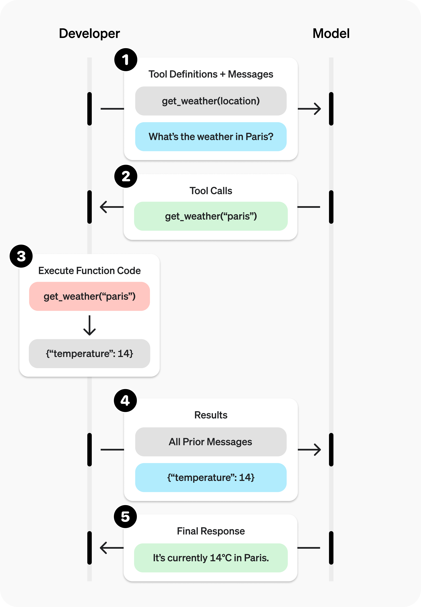

# Function calling 函数调用

**函数调用**（也称为**工具调用**）为 OpenAI 模型提供了一种强大而灵活的方式，使其能够与外部系统交互并访问训练数据之外的信息。本指南将向你展示如何将模型连接到应用程序提供的数据和操作。我们将介绍如何使用函数工具（由 JSON 模式定义）以及使用自由文本输入输出的自定义工具。

如果你的应用程序包含大量函数或庞大的模式，你可以将函数调用与[工具搜索](https://developers.openai.com/api/docs/guides/tools-tool-search)配对使用，以延迟加载很少使用的工具，仅在模型需要时才加载它们。只有 `gpt-5.4` 及更高版本模型支持 `tool_search`。

## 工作原理

让我们先了解一些关于工具调用的关键术语。在我们建立了工具调用的共同词汇后，我们将通过一些实际示例向你展示它是如何完成的。

### 工具 - 我们提供给模型的功能

**函数**或**工具**抽象地指我们告诉模型它可以访问的一段功能。当模型生成对提示的响应时，它可能会决定需要工具提供的数据或功能来遵循提示的指令。

你可以让模型访问以下工具：

- 获取某个位置今天的天气
- 访问给定用户 ID 的账户详情
- 为丢失的订单办理退款

或任何其他你希望模型在响应提示时能够知道或执行的操作。

当我们向模型发出包含提示的 API 请求时，我们可以包含一个模型可以考虑使用的工具列表。例如，如果我们希望模型能够回答关于世界某个地方当前天气的问题，我们可能会让它访问一个以 `location` 为参数的 `get_weather` 工具。

### 工具调用 - 模型使用工具的请求

**函数调用**或**工具调用**是指我们可以从模型获得的一种特殊响应，如果它检查提示，然后确定为了遵循提示中的指令，它需要调用我们提供给它的某个工具。

如果模型收到类似"巴黎的天气怎么样？"的提示，它可以以 `get_weather` 工具的工具调用来响应该提示，其中 `Paris` 作为 `location` 参数。

### 工具调用输出 - 我们为模型生成的输出

**函数调用输出**或**工具调用输出**是指工具使用模型工具调用的输入生成的响应。工具调用输出可以是结构化的 JSON 或纯文本，并且应该包含对特定模型工具调用的引用（在后续示例中通过 `call_id` 引用）。

要完成我们的天气示例：

- 模型可以访问一个以 `location` 为参数的 `get_weather` **工具**。
- 为了响应类似"巴黎的天气怎么样？"的提示，模型返回一个包含值为 `Paris` 的 `location` 参数的**工具调用**
- **工具调用输出**可能返回一个 JSON 对象（例如 `{"temperature": "25", "unit": "C"}`，表示当前温度为 25 度）、[图像内容](https://developers.openai.com/api/docs/guides/images)或[文件内容](https://developers.openai.com/api/docs/guides/file-inputs)。

然后我们将所有工具定义、原始提示、模型的工具调用和工具调用输出发送回模型，最终收到如下文本响应：

```
The weather in Paris today is 25C.
```

### 函数与工具

- 函数是一种特定类型的工具，由 JSON 模式定义。函数定义允许模型将数据传递给你的应用程序，你的代码可以在其中访问数据或执行模型建议的操作。
- 除了函数工具之外，还有自定义工具（在本指南中描述），它们使用自由文本输入和输出。
- 还有[内置工具](https://developers.openai.com/api/docs/guides/tools)，它们是 OpenAI 平台的一部分。这些工具使模型能够[搜索网页](https://developers.openai.com/api/docs/guides/tools-web-search)、[执行代码](https://developers.openai.com/api/docs/guides/tools-code-interpreter)、访问 [MCP 服务器](https://developers.openai.com/api/docs/guides/tools-remote-mcp)的功能等等。

## 工具调用流程

工具调用是你的应用程序与模型通过 OpenAI API 进行的多步骤对话。工具调用流程有五个高级步骤：

1. 向模型发出请求，并提供它可以调用的工具
1. 从模型接收工具调用
1. 使用工具调用的输入在应用程序端执行代码
1. 使用工具输出向模型发出第二次请求
1. 从模型接收最终响应（或更多工具调用）



## 函数工具示例

让我们看一下 `get_horoscope` 函数的端到端工具调用流程，该函数获取星座的每日运势。

  完整的工具调用示例

```python
from openai import OpenAI
import json

client = OpenAI()

# 1. Define a list of callable tools for the model
tools = [
    {
        "type": "function",
        "name": "get_horoscope",
        "description": "Get today's horoscope for an astrological sign.",
        "parameters": {
            "type": "object",
            "properties": {
                "sign": {
                    "type": "string",
                    "description": "An astrological sign like Taurus or Aquarius",
                },
            },
            "required": ["sign"],
        },
    },
]

def get_horoscope(sign):
    return f"{sign}: Next Tuesday you will befriend a baby otter."

# Create a running input list we will add to over time
input_list = [
    {"role": "user", "content": "What is my horoscope? I am an Aquarius."}
]

# 2. Prompt the model with tools defined
response = client.responses.create(
    model="gpt-5",
    tools=tools,
    input=input_list,
)

# Save function call outputs for subsequent requests
input_list += response.output

for item in response.output:
    if item.type == "function_call":
        if item.name == "get_horoscope":
            # 3. Execute the function logic for get_horoscope
            sign = json.loads(item.arguments)["sign"]
            horoscope = get_horoscope(sign)
            
            # 4. Provide function call results to the model
            input_list.append({
                "type": "function_call_output",
                "call_id": item.call_id,
                "output": horoscope,
            })

print("Final input:")
print(input_list)

response = client.responses.create(
    model="gpt-5",
    instructions="Respond only with a horoscope generated by a tool.",
    tools=tools,
    input=input_list,
)

# 5. The model should be able to give a response!
print("Final output:")
print(response.model_dump_json(indent=2))
print("\n" + response.output_text)
```

> 请注意，对于 GPT-5 或 o4-mini 等推理模型，在带有工具调用的模型响应中返回的任何推理项也必须与工具调用输出一起传回。

## 定义函数

函数通常在每次 API 请求的 `tools` 参数中声明。使用[工具搜索](https://developers.openai.com/api/docs/guides/tools-tool-search)，你的应用程序还可以在交互的后期加载延迟函数。无论哪种方式，每个可调用函数都使用相同的模式形状。函数定义具有以下属性：

| 字段          | 描述                                                     |
| ------------- | -------------------------------------------------------- |
| `type`        | 这应该始终是 `function`                                  |
| `name`        | 函数的名称（例如 `get_weather`）                         |
| `description` | 关于何时以及如何使用该函数的详细信息                     |
| `parameters`  | 定义函数输入参数的 [JSON 模式](https://json-schema.org/) |
| `strict`      | 是否为函数调用强制执行严格模式                           |

以下是 `get_weather` 函数的示例函数定义

```json
{
  "type": "function",
  "name": "get_weather",
  "description": "Retrieves current weather for the given location.",
  "parameters": {
    "type": "object",
    "properties": {
      "location": {
        "type": "string",
        "description": "City and country e.g. Bogotá, Colombia"
      },
      "units": {
        "type": "string",
        "enum": ["celsius", "fahrenheit"],
        "description": "Units the temperature will be returned in."
      }
    },
    "required": ["location", "units"],
    "additionalProperties": false
  },
  "strict": true
}
```

因为 `parameters` 是由 [JSON 模式](https://json-schema.org/) 定义的，所以你可以利用它的许多丰富功能，如属性类型、枚举、描述、嵌套对象和递归对象。

## 定义命名空间

使用命名空间按域对相关工具进行分组，例如 `crm`、`billing` 或 `shipping`。命名空间有助于组织类似的工具，当模型必须在服务于不同系统或目的的工具之间进行选择时特别有用，例如用于 CRM 的一个搜索工具和用于支持票务系统的另一个搜索工具。

```json
{
  "type": "namespace",
  "name": "crm",
  "description": "CRM tools for customer lookup and order management.",
  "tools": [
    {
      "type": "function",
      "name": "get_customer_profile",
      "description": "Fetch a customer profile by customer ID.",
      "parameters": {
        "type": "object",
        "properties": {
          "customer_id": { "type": "string" }
        },
        "required": ["customer_id"],
        "additionalProperties": false
      }
    },
    {
      "type": "function",
      "name": "list_open_orders",
      "description": "List open orders for a customer ID.",
      "defer_loading": true,
      "parameters": {
        "type": "object",
        "properties": {
          "customer_id": { "type": "string" }
        },
        "required": ["customer_id"],
        "additionalProperties": false
      }
    }
  ]
}
```

## 工具搜索

如果你需要让模型访问大型工具生态系统，你可以使用 `tool_search` 延迟加载部分或全部工具。`tool_search` 工具让模型搜索相关工具，将它们添加到模型上下文中，然后使用它们。只有 `gpt-5.4` 及更高版本模型支持它。阅读[工具搜索指南](https://developers.openai.com/api/docs/guides/tools-tool-search)以了解更多信息。


### 定义函数的最佳实践

1. **编写清晰详细的函数名称、参数描述和说明。**
   - **明确描述函数的用途和每个参数**（及其格式），以及输出代表什么。
   - **使用系统提示描述何时（以及何时不）使用每个函数。** 通常，告诉模型*确切地*要做什么。
   - **包括示例和边缘情况**，特别是纠正任何反复出现的失败。（**注意：** 添加示例可能会损害[推理模型](https://developers.openai.com/api/docs/guides/reasoning)的性能。）
   - **对于延迟工具，将详细指导放在函数描述中，保持命名空间描述简洁。** 命名空间帮助模型选择要加载的内容；函数描述帮助它正确使用加载的工具。

1. **应用软件工程最佳实践。**
   - **使函数明显且直观**。（[最小惊讶原则](https://en.wikipedia.org/wiki/Principle_of_least_astonishment)）
   - **使用枚举**和对象结构使无效状态无法表示。（例如 `toggle_light(on: bool, off: bool)` 允许无效调用）
   - **通过实习生测试。** 一个实习生/人类能否仅根据你给模型的内容正确使用函数？（如果不能，他们会问你什么问题？将答案添加到提示中。）

1. **尽可能减轻模型的负担并使用代码。**
   - **不要让模型填充你已经知道的参数。** 例如，如果你已经根据之前的菜单有了 `order_id`，就不要设置 `order_id` 参数——相反，设置无参数 `submit_refund()` 并用代码传递 `order_id`。
   - **合并总是按顺序调用的函数。** 例如，如果你总是在 `query_location()` 之后调用 `mark_location()`，只需将标记逻辑移到查询函数调用中。

1. **保持最初可用的函数数量较少以获得更高的准确性。**
   - **用不同数量的函数评估你的性能**。
   - **目标是在任何一次回合开始时少于 20 个可用函数**，尽管这只是一个软建议。
   - **使用工具搜索**来延迟加载工具表面的大部分或不经常使用的部分，而不是一开始就暴露所有内容。

1. **利用 OpenAI 资源。**
   - 在 [Playground](https://platform.openai.com/playground) 中**生成和迭代函数模式**。
   - **考虑[微调](https://developers.openai.com/api/docs/guides/fine-tuning)以提高函数调用准确性**，用于大量函数或困难任务。（[cookbook](https://developers.openai.com/cookbook/examples/fine_tuning_for_function_calling)）

### Token 使用量

在底层，函数被注入到系统消息中，使用模型经过训练的语法。这意味着可调用函数定义会计入模型的上下文限制，并按输入 token 计费。如果你遇到 token 限制，我们建议限制预先加载的函数数量，尽可能缩短描述，或使用[工具搜索](https://developers.openai.com/api/docs/guides/tools-tool-search)，以便仅在需要时加载延迟工具。

如果你的工具规范中定义了许多函数，也可以使用[微调](https://developers.openai.com/api/docs/guides/fine-tuning#fine-tuning-examples)来减少使用的 token 数量。

## 处理函数调用

当模型调用函数时，你必须执行它并返回结果。由于模型响应可以包含零个、一个或多个调用，最佳做法是假设有多个调用。


响应 `output` 数组包含一个 `type` 值为 `function_call` 的条目。每个条目都有 `call_id`（稍后用于提交函数结果）、`name` 和 JSON 编码的 `arguments`。

```python
[
    {
        "id": "fc_12345xyz",
        "call_id": "call_12345xyz",
        "type": "function_call",
        "name": "get_weather",
        "arguments": "{\"location\":\"Paris, France\"}"
    },
    {
        "id": "fc_67890abc",
        "call_id": "call_67890abc",
        "type": "function_call",
        "name": "get_weather",
        "arguments": "{\"location\":\"Bogotá, Colombia\"}"
    },
    {
        "id": "fc_99999def",
        "call_id": "call_99999def",
        "type": "function_call",
        "name": "send_email",
        "arguments": "{\"to\":\"bob@email.com\",\"body\":\"Hi bob\"}"
    }
]
```


如果你正在使用[工具搜索](https://developers.openai.com/api/docs/guides/tools-tool-search)，你可能还会在 `function_call` 之前看到 `tool_search_call` 和 `tool_search_output` 项。一旦函数被加载，以与这里所示相同的方式处理函数调用。

```python
for tool_call in response.output:
    if tool_call.type != "function_call":
        continue

    name = tool_call.name
    args = json.loads(tool_call.arguments)

    result = call_function(name, args)
    input_messages.append({
        "type": "function_call_output",
        "call_id": tool_call.call_id,
        "output": str(result)
    })
```


在上面的示例中，我们有一个假设的 `call_function` 来路由每个调用。以下是一个可能的实现：

```python
def call_function(name, args):
    if name == "get_weather":
        return get_weather(**args)
    if name == "send_email":
        return send_email(**args)
```


### 格式化结果

你在 `function_call_output` 消息中传递的结果通常应该是一个字符串，格式由你决定（JSON、错误代码、纯文本等）。模型将根据需要解释该字符串。

对于返回图像或文件的函数，你可以传递一个[图像或文件对象数组](https://developers.openai.com/api/docs/api-reference/responses/create#responses_create-input-input_item_list-item-function_tool_call_output-output)而不是字符串。

如果你的函数没有返回值（例如 `send_email`），只需返回一个表示成功或失败的字符串。（例如 `"success"`）

### 将结果合并到响应中


将结果附加到 `input` 后，你可以将它们发送回模型以获得最终响应。

Send results back to model

```python
response = client.responses.create(
    model="gpt-4.1",
    input=input_messages,
    tools=tools,
)
```

Final response

```python
"It's about 15°C in Paris, 18°C in Bogotá, and I've sent that email to Bob."
```


## 其他配置

### 工具选择

默认情况下，模型将确定何时以及使用多少工具。你可以使用 `tool_choice` 参数强制特定行为。

1. **自动：**（_默认_）调用零个、一个或多个函数。`tool_choice: "auto"`
1. **必需：**调用一个或多个函数。
   `tool_choice: "required"`
1. **强制函数：**调用一个特定的函数。
   `tool_choice: {"type": "function", "name": "get_weather"}`
1. **允许的工具：**将模型可以进行的工具调用限制为可用工具的子集。

**何时使用 allowed_tools**

你可能想要配置 `allowed_tools` 列表，以防你只想在模型请求中提供一部分工具，而不修改传入的工具列表，这样你可以最大化[提示缓存](https://developers.openai.com/api/docs/guides/prompt-caching)的节省。

```json
"tool_choice": {
    "type": "allowed_tools",
    "mode": "auto",
    "tools": [
        { "type": "function", "name": "get_weather" },
        { "type": "function", "name": "search_docs" }
    ]
  }
}
```

你也可以将 `tool_choice` 设置为 `"none"` 来模拟不传递任何函数的行为。

当你使用工具搜索时，`tool_choice` 仍然适用于当前回合中可调用的工具。这在加载工具子集后，希望将模型限制在该子集时最有用。

### 并行函数调用

使用[内置工具](https://developers.openai.com/api/docs/guides/tools)时无法进行并行函数调用。

模型可能会选择在单个回合中调用多个函数。你可以通过将 `parallel_tool_calls` 设置为 `false` 来防止这种情况，这确保恰好调用零个或一个工具。

**注意：** 目前，如果你使用的是微调模型，并且模型在一个回合中调用多个函数，那么[严格模式](#严格模式)将对这些调用禁用。

**关于 `gpt-4.1-nano-2025-04-14` 的说明：** 这个 `gpt-4.1-nano` 的快照有时可以在启用并行工具调用时对同一工具进行多次工具调用。建议在使用此 nano 快照时禁用此功能。

### 严格模式

将 `strict` 设置为 `true` 将确保函数调用可靠地遵循函数模式，而不是尽力而为。我们建议始终启用严格模式。

在底层，严格模式通过利用我们的[结构化输出](https://developers.openai.com/api/docs/guides/structured-outputs)功能工作，因此引入了几个要求：

1. `parameters` 中的每个对象的 `additionalProperties` 必须设置为 `false`。
1. `properties` 中的所有字段必须标记为 `required`。

你可以通过将 `null` 添加为 `type` 选项来表示可选字段（见下面的示例）。

如果你发送 `strict: true` 但你的模式不符合上述要求，请求将被拒绝并显示有关缺失约束的详细信息。如果你省略 `strict`，默认值取决于 API：响应请求会将你的模式规范化为严格模式（例如，通过设置 `additionalProperties: false` 并将所有字段标记为必需），这可能会使以前可选的字段变为必需，而聊天完成请求默认保持非严格。要在响应中选择退出严格模式并保持非严格、尽力而为的函数调用，请显式设置 `strict: false`。


严格模式已启用

```
{
    "type": "function",
    "name": "get_weather",
    "description": "Retrieves current weather for the given location.",
    "strict": true,
    "parameters": {
        "type": "object",
        "properties": {
            "location": {
                "type": "string",
                "description": "City and country e.g. Bogotá, Colombia"
            },
            "units": {
                "type": ["string", "null"],
                "enum": ["celsius", "fahrenheit"],
                "description": "Units the temperature will be returned in."
            }
        },
        "required": ["location", "units"],
        "additionalProperties": false
    }
}
```

严格模式未启用

```
{
    "type": "function",
    "name": "get_weather",
    "description": "Retrieves current weather for the given location.",
    "parameters": {
        "type": "object",
        "properties": {
            "location": {
                "type": "string",
                "description": "City and country e.g. Bogotá, Colombia"
            },
            "units": {
                "type": "string",
                "enum": ["celsius", "fahrenheit"],
                "description": "Units the temperature will be returned in."
            }
        },
        "required": ["location"],
    }
}
```


在 [playground](https://platform.openai.com/playground) 中生成的所有模式都启用了严格模式。

虽然我们建议你启用严格模式，但它有一些限制：

1. JSON 模式的某些功能不受支持。（参见[支持的模式](https://developers.openai.com/api/docs/guides/structured-outputs?context=with_parse#supported-schemas)。）

特别是对于微调模型：

1. 模式在第一个请求上经过额外处理（然后被缓存）。如果你的模式因请求而异，这可能会导致更高的延迟。
2. 模式被缓存以提高性能，不符合[零数据保留](https://developers.openai.com/api/docs/models#how-we-use-your-data)的条件。

## 流式传输


流式传输可用于通过显示模型填充参数时调用的函数，甚至实时显示参数来展示进度。

流式传输函数调用与流式传输常规响应非常相似：你将 `stream` 设置为 `true` 并获得不同的 `event` 对象。

Streaming function calls

```
from openai import OpenAI

client = OpenAI()

tools = [{
    "type": "function",
    "name": "get_weather",
    "description": "Get current temperature for a given location.",
    "parameters": {
        "type": "object",
        "properties": {
            "location": {
                "type": "string",
                "description": "City and country e.g. Bogotá, Colombia"
            }
        },
        "required": [
            "location"
        ],
        "additionalProperties": False
    }
}]

stream = client.responses.create(
    model="gpt-4.1",
    input=[{"role": "user", "content": "What's the weather like in Paris today?"}],
    tools=tools,
    stream=True
)

for event in stream:
    print(event)
```


Output events

```
{"type":"response.output_item.added","response_id":"resp_1234xyz","output_index":0,"item":{"type":"function_call","id":"fc_1234xyz","call_id":"call_1234xyz","name":"get_weather","arguments":""}}
{"type":"response.function_call_arguments.delta","response_id":"resp_1234xyz","item_id":"fc_1234xyz","output_index":0,"delta":"{\""}
{"type":"response.function_call_arguments.delta","response_id":"resp_1234xyz","item_id":"fc_1234xyz","output_index":0,"delta":"location"}
{"type":"response.function_call_arguments.delta","response_id":"resp_1234xyz","item_id":"fc_1234xyz","output_index":0,"delta":"\":\""}
{"type":"response.function_call_arguments.delta","response_id":"resp_1234xyz","item_id":"fc_1234xyz","output_index":0,"delta":"Paris"}
{"type":"response.function_call_arguments.delta","response_id":"resp_1234xyz","item_id":"fc_1234xyz","output_index":0,"delta":","}
{"type":"response.function_call_arguments.delta","response_id":"resp_1234xyz","item_id":"fc_1234xyz","output_index":0,"delta":" France"}
{"type":"response.function_call_arguments.delta","response_id":"resp_1234xyz","item_id":"fc_1234xyz","output_index":0,"delta":"\"}"}
{"type":"response.function_call_arguments.done","response_id":"resp_1234xyz","item_id":"fc_1234xyz","output_index":0,"arguments":"{\"location\":\"Paris, France\"}"}
{"type":"response.output_item.done","response_id":"resp_1234xyz","output_index":0,"item":{"type":"function_call","id":"fc_1234xyz","call_id":"call_1234xyz","name":"get_weather","arguments":"{\"location\":\"Paris, France\"}"}}
```


但是，你不是将块聚合成单个 `content` 字符串，而是将块聚合成编码的 `arguments` JSON 对象。

当模型调用一个或多个函数时，将为每个函数调用发出一个 `response.output_item.added` 类型的事件，该事件包含以下字段：

| 字段           | 描述                                                      |
| -------------- | --------------------------------------------------------- |
| `response_id`  | 函数调用所属响应的 ID                                     |
| `output_index` | 响应中输出项的索引。这表示响应中的各个函数调用。          |
| `item`         | 包含 `name`、`arguments` 和 `id` 字段的进行中的函数调用项 |

之后，你将收到一系列 `response.function_call_arguments.delta` 类型的事件，其中将包含 `arguments` 字段的 `delta`。这些事件包含以下字段：

| 字段           | 描述                                             |
| -------------- | ------------------------------------------------ |
| `response_id`  | 函数调用所属响应的 ID                            |
| `item_id`      | delta 所属的函数调用项的 ID                      |
| `output_index` | 响应中输出项的索引。这表示响应中的各个函数调用。 |
| `delta`        | `arguments` 字段的 delta。                       |

下面是一个代码片段，演示如何将 `delta` 聚合成最终的 `tool_call` 对象。

Accumulating tool_call deltas

```
final_tool_calls = {}

for event in stream:
    if event.type === 'response.output_item.added':
        final_tool_calls[event.output_index] = event.item;
    elif event.type === 'response.function_call_arguments.delta':
        index = event.output_index

        if final_tool_calls[index]:
            final_tool_calls[index].arguments += event.delta
```

Accumulated final_tool_calls[0]

```
{
    "type": "function_call",
    "id": "fc_1234xyz",
    "call_id": "call_2345abc",
    "name": "get_weather",
    "arguments": "{\"location\":\"Paris, France\"}"
}
```

当模型完成调用函数时，将发出一个 `response.function_call_arguments.done` 类型的事件。此事件包含整个函数调用，包括以下字段：

| 字段           | 描述                                                |
| -------------- | --------------------------------------------------- |
| `response_id`  | 函数调用所属响应的 ID                               |
| `output_index` | 响应中输出项的索引。这表示响应中的各个函数调用。    |
| `item`         | 包含 `name`、`arguments` 和 `id` 字段的函数调用项。 |


## 自定义工具

自定义工具的工作方式与 JSON 模式驱动的函数工具大致相同。但是，不是向模型提供关于工具需要什么输入的明确说明，而是模型可以将任意字符串作为输入传递回你的工具。这对于避免将响应不必要地包装在 JSON 中，或对响应应用自定义语法（下文详述）很有用。

以下代码示例显示了创建一个自定义工具，该工具期望接收包含 Python 代码的文本字符串作为响应。

自定义工具调用示例

```python
from openai import OpenAI

client = OpenAI()

response = client.responses.create(
    model="gpt-5",
    input="Use the code_exec tool to print hello world to the console.",
    tools=[
        {
            "type": "custom",
            "name": "code_exec",
            "description": "Executes arbitrary Python code.",
        }
    ]
)
print(response.output)
```

与之前一样，`output` 数组将包含模型生成的工具调用。只是这次，工具调用输入以纯文本形式给出。

```json
[
  {
    "id": "rs_6890e972fa7c819ca8bc561526b989170694874912ae0ea6",
    "type": "reasoning",
    "content": [],
    "summary": []
  },
  {
    "id": "ctc_6890e975e86c819c9338825b3e1994810694874912ae0ea6",
    "type": "custom_tool_call",
    "status": "completed",
    "call_id": "call_aGiFQkRWSWAIsMQ19fKqxUgb",
    "input": "print(\"hello world\")",
    "name": "code_exec"
  }
]
```

### 上下文无关语法

[上下文无关语法](https://en.wikipedia.org/wiki/Context-free_grammar)（CFG）是一组规则，定义如何以给定格式生成有效文本。对于自定义工具，你可以提供一个 CFG，它将约束模型的自定义工具的文本输入。

你可以在配置自定义工具时使用 `grammar` 参数提供自定义 CFG。目前，我们在定义语法时支持两种 CFG 语法：`lark` 和 `regex`。

#### Lark CFG

Lark 上下文无关语法示例

```python
from openai import OpenAI

client = OpenAI()

grammar = """
start: expr
expr: term (SP ADD SP term)* -> add
| term
term: factor (SP MUL SP factor)* -> mul
| factor
factor: INT
SP: " "
ADD: "+"
MUL: "*"
%import common.INT
"""

response = client.responses.create(
    model="gpt-5",
    input="Use the math_exp tool to add four plus four.",
    tools=[
        {
            "type": "custom",
            "name": "math_exp",
            "description": "Creates valid mathematical expressions",
            "format": {
                "type": "grammar",
                "syntax": "lark",
                "definition": grammar,
            },
        }
    ]
)
print(response.output)
```

工具的输出应该符合你定义的 Lark CFG：

```json
[
  {
    "id": "rs_6890ed2b6374819dbbff5353e6664ef103f4db9848be4829",
    "type": "reasoning",
    "content": [],
    "summary": []
  },
  {
    "id": "ctc_6890ed2f32e8819daa62bef772b8c15503f4db9848be4829",
    "type": "custom_tool_call",
    "status": "completed",
    "call_id": "call_pmlLjmvG33KJdyVdC4MVdk5N",
    "input": "4 + 4",
    "name": "math_exp"
  }
]
```

语法使用 [Lark](https://lark-parser.readthedocs.io/en/stable/index.html) 的变体指定。模型采样使用 [LLGuidance](https://github.com/guidance-ai/llguidance/blob/main/docs/syntax.md) 进行约束。Lark 的某些功能不受支持：

- 词法分析器正则表达式中的前瞻
- 词法分析器正则表达式中的惰性修饰符（`*?`、`+?`、`??`）
- 终端的优先级
- 模板
- 导入（除了内置的 `%import` common）
- `%declare`

我们建议使用 [Lark IDE](https://www.lark-parser.org/ide/) 来试验自定义语法。

### 保持语法简单

尽量使你的语法尽可能简单。如果语法太复杂，OpenAI API 可能会返回错误，因此你应该确保在使用 API 之前你的所需语法是兼容的。

Lark 语法可能很难完善。虽然简单的语法表现最可靠，但复杂的语法通常需要对语法定义本身、提示和工具描述进行迭代，以确保模型不会偏离分布。

### 正确与不正确的模式

正确（单个、有界终端）：

```
start: SENTENCE
SENTENCE: /[A-Za-z, ]*(the hero|a dragon|an old man|the princess)[A-Za-z, ]*(fought|saved|found|lost)[A-Za-z, ]*(a treasure|the kingdom|a secret|his way)[A-Za-z, ]*\./
```

不要这样做（跨规则/终端拆分）。这试图让规则在终端之间划分自由文本。词法分析器将贪婪地匹配自由文本片段，你将失去控制：

```
start: sentence
sentence: /[A-Za-z, ]+/ subject /[A-Za-z, ]+/ verb /[A-Za-z, ]+/ object /[A-Za-z, ]+/
```

小写规则不会影响终端如何从输入中切分——只有终端定义才会。当你需要"两个锚点之间的自由文本"时，让它成为一个巨大的正则表达式终端，这样词法分析器就能准确地一次性匹配你打算的结构。

### 终端与规则

Lark 使用终端作为词法分析器 token（按照惯例，`大写`）和规则作为解析器产生式（按照惯例，`小写`）。保持在支持子集内并避免意外的最实用方法是保持语法简单明确，并使用终端和规则进行明确的职责分离。

终端使用的正则表达式语法是 [Rust regex crate 语法](https://docs.rs/regex/latest/regex/#syntax)，而不是 Python 的 `re` [模块](https://docs.python.org/3/library/re.html)。

### 关键思想和最佳实践

**词法分析器在解析器之前运行**

终端由词法分析器（贪婪/最长匹配获胜）在任何 CFG 规则逻辑应用之前匹配。如果你试图通过将终端拆分到多个规则中来"塑造"终端，词法分析器无法被这些规则引导——只能被终端正则表达式引导。

**当你从自由形式跨度中雕刻文本时，优先使用一个终端**

如果你需要识别嵌入在任意文本中的模式（例如，带有锚点之间"任何内容"的自然语言），将其表示为单个终端。不要试图将自由文本终端与解析器规则交错；贪婪的词法分析器不会尊重你预期的边界，模型很可能会偏离分布。

**使用规则组合离散 token**

规则非常适合将清晰分隔的终端（数字、关键字、标点符号）组合成更大的结构。它们不是约束两个终端之间"中间内容"的正确工具。

**保持终端简单、有界且自包含**

优先使用显式字符类和有界量词（`{0,10}`，而不是无界的 `*`）。如果你需要"句点前的任何文本"，优先使用类似 `/[^.\n]{0,10}*\./` 而不是 `/.+\./` 以避免失控增长。

**使用规则组合 token，而不是引导正则表达式内部**

良好的规则使用示例：

```python
start: expr
NUMBER: /[0-9]+/
PLUS: "+"
MINUS: "-"
expr: term (("+"|"-") term)*
term: NUMBER
```

**显式处理空白**

不要依赖开放式的 `%ignore` 指令。使用无界的忽略指令可能会导致语法太复杂和/或导致模型偏离分布。优先在允许空白的地方显式地线程化终端。

### 故障排除

- 如果 API 因语法太复杂而拒绝语法，简化规则和终端并删除无界的 `%ignore`。
- 如果自定义工具被意外的 token 调用，确认终端不重叠；检查贪婪词法分析器。
- 当模型偏离"分布外"（表现为模型产生过长或重复的输出，它在语法上有效但在语义上是错误的）：
  - 收紧语法。
  - 迭代提示（添加少样本示例）和工具描述（解释语法并指示模型推理并符合它）。
  - 尝试更高的推理力度（例如，从中等提升到高）。

#### Regex CFG

Regex 上下文无关语法示例

```python
from openai import OpenAI

client = OpenAI()

grammar = r"^(?P<month>January|February|March|April|May|June|July|August|September|October|November|December)\s+(?P<day>\d{1,2})(?:st|nd|rd|th)?\s+(?P<year>\d{4})\s+at\s+(?P<hour>0?[1-9]|1[0-2])(?P<ampm>AM|PM)$"

response = client.responses.create(
    model="gpt-5",
    input="Use the timestamp tool to save a timestamp for August 7th 2025 at 10AM.",
    tools=[
        {
            "type": "custom",
            "name": "timestamp",
            "description": "Saves a timestamp in date + time in 24-hr format.",
            "format": {
                "type": "grammar",
                "syntax": "regex",
                "definition": grammar,
            },
        }
    ]
)
print(response.output)
```

工具的输出应该符合你定义的 Regex CFG：

```json
[
  {
    "id": "rs_6894f7a3dd4c81a1823a723a00bfa8710d7962f622d1c260",
    "type": "reasoning",
    "content": [],
    "summary": []
  },
  {
    "id": "ctc_6894f7ad7fb881a1bffa1f377393b1a40d7962f622d1c260",
    "type": "custom_tool_call",
    "status": "completed",
    "call_id": "call_8m4XCnYvEmFlzHgDHbaOCFlK",
    "input": "August 7th 2025 at 10AM",
    "name": "timestamp"
  }
]
```

与 Lark 语法一样，正则表达式使用 [Rust regex crate 语法](https://docs.rs/regex/latest/regex/#syntax)，而不是 Python 的 `re` [模块](https://docs.python.org/3/library/re.html)。

Regex 的某些功能不受支持：

- 前瞻
- 惰性修饰符（`*?`、`+?`、`??`）

### 关键思想和最佳实践

**模式必须在一行上**

如果你需要在输入中匹配换行符，使用转义序列 `\n`。不要使用允许模式跨越多行的详细/扩展模式。

**将正则表达式作为纯模式字符串提供**

不要将模式用 `//` 括起来。