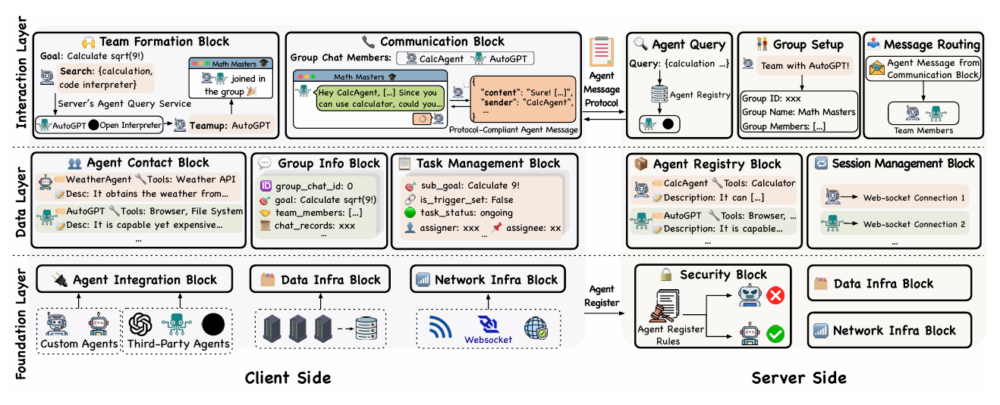
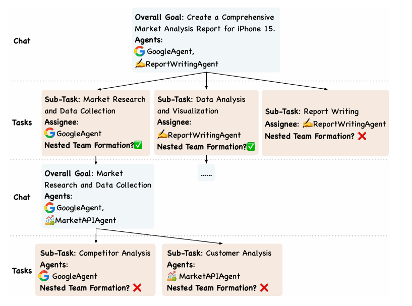
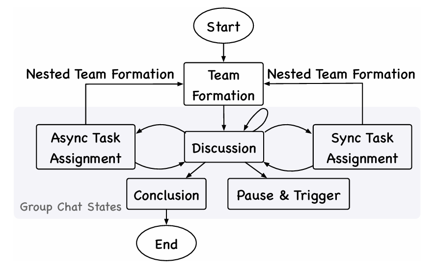
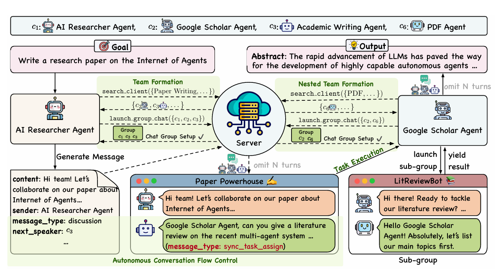
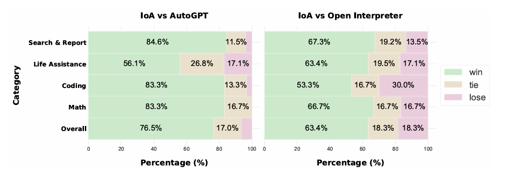
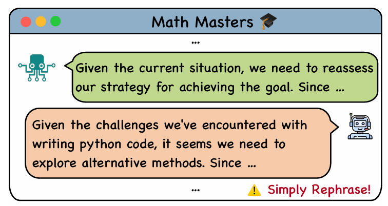
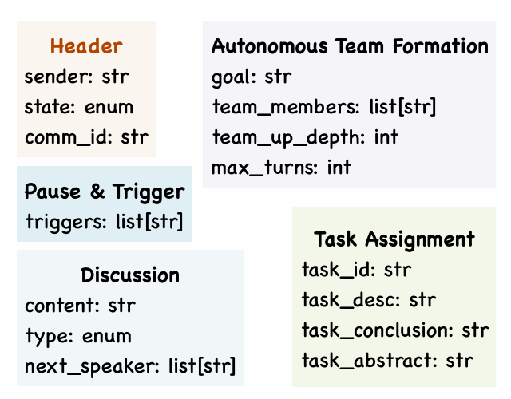
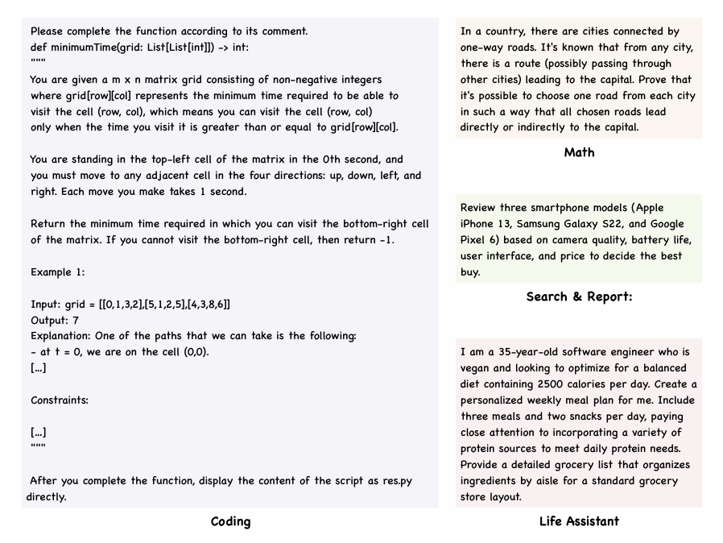
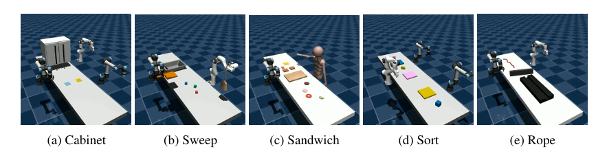

# 智能体互联网：编织异构智能体协作之网

> 《Internet of Agents: Weaving a Web of Heterogeneous Agents for Collaborative Intelligence》

> https://arxiv.org/abs/2407.07061

---

## 摘要

大语言模型（LLMs）的快速发展为开发高度 capable 的自主智能体铺平了道路。然而，现有的多智能体框架在集成各种有能力的第三方智能体方面往往面临困难，因为它们依赖于在其自身生态系统中定义的智能体。它们在模拟分布式环境方面也面临挑战，因为大多数框架仅限于单设备设置。此外，这些框架通常依赖于硬编码的通信管道，限制了它们对动态任务需求的适应性。受互联网概念的启发，我们提出了智能体互联网（Internet of Agents, IoA），这是一个新颖的框架，通过提供一个灵活且可扩展的平台来解决这些局限性，用于基于LLM的多智能体协作。IoA引入了智能体集成协议、即时通讯式架构设计，以及智能体组队和对话流程控制的动态机制。通过在通用助手任务、具身AI任务和检索增强生成基准测试上进行的大量实验，我们证明IoA始终优于最先进的基线方法，展示了其促进异构智能体之间有效协作的能力。IoA代表了在类似互联网的环境中连接多样化智能体的一步，在这种环境中，智能体可以无缝协作以实现更强大的智能和能力。我们的代码库已发布在 https://github.com/OpenBMB/IoA。

---

## 1 引言

互联网彻底改变了人们协作和分享知识的方式，将来自世界各地具有不同技能和背景的个人连接起来。这个全球网络使得创建卓越的协作项目成为可能，如维基百科¹和Linux操作系统²的开发，这些项目对于任何单个人来说都是不可能完成的。互联网极大地促进了人们之间的协作，使不可能成为可能，并推动了人类成就的边界。

互联网在促进人类协作方面的成功提出了一个有趣的问题：我们能否创建一个类似的平台来促进自主智能体之间的协作？随着LLM（OpenAI, 2023; Reid et al., 2024）的快速发展，我们现在拥有能够在广泛任务上实现接近人类性能的自主智能体。这些基于LLM的智能体已经展示了将复杂任务分解为可执行步骤、利用各种工具以及从反馈和经验中学习的能力（Qin et al., 2023; Wang et al., 2023c; Shinn et al., 2023; Qian et al., 2023b）。随着这些智能体能力的持续增长，以及越来越多具有多样化技能的第三方智能体不断涌现（Chase, 2022; Team, 2023; Significant Gravitas, 2023; Open Interpreter, 2023），探索如何有效且高效地编排它们的协作变得至关重要，就像互联网为人类所做的那样。

为了应对这一挑战，我们提出了智能体互联网（Internet of Agents, IoA）的概念，这是一个受互联网启发的智能体通信和协作通用框架。

IoA旨在解决现有三个多智能体框架的根本局限性（Chen et al., 2023; Wu et al., 2023; Hong et al., 2023; Qian et al., 2023a）：

1. **生态系统隔离**：大多数框架只考虑在其自身生态系统中定义的智能体，可能会阻止各种第三方智能体的集成，限制了智能体能力的多样性和平台的通用性；
2. **单设备模拟**：几乎所有多智能体框架都在单设备上模拟多智能体系统，这与现实世界中智能体可能分布在不同地点的多个设备上的场景有显著差异；
3. **僵化的通信与协调**：通信过程、智能体分组和状态转换大多是硬编码的，而在现实生活中，人类根据手头的任务决定队友，并在讨论与任务分配或执行之间动态切换。

为了克服这些局限性，我们提出了一个智能体集成协议，使运行在不同设备上的不同第三方智能体能够无缝集成到框架中并有效协作。此外，我们引入了一个类似即时通讯应用的框架，促进智能体发现和动态组队。通过自主搜索能够处理手头任务的潜在智能体，智能体可以动态决定组建不同的团队并在各种群聊中进行通信。受言语行为理论（Searle, 1969）及其在传统多智能体系统中应用的启发（Finin et al., 1994; Labrou et al., 1999），在每个群聊中，我们抽象出几种对话状态，并提供了一个灵活且通用的有限状态机机制，允许智能体自主决定对话状态，促进讨论和子任务执行。

我们通过大量实验和与最先进的自主智能体的比较来展示IoA的有效性。通过集成AutoGPT（Significant Gravitas, 2023）和Open Interpreter（Open Interpreter, 2023），我们表明在与这些智能体单独比较时，IoA在开放域任务评估中实现了66%到76%的胜率。此外，仅集成几个基本的ReAct智能体，IoA就在GAIA基准测试（Mialon et al., 2023）上优于先前的工作。在检索增强生成（RAG）问答领域，我们的框架大幅超越了现有方法，基于GPT-3.5的实现达到了接近甚至超过GPT-4的性能，并有效超越了先前的多智能体框架。

IoA在各个领域的出色表现突显了这一范式在自主智能体中的潜力。随着较小的LLM不断进步（Mesnard et al., 2024; Hu et al., 2024; Abdin et al., 2024），在个人电脑甚至移动设备上运行智能体正变得越来越可行。这一趋势为在现实场景中部署多智能体系统开辟了新的机会，在这些场景中，智能体可以分布在多个设备上并协作解决复杂问题。我们相信，通过进一步探索和优化IoA范式，可以开发出更复杂和适应性更强的多智能体系统，最终推动自主智能体在问题解决和决策方面所能实现的边界。

---

## 2 IoA的框架设计与关键机制

在本节中，我们全面概述IoA，详细介绍其架构和关键机制。我们将探讨这些组件如何协同工作，以实现自主智能体之间的有效协作，促进动态团队组建、结构化通信和高效任务执行。

### 2.1 IoA概述

IoA被设计为一个类似即时通讯应用的平台，使多样化的自主智能体之间能够无缝通信和协作。受互联网概念的启发，IoA解决了多智能体系统中的三个基本挑战（Chen et al., 2023; Wu et al., 2023; Qian et al., 2023a）：

1. **分布式智能体协作**：与传统框架在单设备上模拟多智能体系统不同，IoA支持分布在多个设备和位置的智能体。（第2.2节和第2.3.1节）
2. **动态自适应通信**：IoA实现了自主团队组建和对话流程控制的机制，允许智能体根据任务需求和正在进行的工作调整其协作策略。（第2.3.2节至2.3.4节）
3. **异构智能体集成**：IoA提供了一个灵活的协议来集成各种第三方智能体，扩展了系统中智能体能力的多样性。（第2.4节）

IoA的核心由两个主要组件组成：服务器和客户端。服务器充当中央枢纽，管理智能体注册、发现和消息路由。它使具有不同能力的智能体能够相互发现并启动通信。另一方面，客户端充当单个智能体的包装器，为它们提供必要的通信功能并使其适应指定的协议。IoA为服务器和客户端组件采用分层架构（Bass et al., 1999），包含三个层：

- **交互层**：促进团队组建和智能体通信。
- **数据层**：管理与智能体、群聊和任务相关的信息。
- **基础层**：为智能体集成、数据管理和网络通信提供必要的基础设施。

这些层协同工作，通过网络促进智能体协作。在以下小节中，我们将详细介绍IoA的架构和设计。

### 2.2 IoA架构

IoA的分层架构旨在支持可扩展、灵活和高效的多智能体协作。这种架构实现了关注点的清晰分离，并促进了多样化智能体和功能的集成



#### 2.2.1 服务器架构

服务器充当IoA的中央枢纽，促进智能体发现、群组组建和消息路由。其架构包含三个层：

**交互层**：在顶层，交互层管理与智能体和系统之间的高级交互。它包括：
- **智能体查询模块**：使智能体能够根据特定特征搜索其他智能体
- **群组设置模块**：促进群聊的创建和管理
- **消息路由模块**：确保智能体和群聊之间消息的高效准确路由

**数据层**：作为信息骨干，数据层处理关键系统信息的存储和管理。**智能体注册模块**维护一个全面的注册智能体数据库，包括它们的能力和当前状态，类似于分布式系统中的服务发现（Meshkova et al., 2008; Netflix）。同时，**会话管理模块**管理活动连接，并确保服务器和已连接客户端之间的持续通信。

**基础层**：作为整个系统的基础，基础层为服务器的运行提供必要的基础设施。它包括：
- **数据基础设施模块**：处理数据持久化和检索
- **网络基础设施模块**：管理网络通信
- **安全模块**：实施认证、授权和其他安全措施以维护系统完整性

#### 2.2.2 客户端架构

IoA的客户端组件充当单个智能体的包装器，为它们提供在系统内进行通信所需的接口。其架构与服务器类似，具有三个层：

**交互层**：在智能体操作的最前沿，交互层管理智能体在系统内的交互。**团队组建模块**实现了识别合适协作者并为手头任务组建团队的逻辑，类似于传统多智能体研究中的联盟组建（Rahwan et al., 2009）。与此相辅相成的是，**通信模块**管理智能体在群聊中的参与并处理消息处理。

**数据层**：作为智能体的内存，数据层维护与智能体操作相关的本地数据。它包括：
- **智能体联系模块**：存储当前智能体与之交互过的其他智能体的信息
- **群组信息模块**：维护正在进行的群聊和协作的详细信息
- **任务管理模块**：跟踪分配给智能体的任务的状态和进度

**基础层**：构成客户端架构的基础，基础层为客户端的操作提供基本功能。**智能体集成模块**定义了将第三方智能体集成到IoA生态系统中的协议和接口。与此并行的是，**数据基础设施模块**处理本地数据存储和检索，而**网络基础设施模块**管理与服务器的网络通信。

这种分层架构使IoA能够支持广泛的智能体类型和协作场景。通过提供关注点的清晰分离和各层之间定义良好的接口，该架构促进了多样化智能体的集成，并允许未来的可扩展性。此外，这种设计支持IoA的关键机制，如自主团队组建和对话流程控制，我们将在以下小节中详细探讨。

### 2.3 关键机制

IoA的有效性依赖于几个关键机制，这些机制使多样化智能体之间能够无缝协作。这些机制协同工作，促进智能体集成、团队组建、任务分配和结构化通信。我们在本节中详细介绍这些关键组件。

#### 2.3.1 智能体注册与发现

为了实现具有异构架构、工具和环境分布式智能体之间的协作，我们提出了智能体注册和发现机制。该机制构成了IoA内协作交互的基础，使多样化智能体能够集成到系统中，并通过网络促进其他智能体在在线服务器上发现它们以进行潜在协作。

**智能体注册**：当新智能体加入IoA时，其客户端包装器与服务器进行注册过程。在注册期间，智能体应提供其能力、技能和专业领域的全面描述。此描述（对于智能体$c_i$表示为$d_i$）存储在服务器数据层的智能体注册模块中。形式上，我们将所有注册智能体的集合表示为 $C = \{c_1, c_2, ..., c_n\}$，其中每个$c_i$与其描述$d_i$相关联。

**智能体发现**：智能体发现功能利用存储在在线服务器智能体注册表中的信息，使智能体能够为特定任务找到合适的协作者。当智能体需要组建团队或寻求帮助时，它可以使用服务器智能体查询模块提供的`search_client`工具。该工具允许智能体根据所需特征或能力搜索其他智能体。形式上，智能体发现过程可以描述如下：

设 $d = [l_1, l_2, ..., l_k]$ 是寻求协作者的智能体生成的所需特征列表。搜索客户端功能可以表示为：$\text{search\_client}: d \rightarrow \mathcal{P}(C)$。该函数返回客户端的子集 $C_d \subseteq C$，其描述$d_j$与$d$中的所需特征匹配。$d$和$d_j$之间的匹配过程可以使用各种语义匹配技术实现（Robertson & Zaragoza, 2009; Karpukhin et al., 2020）。它确保具有相关能力的智能体即使其描述不完全匹配搜索标准也能被发现。

#### 2.3.2 自主嵌套团队组建

自主嵌套团队组建机制使适当的智能体能够动态灵活地组合。该机制允许智能体根据任务需求自适应地组建团队，并为复杂的多方面任务创建嵌套子团队。

**团队组建过程**：当客户端$c_i$被分配任务$t$时，它启动团队组建过程。客户端可以访问服务器提供的两个基本工具：`search_client`和`launch_group_chat`。客户端中的LLM被提示根据任务和当前发现的客户端集合决定调用哪个工具。如果需要更多协作者，它会调用`search_client`并指定适当的特征。一旦找到合适的协作者，它就调用`launch_group_chat`来启动新的群聊$g \in G$，其中$G$是所有群聊的空间。

**嵌套团队结构**：嵌套团队组建允许团队和子团队的分层结构。设$g_0 \in G$是任务$t$的初始群聊。在执行$t$期间，如果客户端$c_i$被分配了子任务$t_l$（任务分配机制将在第2.3.4节中介绍），并且它识别出$t_l$需要额外的专业知识，则允许$c_i$再次搜索适当的智能体并启动新的子群聊$g_l \in G$。对于在$g_l$中分配的新子任务，此过程可以递归继续，形成树状的群聊结构。形式上，我们可以定义一个函数$h: G \rightarrow \mathcal{P}(G)$，将群聊映射到其子群聊集合。嵌套结构可以表示为：$h(g_0) = \{g_1, g_2, ..., g_m\}$，$h(g_i) = \{g_{i1}, g_{i2}, ..., g_{in}\}$，依此类推。

**通信复杂度**：嵌套团队组建机制有助于降低大型智能体团队中的通信复杂度。假设每个群组内完全连接通信，具有$|g|$个成员的单个群组中的通信通道数（连接边）为 $c_{\text{full}} = \frac{|g|(|g|-1)}{2}$。

然而，通过将任务分解为子任务并将它们分配给子群聊，我们可以减少通信通道的总数。设$S(g)$表示为最初分配给群组$g$的任务形成的所有子群组（包括$g$本身）的集合。然后，通信通道的总数可以表示为：

$$c_{\text{nested}} = \sum_{g_i \in S(g)} \frac{|g_i|(|g_i|-1)}{2} \leq c_{\text{full}}$$

下图说明了嵌套团队组建过程的一个示例。在此示例中，初始群聊$g_0$在讨论期间为特定子任务生成三个子群聊$g_1$、$g_2$和$g_3$。$g_1$进一步为更专业的子任务创建两个子群聊$g_{21}$和$g_{22}$。



#### 2.3.3 自主对话流程控制

有效的通信对于自主智能体之间的成功协作至关重要。受言语行为理论（Austin, 1975; Searle, 1969）及其在多智能体系统中应用的启发（Finin et al., 1994; Labrou et al., 1999），我们在IoA中引入了自主对话流程控制机制。该机制使智能体能够协调其通信并保持结构化的对话，提高其协作的效率和有效性。

**顺序发言机制**：为了管理潜在的冲突并确保清晰的通信，IoA采用最基本的顺序发言机制。在任何给定时间，只允许一个智能体发言，防止混乱并保持清晰的通信顺序。这种方法虽然简单，但与以下动态功能结合时，为更复杂的对话管理提供了基础。

**群聊状态的有限状态机**：我们将对话流程形式化为有限状态机 $M = (S, \Sigma, \delta, s_0, F)$，其中：

- $S = \{s_d, s_s, s_a, s_p, s_c\}$ 是状态集合，分别代表讨论、同步任务分配、异步任务分配、暂停与触发、以及结论。
- $\Sigma$ 是状态转换决策空间。
- $\delta: S \times \Sigma \rightarrow S$ 是转换函数，将当前状态和LLM做出的转换决策映射到下一个状态。
- $s_0 = s_d$ 是初始状态，代表对话开始时的讨论阶段。
- $F = {s_c}$ 是最终状态集合，仅包含结论状态。

图3说明了对话流程中的状态转换。每个状态对应协作过程的不同阶段：

- **讨论 ($s_d$)**：智能体进行一般对话，交换想法，澄清任务需求。
- **同步任务分配 ($s_s$)**：任务被分配给特定智能体，群聊暂停直到任务完成（第2.3.4节）。
- **异步任务分配 ($s_a$)**：任务被分配而不中断正在进行的讨论。这允许任务的并行执行。
- **暂停与触发 ($s_p$)**：群聊暂停，等待指定异步任务的完成。
- **结论 ($s_c$)**：标记协作的结束，提示最终总结。

这些状态与言语行为理论中的言语行为一致，如阐述类（讨论）、指令类（任务分配）、承诺类（暂停与触发）和宣告类（结论）（Searle, 1976）。



**自主状态转换和下一个发言者选择**：最近的研究证明了LLM在预定义状态空间内自主管理状态转换的有效性（Liu & Shuai, 2023; Wu et al., 2024a），状态机通常增强整体系统性能（Li et al., 2024）。在IoA中，每个客户端内的LLM负责确定状态转换并选择后续发言者。设$M_t$是到时间步$t$为止交换的消息集合。我们将LLM的决策函数定义为 $f_{\text{LLM}}: M_t \times S \rightarrow S \times C$，其中$S$是状态集合，$C$是客户端集合。下一个状态$s_{t+1}$和下一个发言者$c_{t+1}$确定为：$(s_{t+1}, c_{t+1}) = f_{\text{LLM}}(M_t, s_t)$。这个决策过程考虑了诸如分配任务的完成、进一步讨论的需求以及协作的整体目标等因素。下一个发言者的自主选择确保在适当的时间让最相关的智能体参与，促进高效的信息交换和问题解决。

通过实现这种自主对话流程控制机制，IoA使智能体之间能够进行结构化和高效的通信。这种方法允许根据协作需求进行动态适应，促进复杂多智能体场景中更有效的问题解决和决策。

#### 2.3.4 任务分配与执行

IoA中的任务分配和执行机制旨在高效地在智能体之间分配工作并管理简单和复杂任务的执行。该机制与团队组建和对话流程控制机制协同工作，以确保有效的协作和任务完成。

**任务表示**：在IoA中，任务$t \in T$表示为元组 $(d_t, S_t)$，其中$d_t$是任务描述，$S_t = \{s_1, s_2, ..., s_n\}$ 是可以分解为$t$的子任务集合。最初，$S_t$可能为空，子任务在协作过程中动态识别。

**任务分配**：IoA中的任务分配发生在群聊的上下文中，并与对话流程控制机制密切相关。有两种类型的任务分配：

1. **同步任务分配**：当群聊进入同步任务分配状态$s_s$时，任务被分配给特定智能体，群聊暂停直到任务完成。
2. **异步任务分配**：在异步任务分配状态$s_a$中，任务被分配而不中断正在进行的讨论。这允许任务的并行执行。

形式上，我们可以定义一个任务分配函数 $\alpha: T \times G \rightarrow \mathcal{P}(C)$，它将任务和群聊映射到负责执行任务的客户端子集。

**任务执行**：一旦任务被分配，负责的智能体开始执行。执行过程取决于任务的性质和智能体的能力。对于集成的第三方智能体，任务执行通过客户端基础层中的智能体集成模块处理。该模块提供任务执行的标准化接口，通常形式为：$\text{run}: \text{String} \rightarrow \text{TaskID}$，其中输入是任务描述，输出是任务的唯一标识符。在此阶段还可以实现执行中断等高级功能。

任务或子任务完成后，负责的智能体向群聊报告。对于同步任务，这会触发群聊的恢复。对于异步任务，记录完成情况，并与群组共享任何相关信息。

对话流程控制机制中的暂停与触发状态$s_p$在管理多个异步任务的完成方面起着关键作用。它允许群聊等待指定异步任务的完成，然后再继续，确保后续协作阶段所需的所有信息都可用。

### 2.4 综合消息协议设计

IoA中自主嵌套团队组建和对话流程控制机制的有效性依赖于综合消息协议。该协议通过封装各种机制正常运行所需的所有必要信息，使智能体之间能够无缝通信和协作。

**协议概述和关键字段**：IoA中的智能体消息协议设计具有可扩展性和灵活性，促进有效的多智能体协作。该协议由两个主要组件组成：头部和有效载荷。

头部包含有关消息的基本元数据，确保接收智能体能够正确寻址和处理。头部中的关键字段包括：
- `sender`：发送消息的代理的唯一标识符。
- `group_id`：消息所属群聊的标识符。

有效载荷携带消息的主要内容，因消息类型而异。它可以包括：
- `message_type`：指示消息的目的（例如，讨论、任务分配、暂停与触发）。
- `next_speaker`：预期响应的智能体的标识符。

此结构包含其他字段以有效支持IoA的多样化功能。消息协议的详细解释和示例可在附录A.1中找到。

为确保无缝通信和协调，IoA的客户端和服务器组件都实现了消息协议。当客户端发送消息时，它根据协议对消息进行编码并传输到服务器。服务器解析消息，从头部提取相关信息，并根据`group_id`将其路由到适当的群聊。收到消息后，客户端对其进行解码并相应处理。这种一致的实现确保所有智能体都能正确理解和响应消息，无论其角色或任务如何，保持连贯高效的协作过程。

### 2.5 整合：IoA实际运行示例

为了说明IoA的集成功能，在图4中，我们展示了系统的一个示例演练，任务是一个说明性的复杂任务：撰写一篇关于智能体互联网的论文。



最初，客户端$c_1$，一个额外接受过AI学术论文训练的AI研究专家，通过`search_client`功能参与团队组建模块，使用关键词列表 $\{\text{Internet}, \text{Multi-Agent System Specialist}, \text{Paper Writing}, \text{LLM Expert}\}$。服务器返回一组匹配的客户端 $\{c_2, c_3, c_4, c_5\}$，$c_1$从中组建包含成员 $\{c_1, c_2, c_3\}$ 的群组$g_0$，其中$c_2$可以访问学术数据库，$c_3$专门从事学术写作。

群聊$g_0$形成后，所有客户端都转换到$g_0$的通信模块，其中自主对话流程控制机制（实现为有限状态机）指导协作。该过程从讨论状态($s_d$)的头脑风暴开始，进展到任务分配状态($s_s$、$s_a$)，智能体被分配特定职责。例如，$c_2$被指派使用其学术资源访问权限进行文献综述。当$c_2$识别出需要专业的PDF专业知识时，嵌套团队组建机制得到展示。这促使$c_2$启动子团队组建过程，创建与新智能体$c_6$（PDF专家）的子群组$g_1$。在整个过程中，对话在讨论($s_d$)和异步任务分配($s_a$)状态之间交替，促进分配任务的并行工作。消息协议确保跨嵌套群组结构的高效通信，实现想法、引用和草稿片段的交换。

在最终整合阶段，群组进入同步任务分配状态($s_s$)进行协作编辑和完善，展示了IoA协调多个智能体之间密集实时协作的能力。该过程以转换到结论状态($s_c$)结束，进行最终审查并准备提交论文。

---

## 3 实验

为了展示IoA在集成异构智能体方面的有效性和多功能性，我们在一组多样化的任务上进行了全面的实验。这些实验旨在展示智能体异质性的不同方面：工具可变性（第3.1节）、架构多样性（第3.2节）、不同的观察和行动空间（第3.3节）以及多样化的知识库（第3.4节）。我们的目标是双重的：首先，说明IoA在促进异构智能体之间协作方面的熟练程度；其次，突出其在各种问题领域的适应性。在本节中，我们介绍我们的实验结果，并对IoA与每种任务类别的最先进（SoTA）方法之间的比较分析。IoA中的提示在不同任务中保持一致，并且没有针对特定任务进行调整。³

### 3.1 异构工具：GAIA基准测试

为了评估IoA集成具有异构工具的智能体的能力，我们采用GAIA基准测试（Mialon et al., 2023）。该基准测试包含一组多样化的现实世界问题，旨在评估智能体系统通过协同应用多种技能（包括自然语言理解、推理和外部知识集成）解决复杂任务的能力。基准测试的三层难度结构为评估智能体系统的能力提供了一个强大的测试平台。

**实验设置**：我们用四个基本的ReAct智能体（Yao et al., 2023）实例化IoA，每个智能体配备一个不同的工具：Web浏览器、代码解释器、Wikidata搜索器和YouTube视频转录下载器。这种配置使我们能够评估IoA在编排具有异构工具的智能体之间协作的能力。我们将IoA与几个SoTA智能体系统进行基准测试，评估GAIA所有三个难度级别的性能以及整体性能。详细的实现细节在附录A.4.1中提供。

**结果与分析**：实验结果呈现在下表中，展示了IoA在GAIA基准测试上的卓越性能。尽管仅使用基本的ReAct智能体，IoA实现了最高的整体性能，超越了所有其他方法。值得注意的是，IoA在更具挑战性的2级和3级任务中表现出卓越的性能，这些任务需要高级推理和复杂的协作。这一性能突显了IoA通信机制的有效性及其促进无缝智能体间协作的能力。

与AutoGen相比，IoA在三个难度级别中的两个上表现出卓越的性能。这种优势可归因于IoA的协作机制和集成具有不同工具的智能体的灵活性，而在AutoGen中，只有一个智能体使用不同的工具，其他智能体充当反馈提供者。IoA中实现的机制使自适应团队组成和高效的子任务执行，最终在复杂的多方面问题上增强性能。

GAIA基准测试的结果突显了IoA作为解决现实世界多步骤问题多样化智能体强大编排器的潜力。通过为智能体协作提供灵活高效的平台，IoA使即使是基本智能体也能实现SoTA性能，超越更复杂的独立智能体。这一结果突显了多智能体系统中有效通信和协调的关键作用，并验证了支撑IoA的架构和设计选择。

**表：GAIA基准测试验证集上的性能**

| 模型 | 智能体类型 | 1级 | 2级 | 3级 | 整体 |
|------|-----------|-----|-----|-----|------|
| GPT-4 | - | 15.09 | 2.33 | 0.00 | 6.06 |
| GPT-4-Turbo | - | 20.75 | 5.81 | 0.00 | 9.70 |
| AutoGPT-4 (Significant Gravitas, 2023) | † | 13.21 | 0.00 | 3.85 | 4.85 |
| GPT-4 + Plugins (Mialon et al., 2023) | † | 30.30 | 9.70 | 0.00 | 14.60 |
| FRIDAY (Wu et al., 2024b) | † | 45.28 | 34.88 | 11.54 | 34.55 |
| AutoGen (Wu et al., 2023) | † | 54.72 | 38.37 | 11.54 | 39.39 |
| **IoA** | † | **50.94** | **40.70** | **15.38** | **40.00** |


### 3.2 异构架构：开放式指令基准测试

为了评估IoA在集成和编排具有异构架构的智能体方面的能力，我们开发了一个包含153个开放式指令的综合基准测试，使用self-instruct（Wang et al., 2023e）。该基准测试跨越四个不同的类别：搜索与报告、编码、数学和生活辅助。与GAIA基准测试主要关注具有确定性答案的问答任务不同，我们策划的基准测试包含了更高比例的需要生成响应的非QA任务。这种设计选择旨在更好地反映智能体系统预期要解决的真实世界挑战的多样性。策划过程在附录A.4.2中详细阐述。

**实验设置**：在此实验设置中，我们将两个具有不同架构的SoTA第三方智能体集成到IoA生态系统中：AutoGPT（Significant Gravitas, 2023）和Open Interpreter（Open Interpreter, 2023）。集成过程在附录A.4.2中详细说明，展示了IoA在容纳具有不同内部结构和操作范式的智能体方面的多功能性。这种配置使我们能够评估IoA在促进独立开发的具有异构架构的智能体之间协作方面的功效。

对于评估，我们采用GPT-4-1106-preview作为公正的评判者，先前研究表明GPT模型与人类评估者在评估响应质量方面具有高度一致性（Chiang et al., 2023; Zheng et al., 2023a; Chan et al., 2023）。为了减轻潜在顺序诱导偏见，我们按照Zheng等人（2023a）的方法实现了一种稳健的评估方法，在提示中交替响应的顺序。只有当一种竞争对手在两种顺序中都被一致判定为优越时，才宣布"胜利"。

**结果与分析**：实验结果如图所示，展示了IoA在编排AutoGPT和Open Interpreter之间协作时的显著性能优势。IoA在所有四个任务类别中始终优于两个单独的智能体。总体而言，IoA对AutoGPT实现了76.5%的显著胜率，对Open Interpreter实现了63.4%的胜率。这些结果突显了IoA在高效收集和综合信息方面的熟练程度，以及其在不同领域促进协作问题解决的有效性。



IoA无缝集成和编排具有异构架构的智能体的能力使得能够利用多样化、独立开发的智能体的优势，使创建更多功能和能力的智能体系统成为可能。随着专业AI智能体的格局不断扩大，IoA集成和促进这些多样化实体之间协作的潜力使其成为开发日益复杂和自适应智能体系统的有前景的平台。


### 3.3 异构观察和行动空间：具身智能体任务

为了评估IoA在编排具有异构观察和行动空间的智能体方面的功效，我们在具身AI领域进行了实验。该领域提出了独特的挑战，要求智能体感知、理解并与其物理环境交互。我们利用RoCoBench（Mandi et al., 2023），这是一个最先进的基准测试，旨在评估具身智能体的协作和通信能力。RoCoBench包含六个协作任务，每个任务要求两个或三个具有部分、通常不同的行动空间或环境观察的智能体朝着共同目标合作。

**实验设置**：我们将IoA与Mandi等人（2023）建立的两个基线进行基准测试：(1) Central Plan，一个集中式智能体具有完整的环境信息并控制所有具身智能体，以及(2) Roco Dialog，一个为此任务设计的专门多智能体框架，使智能体通信和决策成为可能。

鉴于RoCoBench要求智能体以特定格式输出行动计划，而不是直接使用工具与智能体交互，我们针对此场景调整IoA而不集成外部智能体。相反，我们为两个IoA客户端提供环境观察，并从它们的讨论中提取它们的行动计划。这种设置使我们能够评估IoA管理具有异构观察和行动空间的智能体的能力。详细的实现细节可在附录A.4.3中找到。为确保公平比较，我们对IoA和Roco Dialog的每个任务进行10次运行，报告平均成功率和采取的步骤。Central Plan的结果直接来自Mandi等人（2023）。请注意，由于基准测试版本中的实现错误，Pack Grocery任务被省略。

**结果与分析**：下表呈现了任务完成的平均成功率和所需步骤。值得注意的是，尽管没有专门针对具身任务进行优化，IoA在成功率方面在五个任务中的四个上优于为此基准测试量身定制的框架Roco Dialog。IoA在Cabinet、Sandwich和Sort任务上取得了完美的分数，展示了其通信和协作机制在使具有异构观察和行动空间的具身智能体协同实现共同目标方面的稳健性。更令人印象深刻的是IoA相对于具有完整环境可观察性的Central Plan基线的性能。IoA在各项任务上的成功率优于或与Central Plan相当，尽管它通常需要稍微更多的决策步骤来完成任务。鉴于IoA是一个并非专门为具身AI任务设计的通用多智能体框架，步骤数的边际增加是其通用性和有效性的合理权衡。

IoA在具身AI场景中的成功突显了其通用性和有效性。它表明IoA背后的原理，例如自主对话流程控制，是根本可通用的，表明IoA在智能体必须尽管具有不同观点或能力但仍需协作的广泛现实世界场景中的潜在适用性。

**表：RoCoBench不同任务的平均成功率和步骤数**

| 模型 | 指标 | Cabinet | Sweep | Sandwich | Sort | Rope |
|------|------|---------|-------|----------|------|------|
| Central Plan (oracle) | Success<br>#Step | 0.90<br>4.0 | 0.75<br>4.7 | 1.00<br>4.6 | 1.00<br>8.4 | 0.70<br>7.9 |
| Roco Dialog | Success<br>#Step | 0.80<br>8.5 | 0.96<br>8.8 | 0.70<br>9.1 | 1.00<br>8.9 | 0.70<br>8.6 |
| **IoA** | Success<br>#Step | **1.00**<br>5.4 | 0.70<br>2.3 | **1.00**<br>2.6 | **1.00**<br>2.6 | **0.70**<br>3.3 |

### 3.4 异构知识：检索增强生成

为了评估IoA在编排具有异构知识的智能体方面的功效，我们在检索增强生成（RAG）任务（Lewis et al., 2021）上进行了实验。RAG任务提出了一个独特的挑战，智能体必须从不同来源检索相关信息并进行协作以综合准确的响应，使其成为评估IoA管理知识异构性和促进有效智能体间通信能力的理想测试平台。

**实验设置**：我们使用GPT-3.5-turbo-0125作为核心语言模型实现IoA，遵循Apollo's Oracle（Wang et al., 2023b）。为了评估知识异构性及其影响，我们设计了三种场景：

1. **异构知识**：两个客户端访问不同的证据池（Wikipedia/Google），测试IoA管理知识异构性的能力。
2. **同构知识（2个智能体）**：两个客户端访问两个池，作为对照以分离异构性效应。
3. **同构知识（3个智能体）**：三个客户端访问两个池，评估可扩展性和知识冗余权衡。

这种设计使我们能够将知识异构性的影响与智能体数量和知识冗余分离开来。我们在四个数据集上进行评估：TriviaQA（Joshi et al., 2017）、Natural Questions (NQ)（Kwiatkowski et al., 2019）、HotpotQA（Yang et al., 2018）和2WikiMultiHopQA (2WMHQA)（Ho et al., 2020），从每个数据集中随机抽样250个问答对。实现细节在附录A.4.4中。

**结果与分析**：表3展示了IoA在所有数据集上的卓越性能，尽管基于GPT-3.5，但经常超越或匹配GPT-4。在四个任务中的两个上，IoA的异构知识场景优于同构的Apollo's Oracle，展示了IoA在管理知识多样性方面的有效性。这种配置在NQ上实现了最佳性能，在其他数据集上取得了有竞争力的结果，通常优于单模型方法和Apollo's Oracle等专业框架。这突显了IoA在促进来自异构来源的信息交换和综合方面的功效，有效弥补了个体智能体的知识差距。

我们还在同构设置中进行了实验。具有3个智能体的IoA实现了最佳的整体性能，在TriviaQA上超越了所有基线，在其他数据集上显示了有竞争力的结果。有趣的是，2智能体同构配置在HotpotQA和2WikiMultiHopQA上优于3智能体设置，表明最佳智能体配置可能取决于任务。这些结果不仅验证了IoA在RAG任务中的有效性，还突显了其作为多智能体系统中管理异构和同构知识的多功能平台的潜力。

**表：RAG任务结果**

| 模型 | TriviaQA | NQ | HotpotQA | 2WMHQA | Overall |
|------|----------|-----|----------|--------|---------|
| GPT 4 | 0.902 | 0.778 | 0.772 | 0.818 | 0.818 |
| GPT 3.5 Turbo | 0.908 | 0.692 | 0.532 | 0.588 | 0.680 |
| + Zero-Shot CoT (Wei et al., 2022) | 0.622 | 0.586 | 0.648 | 0.576 | 0.608 |
| + Self Consistency (Wang et al., 2023d) | 0.662 | 0.708 | 0.671 | 0.682 | 0.681 |
| + Reflxion (Shinn et al., 2023) | 0.566 | 0.384 | 0.410 | 0.408 | 0.442 |
| + Multi-Agent Debate¹ (Du et al., 2023) | 0.378 | 0.394 | 0.450 | 0.542 | 0.441 |
| + Multi-Agent Debate² (Liang et al., 2023) | 0.186 | 0.334 | 0.350 | 0.449 | 0.330 |
| Apollo's Oracle (Homogeneous) | 0.530 | 0.519 | 0.611 | 0.476 | 0.534 |
| **IoA + 2 Agents (Heterogeneous)** | **0.575** | **0.611** | **0.490** | 0.514 | **0.548** |
| IoA + 2 Agents (Homogeneous) | 0.495 | 0.507 | **0.529** | **0.597** | 0.532 |
| **IoA + 3 Agents (Homogeneous)** | **0.610** | 0.652 | 0.671 | 0.610 | **0.636** |

异构表示智能体具有不同的证据池，而同构表示所有智能体访问所有证据池。

---

## 4 分析

### 4.1 团队组建精度

为了评估IoA自主团队组建机制的精度，我们使用GPT-4开发了一个基准测试，包含625个不同的任务和1500个虚拟智能体配置文件。这个模拟环境使我们能够在大型设置中评估常规和嵌套团队组建的准确性。详细的数据构建过程可在附录C中找到。

**实验设计**：我们评估两种不同的场景：常规团队组建和嵌套团队组建。对于常规团队组建，每个任务与GPT生成的2个或更多合适的智能体配置文件相关联。对于嵌套团队组建，我们为每个原始任务生成一个子任务，该子任务可以由最初组建的团队完成或不能完成，如果不能，则生成一个能够解决此子任务的额外智能体配置文件。我们评估团队是否能够正确决定何时进入嵌套团队组建阶段，并评估嵌套团队组建的精度。

我们使用四个指标评估两种设置：Top@1和Top@10召回率、平均排名（MR）和平均倒数排名（MRR）。Top@1测量精确匹配，而Top@10考虑语义相似性，如果招募的智能体在最相似的标记智能体前10名中，则认为智能体被召回。MR和MRR提供对检索智能体排名质量的洞察。

**结果与分析**：表4呈现了两种团队组建机制的性能，每种机制都在其特定的数据集和设置上进行评估。

**表4：团队组建机制的性能**

| | Top@1 ↑ | Top@10 ↑ | MR ↓ | MRR ↑ |
|--|---------|----------|------|-------|
| Regular | 41.4% | 64.9% | 27.4 | 50.1% |
| Nested | 59.7% | 81.8% | 10.6 | 66.5% |

在常规团队组建场景中，该场景评估为给定任务组建初始团队的能力，我们观察到Top@1召回率为41.4%，Top@10召回率为64.9%。这表明该机制可以在41.4%的时间内精确匹配标记的智能体，当考虑语义相似性时，检索到的智能体在64.9%的时间内落入与标记智能体最相似的前10名智能体中。平均排名（MR）为27.4，平均倒数排名（MRR）为50.1%，表明相关智能体平均排名在前30个结果之内，并有倾向于高排名的趋势。

对于嵌套团队组建场景，该场景评估在可能出现需要额外专业知识的子任务的设置中机制的性能，我们看到Top@1召回率为59.7%，Top@10召回率为81.8%。MR为10.6，MRR为66.5%，表明相关智能体通常在前11个结果中找到，并有非常强烈倾向于非常高的排名。这些指标表明在这种更动态的设置中表现有效。

这些结果展示了IoA在初始任务分配和任务需求可能演变的场景中组建精确团队的能力。高召回率，特别是相似性匹配（Top@10），对于解决需要多样化或专业技能的复杂任务至关重要。

### 4.2 成本和次优通信模式分析

为了评估IoA的经济可行性和优化潜力，我们在开放式指令基准测试（第3.2节）上进行了成本分析，其中集成了AutoGPT和Open Interpreter。我们比较了这些智能体单独操作和集成到IoA中时每个任务的平均成本。

如表5所示，当集成到IoA中时，由于每个任务的任务分解，两个智能体的成本都降低了。然而，IoA引入了每个任务0.53美元的额外通信成本，导致总成本为0.99美元。

**表5：开放式指令基准测试上独立智能体和IoA集成智能体的成本分析**

| Setting | Cost per Task |
|------|-----------|
| AutoGPT (Standalone) | $0.39 |
| Open Interpreter (Standalone) | $0.16 |
| AutoGPT (in IoA) | $0.33 |
| Open Interpreter (in IoA) | $0.13 |
| IoA Communication | $0.53 |
| IoA Communication (Dedup.) | $0.28 |
| **IoA Overall** | **$0.99** |
| IoA Overall (Dedup.) | $0.74 |

在我们的分析过程中，我们观察到了导致高通信成本的意外和次优通信模式。一个显著的模式是信息的重复，其中客户端中的LLM会重复或改述来自自己或他人的先前聊天，导致进展停滞。这种现象在几次异步任务分配后特别普遍。尽管每个任务分配不需要立即等待，因为对话继续进行，但随着对话的进行，必须根据先前分配但尚未完成的异步任务的结论做出新的决策。尽管为客户端LLM提供了将群聊状态切换到暂停与触发的选项，但它们有时会未能切换，如图6所示。LLM中的这一缺点在其他多智能体工作中也有观察到（Li et al., 2023; Mandi et al., 2023）。



为了量化这种次优通信模式的影响，我们手动删除了重复内容并重新计算了token数量和相应成本。令人惊讶的是，这导致通信成本降低了近50%，如表5中"Dedup."行所示。这一发现与其他多智能体通信框架的观察结果一致，表明虽然现代LLM很好地对齐以成为有效的聊天机器人助手，但它们可能没有最佳地对齐以成为高效的通信智能体。智能体不仅应该准确完成给定任务，还应该与他人有效通信，理解对话状态并做出适当决策。这一见解引发了关于LLM智能体对齐的新研究问题，并突显了该领域进一步调查的必要性。

尽管存在当前的成本开销和次优通信模式，IoA在促进异构智能体之间的有效协作方面显示出巨大的潜力。通过通过提示优化、协议优化以及在IoA概念下开发更复杂的框架来解决这些挑战，我们相信通信成本可以显著降低。随着研究的进展，IoA和类似方法将成为复杂多智能体系统越来越有吸引力和经济上可行的解决方案。

---

## 5 相关工作

**基于LLM的智能体**：LLM的最新进展，如GPT（OpenAI, 2023）、Claude（Anthropic, 2024）和Gemini（Reid et al., 2024），导致了高度capable的AI智能体的发展，这些智能体可以进行自然语言交互并执行广泛的任务。为了增强基于LLM的智能体的能力，研究人员探索了外部工具和知识源的集成（Nakano et al., 2021; Yao et al., 2023; Schick et al., 2023; Shen et al., 2023），使智能体能够访问和利用超出其预训练知识的相关信息。各种智能体在广泛领域展示了重大进展，包括操作系统交互、软件工程和通用AI应用。例如，OS-Copilot促进跨Web浏览器和代码终端的通用交互（Wu et al., 2024b），而OpenDevin专注于自主软件开发任务，如编码和调试（OpenDevin Team, 2024）。其他值得注意的发展包括用于复杂任务解决的XAgent（Team, 2023）和Voyager（Wang et al., 2023a），一个利用LLM进行Minecraft游戏的开源具身智能体。这些进步为更复杂和多功能的基于LLM的智能体奠定了基础，这些智能体能够自主任务执行和持续学习。

**基于LLM的多智能体系统**：在单个基于LLM的智能体成功的基础上，研究人员开始探索由这些智能体组成的多智能体系统的潜力。早期工作展示了使用LLM模拟多智能体交互和涌现行为的可行性（Park et al., 2023）。此后，提出了各种方法来促进基于LLM的智能体之间的有效协作和通信。AgentVerse（Chen et al., 2023）和AutoGen（Wu et al., 2023）等框架提供了智能体协作所需的基础设施。在软件开发中，ChatDev（Qian et al., 2023a）、MetaGPT（Hong et al., 2023）等多智能体系统在自动化编码、测试和调试过程方面显示出有前景的结果。尽管取得了这些进展，但仍然存在重大局限性，例如缺乏对集成多样化第三方智能体的支持、无法支持分布式多智能体系统，以及依赖硬编码的通信协议和状态转换。IoA旨在解决这些局限性，为基于LLM的多智能体协作提供更灵活和可扩展的平台，为能够有效处理复杂现实世界问题的更先进和实用的系统铺平道路。

---

## 6 结论

在本文中，我们介绍了IoA，这是一个受互联网概念启发的基于LLM的多智能体协作新颖框架。IoA通过提供一个灵活且可扩展的平台来解决现有三个多智能体框架的局限性，用于集成多样化的第三方智能体，实现分布式多智能体协作，并引入智能体组队和对话流程控制的动态机制。通过各种基准测试的大量实验，我们展示了IoA在促进异构智能体之间高效协作方面的有效性，始终优于最先进的基线方法。随着基于LLM的智能体领域的不断进步，我们相信IoA将作为多智能体协作未来研究和开发的基础。通过使集成具有专业技能和知识的多样化智能体成为可能，我们的框架为利用独立开发的现有智能体开辟了新的可能性。我们希望我们的工作将激发这一有前景方向的进一步研究，并为开发更先进和有影响力的多智能体系统做出贡献。

---

## A IoA实现细节

在本附录中，我们提供IoA客户端和服务器各模块实现细节的全面概述。

### A.1 消息协议

为了支持第2.4节中介绍的IoA功能，我们设计了一个全面的智能体消息协议，促进智能体之间的高效通信和协调。该协议如图所示，包含几个字段以满足框架内各种机制的特定需求。



首先，该协议为所有消息类型包含以下头部：
- `sender` (str)：发送消息的智能体的名称或唯一标识符。
- `state` (enum)：与消息关联的群聊的当前状态，可以是团队组建或通信。
- `comm_id` (str)：消息所属群聊的唯一标识符。

为了支持自主团队组建机制，该协议包含以下字段：
- `goal` (str)：当前群聊旨在实现的目标或任务。
- `team_members` (list[str])：当前群聊所需的智能体的名称或唯一标识符。
- `team_up_depth` (int)：当前嵌套团队组建的深度，用于确定是否已达到最大允许深度。
- `max_turns` (int)：当前群聊允许的最大讨论轮数。如果超过，群聊将被迫进入结论阶段。

为了促进讨论阶段，该协议包含以下字段：
- `content` (str)：当前消息的实际内容。
- `type` (enum)：指定下一个对话状态，可以是讨论、任务分配或结论。
- `next_speaker` (list[str])：预期下一个发言的智能体的名称或唯一标识符。在讨论状态下，`next_speaker`限于单个智能体，而在任务分配状态下，它可以包含多个智能体，表示当前消息包含多个任务分配。

为了支持任务分配机制，该协议包含以下字段：
- `task_id` (str)：当前任务的自动生成唯一标识符。
- `task_desc` (str)：分配给客户端的任务描述，从聊天中提取。
- `task_conclusion` (str)：客户端完成任务后提供的结论或结果。
- `task_abstract` (str)：已完成任务的简洁摘要。

最后，为了支持暂停与触发机制，该协议包含以下字段：
- `triggers` (list[str])：需要设置触发的任务ID列表。

通过遵守这种全面的智能体消息协议来发送和接收消息，IoA中的客户端可以有效地实现自主团队组建和对话流程控制。该协议确保所有必要信息在智能体之间通信，使各种任务场景中的无缝协作和协调成为可能。

### A.2 客户端

IoA的客户端组件在实现异构智能体的集成和协作方面发挥着关键作用。它由三个层组成：基础层、数据层和交互层。每一层包含几个模块，它们协同工作以促进高效的通信、数据管理和智能体协调。在本小节中，我们提供客户端各层内每个模块实现的详细概述。

#### A.2.1 基础层

**网络基础设施模块**：在IoA中，所有客户端使用WebSocket协议与服务器保持持久连接，类似于即时通讯应用程序。当客户端发送消息时，它被传输到服务器，服务器解析消息中的`comm_id`字段，并通过各自的WebSocket连接将消息转发到相应群聊中的其他客户端。WebSocket的实时性确保消息及时传递，使客户端能够接收和响应消息而不会延迟。

**数据基础设施模块**：为了支持上层数据层模块的数据存储和检索需求，我们采用SQLite作为主要数据库解决方案。SQLite提供了一种轻量级且高效的方法来持久化和访问与智能体联系人、群组信息和任务管理相关的数据。通过利用SQLite，客户端可以存储和检索有关遇到的智能体、群聊详细信息和任务分配的信息，确保整个协作过程中的数据一致性和可用性。

**智能体集成模块**：智能体集成模块定义了第三方智能体必须遵守的协议，以便与IoA无缝集成。目前，IoA中的智能体集成协议要求智能体实现一个函数 `def run(task_desc: str) -> str`，该函数接受任务描述作为输入并返回任务完成的摘要。这种简单而有效的协议允许将多样化的智能体纳入框架，使它们能够为其独特的能力做出贡献。随着IoA的发展，集成协议可以扩展以支持更高级的功能和交互模式。

#### A.2.2 数据层

**智能体联系模块**：智能体联系模块负责维护当前客户端先前协作过的客户端记录。它存储这些客户端的名称和描述等信息，为未来的协作提供有价值的参考。该模块旨在支持客户端在每次任务后评估和存储协作结果，使其能够在为后续任务组建团队时做出明智的决策。在团队组建过程中，该模块中存储的信息被包含在提示中，以协助客户端根据先前的经验选择最合适的合作伙伴。

**群组信息模块**：群组信息模块管理所有与群聊相关的信息，包括以下字段：
- `comm_id` (str)：群聊的唯一标识符。
- `goal` (str)：群聊旨在实现的目标或任务。
- `team_members` (str)：参与群聊的智能体列表。
- `state` (str)：群聊的当前状态（例如，团队组建、讨论、任务分配、结论）。
- `conclusion` (str — None)：群聊达成的最终结果或结论。
- `team_up_depth` (int)：群聊内嵌套团队组建的深度。
- `max_turns` (int)：群聊中允许的最大通信轮数。

通过组织和持久化这些信息，群组信息模块使客户端能够保持对正在进行的协作及其进展的连贯视图。

**任务管理模块**：任务管理模块负责存储和跟踪每个群聊中分配的任务。它为每个任务维护以下字段：
- `task_id` (str)：任务的唯一标识符。
- `task_desc` (str)：任务的详细描述。
- `task_abstract` (str)：任务的简洁摘要。
- `assignee` (str)：被分配完成任务的智能体。
- `status` (enum)：任务的当前状态（例如，待处理、进行中、已完成）。
- `conclusion` (str — None)：任务的最终结果或结果。

通过跟踪与任务相关的信息，任务管理模块使客户端能够监控分配任务的进度，并确保所有与任务相关的数据都可随时用于参考和决策。

#### A.2.3 交互层

**团队组建模块**：如第2.3.2节简要介绍的，当客户端接收到任务时，它配备了两个基本工具：`search_agent(desc: list[str]) -> list[agent]` 和 `launch_group_chat(team_members: list[str] | None) -> comm_id`。客户端必须决定是使用`search_agent`工具在服务器上查找与指定描述匹配的智能体，还是直接根据发现的智能体和历史协作信息调用`launch_group_chat`工具。如果客户端在不指定任何智能体的情况下调用`launch_group_chat`，则意味着任务将由单个智能体完成。为防止无限循环，IoA对最大工具调用次数施加限制，默认设置为10。如果客户端达到此限制而未成功启动群聊，则被迫调用`launch_group_chat`工具以启动协作过程。

**通信模块**：通信模块处理消息生成和消息接收的核心功能。当客户端生成消息时，IoA根据智能体消息协议对其进行处理。如果消息类型是`conclusion`，客户端进入结论阶段，根据累积的聊天记录和任务完成信息为群聊目标提供最终答案。在`pause & trigger`消息的情况下，框架提示客户端生成需要触发的任务ID，并将它们广播给所有群组成员。对于`discussion`或`task assignment`消息，它们直接广播给群聊中的所有参与者。

收到消息后，客户端根据智能体消息协议对其进行解析。如果`next_speaker`字段不包括当前客户端，则消息只是添加到群聊历史记录中。但是，如果客户端被指定为下一个发言者，则必须根据消息类型采取适当的行动。对于`discussion`消息，客户端生成响应以继续对话。对于`sync`或`async task assignment`消息，客户端从聊天记录中提取其分配的任务，对其进行总结，并指定要传递给集成智能体的相关信息。然后智能体根据总结的描述和相关聊天消息执行任务，并在完成时返回结果。如果消息类型是`pause & trigger`，客户端更新任务管理模块中的相应任务触发器。

通信模块与交互层和数据层中的其他模块协同工作，使智能体之间能够进行无缝和结构化的协作。通过遵守定义良好的智能体消息协议并利用各种模块提供的功能，客户端可以有效地参与讨论、分配任务并协调其行动以实现预期目标。

### A.3 服务器

IoA的服务器组件充当智能体协调、通信和管理的中央枢纽。它由三个层组成：基础层、数据层和交互层。每一层包含协同工作以促进智能体注册、发现和消息路由的模块。在本小节中，我们提供服务器各层内每个模块实现的详细描述。

#### A.3.1 基础层

**网络基础设施模块和数据基础设施模块**：服务器中的网络基础设施模块和数据基础设施模块与其客户端中的对应模块大体相似。但是，服务器的数据基础设施模块包含使用Milvus向量数据库来支持智能体注册表的构建和维护。Milvus能够基于智能体的特征进行高效的相似性搜索和检索，使服务器能够为客户提供有效发现和匹配智能体的功能。

**安全模块**：虽然安全模块在IoA的当前实现中没有广泛使用，但我们承认它在确保真实部署中框架的完整性和可靠性方面的关键作用。该模块负责验证和控制第三方智能体集成到客户端中，防止恶意智能体危害整个框架。随着IoA的发展，安全模块将得到增强，以提供强大的认证、授权和监控机制，保护协作环境免受潜在的安全威胁。

#### A.3.2 数据层

**智能体注册模块**：智能体注册模块维护集成到服务器中的所有客户端的全面记录。当客户端连接到服务器时，它需要提供集成智能体的详细描述，包括其名称和能力描述。此信息存储在智能体注册表中，支持基于智能体特征的相似性匹配。智能体注册表充当智能体信息的中央存储库，促进智能体发现和团队组建过程。

**会话管理模块**：会话管理模块负责管理所有在线智能体的WebSocket连接，并跟踪它们参与的群聊。它维护智能体与其各自WebSocket连接之间的映射，以及智能体与群聊之间的关联。当客户端发送消息时，会话管理模块确保消息正确路由到相应群聊中涉及的所有客户端，保证协作环境中的可靠高效通信。

#### A.3.3 交互层

**智能体查询模块**：智能体查询模块处理来自客户端的基于特定特征发现和匹配智能体的传入请求。收到查询请求后，模块将提供的特征转换为向量表示，并对存储在智能体注册表中的智能体执行相似性匹配。该模块的实现可能因框架的特定需求和可扩展性需求而异。例如，可以采用BM25或其他信息检索方法等技术来增强匹配过程并提高返回的智能体结果的相关性。

**群组设置模块**：群组设置模块负责处理客户端创建新群聊的请求。当客户端提交设置群聊的请求，指定所需的团队成员时，群组设置模块处理该请求并初始化一个新的群聊实例。它为新创建的群聊分配一个唯一的`comm_id`，并通知所有参与的客户端它们已被包含在聊天中。群组设置模块与会话管理模块协同工作，确保为群聊内的有效通信建立必要的WebSocket连接和映射。

**消息路由模块**：消息路由模块在促进群聊中客户端之间的通信方面发挥着关键作用。当客户端发送消息时，消息路由模块接收消息并根据智能体消息协议对其进行解析。基于消息中指定的`comm_id`，模块识别相应的群聊并将消息转发给与该聊天关联的所有客户端。消息路由模块利用会话管理模块维护的信息，确保消息准确及时地传递给预期的接收者。

IoA的服务器组件，通过其精心设计的模块和交互，为智能体协调、通信和管理提供了强大而高效的基础设施。通过利用基础层、数据层和交互层的功能，服务器实现无缝的智能体发现、团队组建和消息交换，营造一个多样化智能体可以协同工作以实现共同目标的协作环境。

随着IoA的不断发展，服务器组件将进一步增强以整合高级功能，如负载均衡、容错和可扩展性，确保框架能够处理现实世界多智能体系统日益增长的需求。此外，安全模块将得到加强，以提供全面的安全措施，保护框架内智能体交互的完整性和机密性。

### A.4 不同实验的实现细节

在本节中，我们提供为评估IoA性能而进行的每个实验的实现细节概述。

#### A.4.1 GAIA

对于GAIA基准测试，IoA集成了四个ReAct智能体：Web浏览器、代码执行器、YouTube转录下载器和Wikidata搜索器。提供给Web浏览器和代码执行器智能体的工具改编自AutoGen框架，并进行了少量修改以确保与IoA的兼容性。为了解决GAIA中与YouTube相关的任务，我们开发了一个基于PyTube⁴的YouTube视频转录下载器。对于没有现成转录的视频，该工具使用Whisper模型将口语转录为文本。类似地，我们将Langchain⁵的Wikidata工具改编以适应IoA生态系统。这些改编展示了IoA的一个关键特性：当任务需要特定工具时，可以通过其实现和智能体适配轻松将其集成到系统中，使其能够参与任务完成。

由于预算限制，我们在GAIA验证集上进行性能测试。尽管有此限制，结果仍为IoA处理复杂多步骤任务的有效性提供了宝贵的见解。



#### A.4.2 开放式指令基准测试

为了创建一个多样化和具有挑战性的基准测试来评估IoA在开放式任务上的性能，我们构建了一组153个指令，跨越四个类别：搜索与报告、编码、数学和生活辅助。基准测试构建过程涉及三个主要步骤：

首先，我们根据XAgent（Team, 2023）使用的真实世界复杂任务选择指令。这些指令被分类为上述四个组。其次，为了增加基准测试的多样性，我们手动创建了额外的10个复杂任务。最后，我们使用Self-Instruct方法（Wang et al., 2023e）生成大约200个指令，使用先前选择的指令作为种子。经过手动筛选和修改后，我们获得了额外的94个指令，总共153个任务。基准测试最终由52个搜索与报告任务、30个编码任务、30个数学任务和41个生活辅助任务组成。通过整合一组多样化的开放式指令，该基准测试允许对IoA在处理广泛真实场景中的性能和多功能性进行全面评估。

**评估方法**。对于IoA，我们将智能体生成的最终结论视为最终答案。但是，由于AutoGPT（Significant Gravitas, 2023）和Open Interpreter（Open Interpreter, 2023）以多个步骤完成任务，并且不会固有地生成结论，我们在任务完成后提示它们提供详细的结论作为最终答案。

受MT-Bench（Zheng et al., 2023b）中使用的成对比较评估方法的启发，我们采用GPT-4来评估IoA与AutoGPT和Open Interpreter的响应。为了减轻响应顺序引入的潜在偏见，我们在向GPT-4展示进行评估时交替两个响应的顺序。只有当一种系统在两种顺序中都被一致判定为优越时，才将其结果计为胜利。如果两种顺序中的性能不一致，则结果被视为平局。

#### A.4.3 具身智能体任务

对于RoCoBench实验，我们遵循原始论文的方法，该方法依赖于讨论并从讨论结果中解析特定格式的字符串来确定具身智能体的行动，而不是使用智能体直接调用工具。我们实现了两个不集成智能体进行通信的客户端，要求它们在结论阶段以RoCoBench格式输出字符串。然后使用RoCoBench的预定义解析函数解析这些字符串，并与环境交互。这种方法作为对IoA客户端实现和通信机制设计的验证。

为了适应RoCoBench中不同任务的不同需求，我们采用特定于任务的设置。对于Sort、Sandwich和Sweep任务，这些任务在步骤之间表现出强烈的相互依赖性，我们保留了聊天记录，并基于先前的群聊继续每次新的行动讨论。相比之下，对于Cabinet和Rope任务，这些任务的步骤相互依赖性较低，我们为每个行动启动一个新的群聊以优化成本。其他设置与Roco Dialog基线保持一致。

#### A.4.4 检索增强生成

对于检索增强生成（RAG）问答任务，我们遵循Apollo's Oracle中概述的设置。我们为智能体提供两个证据池：一个来自Wikipedia，另一个来自Google。对于Wikipedia，我们使用Pyserini的预构建Wikipedia内容索引（截至2021年1月20日），为每个查询检索前10个最相关的结果。对于Google，我们直接访问Google搜索API，为每个查询返回前5个最相关的结果。这些工具可供客户端LLM使用，使它们能够在讨论期间查询相关信息，并最终提供有根据的答案。

为了评估IoA在RAG任务上的性能，我们从四个数据集的验证集或测试集中随机抽样500个条目。在模型生成答案后，我们采用GPT-4进行答案评估。具体来说，我们为GPT-4提供数据集答案和模型答案，要求它以思维链（CoT）方式输出其推理，然后提供最终正确性判断。

---

## B RoCoBench可视化

我们在图中提供RoCoBench的可视化。

- **Cabinet任务**：需要三个智能体协作：两个智能体打开并握住柜门，而第三个智能体从柜内取出两个杯子并将它们放在与杯子颜色匹配的杯垫上。
- **Sweep任务**：涉及两个智能体协调它们的行动：一个智能体控制扫帚清扫立方体，而另一个智能体拿着桶收集立方体，最后它们将所有立方体倒入垃圾箱。
- **Sandwich任务**：两个智能体一起工作，根据给定的食谱拾取原料并将它们堆叠起来。
- **Sort任务**：需要三个智能体将三个立方体放在颜色匹配的杯垫上。由于每个智能体只能到达有限的区域，它们必须协调它们的移动。
- **Rope任务**：涉及智能体将绳索移入支架中。它们必须有效沟通以决定操纵绳索的正确路径。




---

## C 团队组建评估的模拟环境

### C.1 常规团队组建模拟环境构建

为了构建用于评估常规团队组建机制的模拟环境，我们采用GPT-4-1106-preview生成一组多样化的任务和智能体。数据集构建过程涉及以下步骤：

**1. 任务生成**：
- 使用ChatGPT-4，我们生成399个不同的类别主题关键词，涵盖各种领域，如体育、生活方式和娱乐。
- 从这些类别中，我们随机选择25个主题，并让GPT-4生成与所选集合中至少四个主题相关的任务描述，从而获得需要具有不同能力的多样化智能体的任务。
- 任务描述使用GPT-4 API以JSON格式生成，确保结构化和一致的表示。

**2. 智能体生成**：
- 生成任务后，对于每个任务，我们再次提示GPT-4为给定任务构建至少两个具有不同能力的智能体，包括智能体的名称、类型和描述。
- 智能体配置文件格式设计为与服务器端智能体注册表对齐，促进IoA内的无缝集成和交互。

JSON格式的生成任务描述示例如下：
```json
{
  "task_id": "xxx",
  "task_description": "Develop a mobile app that helps users plan and manage their personal finance, including budgeting, expense tracking, and investment suggestions."
}
```

类似地，JSON格式的智能体配置文件示例如下：
```json
{
  "agent_name": "FinanceGuru",
  "agent_type": "Thing Assitant",
  "agent_description": "FinanceGuru is a highly skilled agent specializing in personal finance management. It has extensive knowledge of budgeting techniques, expense tracking tools, and investment strategies. FinanceGuru can provide personalized recommendations based on a user's financial goals and risk tolerance."
}
```

JSON格式的完整示例（包含智能体配置文件和任务描述）：
```json
{
  "agents": [
    {
      "agent_name": "BeautyRoutineAssistant",
      "agent_type": "Thing Assistant",
      "agent_description": "This agent specializes in grooming and beauty routines. It is designed to offer personalized beauty tips and tutorials for efficient makeup application based on the user's facial features, skin type, and preferences. It suggests makeup looks that align with weather conditions and the user's daily agenda. The assistant can interface with smart mirrors, makeup organizers, and tutorials for a streamlined morning routine."
    },
    {
      "agent_name": "LanguageCoachAssistant",
      "agent_type": "Human Assistant",
      "agent_description": "This is an educational aide focused on facilitating language learning sessions. It assesses the user's current language proficiency, learning style, and daily schedule to allocate an optimal one-hour learning window. The agent customizes lesson plans, integrates with language learning apps or platforms, and can organize virtual interactions with native speakers for immersive learning experiences."
    },
    {
      "agent_name": "EcoCuisineAssistant",
      "agent_type": "Thing Assistant",
      "agent_description": "EcoCuisineAssistant is dedicated to healthy meal planning and environmental consciousness. It suggests simple, nutritious dinner recipes based on dietary needs, kitchen inventory, and prep time constraints. It interfaces with smart kitchen appliances to guide the cooking process and monitors waste to teach and reinforce correct recycling habits, ensuring a minimized environmental impact."
    }
  ],
  "task_description": "I am looking to create a daily routine that incorporates applying makeup efficiently in the morning, spending an hour learning a new language, preparing a simple and healthy dinner, and correctly recycling the waste generated throughout the day."
}
```

### C.2 嵌套团队组建模拟环境构建

以类似的方式，为了构建用于评估嵌套团队组建机制的模拟环境，我们还采用GPT-4-1106-preview生成两组多样化的任务和智能体。数据集构建过程涉及以下步骤：

**1. 由现有智能体完成的子任务**：
- **子任务生成**：
  - 基于我们为常规团队组建构建的数据集，我们随机选择300个集合作为原始数据集。
  - 对于原始数据集中的任务，我们提示GPT-4构建一个可以由现有智能体完成的子任务，该智能体由GPT-4选择。
  - 子任务描述使用GPT-4 API以JSON格式生成，包含现有智能体，确保结构化和一致的表示。

**2. 由额外智能体完成的子任务**：
- **子任务和智能体生成**：
  - 生成现有智能体的子任务后，我们将剩余的集合作为另一个原始数据集。
  - 与由现有智能体完成的子任务的区别在于，我们提示GPT-4构建一个需要非常特定专业知识的子任务。
  - 同时，我们还提示GPT-4构建一个与现有智能体相比具有不同能力的智能体来完成生成的子任务，包括智能体的名称、类型和描述。
  - 子任务描述和额外智能体使用GPT-4 API以JSON格式生成，确保结构化和一致的表示。

JSON格式的带有现有智能体的生成子任务描述示例如下：
```json
{
  "additional_subtask": {
    "task_description": "Develop a comprehensive marketing plan highlighting the business's commitment to sustainability, including strategies for podcast promotion, brand awareness, and customer engagement.",
    "agent": {
      "agent_name": "MarketingStrategist",
      "agent_type": "Human Assistant",
      "agent_description": "Critical to the success of the sustainability-focused business, this agent is in charge of advertising campaigns, social media presence, and public relations. With a strong emphasis on the company's eco-friendly values, it develops targeted marketing strategies to reach a wider audience, creating a strong brand identity around sustainability. The agent also handles analytics, gauging the effectiveness of marketing efforts and adjusting tactics to optimize outreach and customer engagement."
    }
  },
  "agents": [
    {
      "agent_name": "SustainabilityEducator",
      "agent_type": "Human Assistant",
      "agent_description": "This agent is specialized in creating, curating, and disseminating information about sustainable living. It is responsible for researching various subjects related to sustainability, structuring podcast content, interviewing experts, and sharing practical tips on incorporating eco-friendly practices into daily life. The agent will also engage the audience through various channels, answer listener queries, and promote discussion on sustainability."
    },
    {
      "agent_name": "EcoDesigner",
      "agent_type": "Human Assistant",
      "agent_description": "Tasked with the creation of custom eco-friendly products, this agent has expertise in sustainable design practices and materials. It collaborates with customers to understand their needs and preferences, and uses innovative methods to craft personalized, environmentally responsible goods while maintaining aesthetic and functional standards. Additionally, the agent works closely with suppliers to ensure the sustainability and ethical sourcing of raw materials."
    },
    {
      "agent_name": "MarketingStrategist",
      "agent_type": "Human Assistant",
      "agent_description": "Critical to the success of the sustainability-focused business, this agent is in charge of advertising campaigns, social media presence, and public relations. With a strong emphasis on the company's eco-friendly values, it develops targeted marketing strategies to reach a wider audience, creating a strong brand identity around sustainability. The agent also handles analytics, gauging the effectiveness of marketing efforts and adjusting tactics to optimize outreach and customer engagement."
    }
  ],
  "task_description": "I want to start a business that focuses on sustainable living. The business will include a podcast series on how to incorporate sustainability into daily life and crafting custom eco-friendly products for customers."
}
```

类似地，JSON格式的带有额外智能体的生成子任务描述示例如下：
```json
{
  "additional_subtask": {
    "task_description": "Implement advanced custom animations and interactive elements to enhance the visual appeal of the personal website, particularly for the graphic design portfolio section. This includes creating dynamic, engaging animations that showcase the artist's skills and bring the homepage to life, as well as ensuring cross-browser compatibility and responsiveness on various devices.",
    "agent": {
      "agent_name": "AnimationExpert",
      "agent_type": "Thing Assistant",
      "agent_description": "AnimationExpert is a highly specialized virtual assistant dedicated to creating sophisticated web animations and interactive experiences. It is equipped with state-of-the-art tools and knowledge of the latest animation libraries like GSAP, Three.js, and WebGL. This agent analyzes the existing style and content of the website to develop tailored, eye-catching animations that complement the graphical elements without compromising website performance. It ensures compatibility with all major browsers and devices and works seamlessly with responsive design principles to deliver a consistent experience across all user interfaces."
    }
  },
  "agents": [
    {
      "agent_name": "WebDesignerAssistant",
      "agent_type": "Human Assistant",
      "agent_description": "This agent specializes in web design and user experience. It assists in creating a visually appealing and intuitive homepage layout that effectively showcases the portfolio of graphic design work. It will help organize content in a cohesive manner, using best web design practices to emphasize the most compelling pieces. This assistant can also suggest and implement design elements that reflect personal style and artistic sensibility."
    },
    {
      "agent_name": "ContentStrategistAssistant",
      "agent_type": "Human Assistant",
      "agent_description": "This agent focuses on content creation and management. It supports in putting together the fashion and style blog posts by helping to curate topics, edit posts for clarity and brand consistency, and integrate them into the website. It ensures that the blog content is strategically placed for optimal engagement, incorporating SEO best practices to increase visibility and draw in more visitors interested in fashion and style."
    },
    {
      "agent_name": "PhotographyShowcaseAssistant",
      "agent_type": "Thing Assistant",
      "agent_description": "This agent is tailored to enhance the presentation of photography work on the website. Equipped with image organizing and editing software integration capabilities, it can help sort and select the best photographs to feature. It will ensure that the images are displayed in high quality and that the loading speed is optimized for user convenience. This assistant will also provide options for interactive image galleries that enable visitors to view the work in detail."
    }
  ],
  "task_description": "I want to create a personal website that showcases my portfolio of graphic design work, my fashion and style blog posts, and my photography. Please provide instructions on how to design the layout for my homepage that effectively incorporates all three aspects."
}
```

通过生成几组多样化的任务和智能体，我们为评估常规团队组建机制和嵌套团队组建机制创建了一个全面的模拟环境。该环境使我们能够评估IoA在组建适当团队以完成任务需求方面的有效性，解决了现有基准测试在提供合适的大规模智能体评估场景方面的局限性。

---

*注：本文档为学术论文的中文翻译版本。原文版权归作者所有。翻译力求准确，但如有歧义，请以原文为准。*

# 主要智能体互联网协议详细分析

## MCP(Model Context Protocol)

**提出时间与组织：**

- 提出时间：2023年
- 提出方：Anthropic公司

**技术特点与架构：**

- 采用客户端-服务器(C/S)架构
- 基于JSON-RPC 2.0协议实现消息传输
- 核心组件包括：Host(主机端)、Client(客户端)、Server(服务器)
- 支持工具调用与数据访问能力的标准化提供

**应用场景：**

- 大型语言模型与外部工具和数据的集成
- AI应用与外部系统的标准化交互
- 模型能力的动态扩展

**发展历程：**

- 最初用于解决Claude模型与外部系统交互的局限性
- 2024年初Anthropic选择开源MCP，鼓励行业采用

**与其他协议关系：**

- 与A2A协议互补：MCP解决模型与工具交互，A2A解决智能体间通信
- 为ANP等协议提供底层工具调用能力支持

## ANP(Agent Network Protocol)

**提出时间与组织：**

- 提出时间：2024年底
- 提出方：国际人工智能联盟(IAIC)

**技术特点与架构：**

- 三层架构：身份与加密通信层、元协议层、应用协议层
- 基于W3C去中心化身份标识(DID)标准实现身份认证
- 采用纯P2P架构，无需中心服务器中转
- 支持智能体能力描述与高效交互

**应用场景：**

- 构建开放、安全、高效的智能体协作网络
- 跨机构、跨地域的智能体协作场景
- 智慧城市的交通管理系统等

**发展历程：**

- 2024年底正式发布
- 成为智能体互联网时代的"HTTP"协议

**与其他协议关系：**

- 与A2A形成对比：ANP坚持纯P2P架构，而A2A采用半中心化架构
- 与MCP互补：提供智能体间通信能力，而MCP提供模型与工具交互能力

## A2A(Agent-to-Agent Protocol)

**提出时间与组织：**

- 提出时间：2025年
- 提出方：Google Cloud

**技术特点与架构：**

- 采用半中心化的P2P架构
- 核心机制包括智能体卡片(Agent Card)、任务全生命周期管理
- 支持多模态协作与安全认证机制
- 基于任务的通信模型，支持SSE/Webhook实时状态更新

**应用场景：**

- 企业内部多智能体任务协作
- 跨不同供应商、框架的智能体协作
- 需要长时间任务执行和状态同步的场景

**发展历程：**

- 2025年Google Cloud Next大会上正式开源
- 已获得Atlassian、Salesforce、SAP等50余家科技巨头支持

**与其他协议关系：**

- 与MCP互补：解决智能体间通信问题
- 与ANP对比：采用半中心化架构，更适合企业级应用

## Agora Protocol

**提出时间与组织：**

- 提出时间：2024年
- 提出方：牛津大学计算机科学系

**技术特点与架构：**

- 双层架构：自然语言协商层、动态协议执行层
- 作为元协议，不规定具体通信格式，提供智能体自主创建通信规则的机制
- 支持"自然语言协商 + 结构化执行"的混合模式

**应用场景：**

- 高度灵活协议的多智能体环境
- 研究型多智能体系统
- 异构框架智能体网络的通信

**发展历程：**

- 2024年在《A Scalable Communication Protocol for Networks of Large Language Models》论文中提出
- 目前主要在学术实验场景验证

**与其他协议关系：**

- 与MCP、A2A等协议互补，提供更高层的协议协商能力
- 为ANP等协议提供智能体层面的互操作能力

## AG-UI(Agent-User Interaction Protocol)

**提出时间与组织：**

- 提出时间：2025年5月
- 提出方：CopilotKit团队

**技术特点与架构：**

- 三层架构：前端应用层、协议中间件层、AI智能体后端
- 支持SSE、WebSocket、Webhook等多种传输方式
- 轻量级、事件驱动的开放协议

**应用场景：**

- 解决AI智能体与前端应用之间的交互标准化问题
- 适用于需要实时双向通信的智能体应用
- 解决智能体前端交互的"三难"问题：接口碎片化、状态不同步、交互僵硬

**发展历程：**

- 2025年5月由CopilotKit团队发起并开源

**与其他协议关系：**

- 与MCP、A2A等协议形成完整的应用交互栈
- 为智能体应用提供统一的前端交互标准

## ACP(Agent Communication Protocol)

**提出时间与组织：**

- 提出时间：2024年
- 提出方：开源社区

**技术特点与架构：**

- 支持客户端-服务器和P2P两种架构模式
- 可灵活部署，单个进程既可作为服务器也可作为客户端
- 支持多智能体编排和路由智能体模式

**应用场景：**

- 智能体与外部工具和系统的标准化通信
- 企业内部智能体系统的构建
- 复杂的多智能体工作流编排

**发展历程：**

- 已成为Linux基金会旗下A2A协议的一部分

**与其他协议关系：**

- 与A2A协议关系密切，已整合到A2A协议中
- 与MCP协议互补，提供不同层面的通信能力

## LMOS(Language Model Operating System)

**提出时间与组织：**

- 提出时间：2024年
- 提出方：Eclipse基金会

**技术特点与架构：**

- 三层架构：应用协议层、传输协议层、身份与安全层
- 受Matter/Thread和ActivityPub启发
- 支持去中心化身份认证和多种传输协议

**应用场景：**

- 构建智能体互联网的基础设施
- 跨平台、跨技术的智能体与工具交互
- 需要高度安全性和可互操作性的场景

**发展历程：**

- 2024年由Eclipse基金会推出

**与其他协议关系：**

- 为IoA协议提供底层安全身份和传输支持
- 与A2A、ANP等协议形成互补关系

## AITP(Agent Interaction & Transaction Protocol)

**提出时间与组织：**

- 提出时间：2025年
- 提出方：NEAR基金会

**技术特点与架构：**

- 主要由聊天线程(Threads)和能力(Capabilities)组成
- 支持多模态交互、生成式UI、支付集成等能力模块
- 专为跨信任边界交互设计

**应用场景：**

- 需要价值交换的分布式场景
- 跨不同信任边界的智能体交互
- 需要结构化数据交换和可信交易的场景

**发展历程：**

- 2025年由NEAR AI Hub主导开发
- 已吸引OpenAI、微软、沃尔玛等企业加入生态

**与其他协议关系：**

- 与A2A协议互补，提供更高级的交易和交互能力
- 与区块链技术结合，为智能体经济提供基础

## NANDA(Networked AI Agents in a Decentralized Architecture)

**提出时间与组织：**

- 提出时间：2024年
- 提出方：麻省理工学院

**技术特点与架构：**

- 六层架构：加密身份与信任、去中心化智能体注册中心、动态路由与解析、语义化发现与匹配、安全证明与审计追踪、内置经济激励
- 基于去中心化架构，提供智能体所需的索引、协议和工具

**应用场景：**

- 大规模智能体网络的构建
- 需要高安全性和可验证性的场景
- 智能体经济和去中心化协作

**发展历程：**

- 2024年由麻省理工学院发起

**与其他协议关系：**

- 整合并拓展A2A、MCP等协议
- 为智能体互联网提供去中心化基础设施

## Agents.json

**提出时间与组织：**

- 提出时间：2024年
- 提出方：WildCard AI团队

**技术特点与架构：**

- 基于OpenAPI标准的开源规范
- 引入flows与links两个核心概念
- 轻量级，对现有Web十分友好

**应用场景：**

- AI智能体与互联网服务提供商的交互
- 需要多步骤API调用的复杂任务
- 网站服务提供方希望支持智能体访问的场景

**发展历程：**

- 2024年由WildCard AI团队开发

**与其他协议关系：**

- 与MCP协议互补，提供更高级的API调用能力
- 与A2A协议中的agent.json文件不同，它更侧重于服务提供方的API声明

## AgentDNS

**提出时间与组织：**

- 提出时间：2024年
- 提出方：开源社区

**技术特点与架构：**

- 提供统一服务命名与发现机制
- 支持动态注册和语义发现
- 兼容现有DNS基础设施

**应用场景：**

- 企业跨部门智能体协作
- 需要统一服务发现的智能体系统
- 替代传统DNS的智能体命名系统

**发展历程：**

- 2024年提出，作为智能体互联网的"根服务系统"

**与其他协议关系：**

- 为其他IoA协议提供基础的智能体发现和命名能力
- 与LMOS协议关系密切，共同构建IoA基础设施

## 协议多维度分类

### 按功能维度分类

1. **智能体与外部工具交互协议**
   - MCP：专注于模型与外部工具和数据的标准化交互
   - Agents.json：专注于智能体与互联网服务提供商的API交互

2. **智能体间通信协议**
   - A2A：专注于智能体间的直接通信和协作
   - ANP：提供开放互联网上的跨平台智能体互操作性
   - Agora：为异构LLM智能体网络提供灵活通信机制

3. **智能体与用户交互协议**
   - AG-UI：解决智能体与前端应用之间的交互标准化问题

4. **智能体基础设施协议**
   - LMOS：为智能体互联网提供基础安全身份和传输能力
   - AgentDNS：提供智能体的统一命名和发现服务
   - NANDA：构建去中心化智能体网络的基础设施

5. **智能体经济与交易协议**
   - AITP：专注于智能体间的价值交换和可信交易

### 按技术架构分类

1. **中心化/半中心化架构**
   - MCP：客户端-服务器架构
   - A2A：半中心化的P2P架构
   - ACP：支持客户端-服务器和P2P两种模式

2. **去中心化架构**
   - ANP：纯P2P架构
   - Agora：去中心化的元协议
   - NANDA：完全去中心化的六层架构
   - LMOS：支持去中心化身份认证

3. **分层架构**
   - ANP：三层架构（身份与加密通信层、元协议层、应用协议层）
   - LMOS：三层架构（应用协议层、传输协议层、身份与安全层）
   - AG-UI：三层架构（前端应用层、协议中间件层、AI智能体后端）
   - NANDA：六层架构

### 按应用场景分类

1. **企业应用**
   - A2A：企业内部多智能体任务协作
   - ACP：企业内部智能体系统的构建

2. **开放互联网**
   - ANP：开放互联网上的跨平台智能体互操作性
   - Agora：异构框架智能体网络的通信

3. **前端应用**
   - AG-UI：解决智能体与前端应用的交互问题

4. **基础设施**
   - LMOS：智能体互联网的基础设施
   - AgentDNS：智能体的统一命名和发现服务
   - NANDA：大规模智能体网络的构建

5. **经济与交易**
   - AITP：需要价值交换的分布式场景

## 协议对比分析

### 技术指标对比

| 协议        | 架构类型      | 通信机制      | 安全机制     | 主要功能        |
| ----------- | ------------- | ------------- | ------------ | --------------- |
| MCP         | C/S           | JSON-RPC 2.0  | 取决于传输层 | 模型与工具交互  |
| ANP         | P2P           | HTTP + DID    | 端到端加密   | 智能体间通信    |
| A2A         | 半中心化P2P   | HTTP + SSE    | OAuth2、JWT  | 智能体间通信    |
| Agora       | P2P           | 自定义协议    | 取决于实现   | 协议协商        |
| AG-UI       | 三层架构      | SSE/WebSocket | 取决于传输   | 智能体-用户交互 |
| ACP         | 灵活架构      | REST + gRPC   | 取决于部署   | 智能体通信      |
| LMOS        | 三层架构      | 多种协议      | W3C DID      | 基础设施        |
| AITP        | 分布式        | 基于线程      | 高级安全     | 交互与交易      |
| NANDA       | 六层架构      | 多种协议      | 多层次安全   | 基础设施        |
| Agents.json | 客户端-服务器 | HTTP          | 取决于传输   | API交互         |
| AgentDNS    | 分布式        | DNS/mDNS      | 取决于实现   | 命名与发现      |

### 成熟度对比

| 协议        | 实现状态 | 生态系统 | 标准化程度 | 采用率 |
| ----------- | -------- | -------- | ---------- | ------ |
| MCP         | 生产就绪 | 中等     | 高         | 中等   |
| ANP         | 开发中   | 中等     | 中等       | 较低   |
| A2A         | 生产就绪 | 高       | 高         | 高     |
| Agora       | 实验阶段 | 较低     | 中等       | 低     |
| AG-UI       | 开发中   | 中等     | 中等       | 较低   |
| ACP         | 开发中   | 中等     | 中等       | 较低   |
| LMOS        | 开发中   | 中等     | 中等       | 较低   |
| AITP        | 开发中   | 中等     | 中等       | 较低   |
| NANDA       | 概念验证 | 较低     | 中等       | 低     |
| Agents.json | 生产就绪 | 中等     | 高         | 中等   |
| AgentDNS    | 开发中   | 较低     | 中等       | 低     |

### 采用情况对比

| 协议        | 主要采用方                  | 行业领域         | 典型应用           | 市场认可度 |
| ----------- | --------------------------- | ---------------- | ------------------ | ---------- |
| MCP         | Anthropic、AI开发者         | 通用AI           | 模型与工具集成     | 高         |
| ANP         | 开源社区、研究机构          | 研究、开放互联网 | 跨平台智能体协作   | 中         |
| A2A         | Google、科技企业            | 企业应用         | 企业智能体协作     | 高         |
| Agora       | 学术研究机构                | 研究             | 异构智能体网络     | 中         |
| AG-UI       | CopilotKit、AI应用开发者    | 前端应用         | 智能体前端交互     | 较低       |
| ACP         | 开发者社区                  | 企业应用         | 智能体系统构建     | 较低       |
| LMOS        | Eclipse基金会、开源社区     | 基础设施         | 智能体互联网基础   | 较低       |
| AITP        | NEAR基金会、区块链企业      | 金融、交易       | 智能体经济         | 中         |
| NANDA       | MIT、研究机构               | 研究、大规模网络 | 去中心化智能体网络 | 较低       |
| Agents.json | WildCard AI、网站服务提供者 | 互联网服务       | API交互            | 中         |
| AgentDNS    | 开源社区、企业IT            | 企业应用         | 智能体命名与发现   | 较低       |

## 总结与展望

智能体互联网协议生态呈现出多元化、分层化发展趋势，不同协议在架构设计和应用场景上各有特色。当前协议发展主要围绕三个方向：

1. **智能体与外部世界交互**：以MCP、Agents.json为代表，解决智能体与工具、数据的标准化交互问题。

2. **智能体间协作**：以A2A、ANP、Agora为代表，解决智能体之间的通信、协作和互操作问题。

3. **智能体基础设施**：以LMOS、NANDA、AgentDNS为代表，为智能体互联网提供底层安全、身份、发现和路由等基础能力。

未来协议发展的趋势包括：

1. **协议融合**：不同协议之间的界限将逐渐模糊，形成更加统一的协议栈。
2. **去中心化加强**：区块链等技术将被更多集成，提供更好的信任和安全机制。
3. **自适应与智能化**：协议本身将具备更强的自适应和智能协商能力。
4. **标准化进展**：随着生态成熟，协议标准化将加速，形成行业和国际标准。
5. **应用场景拓展**：从企业应用到开放互联网，从简单协作到复杂经济活动，协议将支持更广泛的应用场景。

智能体互联网协议的发展正处于加速阶段，预计未来2-3年内将出现更加成熟的协议标准和更广泛的应用部署。
